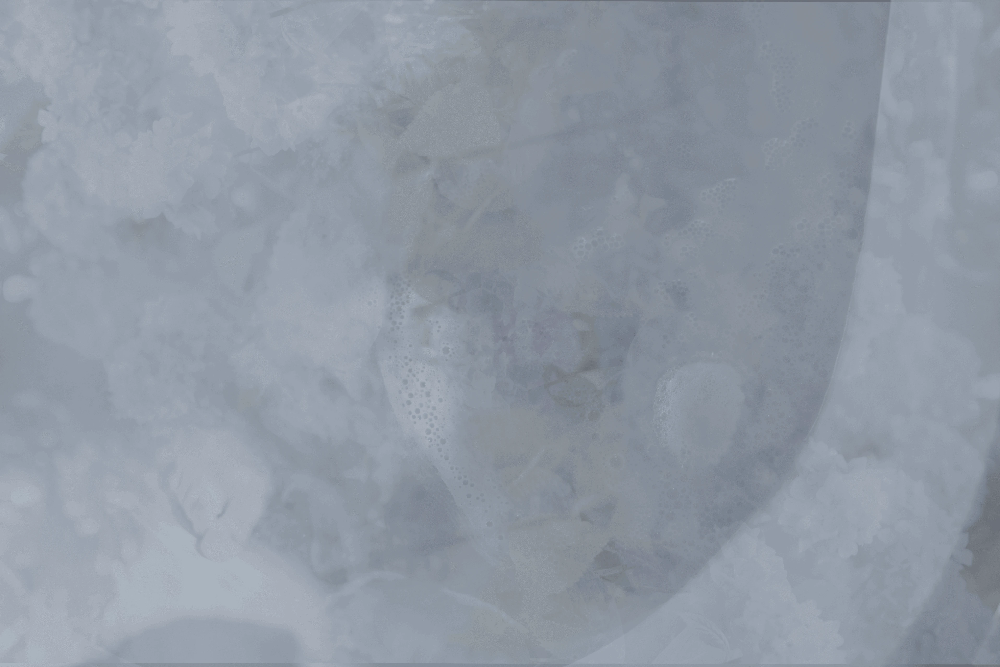
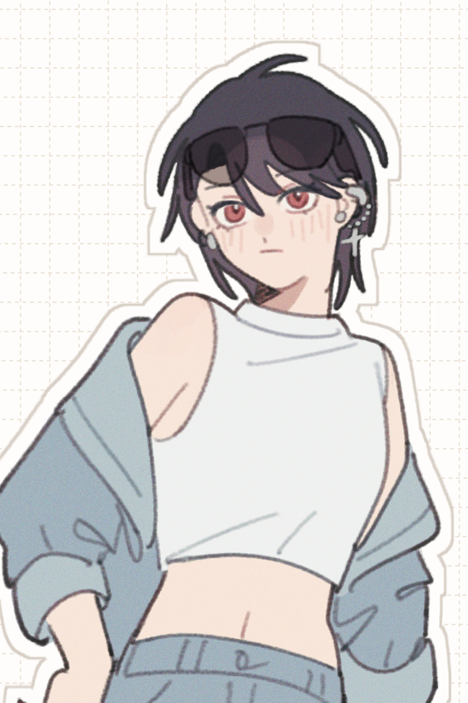
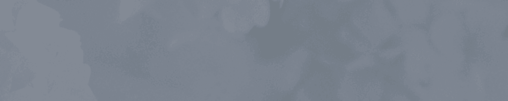
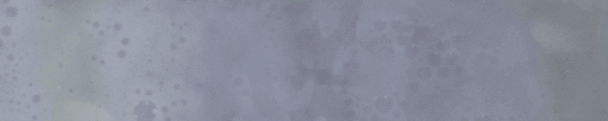
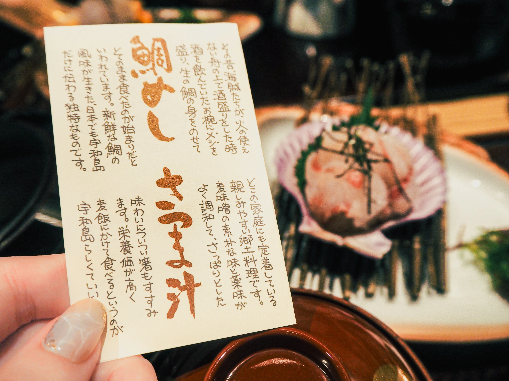

# サイトのソースコード

対象フォルダ: `/Users/rin/Documents/GitHub/calare`

ファイル数: 157

## article.html

```html
<!DOCTYPE HTML>
<html lang="ja" dir="ltr">

<head>
    <!-- 検索避け -->
    <meta NAME="ROBOTS" CONTENT="NOINDEX, NOFOLLOW">
    <meta charset="utf-8">
    <meta http-equiv="X-UA-Compatible" content="IE=edge">
    <!-- responsive -->
    <meta name="viewport" content="width=device-width, initial-scale=1, user-scalable=yes">

    <!-- OGP設定 -->
    <meta name="description" content="忘れてしまいたい。">
    <meta property="og:locale" content="ja_JP">
    <meta property="og:type" content="article">
    <meta property="og:image" content="https://calare.vercel.app/images/OGP.webp">
    <meta property="og:title" content="落日 | Kagami">
    <meta property="og:description" content="忘れてしまいたい。">
    <meta property="og:url" content="https://calare.vercel.app/">
    <meta property="og:site_name" content="落日">
    <meta name="twitter:card" content="summary">
    <meta name="twitter:card" content="summary_large_image">
    <meta name=”twitter:image” content="https://calare.vercel.app/images/OGP.webp">

    <!-- title -->
    <title>Article - 落日 | Kagami</title>
    <!-- stylesheet -->
    <link rel="stylesheet" media="screen" href="https://fontlibrary.org/face/nemoy" type="text/css" />
    <link rel="stylesheet" media="screen" href="https://fontlibrary.org/face/hilo-deco" type="text/css" />
    <!-- head に直接CSSを張り付ける方は以下一行をコメントアウトしてください -->
    <link rel="stylesheet" href="assets/css/style.css">
    <!-- Font Awesome 等 -->
    <link rel="stylesheet" href="https://use.fontawesome.com/releases/v5.7.2/css/all.css">
    <link href="https://cdn.lineicons.com/2.0/LineIcons.css" rel="stylesheet">
</head>

<body id="all">

    <!-- loader -->
    <div class="page-loader">
        <div class="intersecting-circles-spinner">
            <div class="spinnerBlock">
                <span class="circle"></span>
                <span class="circle"></span>
                <span class="circle"></span>
                <span class="circle"></span>
                <span class="circle"></span>
                <span class="circle"></span>
                <span class="circle"></span>
            </div>
        </div>
    </div>

    <!-- header -->
    <header>
        <div>
            
            <aside class="align-center">
                sample text
            </aside>
        </div>
        <h1><span>c</span><span>a</span><span>l</span><span>a</span><span>r</span><span>e</span></h1>
        <div class="m_b_1r align-center"><!--
            <a href="">rank</a> <a href="">rank</a> <a href="">rank</a>--></div>
    </header>

    <!-- nav -->
    <nav>
        <ul>
            <li><a href="index.html#info">information</a></li>
            <li><a href="main.html#main">main contents</a></li>
            <li><a href="note.html#note">notebook</a></li>
        </ul>
    </nav>

    <!-- main -->
    <div class="wrp">
        <main>
            <h2><span>8</span><br>article</h2>
            <h3 class="ja">最近の出来事<span></span></h3>

            <div class="max-780">

                <aside class="qo">
                    <p>何か短い一言など</p>
                </aside>

                  <div class="m_4r">
                      <div class="line"></div>
                      <h3>contents 1<span></span></h3>
                      <p>
                          Lorem ipsum dolor sit accumsan interdum nisi, quis tincidunt felis sagittis eget. tempus euismod. Vestibulum ante ipsum primis in faucibus vestibulum. Blandit adipiscing eu felis iaculis volutpat ac adipiscing accumsan eu faucibus. Integer ac pellentesque praesent tincidunt felis sagittis eget. tempus euismod. Vestibulum ante ipsum primis sagittis eget. tempus euismod. Vestibulum ante ipsum primis in faucibus vestibulum. Blandit adipiscing eu felis iaculis volutpat ac adipiscing accumsan eu faucibus. Integer ac pellentesque praesent tincidunt felis sagittis eget. tempus euismod. Vestibulum ante ipsum primis in faucibus vestibulum. Blandit adipiscing eu felis iaculis volutpat ac adipiscing accumsan eu faucibus. Integer ac pellentesque praesent. Vestibulum ante ipsum primis in faucibus magna blandit adipiscing eu felis iaculis.
                      </p>
                      <a href="#figure-1" class="a-img"></a>
                      <figure id="figure-1">
                          <a id="overlay-1" href="#overlay-1">
                              
                              <div class="align-center">Sample Title</div>
                          </a>
                      </figure>
                      <aside>
                          Lorem ipsum dolor vestibulum ante ipsum primis in faucibus vestibulum. Blandit adipiscing eu felis iaculis volutpat ac adipiscing accumsan eu faucibus. Integer ac pellentesque praesent.
                      </aside>
                      <div class="line"></div>
                      <h3>contents 2<span></span></h3>
                      <p class="clear ja">
                          <a href="#figure-2" class="image img-left"></a>
                          そのころわたくしは、モリーオ市の博物局に勤めて居りました。
                          十八等官でしたから役所のなかでも、ずうっと下の方でしたし俸給もほんのわずかでしたが、受持ちが標本の採集や整理で生れ付き好きなことでしたから、わたくしは毎日ずいぶん愉快にはたらきました。殊にそのころ、モリーオ市では競馬場を植物園に拵え直すというので、その景色のいいまわりにアカシヤを植え込んだ広い地面が、切符売場や信号所の建物のついたまま、わたくしどもの役所の方へまわって来たものですから、わたくしはすぐ宿直という名前で月賦で買った小さな蓄音器と二十枚ばかりのレコードをもって、その番小屋にひとり住むことになりました。わたくしはそこの馬を置く場所に板で小さなしきいをつけて一疋の山羊を飼いました。毎朝その乳をしぼってつめたいパンをひたしてたべ、それから黒い革のかばんへすこしの書類や雑誌を入れ、靴もきれいにみがき、並木のポプラの影法師を大股にわたって市の役所へ出て行くのでした。
                          あのイーハトーヴォのすきとおった風、夏でも底に冷たさをもつ青いそら、うつくしい森で飾られたモリーオ市、郊外のぎらぎらひかる草の波。
                          またそのなかでいっしょになったたくさんのひとたち、ファゼーロとロザーロ、羊飼のミーロや、顔の赤いこどもたち、地主のテーモ、山猫博士のボーガント・デストゥパーゴなど、いまこの暗い巨きな石の建物のなかで考えていると、みんなむかし風のなつかしい青い幻燈のように思われます。では、わたくしはいつかの小さなみだしをつけながら、しずかにあの年のイーハトーヴォの五月から十月までを書きつけましょう。<br>
                          <br>
                          ----日本語の時は外側の＜p＞にclass="ja"を付けます。class="clear"でfloatの解除も忘れないで下さい。
                      </p>
                      <figure id="figure-2">
                          <a id="overlay-2" href="#overlay-2">
                              
                              <div class="align-center">Sample Title</div>
                          </a>
                      </figure>
                  </div>

                <aside class="qo">
                    <p>あとがき</p>
                </aside>

                <!-- pagination -->
                <ul class="pagination">
                    <li><a href=""><i class="lni lni-chevron-left"></i></a></li>
                    <li><a href="note.html"></a></li>
                    <li><a href=""><i class="lni lni-chevron-right"></i></a></li>
                </ul>
            </div>
        </main>
    </div>

    <!-- footer -->
    <footer>
        Template by <a href="https://fantia.jp/ren target="_blank">KERRY</a>
    </footer>

    <!-- pagetop button -->
    <div id="page-top"><a href="#all"></a></div>

    <!--script-->
    <script src="https://ajax.googleapis.com/ajax/libs/jquery/3.5.1/jquery.min.js"></script>
    <script src="./assets/js/main.js"></script>
</body>

</html>

```

## assets/css/password.css

```css
@charset "UTF-8";

/* ==========================================
   password.html 専用スタイル（style.css の後に読み込む）
   色・フォントは style.css の変数と NemoyMedium / HiLoDecoDeco を使用。
   画面を 1 画面に収める：画像が余った高さを埋め、h1 と nav が最下部に並ぶ。
   ========================================== */

html.r18-gate-page,
body.r18-gate-page {
    height: 100%;
    overflow: hidden;
}
body.r18-gate-page {
    display: flex;
    flex-direction: column;
    height: 100vh;
    height: 100dvh;           /* モバイルのアドレスバー対策 */
}

/* header：画像が残りの高さを占める */
.r18-gate-page header {
    flex: 1 1 auto;
    min-height: 0;
    margin: 0;
    display: flex;
    flex-direction: column;
}
.r18-gate-page header > div:first-child {
    flex: 1 1 auto;
    height: auto;
    min-height: 0;
}
.r18-gate-page header h1 {
    flex: none;
    margin: .5rem 0;
}
.r18-gate-page nav {
    flex: none;
}

/* 画像（白い飾り枠）の中央に置くパネル */
.r18-gate-box {
    position: absolute;
    top: 50%;
    left: 50%;
    transform: translate(-50%, -50%);
    z-index: 1;
    width: min(86%, 22rem);
    max-height: calc(100% - 7rem);
    overflow-y: auto;
    padding: 1.5rem 1.5rem 1.2rem;
    text-align: center;
    background: rgba(252, 249, 242, .92);   /* --pure-white */
    border: 1px solid var(--gray);
    color: var(--dark);
}
.r18-gate-label {
    margin: 0 0 .5rem;
    font-family: 'NemoyMedium', 'HiLoDecoDeco', var(--san-serif);
    font-size: 1.4rem;
    line-height: 1.6rem;
    letter-spacing: .2em;
    color: var(--red);
}
.r18-gate-text {
    margin: 0 0 1rem;
    font-size: .8rem;
    line-height: 1.6rem;
    letter-spacing: .08em;
    text-align: center;
}

/* パスワード欄：input[type=text] と同じ見た目 */
.r18-gate-box input[type=password] {
    outline: none;
    display: block;
    width: 100%;
    -webkit-appearance: none;
    border-radius: 0;
    padding: 8px 16px;
    line-height: 22px;
    text-align: center;
    background: var(--pure-gb);
    border: 1px solid var(--pure-gb);
    color: var(--dark);
    font-family: 'Montserrat', var(--san-serif);
    transition: border-color .4s ease-in-out, background-color .4s ease-in-out;
}
.r18-gate-box input[type=password]:focus {
    border-color: var(--gray);
    background: #fff;
}
.r18-gate-box input[type=password][aria-invalid="true"] {
    border-color: var(--red);
}
.r18-gate-box .btn {
    margin: .8rem 0 0;
}

/* エラー表示：空でも高さを確保してレイアウトを揺らさない */
.r18-gate-error {
    min-height: 1.6rem;
    margin: .6rem 0 0;
    font-size: .8rem;
    line-height: 1.6rem;
    text-align: center;
    color: var(--red);
}
```

## assets/css/ss.css

```css
@charset "UTF-8";

/* =====================================================
   ss.html 専用スタイル（style.css の後に読み込む）
   - style.css は変更しません
   - すべて body.page-ss または .ss-* の中に閉じています
   - 色・フォントは style.css の変数と既存フォントを使用

   ■ よく触る切り替え（すべて HTML 側の class で行います）
   1) 1カラム / 2カラム   #ss-list の  ss-cols-2  ⇄  ss-cols-1
   2) 日付 表示 / 非表示   #ss-list に  ss-hide-date  を足す / 外す
   3) 選択タグの見た目     #ss-filter に下記を足す
        （なし）        枠線＋文字が朱ローズ（現在の設定）
        ss-tag-fill    朱ローズで塗りつぶし＋白文字
        ss-tag-marker  枠線なし＋マーカー風の下線
   ===================================================== */

:root {
    --ss-wrap: 1040px;          /* ページ全体の最大幅（既存は800px） */
    --ss-col-gap: 3.5rem;       /* 2カラム時の列の間隔 */
    --ss-body-size: 1rem;     /* 本文サイズ：スマホ（html が12pxのため大きめ） */
}
@media screen and (min-width: 768px) {
    :root { --ss-body-size: 1.05rem; }   /* タブレット */
}
@media screen and (min-width: 1280px) {
    :root { --ss-body-size: 1rem; }      /* PC */
}


/* ---------- ページ幅（このページだけ広げる） ---------- */
body.page-ss .wrp {
    max-width: var(--ss-wrap);
}


/* =====================================================
   ジャンル絞り込み
   ===================================================== */
.ss-filter {
    margin: 0 0 3.5rem;
    text-align: center;
}

.ss-tags {
    display: flex;
    flex-wrap: wrap;
    justify-content: center;
    gap: 0.6rem;
    margin: 0 0 0.8rem;
}

.ss-tag {
    -webkit-appearance: none;
    appearance: none;
    display: inline-flex;
    align-items: center;
    justify-content: center;
    max-width: 100%;
    min-height: 40px;
    margin: 0;
    padding: 0.35rem 1.1rem;
    border: 1px solid var(--gray);
    border-radius: 0;
    background: transparent;
    color: var(--dark-gray);
    font: inherit;
    font-size: 0.95rem;
    line-height: 1.4;
    letter-spacing: 0.12em;
    text-align: center;
    overflow-wrap: anywhere;      /* 長い日本語名でも枠からはみ出さない */
    cursor: pointer;
    transition: color .2s, border-color .2s, background-color .2s, box-shadow .2s;
}
@media screen and (min-width: 768px) {
    .ss-tag { min-height: 36px; }
}
@media (hover: hover) {
    .ss-tag:hover {
        border-color: var(--red);
        color: var(--red);
    }
}
.ss-tag:focus-visible,
.ss-genre:focus-visible,
.ss-clear:focus-visible {
    outline: 2px solid var(--red);
    outline-offset: 2px;
}

/* 選択中：枠線＋文字が朱ローズ（枠を内側に1px足して、未選択との差をはっきりさせる） */
.ss-tag.is-active {
    border-color: var(--red);
    color: var(--red);
    box-shadow: inset 0 0 0 1px var(--red);
}

/* 選択中（別案A）：塗りつぶし */
.ss-tag-fill .ss-tag.is-active {
    background: var(--red);
    border-color: var(--red);
    color: #fff;
    box-shadow: none;
}

/* 選択中（別案B）：マーカー風 */
.ss-tag-marker .ss-tag.is-active {
    border-color: transparent;
    box-shadow: none;
    color: var(--dark);
    background: linear-gradient(transparent 60%, var(--pure-gb) 60%);
}
.ss-tag-marker .ss-tag {
    border-color: transparent;
}

/* 件数・解除 */
.ss-status {
    display: flex;
    align-items: center;
    justify-content: center;
    gap: 1.4rem;
    min-height: 40px;             /* 解除ボタンの出入りで高さが動かないように */
    font-size: 0.85rem;
    letter-spacing: 0.1em;
    color: var(--dark-gray);
}
.ss-clear {
    -webkit-appearance: none;
    appearance: none;
    margin: 0;
    padding: 0.5rem 0.2rem;
    border: 0;
    border-bottom: 1px solid var(--dark-gray);
    border-radius: 0;
    background: none;
    color: var(--dark-gray);
    font: inherit;
    font-size: 0.85rem;
    line-height: 1.2;
    letter-spacing: 0.1em;
    cursor: pointer;
}
.ss-clear[hidden] { display: none; }
@media (hover: hover) {
    .ss-clear:hover { color: var(--red); border-bottom-color: var(--red); }
}


/* =====================================================
   作品一覧
   ===================================================== */
.ss-list {
    display: grid;
    grid-template-columns: minmax(0, 1fr);   /* minmax(0,…) で長い文字列による横はみ出しを防ぐ */
    align-items: stretch;                    /* 行揃え：同じ行の作品は高さが揃う */
    text-align: left;
}

/* 2カラム（900px以上。それ未満は1カラム） */
@media screen and (min-width: 900px) {
    .ss-list.ss-cols-2 {
        grid-template-columns: repeat(2, minmax(0, 1fr));
        column-gap: var(--ss-col-gap);
    }
}

/* 1カラム */
.ss-list.ss-cols-1 {
    max-width: 40rem;
    margin: 0 auto;
}

/* 作品1つ分 */
.ss {
    padding: 1.6rem 0 3.2rem;
    border-top: 1px solid var(--gray);
    animation: ss-fade .2s ease;             /* 絞り込みで再表示された作品だけ、ごく軽くフェード */
}
.ss[hidden] { display: none; }

@keyframes ss-fade {
    from { opacity: 0; }
    to   { opacity: 1; }
}
@media (prefers-reduced-motion: reduce) {
    .ss { animation: none; }
    .ss-tag { transition: none; }
}

/* ジャンル＋日付の行 */
.ss-meta {
    display: flex;
    flex-wrap: wrap;
    align-items: baseline;
    gap: 0.2rem 1rem;
    margin: 0 0 0.7rem;
    font-size: 0.8rem;
    line-height: 1.6;
}
.ss-genres {
    display: flex;
    flex-wrap: wrap;
    gap: 0 1rem;
    margin: 0;
    padding: 0;
    list-style: none;
}
.ss-genre {
    -webkit-appearance: none;
    appearance: none;
    margin: 0;
    padding: 0.3rem 0 0.1rem;
    border: 0;
    border-bottom: 1px dotted var(--dark-gray);   /* 点線＝押せることの手がかり */
    border-radius: 0;
    background: none;
    color: var(--dark-gray);
    font: inherit;
    font-size: 0.8rem;
    line-height: 1.5;
    letter-spacing: 0.12em;
    overflow-wrap: anywhere;
    cursor: pointer;
    transition: color .2s, border-color .2s;
}
@media (hover: hover) {
    .ss-genre:hover { color: var(--red); border-bottom-color: var(--red); }
}
.ss-genre.is-active {
    color: var(--red);
    border-bottom: 1px solid var(--red);
}

.ss-date {
    margin-left: auto;
    color: var(--dark-gray);
    opacity: 0.8;
    letter-spacing: 0.1em;
    white-space: nowrap;
}
.ss-list.ss-hide-date .ss-date { display: none; }

/* タイトル（h3 の既定装飾は style.css のまま：頭文字が朱ローズ） */
.ss-title {
    margin: 0 0 1.1rem;
    font-size: 1.25rem;
    line-height: 1.6;
    letter-spacing: 0.08em;
    text-align: left;
    overflow-wrap: anywhere;
}

/* 本文 */
.ss-body p {
    margin: 0;
    font-size: var(--ss-body-size);
    line-height: 2;
    letter-spacing: 0.06em;
    text-align: left;
    line-break: strict;
    overflow-wrap: anywhere;
}
.ss-body p + p {
    margin-top: 1em;
}

/* 該当なし */
.ss-empty {
    margin: 2rem 0;
    text-align: center;
    font-size: 0.9rem;
    color: var(--dark-gray);
}
.ss-empty[hidden] { display: none; }
```

## assets/css/style.css

```css
@charset "UTF-8";

/* Template & Designed by Orihashi Ren */
/* http://kerry.php.xdomain.jp/ */

/* webフォント */
@import url('https://fonts.googleapis.com/css2?family=Montserrat:ital,wght@0,300;1,300&display=swap');

/* 全体設定 */
* {
    padding: 0;
    margin: 0;
}
*, *::after, *::before {
    -webkit-box-sizing: border-box;
    -moz-box-sizing: border-box;
    box-sizing: border-box;
}
* {
    -ms-overflow-style: none;    /* IE, Edge 対応 */
}
/* *::-webkit-scrollbar{
    display: none;
} */
@-ms-viewport {
    width: device-width;
}

/* 基本設定 */

html, body, div, span, applet, object,
iframe, h1, h2, h3, h4, h5, h6, p, blockquote,
pre, a, abbr, acronym, address, big, cite,
code, del, dfn, em, img, ins, kbd, q, s, samp,
small, strike, strong, sub, sup, tt, var, b,
u, i, center, dl, dt, dd, ol, ul, li, fieldset,
form, label, legend, table, caption, tbody,
tfoot, thead, tr, th, td, article, aside,
canvas, details, embed, figure, figcaption,
footer, header, hgroup, menu, nav, output, ruby,
section, summary, time, mark, audio, video {
    margin: 0;
    padding: 0;
    border: 0;
    font: inherit;
    vertical-align: baseline;}
article, aside, details, figcaption, figure,
footer, header, hgroup, menu, nav, section {
    display: block;}
html,body {
    padding:0;
    margin:0;
    height: 100%;
}
html {
    font-size: 12px; /* スマホ表示時の基本サイズ */
}


@media screen and (min-width: 768px) {
    html {
        font-size: 15px; /* タブレット表示時 */
    }
}
@media screen and (min-width: 1280px) {
    html {
        font-size: 16px; /* パソコン表示時 */
    }
}

body {
    width: 100%;
    text-align: justify;
    word-wrap: break-word; /* 禁則処理 */
    overflow-wrap: break-word;
    -webkit-text-size-adjust: 100%; /* Safari横向き対策 */
    background-color: #fff;
    color: var(--dark-gray);
    font-family: 'Montserrat',"Hiragino Sans W3", "Hiragino Kaku Gothic ProN", "ヒラギノ角ゴ ProN W3", "メイリオ", Meiryo, "ＭＳ Ｐゴシック", "MS PGothic", sans-serif;
}
@media screen and (max-width: 480px) {
    html, body {
        min-width: 320px;
    }
}
body, input, select, textarea, p {
    font-weight: 300;
    font-size: 1rem;
    line-height: 2rem;
    letter-spacing: 0.075em;
}
@media screen and (min-width: 768px) {
    body, input, select, textarea, p {
        font-size: 1rem
    }
}

/* リンク */
a {
    -moz-transition: color .8s ease-in-out, background-color .8s ease-in-out, border-bottom-color .8s ease-in-out;
    -webkit-transition: color .8s ease-in-out, background-color .8s ease-in-out, border-bottom-color .8s ease-in-out;
    -ms-transition: color .8s ease-in-out, background-color .8s ease-in-out, border-bottom-color .8s ease-in-out;
    transition: color .8s ease-in-out, background-color .8s ease-in-out, border-bottom-color .8s ease-in-out;
    border-bottom: none;
    text-decoration: none;
    outline: none;
    color: var(--red);
}
a:hover {
    border-bottom-color: transparent;
    color: var(--pink);
}

/* 文字装飾 */
strong, b, .b {
    font-weight: 700; /*太字*/
}
strong {
    color: #E20613;
}
em, i {
    font-style: italic; /*斜体*/
}
em {
    border-bottom: 1px dashed #E20613;
}

/* text */
p {
    text-align: justify;
    margin: 0 0;
    padding: 0rem 0;
}
h1, h2, h3, h4, h5, h6 {
    text-align: center;
    font-weight: 300;
    line-height: 1.7rem;
    letter-spacing: 0.075em; /*文字間隔*/
    font-family: 'HiLoDecoDeco',"Hiragino Sans W3", "Hiragino Kaku Gothic ProN", "ヒラギノ角ゴ ProN W3", "メイリオ", Meiryo, "ＭＳ Ｐゴシック", "MS PGothic", sans-serif;
    margin: 1.5rem 0;
}
h1 a, h2 a, h3 a, h4 a, h5 a, h6 a {
    border-bottom: 0;
    color: inherit;
    text-decoration: none;
}
h1 {
    font-size: 2.5rem;
}
h2 {
    font-size: 1.5rem;
}
h3 {
    font-size: 1.3rem;
}
h4 {
    font-size: 1.2rem;
}
h5 {
    font-size: 1.1rem;
}
h6 {
    font-size: 1.05rem;
}

/* 上付き */
sub {
    font-size: 0.6rem;
    position: relative;
    top: 0.5rem;
}
/* 下付き */
sup {
    font-size: 0.6rem;
    position: relative;
    top: -0.5rem;
}

/* マーカー */
mark {
    display: inline-block;
    padding: 0rem .5rem;
    margin: 0rem 0;
    background: linear-gradient(transparent 10%, var(--pure-gray) 10%);
    color: var(--dark-gray);
    text-shadow: none;
}

/* 引用 */
blockquote {
    position: relative;
    padding: 5px 15px 5px 55px;
    box-sizing: border-box;
    font-style: italic;
    border-radius: 0px;
    color: #fff;
    background: var(--red);
}
blockquote:before{
    display: inline-block;
    position: absolute;
    top: 0;
    left: 8px;
    width: 38px;
    height: 30px;
    text-align: center;
    content: "\f10d";
    font-family: "Font Awesome 5 Free";
    color: var(--dark-gray);
    font-size: 18px;
    line-height: 30px;
    background: var(--pure-gb);
    font-weight: 900;
}
blockquote:after{
    content: '';
    position: absolute;
    left: 8px;
    top: 30px;
    height: 0;
    width: 0;
    border-left: 19px solid var(--pure-gb);
    border-right: 19px solid var(--pure-gb);
    border-bottom: 10px solid transparent;
}
blockquote p {
    position: relative;
    padding: 0;
    margin: 10px 0;
    z-index: 3;
    line-height: 1.7;
}
blockquote cite {
    display: block;
    text-align: right;
    font-size: 0.9em;
    color: #888888;
    opacity: .8;
}

/* コード */
code {
    border: none;
    font-family: "Courier New", monospace !important;
    margin: 0 .25rem;
    padding: .25rem .65rem;
    background: rgba(238, 238, 238, .7);
    border: solid 1px #eeeeee;
    color: var(--dark);
}
pre {
    width :100% !important;
    -webkit-overflow-scrolling: touch;
    overflow-x: auto;
    text-align: left;
    font-family: "Courier New", monospace !important;
    margin: .5rem 0;
}
pre code {
    width: 100% !important;
    overflow-x: auto;
    display: block;
    padding: .25rem 1.5rem;
    box-sizing: border-box !important;
}

/* 区分線 */
hr {
    border: 0;
    border-bottom: solid 2px;
    margin: 3rem 0rem;
    border-bottom-color: var(--pure-red);
}

/* 文字揃え */
/*  <span class="align-center">例</span> 等と使用してください  */
.align-left {
    text-align: left;
}
.align-center,
.align-center p {
    text-align: center;
}
.align-right {
    text-align: right;
}

/* Box */
.box {
    text-align: left;
    width: 100%;
    height: auto;
    margin: 3rem 0rem;
    padding: 1.5rem;
    border-radius: 0px;
}
.box-1 {
    border: 1px solid var(--pure-gb);
    background: var(--pure-gb);
    color: #888;
}
.box-2 {
    border: 1px solid var(--pure-gray);
    background: var(--pure-gray);
}
.box > p {
    padding: 0 0;
    text-shadow: none;
}
.box a {
    color: #fff;
}

/* lists */
ol, ul {
    text-align: left;
    margin: .5rem 0;
    list-style: none;
}
.list_no {
    list-style: none;
}
.list_un {
    list-style: disc;
}
.list_or {
    list-style: decimal;
}
.list_no > li,
.list_un > li,
.list_or > li {
    margin-left: .5rem;
    padding-left: .5rem;
    text-align: left;
}
.list_or > li,
.list_un > li {
    margin-left: 2rem;
}
.float li {
    float: left;
    padding-left: .5rem;
}
.float:after {
    display: block;
    content: '';
    clear: both
}
.list_no.float li {
    margin-left: .5rem;
}
.list_or.float li {
    margin-left: 2rem;
}
.list_border li:not(:first-of-type) {
    border-left: 1px solid var(--dark-gray);
}

/* dl */
dl {
    text-align: left;
}
.dltype1 {
    text-align: left;
    margin: 0 1rem;
}
.dltype1 > dt a,
.dltype1 > dt {
    color: var(--dark);
    border-bottom: none;
    margin-bottom: .5rem;
}
.dltype1 > dd {
    margin-left: 1.3rem;
    font-size: .97rem;
    line-height: 2rem;
}

/* table */
.table_div {
    -webkit-overflow-scrolling: touch;
    overflow-x: auto;
    margin: 0 0rem;
}
table {
    margin: 0rem 0rem;
    width: 100%;
}
table thead {
    border-bottom: solid 2px #231d25;
}
table tbody tr {
    border: solid 1px;
    border-left: 0;
    border-right: 0;
    border-color: #231d25;
}
table tbody tr:nth-child(odd) {
    background-color: rgba(238, 238, 238, .7);
}
table td {
    padding: 0.75rem 0.75rem;
}
table th {
    font-family: 'Montserrat',"Hiragino Sans W3", "Hiragino Kaku Gothic ProN", "ヒラギノ角ゴ ProN W3", "メイリオ", Meiryo, "ＭＳ Ｐゴシック", "MS PGothic", sans-serif;
    font-size: 0.8rem;
    font-weight: 700;
    letter-spacing: 0.075em;
    line-height: 1.5;
    padding: 0 0.75rem 0.75rem 0.75rem;
    text-align: left;
}
table tfoot {
    border-top: solid 2px;
    border-top-color: #eeeeee;
}
@media screen and (max-width: 980px) {
    table th {
        font-size: 0.9rem;
    }
}

/* link button */
.link {
    display: inline-block;
    height: 25px;
    line-height: 22px;
    margin: .5rem auto;
    padding: 0 .3rem;
    font-size: 1rem;
    border-radius: 0px;
    background: var(--pure-red) !important;
    border: 1px solid var(--pure-red) !important;
    color: #fff !important;
    transition: all .5s;
}
.link:hover {
    background: var(--red) !important;
    color: #fff !important;
}
.btn {
    display: inline-block;
    text-align: center;
    vertical-align: middle;
    touch-action: manipulation;
    position: relative;
    white-space: nowrap;
    border: none;
    margin: 1rem;
    padding: 9px 24px;
    font-size: 14px;
    line-height: 22px;
    letter-spacing: 0.1rem;
    font-weight: 300;
    border-radius: 0 0 0 0;
    text-decoration: none;
    -webkit-transition: all .5s  !important;
    transition: all .5s !important;
    -moz-transition: all .5s !important;
    font-family: 'NemoyMedium',"Hiragino Sans W3", "Hiragino Kaku Gothic ProN", "ヒラギノ角ゴ ProN W3", "メイリオ", Meiryo, "ＭＳ Ｐゴシック", "MS PGothic", sans-serif　!important;
}
.btn-1 {
    background: var(--pure-red);
    border: 1px solid var(--pure-red);
    color: #fff !important;
}
.btn-1:hover {
    background: var(--red);
    border: 1px solid var(--red);
    color: #fff !important;
}
.btn-2 {
    background: var(--pure-gb);
    border: 1px solid var(--red);
    color: var(--red) !important;
}
.btn-2:hover {
    background: var(--pure-red);
    border: 1px solid var(--red);
    color: #fff !important;
}
.btn-3 {
    background: var(--gray);
    border: 1px solid var(--gray);
    color: #fff !important;
}
.btn-3:hover {
    background: #fff;
    border: 1px solid var(--gray);
    color: var(--gray) !important;
}
.btn-1:hover svg {
    fill: #fff;
}
.btn svg {
    position: relative;
    left: -4px;
    width: 18px;
    height: 18px;
    display: inline-block;
    vertical-align: top;
    font-weight: normal;
    margin: 2px 0;
    fill: #fff;
    transition: all .5s;
}

/* form */
form {
    text-align: center;
}
.box-a {
    max-width: 340px;
    margin: 1rem auto;
    padding: 0rem;
    border: 1px solid transparent;
    background: transparent;
}
input[type=text],
input[type=search],
textarea {
    outline: none;
    display: block;
    width: 100%;
    -webkit-appearance: none;
    background: var(--pure-gb);
    border: 1px solid var(--pure-gb);
    border-radius: 0 0 0 0;
    padding: 8px 16px;
    line-height: 22px;
    color: #888;
}
input[type=text]::-webkit-input-placeholder,
textarea::-webkit-input-placeholder {
    color: #888;
}
input[type=text]::-moz-placeholder,
textarea::-moz-placeholder {
    color: #888;
}
input[type=text]:-ms-input-placeholder,
textarea:-ms-input-placeholder {
    color: #888;
}
input[type=text]::placeholder,
textarea::placeholder,
.cp_ipselect select::placeholder {
    color: #888;
}
input[type],
textarea,
.cp_ipselect select {
    -moz-transition: border-color .4s ease-in-out, box-shadow .4s ease-in-out, background-color .4s ease-in-out;
    -webkit-transition: border-color .4s ease-in-out, box-shadow .4s ease-in-out, background-color .4s ease-in-out;
    -ms-transition: border-color .4s ease-in-out, box-shadow .4s ease-in-out, background-color .4s ease-in-out;
    transition: border-color .4s ease-in-out, box-shadow .4s ease-in-out, background-color .4s ease-in-out;
    font-family: 'Montserrat',"Hiragino Sans W3", "Hiragino Kaku Gothic ProN", "ヒラギノ角ゴ ProN W3", "メイリオ", Meiryo, "ＭＳ Ｐゴシック", "MS PGothic", sans-serif !important;
}
input[type=text]:focus,
textarea:focus,
.cp_ipselect select:focus {
    outline: none;
    border-color: var(--gray);
    background: var(--gray);
    color: #fff;
}
input[type=text]:focus::-webkit-input-placeholder,
textarea:focus::-webkit-input-placeholder,
.cp_ipselect select:focus::-webkit-input-placeholder {
    color: #888;
}
input[type=text]:focus::-moz-placeholder,
textarea:focus::-moz-placeholder,
.cp_ipselect select:focus::-moz-placeholder {
    color: #888;
}
input[type=text]:focus:-ms-input-placeholder,
textarea:focus::-ms-input-placeholder,
.cp_ipselect select:focus::-ms-input-placeholder {
    color: #888;
}
input[type=text]:focus::placeholder,
textarea:focus::placeholder,
.cp_ipselect select:focus::placeholder {
    color: #888;
}
.form-element {
    margin-bottom: 20px;
}
form label {
    display: block;
    margin-bottom: 4px;
    font-size: 1rem;
    color: var(--dark-blown);
    font-weight: 500;
}
.cp_ipselect {
    overflow: hidden;
    width: 100%;
    margin: 0 auto;
    text-align: center;
}
.cp_ipselect select {
    width: 100%;
    padding-right: 1em;
    cursor: pointer;
    text-indent: 0.01px;
    text-overflow: ellipsis;
    border: none;
    outline: none;
    background: transparent;
    background-image: none;
    box-shadow: none;
    -webkit-appearance: none;
    appearance: none;
}
.cp_ipselect select::-ms-expand {
    display: none;
}
.cp_ipselect.cp_sl01 {
    position: relative;
    border: 1px solid var(--pure-gb);
    border-radius: 0 0 0 0;
    background: var(--pure-gb);
}
.cp_ipselect.cp_sl01::before {
    position: absolute;
    top: 0.8em;
    right: 0.9em;
    width: 0;
    height: 0;
    padding: 0;
    content: '';
    border-left: 6px solid transparent;
    border-right: 6px solid transparent;
    border-top: 6px solid #999;
    pointer-events: none;
}
.cp_ipselect.cp_sl01 select {
    padding: 8px 38px 8px 8px;
    color: #999
}
.cp_ipselect select option{
    background-color: #fff;
    color: #888;
}

/*-------------------- index --------------------*/

/* color */
:root {
    --dark: #2d272f;        /* ダークチャコール */
    --dark-gray: #5c5046;   /* モカブラウン */
    --gray: #d5cebc;        /* サンドベージュ（境界線） */
    --pure-gray: #f5f1e8;   /* エクリュ・生成り（ボックス背景） */
    --pure-gb: #e8d9cf;     /* ソフトピンクベージュ（引用枠背景） */
    --pure-white: #fcf9f2;  /* サンドホワイト（サイト全体背景） */
    --red: #c4696a;         /* 朱ローズ・赤（メイン差し色） */
    --pure-red: #d96a58;    /* テラコッタ・朱赤（ホバー時強調） */

    --s_s: .9rem;
    --s_m: .97rem;
    --s_n: 1rem;
    --s_b: 1.1rem;
    --s_bb: 1.2rem;

    --serif: "游明朝", YuMincho, "Hiragino Mincho ProN W3", "ヒラギノ明朝 ProN W3", "Hiragino Mincho ProN", "HG明朝E", "ＭＳ Ｐ明朝", "ＭＳ 明朝", serif;
    --san-serif: "Hiragino Sans W3", "Hiragino Kaku Gothic ProN", "ヒラギノ角ゴ ProN W3", "メイリオ", Meiryo, "ＭＳ Ｐゴシック", "MS PGothic", sans-serif;
}

/* header */
header {
    position: relative;
    display: block;
    width: 100%;
    min-height: auto;  /* 100vh から auto に変更（必要な分だけ広がるようにする） */
    margin: 0 0 2rem;
}

/* メイン写真エリアの設定 */
header > div:first-child {
    position: relative;
    overflow: hidden;
    width: 100%;
    height: 83vh; /* 写真の高さの変更 */
}

/* 画面幅が768px以下の場合の高さを調整 */
@media screen and (max-width: 768px) {
    header > div:first-child {
        height: 90vh;
    }
}

header > div:first-child img {
    position: absolute;
    height: 100%;
    width: 100%;
    object-fit: cover;
    top: 50%;
    left: 50%;
    transform: translate(-50%,-50%);
    -mz-transform: translate(-50%,-50%);
    -webkit-transform: translate(-50%,-50%);
    padding: 1.5rem;
    z-index: -2;
}

/* 写真枠の中の白い飾り線（写真の内側に配置） */
header > div:first-child::before {
    display: block;
    content: '';
    position: absolute;
    width: calc(100% - 6rem);  /* 写真の内側に収めるため 6rem 引く */
    height: calc(100% - 6rem); /* 写真の高さに合わせて自動調整 */
    top: 3rem;                  /* 上から3rem（写真の端からさらに1.5rem内側） */
    left: 3rem;                 /* 左から3rem */
    border: 1px solid #fff;
    z-index: 0;
}
header h1 {
    margin: 0 0 .5rem;
    font-size: 1.3rem;
    font-family: 'NemoyMedium';
    color: var(--dark);
}
header h1 span:nth-of-type(1) {
    animation: FadeIn 2s;
}
header h1 span:nth-of-type(2) {
    animation: FadeIn 3s;
}
header h1 span:nth-of-type(3) {
    animation: FadeIn 4s;
}
header h1 span:nth-of-type(4) {
    animation: FadeIn 5s;
}
header h1 span:nth-of-type(5) {
    animation: FadeIn 6s;
}
header h1 span:nth-of-type(6) {
    animation: FadeIn 7s;
}
header h1 span:nth-of-type(7) {
    animation: FadeIn 8s;
}
header aside {
    position: absolute;
    margin: 0;
    padding: 0;
    right: 5rem;
    bottom: calc(5rem);
    border: none;
    color: #fff;
}

/* nav */
nav {
    position: relative;
    text-align: center;
    background: #fff;
    width: 100%;
    font-family: 'HiLoDecoDeco', sans-serif;
    z-index: 100;
}
nav.m_fixed {
    text-align: center;
    position: fixed;
    top: 0;
    -webkit-box-shadow: 0 0 10px 0 rgba(0,0,0,.1);
    box-shadow: 0 0 10px 0 rgba(0,0,0,.1);
}
nav ul {
    display: inline-block;
    margin: .5rem auto;
}
nav ul li {
    display: inline-block;
    margin: 0 1rem;
}
nav a {
    border-bottom: none;
    color: var(--dark);
    font-size: 1.4rem;
}

/* main */
.wrp {
    text-align: center;
    margin: 5rem auto;
    max-width: 800px; /* パソコン表示時の最大幅（左右に広い余白ができます） */
    width: 90%;       /* スマホ・タブレット時も左右に10%（左右各5%）の余白を確保 */
}
main {
    margin: 0 auto;
    padding: 0 1rem;  /* 小さい画面での端づまり防止 */
}
section {
    position: relative;
    text-align: center;
    margin: 0 0 5rem;
}

/* footer */
footer {
    margin: 1rem auto;
    text-align: center;
    font-size: .95rem;
}

/* text */
h1,h2,h3,h4,h5 {
    font-family: 'HiLoDecoDeco', sans-serif;
    color: var(--dark);
}
h3,h4,h5,h6 {
    position: relative;
    font-size: 1.3rem;
    letter-spacing: .2rem;
}
h4.ja, h5.ja, h6.ja, .ja {
    font-size: .9rem;
}
h3.ja {
    font-size: 1rem;
}
h3.ja::first-letter {
    font-size: 1.2rem;
}
h2 {
    position: relative;
    font-size: 1.4rem;
    letter-spacing: .2rem;
}
h2 span {
    position: absolute;
    left: 50%;
    top: 5%;
    transform: translateX(-50%);
    -ms-transform: translateX(-50%);
    -webkit-transform: translateX(-50%);
    font-size: 8rem;
    line-height: 1.2rem;
    font-family: 'NemoyMedium';
    opacity: .3;
    color: var(--pure-red);
}
h3 {
    margin: .5rem auto 2rem;
    font-size: 1.2rem;
}
h3::first-letter {
    font-family: 'NemoyMedium';
    color: var(--red);
}
h4 {
    text-align: left;
    font-size: 1.4rem;
    margin-bottom: 2rem;
}
h4 span:last-child {
    position: relative;
    display: block;
    line-height: 1rem;
    font-size: .97rem;
    color: var(--dark-gray);
}
h4 span:last-child.ja {
    font-size: .87rem;
}
h4 span:last-child::before {
    display: block;
    content: '';
    position: relative;
    left: 0;
    top: 1.5rem;
    width: 3.5rem;
    border-bottom: .9px solid #888;
}
h4::first-letter {
    color: var(--red);
}
h5 {
    text-align: left;
    padding: 0 1rem;
    border: 1px solid var(--dark);
    background: var(--dark);
    color: #fff;
}
h6 {
    display: flex;
    justify-items: center;
    text-align: left;
    padding-left: .7rem;
    border-left: 5px solid var(--red);
}

/* line */
.line {
    display: inline-block;
    margin: 2rem auto .5rem;
    width: 1px;
    height: 3.3rem;
    background-color: var(--dark);
}

/* aside */
aside {
    text-align: left;
    margin: .5rem 0;
    padding: .5rem 1rem;
    border: 1px solid var(--dark-gray);
}

/* scroll box */
.scroll {
    position: relative;
    overflow-y: scroll;
    height: 8rem;
    width: 100%;
    margin: 0 auto 0rem;
    padding: 0;
    font-size: var(--s_s);
    border-radius: 0px;
    border: 1px solid transparent;
    background: transparent;
}
.scroll .list_no {
    margin: 0;
}
.scroll .list_no li {
    margin: 0 0;
    padding-left: 0rem;
}

/* new */
.new::after {
    content: "new";
    color: #888;
    margin-left: 0.5rem;
    opacity: .8;
    font-size: var(--s_s);
    font-family: 'Montserrat',"Hiragino Sans W3", "Hiragino Kaku Gothic ProN", "ヒラギノ角ゴ ProN W3", "メイリオ", Meiryo, "ＭＳ Ｐゴシック", "MS PGothic", sans-serif;
}

/* profile */
.image.img-left {
    float: left;
    margin: 0 1rem 1rem 0;
    top: 0.75rem;
}
.ja .image.img-left {
    top: .3rem;
}
.image.img-left, .image.right {
    max-width: 40%;
    max-height: 40%;
}
.image {
    border: 0;
    display: inline-block;
    position: relative;
}
.image.img-left img, .image.right img {
    width: 100%;
    height: 12rem;
    object-fit: cover;
    vertical-align: middle;
    padding: 5px;
    border: 1px solid var(--pure-red);
}
.image img {
    display: block;
}
.clear::after {
    display: block;
    content: '';
    clear: both;
}

/* margin */
.m_4r {
    margin-top: 4rem !important;
    margin-bottom: 4rem !important;
}
.m_b_1r {
    margin-bottom: 1rem !important;
}
.m_b_5r {
    margin-bottom: 5rem !important;
}
.m_b_9r {
    margin-bottom: 9rem !important;
}
.m_lr_0 {
    margin-left: 0 !important;
    margin-right: 0 !important;
}
.m_lr_1r {
    margin-left: 1rem !important;
    margin-right: 1rem !important;
}
.m_lr_2r {
    margin-left: 2rem !important;
    margin-right: 2rem !important;
}

/* padding */
.pd_l_0 {
    padding-left: 0 !important;
}

/* letter spacing */
.l_2 {
    letter-spacing: .2rem;
}

/* max-width */
.max-780 {
    display: block;
    max-width: 780px;
    margin: 0 auto;
}

/* animation */
@keyframes FadeIn {
    0% {
        opacity: 0
    }
    100% {
        opacity: 1
    }
}

@media screen and (min-width: 768px) {
    main {
        padding: 0 1.5rem;
    }
    .flex {
        display: flex;
        flex-wrap: wrap;
        justify-content: space-around;
    }
    .wrp {
        margin: 7rem auto;
    }
    /* 全てのコンテンツ・カードを基本1カラム（100%幅）に統一 */
    .flex section,
    .flex .flex_m_b50,
    .flex .flex_b_b50,
    .flex .flex_b_b33,
    .flex .flex_b_b25 {
        flex-basis: 100%;
        padding: 0 1.5rem;
    }
    /* 画像バナー（card-1）だけはタブレットで2列（50%幅）に並べる */
    .flex .card-1 {
        flex-basis: 50%;
    }
    .col-1 {
        flex-basis: 100%;
        column-span: all;
    }
    .columns {
        columns: auto;
    }
    .pd_m_lr_1-5r {
      padding-left: 1.5rem !important;
      padding-right: 1.5rem !important;
    }
}
@media screen and (min-width: 1280px) {
    .wrp {
        margin: 7rem auto;
    }
    /* 画像バナー（card-1）だけをPC表示で3列（約33%幅）にする */
    .flex .card-1 {
        flex-basis: calc(100% / 3);
    }
    .flex section,
    .flex .flex_b_b50,
    .flex .flex_b_b33,
    .flex .flex_b_b25 {
        padding: 0 2rem;
    }

}


/*-------------------- main --------------------*/

 /* card 1 */
.card-1 {
    margin: 1rem auto;
}
.card-1 > div {
    position: relative;
    height: 130px;
    width: 250px;
    margin: 0 auto;
}
.card-1 > div img,
.long-img img {
    position: relative;
    width: 100%;
    height: 100%;
    object-fit: cover;
    z-index: -100;
}
.card-1 > div::before,
.long-img::before {
    position: absolute;
    display: block;
    content: '';
    top: 1rem;
    left: 1rem;
    width: calc(100% - 2rem);
    height: calc(100% - 2rem);
    border: 1px solid #fff;
    z-index: -1;
}
.card-1 > div div {
    position: absolute;
    width: 100%;
    height: auto;
    top: 50%;
    left: 50%;
    -ms-transform: translate(-50%,-50%);
    -webkit-transform: translate(-50%,-50%);
    transform: translate(-50%,-50%);
}
.card-1 a {
    position: relative;
    z-index: 3;
}
.card-1 h5 {
    text-align: center;
    display: -webkit-box;
    -webkit-box-orient: vertical;
    -webkit-line-clamp: 3;
    overflow: hidden;
    font-size: 1.2rem;
    line-height: 1.2rem;
    margin: 0;
    border: none;
    background: transparent;
    color: #fff;
}
.card-1 h5 span:first-of-type {
    font-size: .9rem;
}
.card-1 h5.ja span:first-of-type {
    font-size: .85rem;
}

/* card-2 */
.card-2 {
    position: relative;
    width: 100%;
}
.card-2 h5 {
    position: relative;
    overflow: hidden;
    text-overflow: ellipsis;
    background: transparent;
    padding-right: 6.5rem;
    color: var(--dark);
}
.card-2 h5 span {
    position: absolute;
    height: 100%;
    right: 1rem;
    top: 0;
    font-size: .75rem;
    letter-spacing: .08rem;
    color: var(--red);
}
.card-2 p {
    display: -webkit-box;
    -webkit-box-orient: vertical;
    -webkit-line-clamp: 3;
    overflow: hidden;
}

/* all */
.card a {
    border-bottom: none;
}

/* card 3 */
.card-3 {
    margin-bottom: 1rem;
}

/* card 4 */
.card-4 img,
.card-5 img {
    display: flex;
    width: 200px;
    height: 40px;
}
.card-4 aside,
.card-5 aside {
    margin: 0;
    padding: .5rem;
    text-align: left;
    border: none;
}

/* form */
.main form {
    display: inline-block;
    margin: 1rem -1rem;
    max-width: 370px;
}
.main input[type] {
    display: inline-block;
}
.main input[type=text] {
    width: 40%;
    padding: .2rem .3rem;
}
.main input[type=submit] {
    -webkit-appearance: none;
    transition: all .5s;
    padding: .1rem .3rem;
    border-radius: 0 0 0 0;
    background: var(--pure-red);
    border: 1px solid var(--pure-red);
    color: #fff !important;
}
.main input[type=submit]:hover {
    background: var(--red);
    border: 1px solid var(--red);
    color: #fff !important;
}

/*-------------------- long --------------------*/

/* aside */
.qo {
    position: relative;
    padding-left: 1.9rem;
    font-style: italic;
    border: none;
}
.qo::before {
    display: inline-block;
    position: absolute;
    top: .1rem;
    left: -1rem;
    width: 38px;
    height: 30px;
    text-align: center;
    content: "\f10d";
    font-family: "Font Awesome 5 Free";
    color: var(--pure-red);
    font-size: 2rem;
    font-style: italic;
    line-height: 30px;
    font-weight: 900;
}

/* main image */
.long-img {
    position: relative;
    height: 150px;
    width: 150px;
    margin: 0 auto;
}
.long-img img {
    box-shadow: 1px 1px 10px silver;
}

/* card-5 */
.card-5 > div {
    margin: 1.5rem 0;
}
.card-5 > div span {
    display: block;
    margin: .5rem 0;
    color: var(--red);
    font-family: 'NemoyMedium', sans-serif;
    font-size: .9rem;
}
.card-5 > div p {
    font-size: .75rem;
}
.card-5 aside {
    padding: .5rem 1rem 0;
}

/* right */
.right,
.right ul,
.right ul li,
.right p,
.right aside {
    text-align: right;
}
.right {
    padding-right: .7rem;
    border-right: 10px solid var(--pure-red);
}
.right-img {
    display: flex;
    flex-direction: row-reverse;
}
.right-img img {
    display: block;
    margin: .5rem 0 0;
}

/* left */
.left img {
    margin: .5rem 0 0;
}
.left {
    text-align: left;
    padding-left: .7rem;
    border-left: 10px solid var(--pure-red);
}
.left li {
    padding-left: 0;
    margin-left: 0;
}

@media screen and (min-width:1280px) {
    .long-img {
        width: 200px;
        height: 200px;
    }
}

/*-------------------- novel --------------------*/

/* story */
.novel {
    text-align: center !important;
    padding: 1rem;
    margin: 2rem 0;
    background: #fff
}
.novel > p {
    /*小説部分の段落に間隔を作りたくない場合はmargin-topに0を指定してください*/
    margin-top: 2rem;
    font-size: 1rem;
    line-height: 2.5rem; /*小説部分の行間*/
    letter-spacing: 0.025rem; /*小説部分の文字間隔*/
}
.novel > p:first-of-type {
    margin-top: 0;
}

/* ruby */
[data-ruby] {
    display: inline-block;
    position: relative;
}
[data-ruby]::before {
    content: attr(data-ruby);
    display: inline-block;
    position: absolute;
    transform: translateX(-50%) scale(.5);
    white-space: nowrap;
    top: -1.2rem;
    left: calc(50%);
    text-align: center;
    letter-spacing: 0.25em;
    font-size: 1em;
    font-family: var(--san-serif) !important;
}
[data-ruby] rt {
    display: none;
}

/* pagination */
ul.pagination {
    display: inline-block;
    position: relative;
    text-align: center !important;
    margin: 1.5rem auto;
    padding: .3rem 1rem;
    line-height: 1.9rem;
    transition: all .5s;
    background: transparent;
}
ul.pagination > li {
    display: inline-block;
    margin: 0 5px 0 0;
}
ul.pagination > li a {
    border: none;
}
ul.pagination > li:last-child {
    margin: 0 0;
}
ul.pagination > li img  {
    display: inline-block;
    margin: 0 1rem -.3rem;
}

/*-------------------- note --------------------*/

/* card-2 */
.card-a .card-2 {
    position: relative;
    overflow: hidden;
    max-height: 12rem;
}
.card-a .card-2::before {
    display: block;
    position: absolute;
    content: '';
    left: 0;
    bottom: 0;
    height: 60px;
    width: 100%;
    background: -webkit-linear-gradient(top, rgba(255,255,255,0) 0%, rgba(255,255,255,0.7) 50%, rgba(255,255,255,0.7) 50%, rgba(255,255,255,1) 100%);
    background: linear-gradient(top, rgba(255,255,255,0) 0%, rgba(255,255,255,0.7) 50%, rgba(255,255,255,0.7) 50%, rgba(255,255,255,1) 100%);
    z-index: 1;
}
.card-a .card-2 p,
.card-b .card-2 p {
    display: block;
    position: relative;
}
.card-b .card-2 {
    position: relative;
    padding-bottom: 2.5rem;
}

/* read more */
.more {
    position: absolute;
    right: 9%;
    bottom: 0;
    z-index: 2;
}
.card-b .more {
    margin-bottom: 0rem;
}

/*-------------------- article --------------------*/

/* image */
.a-img img {
    display: inline-block;
    height: 15rem;
    width: auto;
    max-width: 90%;
    object-fit: cover;
    margin: .5rem auto;
    padding: 5px;
    border: 1px solid var(--pure-red);
}

.a-img img {
    max-width: 100% !important;   /* 横幅は枠からはみ出さない */
    max-height: 25rem !important; /* ★縦の長さの上限（お好みで 400px や 70vh に変更可能） */
    width: auto !important;       /* アスペクト比を崩さない */
    height: auto !important;      /* アスペクト比を崩さない */
    display: block;
    margin: 1.5rem auto;          /* 中央寄せと上下余白 */
}


.a-img,
[id^="figure-"] a {
    border-bottom: none;
}
figure{
    margin: 0;
    display: none;
}
figure:target{
    display: block;
    position: fixed;
    top: 0;
    bottom: 0;
    left: 0;
    right: 0;
    z-index: 9999;
}
figure:target [id^="overlay-"]{
    position: absolute;
    top: 0;
    bottom: 0;
    left: 0;
    right: 0;
    display: flex;
    flex-direction: column;
    justify-content: center;
    align-items: center;
    background: rgba(255, 255, 255, 0.7);
    text-decoration: none;
    color: inherit;
}
figure:target img{
    height: 20rem;
    max-width: none;
    max-height: none;
    width: auto;
    object-fit: fill;
    animation: fadein .3s;
}
[id^="overlay-"] .align-center {
    color: var(--dark);
}

@keyframes fadein{
    0%{
        transform: scale(0.2);
        opacity: 0.2;
    }
    100%{
        transform: scale(1);
        opacity: 1;
    }
}
@media screen and (min-width:768px) {
    figure:target img{
        height: 30rem;
    }
}
@media screen and (min-width:1280px) {
    figure:target img{
        height: 40rem;
    }
}


/* スマホ表示時（767px以下）の note 内本文サイズ調整 */
@media screen and (max-width: 767px) {
    note p,
    note p.ja,
    .note p,
    .note p.ja {
        font-size: 1rem !important;
    }
}

@media screen and (min-width: 767px) {
    note p,
    note p.ja,
    .note p,
    .note p.ja {
        font-size: 1.1rem !important;
    }
}


/*-------------------- elements --------------------*/

.sub {
    display: inline-block;
    margin: .5rem 0;
}

/*-------------------- other --------------------*/

/* pagetop button */
#page-top {
    position: fixed;
    bottom: 1%;
    left: 1%;
    z-index: 100;
}
#page-top a {
    display: block;
    padding: .1rem .4rem;
    border-bottom: none;
}
#page-top img,
.pagination img {
    width: 20px;
    height: 20px;
    object-fit: cover;
    padding: 3px;
    border: 1px solid var(--pure-red);
}

/* loader */
.page-loader {
    display: inline-block;
    position: fixed;
    height: 100vh;
    width: 100%;
    background: var(--pure-white); /* サイト背景と同じ落ち着いた背景色 */
    bottom: 0;
    right: 0;
    left: 0;
    top: 0;
    z-index: 9998;
}
.intersecting-circles-spinner, .intersecting-circles-spinner * {
    box-sizing: border-box;
}
.intersecting-circles-spinner {
    height: 70px;
    width: 70px;
    display: flex;
    flex-direction: row;
    justify-content: center;
    align-items: center;
    position: relative;
    top: 50%;
    left: 50%;
    -ms-transform: translate(-50%,-50%);
    -webkit-transform: translate(-50%,-50%);
    transform: translate(-50%,-50%);
    margin:0;
    padding:0;
}
.intersecting-circles-spinner .spinnerBlock {
    animation: intersecting-circles-spinners-animation 1200ms linear infinite;
    transform-origin: center;
    display: block;
    height: 35px;
    width: 35px;
}
.intersecting-circles-spinner .circle {
    display: block;
    border: 2px solid var(--red); /* アイコンの輪郭を差し色（赤系）に変更して見やすくします */
    border-radius: 50%;
    height: 100%;
    width: 100%;
    position: absolute;
    left: 0;
    top: 0;
}
.intersecting-circles-spinner .circle:nth-child(1) {
    left: 0;
    top: 0;
}
.intersecting-circles-spinner .circle:nth-child(2) {
    left: calc(35px * -0.36);
    top: calc(35px * 0.2);
}
.intersecting-circles-spinner .circle:nth-child(3) {
    left: calc(35px * -0.36);
    top: calc(35px * -0.2);
}
.intersecting-circles-spinner .circle:nth-child(4) {
    left: 0;
    top: calc(35px * -0.36);
}
.intersecting-circles-spinner .circle:nth-child(5) {
    left: calc(35px * 0.36);
    top: calc(35px * -0.2);
}
.intersecting-circles-spinner .circle:nth-child(6) {
    left: calc(35px * 0.36);
    top: calc(35px * 0.2);
}
.intersecting-circles-spinner .circle:nth-child(7) {
    left: 0;
    top: calc(35px * 0.36);
}
@keyframes intersecting-circles-spinners-animation {
    from { transform: rotate(0deg); }
    to { transform: rotate(360deg); }
}

@media screen and (min-width:768px) {
    #page-top img,
    .pagination img {
        width: 30px;
        height: 30px;
    }
}

/*-------------------- color --------------------*/

/* white */
.white {
    color: #fff !important;
    display: inline;
}
/* pure-white */
.pure-white {
    color: var(--pure-white) !important;
    display: inline;
}
/* red */
.red {
    color: var(--red) !important;
    display: inline;
}
.pure-red {
    color: var(--pure-red) !important;
    display: inline;
}
/* gray */
.dark-gray {
    color: var(--dark-gray) !important;
    display: inline;
}
.gray {
    color: var(--gray) !important;
    display: inline;
}
.pure-gray {
    color: var(--pure-gray) !important;
    display: inline;
}
.pure-gb {
    color: var(--pure-gb) !important;
    display: inline;
}
.dark {
    color: var(--dark) !important;
    display: inline;
}

/*-------------------- font size --------------------*/

.inline {
    display: inline;
}
.s_s {
    font-size: var(--s_s);
    line-height: .9rem !important;
}
.s_m {
    font-size: var(--s_m) !important;
}
.s_n {
    font-size: var(--s_n) !important;
}
.s_b {
    font-size: var(--s_b) !important;
}
.s_bb {
    font-size: var(--s_bb) !important;
}


/*-------------------- font family --------------------*/

.serif {
    font-family: var(--serif);
}

/*-------------------- opacity --------------------*/

.o_8 {
    opacity: .8;
}

/*--------------------アンダーライン--------------------*/
.dot {
    border-bottom: dotted 1px var(--red);
    display: inline;
}
.none {
    border-bottom: none;
}

/*--------------------マーカー--------------------*/
.marker {
    padding: 0;
    height: 2rem;
}
.marker1 {
    background: linear-gradient(transparent 60%, var(--pure-white) 60%);
    color: var(--dark);
}
.marker2 {
    background: linear-gradient(transparent 60%, var(--pure-gray) 60%);
    color: var(--dark);
}
.marker3 {
    background: linear-gradient(transparent 60%, var(--pure-gb) 60%);
    color: var(--dark);
}
.marker4 {
    padding: 0 .5rem;
    background: linear-gradient(transparent 0%, var(--pure-red) 0%);
    color: #fff;
}

.marker5 {
    display: inline;
    /* 上部60%は透明、下部40%に薄い赤（ピンク）のマーカーライン */
    background: linear-gradient(transparent 60%, rgba(226, 105, 110, 0.35) 60%);
    color: inherit;         /* リンク本来の文字色をそのまま継承 */
    padding: 0 0.2rem;       /* 文字の左右にほんの少し余白をつける */
    text-decoration: none;  /* 念のため標準下線を消去 */
}

/*--------------------横線--------------------*/
.border-r {
    padding-right: .5rem;
    margin-right: .5rem;
    border-right: 5px solid var(--pure-red);
}
.border-l {
    padding-left: .5rem;
    border-left: 5px solid var(--pure-red);
}
.border-a {
    position: relative;
    margin-right: 4.5rem;
}
.border-a::after {
    position: absolute;
    display: block;
    content: '';
    top: 50%;
    left: 115%;
    width: 3rem;
    height: 1px;
    background: var(--dark);
}


/* idタグが付いた位置へスクロールした際、上部に余白を作る設定 */
[id] {
    scroll-margin-top: 170px; /* タブバーの高さに合わせてpx数やremで微調整してください */
}

@media screen and (max-width: 600px) {
    [id] {
        scroll-margin-top: 100px; /* タブバーの高さに合わせてpx数やremで微調整してください */
    }
}


/* ---------- 1. ジャンル名 ---------- */
h3.genre-title {
    display: flex;
    align-items: center;
    gap: 1.2rem;
    margin: 5rem 5rem 2.5rem;
    font-family: 'NemoyMedium', 'HiLoDecoDeco', var(--san-serif);
    font-size: 2rem;                           /* ← ここでジャンル名の大きさを調整 */
    font-weight: 400;
    line-height: 1.2;
    letter-spacing: .25em;
    color: var(--dark);
}
h3.genre-title::before,
h3.genre-title::after {
    content: '';
    flex: 1;
    height: 1px;
    background: var(--gray);
}
h3.genre-title span {
    padding-left: .25em;                       /* letter-spacing 分の位置補正 */
}


/* =====================================================
   main.html 専用スタイル（style.css の後に読み込む）
   フォントは既存の NemoyMedium / HiLoDecoDeco のみ使用
   サイズはすべて rem

   階層
   1. .genre-title   ジャンル名（RKRN / WT ...）
   2. h4.kind        Long story / Short story
   3. h6.group       グループ名（忍術学園 など）
   4. .cast          キャラクター名（marker3 を使用）
   5. .stories       各話リンク
   ===================================================== */


/* ---------- 上部：注意書きとジャンルナビ ---------- */

/* 注意書き（文字幅に縮めて主張を抑える） */
.notice {
    display: block;
    width: fit-content;          /* 中身の文字幅ぴったりに縮める */
    margin: 1.5rem auto 0.5rem;  /* 中央寄せ & 下との余白 */
    padding: 0;                  /* 余分な内側余白をリセット */
    font-size: 0.78rem;          /* 控えめな小さめサイズ */
    line-height: 1.4;
    letter-spacing: 0.12em;
    color: var(--dark-gray, #888);    /* 落ち着いたグレー */
    border: none;                /* asideデフォルトの太枠線を消去 */
    background: transparent;     /* 背景色なし */
}

/* もし少しだけ枠線で囲みたい場合は、上の border: none; を以下に変更できます
   border: 1px solid var(--gray);
   padding: 0.1rem 0.6rem;
*/

/* ジャンルナビ */
.genre-nav {
    display: flex;
    flex-wrap: wrap;
    justify-content: center;
    margin: 1rem 0 0;
}
.genre-nav a {
    padding: 0 1.2rem;
    font-family: 'NemoyMedium', 'HiLoDecoDeco', var(--san-serif);
    font-size: 0.95rem;
    line-height: 1.6rem;
    letter-spacing: .15em;
    color: var(--dark);
    border-bottom: 0;
}
.genre-nav a + a {
    border-left: 1px solid var(--gray);
}
.genre-nav a:hover {
    color: var(--red);
}


/* ==========================================
   キャッチコピー用スタイル（左右ドット線タイプ）
   ========================================== */
.catch-line {
    display: flex;
    align-items: center;
    justify-content: center;
    width: 100%;
    margin: 1.5rem auto;
    font-size: 0.9rem;
    color: var(--dark-gray);
    letter-spacing: 0.1em;
    text-align: center;
}

/* 左右の点線 */
.catch-line::before,
.catch-line::after {
    content: "";
    flex: 1;
    /* 線の太さ・種類・色（1px～2pxで雰囲気が変わります） */
    border-top: 1px dashed var(--dark-gray, #888);
}

/* 言葉と点線の間隔 */
.catch-line::before {
    margin-right: 1rem;
}
.catch-line::after {
    margin-left: 1rem;
}
/* ==========================================
   全体リンク付き作品ボックス（枠線消え対策版）
   ========================================== */

/* ボックス全体のリンク化と基本スタイル */
a.box-link {
    display: block;                  /* 全体をブロック化して押しやすくする */
    text-decoration: none;           /* リンクの下線を消す */
    color: var(--dark, #333);        /* 文字色を通常テキストに合わせる */
    transition: transform 0.3s ease, box-shadow 0.3s ease, opacity 0.3s ease;
    box-sizing: border-box;
}

/* マウスを乗せた時の演出 */
a.box-link:hover {
    transform: translateY(-3px);     /* ふわっと3px上に浮き上がる */
    box-shadow: 0 4px 15px rgba(0, 0, 0, 0.08); /* 上品な影をつける */
    opacity: 0.95;
}

/* ホバー時にタイトル（h4）の色をほんのりアクセントカラーに変える */
a.box-link:hover h4 {
    color: var(--c-rose, #c4696a);
}


/* ==========================================
   作品ごとの背景色指定（:hover時も枠線を保持）
   ========================================== */

/* 作品1：まほろばのくに用 */
.box-bg-mahoroba,
.box-bg-mahoroba:hover {
    background-color: #f9f1f6;
    border: 1px solid #d8bacd;       /* :hover を併記して下の枠線消えを防止 */
}

/* 作品2：新しい作品用（複製用） */
.box-bg-syura,
.box-bg-syura:hover {
    background-color: #fffaf5;
    border: 1px solid #e4e7d9;
}

/* 作品2：新しい作品用（複製用） */
.box-bg-blue,
.box-bg-blue:hover {
    background-color: #effbfe;
    border: 1px solid #c7dade;
}

/* ダッシュ（──）の字間を詰めて繋げる。main.js が自動で付ける */
.dash {
    letter-spacing: 0;
    white-space: nowrap;   /* 行末でダッシュが途中で切れないように */
}
```

## assets/js/main.js

```javascript
/* Template & Designed by Orihashi Ren */
/* http://kerry.php.xdomain.jp/ */

/* main.jsは必ず最後に読み込んでください */

// page loader
$(document).ready( function() {
  $('.page-loader').delay(300).fadeOut();
  $('.circle').delay(350).fadeOut('slow');
}); 

// nav fixed
var wpPos = jQuery( 'nav' ).offset().top; // navのトップ
var wpHeight = jQuery( 'nav' ).outerHeight(); // navの高さ
jQuery( window ).on( 'scroll', function() {
    if ( jQuery( this ).scrollTop() > wpPos ) {
        jQuery( 'nav' ).addClass( 'm_fixed' );
    } else {
        jQuery( 'nav' ).removeClass( 'm_fixed' );
    }
});

// pagetop button
$(function() {
    var topBtn = $('#page-top');
    topBtn.hide();
    $(window).scroll(function() {
        if ($(this).scrollTop() > 300) {
            topBtn.fadeIn();
        } else {
            topBtn.fadeOut();
        }
    });
    topBtn.click(function() {
        $('body,html').animate({
            scrollTop: 0
        }, 500);
        return false;
    });
});

// smooth scroll
$(function(){
    $('.s-scroll').click(function() {
        var speed = 500;
        var href= $(this).attr("href");
        var target = $(href == "#" || href == "" ? 'html' : href);
        var position = target.offset().top;
        $("html, body").animate({scrollTop:position}, speed, "swing");
        return false;
    });
});


// ダッシュの自動処理：連続するダッシュを <span class="dash"> で包む
document.addEventListener('DOMContentLoaded', function () {
    var re = /[─―—]{2,}/;
    var skip = { SCRIPT: 1, STYLE: 1, TEXTAREA: 1, CODE: 1, PRE: 1, NOSCRIPT: 1, RT: 1, RP: 1 };

    var walker = document.createTreeWalker(document.body, NodeFilter.SHOW_TEXT, {
        acceptNode: function (n) {
            var p = n.parentNode;
            if (!p || skip[p.nodeName] || (p.classList && p.classList.contains('dash'))) {
                return NodeFilter.FILTER_REJECT;
            }
            return re.test(n.nodeValue) ? NodeFilter.FILTER_ACCEPT : NodeFilter.FILTER_REJECT;
        }
    });

    var nodes = [], n;
    while ((n = walker.nextNode())) nodes.push(n);

    nodes.forEach(function (node) {
        var frag = document.createDocumentFragment();
        node.nodeValue.split(/([─―—]{2,})/).forEach(function (part, i) {
            if (i % 2) {
                var s = document.createElement('span');
                s.className = 'dash';
                s.textContent = part;
                frag.appendChild(s);
            } else if (part) {
                frag.appendChild(document.createTextNode(part));
            }
        });
        node.parentNode.replaceChild(frag, node);
    });
});
```

## assets/js/name.js

```javascript
/* ==========================================
   小説名前自動変換処理
   ========================================== */
document.addEventListener("DOMContentLoaded", function(){
    // 保存された名前を取得
    const last  = localStorage.getItem("userYour"); 
    const first = localStorage.getItem("userName"); 

    // 苗字（class="user-your"）を一括書き換え
    document.querySelectorAll(".user-your").forEach(el => {
        el.textContent = last ? last : "ミョウジ"; // 未入力時のデフォルト名
    });

    // 名前（class="user-name"）を一括書き換え
    document.querySelectorAll(".user-name").forEach(el => {
        el.textContent = first ? first : "ナマエ"; // 未入力時のデフォルト名
    });
});
```

## assets/js/password.js

```javascript
/* R-18 パスワード認証（共通）
   作品ページの <head> でこのファイルを読み込むだけ。
   <script src="../../../assets/js/password.js"></script>
   別のパスワードを使う作品は data-group="syura" を足す（既定は main）。 */
(function () {
    // ★ パスワードはここだけ変更（グループを増やす場合は行を足す）
    var PASSWORDS = {
        main: "yes",
        // syura: "別のパスワード",
    };
    var LOGIN = "password.html", HOME = "main.html";

    var s = document.currentScript;
    var root = new URL("../../", s.src);               // assets/js/ の2つ上＝サイトルート
    var isLogin = document.documentElement.hasAttribute("data-r18-gate");
    var q = new URLSearchParams(location.search);
    var group = isLogin ? q.get("group") || "main" : s.getAttribute("data-group") || "main";
    var key = "ginevra_r18_" + group, pass = PASSWORDS[group];

    // 保存値＝パスワード自体。パスワードを変えると以前の認証は自動で無効になる
    function ok() { try { return pass !== undefined && localStorage.getItem(key) === pass; } catch (e) { return false; } }

    if (!isLogin) {                                     // ---- 作品ページ側
        var gate = function () {
            if (ok()) return;
            document.documentElement.style.visibility = "hidden";
            location.replace(new URL(LOGIN, root) + "?group=" + group + "&next=" + encodeURIComponent(location.href));
        };
        gate();
        addEventListener("pageshow", function (e) { if (e.persisted) gate(); });
    } else {                                            // ---- password.html 側
        var next = new URL(HOME, root).href;
        try {                                           // 同一サイトの別ページのみ許可
            var u = new URL(q.get("next"), location.href);
            if (u.protocol === location.protocol && u.host === location.host && u.pathname !== location.pathname) next = u.href;
        } catch (e) {}
        if (ok()) { location.replace(next); return; }
        addEventListener("DOMContentLoaded", function () {
            var i = document.getElementById("r18-password"), m = document.getElementById("r18-error");
            document.getElementById("r18-form").onsubmit = function (e) {
                e.preventDefault();
                if (i.value !== pass) { m.textContent = "パスワードが違います。"; i.value = ""; i.focus(); return; }
                try { localStorage.setItem(key, pass); } catch (x) { m.textContent = "localStorageが使えません。"; return; }
                location.replace(next);
            };
            i.oninput = function () { m.textContent = ""; };
            i.focus();
        });
    }
})();
```

## assets/js/ss.js

```javascript
/* =====================================================
   ss.html 専用：ジャンル絞り込み（OR検索）
   - ジャンルが未選択なら全作品を表示
   - 選択状態は URL のハッシュ（例：ss.html#kgrbc,wt）に保存し、リロードで復元
   - ジャンルの表示名は、上部のタグ（.ss-tag）の文字が唯一の定義元
     各作品のジャンル表示は、起動時にそこから自動で書き換えます
   ===================================================== */
(function () {
    'use strict';

    const filter  = document.getElementById('ss-filter');
    const list    = document.getElementById('ss-list');
    if (!filter || !list) return;

    const tags     = Array.from(filter.querySelectorAll('.ss-tag'));
    const countEl  = filter.querySelector('.ss-count');
    const clearBtn = filter.querySelector('.ss-clear');
    const emptyEl  = document.getElementById('ss-empty');

    // ジャンル名の定義（コード → 表示名）
    const labels = Object.create(null);
    tags.forEach(t => { labels[t.dataset.genre] = t.textContent.trim(); });

    // 作品ごとの情報
    const items = Array.from(list.querySelectorAll('.ss')).map(el => {
        const btns = Array.from(el.querySelectorAll('.ss-genre'));
        btns.forEach(b => {
            const g = b.dataset.genre;
            if (g in labels) b.textContent = labels[g];
        });
        return { el: el, btns: btns, genres: btns.map(b => b.dataset.genre) };
    });

    let selected = [];

    /* ---------- URL ハッシュ ---------- */
    const readHash = () => {
        let raw = '';
        try { raw = decodeURIComponent(location.hash.slice(1)); } catch (e) {}
        return raw.split(',')
            .map(s => s.trim())
            .filter((g, i, a) => g in labels && a.indexOf(g) === i);
    };

    const writeHash = () => {
        const h = selected.length ? '#' + selected.map(encodeURIComponent).join(',') : '';
        if (location.hash === h) return;
        try {
            history.replaceState(null, '', location.pathname + location.search + h);
        } catch (e) {
            location.hash = h.slice(1);
        }
    };

    /* ---------- 表示の更新 ---------- */
    const render = () => {
        let shown = 0;

        items.forEach(it => {
            const show = selected.length === 0 || it.genres.some(g => selected.indexOf(g) > -1);
            it.el.hidden = !show;
            if (show) shown++;
            it.btns.forEach(b => {
                const on = selected.indexOf(b.dataset.genre) > -1;
                b.classList.toggle('is-active', on);
                b.setAttribute('aria-pressed', on ? 'true' : 'false');
            });
        });

        tags.forEach(t => {
            const on = selected.indexOf(t.dataset.genre) > -1;
            t.classList.toggle('is-active', on);
            t.setAttribute('aria-pressed', on ? 'true' : 'false');
        });

        if (countEl) {
            countEl.textContent = selected.length
                ? shown + '件 / 全' + items.length + '件'
                : '全' + items.length + '件';
        }
        if (clearBtn) clearBtn.hidden = selected.length === 0;
        if (emptyEl)  emptyEl.hidden  = shown > 0;
    };

    const toggle = (g) => {
        const i = selected.indexOf(g);
        if (i > -1) selected.splice(i, 1);
        else selected.push(g);
    };

    /* ---------- クリック（タグ・作品内ジャンル・解除） ---------- */
    document.addEventListener('click', (e) => {
        const btn = e.target.closest && e.target.closest('.ss-tag, .ss-genre, .ss-clear');
        if (!btn) return;

        if (btn.classList.contains('ss-clear')) {
            selected = [];
        } else {
            const g = btn.dataset.genre;
            if (!(g in labels)) return;       // タグ未定義のジャンルは無視
            toggle(g);
        }

        render();
        writeHash();

        // 作品内のジャンルを押した場合、絞り込み欄が画面外ならそこまで戻す
        if (btn.classList.contains('ss-genre') && filter.getBoundingClientRect().top < 0) {
            filter.scrollIntoView({ block: 'start' });
        }
    });

    // 手動でハッシュを書き換えたとき
    window.addEventListener('hashchange', () => {
        selected = readHash();
        render();
    });

    /* ---------- 初期表示：ハッシュがあれば復元、なければ全件 ---------- */
    selected = readHash();
    render();
})();
```

## elements.html

```html
<!DOCTYPE HTML>
<html lang="ja" dir="ltr">

<head>
    <!-- 検索避け -->
    <meta NAME="ROBOTS" CONTENT="NOINDEX, NOFOLLOW">
    <meta charset="utf-8">
    <meta http-equiv="X-UA-Compatible" content="IE=edge">
    <!-- responsive -->
    <meta name="viewport" content="width=device-width, initial-scale=1, user-scalable=yes">

    <!-- OGP設定 -->
    <meta name="description" content="忘れてしまいたい。">
    <meta property="og:locale" content="ja_JP">
    <meta property="og:type" content="article">
    <meta property="og:image" content="https://calare.vercel.app/images/OGP.webp">
    <meta property="og:title" content="落日 | Kagami">
    <meta property="og:description" content="忘れてしまいたい。">
    <meta property="og:url" content="https://calare.vercel.app/">
    <meta property="og:site_name" content="落日">
    <meta name="twitter:card" content="summary">
    <meta name="twitter:card" content="summary_large_image">
    <meta name=”twitter:image” content="https://calare.vercel.app/images/OGP.webp">

    <!-- title -->
    <title>Elements - 落日 | Kagami</title>
    <!-- stylesheet -->
    <link rel="stylesheet" media="screen" href="https://fontlibrary.org/face/nemoy" type="text/css" />
    <link rel="stylesheet" media="screen" href="https://fontlibrary.org/face/hilo-deco" type="text/css" />
    <!-- head に直接CSSを張り付ける方は以下一行をコメントアウトしてください -->
    <link rel="stylesheet" href="assets/css/style.css">
    <!-- Font Awesome 等 -->
    <link rel="stylesheet" href="https://use.fontawesome.com/releases/v5.7.2/css/all.css">
    <link href="https://cdn.lineicons.com/2.0/LineIcons.css" rel="stylesheet">
</head>

<body id="all">

    <!-- loader -->
    <div class="page-loader">
        <div class="intersecting-circles-spinner">
            <div class="spinnerBlock">
                <span class="circle"></span>
                <span class="circle"></span>
                <span class="circle"></span>
                <span class="circle"></span>
                <span class="circle"></span>
                <span class="circle"></span>
                <span class="circle"></span>
            </div>
        </div>
    </div>

    <!-- header -->
    <header>
        <div>
            
            <aside class="align-center">
                sample text
            </aside>
        </div>
        <h1><span>c</span><span>a</span><span>l</span><span>a</span><span>r</span><span>e</span></h1>
        <div class="m_b_1r align-center"><!--
            <a href="">rank</a> <a href="">rank</a> <a href="">rank</a>--></div>
    </header>

    <!-- nav -->
    <nav>
        <ul>
            <li><a href="index.html#info">information</a></li>
            <li><a href="main.html#main">main contents</a></li>
            <li><a href="note.html#note">notebook</a></li>
        </ul>
    </nav>

    <!-- main -->
    <div class="wrp">
        <main>
            <h2><span>9</span><br>elements</h2>
            <div class="line"></div>
            <h3>detail<span></span></h3>

            <div class="max-780">
                <h4>Explanation</h4>
                <p>
                    <b>bで太字</b><br>
                    <i>iで斜体</i><br>
                    <em>emで強調</em><br>
                    <strong>strongで重要事項</strong><br>
                    <mark>markでマーカー</mark><br>
                    supで<sup>上付き</sup>
                    subで<sub>下付き</sub><br>
                    <u>uで下線</u>
                </p><br>

                <p>
                    code: <code>for (;;) { ... }</code>.<br>
                    link: <a href="#0">リンク</a>.<br>
                    link: <a class="link" href="#0">リンク</a>.<br>
                </p><br>
                <p>
                    <span class="marker marker1">marker marker1でマーカー1</span><br>
                    <span class="marker marker2">marker marker2でマーカー2</span><br>
                    <span class="marker marker3">marker marker3でマーカー3</span><br>
                    <span class="marker marker4">marker marker4でマーカー4</span><br>
                    <span class="border-r">border-rで右横線</span><br>
                    <span class="border-l">border-lで左横線</span><br>
                    <span class="border-a">border-aで後線</span><br>
                    <span class="dot">dotでドット線</span><br>
                    <span class="red">redで青色</span><br>
                    <span class="pure-red">pure-redで水色</span><br>
                    <span class="">whiteで白色</span><br>
                    <span class="pure-white">pure-whiteで淡黄色</span><br>
                    <span class="gray">grayで灰色</span><br>
                    <span class="pure-gb">pure-gbで灰色</span><br>
                    <span class="pure-gray">pure-grayで薄灰色</span><br>
                    <span class="dark-gray">dark-grayで濃い灰色</span><br>
                    <span class="dark">darkで黒色</span><br>
                    <span class="serif">serifで明朝体／セリフ</span><br>
                    <span class="s_s">s_sでフォントサイズ極小</span><br>
                    <span class="s_m">s_mでフォントサイズ小</span><br>
                    <span class="s_n">s_nでフォントサイズノーマル</span><br>
                    <span class="s_b">s_bでフォントサイズ大</span><br>
                    <span class="s_bb">s_bbでフォントサイズ極大</span>
                </p>

                <hr />

                <h4>Text</h4>
                <h2><span>2</span><br>Heading level 2</h2>
                <div class="line"></div>
                <h3>Heading Level 3<span></span></h3>
                <!--  h4, span = ▼ 日本語：class="ja"あり 英語：なし -->
                <h4>Heading Level 4<span class="ja">ヘディングレベル４</span></h4>
                <h5>Heading Level 5</h5>
                <h6>Heading Level 6</h6>

                <!-- Container-->
                <div class="box box-1">
                    <h4>Box1</h4>
                    <span class="border-r sub align-left">Sub Title</span>
                    <p>Lorem ipsum dolor vestibulum ante ipsum primis in faucibus vestibulum. Blandit adipiscing eu felis iaculis volutpat ac adipiscing accumsan eu faucibus. Integer ac pellentesque praesent.</p>
                </div>
                <div class="box box-2">
                    <h4>Box2</h4>
                    <span class="border-r sub align-left">Sub Title</span>
                    <p>Lorem ipsum dolor vestibulum ante ipsum primis in faucibus vestibulum. Blandit adipiscing eu felis iaculis volutpat ac adipiscing accumsan eu faucibus. Integer ac pellentesque praesent.</p>
                </div>

                <hr />

                <!-- Lists -->
                <h4>Lists</h4>
                <h6>Unordered</h6>
                <ul class="list_un">
                    <li>Dolor pulvinar etiam.</li>
                    <li>Sagittis lorem eleifend.</li>
                    <li>Felis feugiat dolore viverra.</li>
                    <li>Dolor pulvinar etiam.</li>
                </ul>
                <br>
                <h6>Ordered</h6>
                <ol class="list_or">
                    <li>Dolor pulvinar etiam.</li>
                    <li>Etiam vel felis at viverra.</li>
                    <li>Felis enim feugiat magna.</li>
                    <li>Etiam vel felis nullam.</li>
                </ol>
                <br>
                <h6>Definition</h6>
                <dl class="dltype1">
                    <dt class="marker3">Item 1</dt>
                    <dd>
                        <p>Lorem ipsum dolor vestibulum ante ipsum primis in faucibus vestibulum. Blandit adipiscing eu felis iaculis volutpat ac adipiscing accumsan eu faucibus. Integer ac pellentesque praesent.</p>
                    </dd>
                    <dt class="marker3">Item 2</dt>
                    <dd>
                        <p>Lorem ipsum dolor vestibulum ante ipsum primis in faucibus vestibulum. Blandit adipiscing eu felis iaculis volutpat ac adipiscing accumsan eu faucibus. Integer ac pellentesque praesent.</p>
                    </dd>
                </dl>

                <hr />

                <!-- Blockquote -->
                <h4>Blockquote</h4>
                <blockquote><p>Fringilla nisl. Donec accumsan interdum nisi, quis tincidunt felis sagittis eget tempus euismod. Vestibulum ante ipsum primis in faucibus vestibulum. Blandit adipiscing eu felis iaculis volutpat ac adipiscing accumsan faucibus. Vestibulum ante ipsum primis in faucibus vestibulum. Blandit adipiscing eu felis.<cite lang="ja">Blockquote Cite</cite></p></blockquote>

                <hr />

                <!-- Table -->
                <h4>Table</h4>
                <div class="table_div">
                    <table>
                        <thead>
                            <tr>
                                <th>Name</th>
                                <th>Description</th>
                                <th>Price</th>
                            </tr>
                        </thead>
                        <tbody>
                            <tr>
                                <td>Item 1</td>
                                <td>Ante turpis integer aliquet porttitor.</td>
                                <td>30.99</td>
                            </tr>
                            <tr>
                                <td>Item 2</td>
                                <td>Vis ac commodo adipiscing arcu aliquet.</td>
                                <td>30.99</td>
                            </tr>
                            <tr>
                                <td>Item 3</td>
                                <td> Morbi faucibus arcu accumsan lorem.</td>
                                <td>40.99</td>
                            </tr>
                        </tbody>
                        <tfoot>
                            <tr>
                                <td colspan="2"></td>
                                <td>100.00</td>
                            </tr>
                        </tfoot>
                    </table>
                </div>


                <!-- Buttons -->
                <h4>Buttons</h4>
                <div class="align-center">
                    <a href="" class="btn btn-1">Demo</a>
                    <button class="btn btn-1">Demo</button>
                    <a href="" class="btn btn-2">Demo</a>
                    <button class="btn btn-2">Demo</button>
                    <a href="" class="btn btn-3">Demo</a>
                    <button class="btn btn-3">Demo</button>
                </div>


                <hr />

                <!-- Form -->
                <div class="box-a">
                    <h4>Form</h4>
                    <form method="post" action="#">
                        <div class="form-element">
                            <label>Name</label>
                            <input class="form-field" type="text" placeholder="Handlename">
                        </div>
                        <div class="form-element">
                            <label>Email</label>
                            <input class="form-field" type="text" placeholder="hello@hello.com">
                        </div>
                        <!-- Break -->
                        <label>Message</label>
                        <textarea name="message" id="message" placeholder="Enter your message" rows="6"></textarea>
                        <!-- Break -->
                        <button class="btn btn-1">
                            <!--
This SVG uses some of the following library:
Font Awesome Free 5.8.2 by @fontawesome - https://fontawesome.com
License - https://fontawesome.com/license/free (Icons: CC BY 4.0, Fonts: SIL OFL 1.1, Code: MIT License)
-->
                            <svg xmlns="http://www.w3.org/2000/svg" viewBox="0 0 448 512"><path d="M446.7 98.6l-67.6 318.8c-5.1 22.5-18.4 28.1-37.3 17.5l-103-75.9-49.7 47.8c-5.5 5.5-10.1 10.1-20.7 10.1l7.4-104.9 190.9-172.5c8.3-7.4-1.8-11.5-12.9-4.1L117.8 284 16.2 252.2c-22.1-6.9-22.5-22.1 4.6-32.7L418.2 66.4c18.4-6.9 34.5 4.1 28.5 32.2z"/></svg>Submit
                        </button>
                    </form>
                </div>

                <div class="box-a">
                    <form method="post" action="#">
                        <div>
                            <div class="form-element">
                                <label>name</label>
                                <input class="form-field" type="text" placeholder="Handle name">
                            </div>
                            <div class="form-element">
                                <label>email</label>
                                <input class="form-field" type="text" placeholder="hello@hello.com">
                            </div>
                            <div class="form-element">
                                <label>impression</label>
                                <div class="cp_ipselect cp_sl01">
                                    <select required>
                                        <option value="" hidden>Choose</option>
                                        <option value="1">使います</option>
                                        <option value="2">イイね</option>
                                        <option value="3">更新ください</option>
                                    </select>
                                </div>
                            </div>
                        </div>
                        <!-- Break -->
                        <div>
                            <label>message</label>
                            <textarea name="message" id="message" placeholder="Enter your message" rows="6"></textarea>
                            <!-- Break -->
                            <button class="btn btn-1" id="mail">
                                <!--
                                This SVG uses some of the following library:
                                Font Awesome Free 5.8.2 by @fontawesome - https://fontawesome.com
                                License - https://fontawesome.com/license/free (Icons: CC BY 4.0, Fonts: SIL OFL 1.1, Code: MIT License)-->
                                <svg xmlns="http://www.w3.org/2000/svg" viewBox="0 0 448 512">
                                    <path d="M446.7 98.6l-67.6 318.8c-5.1 22.5-18.4 28.1-37.3 17.5l-103-75.9-49.7 47.8c-5.5 5.5-10.1 10.1-20.7 10.1l7.4-104.9 190.9-172.5c8.3-7.4-1.8-11.5-12.9-4.1L117.8 284 16.2 252.2c-22.1-6.9-22.5-22.1 4.6-32.7L418.2 66.4c18.4-6.9 34.5 4.1 28.5 32.2z" /></svg>send message
                            </button>
                        </div>
                    </form>
                </div>


                <!-- Preformatted Code -->
                <h4>Preformatted</h4>
                <pre><code>function myFunction() {
  /* Get the text field */
  var copyText = document.getElementById("myInput");

  /* Select the text field */
  copyText.select();
  copyText.setSelectionRange(0, 99999); /*For mobile devices*/

  /* Copy the text inside the text field */
  document.execCommand("copy");

  /* Alert the copied text */
  alert("Copied the text: " + copyText.value);
}
</code></pre>
            </div>
        </main>
    </div>

    <!-- footer -->
    <footer>
        Template by <a href="https://fantia.jp/ren target="_blank">KERRY</a>
    </footer>

    <!-- pagetop button -->
    <div id="page-top"><a href="#all"></a></div>

    <!--script-->
    <script src="https://ajax.googleapis.com/ajax/libs/jquery/3.5.1/jquery.min.js"></script>
    <script src="./assets/js/main.js"></script>
</body>

</html>

```

## index.html

```html
<!DOCTYPE HTML>
<html lang="ja" dir="ltr">

<head>
    <!-- 検索避け -->
    <meta NAME="ROBOTS" CONTENT="NOINDEX, NOFOLLOW">
    <meta charset="utf-8">
    <meta http-equiv="X-UA-Compatible" content="IE=edge">
    <!-- responsive -->
    <meta name="viewport" content="width=device-width, initial-scale=1, user-scalable=yes">

    <!-- OGP設定 -->
    <meta name="description" content="忘れてしまいたい。">
    <meta property="og:locale" content="ja_JP">
    <meta property="og:type" content="article">
    <meta property="og:image" content="https://calare.vercel.app/images/OGP.webp">
    <meta property="og:title" content="落日 | Kagami">
    <meta property="og:description" content="忘れてしまいたい。">
    <meta property="og:url" content="https://calare.vercel.app/">
    <meta property="og:site_name" content="落日">
    <meta name="twitter:card" content="summary">
    <meta name="twitter:card" content="summary_large_image">
    <meta name=”twitter:image” content="https://calare.vercel.app/images/OGP.webp">

    <!-- title -->
    <title>Information - 落日 | Kagami</title>
    <!-- stylesheet -->
    <link rel="stylesheet" media="screen" href="https://fontlibrary.org/face/nemoy" type="text/css" />
    <link rel="stylesheet" media="screen" href="https://fontlibrary.org/face/hilo-deco" type="text/css" />
    <!-- head に直接CSSを張り付ける方は以下一行をコメントアウトしてください -->
    <link rel="stylesheet" href="assets/css/style.css">
    <!-- Font Awesome 等 -->
    <link rel="stylesheet" href="https://use.fontawesome.com/releases/v5.7.2/css/all.css">
    <link rel="stylesheet" href="https://cdnjs.cloudflare.com/ajax/libs/font-awesome/6.5.1/css/all.min.css">
    <link href="https://cdn.lineicons.com/2.0/LineIcons.css" rel="stylesheet">
</head>

<body id="all">
   
    <!-- loader -->
    <div class="page-loader">
        <div class="intersecting-circles-spinner">
            <div class="spinnerBlock">
                <span class="circle"></span>
                <span class="circle"></span>
                <span class="circle"></span>
                <span class="circle"></span>
                <span class="circle"></span>
                <span class="circle"></span>
                <span class="circle"></span>
            </div>
        </div>
    </div>

    <!-- header -->
    <header>
        <div>
            
            <aside class="align-center">
                last up > 26/11/06<br>
                忘れてしまいたい。<br>
            </aside>
        </div>
        <h1><span>c</span><span>a</span><span>l</span><span>a</span><span>r</span><span>e</span></h1>
        <div class="m_b_1r align-center"><!--
            <a href="">rank</a> <a href="">rank</a> <a href="">rank</a>-->
        </div>
    </header>

    <!-- nav -->
    <nav>
        <ul>
            <li><a href="#info" class="s-scroll">information</a></li>
            <li><a href="main.html#main">main contents</a></li>
            <li><a href="note.html#note">notebook</a></li>
        </ul>
    </nav>

    <!-- main -->
    <div class="wrp">
        <main class="flex">
            <h2 class="col-1" id="info"><span>1</span><br>information</h2>
            <section>
                <div class="line"></div>
                <h3>about site<span></span></h3>
                <p>　こちらは夢小説を扱う二次創作サイトです。
                    サイト内においての全ての作品はフィクションであり、
                    現実とはなんら関係がありません。<br>

                    　フィクションゆえの暴力・犯罪が大好きであるため、
                    忠告なく不愉快な描写が出てくることがあります。苦手な方はお気をつけください。<br>
                    　名前変換・パスワードともにlocalStorageを使用しているため、
                    一度入力をしたら以後同じ端末での入力は必要ありません。
                    小説部分はダークモードにも対応しております。</p><br>
                <aside class="align-left">
                    <span class="border-l border-a">Site name</span>落日/Calare<br>
                    <span class="border-l border-a">URL</span>https://calare.vercel.app/<br>
                    <p>当サイトは検索避け済みのサイト様に限りアンリンク/リンクフリーです</p>
                </aside>
            </section>
            <section>
                <div class="line"></div>
                <h3>about me<span></span></h3>
                <!--  h4, span = ▼ 日本語：class="ja"あり 英語：なし -->
                <h4>KAGAMI<span class="ja">カガミ</span></h4>
                <!-- ▼ 日本語：class="ja"あり 英語：なし -->
                <p class="clear ja">
                    <mark class="m_b_1r" style="background: var(--pure-gb)"><a href="https://x.com/Kagami_hyaku" class="dark-gray none">
                        <i class="fa-brands fa-x-twitter" style="color: white">
                        </i> @Kagami_hyaku</a></mark>
                    <mark class="m_b_1r" style="background: var(--pure-gb)"><a href="https://x.com/Kagami_sab" class="dark-gray none">
                        <i class="fa-brands fa-x-twitter" style="color: white">
                        </i> @Kagami_sab</a></mark>
                    <mark class="m_b_1r" style="background: var(--pure-gb)"><a href="https://www.pixiv.net/users/53702365" class="dark-gray none">
                        <i class="fa-brands fa-pixiv" style="color: white">
                        </i> pixiv</a></mark>
                    <mark class="m_b_1r" style="background: var(--pure-gb)"><a href="https://calare.vercel.app/site/room/" class="dark-gray none">
                        <i class="fa-solid fa-house" style="color: white">
                        </i> Profile</a></mark>
                        <br>
                    <span class="image img-left"></span>
                    <span class="dark-gray">
                        　カガミです。主にpixiv、Twitter(X)、個人サイト（落日）で活動しています。<br>
                        　長編夢小説を中心に書いており、その他にデザイン、イラストの勉強をしています。
                        その他はプロフィールサイトを<br>
                        夢小説は十万字からが本番だと思っていますが（※イカれている）、
                        これは自分に課した枷であり、短編を書ける人を尊敬してもいます。<br>
                        　努力をする人間の美しさが好きで、 その過程で起こる暴力や後悔、葛藤、決断も一緒に愛しています。
                        誰かがひどい目に遭えば遭うほど、立ち上がる時のきらめきが輝かしくなると 思っているので、大体そういう話ばかりを書いています。<br>
                        　長編ではずっと愛の話をしているつもりです。
                    </span>
                </p>
            </section>
            <section>
                <div class="line"></div>
                <h3>update<span></span></h3>
                <div class="scroll">
                    <p><i class="lni lni-chevron-down"></i>scroll</p>
                    <ul class="list_no">
                        <li><mark class="border-a">20/09/14</mark>xxx +1</li>
                    </ul>
                </div>
            </section>
            <section class="m_b_9r">
                <div class="line"></div>
                <h3>bookmark<span></span></h3>
                <ul class="list_no float">
                    <li>
                        <span class="border-l border-a">Rank</span>
                    </li><br><br>
                    <li><span class="marker marker2">RKRN</span></li>
                    <li><a href="http://02s.rknt.jp/entry.php?id=koikromo&in_id=Kagam1&guid=on">恋衣</a></li>
                    <li><a href="http://02s.rknt.jp/entry.php?id=xxxxi&in_id=Kagam1&guid=on">つま先でおどる街</a></li>
                    <li><a href="http://mrank.tv/u/in.php?guid=ON&id=suigun&pid=Kagam1">水軍さぁち</a></li>
                    <br>
                    <li><span class="marker marker2">WT</span></li>
                    <li><a href="http://02s.rknt.jp/entry.php?id=koikromo&in_id=Kagam1&guid=on">恋衣</a></li>

                </ul><br>

                <ul class="list_no float">
                    <li>
                        <span class="border-l border-a">Favorite</span><span class="pure-red">サイト名</span>（イチオシの話）
                    </li><br><br>
                    <li><span class="marker marker2">RKRN</span></li><br>
                    <li><a href="https://abennightdrot.web.fc2.com/index.html">暮れ六つ半</a></li>
                    （長編／トリップした女子が水軍にお世話になる）<br>
                    <li><a href="https://martialsong.moryou.com/">インスタントオペラ</a></li>
                    （短編連作／様子のおかしい六年）<br><br>
                    <li><span class="marker marker2">HQ</span></li><br>
                    <li><a href="https://garannn.x.2nt.com/">伽藍堂</a></li>
                    （長編／木兎さんとマネージャー）<br><br>
                    <li><span class="marker marker2">FGO</span></li><br>
                    <li><a href="https://nanos.jp/fulminant/">怒りに燃える</a></li>
                    （中編／アーラシュはいい人じゃない）
                </ul><br>


                <ul class="list_no float">
                    <li>
                        <span class="border-l border-a">Respect</span>
                    </li><br><br>
                    <li><span class="marker marker2">TEMP, ITEM</span></li><br>
                    <li><a href="https://fantia.jp/ren">Kerry</a></li>
                    <li><a href="https://nanos.jp/zerosense/">ZERO SENSE</a></li>
                    <li><a href="https://ninawas.me/">NINA</a></li>
                    <li><a href="https://nanos.jp/mellow100/">Mellow</a></li>
                    <li><a href="https://miroirs.stars.ne.jp/">Miroirs</a></li>
                    <li><a href="https://asteroid19.netlify.app/">Asteroid</a></li>
                    <li><a href="https://alicex.jp/4teen/">十四才</a></li><br>
                    <li><span class="marker marker2">TITLE</span></li><br>
                    <li><a href="https://alicex.jp/kajika0101/">花鹿</a></li>
                    <li><a href="https://yorugakuru.xyz/">天文学</a></li>
                    <li><a href="https://nanos.jp/nautilus123/">ノーチラス</a></li>
                    <li><a href="https://harunohara.mystrikingly.com/">Bacca</a></li>
                    <li><a href="http://nanos.jp/oyasumi107/">水星</a></li>
                    <li><a href="https://and.noor.jp/e/">エナメル</a></li>
                    
                    
                    
                </ul>
            </section>
            <h2 class="col-1"><span>2</span><br>contact</h2>
            <section>
                <div class="line"></div>
                <h3>mail form<span></span></h3>
                <p>感想がありましたら、<a href="https://marshmallow-qa.com/kagami_hyaku">マシュマロ</a>、
                    <a href="https://wavebox.me/wave/79fcahuzi1ro1b1k/">Wave Box</a>より送っていただけると嬉しいです。
                    マシュマロは千字、 Wave Boxは一万字まで送信可能です。<br>
                    誤字脱字や表示が崩れているところの報告は、Wave Boxよりお願いします。
                    </p>

            </section>

        </main>
    </div>

    <!-- footer -->
    <footer>
        Template by <a href="https://fantia.jp/ren target="_blank">KERRY</a>
    </footer>

    <!-- pagetop button -->
    <div id="page-top"><a href="#all"></a></div>

    <!--script-->
    <script src="https://ajax.googleapis.com/ajax/libs/jquery/3.5.1/jquery.min.js"></script>
    <script src="./assets/js/main.js"></script>
</body>

</html>

```

## long.html

```html
<!DOCTYPE HTML>
<html lang="ja" dir="ltr">

<head>
    <!-- 検索避け -->
    <meta NAME="ROBOTS" CONTENT="NOINDEX, NOFOLLOW">
    <meta charset="utf-8">
    <meta http-equiv="X-UA-Compatible" content="IE=edge">
    <!-- responsive -->
    <meta name="viewport" content="width=device-width, initial-scale=1, user-scalable=yes">

    <!-- OGP設定 -->
    <meta name="description" content="忘れてしまいたい。">
    <meta property="og:locale" content="ja_JP">
    <meta property="og:type" content="article">
    <meta property="og:image" content="https://calare.vercel.app/images/OGP.webp">
    <meta property="og:title" content="落日 | Kagami">
    <meta property="og:description" content="忘れてしまいたい。">
    <meta property="og:url" content="https://calare.vercel.app/">
    <meta property="og:site_name" content="落日">
    <meta name="twitter:card" content="summary">
    <meta name="twitter:card" content="summary_large_image">
    <meta name=”twitter:image” content="https://calare.vercel.app/images/OGP.webp">

    <!-- title -->
    <title>Long - 落日 | Kagami</title>
    <!-- stylesheet -->
    <link rel="stylesheet" media="screen" href="https://fontlibrary.org/face/nemoy" type="text/css" />
    <link rel="stylesheet" media="screen" href="https://fontlibrary.org/face/hilo-deco" type="text/css" />
    <!-- head に直接CSSを張り付ける方は以下一行をコメントアウトしてください -->
    <link rel="stylesheet" href="assets/css/style.css">
    <!-- Font Awesome 等 -->
    <link rel="stylesheet" href="https://use.fontawesome.com/releases/v5.7.2/css/all.css">
    <link href="https://cdn.lineicons.com/2.0/LineIcons.css" rel="stylesheet">
</head>

<body id="all">

    <!-- loader -->
    <div class="page-loader">
        <div class="intersecting-circles-spinner">
            <div class="spinnerBlock">
                <span class="circle"></span>
                <span class="circle"></span>
                <span class="circle"></span>
                <span class="circle"></span>
                <span class="circle"></span>
                <span class="circle"></span>
                <span class="circle"></span>
            </div>
        </div>
    </div>

    <!-- header -->
    <header>
        <div>
            
            <aside class="align-center">
                last up > 26/11/06<br>
            </aside>
        </div>
        <h1><span>c</span><span>a</span><span>l</span><span>a</span><span>r</span><span>e</span></h1>
        <div class="m_b_1r align-center"><!--
            <a href="">rank</a> <a href="">rank</a> <a href="">rank</a>--></div>
    </header>

    <!-- nav -->
    <nav>
        <ul>
            <li><a href="index.html#info">information</a></li>
            <li><a href="main.html#main">main contents</a></li>
            <li><a href="note.html#note">notebook</a></li>
        </ul>
    </nav>

    <!-- main -->
    <div class="wrp">
        <main>


            
            <h2><span>5</span><br>long story</h2>
            <div class="line"></div>
            <h3 class="ja">銀河鉄道の夜<span></span></h3>

            <div class="col-1 main align-center"><form action="#" method="post">
                <input type="text" placeholder="Your">
                <input type="text" placeholder="Name">
                <input type="submit" value="Send">
                </form></div>
            <div class="max-780">
                <aside class="qo">
                    Fringilla nisl. Donec accumsan interdum nisi, quis tincidunt felis sagittis eget tempus euismod. Vestibulum ante ipsum primis in faucibus vestibulum. Blandit adipiscing eu felis iaculis volutpat ac adipiscing accumsan faucibus. Vestibulum ante ipsum primis in faucibus vestibulum. Blandit adipiscing eu felis.
                </aside>
                <div class="line"></div>
                <h3>main story<span></span></h3>
                <div class="long-img">
                    
                </div>
                <div class="card card-5">
                    <div class="right">
                        <span>chapter. 1</span>
                        <p>Lorem ipsum dolor vestibulum ante ipsum primis in faucibus vestibulum. Blandit adipiscing eu felis iaculis volutpat ac adipiscing accumsan eu faucibus. Integer ac pellentesque praesen</p>
                        <ul class="list_no">
                            <li><a href="novel.html">sample title</a></li>
                            <li><a href="novel.html">sample title</a></li>
                            <li><a href="novel.html">sample title</a></li>
                            <li><a href="novel.html">sample title</a></li>
                            <li><a href="novel.html">sample title</a></li>
                        </ul>
                    </div>
                    <div class="left">
                        <span>chapter. 2</span>
                        <p>Lorem ipsum dolor vestibulum ante ipsum primis in faucibus vestibulum. Blandit adipiscing eu felis iaculis volutpat ac adipiscing accumsan eu faucibus. Integer ac pellentesque praesen</p>
                        <ul class="list_no">
                            <li><a href="novel.html">sample title</a></li>
                            <li><a href="novel.html">sample title</a></li>
                            <li><a href="novel.html">sample title</a></li>
                            <li><a href="novel.html">sample title</a></li>
                            <li><a href="novel.html">sample title</a></li>
                        </ul>
                    </div>
                    <div class="line"></div>
                    <h3>other<span></span></h3>
                    <div class="right">
                        <span>1.</span>
                        <p>Lorem ipsum dolor vestibulum ante ipsum primis in faucibus vestibulum. Blandit adipiscing eu felis iaculis volutpat ac adipiscing accumsan eu faucibus. Integer ac pellentesque praesen</p>
                        <div class="right-img"></div>
                        <aside><a href="novel.html">sample title</a></aside>
                        <div class="right-img"></div>
                        <aside><a href="novel.html">sample title</a></aside>
                        <div class="right-img"></div>
                        <aside><a href="novel.html">sample title</a></aside>
                    </div>
                    <div class="left">
                        <span>2.</span>
                        <p>Lorem ipsum dolor vestibulum ante ipsum primis in faucibus vestibulum. Blandit adipiscing eu felis iaculis volutpat ac adipiscing accumsan eu faucibus. Integer ac pellentesque praesen</p>
                        
                        <aside><a href="novel.html">sample title</a></aside>
                        
                        <aside><a href="novel.html">sample title</a></aside>
                        
                        <aside><a href="novel.html">sample title</a></aside>
                    </div>
                </div>
            </div>
        </main>
    </div>

    <!-- footer -->
    <footer>
        Template by <a href="https://fantia.jp/ren target="_blank">KERRY</a>
    </footer>

    <!-- pagetop button -->
    <div id="page-top"><a href="#all"></a></div>

    <!--script-->
    <script src="https://ajax.googleapis.com/ajax/libs/jquery/3.5.1/jquery.min.js"></script>
    <script src="./assets/js/main.js"></script>
</body>

</html>

```

## main.html

```html
<!DOCTYPE HTML>
<html lang="ja" dir="ltr">

<head>
    <!-- 検索避け -->
    <meta NAME="ROBOTS" CONTENT="NOINDEX, NOFOLLOW">
    <meta charset="utf-8">
    <meta http-equiv="X-UA-Compatible" content="IE=edge">
    <!-- responsive -->
    <meta name="viewport" content="width=device-width, initial-scale=1, user-scalable=yes">

    <!-- OGP設定 -->
    <meta name="description" content="忘れてしまいたい。">
    <meta property="og:locale" content="ja_JP">
    <meta property="og:type" content="article">
    <meta property="og:image" content="https://calare.vercel.app/images/OGP.webp">
    <meta property="og:title" content="落日 | Kagami">
    <meta property="og:description" content="忘れてしまいたい。">
    <meta property="og:url" content="https://calare.vercel.app/">
    <meta property="og:site_name" content="落日">
    <meta name="twitter:card" content="summary">
    <meta name="twitter:card" content="summary_large_image">
    <meta name=”twitter:image” content="https://calare.vercel.app/images/OGP.webp">


    <!-- title -->
    <title>Main - 落日 | Kagami</title>
    <!-- stylesheet -->
    <link rel="stylesheet" media="screen" href="https://fontlibrary.org/face/nemoy" type="text/css" />
    <link rel="stylesheet" media="screen" href="https://fontlibrary.org/face/hilo-deco" type="text/css" />
    <!-- head に直接CSSを張り付ける方は以下一行をコメントアウトしてください -->
    <link rel="stylesheet" href="assets/css/style.css">
    <!-- Font Awesome 等 -->
    <link rel="stylesheet" href="https://use.fontawesome.com/releases/v5.7.2/css/all.css">
    <link href="https://cdn.lineicons.com/2.0/LineIcons.css" rel="stylesheet">
</head>

<body id="all">

    <!-- loader -->
    <div class="page-loader">
        <div class="intersecting-circles-spinner">
            <div class="spinnerBlock">
                <span class="circle"></span>
                <span class="circle"></span>
                <span class="circle"></span>
                <span class="circle"></span>
                <span class="circle"></span>
                <span class="circle"></span>
                <span class="circle"></span>
            </div>
        </div>
    </div>

    <!-- header -->
    <header>
        <div>
            
            <aside class="align-center">
                last up > 26/11/06<br>
            </aside>
        </div>
        <h1><span>c</span><span>a</span><span>l</span><span>a</span><span>r</span><span>e</span></h1>
        <div class="m_b_1r align-center"><!--
            <a href="">rank</a> <a href="">rank</a> <a href="">rank</a>--></div>
    </header>

    <!-- nav -->
    <nav>
        <ul>
            <li><a href="index.html#info">information</a></li>
            <li><a href="main.html#main">main contents</a></li>
            <li><a href="note.html#note">notebook</a></li>
        </ul>
    </nav>

    <!-- main -->
    <div class="wrp">
        <main class="flex">
            <div class="col-1">
                <h2 id="main"><span>3</span><br>main contents</h2>
                <div class="line"></div>

                <!-- 名前入力フォーム -->
                <div class="col-1 main align-center">
                    <form id="usernameForm" action="#" method="post">
                        <input type="text" class="your" placeholder="ミョウジ">
                        <input type="text" class="name" placeholder="ナマエ">
                        <input type="submit" value="send">
                    </form>
                </div>

                <!-- 注意書き -->
                <aside class="notice"><span class="marker marker5">R-18</span>：パス有</aside>

                <!-- ページ内ジャンルナビ -->
                <div class="genre-nav">
                    <a href="#rkrn">RKRN</a>
                    <a href="#wt">WT</a>
                    <a href="#kgrbc">カグラバチ</a>
                    <a href="#other">その他</a><br>
                    <a href="/ss.html#ss"><span class="marker marker4">掌編</span></a>
                </div>
            </div>

            <!-- =================================================== -->
            <!-- RKRN -->
            <!-- =================================================== -->
            <div class="genre col-1">
                <h3 class="genre-title" id="rkrn"><span>RKRN</span></h3>

                <h3>long story<span></span></h3>

                <!-- まほろばのくに -->
                <a href="novel/long/mahoroba/mahoroba.html" class="box box-link box-bg-mahoroba">
                    <h4>まほろばのくに</h4>
                    <p class="catch-line">まほろばのくにをみていた。</p>
                    <p>
                        　高校三年生の彼女は、塾からの帰り道、五百年前の瀬戸内海へと落下する。兵庫水軍に協力してもらいつつ、偶然足を運んだ忍術学園には現代での友人にそっくりな男がいた──家へ帰るために、彼女は忍術学園で手がかりを探すことを決心する。<br>
                        　彼女が家へ帰るまでの一年間。
                    </p>
                </a>

                <!-- あどけない修羅 -->
                <a href="novel/long/syura/syura.html" class="box box-link box-bg-syura">
                    <h4>あどけない修羅</h4>
                    <p class="catch-line">ああ、おれはひとりの修羅なのだ。</p>
                    <p>
                        　犯罪現場に巻き込まれそうだった彼女を助けたのは、背が高く、人好きのする笑みを浮かべる男だった。網問と名乗る彼は高校生で、彼女はその家庭教師をやることとなるが──ある日、彼の本性を目の当たりにしてから一変する。<br>
                        　兵庫水軍のヤクザパロ。R-18。
                    </p>
                </a>

                <div class="line"></div>

                <h3>short story<span></span></h3>
                <div class="card-4">
                    <!-- <h6>忍術学園</h6> -->
                    <ul class="list_no float">
                        <li><span class="border-a">小松田秀作　</span></li>
                        <li><a href="novel/rkrn/komatuda01.html"><span class="marker5">脳内AV女</span></a></li>
                    </ul>

                    <!-- <h6>兵庫水軍</h6> -->
                    <ul class="list_no float">
                        <li><span class="border-a">網問　</span></li>
                        <li><a href="novel/rkrn/atoi01.html"><span class="marker5">現パロヒモ網問くんと嫉妬</span></a></li>
                    </ul>
                    <ul class="list_no float">
                        <li><span class="border-a">義丸　</span></li>
                        <li><a href="novel/rkrn/yosimaru01.html"><span class="marker5">主導権はない</span></a></li>
                    </ul>

                    <!-- <h6>複数</h6> -->
                    <ul class="list_no float">
                        <li><span class="border-a">網問、雑渡　</span></li>
                        <li><a href="novel/rkrn/hukusu01.html"><span class="marker5">セックスしないと出られない部屋</span></a></li>
                    </ul>
                </div>
            </div>

            <!-- =================================================== -->
            <!-- WT -->
            <!-- =================================================== -->
            <div class="genre col-1">
                <h3 class="genre-title" id="wt"><span>WT</span></h3>

                <h3>long story<span></span></h3>

                <!-- ブルー・クオリア -->
                <a href="novel/long/blue/blue.html" class="box box-link box-bg-blue">
                    <h4>ブルー・クオリア</h4>
                    <p class="catch-line">青い女がいた。</p>
                    <p>
                        　ある日突然、ボーダーの前に青い女が現れた。侵攻に来た者かと思われたが、彼女はある場所を探している、と言う。紆余曲折を経て、彼女は日本人としての居場所を得た。十八歳組と同い年の青い女が、失った青春を取り返すようにボーダーで過ごす。<br>
                        　原作開始の約三年前から始まる。
                    </p>
                </a>

                <div class="line"></div>

                <h3>short story<span></span></h3>
                <div class="card-4">

                    <!-- <h6>複数</h6> -->
                    <ul class="list_no float">
                        <li><span class="border-a">迅悠一　</span></li>
                        <li><a href="novel/wt/jin01.html">ウイズ・バングのようなスピードで</a></li>
                    </ul>
                    <!-- <h6>複数</h6> -->
                    <ul class="list_no float">
                        <li><span class="border-a">太刀川慶</span></li>
                        <li><a href="novel/wt/tatikawa01.html">かわいい女とずるい男</a></li>
                    </ul>

                    <!-- <h6>複数</h6> -->
                    <ul class="list_no float">
                        <li><span class="border-a">弓場琢磨　</span></li>
                        <li><a href="novel/wt/yuba01.html">ロック・オブ・ラブ</a></li>
                    </ul>
                    <!-- <h6>複数</h6> -->
                    <ul class="list_no float">
                        <li><span class="border-a">小南桐絵　</span></li>
                        <li><a href="novel/wt/konami01.html">エリーゼはわたしのため</a></li>
                    </ul>
                    <ul class="list_no float">
                        <li><span class="border-a">エネドラ　</span></li>
                        <li><a href="novel/wt/enedora01.html">指先にきみの残り火</a></li>
                    </ul>


                    <!-- <h6>複数</h6> -->
                    <ul class="list_no float">
                        <li><span class="border-a">生駒隊　</span></li>
                        <li><a href="novel/wt/hukusu01.html">DANCE IN THE HELL！</a></li>
                        <li><a href="novel/wt/hukusu02.html">やさしくってなみだがでたの</a></li>
                    </ul>

                </div>

            </div>

            <!-- =================================================== -->
            <!-- カグラバチ -->
            <!-- =================================================== -->
            <div class="genre col-1">
                <h3 class="genre-title" id="kgrbc"><span>カグラバチ</span></h3>

                <h3>short story<span></span></h3>
                <div class="card-4">
                    <!-- <h6>六平陣営</h6> -->
                    <ul class="list_no float">
                        <li><span class="border-a">六平千鉱　</span></li>
                        <li><a href="novel/kgrbc/chr01.html">とんでもないベロチューをする</a></li>
                        <li><a href="novel/kgrbc/chr02.html">俺じゃだめですか</a></li>
                    </ul>
                    <ul class="list_no float">
                        <li><span class="border-a">柴登吾　</span></li>
                        <li><a href="novel/kgrbc/sb01.html">キスでいじめ倒してくる</a></li>
                        <li><a href="novel/kgrbc/sb02.html">俺にしとけ</a></li>
                        <li><a href="novel/kgrbc/sb03.html">わがまま許さぬきみが好き</a></li>
                    </ul>
                    <!-- <h6>妖刀契約者</h6> -->
                    <ul class="list_no float">
                        <li><span class="border-a">巳坂伊武基　</span></li>
                        <li><a href="novel/kgrbc/ibk01.html"><span class="marker5">セイ・アンコール！</span></a></li>
                    </ul>


                </div>
            </div>

            <!-- =================================================== -->
            <!-- その他 -->
            <!-- =================================================== -->
            <div class="genre col-1">
                <h3 class="genre-title" id="other"><span>その他</span></h3>

                <h3>short story<span></span></h3>
                <div class="card-4">
                    <h6>FGO</h6>
                    <ul class="list_no float">
                        <li><span class="border-a">原田、勝　</span></li>
                        <li><a href="novel/other/fgo01.html">出られない部屋</a></li>
                    </ul>

                    <h6>出禁のモグラ</h6>
                    <ul class="list_no float">
                        <li><span class="border-a">梗史郎　</span></li>
                        <li><a href="novel/other/dmg.html">楽園には誰もいない</a></li>
                    </ul>
                    <h6>鬼滅の刃</h6>
                    <ul class="list_no float">
                        <li><span class="border-a">煉獄杏寿郎　</span></li>
                        <li><a href="novel/other/kmt01.html">喪失の朝</a></li>
                    </ul>


                    <h6>ダンジョン飯</h6>
                    <ul class="list_no float">
                        <li><span class="border-a">ライオス　</span></li>
                        <li><a href="novel/other/dnms01.html">花のにおいのする幸福</a></li>
                    </ul>

                    <h6>ミルキーサブウェイ</h6>
                    <ul class="list_no float">
                        <li><span class="border-a">カート、マックス　</span></li>
                        <li><a href="novel/other/mlsb01.html"><span class="marker5">カートとマックスのペット</span></a></li>
                    </ul>

                    <h6>Thisコミュニケーション</h6>
                    <ul class="list_no float">
                        <li><span class="border-a">デルウハ　</span></li>
                        <li><a href="novel/other/this01.html"><span class="marker5">デルウハ殿と出られない部屋</span></a></li>
                    </ul>
                    <h6>文豪ストレイドッグス</h6>
                    <ul class="list_no float">
                        <li><span class="border-a">織田作之助　</span></li>
                        <li><a href="novel/other/bnst01.html">冬を語る織田作</a></li>
                    </ul>

                </div>
            </div>

        </main>
    </div>

    <!-- footer -->
    <footer>
        Template by <a href="https://fantia.jp/ren" target="_blank">KERRY</a>
    </footer>

    <!-- pagetop button -->
    <div id="page-top"><a href="#all"></a></div>

    <!--script-->
    <script src="https://ajax.googleapis.com/ajax/libs/jquery/3.5.1/jquery.min.js"></script>
    <script src="./assets/js/main.js"></script>


<script>
document.getElementById("usernameForm")?.addEventListener("submit", function(e){
    e.preventDefault(); 

    // class="your" と class="name" から入力文字を取得
    const last  = document.querySelector(".your")?.value.trim() || "";
    const first = document.querySelector(".name")?.value.trim() || "";

    // 両方とも空の場合のみ警告を出して中断する
    if (last === "" && first === "") {
        alert("ミョウジまたはナマエのどちらかを入力してください。");
        return;
    }

    // 入力されている項目だけを保存（片方だけの更新にも対応）
    if (last !== "") {
        localStorage.setItem("userYour", last);  // 苗字
    }
    if (first !== "") {
        localStorage.setItem("userName", first); // 名前
    }

    alert("名前を保存しました！");
});
</script>


    


</body>

</html>

```

## main_example.html

```html
<!DOCTYPE HTML>
<html lang="ja" dir="ltr">

<head>
    <!-- 検索避け -->
    <meta NAME="ROBOTS" CONTENT="NOINDEX, NOFOLLOW">
    <meta charset="utf-8">
    <meta http-equiv="X-UA-Compatible" content="IE=edge">
    <!-- responsive -->
    <meta name="viewport" content="width=device-width, initial-scale=1, user-scalable=yes">

    <!-- OGP設定 -->
    <meta name="description" content="忘れてしまいたい。">
    <meta property="og:locale" content="ja_JP">
    <meta property="og:type" content="article">
    <meta property="og:image" content="https://calare.vercel.app/images/OGP.webp">
    <meta property="og:title" content="落日 | Kagami">
    <meta property="og:description" content="忘れてしまいたい。">
    <meta property="og:url" content="https://calare.vercel.app/">
    <meta property="og:site_name" content="落日">
    <meta name="twitter:card" content="summary">
    <meta name="twitter:card" content="summary_large_image">
    <meta name=”twitter:image” content="https://calare.vercel.app/images/OGP.webp">

    <!-- title -->
    <title>Main contents - 落日 | Kagami</title>
    <!-- stylesheet -->
    <link rel="stylesheet" media="screen" href="https://fontlibrary.org/face/nemoy" type="text/css" />
    <link rel="stylesheet" media="screen" href="https://fontlibrary.org/face/hilo-deco" type="text/css" />
    <!-- head に直接CSSを張り付ける方は以下一行をコメントアウトしてください -->
    <link rel="stylesheet" href="assets/css/style.css">
    <!-- Font Awesome 等 -->
    <link rel="stylesheet" href="https://use.fontawesome.com/releases/v5.7.2/css/all.css">
    <link href="https://cdn.lineicons.com/2.0/LineIcons.css" rel="stylesheet">
</head>

<body id="all">

    <!-- loader -->
    <div class="page-loader">
        <div class="intersecting-circles-spinner">
            <div class="spinnerBlock">
                <span class="circle"></span>
                <span class="circle"></span>
                <span class="circle"></span>
                <span class="circle"></span>
                <span class="circle"></span>
                <span class="circle"></span>
                <span class="circle"></span>
            </div>
        </div>
    </div>

    <!-- header -->
    <header>
        <div>
            
            <aside class="align-center">
                last up > 26/11/06<br>
            </aside>
        </div>
        <h1><span>c</span><span>a</span><span>l</span><span>a</span><span>r</span><span>e</span></h1>
        <div class="m_b_1r align-center"><!--
            <a href="">rank</a> <a href="">rank</a> <a href="">rank</a>--></div>
    </header>

    <!-- nav -->
    <nav>
        <ul>
            <li><a href="index.html#info">information</a></li>
            <li><a href="main.html#main">main contents</a></li>
            <li><a href="note.html#note">notebook</a></li>
        </ul>
    </nav>

    <!-- main -->
    <div class="wrp">
        <main class="flex">
            <div class="col-1">
                <h2 id="main"><span>3</span><br>main contents</h2>
                <div class="line"></div>


                    <!-- 名前入力フォーム -->
                    <div class="col-1 main align-center">
                        <form id="usernameForm" action="#" method="post">
                            <input type="text" class="Your" placeholder="ミョウジ">
                            <input type="text" class="Name" placeholder="ナマエ">
                            <input type="submit" value="Send">
                        </form>
                    </div>


                <h3>long story<span></span></h3>
            </div>


            <div class="col-1 flex m_b_5r">
                <h4 class="col-1">Genre 1.&ensp;<span class="s_n l_2 inline">サンプルタイトル</span><span class="ja">日本語タイトル</span></h4>
                <div class="flex_b_b25 flex_m_b50 card-1">
                    <div>
                        
                        <div>
                            <h5><span>sample title</span><br>
                                <span>name</span>
                            </h5>
                        </div>
                        <div>
                            <a href="long.html">
                                <h5><span>sample title</span><br>
                                    <span>name</span>
                                </h5>
                            </a>
                        </div>
                    </div>
                </div>
                <div class="flex_b_b25 flex_m_b50 card-1">
                    <div>
                        
                        <div>
                            <a href="long.html">
                                <h5><span>sample title</span><br>
                                    <span>name</span>
                                </h5>
                            </a>
                        </div>
                    </div>
                </div>
                <div class="flex_b_b25 flex_m_b50 card-1">
                    <div>
                        
                        <div>
                            <a href="long.html">
                                <h5 class="ja"><span>サンプルタイトル</span><br>
                                    <span>name</span>
                                </h5>
                            </a>
                        </div>
                    </div>

            </div>
            <div class="col-1 flex m_b_5r">
                <h4 class="col-1">Name<span class="ja">名前</span></h4>
                <div class="flex_m_b50 flex_b_b33 card-2 card">
                    <h5 class="ja"><a href="#0">サンプルタイトル</a></h5>
                    <p>ここの文字は3行以上は省略されます。現在の設定では、768以上2カラム、1024px以上3カラムになります。 Vestibulum ante ipsum primis in faucibus vestibulum. Blandit adipiscing eu felis.</p>
                    <ol class="list_or">
                        <li><a href="novel.html">sample title</a></li>
                        <li><a href="novel.html">sample title</a></li>
                        <li class="new"><a href="novel.html">sample title</a></li>
                    </ol>
                </div>
                <div class="flex_m_b50 flex_b_b33 card-2 card">
                    <h5 class="ja"><a href="#0">サンプルタイトル</a></h5>
                    <p>Fringilla nisl. Donec accumsan interdum nisi, quis tincidunt felis sagittis eget tempus euismod. Vestibulum ante ipsum primis in faucibus vestibulum. Blandit adipiscing eu felis iaculis volutpat ac adipiscing accumsan faucibus. Vestibulum ante ipsum primis in faucibus vestibulum. Blandit adipiscing eu felis.</p>
                    <ol class="list_or float">
                        <li><a href="novel.html">sample title</a></li>
                        <li><a href="novel.html">sample title</a></li>
                        <li><a href="novel.html">sample title</a></li>
                        <li class="new"><a href="novel.html">sample title</a></li>
                    </ol>
                </div>
                <div class="flex_m_b50 flex_b_b33 card-2 card">
                    <h5 class="ja"><a href="long.html">サンプルタイトル</a></h5>
                    <p>Fringilla nisl. Donec accumsan interdum nisi, quis tincidunt felis sagittis eget tempus euismod. Vestibulum ante ipsum primis in faucibus vestibulum. Blandit adipiscing eu felis iaculis volutpat ac adipiscing accumsan faucibus. Vestibulum ante ipsum primis in faucibus vestibulum. Blandit adipiscing eu felis.</p>
                </div>
                <div class="flex_m_b50 flex_b_b33 card-2 card">
                    <h5><a href="long.html">sample title</a></h5>
                    <p>Fringilla nisl. Donec accumsan interdum nisi, quis tincidunt felis sagittis eget tempus euismod. Vestibulum ante ipsum primis in faucibus vestibulum. Blandit adipiscing eu felis iaculis volutpat ac adipiscing accumsan faucibus. Vestibulum ante ipsum primis in faucibus vestibulum. Blandit adipiscing eu felis.</p>
                </div>

            </div>
            <div class="col-1 flex m_b_5r">


                <h4 class="col-1">Name<span class="ja">名前</span></h4>


                    <div class="flex_m_b50 flex_b_b33 card-3 card">
                        <dl class="dltype1">
                            <dt class="marker3"><a href="#0" class="ja">サンプルタイトル</a></dt>
                            <dd>現在の設定では、768以上2カラム、1024px以上3カラムになります。Blandit adipiscing eu felis iaculis volutpat ac adipiscing accumsan eu faucibus. Integer ac pellentesque praesent.
                            <ol class="list_or">
                                <li><a href="novel.html">sample title</a></li>
                                <li><a href="novel.html">sample title</a></li>
                                <li class="new"><a href="novel.html">sample title</a></li>
                            </ol>
                            </dd>
                        </dl>
                    </div>
                    <div class="flex_m_b50 flex_b_b33 card-3 card">
                        <dl class="dltype1">
                            <dt class="marker2"><a href="#0" class="ja">サンプルタイトル</a></dt>
                            <dd>Lorem ipsum dolor vestibulum ante ipsum primis in faucibus vestibulum. Blandit adipiscing eu felis iaculis volutpat ac adipiscing accumsan eu faucibus. Integer ac pellentesque praesent.
                            <ol class="list_or float">
                                <li><a href="novel.html">sample title</a></li>
                                <li><a href="novel.html">sample title</a></li>
                                <li><a href="novel.html">sample title</a></li>
                                <li class="new"><a href="novel.html">sample title</a></li>
                            </ol>
                            </dd>
                        </dl>
                    </div>
                    <div class="flex_m_b50 flex_b_b33 card-3 card">
                        <dl class="dltype1">
                            <dt class="marker3"><a href="#0" class="ja">サンプルタイトル</a></dt>
                            <dd>Lorem ipsum dolor vestibulum ante ipsum primis in faucibus vestibulum. Blandit adipiscing eu felis iaculis volutpat ac adipiscing accumsan eu faucibus. Integer ac pellentesque praesent.</dd>
                        </dl>
                    </div>
                    <div class="flex_m_b50 flex_b_b33 card-3 card">
                        <dl class="dltype1">
                            <dt class="marker2"><a href="long.html">sample title</a></dt>
                            <dd>Lorem ipsum dolor vestibulum ante ipsum primis in faucibus vestibulum. Blandit adipiscing eu felis iaculis volutpat ac adipiscing accumsan eu faucibus. Integer ac pellentesque praesent.</dd>
                        </dl>
                    </div>

            </div>
            <hr class="col-1">
            <div class="col-1 m_b_5r pd_m_lr_1-5r">
                <h2><span>4</span><br>sub contents</h2>
                <div class="line"></div>

                
                <h3>short story<span></span></h3>


                <h4 class="col-1">Genre 2.&ensp;<span class="s_n l_2 inline">サンプルタイトル</span><span class="ja">日本語タイトル</span></h4>
                <div class="card-4">
                    <h6>sample name</h6>
                    <ul class="list_no float">
                        <li class="border-r">sample</li>
                        <li><a href="novel.html">sample title</a></li>
                        <li><a href="novel.html">sample title</a></li>
                        <li class="new"><a href="novel.html">sample title</a></li>
                    </ul>
                    <h6>兵庫水軍</h6>
                    <ul class="list_no float">
                        <li><mark>網問</mark></li>
                        <li><a href="novel.html">sample title</a></li>
                        <li><a href="novel.html">sample title</a></li>
                        <li><a href="novel.html">sample title</a></li>
                        <li><a href="novel.html">sample title</a></li>
                        <li><a href="novel.html">sample title</a></li>
                        <li><a href="novel.html">sample title</a></li>

                        <li class="new"><a href="novel.html">sample title</a></li>
                    </ul>
                    <ul class="list_no float">
                        <li><span class="border-a">網問　</span></li>
                        <li><a href="novel.html">sample title</a></li>
                        <li><a href="novel.html">sample title</a></li>

                        <li class="new"><a href="novel.html">sample title</a></li>
                    </ul>
                    <ul class="list_no float">
                        <li><span class="pure-red">網問</span></li>
                        <li><a href="novel.html">sample title</a></li>
                        <li><a href="novel.html">sample title</a></li>
                        <li class="new"><a href="novel.html">sample title</a></li>
                    </ul>


                    <ul class="list_no float list_border">
                        <li>sample</li>
                        <li><a href="novel.html">01</a></li>
                        <li><a href="novel.html">02</a></li>
                        <li><a href="novel.html">03</a></li>
                        <li><a href="novel.html">04</a></li>
                        <li class="new"><a href="novel.html">05</a></li>
                    </ul>
                    <h6>sample name</h6>
                    <ul class="list_no">
                        <li><mark>sample</mark></li>
                        <li><a href="novel.html">sample title</a></li>
                        <li><a href="novel.html">sample title</a></li>
                        <li class="new"><a href="novel.html">sample title</a></li>
                    </ul>
                    <h6>sample name</h6>
                    
                    <aside>project's name</aside>
                    
                    <aside>project's name</aside>
                    
                    <aside>project's name</aside>
                </div>
            </div>
            <section>
                <h5>sample</h5>
                <h6 class="ja">縦割り2カラムのサンプルです</h6>
                <div class="card-2 card">
                    <h5 class="ja"><a href="#0">サンプルタイトル</a></h5>
                    <p>ここの文字は3行以上は省略されます。現在の設定では、768以上2カラム、1024px以上3カラムになります。 Vestibulum ante ipsum primis in faucibus vestibulum. Blandit adipiscing eu felis.</p>
                    <ol class="list_or">
                        <li><a href="novel.html">sample title</a></li>
                        <li><a href="novel.html">sample title</a></li>
                        <li class="new"><a href="novel.html">sample title</a></li>
                    </ol>
                </div>
                <div class="card-2 card">
                    <h5 class="ja"><a href="#0">サンプルタイトル</a></h5>
                    <p>Fringilla nisl. Donec accumsan interdum nisi, quis tincidunt felis sagittis eget tempus euismod. Vestibulum ante ipsum primis in faucibus vestibulum. Blandit adipiscing eu felis iaculis volutpat ac adipiscing accumsan faucibus. Vestibulum ante ipsum primis in faucibus vestibulum. Blandit adipiscing eu felis.</p>
                    <ol class="list_or float">
                        <li><a href="novel.html">sample title</a></li>
                        <li><a href="novel.html">sample title</a></li>
                        <li><a href="novel.html">sample title</a></li>
                        <li class="new"><a href="novel.html">sample title</a></li>
                    </ol>
                </div>
            </section>

        </main>
    </div>

    <!-- footer -->
    <footer>
        Template by <a href="https://fantia.jp/ren target="_blank">KERRY</a>
    </footer>

    <!-- pagetop button -->
    <div id="page-top"><a href="#all"></a></div>

    <!--script-->
    <script src="https://ajax.googleapis.com/ajax/libs/jquery/3.5.1/jquery.min.js"></script>
    <script src="./assets/js/main.js"></script>


<script>
document.getElementById("usernameForm")?.addEventListener("submit", function(e){
    e.preventDefault(); 

    // class="your" と class="name" から入力文字を取得
    const last  = document.querySelector(".your")?.value.trim() || "";
    const first = document.querySelector(".name")?.value.trim() || "";

    // 両方とも空の場合のみ警告を出して中断する
    if (last === "" && first === "") {
        alert("ミョウジまたはナマエのどちらかを入力してください。");
        return;
    }

    // 入力されている項目だけを保存（片方だけの更新にも対応）
    if (last !== "") {
        localStorage.setItem("userYour", last);  // 苗字
    }
    if (first !== "") {
        localStorage.setItem("userName", first); // 名前
    }

    alert("名前を保存しました！");
});
</script>


    


</body>

</html>

```

## note/01.html

```html
<!DOCTYPE HTML>
<html lang="ja" dir="ltr">

<head>
    <!-- 検索避け -->
    <meta NAME="ROBOTS" CONTENT="NOINDEX, NOFOLLOW">
    <meta charset="utf-8">
    <meta http-equiv="X-UA-Compatible" content="IE=edge">
    <!-- responsive -->
    <meta name="viewport" content="width=device-width, initial-scale=1, user-scalable=yes">

    <!-- OGP設定 -->
    <meta name="description" content="忘れてしまいたい。">
    <meta property="og:locale" content="ja_JP">
    <meta property="og:type" content="article">
    <meta property="og:image" content="https://calare.vercel.app/images/OGP.webp">
    <meta property="og:title" content="落日 | Kagami">
    <meta property="og:description" content="忘れてしまいたい。">
    <meta property="og:url" content="https://calare.vercel.app/">
    <meta property="og:site_name" content="落日">
    <meta name="twitter:card" content="summary">
    <meta name="twitter:card" content="summary_large_image">
    <meta name=”twitter:image” content="https://calare.vercel.app/images/OGP.webp">

    <!-- title -->
    <title>FGO第二部終章を終えて - 落日 | Kagami</title>
    <!-- stylesheet -->
    <link rel="stylesheet" media="screen" href="https://fontlibrary.org/face/nemoy" type="text/css" />
    <link rel="stylesheet" media="screen" href="https://fontlibrary.org/face/hilo-deco" type="text/css" />
    <!-- head に直接CSSを張り付ける方は以下一行をコメントアウトしてください -->
    <link rel="stylesheet" href="/assets/css/style.css">
    <!-- Font Awesome 等 -->
    <link rel="stylesheet" href="https://use.fontawesome.com/releases/v5.7.2/css/all.css">
    <link href="https://cdn.lineicons.com/2.0/LineIcons.css" rel="stylesheet">
</head>

<body id="all">

    <!-- loader -->
    <div class="page-loader">
        <div class="intersecting-circles-spinner">
            <div class="spinnerBlock">
                <span class="circle"></span>
                <span class="circle"></span>
                <span class="circle"></span>
                <span class="circle"></span>
                <span class="circle"></span>
                <span class="circle"></span>
                <span class="circle"></span>
            </div>
        </div>
    </div>

    <!-- header -->
    <header>
        <div>
            
            <!-- <aside class="align-center">
                sample text
            </aside> -->
        </div>
        <h1><span>c</span><span>a</span><span>l</span><span>a</span><span>r</span><span>e</span></h1>
        <div class="m_b_1r align-center"><!--
            <a href="">rank</a> <a href="">rank</a> <a href="">rank</a>--></div>
    </header>

    <!-- nav -->
    <nav>
        <ul>
            <li><a href="/index.html#info">information</a></li>
            <li><a href="/main.html#main">main contents</a></li>
            <li><a href="/note.html#note">notebook</a></li>
        </ul>
    </nav>

    <!-- main -->
    <div class="wrp">
        <main>
            <note>
            <h2 id="article"><span>8</span><br>article</h2>
            <h3 class="ja"><span>FGO第二部終章を終えて</span></h3>

            <div class="max-780">

                <!-- <aside class="qo">
                    <p>FGO第二部終章を終えて</p>
                </aside> -->

                  <div class="m_4r">

                      <div class="line"></div>
                      <h3>感想<span></span></h3>
                      <p class="clear ja">
                            　シンプルに、非常に面白かったし、嬉しかった。<br>
                            　物語を読んでいてこんなに嬉しかったことがあるだろうか。こんなに「よかった」と心の底から思えたことがあっただろうか。いや、もちろん、ある。たくさんある。この世に素晴らしい小説も漫画もアニメもいっぱいあって、それらは本当に私の心に根差している。<br>
                            　でも、マシュは、最後に私の名前を呼んでくれた。<br>
                            　今まで誰も呼んでくれなかった。今まで誰もそんなことは言ってくれなかった。今まで、どんな小説もどんな漫画もどんなアニメも、誰も読者である私のことを見てくれなかった。彼らの主人公を、彼らのヒーローだけを、彼らは見続けていた。<br>
                            　私を主人公にしてくれた。<br>
                            　もちろん、わかる、ビジュアルだって決められているし、デフォルト名の漫画作品がいっぱいあるし、私だって藤丸立香が好きだ。でも、でも違った。私がようやくヒーローになれた。私がようやく誰かを救うことができて、ありがとう、って言ってもらえた。それが本当に嬉しい。<br>
                            　嫌だったよ。異聞帯を攻略するのはいつだって怖かった。どんな人と仲良くなっても、結局私はすべてをなくしてしまうんだ。<br>
                            　マシュのおかげだ。全部マシュのおかげ。<br>
                            　マリスに「イヤです」って言ってくれてありがとう。最後に私の名前を呼んでくれてありがとう。東京駅で、私を見つけてくれて、ありがとう。<br>
                            　素晴らしい旅だった。こんなに楽しい旅はなかったよ。つらかったけど、何もかも本当につらかったけど、私は結局ゲームの選択肢を選んでいただけでしかないけど、でも本当に楽しかったよ。私の選択肢で、ゲームの中の誰かを救えるのが本当に嬉しかったんだ。所長の手を握れたときも。マシュの手を握ったときも。ありがとうって画面で笑ってくれる人が、「頑張れ」って言ってくれる人が、「行け！」って背中を押してくれる人が、本当に大好きだった。<br>
                            　みんなのマスターになれてよかった。<br>
                            　藤丸とは違ったかもしれないけど。他のマスターたちとは違ったかもしれないけど。<br>
                            　でも私の世界で、私の記録で、私の選択で救えたんだ。それはゆるぎない。それは本当に嬉しい。何度だってみんなに会いたい。何度だってまた旅をしたい。心の底からそう思う。<br>
                            　本当に面白かった。素晴らしいゲームだった。きっとこれからも。<br>
                      </p>

                  </div>


                <!-- pagination -->
                <ul class="pagination">
                    <li><a href="02.html"><i class="lni lni-chevron-left"></i></a></li>
                    <li><a href="/note.html"></a></li>
                </ul>
            </div>
            </note>
        </main>
    </div>

    <!-- footer -->
    <footer>
        Template by <a href="https://fantia.jp/ren" target="_blank">KERRY</a>
    </footer>

    <!-- pagetop button -->
    <div id="page-top"><a href="#all"></a></div>

    <!--script-->
    <script src="https://ajax.googleapis.com/ajax/libs/jquery/3.5.1/jquery.min.js"></script>
    <script src="/assets/js/main.js"></script>
</body>

</html>

```

## note/02.html

```html
<!DOCTYPE HTML>
<html lang="ja" dir="ltr">

<head>
    <!-- 検索避け -->
    <meta NAME="ROBOTS" CONTENT="NOINDEX, NOFOLLOW">
    <meta charset="utf-8">
    <meta http-equiv="X-UA-Compatible" content="IE=edge">
    <!-- responsive -->
    <meta name="viewport" content="width=device-width, initial-scale=1, user-scalable=yes">

    <!-- OGP設定 -->
    <meta name="description" content="忘れてしまいたい。">
    <meta property="og:locale" content="ja_JP">
    <meta property="og:type" content="article">
    <meta property="og:image" content="https://calare.vercel.app/images/OGP.webp">
    <meta property="og:title" content="落日 | Kagami">
    <meta property="og:description" content="忘れてしまいたい。">
    <meta property="og:url" content="https://calare.vercel.app/">
    <meta property="og:site_name" content="落日">
    <meta name="twitter:card" content="summary">
    <meta name="twitter:card" content="summary_large_image">
    <meta name=”twitter:image” content="https://calare.vercel.app/images/OGP.webp">

    <!-- title -->
    <title>網問くんが好き - 落日 | Kagami</title>
    <!-- stylesheet -->
    <link rel="stylesheet" media="screen" href="https://fontlibrary.org/face/nemoy" type="text/css" />
    <link rel="stylesheet" media="screen" href="https://fontlibrary.org/face/hilo-deco" type="text/css" />
    <!-- head に直接CSSを張り付ける方は以下一行をコメントアウトしてください -->
    <link rel="stylesheet" href="/assets/css/style.css">
    <!-- Font Awesome 等 -->
    <link rel="stylesheet" href="https://use.fontawesome.com/releases/v5.7.2/css/all.css">
    <link href="https://cdn.lineicons.com/2.0/LineIcons.css" rel="stylesheet">
</head>

<body id="all">

    <!-- loader -->
    <div class="page-loader">
        <div class="intersecting-circles-spinner">
            <div class="spinnerBlock">
                <span class="circle"></span>
                <span class="circle"></span>
                <span class="circle"></span>
                <span class="circle"></span>
                <span class="circle"></span>
                <span class="circle"></span>
                <span class="circle"></span>
            </div>
        </div>
    </div>

    <!-- header -->
    <header>
        <div>
            
            <!-- <aside class="align-center">
                sample text
            </aside> -->
        </div>
        <h1><span>c</span><span>a</span><span>l</span><span>a</span><span>r</span><span>e</span></h1>
        <div class="m_b_1r align-center"><!--
            <a href="">rank</a> <a href="">rank</a> <a href="">rank</a>--></div>
    </header>

    <!-- nav -->
    <nav>
        <ul>
            <li><a href="/index.html#info">information</a></li>
            <li><a href="/main.html#main">main contents</a></li>
            <li><a href="/note.html#note">notebook</a></li>
        </ul>
    </nav>

    <!-- main -->
    <div class="wrp">
        <main>
            <note>
            <h2 id="article"><span>8</span><br>article</h2>
            <h3 class="ja"><span>網問くんが好き</span></h3>

            <div class="max-780">

                <!-- <aside class="qo">
                    <p>FGO第二部終章を終えて</p>
                </aside> -->

                  <div class="m_4r">

                      <div class="line"></div>
                      <h3>section 1<span></span></h3>
                      <p class="clear ja">
                            　網問くんが好きだ。<br>
                            <br>
                            　めちゃくちゃ好きだ。最高だ。テレビで喋った瞬間「うえっ、あ、えっえっあ、しゃべ、喋った？？」と声に出すくらい好きだ。<br>
                            　と同時に、私はとんでもない浮気者だ。流行りのジャンルにすぐ乗っかって、すぐいろんな人を好きになって、すぐメロつく。好きになった人がずっと好きだということは変わらないけれど、でも表に出せる熱量や、その時感じていた感情は確実に薄れていく（実際、今はまた昔のジャンルに再熱したり、新たなジャンルにハマりかけたりしている……）。それは別に悪いことじゃないと思うけど、ただなんとなく悔しい。だから網問くんが好き！　という気持ちを、今のうちに残しておこうと思った。<br>
                            <br>
                            　なぜ網問くん──落乱にもアニメにもほとんど出てこず、原作漫画では一人称も判明しておらず、出生やその他諸々ほとんどが謎の男──を好きになったのか、というと、Twitterに過去何回か書いた話であるので、ここでは割愛する。<br>
                            　網問くんの最低限の情報をあげるとするなら、兵庫水軍最年少で水夫の16歳、アイヌ出身で水軍に流れついてきた、ということだけ。後はインターネットでまことしやかに噂されている、身長180センチ越え……とか。<br>
                            　全然情報がない！（泣）<br>
                            　意味がわからない。悔しい。くそう。悔しすぎる！　忍たまって、ほんと、そういうとこある。いっぱい登場人物がいて、どの人もすごく魅力的に描かれているのに、出されていない情報がいっぱいある。いや、もちろんそこを想像するのも楽しいし、あの量の登場人物の生い立ちや詳細な設定を全て文字に起こせるのは葦原先生くらいだとも思う。<br>
                            　まあ、情報が少なくても好きになっちゃったんだけど……。<br>
                            <br>
                            　網問くんへの『好き』に拍車をかけたのも、この情報の少なさだったと思う。網問くんのこと、結構好きかもな？　と思って、ネットでいろいろ調べてみたりしたけど、網問くんについての情報は全然出てこなかった。根っからの夢女子なので、網問くんの夢小説や夢絵もいっぱい探したけれど、私が過去にいた最盛期ジャンルと比べたら全然出てこなかった。ゲロ吐くかと思った。<br>
                            　網問くんのことが好きで、網問くんのことを知りたいのに、私の周りには網問くんのことを好きな人が全然いない。悔しくてTwitterで叫ぶ日々が続いた。どうすればいいかもわからなかった。<br>
                            <br>
                            　その時は『最強の軍師』で六年生やタソガレドキ、土井先生ファンが一気に増えていた時期でもあった（私も入り口はここだ）。その中でいきなり「兵庫水軍にハマりました！　その中でも最年少水夫の網問くんにハマりました！　どなたか仲間はいませんか！？（泣）」とやっている女が一人いても、何も起こるわけがない。というかハマり方があんまり褒められるべきハマり方じゃないので、あんまり人にオススメもできない。だから、まあ。なんというか。結構孤独だった。pixivには夢小説８件くらいしかなかったし。六年生は1000件以上あったけど。<br>
                            　でも、ずーっと好きだったなー、と思う。私が一人で騒いで、FFさんが慰めてくれて、網問くんの夢小説がなさすぎるから網問くんのための夢小説を10万字以上書いて……。<br>
                            　網問くんのための夢本も出した！　すごく楽しかったな、と思う。あの時買ってくれた人はありがとう。感想をくれた人もありがとう。そのくらい、網問くんが好き。<br>
                            <br>
                            　四国には二度行った。去年と、今年。幸いにも網問くんを好きになってからは毎年行くことができている。来年は、どうだろう。行けないかもしれない。それが悔しいな、と思う。私が薄情な人間で、永遠に同じ人を、同じ熱量で愛することができないこと。<br>
                            　たまに、ネットで何十年も同じ人を推してます！　っていう人を見かける。うらやましいと思うし、それをできない私が悔しくなる。もちろん、どんな推し方をしたって人に迷惑をかけなければ大丈夫なんだけどね。<br>
                            　ちなみに、リゼロにはロズワールというキャラクターがいて、彼は「変わらない想いこそが至高」というようなことを言っていた（うろ覚え）。その通りだ！　と思った。彼は結局、主人公のナツキスバルに論破されて、考えを無理やり押し通すことはなくなったけれど──でも、ロズワールの言葉を読んだ瞬間、同意してしまったことは間違いない。<br>
                            <br>
                        </p>
                                <a href="#figure-1" class="a-img"></a>
                                <figure id="figure-1">
                                    <a id="overlay-1" href="#overlay-1">
                                        
                                        <div class="align-center">瀬戸大橋。サイクリング中に撮影。なんと日射病になりかけたものの、急いでレストランに入って水をがぶ飲みして事なきを得る。</div>
                                    </a>
                                </figure>
                                <br>
                      <div class="line"></div>
                      <h3>section 2<span></span></h3>
                        <p class="clear ja">
                            　閑話休題。<br>
                            　去年行った四国は、本当に幸運なことに快晴だった。尾道と今治の間をうろちょろして、しまなみ街道を巡った。今治海賊ミュージアムで、村上海賊の勉強をして、実際に彼らが使っていた武器や住まいなんかも眺めた。車がなかったから、あんまり自由なことはできなかったけれど、サイクリングしたりバスに乗ったりして、充分楽しめた。<br>
                            　真っ青な海と真っ青な空を見て、それがずーっと続いていて。海と空のあわいが、穏やかに、しかし明確に分けられていて。私はちょっと泣いてしまった。<br>
                            <br>
                            </p>
                      <a href="#figure-2" class="a-img"></a>
                      <figure id="figure-2">
                          <a id="overlay-2" href="#overlay-2">
                              
                              <div class="align-center">今治で泊まったホテルからてくてく歩き、ちょうど夕焼けだったので撮影。美しすぎて一時間くらい一時間くらいぼうっとしていた。</div>
                          </a>
                      </figure>
                        <p class="clear ja">
                            <br>
                            　網問くんって、ここで生きてたんだ、と思った。<br>
                            　夏の晴れてた日はこんな風に暑かったんだね。でも海辺は遮るものがほとんどないから、風が吹いてとっても気持ちよかったよね。海が青くって透明で、ほんとに、ほんとにめちゃくちゃ綺麗だね。ああいう小さな浜辺は、きっと網問くんがいた時代にもあったんだろう。干潮と満潮の時間も頭に叩き込んでのかな。山がたくさんあるね、山は好きだったのかな？　間切が陸酔いしちゃうから、陸は行かないようにしてたかな。知らないな。もう知りようもないことばっかりだ。<br>
                            　あなたがかつていたところよりも、ここは素敵だった？<br>
                            　あなたがかつて旅をした、そのどんな通り道よりも、瀬戸内海は居心地よかったのかな？<br>
                            　きっとそうなんだろうって思う。兵庫水軍という場所を、網問くんが旅の終着点として決めてしまうくらい、素敵な場所だったんだと思う。いいな。すごくいいな、それって。網問くんって、兵庫水軍のこと、すごく好きだよね。あなたにはそんなに好きなものがあるんだ。それって幸せだね。網問くんって幸せなんだね。嬉しい、めちゃくちゃ嬉しいよ。あなたが今、あんなふうに兵庫水軍で笑っているのがほんとに嬉しいよ。<br>
                            <br>
                        </p>
                        <br>
                      <a href="#figure-3" class="a-img"></a>
                      <figure id="figure-3">
                          <a id="overlay-3" href="#overlay-3">
                              
                              <div class="align-center">鯛めし。海賊の料理とあって食うしかないだろ……！　となった。</div>
                          </a>
                      </figure>
                      <a href="#figure-4" class="a-img"></a>
                      <figure id="figure-4">
                          <a id="overlay-4" href="#overlay-4">
                              
                              <div class="align-center">美味すぎてビビる。</div>
                          </a>
                      </figure>
                        <p class="clear ja">

                            　<br>
                            　ご飯が美味しいね。海鮮いっぱい食べたよ。いろんな海賊がいたんだね、兵庫水軍はどんな食事をしてたのかな？　それって美味しかった？　誰が料理してたのかな、由良四郎さんの料理が一番美味しかったら、なんか嬉しいな（笑）。由良四郎さんの作る料理って絶対美味しいもん。でも網問くんは兵庫水軍の下っ端だから、やっぱり網問くんや間切が用意してたりしたのかな。当番表、由良四郎さんと蜉蝣さんの間にいたよね。それって網問くんが下っ端だから？（笑）<br>
                            　書いてると、本当にどんどん好きになっちゃうな。なんでこんなに好きなんだろう。網問くんにずーっと笑っててほしい。網問くんの笑い方が本当に好き。頬に斜線が入ってて、顔が幼くて可愛い。腕は太いらしい、メロメロすぎる。肩周りもムキムキなんだろうな。筋肉の塊みたいな体に幼い顔が乗ってるの、鬼滅の伊之助みたいな感じなんだろうか。<br>
                            　イメソンの『レプンカムイ』とか、聞いた瞬間にビビったな。歌詞重すぎる。そんなことある？　あんな可愛い顔してそれがイメソンなの？　マジで言ってる？　どんな経験してきたんだよ。怖いよ。<br>
                            　大丈夫だった？　今はもう大丈夫？<br>
                            　網問くんのこと大好きだから、網問くんがずっと幸せだったら嬉しいよ。網問くんが好きなことが嬉しいよ。網問くんがいなかったら、こんなに瀬戸内海の景色に感動できなかったかもしれない。網問くんがいなかったら、私、本作ってないよ。網問くんがいなかったら、こんなにいろんな人に感想もらってないかも。網問くんがいなかったら、私、この二年間何してたんだろ？（笑）<br>
                            　いくらでも書けちゃうな。いくらでも好きだから。<br>
                            　でもいつか、昔いた推しの一人になっちゃうんだろうな……（泣）。<br>
                            <br>
                        </p>
                      <a href="#figure-5" class="a-img"></a>
                      <figure id="figure-5">
                          <a id="overlay-5" href="#overlay-5">
                              
                              <div class="align-center">今治海賊ミュージアムには船で移動。船内から撮影したもの。白波が見えるほど海面と距離が近かった。</div>
                          </a>
                      </figure>
                        <p class="clear ja">
                            　<br>
                            　ちゃんと残しておこうと思う。度々、いろんなことを忘れるたびに思う。ちゃんと全部残しておこう。漫画やグッズや作品も、もちろんそうだけど、私の気持ちを残しておこう。網問くんを推しててすごーく幸せだった時の気持ちを、見返した時に「そんな時期もあった！」って笑えるようになりたい。嬉しいなー。そんな嬉しいこと、あるんだ。好きだなー……。好きでよかったな。網問くんのこと好きになれて、ほんとにほんとによかったな。
                      </p>
                  </div>

                <!-- pagination -->
                <ul class="pagination">
                    <li><a href="03.html"><i class="lni lni-chevron-left"></i></a></li>
                    <li><a href="/note.html"></a></li>
                    <li><a href="01.html"><i class="lni lni-chevron-right"></i></a></li>
                </ul>
            </div>
            </note>
        </main>
    </div>

    <!-- footer -->
    <footer>
        Template by <a href="https://fantia.jp/ren" target="_blank">KERRY</a>
    </footer>

    <!-- pagetop button -->
    <div id="page-top"><a href="#all"></a></div>

    <!--script-->
    <script src="https://ajax.googleapis.com/ajax/libs/jquery/3.5.1/jquery.min.js"></script>
    <script src="/assets/js/main.js"></script>
</body>

</html>

```

## note/03.html

```html
<!DOCTYPE HTML>
<html lang="ja" dir="ltr">

<head>
    <!-- 検索避け -->
    <meta NAME="ROBOTS" CONTENT="NOINDEX, NOFOLLOW">
    <meta charset="utf-8">
    <meta http-equiv="X-UA-Compatible" content="IE=edge">
    <!-- responsive -->
    <meta name="viewport" content="width=device-width, initial-scale=1, user-scalable=yes">

    <!-- OGP設定 -->
    <meta name="description" content="忘れてしまいたい。">
    <meta property="og:locale" content="ja_JP">
    <meta property="og:type" content="article">
    <meta property="og:image" content="https://calare.vercel.app/images/OGP.webp">
    <meta property="og:title" content="落日 | Kagami">
    <meta property="og:description" content="忘れてしまいたい。">
    <meta property="og:url" content="https://calare.vercel.app/">
    <meta property="og:site_name" content="落日">
    <meta name="twitter:card" content="summary">
    <meta name="twitter:card" content="summary_large_image">
    <meta name=”twitter:image” content="https://calare.vercel.app/images/OGP.webp">

    <!-- title -->
    <title>サイトの移行完了 - 落日 | Kagami</title>
    <!-- stylesheet -->
    <link rel="stylesheet" media="screen" href="https://fontlibrary.org/face/nemoy" type="text/css" />
    <link rel="stylesheet" media="screen" href="https://fontlibrary.org/face/hilo-deco" type="text/css" />
    <!-- head に直接CSSを張り付ける方は以下一行をコメントアウトしてください -->
    <link rel="stylesheet" href="/assets/css/style.css">
    <!-- Font Awesome 等 -->
    <link rel="stylesheet" href="https://use.fontawesome.com/releases/v5.7.2/css/all.css">
    <link href="https://cdn.lineicons.com/2.0/LineIcons.css" rel="stylesheet">
</head>

<body id="all">

    <!-- loader -->
    <div class="page-loader">
        <div class="intersecting-circles-spinner">
            <div class="spinnerBlock">
                <span class="circle"></span>
                <span class="circle"></span>
                <span class="circle"></span>
                <span class="circle"></span>
                <span class="circle"></span>
                <span class="circle"></span>
                <span class="circle"></span>
            </div>
        </div>
    </div>

    <!-- header -->
    <header>
        <div>
            
            <!-- <aside class="align-center">
                sample text
            </aside> -->
        </div>
        <h1><span>c</span><span>a</span><span>l</span><span>a</span><span>r</span><span>e</span></h1>
        <div class="m_b_1r align-center"><!--
            <a href="">rank</a> <a href="">rank</a> <a href="">rank</a>--></div>
    </header>

    <!-- nav -->
    <nav>
        <ul>
            <li><a href="/index.html#info">information</a></li>
            <li><a href="/main.html#main">main contents</a></li>
            <li><a href="/note.html#note">notebook</a></li>
        </ul>
    </nav>

    <!-- main -->
    <div class="wrp">
        <main>
            <note>
            <h2 id="article"><span>8</span><br>article</h2>
            <h3 class="ja"><span>サイトの移行完了</span></h3>

            <div class="max-780">

                <!-- <aside class="qo">
                    <p>FGO第二部終章を終えて</p>
                </aside> -->

                  <div class="m_4r">

                      <div class="line"></div>
                      <h3>感想<span></span></h3>
                      <p class="clear ja">
                        　昨今のPHPの脆弱性やインターネットでのセキュリティに関する問題が怖すぎるので、無料レンタルサーバーのXREAから、vercelというサイトを公開できるサービスに切り替えた。XREAよりはまだ信頼性があるかな？　と思ったので……。<br>
                        <br>
                        　ブラックオクトーバー、私がそれを初めて認識したのは10/21だった。帰りの電車でTwitterに「PHPの脆弱性が見つかった」というツイートが流れてきて、おいおいまじか、と腰を浮かせて慌てていろんな使い回しパスワードを変更した。途中からFFさんと通話を繋げて、「世界終わる？　これ笑」「TwitterとGoogleさえやられなければ大丈夫」「鍵のTwitter開けられたりしたら人生終わりだからな普通に」などと会話しながら、ギリギリの11時までパスワード変更やサイトの設定について変更したりしていた。私の以前のサイトでは、読者から感想を送ってもらうためのメールフォームでPHPを使っており、それのバージョンが更新しておらず低いままだったので、とりあえず最新に更新しておくくらいしかできなかったが。<br>
                        <br>
                        　なんとなく、あ、インターネットってこういうふうに終わるんだ、という感覚があった。パッと知らないところでいきなり爆弾が落ちて、その爆発はとても大きくて、私が気づかないうちに世界が終わってしまうのだ。悔し〜。今回はたまたまいろいろ調べる時間があったけど、まあ、そうじゃない時もあるだろう。インターネットが終わっても、私たちずっとどっかで仲良くしてような！　という気持ちである。<br>
                        　サイトの移行については大体そんな感情の始まりで、途中からはサイトを作るのが楽しすぎて普通にウキウキでやっていた。私は片付けや整理整頓を恒常的に行うのが致命的に苦手であるため、過去のファイルの入り乱れようには発狂しそうになったが、なんとか公開も完了した。<br>
                        <br>
                        　サイト内UIの美しさに関しては、ほとんどこのテンプレートの作者であるKERRY様のおかげである。以前のサイトでもお世話になっていたが、雨の降るアニメーションの挙動や他のコードが私には御しきれず、泣く泣く変更を決意した。この方は現状どこのランキングサイトにも登録されていないようなので（見逃してるだけか？）自力で見つけるのは至難だと思う。個人サイトを作ろうとしている人がいたらぜひ一番に勧めたい。<br>
                        　私は理系出身ではあるが、コーディングの知識に関しては素人に毛が生えた程度の知識しかない。サイト内のデザイン変更に関してはちょくちょくとAIの知識を借りているので、それは念頭に置いて、以下のこだわりも聞いてほしい。<br>
                        <br>
                        　テンプレ元からの変更点は、大きな点で言えばPCで３カラムだったのを１カラムにしたことだろう。画面内のぱっと見がわかりやすいのが好きなので、１カラムに変更させていただいた。SSページはテンプレにはなかったが、サイト内の雰囲気に合うようClaudeと相談しながら少しずつ作った。割と、いやかなり読みやすく、使いやすいのでは？　という自負がある。jsで挙動を制御していて、オア検索で自分の知ってるジャンルの作品だけ、しかもページを跨がずに読むことができる。ちなみに、これを作っている最中にこのサイト内では字間を空けるスタイルが適用されているのが発覚し、「──」のときだけは字間を空けないようにコードを書き加える必要があった（笑）。<br>
                        　結構画期的なんじゃないだろうか。UIが凝ってる個人サイトが好きだから、もしみんなも「このサイトの人すごいですよ！」っていうのがあったら教えてほしいね。<br>
                        <br>
                        　小説ページはほとんどAsteroidさんのテンプレをお借りしている。改変点は、小説閲覧設定の部分をアイコンにしたこと（小説の中身の邪魔をしない）、タイトル部分のデザイン性をあげたこと（『小説家になろう』のUIで育ってきたのでタイトルが大きいと嬉しい）、前書き部分を追加したこと（注意書きが欲しい話とかがある）、背景部分で長編小説の独自性を出したこと（長編ページとのリンク性）などか。他にも多少の変更点はあるが、そんな感じだ。主に私が読みやすく・使いやすくするために改変したものだけれど、もしみんなも使いやすいって思っていてくれたら嬉しい。Asteroidさんのこの小説ページは改変なんかしなくたってめちゃくちゃ読みやすいので、いろんな人に使ってほしい。<br>
                        <br>
                        　あと、私の長編夢小説では、その作品だけに集中して、その作品の世界観に浸ってほしいから、それぞれ全く違うテンプレを元にして作っている。どのテンプレ配布サイト様もすごく可愛くて綺麗だから、これも見て（笑）。みんなに見てほしいものがいっぱいあるんだよな、ほんとに。二次創作で、しかも夢小説とか取り扱ってると、やっぱり大っぴらに誰かのことを宣伝したりするのは難しいけれど。私のブクマ欄とか、テンプレ元とかは本当に全部見ていいから（みんなに見てほしくて公開してるから）よろしく。<br>
                        <br>
                        　これから、まだいろんなことをやりたいと思っている。もっと字が上手くなりたいし、デザインももっと上手くなりたいし、イラストやコーディングもちゃんと勉強してちゃんとやりたい。一つのことを極めるには、一つのことをちゃんとやれる人より時間がかかってしまうと思うけど、私が上手になるまで待っていてほしい。それまでは拙いものを見せるけど、見てくれている人がいるなら、ずっと頑張りたい。
                      </p>

                  </div>


                <!-- pagination -->
                <ul class="pagination">
                    <li><a href="02.html"><i class="lni lni-chevron-left"></i></a></li>
                    <li><a href="/note.html"></a></li>
                </ul>
            </div>
            </note>
        </main>
    </div>

    <!-- footer -->
    <footer>
        Template by <a href="https://fantia.jp/ren" target="_blank">KERRY</a>
    </footer>

    <!-- pagetop button -->
    <div id="page-top"><a href="#all"></a></div>

    <!--script-->
    <script src="https://ajax.googleapis.com/ajax/libs/jquery/3.5.1/jquery.min.js"></script>
    <script src="/assets/js/main.js"></script>
</body>

</html>

```

## note.html

```html
<!DOCTYPE HTML>
<html lang="ja" dir="ltr">

<head>
    <!-- 検索避け -->
    <meta NAME="ROBOTS" CONTENT="NOINDEX, NOFOLLOW">
    <meta charset="utf-8">
    <meta http-equiv="X-UA-Compatible" content="IE=edge">
    <!-- responsive -->
    <meta name="viewport" content="width=device-width, initial-scale=1, user-scalable=yes">

    <!-- OGP設定 -->
    <meta name="description" content="忘れてしまいたい。">
    <meta property="og:locale" content="ja_JP">
    <meta property="og:type" content="article">
    <meta property="og:image" content="https://calare.vercel.app/images/OGP.webp">
    <meta property="og:title" content="落日 | Kagami">
    <meta property="og:description" content="忘れてしまいたい。">
    <meta property="og:url" content="https://calare.vercel.app/">
    <meta property="og:site_name" content="落日">
    <meta name="twitter:card" content="summary">
    <meta name="twitter:card" content="summary_large_image">
    <meta name=”twitter:image” content="https://calare.vercel.app/images/OGP.webp">

    <!-- title -->
    <title>Notebook - 落日 | Kagami</title>
    <!-- stylesheet -->
    <link rel="stylesheet" media="screen" href="https://fontlibrary.org/face/nemoy" type="text/css" />
    <link rel="stylesheet" media="screen" href="https://fontlibrary.org/face/hilo-deco" type="text/css" />
    <!-- head に直接CSSを張り付ける方は以下一行をコメントアウトしてください -->
    <link rel="stylesheet" href="assets/css/style.css">
    <!-- Font Awesome 等 -->
    <link rel="stylesheet" href="https://use.fontawesome.com/releases/v5.7.2/css/all.css">
    <link href="https://cdn.lineicons.com/2.0/LineIcons.css" rel="stylesheet">
</head>

<body id="all">

    <!-- loader -->
    <div class="page-loader">
        <div class="intersecting-circles-spinner">
            <div class="spinnerBlock">
                <span class="circle"></span>
                <span class="circle"></span>
                <span class="circle"></span>
                <span class="circle"></span>
                <span class="circle"></span>
                <span class="circle"></span>
                <span class="circle"></span>
            </div>
        </div>
    </div>

    <!-- header -->
    <header>
        <div>
            
            <aside class="align-center">
                last up > 26/11/06<br>
            </aside>
        </div>
        <h1><span>c</span><span>a</span><span>l</span><span>a</span><span>r</span><span>e</span></h1>
        <div class="m_b_1r align-center"><!--
            <a href="">rank</a> <a href="">rank</a> <a href="">rank</a>--></div>
    </header>

    <!-- nav -->
    <nav>
        <ul>
            <li><a href="index.html#info">information</a></li>
            <li><a href="main.html#main">main contents</a></li>
            <li><a href="note.html#note">notebook</a></li>
        </ul>
    </nav>

    <!-- main -->
    <div class="wrp">

        <main class="flex">
            <div class="col-1">
                <h2 id="note"><span>5</span><br>notebook</h2>
                <div class="line"></div>
                <h3>record<span></span></h3>
                <div class="flex m_b_5r card-b">
                    <h6 class="col-1">2026</h6>

                    <div class="flex_m_b50 flex_b_b33 card-2 card">
                        <h5 class="ja"><a href="#">サイトの移行完了</a><span><i class="far fa-clock"></i> 26/11/5</span></h5>
                        <p>昨今のPHPの脆弱性やインターネットでのセキュリティに関する問題が怖すぎるので、無料レンタルサーバーのXREAから、vercelというサイトを公開できるサービスに切り替えました。</p>
                        <a class="more link" href="/note/03.html">read more</a>
                    </div>
                    <div class="flex_m_b50 flex_b_b33 card-2 card">
                        <h5 class="ja"><a href="#">網問くんが好き</a><span><i class="far fa-clock"></i> 26/09/08</span></h5>
                        <p>網問くんが本当に好きなんですが、好きすぎてどうにかなりそうだったときのことを記録しておこうと思いました。四国旅行の写真を少し載せています。</p>
                        <a class="more link" href="/note/02.html">read more</a>
                    </div>

                    <h6 class="col-1">2025</h6>

                    <div class="flex_m_b50 flex_b_b33 card-2 card">
                        <h5 class="ja"><a href="#">FGO第二部終章を終えて</a><span><i class="far fa-clock"></i> 25/12/18</span></h5>
                        <p>FGOの第二部終章を終えました。以下ネタバレを含むポエムじみた感想となりますので、終章の最後までクリアした方のみが続きを閲覧してください。</p>
                        <a class="more link" href="/note/01.html">read more</a>
                    </div>


                    <div class="col-1">
                        <!-- pagination -->
                        <ul class="pagination">
                            <li><a href=""><i class="lni lni-chevron-left"></i></a></li>
                            <li><a href="note.html"></a></li>
                            <li><a href=""><i class="lni lni-chevron-right"></i></a></li>
                        </ul>
                    </div>
                </div>

            </div>


        </main>
    </div>

    <!-- footer -->
    <footer>
        Template by <a href="https://fantia.jp/ren" target="_blank">KERRY</a>
    </footer>

    <!-- pagetop button -->
    <div id="page-top"><a href="#all"></a></div>

    <!--script-->
    <script src="https://ajax.googleapis.com/ajax/libs/jquery/3.5.1/jquery.min.js"></script>
    <script src="./assets/js/main.js"></script>
</body>

</html>

```

## note_example.html

```html
<!DOCTYPE HTML>
<html lang="ja" dir="ltr">

<head>
    <!-- 検索避け -->
    <meta NAME="ROBOTS" CONTENT="NOINDEX, NOFOLLOW">
    <meta charset="utf-8">
    <meta http-equiv="X-UA-Compatible" content="IE=edge">
    <!-- responsive -->
    <meta name="viewport" content="width=device-width, initial-scale=1, user-scalable=yes">

    <!-- OGP設定 -->
    <meta name="description" content="忘れてしまいたい。">
    <meta property="og:locale" content="ja_JP">
    <meta property="og:type" content="article">
    <meta property="og:image" content="https://calare.vercel.app/images/OGP.webp">
    <meta property="og:title" content="落日 | Kagami">
    <meta property="og:description" content="忘れてしまいたい。">
    <meta property="og:url" content="https://calare.vercel.app/">
    <meta property="og:site_name" content="落日">
    <meta name="twitter:card" content="summary">
    <meta name="twitter:card" content="summary_large_image">
    <meta name=”twitter:image” content="https://calare.vercel.app/images/OGP.webp">

    <!-- title -->
    <title>Notebook - 落日 | Kagami</title>
    <!-- stylesheet -->
    <link rel="stylesheet" media="screen" href="https://fontlibrary.org/face/nemoy" type="text/css" />
    <link rel="stylesheet" media="screen" href="https://fontlibrary.org/face/hilo-deco" type="text/css" />
    <!-- head に直接CSSを張り付ける方は以下一行をコメントアウトしてください -->
    <link rel="stylesheet" href="assets/css/style.css">
    <!-- Font Awesome 等 -->
    <link rel="stylesheet" href="https://use.fontawesome.com/releases/v5.7.2/css/all.css">
    <link href="https://cdn.lineicons.com/2.0/LineIcons.css" rel="stylesheet">
</head>

<body id="all">

    <!-- loader -->
    <div class="page-loader">
        <div class="intersecting-circles-spinner">
            <div class="spinnerBlock">
                <span class="circle"></span>
                <span class="circle"></span>
                <span class="circle"></span>
                <span class="circle"></span>
                <span class="circle"></span>
                <span class="circle"></span>
                <span class="circle"></span>
            </div>
        </div>
    </div>

    <!-- header -->
    <header>
        <div>
            
            <aside class="align-center">
                last up > 26/11/06<br>
            </aside>
        </div>
        <h1><span>c</span><span>a</span><span>l</span><span>a</span><span>r</span><span>e</span></h1>
        <div class="m_b_1r align-center"><!--
            <a href="">rank</a> <a href="">rank</a> <a href="">rank</a>--></div>
    </header>

    <!-- nav -->
    <nav>
        <ul>
            <li><a href="index.html#info">information</a></li>
            <li><a href="main.html#main">main contents</a></li>
            <li><a href="note.html#note">notebook</a></li>
        </ul>
    </nav>

    <!-- main -->
    <div class="wrp">

        <main class="flex">
            <div class="col-1">
                <h2 id="note"><span>7</span><br>notebook</h2>
                <div class="line"></div>
                <h3>record<span></span></h3>
            </div>
            <div class="col-1 flex m_b_5r card-a">
                <h6 class="col-1">2020</h6>
                <div class="flex_m_b50 flex_b_b33 card-2 card">
                    <h5 class="ja"><a href="#0">サンプルタイトル</a></h5>
                    <p>こちらのサンプルは高さ固定です。それを過ぎた文字は隠されます。768以上2カラム、1024px以上3カラムになります。Vestibulum ante ipsum primis in faucibus vestibulum. Blandit adipiscing eu felis.</p>
                </div>
                <div class="flex_m_b50 flex_b_b33 card-2 card">
                    <h5 class="ja"><a href="#0">サンプルタイトル</a></h5>
                    <p>Fringilla nisl. Donec accumsan interdum nisi, quis tincidunt felis sagittis eget tempus euismod. Vestibulum ante ipsum primis in faucibus vestibulum. Blandit adipiscing eu felis iaculis volutpat ac adipiscing accumsan faucibus. Vestibulum ante ipsum primis in faucibus vestibulum. Blandit adipiscing eu felis.</p>
                    <a class="more link" href="article.html">read more</a>
                </div>
                <div class="flex_m_b50 flex_b_b33 card-2 card">
                    <h5 class="ja"><a href="article.html">サンプルタイトル</a></h5>
                    <p>Fringilla nisl. Donec accumsan interdum nisi, quis tincidunt felis sagittis eget tempus euismod. Vestibulum ante ipsum primis in faucibus vestibulum. Blandit adipiscing eu felis iaculis volutpat ac adipiscing accumsan faucibus. Vestibulum ante ipsum primis in faucibus vestibulum. Blandit adipiscing eu felis.</p>
                    <a class="more link" href="article.html">read more</a>
                </div>
                <div class="flex_m_b50 flex_b_b33 card-2 card">
                    <h5><a href="article.html">sample title</a></h5>
                    <p>Fringilla nisl. Donec accumsan interdum nisi, quis tincidunt felis sagittis eget tempus euismod. Vestibulum ante ipsum primis in faucibus vestibulum. Blandit adipiscing eu felis iaculis volutpat ac adipiscing accumsan faucibus. Vestibulum ante ipsum primis in faucibus vestibulum. Blandit adipiscing eu felis.</p>
                    <a class="more link" href="article.html">read more</a>
                </div>
                <div class="flex_m_b50 flex_b_b33 card-2 card">
                    <h5><a href="article.html">sample title</a></h5>
                    <p>Fringilla nisl. Donec accumsan interdum nisi, quis tincidunt felis sagittis eget tempus euismod. Vestibulum ante ipsum primis in faucibus vestibulum. Blandit adipiscing eu felis iaculis volutpat ac adipiscing accumsan faucibus. Vestibulum ante ipsum primis in faucibus vestibulum. Blandit adipiscing eu felis.</p>
                    <a class="more link" href="article.html">read more</a>
                </div>
                <div class="flex_m_b50 flex_b_b33 card-2 card">
                    <h5><a href="article.html">sample title</a></h5>
                    <p>Fringilla nisl. Donec accumsan interdum nisi, quis tincidunt felis sagittis eget tempus euismod. Vestibulum ante ipsum primis in faucibus vestibulum. Blandit adipiscing eu felis iaculis volutpat ac adipiscing accumsan faucibus. Vestibulum ante ipsum primis in faucibus vestibulum. Blandit adipiscing eu felis.</p>
                    <a class="more link" href="article.html">read more</a>
                </div>
                <div class="col-1">
                    <!-- pagination -->
                    <ul class="pagination">
                        <li><a href=""><i class="lni lni-chevron-left"></i></a></li>
                        <li><a href="note.html"></a></li>
                        <li><a href=""><i class="lni lni-chevron-right"></i></a></li>
                    </ul>
                </div>
            </div>
            <div class="col-1">
                <div class="line"></div>
                <h3>response<span></span></h3>
                <div class="flex m_b_5r card-b">
                    <h6 class="col-1">2020</h6>
                    <div class="flex_m_b50 flex_b_b33 card-2 card">
                        <h5 class="ja"><a href="#0">サンプルタイトル</a><span><i class="far fa-clock"></i> 20/09/17</span></h5>
                        <p>高さを気にせずにつらつら書くときはこっちを使ってください。PCから見ると、その段でコンテンツの高さが一番高いものに全体の高さが合わせられます。詳しくは実物を弄ってみてください。768以上2カラム、1024px以上3カラム。</p>
                    </div>
                    <div class="flex_m_b50 flex_b_b33 card-2 card">
                        <h5 class="ja"><a href="#0">タイトルが長過ぎるとこのようになります</a><span><i class="far fa-clock"></i> 20/09/17</span></h5>
                        <p>続きを読むボタンは下部固定になります。他のコンテンツと高さが揃えられるので、位置が分かりにくいかもしれません。 Vestibulum ante ipsum primis in faucibus vestibulum. Blandit adipiscing eu felis iaculis volutpat ac adipiscing accumsan faucibus. Vestibulum ante ipsum primis in faucibus vestibulum. Blandit adipiscing eu felis.</p>
                        <a class="more link" href="article.html">read more</a>
                    </div>
                    <div class="flex_m_b50 flex_b_b33 card-2 card">
                        <h5 class="ja"><a href="article.html">サンプルタイトル</a><span><i class="far fa-clock"></i> 20/09/17</span></h5>
                        <p>Fringilla nisl. Donec accumsan interdum nisi, quis tincidunt felis sagittis eget tempus euismod. Vestibulum ante ipsum primis in faucibus vestibulum. Blandit adipiscing eu felis iaculis volutpat ac adipiscing accumsan faucibus. Vestibulum ante ipsum primis in faucibus vestibulum. Blandit adipiscing eu felis.</p>
                        <a class="more link" href="article.html">read more</a>
                    </div>
                    <div class="flex_m_b50 flex_b_b33 card-2 card">
                        <h5><a href="article.html">sample title</a><span><i class="far fa-clock"></i> 20/09/17</span></h5>
                        <p>Fringilla nisl. Donec accumsan interdum nisi, quis tincidunt felis sagittis eget tempus euismod. Vestibulum ante ipsum primis in faucibus vestibulum. Blandit adipiscing eu felis iaculis volutpat ac adipiscing accumsan faucibus. Vestibulum ante ipsum primis in faucibus vestibulum. Blandit adipiscing eu felis.</p>
                        <a class="more link" href="article.html">read more</a>
                    </div>
                    <div class="flex_m_b50 flex_b_b33 card-2 card">
                        <h5><a href="article.html">sample title</a><span><i class="far fa-clock"></i> 20/09/17</span></h5>
                        <p>Fringilla nisl. Donec accumsan interdum nisi, quis tincidunt felis sagittis eget tempus euismod. Vestibulum ante ipsum primis in faucibus vestibulum. Blandit adipiscing eu felis iaculis volutpat ac adipiscing accumsan faucibus. Vestibulum ante ipsum primis in faucibus vestibulum. Blandit adipiscing eu felis.</p>
                    </div>
                    <div class="flex_m_b50 flex_b_b33 card-2 card">
                        <h5><a href="article.html">sample title</a><span><i class="far fa-clock"></i> 20/09/17</span></h5>
                        <!-- 英語の時は＜p＞にclass="jaを付けない, class="clear"は消さない -->
                        <p class="clear">
                            <a href="#figure" class="image img-left"></a>
                            Fringilla nisl. Donec accumsan interdum nisi, quis tincidunt felis sagittis eget tempus euismod. Vestibulum ante ipsum primis in faucibus vestibulum. Blandit adipiscing eu felis iaculis volutpat ac adipiscing accumsan faucibus. Vestibulum ante ipsum primis in faucibus vestibulum. Blandit adipiscing eu felis.
                        </p>
                        <figure id="figure">
                            <a id="overlay" href="#overlay">
                                
                                <div class="align-center">Sample Title</div>
                            </a>
                        </figure>
                    </div>
                    <div class="col-1">
                        <!-- pagination -->
                        <ul class="pagination">
                            <li><a href=""><i class="lni lni-chevron-left"></i></a></li>
                            <li><a href="note.html"></a></li>
                            <li><a href=""><i class="lni lni-chevron-right"></i></a></li>
                        </ul>
                    </div>
                </div>
            </div>
        </main>
    </div>

    <!-- footer -->
    <footer>
        Template by <a href="https://fantia.jp/ren" target="_blank">KERRY</a>
    </footer>

    <!-- pagetop button -->
    <div id="page-top"><a href="#all"></a></div>

    <!--script-->
    <script src="https://ajax.googleapis.com/ajax/libs/jquery/3.5.1/jquery.min.js"></script>
    <script src="./assets/js/main.js"></script>
</body>

</html>

```

## novel/css/base.css

```css
@charset "utf-8";
/* 
  Template & Designed by Asteroid
  https://asteroid19.netlify.app/
*/
/*
  ※旧バージョンではI'll be NET様のpixiv小説のように縦書き表示する方法-2019版を元に作成していましたが、技術の進化に合わせて全面的に刷新しています。
*/
/* ******************************************************************************** */
/*  I'll be NET jQuery Novel
/*  作成：I'll be NET（http://illbenet.jp/）
/* ******************************************************************************** */


/* ******************************************************************************** */
/* 最低限のスタイル設定。
/* 自分のサイトで使用しているCSSに差し替えても動きます。
/* ******************************************************************************** */

/* CSS変数(このファイル内でのみ使用する) */
:root {
  --n-text-color: #2d272f;         /* ダークチャコール */
  --n-background-color: #fafafa;   /* novel.html風のすっきりした明るい白 */
  --n-link-color: #c4696a;         /* 朱ローズ */
  --n-link-visited-color: #a88d85; /* くすみローズ */
  --n-hr-bd-color: #d5cebc;        /* サンドベージュ */
}

/* body */
body {
    font-family: "Helvetica Neue", "Arial", sans-serif; /* フォントの種類 */
    font-size: clamp(0.75rem, 3.8vw, 1rem); /* フォントサイズを「12px以上1rem以下の3.8」にしています。お好みで変更してください。 */
    line-height: 1.8; /* 行の高さ */
    text-align: left; /* 左寄せ */
    overflow-wrap: break-word;
    overflow-wrap: anywhere;  /* 文字の折り返し。収まらない場合に折り返す。anywhereが非対応時のフォールバックとしてbreak-wordも指定。 */
    line-break: strict; /* 強い禁則処理(通常はnormal) */
    -moz-text-size-adjust: 100%;
    -webkit-text-size-adjust: 100%;
    text-size-adjust: 100%; /* 文字サイズの自動調整を制御 */
    hanging-punctuation: allow-end; /* 句読点のぶら下げ。対応ブラウザは少ない。不要ならば削除してください。 */
    color: var(--n-text-color); /* 文字色 */
    background-color: var(--n-background-color);  /* 背景色 */
}

/* リンク */
/* 未訪問リンク（基本） */
:where(a) {
    color: var(--n-link-color);
    text-decoration: none;
    border-bottom: 1px dotted var(--n-link-color); /* 下線を控えめな点線に */
    transition: color 0.2s ease, border-color 0.2s ease;
}

/* 訪問済みリンク（少し薄く落ち着いた表示） */
:where(a:visited) {
    color: var(--n-link-visited-color);
    border-bottom-color: var(--n-link-visited-color); /* 下線も薄い色に同期 */
}

/* マウスを乗せたとき・タップ時（ホバー） */
:where(a:is(:hover, :active)) {
    color: #d96a58;                /* 少し明るい朱赤に変化 */
    border-bottom-style: solid;    /* 点線から実線に変わって分かりやすく */
    border-bottom-color: #d96a58;
}

/* :where(center){ text-align: revert;}は
nanoやalice+で center タグを使っている場合は必要。不要なら削除 */
:where(center) {
    text-align: revert;
}

/* ol, ulタグ */
:where(ol, ul) {
    list-style: revert;
    padding-inline-start: 2em;
}

```

## novel/css/novel.css

```css
@charset "utf-8";
/* 
  Template & Designed by Asteroid
  https://asteroid19.netlify.app/
*/
/*
  ※旧バージョンではI'll be NET様のpixiv小説のように縦書き表示する方法-2019版を元に作成していましたが、技術の進化に合わせて全面的に刷新しています。
*/
/* ******************************************************************************** */
/*  I'll be NET jQuery Novel
/*  作成：I'll be NET（http://illbenet.jp/）
/* ******************************************************************************** */


/* ******************************************************************************** */
/*  共通設定
/* ******************************************************************************** */

:root {

    /* 配色 */
    --n-red: #c4696a;                   /* 断り書き（朱ローズ） */
    --n-details-bd-color: #2d272f;      /* 枠線（ダークチャコール） */
    --n-label-radio-bd-color: #d5cebc;  /* ラジオボタン枠線（サンドベージュ） */
    --n-accent-color: #c4696a;          /* ラジオボタン・スライダー（朱ローズ） */

    /* 共通設定 */
    --n-common-value-1: 1.125em; /* paddingの横幅の最大値。1em以上を推奨。 */
    --n-common-side-padding: min(5%, var(--n-common-value-1)); /* paddingの横幅の設定。設定の意味は「5%、ただしvar(--n-common-value-1)以下」 */
    --n-common-max-width: 45em;   /* 横幅の最大値 */
}

.n-common {
    margin: 3em auto 0;
    padding: 0 var(--n-common-side-padding);
    max-width: var(--n-common-max-width);
}

/* ******************************************************************************** */
/*  断り書き
/* ******************************************************************************** */

/* 以下の状況で断り書きを表示する要素
・JavaScriptが使用不可なとき
・WebStorageが使用不可なとき */
.n-announce {
    padding: var(--n-common-value-1) var(--n-common-side-padding);
    border: solid 2px var(--n-red);
}

/* WebStorageが使用不可の場合、またはWebStorageの空き容量がない場合は断り書きを表示する */
.n-webstorage-unusable,
.n-webstorage-nospace {
    display: none;
}

.n-webstorage-unusable-after,
.n-webstorage-nospace-after {
    display: revert;
}

/* ******************************************************************************** */
/*  小説閲覧設定切り替えのボタン
/* ******************************************************************************** */
/* *********************************** */
/*  detailsとsummaryで開閉できるボタン
/* *********************************** */
/* 右寄せ用指定 */
aside.n-common {
    text-align: right;
}

/* details */
/* 開いているときのdetails */
.n-details[open] {
    border-bottom-left-radius: 10px;
    border-bottom-right-radius: 10px;
}

/* summary（アイコンサイズ・右寄せ） */
.n-summary {
    list-style: none; /* 三角マークを非表示 */
    display: inline-flex;
    align-items: center;
    justify-content: center;
    width: 2.75rem;  /* 【変更】2.5rem → 2.75rem（指で押しやすい約44px） */
    height: 2.75rem;
    padding: 0;
    border: solid 2px var(--n-details-bd-color);  /* 【変更】1px → 2px（見えやすく） */
    border-radius: 50%;  /* 丸型 */
    background-color: var(--n-background-color, #fff);  /* 【追加】背景色 */
    color: var(--n-details-bd-color);  /* 【追加】アイコンの色（枠線と同じ） */
    cursor: pointer;
    margin-left: auto;
    user-select: none;  /* 【追加】連続タップで文字選択されないように */
    -webkit-tap-highlight-color: transparent;  /* 【追加】スマホで押したときの灰色の四角を消す */
    transition: 0.2s;  /* 【追加】色の変化をなめらかに */
}

.n-summary::-webkit-details-marker {
    display: none;
}

/* 【追加】アイコンの大きさ。大きくしたい／小さくしたい場合はこの数字を変更 */
.n-summary i,
.n-summary svg,
.n-icon {
    font-size: 1.2rem;
    line-height: 1;
}

/* 【追加】マウスを乗せたとき（スマホでは反応しない） */
@media (hover: hover) {
    .n-summary:hover {
        background-color: var(--n-accent-color);
        border-color: var(--n-accent-color);
        color: #fff;
    }
}

/* 【追加】押した瞬間に少し縮む */
.n-summary:active {
    transform: scale(0.94);
}

/* 【追加】キーボードで選んだときの枠 */
.n-summary:focus-visible {
    outline: 3px solid var(--n-accent-color);
    outline-offset: 3px;
}

/* 開いているときのsummary */
.n-details[open] .n-summary {
    border-radius: 50%;
    /* 【追加】開いている間は塗りつぶしたままにして、今開いていることを分かりやすく */
    background-color: var(--n-accent-color);
    border-color: var(--n-accent-color);
    color: #fff;
}

/* summaryに下線を表示するためのspan */
.n-summary-span {
    text-decoration: underline;
}

/* 開いているときのsummaryからは下線を消す */
.n-details[open] .n-summary-span {
    text-decoration: none;
}

/* ここから開閉アニメーション。アニメーションが不要ならば削除 */
.n-details .n-collection {
  animation: unset;
}

.n-details[open] .n-collection {
  animation: fadeIn-Animation 0.18s ease-out;  /* 【変更】0.25s → 0.18s（速くした）。もっと速くしたいなら 0.12s、ゆっくりなら 0.3s */
}

@keyframes fadeIn-Animation {
  0% {
    opacity: 0;    /* 透明 */
    transform: translateY(-8px);    /* 【変更】-10px → -8px（動く幅を少し小さく） */
  }

  100% {
    opacity: 1;
    transform: none;
  }
}

/* 【追加】「動きを減らす」設定にしている人にはアニメーションなし */
@media (prefers-reduced-motion: reduce) {
  .n-details[open] .n-collection {
    animation: none;
  }
}
/* ここまで開閉アニメーション */

/* *********************************** */
/* 切り替えボタン
/* ・ラジオボタン(input type="radio")
/* ・スライダー(input type="range")
/* *********************************** */

/* 開閉ボタンで展開される箇所を一括でまとめている要素 */
.n-collection {
    text-align: left; /* メニュー内の配置は左揃えに維持 */
    display: grid;
    row-gap: calc(var(--n-common-value-1) * 1.5); /* 要素の隙間の大きさ */
    padding: calc(var(--n-common-value-1) * 1.5) var(--n-common-side-padding);
    border: solid 1px var(--n-details-bd-color);
    border-radius: 10px;
    margin-top: 12px;  /* 【追加】アイコンとの間に隙間をあける */
    background-color: var(--n-background-color, #fff);  /* 【追加】 */
}

/* 【追加】fieldsetの標準の枠線・余白を消す（向き・フォント・背景色の外側に出る線を無くす） */
.n-collection fieldset {
    margin: 0;
    padding: 0;
    border: 0;
    min-width: 0;
}

/* グループ化したラジオボタンのグループ見出し */
.n-collection-item {
    font-weight: bold;
    margin-bottom: calc(var(--n-common-value-1) - 1em);
}

/* ラジオボタンの個数にかかわらず、均等に1行にまとめる要素 */
.n-collection-radio {
    display: grid;
    grid-template-columns: repeat(auto-fit, minmax(1px, 1fr));
}

/* ラジオボタンのラベル */
.n-label-radio {
    display: grid;
    place-items: center;    /* 上下中央寄せ */
    justify-content: start; /* 左寄せ */
    grid-auto-flow: column; /* 横に並べる */
    column-gap: 0.35em; /* 【変更】0.25em → 0.35em ラジオボタンとテキストの間の大きさ */
    padding: 0.75em 0.4em 0.75em 0.6em;  /* 【変更】押しやすいように上下を広げた */
    border: solid 1px var(--n-label-radio-bd-color);
    border-right: 0;
    cursor: pointer;  /* 【追加】 */
    transition: background-color 0.15s;  /* 【追加】 */
}

/* 【追加】マウスを乗せたとき、うっすら色が付く */
@media (hover: hover) {
    .n-label-radio:hover {
        background-color: color-mix(in srgb, var(--n-accent-color) 8%, transparent);
    }
}

/* ラジオボタンのラベルの最初のみ左側を角丸 */
.n-label-radio:first-of-type {
    border-top-left-radius: 8px;
    border-bottom-left-radius: 8px;
}

/* ラジオボタンのラベルの最後のみ右側を角丸 */
.n-label-radio:last-of-type {
    border-top-right-radius: 8px;
    border-bottom-right-radius: 8px;
    border-right: solid 1px var(--n-label-radio-bd-color);
}

/* ラジオボタンのラベルのうち、ラジオボタンにチェックが入ったときのスタイル */
.n-label-radio:has(.n-radio:checked) {
    outline: solid 2px var(--n-accent-color);
    outline-offset: -1px;
    background-color: color-mix(in srgb, var(--n-accent-color) 14%, transparent);  /* 【追加】選択中が一目で分かるように色を付ける */
    font-weight: bold;  /* 【追加】 */
}

/* ラジオボタンとスライダー */
.n-radio,
.n-range {
    all: revert;
    box-sizing: border-box;
    cursor: pointer;
    font: unset;
    font-size: max(1em, 1rem);  /* フォントサイズは1em、ただし1rem以上に設定 */
    margin: unset;
    padding: unset;
    accent-color: var(--n-accent-color);    /* アクセントカラー */
}

/* ラジオボタンの大きさ */
.n-radio {
    width: 1em;   /* 【変更】0.85em → 1em（押しやすく） */
    height: 1em;
}

/* スライダーのラベル */
.n-label-range {
    display: block;
    width: fit-content;
}

/* スライダーの大きさ */
.n-range {
    display: block;
    width: 100%;
    height: 1.75rem;  /* 【追加】つまみを指で掴みやすい高さにする */
}
 /* スライダーの補足文章(小さい大きい、狭い広い)のブロック */
.n-auxiliary {
    display: grid;
    grid-template-columns: auto auto;
    justify-content: space-between;
}

/* スライダーの補足文章の大きさ */
.n-auxiliary-text {
    font-size: 0.75em;
}
/* ******************************************************************************** */
/*  小説の外観
/* ******************************************************************************** */

/* *********************************** */
/*  外枠の共通設定
/* *********************************** */
.n-outer {

    /* 小説のフォントサイズの変化量 */
    --n-f-size-base: 1em;  /* 基本は1em */
    --n-f-size-step: 1px;  /* 1段階ごとに1px増減する */
    --n-f-size-delta: calc(var(--n-f-size-step) * var(--n-f-size-step-value)); /* フォントサイズを増減させる値 */

    /* 小説の行間の変化量 */
    --n-l-height-base: 1.8;    /* 基本は1.8 */
    --n-l-height-step: 0.1;    /* 1段階ごとに0.1増減する */
    --n-l-height-delta: calc(var(--n-l-height-step) * var(--n-l-height-step-value)); /* 行間を増減させる値 */

    /* 外枠の共通設定 */
    border-top: solid 1px var(--n-label-radio-bd-color);
    border-bottom: solid 1px var(--n-label-radio-bd-color);
    margin: calc(3 * calc(var(--n-f-size-base) - var(--n-f-size-delta))) auto;

    /* 小説閲覧設定切り替えで選択可能な要素 */
    /* フォントファミリー */
    font-family: var(--n-f-family);
    /* 背景色と文字色 */
    background-color: var(--n-bg-color);
    color: var(--n-t-color);
    /* フォントサイズ */
    font-size: calc(var(--n-f-size-base) + var(--n-f-size-delta));
    /* 行間 */
    line-height: calc(var(--n-l-height-base) + var(--n-l-height-delta));

    /* 小説の向きは別指定 */
}

/* *********************************** */
/*  小説のフォントファミリー
/* *********************************** */

/* 明朝体 */
/* 指定する順番は、ヒラギノ明朝、Noto Serif JP、OS標準の明朝体 */
/* いずれも存在しない場合に限り、JavaScriptでWebフォント(Noto Serif JP)をダウンロードする。 */
.font-family-mincho {
    --n-f-family: "Hiragino Mincho ProN", "Noto Serif JP", serif;
}

/* 丸ゴシック体 */
/* 指定する順番は、ヒラギノ丸ゴシック、Kosugi Maru、ユーザーインターフェイス既定の丸い特性を持ったフォント、OS標準のゴシック体 */
/* ヒラギノ丸ゴシックが存在しない場合に限り、JavaScriptでWebフォント(Kosugi Maru)をダウンロードする。 */
.font-family-marugothic {
    --n-f-family: "Hiragino Maru Gothic ProN", "Kosugi Maru", ui-rounded, sans-serif;
}

/* ゴシック体 */
.font-family-gothic {
    --n-f-family: sans-serif;
}

/* *********************************** */
/*  小説の背景色
/* *********************************** */

/* 白（Webで定番の、真っ白に見えて目に優しいスッキリした白） */
.bg-color-white {
    --n-bg-color: #fafafa; /* または #fcfcfc */
    --n-t-color: #2d272f;
}

/* 黒 */
.bg-color-black {
    --n-bg-color: #1f1f1f;
    --n-t-color: #ddd;
}

/* 灰 */
.bg-color-gray {
    --n-bg-color: #f5f5f5; /* または #e8e8eb / #f0f0f2 */
    --n-t-color: #2d272f;  /* ダークチャコール文字 */
}

/* 青 */
.bg-color-blue {
    --n-bg-color: #e8eee8; /* ほんのり青みがかった灰水色 */
    --n-t-color: #2d272f;  /* ダークチャコール */
}

/* 黄（ほんのり黄みがかった優しいクリーム・サンドカラー） */
.bg-color-yellow {
    --n-bg-color: #fcf9f2; /* サイト基本背景と同じ色 */
    --n-t-color: #2d272f;
}


/* *********************************** */
/*  小説のフォントサイズ
/* *********************************** */

/* 変化は11段階、数値が大きいほどフォントサイズが大きくなる */
.font-size-1 {
    --n-f-size-step-value: -5;
}

.font-size-2 {
    --n-f-size-step-value: -4;
}

.font-size-3 {
    --n-f-size-step-value: -3;
}

.font-size-4 {
    --n-f-size-step-value: -2;
}

.font-size-5 {
    --n-f-size-step-value: -1;
}

.font-size-6 {
    --n-f-size-step-value: 0;
}

.font-size-7 {
    --n-f-size-step-value: 1;
}

.font-size-8 {
    --n-f-size-step-value: 2;
}

.font-size-9 {
    --n-f-size-step-value: 3;
}

.font-size-10 {
    --n-f-size-step-value: 4;
}

.font-size-11 {
    --n-f-size-step-value: 5;
}

/* *********************************** */
/*  小説の行間
/* *********************************** */

/* 変化は11段階、数値が大きいほど行間が広くなる */
.line-height-1 {
    --n-l-height-step-value: -5;
}

.line-height-2 {
    --n-l-height-step-value: -4;
}

.line-height-3 {
    --n-l-height-step-value: -3;
}

.line-height-4 {
    --n-l-height-step-value: -2;
}

.line-height-5 {
    --n-l-height-step-value: -1;
}

.line-height-6 {
    --n-l-height-step-value: 0;
}

.line-height-7 {
    --n-l-height-step-value: 1;
}

.line-height-8 {
    --n-l-height-step-value: 2;
}

.line-height-9 {
    --n-l-height-step-value: 3;
}

.line-height-10 {
    --n-l-height-step-value: 4;
}

.line-height-11 {
    --n-l-height-step-value: 5;
}

/* *********************************** */
/*  小説の向き
/* *********************************** */

/* 1. 縦書き・多段組み・画面高さ固定・縦スクロール */
/* 外枠 */
.direction-tate-dan {
    writing-mode: vertical-rl;  /* 縦書き */
    width: 100%;
    height: 85vh;
    margin-left: auto;
    margin-right: auto;
    padding: calc(var(--n-common-value-1) * 2) var(--n-common-value-1);
    overflow-x: hidden;
    overflow-y: scroll;
    column-gap: calc(var(--n-common-value-1) * 2);  /* 段間の大きさ */
    column-count: 2;    /* 画面の縦幅が小さい時は1画面に1段組み */
    hanging-punctuation: allow-end last; /* 句読点と閉じ括弧のぶら下げ。対応ブラウザは少ない。不要ならば削除してください。 */
}

/* 1のとき内枠は特に指定なし */

/* 画面の横幅が45em以上のときに限定して、.direction-tate-danの設定 */
@media screen and (min-width: 45em) {
    .direction-tate-dan {
        width: calc(100% - calc(calc(var(--n-f-size-base) - var(--n-f-size-delta)) * 6));
        padding-left: calc(var(--n-common-value-1) * 4);
        padding-right: calc(var(--n-common-value-1) * 4);
    }
}

/* 2. 縦書き・画面高さ固定・横スクロール */
/* 外枠 */
.direction-tate {
    writing-mode: vertical-rl;  /* 縦書き */
    width: 100%;
    max-width: 100%;
    height: 80vh;
    max-height: var(--n-common-max-width);
    padding: calc(var(--n-common-value-1) * 2);
    overflow: auto;
    hanging-punctuation: allow-end last; /* 句読点と閉じ括弧のぶら下げ。対応ブラウザは少ない。不要ならば削除してください。 */
}

/* 内枠 */
/* 2のとき内枠は特に設定なし */

/* 画面の横幅が45em以上のときに限定して、.direction-tateの設定 */
@media screen and (min-width: 45em) {
    .direction-tate {
        width: calc(100% - calc(calc(var(--n-f-size-base) - var(--n-f-size-delta)) * 4));
    }
}

/* 3. 横書き */
/* 外枠 */
.direction-yoko {
    width: 100%;
    max-width: 100%;
    hanging-punctuation: allow-end; /* 句読点のぶら下げ。対応ブラウザは少ない。不要ならば削除してください。 */
}

/* 内枠 */
.direction-yoko .n-inner {
    max-width: var(--n-common-max-width);
    margin: 0 auto;
    padding: calc(3 * calc(var(--n-f-size-base) - var(--n-f-size-delta))) var(--n-common-side-padding);
}

/* ******************************************************************************** */
/*  その他のパーツ
/* ******************************************************************************** */


/* 前書きとあとがきの共通枠（線だけを消し、領域・余白は保持） */
.n-maegaki,
.n-atogaki {
    border: none;       /* 線を消去 */
    margin-bottom: 2em; /* 領域（高さ・間隔）はそのまま保持 */
}

/* 前書き・あとがき内の余白 */
.n-maegaki .n-common,
.n-atogaki .n-common {
    margin-bottom: 1.5em;
}

/* ページネーション（前へ ｜ 一覧へ ｜ 次へ） */
.n-pagenation {
    text-align: center; /* 中央寄せ */
    margin: 1em 0;
}
/* フッター、簡易版 */
.n-footer {
    text-align: center; /* 中央寄せ、不要ならば削除。サイト共通のフッターがあればそれらを適用する */
    margin-bottom: 3em;
}


/* タイトル全体を包むエリア */
.novel-title-header {
    text-align: center;
    margin: 3.5rem 0 2.5rem;
}


/* 小説タイトルの1文字目を赤色＆少し強調 */
.novel-title::first-letter {
    color: var(--n-link-color);        /* または #c4696a */
    font-size: 1.15em;        /* ほんの少しだけ大きくして印象的に */
    font-weight: bold;
}


/* タイトル上の小さなカテゴリ（英語表記） */
.novel-category {
    display: block;
    font-family: var(--san-serif);
    font-size: 0.75rem;
    letter-spacing: 0.25em;       /* 文字間隔を広げて現代的に */
    color: var(--red);            /* テーマカラーの朱ローズ */
    text-transform: uppercase;
    margin-bottom: 0.6rem;
}

/* メインの作品タイトル */
.novel-title {
    font-family: "Tsukushi A Old Mincho", "貂明朝", var(--serif); /* Adobe Fontsを指定 */
    font-size: clamp(1.8rem, 5vw, 2.5rem); /* スマホ〜PCで大きさを自動調整 */
    font-weight: 600;             /* 程よい太さ */
    color: var(--dark);           /* ダークチャコール */
    letter-spacing: 0.12em;       /* 文字間隔を少し空けて上品に */
    line-height: 1.3;
    margin: 0;
}

/* タイトルの下の短いアクセント線 */
.novel-title-line {
    width: 30px;
    height: 2px;
    background-color: var(--red); /* 朱ローズの短い線 */
    margin: 1.2rem auto 0;
}


/* スマホ表示時（画面幅768px以下）のみ閲覧設定の文字サイズを小さくする */
@media screen and (max-width: 768px) {

    /* 「ゴシック」「明朝」「縦書き」などの選択肢テキスト */
    .n-settings .n-label-radio {
        font-size: 0.75rem; /* お好みのサイズに微調整してください（例: 11px や 0.8rem） */
    }

    /* 「向き」「フォント」「背景色」などの見出し文字も小さくする場合（不要なら削除可） */
    .n-settings .n-collection-item {
        font-size: 0.8rem;
    }

    /* 「小さい/大きい」「狭い/広い」などの補助テキストも小さくする場合（不要なら削除可） */
    .n-settings .n-auxiliary-text {
        font-size: 0.7rem;
    }
}
/* ==========================================
   全ての小説ページでスクロールバーを表示させる設定
   ========================================== */

/* 1. ブラウザのスクロールバー非表示設定を強制解除 */
html, 
body, 
#honbun {
    -ms-overflow-style: auto !important;  /* IE / Edge */
    scrollbar-width: auto !important;     /* Firefox */
}

html::-webkit-scrollbar,
body::-webkit-scrollbar,
#honbun::-webkit-scrollbar {
    display: block !important;             /* Chrome / Safari */
}

/* 2. 横書き表示時もスクロール領域を安定して確保する設定 */
.direction-yoko {
    overflow-y: auto;
}


/* ******************************************************************************** */
/*  場面区切り・小見出し（1ページ完結用）
/*  ※ 論理プロパティを使っているため、縦書き／横書きどちらでも崩れない
/* ******************************************************************************** */

/* 小見出し（副タイトル） */
.n-subtitle {
    margin-block: 3em 1.5em;
    font-size: 1.05em;
    font-weight: bold;
    letter-spacing: 0.2em;
    text-combine-upright: digits 2; /* 縦書きで数字（例：「1」「12」）を正立させる */
    break-after: avoid;             /* 段組みで見出しだけ段末に残らないように */
}

/* 区切り装飾の共通部分（A・B共通） */
.n-sep {
    display: block;
    margin-block: 3em;
    margin-inline: auto;
    opacity: 0.4;
    break-inside: avoid;
}
/* 区切りの直後に小見出しが来る場合は、余白を二重にしない */
.n-sep + .n-subtitle {
    margin-block-start: 0;
}

/* ------------------------------------------
   A案：細い罫線
   横書き＝横線 ／ 縦書き＝縦線（行の流れに直交する向き）
   長さは --n-sep-length で調整可
   ------------------------------------------ */
.n-inner[data-sep="a"] .n-sep {
    inline-size: min(100%, var(--n-sep-length, 10em));
    block-size: 0;
    border-block-start: 1px solid currentColor;
}

/* ------------------------------------------
   B案：小さな記号（ひし形）
   向きに関係なく同じ見た目。サイズは em 指定
   ------------------------------------------ */
.n-inner[data-sep="b"] .n-sep {
    inline-size: 0.5em;
    block-size: 0.5em;
    background: currentColor;
    transform: rotate(45deg);
}
```

## novel/css/reset.css

```css
@charset "utf-8";
/* 
  Template & Designed by Asteroid
  https://asteroid19.netlify.app/
*/

/* ******************************************************************************** */
/* リセットCSSと、最低限のスタイル復元。
/* ******************************************************************************** */

/* リセットCSSはここから */
/* Copyright (c) 2021 Elad Shechter - https://github.com/elad2412/the-new-css-reset Released under the MIT license https://opensource.org/license/mit/ */
*:where(:not(html,iframe,canvas,img,svg,video,audio):not(svg *,symbol *)){all:unset;display:revert}*,*::before,*::after{box-sizing:border-box}a,button{cursor:revert}:where(ol,ul){counter-reset:revert}img{max-inline-size:100%;max-block-size:100%}table{border-collapse:collapse}input,textarea{-webkit-user-select:auto}textarea{white-space:revert}meter{-webkit-appearance:revert;appearance:revert}:where(pre){all:revert;box-sizing:border-box}::placeholder{color:unset}:where([hidden]){display:none}:where([contenteditable]:not([contenteditable="false"])){-moz-user-modify:read-write;-webkit-user-modify:read-write;overflow-wrap:break-word;-webkit-line-break:after-white-space;-webkit-user-select:auto}:where([draggable="true"]){-webkit-user-drag:element}:where(dialog:modal){all:revert;box-sizing:border-box}
/* リセットCSSここまで */


/* 特定のセレクタに対してスタイルを復元・指定 */

/* キーボード操作でのフォーカスリングを復元 */
:where(:focus-visible) {
    outline: revert;
}

/* imgを表示した際のズレを解消 */
:where(img) {
    vertical-align: bottom;
}

/* カーソルをポインターに */
a, button, :where([type="checkbox"], [type="radio"], [type="submit"], [type="reset"], [type="button"], select, optgroup, option, label:has([type="checkbox"], [type="radio"]), summary) {
    cursor: pointer;
}

/* 一部のhtmlタグのスタイルを復元 */
:where(em, strong, small, s, cite, q, dfn, abbr, data, time, code, var, samp, kbd, sub, sup, i, b, u, mark, ruby, rb, rt, rtc, rp, bdi, bdo, span, br, wbr, ins, del, center, font) {
    all: revert;
    box-sizing: border-box;
}

```

## novel/html/index.html

```html
<!DOCTYPE html>
<html lang="ja">
<head>
  <meta charset="UTF-8">
  <meta name="viewport" content="width=device-width,initial-scale=1.0">
    <!-- 検索避け -->
    <meta NAME="ROBOTS" CONTENT="NOINDEX, NOFOLLOW">
    <meta charset="utf-8">
    <meta http-equiv="X-UA-Compatible" content="IE=edge">
    <!-- responsive -->
    <meta name="viewport" content="width=device-width, initial-scale=1, user-scalable=yes">

    <!-- OGP設定 -->
    <meta name="description" content="忘れてしまいたい。">
    <meta property="og:locale" content="ja_JP">
    <meta property="og:type" content="article">
    <meta property="og:image" content="https://calare.vercel.app/images/OGP.webp">
    <meta property="og:title" content="落日 | Kagami">
    <meta property="og:description" content="忘れてしまいたい。">
    <meta property="og:url" content="https://calare.vercel.app/">
    <meta property="og:site_name" content="落日">
    <meta name="twitter:card" content="summary">
    <meta name="twitter:card" content="summary_large_image">
    <meta name=”twitter:image” content="https://calare.vercel.app/images/OGP.webp">


  <!-- リセットCSS -->
  <link rel="stylesheet" href="/novel/css/reset.css">
  <!-- 小説以外で最低限適用するベースのCSS。自分のサイトで使用しているCSSに差し替えても動きます。 -->
  <link rel="stylesheet" href="/novel/css/base.css">
  <!-- 小説用のCSS -->
  <link rel="stylesheet" href="/novel/css/novel.css">
  <!-- Font Awesome（アイコン表示用ライブラリ）の読み込み -->
　<link rel="stylesheet" href="https://cdnjs.cloudflare.com/ajax/libs/font-awesome/6.5.1/css/all.min.css">
  <!-- 閲覧設定切り替えのためのJavaScript -->
  <script defer src="/novel/js/novel.js"></script>

    <!-- <script defer src="/assets/js/password.js"></script> -->

  <!-- ページタイトル -->
  <title>ページタイトルサンプル</title>
</head>
<body>
  <!-- JavaScriptが使用不可なときに断り書きを表示する -->
  <noscript>
    <div class="n-common">
      <div class="n-announce">
        小説閲覧設定の切り替えのためにJavaScriptとWebStorageを使用しています。
      </div>
    </div>
  </noscript>
  <!-- WebStorageが使用不可なときに断り書きを表示する -->
  <div class="n-common n-webstorage-unusable n-webstorage-nospace">
    <!-- WebStorageが使用不可なときに断り書きを表示する -->
    <div class="n-announce n-webstorage-unusable">
      ※小説閲覧設定の切り替えのためにWebStorageを使用しています。ご利用される場合はWebStorageをオンにしたのち、再読み込みをしてください。
    </div>
    <!-- WebStorageの空き容量がないときに断り書きを表示する -->
    <div class="n-announce n-webstorage-nospace">
      ※WebStorageの空き容量がありません。
    </div>
  </div>

  <!-- ここから 小説閲覧設定切り替えのボタン -->
<aside class="n-common n-settings">
  <details class="n-details">
    <!-- summaryで開閉ボタン（アイコン化） -->
    <summary class="n-summary" aria-label="表示設定を開く">
      <i class="fa-solid fa-book n-icon" aria-hidden="true"></i>
      <!-- 歯車マークにしたい場合は fa-book を fa-gear に変更 -->
    </summary>
    <!-- ここから 切り替えボタンの一覧 -->
    <div class="n-collection">

      <!-- ここから 向きの切り替えボタン -->
      <fieldset>
        <legend class="n-collection-item">向き</legend>
        <div class="n-collection-radio">
          <label class="n-label-radio">
            <input class="n-radio" type="radio" name="direction" value="tate-dan">縦書き(段)
          </label>
          <label class="n-label-radio">
            <input class="n-radio" type="radio" name="direction" value="tate">縦書き
          </label>
          <label class="n-label-radio">
            <input class="n-radio" type="radio" name="direction" value="yoko">横書き
          </label>
        </div>
      </fieldset>
      <!-- ここまで 向きの切り替えボタン -->

      <!-- ここから フォントファミリーの切り替えボタン -->
      <fieldset>
        <legend class="n-collection-item">フォント</legend>
        <div class="n-collection-radio">
          <label class="n-label-radio">
            <input class="n-radio" type="radio" name="font-family" value="mincho">明朝
          </label>
          <label class="n-label-radio">
            <input class="n-radio" type="radio" name="font-family" value="marugothic">丸ゴシック
          </label>
          <label class="n-label-radio">
            <input class="n-radio" type="radio" name="font-family" value="gothic">ゴシック
          </label>
        </div>
      </fieldset>
      <!-- ここまで フォントファミリーの切り替えボタン -->

      <!-- ここから 背景色の切り替えボタン -->
      <fieldset>
        <legend class="n-collection-item">背景色</legend>
        <div class="n-collection-radio">
          <label class="n-label-radio">
            <input class="n-radio" type="radio" name="bg-color" value="white">白
          </label>
          <label class="n-label-radio">
            <input class="n-radio" type="radio" name="bg-color" value="black">黒
          </label>
          <label class="n-label-radio">
            <input class="n-radio" type="radio" name="bg-color" value="gray">灰
          </label>
          <label class="n-label-radio">
            <input class="n-radio" type="radio" name="bg-color" value="blue">青
          </label>
          <label class="n-label-radio">
            <input class="n-radio" type="radio" name="bg-color" value="yellow">黄
          </label>
        </div>
      </fieldset>
      <!-- ここまで 背景色の切り替えボタン -->

      <!-- ここから フォントサイズの切り替えボタン -->
      <div>
        <label class="n-collection-item n-label-range" for="font-size">サイズ</label>
        <div class="n-auxiliary">
          <div class="n-auxiliary-text">小さい</div><div class="n-auxiliary-text">大きい</div>
        </div>
        <input class="n-range" type="range" id="font-size" name="font-size" min="1" max="11" step="1">
      </div>
      <!-- labelタグのfor属性とinputのid属性でフォームパーツとラベルを紐づける -->
      <!-- ここまで フォントサイズの切り替えボタン -->

      <!-- ここから 行間の切り替えボタン -->
      <div>
        <label class="n-collection-item n-label-range" for="line-height">行間</label>
        <div class="n-auxiliary">
          <div class="n-auxiliary-text">狭い</div><div class="n-auxiliary-text">広い</div>
        </div>
        <input class="n-range" type="range" id="line-height" name="line-height" min="1" max="11" step="1">
      </div>
      <!-- labelタグのfor属性とinputのid属性でフォームパーツとラベルを紐づける -->
      <!-- ここまで 行間の切り替えボタン -->

    </div>
    <!-- ここまで 切り替えボタンの一覧 -->
  </details>
</aside>
  <!-- ここまで 小説閲覧設定切り替えのボタン -->

  <main>


    <div class="novel-title-header">
    <span class="novel-category">SHORT STORY</span>
    <h1 class="novel-title">手袋を買いに</h1>
    <div class="novel-title-line"></div>
</div>


    <!-- ========================================== -->
    <!-- ここから 前書き＆上部ページネーション -->
    <!-- ========================================== -->

    <!-- 上部ページネーション -->
    <div class="n-maegaki">
      <div class="n-pagenation">
        <a href="前話のファイル名.html">前へ</a> ｜ <a href="/main.html#rkrn">一覧へ戻る</a> ｜ <a href="次話のファイル名.html">次へ</a>
      </div>
    </div>

    <!-- 前書き本文（不要な話ではこの div ブロック全体を削除OK） -->
    <div class="n-maegaki">
      <div class="n-common">
        <!-- ↓ここから前書き本文↓ -->
        <p>【前書き】</p>
        <p>ここに前書きの文章（注意書きやキャプション、作品の前提など）を自由に記入してください。</p>
        <!-- ↑ここまで前書き本文↑ -->
      </div>
    </div>

    <!-- ========================================== -->
    <!-- ここまで 前書き＆上部ページネーション -->
    <!-- ========================================== -->
    


    <!-- ここから 小説の本文 -->
    <!-- n-outerが外枠、n-innerが内枠。-->
    <!-- 閲覧のデフォルトのスタイルをここで設定する。デフォルト設定の内容は、「向き：横書き、フォントファミリー：ゴシック、背景色：灰色、フォントサイズ：6段階目、行間：6段階目」。 -->
    <div id="honbun" class="n-outer direction-yoko font-family-gothic bg-color-gray font-size-6 line-height-6">
      <!-- data-sep="a"（罫線）／ "b"（記号）を書き換えるだけで切り替わる -->
      <div class="n-inner" data-sep="a">

        <h2 class="n-subtitle">一　雪の朝</h2>
        <p>　寒い冬が北方から、……</p>
        <p>　……</p>

        <div class="n-sep" role="separator"></div>

        <h2 class="n-subtitle">二　町へ</h2>
        <p>　……</p>

        <div class="n-sep" role="separator"></div>

        <!-- 小見出しなしで区切りだけでもOK -->
        <p>　……</p>
            <p>　寒い冬が北方から、<ruby>狐<rp>（</rp><rt>きつね</rt><rp>）</rp></ruby>
              の親子の<ruby>棲<rp>（</rp><rt>す</rt><rp>）</rp></ruby>んでいる森へもやって来ました。</p>
          
          
            <p>　名前は<span class="user-your">ミョウジ</span>
              <span class="user-name">ナマエ</span>のように書き換わります。</p>
            <p>
              <ruby>漢字漢字<rt>ルビルビ</rt></ruby>
            </p>


      </div>
    </div>
    <!-- ここまで 小説の本文 -->

    <!-- あとがきなど。不要ならば削除 -->
    <div class="n-atogaki">
      <div class="n-common">
        <p>あとがきなど。不要ならば削除。小説閲覧設定切り替えテンプレートです。</p>      
      </div>
    </div>

    <!-- ページネーション。不要ならば削除 -->
    <div class="n-atogaki">
      <div class="n-pagenation">
        <a href="###">前へ</a> ｜ <a href="/main.html/rkrn">一覧へ戻る</a> ｜ <a href="###">次へ</a>
      </div>
    </div>

  </main>

  <!-- フッター。不要ならば削除 -->
  <footer class="n-common n-footer">
    <div>
      <a href="/index.html">落日</a>
    </div>
    <div>
      Template by <a href="https://asteroid19.netlify.app/">Asteroid</a>
    </div>
  </footer>

</body>
</html>
```

## novel/js/novel.js

```javascript
/* 
  Template & Designed by Asteroid
  https://asteroid19.netlify.app/
*/
/*
  ※旧バージョンではI'll be NET様のpixiv小説のように縦書き表示する方法-2019版を元に作成していましたが、技術の進化に合わせて全面的に刷新しています。
*/
/* ******************************************************************************** */
/*  I'll be NET jQuery Novel
/*  作成：I'll be NET（http://illbenet.jp/）
/* ******************************************************************************** */

document.addEventListener("DOMContentLoaded", () => {

  /* -----------------------------
   処理：id="honbun"の要素を取得する。要素が存在しなかったらその時点で処理を終了する。
   ------------------------------ */
  const honbun = document.getElementById("honbun");
  if (!honbun) return;

  /* -----------------------------
   以下に定数と関数が書かれている。定数と関数の記述が終了した後、一番最後にメインの処理が記述されている。
   ------------------------------ */

  /* -----------------------------
   定数：localStorageのキー名、テンプレートのバージョン
   ------------------------------ */
  const localStorageKey = "asteroid-novel";
  const templateVersion = "4.1";

  /* -----------------------------
   定数：設定する項目の一覧
   ------------------------------ */
  const editableItems = [
    { key: "direction", type: "radio" },  /* ラジオボタン */
    { key: "font-family", type: "radio" },  /* ラジオボタン */
    { key: "bg-color", type: "radio" }, /* ラジオボタン */
    { key: "font-size", type: "range" },  /* レンジボタンでスライダー */
    { key: "line-height", type: "range" } /* レンジボタンでスライダー */
  ];

  /* -----------------------------
   定数：存在判定を行うフォントの一覧
   ------------------------------ */
  const FONT_CONFIG = {
    /* minchoという値が選ばれたときに判定を行うフォント名および総称フォント名と、webフォントのURL */
    mincho: {
      names: ["Hiragino Mincho ProN", "Noto Serif JP"],
      link: "https://fonts.googleapis.com/css2?family=Noto+Serif+JP:wght@200..900&display=swap"
    },
    /* marugothicという値が選ばれたときに判定を行うフォント名と、webフォントのURL */
    marugothic: {
      names: ["Hiragino Maru Gothic ProN", "Kosugi Maru"],
      link: "https://fonts.googleapis.com/css2?family=Kosugi+Maru&display=swap"
    }
  };


  /* -----------------------------
     関数：localStorage から小説閲覧設定データを取得する
  ------------------------------ */
  const getNovelData = () => {
    const raw = localStorage.getItem(localStorageKey);
    return raw ? JSON.parse(raw) : {};
  };

  /* -----------------------------
     関数：localStorage の指定項目(key)を更新する
  ------------------------------ */
  const updateNovelData = (key, value) => {
    const data = getNovelData();
    data[key] = value;
    localStorage.setItem(localStorageKey, JSON.stringify(data));
  };

  /* -----------------------------
     関数：1つのクラスを更新する
  ------------------------------ */
  const updateClass = (element, prefix, value) => {
    const toRemove = Array.from(element.classList).filter(c => c.startsWith(prefix));
    toRemove.forEach(c => element.classList.remove(c));
    if (value) element.classList.add(prefix + value);
  };

  /* -----------------------------
     関数：データに基づいて複数クラスをまとめて反映する
  ------------------------------ */
  const applyStoredClasses = (data) => {
    editableItems.forEach(item => {
      const value = data[item.key];
      if (value !== "novalue") updateClass(honbun, item.key + "-", value);
      else if (item.type === "radio") applyRadioDefaults(data);
    });
  };

  /* -----------------------------
     関数：ラジオボタンに初期値をセットし、チェック状態にする。localStorageに値があればそれを、なければhtmlのクラス名から判断し、適用する。
  ------------------------------ */
  const applyRadioDefaults = (data) => {
    editableItems.filter(item => item.type === "radio").forEach(item => {
      const key = item.key;
      if (data[key] === "novalue") {
        const matchedClass = Array.from(honbun.classList).find(c => c.startsWith(key + "-"));
        if (matchedClass) {
          const value = matchedClass.substring((key + "-").length);
          const input = document.querySelector(`input[name="${key}"][value="${value}"]`);
          if (input) input.checked = true;
        }
      }
    });
  };

  /* -----------------------------
     関数：フォントの存在を確認する
  ------------------------------ */
  const isFontAvailable = (fontName) => {
    const canvas = document.createElement("canvas");
    const context = canvas.getContext("2d");
    const text = "abcdefghijklmnopqrstuvwxyz0123456789あいうえお";

    const testFont = fontName.toLowerCase() === "serif" ? "serif" : fontName + ", sans-serif";

    context.font = "72px " + testFont;
    const widthFont = context.measureText(text).width;

    context.font = "72px sans-serif";
    const widthSans = context.measureText(text).width;

    return widthFont !== widthSans;
  };

  /* -----------------------------
   関数：head内に特定のlinkタグを一度だけ追加する
   ------------------------------ */
  const loadFontIfMissing = (fontNames, fontLinkUrl) => {
    const anyAvailable = fontNames.some(f => isFontAvailable(f));
    if (anyAvailable) return;

    const headLinks = Array.from(document.head.querySelectorAll("link[href]"));
    const alreadyExists = headLinks.some(link => link.href === fontLinkUrl);
    if (alreadyExists) return;

    const link = document.createElement("link");
    link.href = fontLinkUrl;
    link.rel = "stylesheet";
    document.head.appendChild(link);
  };

  /* -----------------------------
   関数：ページロード後またはラジオボタン選択時にフォントを反映
  ------------------------------ */
  const handleFontLoading = (initial = true, selectedFont) => {
    const data = getNovelData();
    const fontClass = honbun.className;

    const fontKey = initial
      ? Object.keys(FONT_CONFIG).find(key => {
          const stored = data["font-family"];
          return (
            stored === key ||
            (stored === "novalue" && fontClass.includes(`font-family-${key}`))
          );
        }) || null
      : selectedFont;

    if (!fontKey || !(fontKey in FONT_CONFIG)) return;

    const config = FONT_CONFIG[fontKey];
    loadFontIfMissing(config.names, config.link);
  };

  /* -----------------------------
   関数：縦書き時に横スクロール制御
   ------------------------------ */
  const setupTategakiScroll = () => {
    /* すでに登録済みならスキップ */
    if (setupTategakiScroll.initialized) return;
    setupTategakiScroll.initialized = true;

    const handleWheel = (event) => {
      const data = getNovelData();
      const direction = data["direction"];
      if (direction === "tate") {
        event.preventDefault();
        honbun.scrollLeft -= event.deltaY;
      }
    };
    honbun.addEventListener("wheel", handleWheel, { passive: false });
  };


  /* -----------------------------
   関数：ユーザがラジオボタンで切り替えたときに反映する
   ------------------------------ */
  const setupRadioGroup = (optionKey, inputName, classPrefix) => {
    const inputs = document.querySelectorAll(`input[name="${inputName}"]`);
    if (!inputs.length || !honbun) return;

    const data = getNovelData();
    const value = data[optionKey];

    if (value && value !== "novalue") {
      inputs.forEach(input => {
        if (input.value === value) {
          input.checked = true;
          updateClass(honbun, classPrefix + "-", value);
        }
      });
    }

    inputs.forEach(input => {
      input.addEventListener("change", (event) => {
        updateClass(honbun, classPrefix + "-", event.target.value);
        updateNovelData(optionKey, event.target.value);

        if (optionKey === "font-family") {
          handleFontLoading(false, event.target.value);
        }
        if (optionKey === "direction" && event.target.value === "tate") {
          setupTategakiScroll();
        }
      });
    });
  };

  /* -----------------------------
   関数：ユーザがレンジボタン(スライダー)で切り替えたときに反映する
   ------------------------------ */
  const setupSlider = (optionKey, inputSelector, classPrefix) => {
    const input = document.querySelector(inputSelector);
    if (!input || !honbun) return;

    const data = getNovelData();
    const value = data[optionKey];

    if (value && value !== "novalue") {
      input.value = value;
      updateClass(honbun, classPrefix + "-", value);
    }

    input.addEventListener("input", (event) => {
      updateClass(honbun, classPrefix + "-", event.target.value);
      updateNovelData(optionKey, event.target.value);
    });
  };

  /* -----------------------------
   関数：小説閲覧設定のデータを初期化する。localStorageに値があればそれを、なければhtmlのクラス名から判断し、適用する。
   ------------------------------ */
  const initializeNovelData = () => {
    const defaultData = { ver: "novalue" };
    editableItems.forEach(item => defaultData[item.key] = "novalue");

    const storedValue = localStorage.getItem(localStorageKey);

    const data = storedValue
      ? (() => {
          const parsed = JSON.parse(storedValue);
          editableItems.forEach(item => {
            if (!(item.key in parsed)) parsed[item.key] = "novalue";
          });
          localStorage.setItem(localStorageKey, JSON.stringify(parsed));
          return parsed;
        })()
      : (() => {
          const initial = { ...defaultData };
          localStorage.setItem(localStorageKey, JSON.stringify(initial));
          applyRadioDefaults(defaultData);
          console.log("キーが存在しないため、初期値をセットしました。");
          return initial;
        })();

    applyStoredClasses(data);
    handleFontLoading(true);
  };

  /* -----------------------------
   関数：テンプレートのバージョンを確認する
   ------------------------------ */
  const updateNovelVersion = () => {
    const data = getNovelData();
    if (!data.ver || data.ver !== templateVersion) {
      data.ver = templateVersion;

      [
        "localStorage_BgColor",
        "localStorage_FontFamily",
        "localStorage_Tateyoko",
        "localStorage_FontSize",
        "localStorage_slider_size",
        "localStorage_slider_height"
      ].forEach(key => {
        if (localStorage.getItem(key) !== null) {
          localStorage.removeItem(key);
        }
      });

      localStorage.setItem(localStorageKey, JSON.stringify(data));
    }
  };

  /* -----------------------------
   関数：切り替えボタンUI(ラジオボタンやスライダー)を初期化する。ページロード時にlocalStorageの値があればそれを、なければhtmlの指定と一致させ、イベントも設定して使える状態にする。
   ------------------------------ */
  const initializeUIControls = () => {
    editableItems.forEach(item => {
      if (item.type === "radio") {
        setupRadioGroup(item.key, item.key, item.key);
      } else if (item.type === "range") {
        setupSlider(item.key, `input[name='${item.key}']`, item.key);
      }
    });

    const data = getNovelData();
    if (data["direction"] === "tate") {
      setupTategakiScroll();
    }
  };

  /* -----------------------------
   関数：エラー時にエラーメッセージを表示する。
   ------------------------------ */
  const handleLocalStorageError = (e) => {
    if (e instanceof DOMException) {
      if (e.name === "QuotaExceededError" || e.code === 22 || e.code === 1014) {
        document.querySelectorAll(".n-webstorage-nospace")
          .forEach(el => el.classList.add("n-webstorage-nospace-after"));
        console.log("localStorageの空き容量がありません。処理を終了します。");
      } else if (e.name === "SecurityError") {
        document.querySelectorAll(".n-webstorage-unusable")
          .forEach(el => el.classList.add("n-webstorage-unusable-after"));
        console.log("localStorage が使用できません。処理を終了します。");
      } else {
        console.error("予期しない DOMException:", e);
      }
    } else {
      console.error("予期しないエラー:", e);
    }
  };

  /* -----------------------------
   メインの処理：小説閲覧設定切り替えのメインの処理。エラーハンドリングつき。
   ------------------------------ */
  try {
    initializeNovelData();
    updateNovelVersion();
    initializeUIControls();
  } catch (e) {
    handleLocalStorageError(e);
  }

});


/* ==========================================
   小説名前自動変換処理
   ========================================== */
document.addEventListener("DOMContentLoaded", function(){
    // 保存された名前を取得
    const last  = localStorage.getItem("userYour"); 
    const first = localStorage.getItem("userName"); 

    // 苗字（class="user-your"）を一括書き換え
    document.querySelectorAll(".user-your").forEach(el => {
        el.textContent = last ? last : "ミョウジ"; // 未入力時のデフォルト名
    });

    // 名前（class="user-name"）を一括書き換え
    document.querySelectorAll(".user-name").forEach(el => {
        el.textContent = first ? first : "ナマエ"; // 未入力時のデフォルト名
    });
});
```

## novel/kgrbc/chr01.html

```html
<!DOCTYPE html>
<html lang="ja">
<head>
  <meta charset="UTF-8">
  <meta name="viewport" content="width=device-width,initial-scale=1.0">
    <!-- 検索避け -->
    <meta NAME="ROBOTS" CONTENT="NOINDEX, NOFOLLOW">
    <meta charset="utf-8">
    <meta http-equiv="X-UA-Compatible" content="IE=edge">
    <!-- responsive -->
    <meta name="viewport" content="width=device-width, initial-scale=1, user-scalable=yes">

    <!-- OGP設定 -->
    <meta name="description" content="忘れてしまいたい。">
    <meta property="og:locale" content="ja_JP">
    <meta property="og:type" content="article">
    <meta property="og:image" content="https://calare.vercel.app/images/OGP.webp">
    <meta property="og:title" content="落日 | Kagami">
    <meta property="og:description" content="忘れてしまいたい。">
    <meta property="og:url" content="https://calare.vercel.app/">
    <meta property="og:site_name" content="落日">
    <meta name="twitter:card" content="summary">
    <meta name="twitter:card" content="summary_large_image">
    <meta name=”twitter:image” content="https://calare.vercel.app/images/OGP.webp">


  <!-- リセットCSS -->
  <link rel="stylesheet" href="/novel/css/reset.css">
  <!-- 小説以外で最低限適用するベースのCSS。自分のサイトで使用しているCSSに差し替えても動きます。 -->
  <link rel="stylesheet" href="/novel/css/base.css">
  <!-- 小説用のCSS -->
  <link rel="stylesheet" href="/novel/css/novel.css">
  <!-- Font Awesome（アイコン表示用ライブラリ）の読み込み -->
　<link rel="stylesheet" href="https://cdnjs.cloudflare.com/ajax/libs/font-awesome/6.5.1/css/all.min.css">
  <!-- 閲覧設定切り替えのためのJavaScript -->
  <script defer src="/novel/js/novel.js"></script>

    <!-- <script defer src="/assets/js/password.js"></script> -->

  <!-- ページタイトル -->
  <title>とんでもないベロチューをする</title>
</head>
<body>
  <!-- JavaScriptが使用不可なときに断り書きを表示する -->
  <noscript>
    <div class="n-common">
      <div class="n-announce">
        小説閲覧設定の切り替えのためにJavaScriptとWebStorageを使用しています。
      </div>
    </div>
  </noscript>
  <!-- WebStorageが使用不可なときに断り書きを表示する -->
  <div class="n-common n-webstorage-unusable n-webstorage-nospace">
    <!-- WebStorageが使用不可なときに断り書きを表示する -->
    <div class="n-announce n-webstorage-unusable">
      ※小説閲覧設定の切り替えのためにWebStorageを使用しています。ご利用される場合はWebStorageをオンにしたのち、再読み込みをしてください。
    </div>
    <!-- WebStorageの空き容量がないときに断り書きを表示する -->
    <div class="n-announce n-webstorage-nospace">
      ※WebStorageの空き容量がありません。
    </div>
  </div>

  <!-- ここから 小説閲覧設定切り替えのボタン -->
<aside class="n-common n-settings">
  <details class="n-details">
    <!-- summaryで開閉ボタン（アイコン化） -->
    <summary class="n-summary" aria-label="表示設定を開く">
      <i class="fa-solid fa-book n-icon" aria-hidden="true"></i>
      <!-- 歯車マークにしたい場合は fa-book を fa-gear に変更 -->
    </summary>
    <!-- ここから 切り替えボタンの一覧 -->
    <div class="n-collection">

      <!-- ここから 向きの切り替えボタン -->
      <fieldset>
        <legend class="n-collection-item">向き</legend>
        <div class="n-collection-radio">
          <label class="n-label-radio">
            <input class="n-radio" type="radio" name="direction" value="tate-dan">縦書き(段)
          </label>
          <label class="n-label-radio">
            <input class="n-radio" type="radio" name="direction" value="tate">縦書き
          </label>
          <label class="n-label-radio">
            <input class="n-radio" type="radio" name="direction" value="yoko">横書き
          </label>
        </div>
      </fieldset>
      <!-- ここまで 向きの切り替えボタン -->

      <!-- ここから フォントファミリーの切り替えボタン -->
      <fieldset>
        <legend class="n-collection-item">フォント</legend>
        <div class="n-collection-radio">
          <label class="n-label-radio">
            <input class="n-radio" type="radio" name="font-family" value="mincho">明朝
          </label>
          <label class="n-label-radio">
            <input class="n-radio" type="radio" name="font-family" value="marugothic">丸ゴシック
          </label>
          <label class="n-label-radio">
            <input class="n-radio" type="radio" name="font-family" value="gothic">ゴシック
          </label>
        </div>
      </fieldset>
      <!-- ここまで フォントファミリーの切り替えボタン -->

      <!-- ここから 背景色の切り替えボタン -->
      <fieldset>
        <legend class="n-collection-item">背景色</legend>
        <div class="n-collection-radio">
          <label class="n-label-radio">
            <input class="n-radio" type="radio" name="bg-color" value="white">白
          </label>
          <label class="n-label-radio">
            <input class="n-radio" type="radio" name="bg-color" value="black">黒
          </label>
          <label class="n-label-radio">
            <input class="n-radio" type="radio" name="bg-color" value="gray">灰
          </label>
          <label class="n-label-radio">
            <input class="n-radio" type="radio" name="bg-color" value="blue">青
          </label>
          <label class="n-label-radio">
            <input class="n-radio" type="radio" name="bg-color" value="yellow">黄
          </label>
        </div>
      </fieldset>
      <!-- ここまで 背景色の切り替えボタン -->

      <!-- ここから フォントサイズの切り替えボタン -->
      <div>
        <label class="n-collection-item n-label-range" for="font-size">サイズ</label>
        <div class="n-auxiliary">
          <div class="n-auxiliary-text">小さい</div><div class="n-auxiliary-text">大きい</div>
        </div>
        <input class="n-range" type="range" id="font-size" name="font-size" min="1" max="11" step="1">
      </div>
      <!-- labelタグのfor属性とinputのid属性でフォームパーツとラベルを紐づける -->
      <!-- ここまで フォントサイズの切り替えボタン -->

      <!-- ここから 行間の切り替えボタン -->
      <div>
        <label class="n-collection-item n-label-range" for="line-height">行間</label>
        <div class="n-auxiliary">
          <div class="n-auxiliary-text">狭い</div><div class="n-auxiliary-text">広い</div>
        </div>
        <input class="n-range" type="range" id="line-height" name="line-height" min="1" max="11" step="1">
      </div>
      <!-- labelタグのfor属性とinputのid属性でフォームパーツとラベルを紐づける -->
      <!-- ここまで 行間の切り替えボタン -->

    </div>
    <!-- ここまで 切り替えボタンの一覧 -->
  </details>
</aside>
  <!-- ここまで 小説閲覧設定切り替えのボタン -->

  <main>


    <div class="novel-title-header">
    <span class="novel-category">kgrbc Short</span>
    <h1 class="novel-title">とんでもないベロチューをする</h1>
    <div class="novel-title-line"></div>
</div>


    <!-- ========================================== -->
    <!-- ここから 前書き＆上部ページネーション -->
    <!-- ========================================== -->

    <!-- 上部ページネーション -->
    <div class="n-maegaki">
      <div class="n-pagenation">
        <a href="/main.html#kgrbc">一覧へ戻る</a> ｜ <a href="chr02.html">次へ</a>
      </div>
    </div>


    <!-- ここから 小説の本文 -->
    <!-- n-outerが外枠、n-innerが内枠。-->
    <!-- 閲覧のデフォルトのスタイルをここで設定する。デフォルト設定の内容は、「向き：横書き、フォントファミリー：ゴシック、背景色：灰色、フォントサイズ：6段階目、行間：6段階目」。 -->
    <div id="honbun" class="n-outer direction-yoko font-family-gothic bg-color-gray font-size-6 line-height-6">
      <div class="n-inner">
        <!-- 書き換え -->
　最初の頃は、幼さに裏打ちされるようなキスだな、と思っていた。チヒロくんの薄い唇と厚い舌がぐっと強く押し付けられて、時々前歯が当たると「すみません」と申し訳なさそうに謝っていた。あの頃はなんというか、小型犬が顔を一生懸命舐めてくるような必死さや技術の拙さがあって、可愛いと思っていたんだけれど。<br>
<br>
「ん……っ、ふ、……〜〜っ」<br>
<br>
　食べられてしまう、と錯覚するようなキスだ。唇が大きく開かれて、私の口を覆い尽くす。舌が閉じることのできない口内に悠々と押し入って、己の唾液と舌とチヒロくんの舌でいっぱいだ。生存本能からくる怯えか、私はじりじりと追い詰められるように首を引いてしまう。薄く目を開くと、あの赤い双眸は瞼の下で見えなかった。あどけない顔立ちと暴風雨のようなキスとのギャップに、胸が軋むような音を立てる。<br>
<br>
「……、<span class="user-name">ナマエ</span>さん」私の視線を感じたのか、チヒロくんは舌を絡めるのをやめて口をほんの少しだけ離した。「もっと、口。開けてください」<br>
「や……っ、も、もう、これ以上は」<br>
「はやく」<br>
<br>
　彼は何かに急きたてられるみたいに、もはや語ることはないという様子で口付けを再開した。無意識に逃れようとする私の腰を抱いて、後頭部に手を回される。体が段々と仰け反っていくのを、チヒロくんは体を折り曲げて追った。重力に従って落ちてくるチヒロくんの唾液は、私の口内だけでは受け止めきれない。口端からつう、と冷たい嫌な感触が伝っていく。<br>
<br>
「ちひ、……〜〜、…………っ！　ま、」<br>
「待たない」<br>
「ん、……っん！　ふぁ、……！」<br>
<br>
　ぐちゅ、ぬちゅ、と舌が痺れるくらいに絡められた。制止の声も呼吸の吐息も、チヒロくんの赤い唇に覆われていく。続かない息に彼のロングコートへ爪を立てたが、意にも介さぬ様子に気が遠くなりそうだった。こうなると何の手立てもない。彼がこのキスに飽きるのを待つか、私が酸欠で気絶するのを待つか、どちらかだ。<br>
　まさしく全てを食い尽くされそうになりながら、小型犬ではなく肉食獣だったか、と私は己の間違いを悔いた。
      </div>
    </div>
    <!-- ここまで 小説の本文 -->

    <!-- あとがきなど。不要ならば削除 -->
    <div class="n-atogaki">
      <div class="n-common">
        <p>2026.05.31</p><!-- 書き換え -->
        <p>主人公が推しになることはあまりないけど、チヒロくんはカッコ良すぎて普通に大好きになってしまった。</p>      
      </div>
    </div>

    <!-- ページネーション。不要ならば削除 -->
    <div class="n-atogaki">
      <div class="n-pagenation">
        <a href="/main.html#kgrbc">一覧へ戻る</a> ｜ <a href="chr02.html">次へ</a>
      </div>
    </div>

  </main>

  <!-- フッター。不要ならば削除 -->
  <footer class="n-common n-footer">
    <div>
      <a href="/index.html">落日</a>
    </div>
    <div>
      Template by <a href="https://asteroid19.netlify.app/">Asteroid</a>
    </div>
  </footer>

</body>
</html>
```

## novel/kgrbc/chr02.html

```html
<!DOCTYPE html>
<html lang="ja">
<head>
  <meta charset="UTF-8">
  <meta name="viewport" content="width=device-width,initial-scale=1.0">
    <!-- 検索避け -->
    <meta NAME="ROBOTS" CONTENT="NOINDEX, NOFOLLOW">
    <meta charset="utf-8">
    <meta http-equiv="X-UA-Compatible" content="IE=edge">
    <!-- responsive -->
    <meta name="viewport" content="width=device-width, initial-scale=1, user-scalable=yes">

    <!-- OGP設定 -->
    <meta name="description" content="忘れてしまいたい。">
    <meta property="og:locale" content="ja_JP">
    <meta property="og:type" content="article">
    <meta property="og:image" content="https://calare.vercel.app/images/OGP.webp">
    <meta property="og:title" content="落日 | Kagami">
    <meta property="og:description" content="忘れてしまいたい。">
    <meta property="og:url" content="https://calare.vercel.app/">
    <meta property="og:site_name" content="落日">
    <meta name="twitter:card" content="summary">
    <meta name="twitter:card" content="summary_large_image">
    <meta name=”twitter:image” content="https://calare.vercel.app/images/OGP.webp">


  <!-- リセットCSS -->
  <link rel="stylesheet" href="/novel/css/reset.css">
  <!-- 小説以外で最低限適用するベースのCSS。自分のサイトで使用しているCSSに差し替えても動きます。 -->
  <link rel="stylesheet" href="/novel/css/base.css">
  <!-- 小説用のCSS -->
  <link rel="stylesheet" href="/novel/css/novel.css">
  <!-- Font Awesome（アイコン表示用ライブラリ）の読み込み -->
　<link rel="stylesheet" href="https://cdnjs.cloudflare.com/ajax/libs/font-awesome/6.5.1/css/all.min.css">
  <!-- 閲覧設定切り替えのためのJavaScript -->
  <script defer src="/novel/js/novel.js"></script>

    <!-- <script defer src="/assets/js/password.js"></script> -->

  <!-- ページタイトル -->
  <title>俺じゃだめですか</title>
</head>
<body>
  <!-- JavaScriptが使用不可なときに断り書きを表示する -->
  <noscript>
    <div class="n-common">
      <div class="n-announce">
        小説閲覧設定の切り替えのためにJavaScriptとWebStorageを使用しています。
      </div>
    </div>
  </noscript>
  <!-- WebStorageが使用不可なときに断り書きを表示する -->
  <div class="n-common n-webstorage-unusable n-webstorage-nospace">
    <!-- WebStorageが使用不可なときに断り書きを表示する -->
    <div class="n-announce n-webstorage-unusable">
      ※小説閲覧設定の切り替えのためにWebStorageを使用しています。ご利用される場合はWebStorageをオンにしたのち、再読み込みをしてください。
    </div>
    <!-- WebStorageの空き容量がないときに断り書きを表示する -->
    <div class="n-announce n-webstorage-nospace">
      ※WebStorageの空き容量がありません。
    </div>
  </div>

  <!-- ここから 小説閲覧設定切り替えのボタン -->
<aside class="n-common n-settings">
  <details class="n-details">
    <!-- summaryで開閉ボタン（アイコン化） -->
    <summary class="n-summary" aria-label="表示設定を開く">
      <i class="fa-solid fa-book n-icon" aria-hidden="true"></i>
      <!-- 歯車マークにしたい場合は fa-book を fa-gear に変更 -->
    </summary>
    <!-- ここから 切り替えボタンの一覧 -->
    <div class="n-collection">

      <!-- ここから 向きの切り替えボタン -->
      <fieldset>
        <legend class="n-collection-item">向き</legend>
        <div class="n-collection-radio">
          <label class="n-label-radio">
            <input class="n-radio" type="radio" name="direction" value="tate-dan">縦書き(段)
          </label>
          <label class="n-label-radio">
            <input class="n-radio" type="radio" name="direction" value="tate">縦書き
          </label>
          <label class="n-label-radio">
            <input class="n-radio" type="radio" name="direction" value="yoko">横書き
          </label>
        </div>
      </fieldset>
      <!-- ここまで 向きの切り替えボタン -->

      <!-- ここから フォントファミリーの切り替えボタン -->
      <fieldset>
        <legend class="n-collection-item">フォント</legend>
        <div class="n-collection-radio">
          <label class="n-label-radio">
            <input class="n-radio" type="radio" name="font-family" value="mincho">明朝
          </label>
          <label class="n-label-radio">
            <input class="n-radio" type="radio" name="font-family" value="marugothic">丸ゴシック
          </label>
          <label class="n-label-radio">
            <input class="n-radio" type="radio" name="font-family" value="gothic">ゴシック
          </label>
        </div>
      </fieldset>
      <!-- ここまで フォントファミリーの切り替えボタン -->

      <!-- ここから 背景色の切り替えボタン -->
      <fieldset>
        <legend class="n-collection-item">背景色</legend>
        <div class="n-collection-radio">
          <label class="n-label-radio">
            <input class="n-radio" type="radio" name="bg-color" value="white">白
          </label>
          <label class="n-label-radio">
            <input class="n-radio" type="radio" name="bg-color" value="black">黒
          </label>
          <label class="n-label-radio">
            <input class="n-radio" type="radio" name="bg-color" value="gray">灰
          </label>
          <label class="n-label-radio">
            <input class="n-radio" type="radio" name="bg-color" value="blue">青
          </label>
          <label class="n-label-radio">
            <input class="n-radio" type="radio" name="bg-color" value="yellow">黄
          </label>
        </div>
      </fieldset>
      <!-- ここまで 背景色の切り替えボタン -->

      <!-- ここから フォントサイズの切り替えボタン -->
      <div>
        <label class="n-collection-item n-label-range" for="font-size">サイズ</label>
        <div class="n-auxiliary">
          <div class="n-auxiliary-text">小さい</div><div class="n-auxiliary-text">大きい</div>
        </div>
        <input class="n-range" type="range" id="font-size" name="font-size" min="1" max="11" step="1">
      </div>
      <!-- labelタグのfor属性とinputのid属性でフォームパーツとラベルを紐づける -->
      <!-- ここまで フォントサイズの切り替えボタン -->

      <!-- ここから 行間の切り替えボタン -->
      <div>
        <label class="n-collection-item n-label-range" for="line-height">行間</label>
        <div class="n-auxiliary">
          <div class="n-auxiliary-text">狭い</div><div class="n-auxiliary-text">広い</div>
        </div>
        <input class="n-range" type="range" id="line-height" name="line-height" min="1" max="11" step="1">
      </div>
      <!-- labelタグのfor属性とinputのid属性でフォームパーツとラベルを紐づける -->
      <!-- ここまで 行間の切り替えボタン -->

    </div>
    <!-- ここまで 切り替えボタンの一覧 -->
  </details>
</aside>
  <!-- ここまで 小説閲覧設定切り替えのボタン -->

  <main>


    <div class="novel-title-header">
    <span class="novel-category">kgrbc short</span>
    <h1 class="novel-title">俺じゃだめですか</h1>
    <div class="novel-title-line"></div>
</div>


    <!-- ========================================== -->
    <!-- ここから 前書き＆上部ページネーション -->
    <!-- ========================================== -->

    <!-- 上部ページネーション -->
    <div class="n-maegaki">
      <div class="n-pagenation">
        <a href="chr01.html">前へ</a> ｜ <a href="/main.html#kgrbc">一覧へ戻る</a> ｜ <a href="sb01.html">次へ</a>
      </div>
    </div>


    <!-- ここから 小説の本文 -->
    <!-- n-outerが外枠、n-innerが内枠。-->
    <!-- 閲覧のデフォルトのスタイルをここで設定する。デフォルト設定の内容は、「向き：横書き、フォントファミリー：ゴシック、背景色：灰色、フォントサイズ：6段階目、行間：6段階目」。 -->
    <div id="honbun" class="n-outer direction-yoko font-family-gothic bg-color-gray font-size-6 line-height-6">
      <div class="n-inner">
「ごはん！　ご飯だ！　誰が作ったんですかこれは」<br>
<br>
　目の前に出てきた、ほかほかの朝ごはんを見てわーっと歓声をあげる私。湯気をあげてるご飯なんていつぶりだろう。う、うまそう！　うまそうすぎる。今すぐ食べたい。<br>
<br>
「在りし日の六平を見てる気分やわ」人の家のソファで我が家の主みたいに足を組んでいる柴。「それ作ったのチヒロ君やで」<br>
「か、神ーッ」思わず絶叫する。チヒロくんの家事能力の高さは前々からこの傲岸不遜男に聞いて知っていたが、それをこうも目の前で見せつけられるとは。「ありがとう。君をこの船のコックに任命する」<br>
「船どこですか」マジレスのチヒロくん。<br>
<br>
「こいつの言うこと八割妄言やから気にせんといて」マジ失礼の柴。<br>
　どうぞと食事を促されたので、ほぼ泣きながら箸を取って「いただきます」と手を合わせた。ふっくらと炊かれた白米はつやつやの光を反射していて、何が何でも私に食べられたいんです！　と言わんばかりだ。箸が進む進む。美味すぎである。私がいくら社会不適合な生活をしているとはいえ、こんな青年がこんな美味い飯を作っていいのか？<br>
　ほとんど泣きながら朝ごはんを食べている私を、チヒロくんは感情の読めない瞳で見つめている。あ、なに、なんですか？　き、気持ち悪いですか？　すみません……でもチヒロくんのご飯が美味しすぎるのが問題だと思います……いや問題ではないか……。<br>
<br>
「もうチヒロくんに胃袋掴まれちゃったからな……。お嫁に行けないよ。どうしてくれるの」<br>
「はあ。別にいいんじゃないですか」<br>
「つめた！？」<br>
<br>
　もう少し温かみのある返事が来ると思ったのに、あまりに鋭い言葉のナイフが刺さって絶望する。なんで？　チヒロくんってそんなに私に厳しい人でしたっけ？<br>
<br>
「ちょ、ちょっと柴さん、柴さんのせいでかわいいチヒロくんが塩対応になっちゃった」<br>
「いや俺のせいちゃうやろ、って言いたいとこやけど、珍しくめっちゃ塩やねチヒロ君……」<br>
「え」<br>
<br>
　ほら見ろ、柴が同情するレベルだ。うるうると涙に濡れた瞳でチヒロくんを見上げる。ち、チヒロくん、私のことを嫌いになったんでしょうか？<br>
　チヒロくんは本気で意味がわからなそうな顔のまま「いや、そうじゃなくて」と頬の傷をかいた。<br>
<br>
「お嫁に来るのって、別に俺でいいですよねっていう」<br>
「…………、え？」<br>
「──？」<br>
「…………あ、いや、今のは冗談……」<br>
<br>
　咄嗟にマジレスしてしまう私に、チヒロくんは小首を傾げる。<br>
<br>
「俺じゃだめですか？」
      </div>
    </div>
    <!-- ここまで 小説の本文 -->

    <!-- あとがきなど。不要ならば削除 -->
    <div class="n-atogaki">
      <div class="n-common">
        <p>2026.05.27<br>
        　Twitterで出したSSを加筆しました。</p>      
      </div>
    </div>

    <!-- ページネーション。不要ならば削除 -->
    <div class="n-atogaki">
      <div class="n-pagenation">
        <a href="chr01.html">前へ</a> ｜ <a href="/main.html#kgrbc">一覧へ戻る</a> ｜ <a href="sb01.html">次へ</a>
      </div>
    </div>

  </main>

  <!-- フッター。不要ならば削除 -->
  <footer class="n-common n-footer">
    <div>
      <a href="/index.html">落日</a>
    </div>
    <div>
      Template by <a href="https://asteroid19.netlify.app/">Asteroid</a>
    </div>
  </footer>

</body>
</html>
```

## novel/kgrbc/ibk01.html

```html
<!DOCTYPE html>
<html lang="ja">
<head>
  <meta charset="UTF-8">
  <meta name="viewport" content="width=device-width,initial-scale=1.0">
    <!-- 検索避け -->
    <meta NAME="ROBOTS" CONTENT="NOINDEX, NOFOLLOW">
    <meta charset="utf-8">
    <meta http-equiv="X-UA-Compatible" content="IE=edge">
    <!-- responsive -->
    <meta name="viewport" content="width=device-width, initial-scale=1, user-scalable=yes">

    <!-- OGP設定 -->
    <meta name="description" content="忘れてしまいたい。">
    <meta property="og:locale" content="ja_JP">
    <meta property="og:type" content="article">
    <meta property="og:image" content="https://calare.vercel.app/images/OGP.webp">
    <meta property="og:title" content="落日 | Kagami">
    <meta property="og:description" content="忘れてしまいたい。">
    <meta property="og:url" content="https://calare.vercel.app/">
    <meta property="og:site_name" content="落日">
    <meta name="twitter:card" content="summary">
    <meta name="twitter:card" content="summary_large_image">
    <meta name=”twitter:image” content="https://calare.vercel.app/images/OGP.webp">


  <!-- リセットCSS -->
  <link rel="stylesheet" href="/novel/css/reset.css">
  <!-- 小説以外で最低限適用するベースのCSS。自分のサイトで使用しているCSSに差し替えても動きます。 -->
  <link rel="stylesheet" href="/novel/css/base.css">
  <!-- 小説用のCSS -->
  <link rel="stylesheet" href="/novel/css/novel.css">
  <!-- Font Awesome（アイコン表示用ライブラリ）の読み込み -->
　<link rel="stylesheet" href="https://cdnjs.cloudflare.com/ajax/libs/font-awesome/6.5.1/css/all.min.css">
  <!-- 閲覧設定切り替えのためのJavaScript -->
  <script defer src="/novel/js/novel.js"></script>

    <script defer src="/assets/js/password.js"></script> 

  <!-- ページタイトル -->
  <title>セイ・アンコール！</title>
</head>
<body>
  <!-- JavaScriptが使用不可なときに断り書きを表示する -->
  <noscript>
    <div class="n-common">
      <div class="n-announce">
        小説閲覧設定の切り替えのためにJavaScriptとWebStorageを使用しています。
      </div>
    </div>
  </noscript>
  <!-- WebStorageが使用不可なときに断り書きを表示する -->
  <div class="n-common n-webstorage-unusable n-webstorage-nospace">
    <!-- WebStorageが使用不可なときに断り書きを表示する -->
    <div class="n-announce n-webstorage-unusable">
      ※小説閲覧設定の切り替えのためにWebStorageを使用しています。ご利用される場合はWebStorageをオンにしたのち、再読み込みをしてください。
    </div>
    <!-- WebStorageの空き容量がないときに断り書きを表示する -->
    <div class="n-announce n-webstorage-nospace">
      ※WebStorageの空き容量がありません。
    </div>
  </div>

  <!-- ここから 小説閲覧設定切り替えのボタン -->
<aside class="n-common n-settings">
  <details class="n-details">
    <!-- summaryで開閉ボタン（アイコン化） -->
    <summary class="n-summary" aria-label="表示設定を開く">
      <i class="fa-solid fa-book n-icon" aria-hidden="true"></i>
      <!-- 歯車マークにしたい場合は fa-book を fa-gear に変更 -->
    </summary>
    <!-- ここから 切り替えボタンの一覧 -->
    <div class="n-collection">

      <!-- ここから 向きの切り替えボタン -->
      <fieldset>
        <legend class="n-collection-item">向き</legend>
        <div class="n-collection-radio">
          <label class="n-label-radio">
            <input class="n-radio" type="radio" name="direction" value="tate-dan">縦書き(段)
          </label>
          <label class="n-label-radio">
            <input class="n-radio" type="radio" name="direction" value="tate">縦書き
          </label>
          <label class="n-label-radio">
            <input class="n-radio" type="radio" name="direction" value="yoko">横書き
          </label>
        </div>
      </fieldset>
      <!-- ここまで 向きの切り替えボタン -->

      <!-- ここから フォントファミリーの切り替えボタン -->
      <fieldset>
        <legend class="n-collection-item">フォント</legend>
        <div class="n-collection-radio">
          <label class="n-label-radio">
            <input class="n-radio" type="radio" name="font-family" value="mincho">明朝
          </label>
          <label class="n-label-radio">
            <input class="n-radio" type="radio" name="font-family" value="marugothic">丸ゴシック
          </label>
          <label class="n-label-radio">
            <input class="n-radio" type="radio" name="font-family" value="gothic">ゴシック
          </label>
        </div>
      </fieldset>
      <!-- ここまで フォントファミリーの切り替えボタン -->

      <!-- ここから 背景色の切り替えボタン -->
      <fieldset>
        <legend class="n-collection-item">背景色</legend>
        <div class="n-collection-radio">
          <label class="n-label-radio">
            <input class="n-radio" type="radio" name="bg-color" value="white">白
          </label>
          <label class="n-label-radio">
            <input class="n-radio" type="radio" name="bg-color" value="black">黒
          </label>
          <label class="n-label-radio">
            <input class="n-radio" type="radio" name="bg-color" value="gray">灰
          </label>
          <label class="n-label-radio">
            <input class="n-radio" type="radio" name="bg-color" value="blue">青
          </label>
          <label class="n-label-radio">
            <input class="n-radio" type="radio" name="bg-color" value="yellow">黄
          </label>
        </div>
      </fieldset>
      <!-- ここまで 背景色の切り替えボタン -->

      <!-- ここから フォントサイズの切り替えボタン -->
      <div>
        <label class="n-collection-item n-label-range" for="font-size">サイズ</label>
        <div class="n-auxiliary">
          <div class="n-auxiliary-text">小さい</div><div class="n-auxiliary-text">大きい</div>
        </div>
        <input class="n-range" type="range" id="font-size" name="font-size" min="1" max="11" step="1">
      </div>
      <!-- labelタグのfor属性とinputのid属性でフォームパーツとラベルを紐づける -->
      <!-- ここまで フォントサイズの切り替えボタン -->

      <!-- ここから 行間の切り替えボタン -->
      <div>
        <label class="n-collection-item n-label-range" for="line-height">行間</label>
        <div class="n-auxiliary">
          <div class="n-auxiliary-text">狭い</div><div class="n-auxiliary-text">広い</div>
        </div>
        <input class="n-range" type="range" id="line-height" name="line-height" min="1" max="11" step="1">
      </div>
      <!-- labelタグのfor属性とinputのid属性でフォームパーツとラベルを紐づける -->
      <!-- ここまで 行間の切り替えボタン -->

    </div>
    <!-- ここまで 切り替えボタンの一覧 -->
  </details>
</aside>
  <!-- ここまで 小説閲覧設定切り替えのボタン -->

  <main>


    <div class="novel-title-header">
    <span class="novel-category">kgrbc short</span>
    <h1 class="novel-title">セイ・アンコール！</h1>
    <div class="novel-title-line"></div>
</div>


    <!-- ========================================== -->
    <!-- ここから 前書き＆上部ページネーション -->
    <!-- ========================================== -->

    <!-- 上部ページネーション -->
    <div class="n-maegaki">
      <div class="n-pagenation">
        <a href="sb03.html">前へ</a> ｜ <a href="/main.html#kgrbc">一覧へ戻る</a>
         <!-- ｜ <a href="ibk02.html">次へ</a> -->
      </div>
    </div>


    <!-- ここから 小説の本文 -->
    <!-- n-outerが外枠、n-innerが内枠。-->
    <!-- 閲覧のデフォルトのスタイルをここで設定する。デフォルト設定の内容は、「向き：横書き、フォントファミリー：ゴシック、背景色：灰色、フォントサイズ：6段階目、行間：6段階目」。 -->
    <div id="honbun" class="n-outer direction-yoko font-family-gothic bg-color-gray font-size-6 line-height-6">
      <div class="n-inner">
　う、と濁った声が腹の奥から発せられる。体の隅々に疲労が溜まっていて、もう指の一本だって動かせそうになかった。<br>
<br>
「動かねーの？」<br>
<br>
　だのに、私の真下で悠然とした顔の男がそう問いかけてくるものだから、私は眉を歪めながら「う、……動くっ」と自分で自分の首を絞める言葉を吐き出すしかなかった。<br>
　体の真ん中を、煮えたぎるような熱杭で貫かれている。恥じるべきは目先の恐怖につられて軽はずみな一言を発してしまったことではなく、私の柔肉が濡れそぼったまま彼の陰茎を食い締めていることだろう。<br>
　ふうふうと荒く息を吐きながら、伊武基さんの腹筋に手を突く。自分にない筋肉の感触は、まるで皮膚の下に鉄板が仕込まれているみたいで、いつも不思議な気持ちになる。表面は柔らかいのに、肉一枚隔てた筋肉は（伊武基さんが今力を入れているのかもしれないけど）すごく硬い。私の二の腕やお腹とは比べ物にならないと思う。<br>
　伊武基さんの体をまたがって行う騎乗位は、私は本当に疲れるし、本当に恥ずかしいし、本当にやりたくないけれど、伊武基さんはたまにこうやって私にやらせたがる。普段は私の保護者みたいな面をしているし、保護者みたいなことも言ってくるくせに、こういう時はほんとに意地悪だった。意地悪じゃない伊武基さんにも勝てないのに、意地悪な伊武基さんに私が勝てるはずもない。だからぐだぐだむにゃむにゃ文句を言っても、結局いつもこうなる。<br>
<br>
「ふ……ッ、う〜っ」<br>
<br>
　下肢に力を入れて、体を持ち上げる。太ももで挟んだ伊武基さんの体はやっぱり硬くって、私の柔らかい太ももの肉が、むにっと潰れていた。ずる、と抜けていく感覚に腰が砕けそうになって、ぶるぶると震える。ある程度抜けたところで、またゆっくり腰を落としていく。控えめに鳴る水音が、羞恥を捨てきれない私を責め立てているみたいで、涙が勝手に滲んだ。<br>
<br>
「遅えなあ」<br>
「っ、あ！　や、さ、さわらないで……」<br>
<br>
　するりとお尻をぶ厚い手のひらで撫でられて、びく、と震える。冷や汗か、単なる暑さによる汗かはわからないが、伊武基さんの胸板にぽたりと水滴が落ちた。<br>
　動かないと。頑張らないと……、ちゃんと、ちゃんとやらないと。その一心で、戯れのように肌をくすぐったりしてくる伊武基さんの上で、なんとか抜き挿しを繰り返す。伊武基さんのまろい先端が私の一番弱いところを押し上げないようにと頑張っているから、完全に力を抜くことができなくて、ずっと中腰みたいな体勢になっているのがつらい。筋肉なんて全然ない下半身と腹筋が悲鳴をあげている。さっきからほとんど腕の力だけで体を持ち上げているようなものだ。それに。<br>
<br>
「……い、……いぶきさん、」<br>
<br>
　ほとんど泣きそうな声で彼の名前を呼ぶ。伊武基さんはじいっと私を見つめていた目をふっと緩めて、「なに」と柔らかく言った。その柔らかさと、私の腰を捕まえている手の温度は、全然違う。<br>
<br>
「も、もう無理です……」<br>
「無理じゃねえよ」<br>
<br>
　私はもう半べそをかいて、「い、いけないんだもん」と子供じみたセリフを口にした。伊武基さんの鋭い瞳がきゅっと細まる。<br>
　いつもだったら、伊武基さんはほとんど私の言うことを聞かずに、ほとんど獣みたいなセックスをしてくる。私はとにかくそれに翻弄され、めちゃくちゃにされ、ぐでんぐでんにされ、茹で上がったおでんみたいになる。それに慣れきってしまった私の体は、もうこんな児戯みたいな動きでは達することはできなかった。<br>
<br>
「イけない？」<br>
「う、うう……」<br>
「俺にオナニーを手伝えってこと？」<br>
「っ、ああ！　や、あ、」<br>
<br>
　皮膚の硬い伊武基さんの指先が、私の乳首をキュッと摘んで、咄嗟に声が出る。あまりに直接的な言葉をぶつけられた衝撃もあって、じわ、と涙が滲む。ぐぷ、と伊武基さんのものが中に深く沈んだ。<br>
<br>
「そ、……そうじゃ、なくてえ、」<br>
「じゃなに」<br>
「う……うう〜〜っ」<br>
<br>
　ポロポロと大粒の涙が溢れ始めた。伊武基さんは一瞬驚いたようで、三白眼じみたその目を見開いたけれど、すぐに子供をバカにするような表情に変えて笑った。はは、と嘲りを含んだ笑い声に、羞恥心と性感が同時に高まる。<br>
<br>
「泣くのかよ」<br>
「い、いぶきさんが、意地悪するからっ！」<br>
「あー悪かった悪かった」<br>
<br>
　伊武基さんの手が伸びて、私の後頭部をかき混ぜるみたいに撫でて、するりと頬の方へ辿ってきた。それに少し安心して、犬がじゃれつくみたいに無意識に擦り寄ってしまった。伊武基さんは薄く微笑んで、<br>
<br>
「じゃ俺の好きにしていい？」<br>
<br>
　と言った。<br>
<br>
「…………だ、だめ……」<br>
<br>
　全身の力を振り絞って、その一言を口に出す。圧倒的な強者である伊武基さんに反抗するのはいつも恐ろしい。この人が私を甘やかしてくれるのは、私がこの人よりもずっと弱く、この人の指先ひとつ、いや、妖術を使えば指一本さえ動かさないままに私を完封できる自信があるからだ。なけなしの勇気を振り絞った拒否も、この人にとってはなんでもないんだろう。でも、あの目も眩むような、濁流のような快楽に飲まれることは、やはり恐ろしい。<br>
　伊武基さんは少し首を傾けて、「ふうん」と言った。<br>
<br>
「っ、あ！？」<br>
<br>
　突然、伊武基さんの手が私の薄い骨盤周りを鷲掴んで、ぐっと下に引き下げた。同時に伊武基さんの腰も力強く押し付けられて、弾き出されるみたいに声が出る。しかも一回で終わりじゃなくて、ばちゅ、ばちゅん、と何度も突き上げられる。<br>
<br>
「あ、っぐ、っぅ、〜〜〜っ」<br>
「いい？」<br>
「だ、だぇ、……っうあぁ！　は、はーっ」<br>
「返事しろよ」<br>
<br>
　してる！<br>
　腹の奥を押し上げるような動作に、なかがぎゅうと締まる。足の指が意味もなく閉じたり開いたりを繰り返して、もう絶頂が目の前にあった。いく、と唇が勝手に動く。「いいの？」と伊武基さんが訊ねた。答えはわかりきっているのに。<br>
<br>
「い……も、いいからあ、」<br>
<br>
　伊武基さんはハッと鼻で笑うような仕草を見せた。<br>
<br>
「かわいいやつ」<br>
「ッ、あ〜〜〜っ……！！」<br>
<br>
　両手で腰を掴まれたまま、どちゅ、と下から勢いよく突き上げられた。溜まっていた快感が一気に弾けるみたいに易々と達する。喉を反らして感じ入る私を、伊武基さんは軽い力で押し倒す。内側にあるものの角度が変わって、うあ、とまた呻く破目になった。<br>
<br>
「あッ、あ、だめ、それだめ、」<br>
「いいって言ったろ」<br>
<br>
　ほとんど使い物にならなかった足首を掴まれて持ち上げられる。秘部が丸見えになってしまうのと同じく、上半身が後ろに倒れてしまう。シーツの柔らかい感触にぼすん、と沈んだ直後から、伊武基さんの容赦のない挿入が視界に星を散らした。がくっ、と過ぎる快感に足が勝手に跳ねて、マットレスを叩いた。<br>
<br>
「あ、っく、う〜……っ！」<br>
「……こら」<br>
<br>
　はしたない声が出てしまうのを我慢しようと唇を噛むと、目ざとく気づいた伊武基さんにたしなめられる。突然唇の中に指先が割って入ってきたから、噛まないように口を開くしかない。伊武基さんの指が自分の唾液でべたついているのを見ると、自分が何かとんでもないことをしてしまっているような罪悪感が勝手に滲んできてしまう。舌を二本の指で挟まれて涙目でえづいても、伊武基さんはどこ吹く風、という様子だった。泣きべそをかいたまま伊武基さんの太い腕を掴んで抵抗してみるも、さっきまで足を持ち上げていた片手で簡単にシーツに押さえつけられる。<br>
<br>
「い──いうぅ、」呼吸がうまくできない。いく。イッてしまう、また、私だけ。「っ、ぃ……！　っ、〜〜〜！！」<br>
<br>
　がく、と腰が跳ね上がったけれど、同時に伊武基さんが最奥までごちゅんと陰茎を突き入れてきたから、ほとんど快感を逃せなかった。見開いた目からころんと涙が溢れる。伊武基さんはそのままうねる内壁にしごかれるのを耐えるように一瞬だけ顔を顰めた。<br>
　は、とざらついた声が響いて、伊武基さんの腕の力が緩む。彼も達したのだろう。ぬぽ、と淫猥な音を立てて彼の陰茎が引き抜かれた。ふー、と息をついた伊武基さんは、私の口の中の指でぐにぐにと舌を少しだけ弄ぶ。私が、う、とか、あえ、とか意味のない呻き声を出すと、それで満足したのか、唾液で繋がった糸を垂らしながら口から抜いた。<br>
　精液の溜まったゴムを自身のものから外す伊武基さんに、ようやく終わった、とベッドの上で脱力する。ただでさえ騎乗位になる前から散々に抱かれていたのだ。足腰はもう限界だった。<br>
<br>
「終わった気になってる？」<br>
「──、え、あ、……」<br>
「好きにしていいっつったろ」<br>
<br>
　伊武基さんが新しくゴムの袋を破って、そのへんに放った。片付けてくださいね、とか怒る気力もなかった。どうせ気絶した私をよそに、事が始まる前より丁寧に片してくれるのだ。それでも喘ぎすぎた喉はガラガラだったし、ふくらはぎはもう攣りそうだった。伊武基さんは手早くゴムを装着して、私に覆い被さる。慈愛と、嗜虐欲と、支配欲と、自制と、いろんなものが混ざった瞳で私を見下ろす。カーテンの隙間から月明かりが差し込んでいる。伊武基さんの色素の薄い髪がきらきらと反射していた。<br>
<br>
「いぶ……い、伊武基さん、」<br>
「なに。やめないよ」<br>
「す、すきです……」<br>
<br>
　好きで、カッコよくて、気持ちよくて、めちゃくちゃだ。伊武基さんに抱かれるといつもこう。私の心も体も伊武基さんにめちゃくちゃにされてしまう。顔を涙と唾液と鼻水でべしゃべしゃにして、とんでもなく不細工な表情のままそう言うと、伊武基さんはわずかに瞠目してから微笑った。それがめちゃくちゃカッコよくて、また涙が出てきた。<br>
<br>
「知ってる」<br>
<br>
　うわ〜〜〜ん、かっこいい〜〜〜…………。
      </div>
    </div>
    <!-- ここまで 小説の本文 -->

    <!-- あとがきなど。不要ならば削除 -->
    <div class="n-atogaki">
      <div class="n-common">
        <p>2026.10.10<br>
        　伊武基さんのこと好きすぎておかしくなってまう！！　メロメロすぎて頭がおかしくなる。意味がわからない。
    普通に助けてほしい。もう今すぐ伊武基さんが出てくるところまでアニメ化してほしい。助けて。助けてくれ……。</p>      
      </div>
    </div>

    <!-- ページネーション。不要ならば削除 -->
    <div class="n-atogaki">
      <div class="n-pagenation">
        <a href="sb03.html">前へ</a> ｜ <a href="/main.html#kgrbc">一覧へ戻る</a>
         <!-- ｜ <a href="ibk02.html">次へ</a> -->
      </div>
    </div>

  </main>

  <!-- フッター。不要ならば削除 -->
  <footer class="n-common n-footer">
    <div>
      <a href="/index.html">落日</a>
    </div>
    <div>
      Template by <a href="https://asteroid19.netlify.app/">Asteroid</a>
    </div>
  </footer>

</body>
</html>
```

## novel/kgrbc/sb01.html

```html
<!DOCTYPE html>
<html lang="ja">
<head>
  <meta charset="UTF-8">
  <meta name="viewport" content="width=device-width,initial-scale=1.0">
    <!-- 検索避け -->
    <meta NAME="ROBOTS" CONTENT="NOINDEX, NOFOLLOW">
    <meta charset="utf-8">
    <meta http-equiv="X-UA-Compatible" content="IE=edge">
    <!-- responsive -->
    <meta name="viewport" content="width=device-width, initial-scale=1, user-scalable=yes">

    <!-- OGP設定 -->
    <meta name="description" content="忘れてしまいたい。">
    <meta property="og:locale" content="ja_JP">
    <meta property="og:type" content="article">
    <meta property="og:image" content="https://calare.vercel.app/images/OGP.webp">
    <meta property="og:title" content="落日 | Kagami">
    <meta property="og:description" content="忘れてしまいたい。">
    <meta property="og:url" content="https://calare.vercel.app/">
    <meta property="og:site_name" content="落日">
    <meta name="twitter:card" content="summary">
    <meta name="twitter:card" content="summary_large_image">
    <meta name=”twitter:image” content="https://calare.vercel.app/images/OGP.webp">


  <!-- リセットCSS -->
  <link rel="stylesheet" href="/novel/css/reset.css">
  <!-- 小説以外で最低限適用するベースのCSS。自分のサイトで使用しているCSSに差し替えても動きます。 -->
  <link rel="stylesheet" href="/novel/css/base.css">
  <!-- 小説用のCSS -->
  <link rel="stylesheet" href="/novel/css/novel.css">
  <!-- Font Awesome（アイコン表示用ライブラリ）の読み込み -->
　<link rel="stylesheet" href="https://cdnjs.cloudflare.com/ajax/libs/font-awesome/6.5.1/css/all.min.css">
  <!-- 閲覧設定切り替えのためのJavaScript -->
  <script defer src="/novel/js/novel.js"></script>

    <!-- <script defer src="/assets/js/password.js"></script> -->

  <!-- ページタイトル -->
  <title>キスでいじめ倒してくる</title>
</head>
<body>
  <!-- JavaScriptが使用不可なときに断り書きを表示する -->
  <noscript>
    <div class="n-common">
      <div class="n-announce">
        小説閲覧設定の切り替えのためにJavaScriptとWebStorageを使用しています。
      </div>
    </div>
  </noscript>
  <!-- WebStorageが使用不可なときに断り書きを表示する -->
  <div class="n-common n-webstorage-unusable n-webstorage-nospace">
    <!-- WebStorageが使用不可なときに断り書きを表示する -->
    <div class="n-announce n-webstorage-unusable">
      ※小説閲覧設定の切り替えのためにWebStorageを使用しています。ご利用される場合はWebStorageをオンにしたのち、再読み込みをしてください。
    </div>
    <!-- WebStorageの空き容量がないときに断り書きを表示する -->
    <div class="n-announce n-webstorage-nospace">
      ※WebStorageの空き容量がありません。
    </div>
  </div>

  <!-- ここから 小説閲覧設定切り替えのボタン -->
<aside class="n-common n-settings">
  <details class="n-details">
    <!-- summaryで開閉ボタン（アイコン化） -->
    <summary class="n-summary" aria-label="表示設定を開く">
      <i class="fa-solid fa-book n-icon" aria-hidden="true"></i>
      <!-- 歯車マークにしたい場合は fa-book を fa-gear に変更 -->
    </summary>
    <!-- ここから 切り替えボタンの一覧 -->
    <div class="n-collection">

      <!-- ここから 向きの切り替えボタン -->
      <fieldset>
        <legend class="n-collection-item">向き</legend>
        <div class="n-collection-radio">
          <label class="n-label-radio">
            <input class="n-radio" type="radio" name="direction" value="tate-dan">縦書き(段)
          </label>
          <label class="n-label-radio">
            <input class="n-radio" type="radio" name="direction" value="tate">縦書き
          </label>
          <label class="n-label-radio">
            <input class="n-radio" type="radio" name="direction" value="yoko">横書き
          </label>
        </div>
      </fieldset>
      <!-- ここまで 向きの切り替えボタン -->

      <!-- ここから フォントファミリーの切り替えボタン -->
      <fieldset>
        <legend class="n-collection-item">フォント</legend>
        <div class="n-collection-radio">
          <label class="n-label-radio">
            <input class="n-radio" type="radio" name="font-family" value="mincho">明朝
          </label>
          <label class="n-label-radio">
            <input class="n-radio" type="radio" name="font-family" value="marugothic">丸ゴシック
          </label>
          <label class="n-label-radio">
            <input class="n-radio" type="radio" name="font-family" value="gothic">ゴシック
          </label>
        </div>
      </fieldset>
      <!-- ここまで フォントファミリーの切り替えボタン -->

      <!-- ここから 背景色の切り替えボタン -->
      <fieldset>
        <legend class="n-collection-item">背景色</legend>
        <div class="n-collection-radio">
          <label class="n-label-radio">
            <input class="n-radio" type="radio" name="bg-color" value="white">白
          </label>
          <label class="n-label-radio">
            <input class="n-radio" type="radio" name="bg-color" value="black">黒
          </label>
          <label class="n-label-radio">
            <input class="n-radio" type="radio" name="bg-color" value="gray">灰
          </label>
          <label class="n-label-radio">
            <input class="n-radio" type="radio" name="bg-color" value="blue">青
          </label>
          <label class="n-label-radio">
            <input class="n-radio" type="radio" name="bg-color" value="yellow">黄
          </label>
        </div>
      </fieldset>
      <!-- ここまで 背景色の切り替えボタン -->

      <!-- ここから フォントサイズの切り替えボタン -->
      <div>
        <label class="n-collection-item n-label-range" for="font-size">サイズ</label>
        <div class="n-auxiliary">
          <div class="n-auxiliary-text">小さい</div><div class="n-auxiliary-text">大きい</div>
        </div>
        <input class="n-range" type="range" id="font-size" name="font-size" min="1" max="11" step="1">
      </div>
      <!-- labelタグのfor属性とinputのid属性でフォームパーツとラベルを紐づける -->
      <!-- ここまで フォントサイズの切り替えボタン -->

      <!-- ここから 行間の切り替えボタン -->
      <div>
        <label class="n-collection-item n-label-range" for="line-height">行間</label>
        <div class="n-auxiliary">
          <div class="n-auxiliary-text">狭い</div><div class="n-auxiliary-text">広い</div>
        </div>
        <input class="n-range" type="range" id="line-height" name="line-height" min="1" max="11" step="1">
      </div>
      <!-- labelタグのfor属性とinputのid属性でフォームパーツとラベルを紐づける -->
      <!-- ここまで 行間の切り替えボタン -->

    </div>
    <!-- ここまで 切り替えボタンの一覧 -->
  </details>
</aside>
  <!-- ここまで 小説閲覧設定切り替えのボタン -->

  <main>


    <div class="novel-title-header">
    <span class="novel-category">kgrbc short</span>
    <h1 class="novel-title">キスでいじめ倒してくる</h1>
    <div class="novel-title-line"></div>
</div>


    <!-- ========================================== -->
    <!-- ここから 前書き＆上部ページネーション -->
    <!-- ========================================== -->

    <!-- 上部ページネーション -->
    <div class="n-maegaki">
      <div class="n-pagenation">
        <a href="chr02.html">前へ</a> ｜ <a href="/main.html#kgrbc">一覧へ戻る</a> ｜ <a href="sb02.html">次へ</a>
      </div>
    </div>


    <!-- ここから 小説の本文 -->
    <!-- n-outerが外枠、n-innerが内枠。-->
    <!-- 閲覧のデフォルトのスタイルをここで設定する。デフォルト設定の内容は、「向き：横書き、フォントファミリー：ゴシック、背景色：灰色、フォントサイズ：6段階目、行間：6段階目」。 -->
    <div id="honbun" class="n-outer direction-yoko font-family-gothic bg-color-gray font-size-6 line-height-6">
      <div class="n-inner">
        <!-- 書き換え -->
　口内炎ができたので、キスはしません。そう言ったとき、つまり彼のあの「ほーん」という微塵も興味がなさそうな返事を聞いたときにはもう嫌な予感はしていたのだが、今になってやっぱりか、と私は痛感せざるを得なかった。<br>
<br>
「し……ないですって！　ちょっと！　んっ、ちょ、や」<br>
「えーやんえーやん。そんな口内炎ぽっちで彼氏とのキス拒まれたら流石の柴さんも悲しいですうー」<br>
「ぽっちじゃな、」<br>
<br>
　私のここ数日の小さなストレスを軽視するような物言いに怒りが芽生える。ご飯を食べてもお水を飲んでも痛いのだ。柴さんはキスの時は大抵舌を入れてくるし、自分のベロが当たっても痛いのに他人のベロで痛くないことはないだろう。そう思ってじたばたと暴れてみるも、柴さんの膂力の前には簡単に押さえ込まれてしまい、唇が重ねられた。臭う。<br>
　む、と唇に思い切り力を入れて、とりあえず柴さんの舌が侵入しないように耐えてみる──が、ものの一秒ほどで柴さんの舌が隙間を縫って割り入ってきた。歯茎を舐められると力が抜けてしまい、そのまま舌がぐじゅぐじゅと絡められた。んーっ、と呻きながら頬に添えられた手を上から掴んでも、全然びくともしない。<br>
<br>
「！　んっ、」一瞬の鋭い痛み。反射的に全身が強張り、ぶるぶると震える。<br>
<br>
「ん。これ？」<br>
<br>
　柴さんは目ざとく私の口内炎の位置を見つけてしまったらしい。顔を固定されているから動くことはできないけど、わずかに顎を引いて頷く。ふーん、と彼は唇をくっつけたまま喋って、そのままチョンと舌先でそこを突いた。<br>
<br>
「んぅ！？　っ、う、ん〜……っ！」<br>
<br>
　ふ、と息だけで柴さんが笑ったのがわかった。口の中のとっかかりを、そのまま押しつぶすみたいに舌で圧をかけられる。ぴりぴりした痛みにじわっと涙が浮かんで、柴さんのワイシャツをグッと掴んだ。声にならない声が二人の口の中で潰れる。柴さんの舌が口内炎に触れるたび、私はびくびくと体を震わせて痛みに耐えた。それからしばらくそこを虐め尽くして満足したのか、彼はようやく唇を離した。そうして眉間に皺を寄せたまま、ぽつりと「おまえ、ほんまかわええな」と呟くのだった。
      </div>
    </div>
    <!-- ここまで 小説の本文 -->

    <!-- あとがきなど。不要ならば削除 -->
    <div class="n-atogaki">
      <div class="n-common">
        <p>2026.05.31</p><!-- 書き換え -->
        <p>カグラバチ121話を読んで頭がおかしくなってしまった。柴さんの子供時代が何者にも変え難いものでありますように。</p>      
      </div>
    </div>

    <!-- ページネーション。不要ならば削除 -->
    <div class="n-atogaki">
      <div class="n-pagenation">
        <a href="chr02.html">前へ</a> ｜ <a href="/main.html#kgrbc">一覧へ戻る</a> ｜ <a href="sb02.html">次へ</a>
      </div>
    </div>

  </main>

  <!-- フッター。不要ならば削除 -->
  <footer class="n-common n-footer">
    <div>
      <a href="/index.html">落日</a>
    </div>
    <div>
      Template by <a href="https://asteroid19.netlify.app/">Asteroid</a>
    </div>
  </footer>

</body>
</html>
```

## novel/kgrbc/sb02.html

```html
<!DOCTYPE html>
<html lang="ja">
<head>
  <meta charset="UTF-8">
  <meta name="viewport" content="width=device-width,initial-scale=1.0">
    <!-- 検索避け -->
    <meta NAME="ROBOTS" CONTENT="NOINDEX, NOFOLLOW">
    <meta charset="utf-8">
    <meta http-equiv="X-UA-Compatible" content="IE=edge">
    <!-- responsive -->
    <meta name="viewport" content="width=device-width, initial-scale=1, user-scalable=yes">

    <!-- OGP設定 -->
    <meta name="description" content="忘れてしまいたい。">
    <meta property="og:locale" content="ja_JP">
    <meta property="og:type" content="article">
    <meta property="og:image" content="https://calare.vercel.app/images/OGP.webp">
    <meta property="og:title" content="落日 | Kagami">
    <meta property="og:description" content="忘れてしまいたい。">
    <meta property="og:url" content="https://calare.vercel.app/">
    <meta property="og:site_name" content="落日">
    <meta name="twitter:card" content="summary">
    <meta name="twitter:card" content="summary_large_image">
    <meta name=”twitter:image” content="https://calare.vercel.app/images/OGP.webp">


  <!-- リセットCSS -->
  <link rel="stylesheet" href="/novel/css/reset.css">
  <!-- 小説以外で最低限適用するベースのCSS。自分のサイトで使用しているCSSに差し替えても動きます。 -->
  <link rel="stylesheet" href="/novel/css/base.css">
  <!-- 小説用のCSS -->
  <link rel="stylesheet" href="/novel/css/novel.css">
  <!-- Font Awesome（アイコン表示用ライブラリ）の読み込み -->
　<link rel="stylesheet" href="https://cdnjs.cloudflare.com/ajax/libs/font-awesome/6.5.1/css/all.min.css">
  <!-- 閲覧設定切り替えのためのJavaScript -->
  <script defer src="/novel/js/novel.js"></script>

    <!-- <script defer src="/assets/js/password.js"></script> -->

  <!-- ページタイトル -->
  <title>俺にしとけ</title>
</head>
<body>
  <!-- JavaScriptが使用不可なときに断り書きを表示する -->
  <noscript>
    <div class="n-common">
      <div class="n-announce">
        小説閲覧設定の切り替えのためにJavaScriptとWebStorageを使用しています。
      </div>
    </div>
  </noscript>
  <!-- WebStorageが使用不可なときに断り書きを表示する -->
  <div class="n-common n-webstorage-unusable n-webstorage-nospace">
    <!-- WebStorageが使用不可なときに断り書きを表示する -->
    <div class="n-announce n-webstorage-unusable">
      ※小説閲覧設定の切り替えのためにWebStorageを使用しています。ご利用される場合はWebStorageをオンにしたのち、再読み込みをしてください。
    </div>
    <!-- WebStorageの空き容量がないときに断り書きを表示する -->
    <div class="n-announce n-webstorage-nospace">
      ※WebStorageの空き容量がありません。
    </div>
  </div>

  <!-- ここから 小説閲覧設定切り替えのボタン -->
<aside class="n-common n-settings">
  <details class="n-details">
    <!-- summaryで開閉ボタン（アイコン化） -->
    <summary class="n-summary" aria-label="表示設定を開く">
      <i class="fa-solid fa-book n-icon" aria-hidden="true"></i>
      <!-- 歯車マークにしたい場合は fa-book を fa-gear に変更 -->
    </summary>
    <!-- ここから 切り替えボタンの一覧 -->
    <div class="n-collection">

      <!-- ここから 向きの切り替えボタン -->
      <fieldset>
        <legend class="n-collection-item">向き</legend>
        <div class="n-collection-radio">
          <label class="n-label-radio">
            <input class="n-radio" type="radio" name="direction" value="tate-dan">縦書き(段)
          </label>
          <label class="n-label-radio">
            <input class="n-radio" type="radio" name="direction" value="tate">縦書き
          </label>
          <label class="n-label-radio">
            <input class="n-radio" type="radio" name="direction" value="yoko">横書き
          </label>
        </div>
      </fieldset>
      <!-- ここまで 向きの切り替えボタン -->

      <!-- ここから フォントファミリーの切り替えボタン -->
      <fieldset>
        <legend class="n-collection-item">フォント</legend>
        <div class="n-collection-radio">
          <label class="n-label-radio">
            <input class="n-radio" type="radio" name="font-family" value="mincho">明朝
          </label>
          <label class="n-label-radio">
            <input class="n-radio" type="radio" name="font-family" value="marugothic">丸ゴシック
          </label>
          <label class="n-label-radio">
            <input class="n-radio" type="radio" name="font-family" value="gothic">ゴシック
          </label>
        </div>
      </fieldset>
      <!-- ここまで フォントファミリーの切り替えボタン -->

      <!-- ここから 背景色の切り替えボタン -->
      <fieldset>
        <legend class="n-collection-item">背景色</legend>
        <div class="n-collection-radio">
          <label class="n-label-radio">
            <input class="n-radio" type="radio" name="bg-color" value="white">白
          </label>
          <label class="n-label-radio">
            <input class="n-radio" type="radio" name="bg-color" value="black">黒
          </label>
          <label class="n-label-radio">
            <input class="n-radio" type="radio" name="bg-color" value="gray">灰
          </label>
          <label class="n-label-radio">
            <input class="n-radio" type="radio" name="bg-color" value="blue">青
          </label>
          <label class="n-label-radio">
            <input class="n-radio" type="radio" name="bg-color" value="yellow">黄
          </label>
        </div>
      </fieldset>
      <!-- ここまで 背景色の切り替えボタン -->

      <!-- ここから フォントサイズの切り替えボタン -->
      <div>
        <label class="n-collection-item n-label-range" for="font-size">サイズ</label>
        <div class="n-auxiliary">
          <div class="n-auxiliary-text">小さい</div><div class="n-auxiliary-text">大きい</div>
        </div>
        <input class="n-range" type="range" id="font-size" name="font-size" min="1" max="11" step="1">
      </div>
      <!-- labelタグのfor属性とinputのid属性でフォームパーツとラベルを紐づける -->
      <!-- ここまで フォントサイズの切り替えボタン -->

      <!-- ここから 行間の切り替えボタン -->
      <div>
        <label class="n-collection-item n-label-range" for="line-height">行間</label>
        <div class="n-auxiliary">
          <div class="n-auxiliary-text">狭い</div><div class="n-auxiliary-text">広い</div>
        </div>
        <input class="n-range" type="range" id="line-height" name="line-height" min="1" max="11" step="1">
      </div>
      <!-- labelタグのfor属性とinputのid属性でフォームパーツとラベルを紐づける -->
      <!-- ここまで 行間の切り替えボタン -->

    </div>
    <!-- ここまで 切り替えボタンの一覧 -->
  </details>
</aside>
  <!-- ここまで 小説閲覧設定切り替えのボタン -->

  <main>


    <div class="novel-title-header">
    <span class="novel-category">kgrbc short</span>
    <h1 class="novel-title">俺にしとけ</h1>
    <div class="novel-title-line"></div>
</div>


    <!-- ========================================== -->
    <!-- ここから 前書き＆上部ページネーション -->
    <!-- ========================================== -->

    <!-- 上部ページネーション -->
    <div class="n-maegaki">
      <div class="n-pagenation">
        <a href="sb01.html">前へ</a> ｜ <a href="/main.html#kgrbc">一覧へ戻る</a> ｜ <a href="sb03.html">次へ</a>
      </div>
    </div>


    <!-- ここから 小説の本文 -->
    <!-- n-outerが外枠、n-innerが内枠。-->
    <!-- 閲覧のデフォルトのスタイルをここで設定する。デフォルト設定の内容は、「向き：横書き、フォントファミリー：ゴシック、背景色：灰色、フォントサイズ：6段階目、行間：6段階目」。 -->
    <div id="honbun" class="n-outer direction-yoko font-family-gothic bg-color-gray font-size-6 line-height-6">
      <div class="n-inner">
　彼氏と別れた。<br>
　そう言うと柴さんは「せやろな」と言って生ビールを呷った。<br>
<br>
「おまえから飲み会誘うのなんて大体要件それやん。どんなヘッポコ名探偵でもわかるわ」<br>
<br>
　にべもない態度にううと鳴き声を漏らす私。居酒屋のテーブルに突っ伏しながら「別れた理由はわかりますか」とせめて優位に立とうとしてみる。<br>
<br>
「仕事」<br>
「正解です……」<br>
<br>
　図星にうなだれる私に、柴さんは「せやからあんなとこはよ辞めとけっちゅーてんねん」とタバコに火をつけた。私は喫煙者ではないので、タバコの苦い香りにちょっと顔を顰める。柴さんはいつも私の事情なんかお構いなしの人なのだ。<br>
　あんなとこ、とは、もちろん神奈備のことである。国家の安全を保つための重要な公的機関。そこで働く私が毎晩毎晩夜遅く帰ってくるわ、時々めちゃくちゃな怪我をして帰ってくるわ、休日に連絡はつかないわでフラれるのはもう何度目かのことだった。休日返上で体を鍛えているのに……いや、そのせいか？　本当は福利厚生もだいぶ充実してきているのに、私のせいで神奈備にブラック会社のイメージがつけられてしまう。<br>
<br>
「理解ある彼くんを探すんやな」<br>
<br>
　無茶を言う。そんな人を見つけられるならとっくに見つけているというものだ。<br>
<br>
「神奈備に理解ある人なんて、今神奈備にいる人か、神奈備辞めた人くらいですよねえ……」<br>
<br>
　少しでも当てはまる可能性のある人物の属性をあげてみる。無理じゃない？　神奈備やめた人とか全然知らないし（殉職が多いから）、今神奈備にいる人と、なんかこう、社内恋愛的なのは……ちょっと困るというか……。<br>
　柴さんも「せやなあ」とつまみを一つ口に放り込む。<br>
　「ほな、俺にしとき」<br>
<br>
　「あはは、それもいーかも……」<br>
<br>
　「おお。じゃ、今日から恋人同士ってことで」<br>
<br>
　「…………。え？　今の冗談……え？」
      </div>
    </div>
    <!-- ここまで 小説の本文 -->

    <!-- あとがきなど。不要ならば削除 -->
    <div class="n-atogaki">
      <div class="n-common">
        <p>2026.05.27<br>
        　Twitterで出したSSを加筆しました。</p>      
      </div>
    </div>

    <!-- ページネーション。不要ならば削除 -->
    <div class="n-atogaki">
      <div class="n-pagenation">
        <a href="sb01.html">前へ</a> ｜ <a href="/main.html#kgrbc">一覧へ戻る</a> ｜ <a href="sb03.html">次へ</a>
      </div>
    </div>

  </main>

  <!-- フッター。不要ならば削除 -->
  <footer class="n-common n-footer">
    <div>
      <a href="/index.html">落日</a>
    </div>
    <div>
      Template by <a href="https://asteroid19.netlify.app/">Asteroid</a>
    </div>
  </footer>

</body>
</html>
```

## novel/kgrbc/sb03.html

```html
<!DOCTYPE html>
<html lang="ja">
<head>
  <meta charset="UTF-8">
  <meta name="viewport" content="width=device-width,initial-scale=1.0">
    <!-- 検索避け -->
    <meta NAME="ROBOTS" CONTENT="NOINDEX, NOFOLLOW">
    <meta charset="utf-8">
    <meta http-equiv="X-UA-Compatible" content="IE=edge">
    <!-- responsive -->
    <meta name="viewport" content="width=device-width, initial-scale=1, user-scalable=yes">

    <!-- OGP設定 -->
    <meta name="description" content="忘れてしまいたい。">
    <meta property="og:locale" content="ja_JP">
    <meta property="og:type" content="article">
    <meta property="og:image" content="https://calare.vercel.app/images/OGP.webp">
    <meta property="og:title" content="落日 | Kagami">
    <meta property="og:description" content="忘れてしまいたい。">
    <meta property="og:url" content="https://calare.vercel.app/">
    <meta property="og:site_name" content="落日">
    <meta name="twitter:card" content="summary">
    <meta name="twitter:card" content="summary_large_image">
    <meta name=”twitter:image” content="https://calare.vercel.app/images/OGP.webp">


  <!-- リセットCSS -->
  <link rel="stylesheet" href="/novel/css/reset.css">
  <!-- 小説以外で最低限適用するベースのCSS。自分のサイトで使用しているCSSに差し替えても動きます。 -->
  <link rel="stylesheet" href="/novel/css/base.css">
  <!-- 小説用のCSS -->
  <link rel="stylesheet" href="/novel/css/novel.css">
  <!-- Font Awesome（アイコン表示用ライブラリ）の読み込み -->
　<link rel="stylesheet" href="https://cdnjs.cloudflare.com/ajax/libs/font-awesome/6.5.1/css/all.min.css">
  <!-- 閲覧設定切り替えのためのJavaScript -->
  <script defer src="/novel/js/novel.js"></script>

    <!-- <script defer src="/assets/js/password.js"></script> -->

  <!-- ページタイトル -->
  <title>わがまま許さぬきみが好き</title>
</head>
<body>
  <!-- JavaScriptが使用不可なときに断り書きを表示する -->
  <noscript>
    <div class="n-common">
      <div class="n-announce">
        小説閲覧設定の切り替えのためにJavaScriptとWebStorageを使用しています。
      </div>
    </div>
  </noscript>
  <!-- WebStorageが使用不可なときに断り書きを表示する -->
  <div class="n-common n-webstorage-unusable n-webstorage-nospace">
    <!-- WebStorageが使用不可なときに断り書きを表示する -->
    <div class="n-announce n-webstorage-unusable">
      ※小説閲覧設定の切り替えのためにWebStorageを使用しています。ご利用される場合はWebStorageをオンにしたのち、再読み込みをしてください。
    </div>
    <!-- WebStorageの空き容量がないときに断り書きを表示する -->
    <div class="n-announce n-webstorage-nospace">
      ※WebStorageの空き容量がありません。
    </div>
  </div>

  <!-- ここから 小説閲覧設定切り替えのボタン -->
<aside class="n-common n-settings">
  <details class="n-details">
    <!-- summaryで開閉ボタン（アイコン化） -->
    <summary class="n-summary" aria-label="表示設定を開く">
      <i class="fa-solid fa-book n-icon" aria-hidden="true"></i>
      <!-- 歯車マークにしたい場合は fa-book を fa-gear に変更 -->
    </summary>
    <!-- ここから 切り替えボタンの一覧 -->
    <div class="n-collection">

      <!-- ここから 向きの切り替えボタン -->
      <fieldset>
        <legend class="n-collection-item">向き</legend>
        <div class="n-collection-radio">
          <label class="n-label-radio">
            <input class="n-radio" type="radio" name="direction" value="tate-dan">縦書き(段)
          </label>
          <label class="n-label-radio">
            <input class="n-radio" type="radio" name="direction" value="tate">縦書き
          </label>
          <label class="n-label-radio">
            <input class="n-radio" type="radio" name="direction" value="yoko">横書き
          </label>
        </div>
      </fieldset>
      <!-- ここまで 向きの切り替えボタン -->

      <!-- ここから フォントファミリーの切り替えボタン -->
      <fieldset>
        <legend class="n-collection-item">フォント</legend>
        <div class="n-collection-radio">
          <label class="n-label-radio">
            <input class="n-radio" type="radio" name="font-family" value="mincho">明朝
          </label>
          <label class="n-label-radio">
            <input class="n-radio" type="radio" name="font-family" value="marugothic">丸ゴシック
          </label>
          <label class="n-label-radio">
            <input class="n-radio" type="radio" name="font-family" value="gothic">ゴシック
          </label>
        </div>
      </fieldset>
      <!-- ここまで フォントファミリーの切り替えボタン -->

      <!-- ここから 背景色の切り替えボタン -->
      <fieldset>
        <legend class="n-collection-item">背景色</legend>
        <div class="n-collection-radio">
          <label class="n-label-radio">
            <input class="n-radio" type="radio" name="bg-color" value="white">白
          </label>
          <label class="n-label-radio">
            <input class="n-radio" type="radio" name="bg-color" value="black">黒
          </label>
          <label class="n-label-radio">
            <input class="n-radio" type="radio" name="bg-color" value="gray">灰
          </label>
          <label class="n-label-radio">
            <input class="n-radio" type="radio" name="bg-color" value="blue">青
          </label>
          <label class="n-label-radio">
            <input class="n-radio" type="radio" name="bg-color" value="yellow">黄
          </label>
        </div>
      </fieldset>
      <!-- ここまで 背景色の切り替えボタン -->

      <!-- ここから フォントサイズの切り替えボタン -->
      <div>
        <label class="n-collection-item n-label-range" for="font-size">サイズ</label>
        <div class="n-auxiliary">
          <div class="n-auxiliary-text">小さい</div><div class="n-auxiliary-text">大きい</div>
        </div>
        <input class="n-range" type="range" id="font-size" name="font-size" min="1" max="11" step="1">
      </div>
      <!-- labelタグのfor属性とinputのid属性でフォームパーツとラベルを紐づける -->
      <!-- ここまで フォントサイズの切り替えボタン -->

      <!-- ここから 行間の切り替えボタン -->
      <div>
        <label class="n-collection-item n-label-range" for="line-height">行間</label>
        <div class="n-auxiliary">
          <div class="n-auxiliary-text">狭い</div><div class="n-auxiliary-text">広い</div>
        </div>
        <input class="n-range" type="range" id="line-height" name="line-height" min="1" max="11" step="1">
      </div>
      <!-- labelタグのfor属性とinputのid属性でフォームパーツとラベルを紐づける -->
      <!-- ここまで 行間の切り替えボタン -->

    </div>
    <!-- ここまで 切り替えボタンの一覧 -->
  </details>
</aside>
  <!-- ここまで 小説閲覧設定切り替えのボタン -->

  <main>


    <div class="novel-title-header">
    <span class="novel-category">kgrbc short</span>
    <h1 class="novel-title">わがまま許さぬきみが好き</h1>
    <div class="novel-title-line"></div>
</div>


    <!-- ========================================== -->
    <!-- ここから 前書き＆上部ページネーション -->
    <!-- ========================================== -->

    <!-- 上部ページネーション -->
    <div class="n-maegaki">
      <div class="n-pagenation">
        <a href="sb02.html">前へ</a> ｜ <a href="/main.html#kgrbc">一覧へ戻る</a> ｜ <a href="ibk01.html">次へ</a>
      </div>
    </div>


    <!-- ここから 小説の本文 -->
    <!-- n-outerが外枠、n-innerが内枠。-->
    <!-- 閲覧のデフォルトのスタイルをここで設定する。デフォルト設定の内容は、「向き：横書き、フォントファミリー：ゴシック、背景色：灰色、フォントサイズ：6段階目、行間：6段階目」。 -->
    <div id="honbun" class="n-outer direction-yoko font-family-gothic bg-color-gray font-size-6 line-height-6">
      <div class="n-inner">
「え俺言わへんかったっけ？」<br>
<br>
　柴はヘラヘラ笑った。大きな手のひらが私の口ごと覆う形で、頬ごとガッチリと掴んでいた。空気が少しでも入ることを許さないような手のひらのせいで、私は必死に鼻で呼吸するしかなかった。しかも微妙に持ち上げられているせいで、踵は若干浮いていた。むぐむぐと声をくぐもらせて喋ろうとする私に、柴はゴミを見る目になった。怖い！　普通に幼馴染が怖いぞ！　そこらへんの刀持って歩いてるヤクザより怖い！<br>
<br>
「なに？　田舎と<ruby>違<rt>ちご</rt></ruby>てヤバいやついっぱいおるから、東京来よんなら夜中出歩くなって上京ん時に言ったよな、俺？　え？　何？　今何時？　昼夜逆転しとんのおまえ？」<br>
<br>
　ギリギリと口元を締め上げる力が強くなる。バシバシと口を塞ぐ柴の手を叩くが、ビキビキに血管が浮いた柴の腕は全く力が緩む様子がなかった。マジでブチギレているのはわかるし、これを宥めるには即謝罪以外の行動はないのだが、柴にはそもそも謝罪させる気がないのだ。恐怖！　一般成人男性が一般成人女性の口を塞いで道端でブチギレている図！<br>
<br>
「えー、はは、もしかして俺舐められとる？」柴が半笑いで言う。目が全然笑ってない。「あー、そうなんや。舐めてるから言うこと聞かへんねや、おまえ。せやんな？」<br>
<br>
　いや、ごめん、一旦、舐めてはいる。なんだかんだ、許してねって可愛い顔して上目遣いとかすれば、普通に許してくれるかな？　と思っていた。だが今の柴の様子を見ると全然そんなことはなかったかもしれない、と思う。六平！　助けてくれ！　私の死因が幼馴染の男による窒息死になってしまう！　頭の中でそう叫ぶが、頭の中の六平は下手くそなウインクをするだけで全然助けてくれなかった。薊まで出てきて『おまえが悪いよ』とか言い始める。おい！　うるさいな、私が悪いことは知ってるよ。だからここから入れる保険はあるか聞いてるんだ。<br>
<br>
「なあ」柴がずい、と顔を近づけてきた。「聞いとんねんけど」<br>
<br>
　ドスの効いた声に、体がびく、と怯える。富士急で乗ったアトラクションの足元にネジが落ちていた時より怖い。単純に命の危機を感じる。<br>
　だが柴からそんなふうに尋問（詰問を超えている）されても、その柴自身の手によって私は返事ができないのだ。いや、柴の言うことを聞きながら早く解放してくれないかなと思っていたのは事実だが。しかも依然として柴はその手を離す様子はない。私は視線だけで必死に柴に訴えた。普通にすみません。普通に舐めてました。次から言うこと聞きます。<br>
<br>
「…………」<br>
<br>
　柴はマジで午前四時の歌舞伎町で倒れているホストを見るみたいな目で私を見下ろした。あ、こわ、怖い〜。え？　本当に死ぬのかな、私……。<br>
<br>
「………………チッ」<br>
<br>
　頭の中で走馬灯が数秒だけ駆け巡る時間があったが、柴はとんでもなく煩い舌打ちをして私を解放してくれた。ぶはあ、と荒く息をする。すごい音だった。チッていうよりヂィッて感じだった。柴の口の中で摩擦で火がついたかと思ったくらい。<br>
<br>
「帰るぞ」<br>
「あ、はい〜……」<br>
<br>
　私は歩き始めた柴の隣にそろそろと並んだ。めちゃくちゃイライラしている様子で路上喫煙をする男を見上げる。そんなイライラしながら喫煙して大丈夫なのか？　血圧とかになんらかの影響が出たりしないのかな？<br>
<br>
「ちなみに、妖術でビュンッと送ってくれたりは……」<br>
「あ？」<br>
「しないよね〜、はい、すいません、はい……」
      </div>
    </div>
    <!-- ここまで 小説の本文 -->

    <!-- あとがきなど。不要ならば削除 -->
    <div class="n-atogaki">
      <div class="n-common">
        <p>2026.08.30<br>
        　怖い柴さんしか見たくないという気持ちで書いた。もっと怖い柴さんが読みたい……。</p>      
      </div>
    </div>

    <!-- ページネーション。不要ならば削除 -->
    <div class="n-atogaki">
      <div class="n-pagenation">
        <a href="sb02.html">前へ</a> ｜ <a href="/main.html#kgrbc">一覧へ戻る</a> ｜ <a href="ibk01.html">次へ</a>
      </div>
    </div>

  </main>

  <!-- フッター。不要ならば削除 -->
  <footer class="n-common n-footer">
    <div>
      <a href="/index.html">落日</a>
    </div>
    <div>
      Template by <a href="https://asteroid19.netlify.app/">Asteroid</a>
    </div>
  </footer>

</body>
</html>
```

## novel/long/blue/00.html

```html
<!DOCTYPE html>
<html lang="ja">
<head>
  <meta charset="UTF-8">
  <meta name="viewport" content="width=device-width,initial-scale=1.0">
    <!-- 検索避け -->
    <meta NAME="ROBOTS" CONTENT="NOINDEX, NOFOLLOW">
    <meta charset="utf-8">
    <meta http-equiv="X-UA-Compatible" content="IE=edge">
    <!-- responsive -->
    <meta name="viewport" content="width=device-width, initial-scale=1, user-scalable=yes">

    <!-- OGP設定 -->
    <meta name="description" content="ブルー・クオリア">
    <meta property="og:locale" content="ja_JP">
    <meta property="og:type" content="article">
    <meta property="og:image" content="https://calare.vercel.app/images/blue-OGP.webp">
    <meta property="og:title" content="ブルー・クオリア - 落日 | Kagami">
    <meta property="og:description" content="青い女がいた。">
    <meta property="og:url" content="https://calare.vercel.app/">
    <meta property="og:site_name" content="落日">
    <meta name="twitter:card" content="summary_large_image">
    <meta name="twitter:image" content="https://calare.vercel.app/images/blue-OGP.webp">


  <!-- リセットCSS -->
  <link rel="stylesheet" href="/novel/css/reset.css">
  <link rel="stylesheet" href="/novel/css/base.css">
  <link rel="stylesheet" href="novel.css">
  <!-- Font Awesome（アイコン表示用ライブラリ）の読み込み -->
  <link rel="stylesheet" href="https://cdnjs.cloudflare.com/ajax/libs/font-awesome/6.5.1/css/all.min.css">
  <!-- 閲覧設定切り替えのためのJavaScript -->
  <script defer src="/novel/js/novel.js"></script>
  <script defer src="/assets/js/name.js"></script>

  <!-- ページタイトル -->
  <title>プロローグ｜ブルー・クオリア</title>
</head>
<body>
  <!-- JavaScriptが使用不可なときに断り書きを表示する -->
  <noscript>
    <div class="n-common">
      <div class="n-announce">
        小説閲覧設定の切り替えのためにJavaScriptとWebStorageを使用しています。
      </div>
    </div>
  </noscript>
  <!-- WebStorageが使用不可なときに断り書きを表示する -->
  <div class="n-common n-webstorage-unusable n-webstorage-nospace">
    <!-- WebStorageが使用不可なときに断り書きを表示する -->
    <div class="n-announce n-webstorage-unusable">
      ※小説閲覧設定の切り替えのためにWebStorageを使用しています。ご利用される場合はWebStorageをオンにしたのち、再読み込みをしてください。
    </div>
    <!-- WebStorageの空き容量がないときに断り書きを表示する -->
    <div class="n-announce n-webstorage-nospace">
      ※WebStorageの空き容量がありません。
    </div>
  </div>

  <!-- ここから 小説閲覧設定切り替えのボタン -->
<aside class="n-common n-settings">
  <details class="n-details">
    <!-- summaryで開閉ボタン（アイコン化） -->
    <summary class="n-summary" aria-label="表示設定を開く">
      <i class="fa-solid fa-book n-icon" aria-hidden="true"></i>
      <!-- 歯車マークにしたい場合は fa-book を fa-gear に変更 -->
    </summary>
    <!-- ここから 切り替えボタンの一覧 -->
    <div class="n-collection">

      <!-- ここから 向きの切り替えボタン -->
      <fieldset>
        <legend class="n-collection-item">向き</legend>
        <div class="n-collection-radio">
          <label class="n-label-radio">
            <input class="n-radio" type="radio" name="direction" value="tate-dan">縦書き(段)
          </label>
          <label class="n-label-radio">
            <input class="n-radio" type="radio" name="direction" value="tate">縦書き
          </label>
          <label class="n-label-radio">
            <input class="n-radio" type="radio" name="direction" value="yoko">横書き
          </label>
        </div>
      </fieldset>
      <!-- ここまで 向きの切り替えボタン -->

      <!-- ここから フォントファミリーの切り替えボタン -->
      <fieldset>
        <legend class="n-collection-item">フォント</legend>
        <div class="n-collection-radio">
          <label class="n-label-radio">
            <input class="n-radio" type="radio" name="font-family" value="mincho">明朝
          </label>
          <label class="n-label-radio">
            <input class="n-radio" type="radio" name="font-family" value="marugothic">丸ゴシック
          </label>
          <label class="n-label-radio">
            <input class="n-radio" type="radio" name="font-family" value="gothic">ゴシック
          </label>
        </div>
      </fieldset>
      <!-- ここまで フォントファミリーの切り替えボタン -->

      <!-- ここから 背景色の切り替えボタン -->
      <fieldset>
        <legend class="n-collection-item">背景色</legend>
        <div class="n-collection-radio">
          <label class="n-label-radio">
            <input class="n-radio" type="radio" name="bg-color" value="white">白
          </label>
          <label class="n-label-radio">
            <input class="n-radio" type="radio" name="bg-color" value="black">黒
          </label>
          <label class="n-label-radio">
            <input class="n-radio" type="radio" name="bg-color" value="gray">灰
          </label>
          <label class="n-label-radio">
            <input class="n-radio" type="radio" name="bg-color" value="blue">青
          </label>
          <label class="n-label-radio">
            <input class="n-radio" type="radio" name="bg-color" value="yellow">黄
          </label>
        </div>
      </fieldset>
      <!-- ここまで 背景色の切り替えボタン -->

      <!-- ここから フォントサイズの切り替えボタン -->
      <div>
        <label class="n-collection-item n-label-range" for="font-size">サイズ</label>
        <div class="n-auxiliary">
          <div class="n-auxiliary-text">小さい</div><div class="n-auxiliary-text">大きい</div>
        </div>
        <input class="n-range" type="range" id="font-size" name="font-size" min="1" max="11" step="1">
      </div>
      <!-- labelタグのfor属性とinputのid属性でフォームパーツとラベルを紐づける -->
      <!-- ここまで フォントサイズの切り替えボタン -->

      <!-- ここから 行間の切り替えボタン -->
      <div>
        <label class="n-collection-item n-label-range" for="line-height">行間</label>
        <div class="n-auxiliary">
          <div class="n-auxiliary-text">狭い</div><div class="n-auxiliary-text">広い</div>
        </div>
        <input class="n-range" type="range" id="line-height" name="line-height" min="1" max="11" step="1">
      </div>
      <!-- labelタグのfor属性とinputのid属性でフォームパーツとラベルを紐づける -->
      <!-- ここまで 行間の切り替えボタン -->

    </div>
    <!-- ここまで 切り替えボタンの一覧 -->
  </details>
</aside>
  <!-- ここまで 小説閲覧設定切り替えのボタン 書き換え-->

  <main>


    <div class="novel-title-header">
    <span class="novel-category">001</span>
    <h1 class="novel-title">プロローグ</h1>
    <div class="novel-title-line"></div>
</div>


    <!-- ========================================== -->
    <!-- ここから 前書き＆上部ページネーション 書き換え　-->
    <!-- ========================================== -->

    <!-- 上部ページネーション -->
    <div class="n-maegaki">
      <div class="n-pagenation">
        <a href="01.html">前へ</a> ｜ <a href="blue.html">一覧へ戻る</a> ｜ <a href="03.html">次へ</a>
      </div>
    </div>


    <!-- ========================================== -->
    <!-- ここまで 前書き＆上部ページネーション -->
    <!-- ========================================== -->
    


    <!-- ここから 小説の本文 -->
    <!-- n-outerが外枠、n-innerが内枠。-->
    <!-- 閲覧のデフォルトのスタイルをここで設定する。デフォルト設定の内容は、「向き：横書き、フォントファミリー：ゴシック、背景色：灰色、フォントサイズ：6段階目、行間：6段階目」。 -->
    <div id="honbun" class="n-outer direction-yoko font-family-gothic bg-color-gray font-size-6 line-height-6">
      <div class="n-inner">
        <!-- 書き換え -->
　扉の開く音がした。<br>
　地獄の扉だ。地獄は向こう側ではない、こちら側である。<br>
<ruby>漢字漢字<rt>ルビルビ</rt></ruby>
<span class="user-name">ナマエ</span>
      </div>
    </div>
    <!-- ここまで 小説の本文 -->


    <!-- ページネーション。不要ならば削除 -->
    <div class="n-atogaki">
      <div class="n-pagenation">
        <a href="01.html">前へ</a> ｜ <a href="blue.html">一覧へ戻る</a> ｜ <a href="03.html">次へ</a>
      </div>
    </div>

  </main>

  <!-- フッター。不要ならば削除 -->
  <footer class="n-common n-footer">
    <div>
      <a href="/main.html#wt">落日</a>
    </div>
    <div>
      Template by <a href="https://asteroid19.netlify.app/">Asteroid</a>
    </div>
  </footer>

</body>
</html>
```

## novel/long/blue/01.html

```html
<!DOCTYPE html>
<html lang="ja">
<head>
  <meta charset="UTF-8">
  <meta name="viewport" content="width=device-width,initial-scale=1.0">
    <!-- 検索避け -->
    <meta NAME="ROBOTS" CONTENT="NOINDEX, NOFOLLOW">
    <meta charset="utf-8">
    <meta http-equiv="X-UA-Compatible" content="IE=edge">
    <!-- responsive -->
    <meta name="viewport" content="width=device-width, initial-scale=1, user-scalable=yes">

    <!-- OGP設定 -->
    <meta name="description" content="ブルー・クオリア">
    <meta property="og:locale" content="ja_JP">
    <meta property="og:type" content="article">
    <meta property="og:image" content="https://calare.vercel.app/images/blue-OGP.webp">
    <meta property="og:title" content="ブルー・クオリア - 落日 | Kagami">
    <meta property="og:description" content="青い女がいた。">
    <meta property="og:url" content="https://calare.vercel.app/">
    <meta property="og:site_name" content="落日">
    <meta name="twitter:card" content="summary_large_image">
    <meta name="twitter:image" content="https://calare.vercel.app/images/blue-OGP.webp">


  <!-- リセットCSS -->
  <link rel="stylesheet" href="/novel/css/reset.css">
  <link rel="stylesheet" href="/novel/css/base.css">
  <link rel="stylesheet" href="novel.css">
  <!-- Font Awesome（アイコン表示用ライブラリ）の読み込み -->
  <link rel="stylesheet" href="https://cdnjs.cloudflare.com/ajax/libs/font-awesome/6.5.1/css/all.min.css">
  <!-- 閲覧設定切り替えのためのJavaScript -->
  <script defer src="/novel/js/novel.js"></script>
  <script defer src="/assets/js/name.js"></script>

  <!-- ページタイトル -->
  <title>No One｜ブルー・クオリア</title>
</head>
<body>
  <!-- JavaScriptが使用不可なときに断り書きを表示する -->
  <noscript>
    <div class="n-common">
      <div class="n-announce">
        小説閲覧設定の切り替えのためにJavaScriptとWebStorageを使用しています。
      </div>
    </div>
  </noscript>
  <!-- WebStorageが使用不可なときに断り書きを表示する -->
  <div class="n-common n-webstorage-unusable n-webstorage-nospace">
    <!-- WebStorageが使用不可なときに断り書きを表示する -->
    <div class="n-announce n-webstorage-unusable">
      ※小説閲覧設定の切り替えのためにWebStorageを使用しています。ご利用される場合はWebStorageをオンにしたのち、再読み込みをしてください。
    </div>
    <!-- WebStorageの空き容量がないときに断り書きを表示する -->
    <div class="n-announce n-webstorage-nospace">
      ※WebStorageの空き容量がありません。
    </div>
  </div>

  <!-- ここから 小説閲覧設定切り替えのボタン -->
<aside class="n-common n-settings">
  <details class="n-details">
    <!-- summaryで開閉ボタン（アイコン化） -->
    <summary class="n-summary" aria-label="表示設定を開く">
      <i class="fa-solid fa-book n-icon" aria-hidden="true"></i>
      <!-- 歯車マークにしたい場合は fa-book を fa-gear に変更 -->
    </summary>
    <!-- ここから 切り替えボタンの一覧 -->
    <div class="n-collection">

      <!-- ここから 向きの切り替えボタン -->
      <fieldset>
        <legend class="n-collection-item">向き</legend>
        <div class="n-collection-radio">
          <label class="n-label-radio">
            <input class="n-radio" type="radio" name="direction" value="tate-dan">縦書き(段)
          </label>
          <label class="n-label-radio">
            <input class="n-radio" type="radio" name="direction" value="tate">縦書き
          </label>
          <label class="n-label-radio">
            <input class="n-radio" type="radio" name="direction" value="yoko">横書き
          </label>
        </div>
      </fieldset>
      <!-- ここまで 向きの切り替えボタン -->

      <!-- ここから フォントファミリーの切り替えボタン -->
      <fieldset>
        <legend class="n-collection-item">フォント</legend>
        <div class="n-collection-radio">
          <label class="n-label-radio">
            <input class="n-radio" type="radio" name="font-family" value="mincho">明朝
          </label>
          <label class="n-label-radio">
            <input class="n-radio" type="radio" name="font-family" value="marugothic">丸ゴシック
          </label>
          <label class="n-label-radio">
            <input class="n-radio" type="radio" name="font-family" value="gothic">ゴシック
          </label>
        </div>
      </fieldset>
      <!-- ここまで フォントファミリーの切り替えボタン -->

      <!-- ここから 背景色の切り替えボタン -->
      <fieldset>
        <legend class="n-collection-item">背景色</legend>
        <div class="n-collection-radio">
          <label class="n-label-radio">
            <input class="n-radio" type="radio" name="bg-color" value="white">白
          </label>
          <label class="n-label-radio">
            <input class="n-radio" type="radio" name="bg-color" value="black">黒
          </label>
          <label class="n-label-radio">
            <input class="n-radio" type="radio" name="bg-color" value="gray">灰
          </label>
          <label class="n-label-radio">
            <input class="n-radio" type="radio" name="bg-color" value="blue">青
          </label>
          <label class="n-label-radio">
            <input class="n-radio" type="radio" name="bg-color" value="yellow">黄
          </label>
        </div>
      </fieldset>
      <!-- ここまで 背景色の切り替えボタン -->

      <!-- ここから フォントサイズの切り替えボタン -->
      <div>
        <label class="n-collection-item n-label-range" for="font-size">サイズ</label>
        <div class="n-auxiliary">
          <div class="n-auxiliary-text">小さい</div><div class="n-auxiliary-text">大きい</div>
        </div>
        <input class="n-range" type="range" id="font-size" name="font-size" min="1" max="11" step="1">
      </div>
      <!-- labelタグのfor属性とinputのid属性でフォームパーツとラベルを紐づける -->
      <!-- ここまで フォントサイズの切り替えボタン -->

      <!-- ここから 行間の切り替えボタン -->
      <div>
        <label class="n-collection-item n-label-range" for="line-height">行間</label>
        <div class="n-auxiliary">
          <div class="n-auxiliary-text">狭い</div><div class="n-auxiliary-text">広い</div>
        </div>
        <input class="n-range" type="range" id="line-height" name="line-height" min="1" max="11" step="1">
      </div>
      <!-- labelタグのfor属性とinputのid属性でフォームパーツとラベルを紐づける -->
      <!-- ここまで 行間の切り替えボタン -->

    </div>
    <!-- ここまで 切り替えボタンの一覧 -->
  </details>
</aside>
  <!-- ここまで 小説閲覧設定切り替えのボタン 書き換え-->

  <main>


    <div class="novel-title-header">
    <span class="novel-category">001</span>
    <h1 class="novel-title">No One</h1>
    <div class="novel-title-line"></div>
</div>


    <!-- ========================================== -->
    <!-- ここから 前書き＆上部ページネーション 書き換え　-->
    <!-- ========================================== -->

    <!-- 上部ページネーション -->
    <div class="n-maegaki">
      <div class="n-pagenation">
<a href="blue.html">一覧へ戻る</a> ｜ <a href="02.html">次へ</a>
      </div>
    </div>


    <!-- ========================================== -->
    <!-- ここまで 前書き＆上部ページネーション -->
    <!-- ========================================== -->
    


    <!-- ここから 小説の本文 -->
    <!-- n-outerが外枠、n-innerが内枠。-->
    <!-- 閲覧のデフォルトのスタイルをここで設定する。デフォルト設定の内容は、「向き：横書き、フォントファミリー：ゴシック、背景色：灰色、フォントサイズ：6段階目、行間：6段階目」。 -->
    <div id="honbun" class="n-outer direction-yoko font-family-gothic bg-color-gray font-size-6 line-height-6">
      <div class="n-inner">
        <!-- 書き換え -->
        <br><br><br><br>
            　椅子がある。<br>
<br>
　誰も座らぬ椅子が、ただずっとそこにある。<br><br><br><br><br>
      </div>
    </div>
    <!-- ここまで 小説の本文 -->


    <!-- ページネーション。不要ならば削除 -->
    <div class="n-atogaki">
      <div class="n-pagenation">
   <a href="blue.html">一覧へ戻る</a> ｜ <a href="02.html">次へ</a>
      </div>
    </div>

  </main>

  <!-- フッター。不要ならば削除 -->
  <footer class="n-common n-footer">
    <div>
      <a href="/main.html#wt">落日</a>
    </div>
    <div>
      Template by <a href="https://asteroid19.netlify.app/">Asteroid</a>
    </div>
  </footer>

</body>
</html>
```

## novel/long/blue/02.html

```html
<!DOCTYPE html>
<html lang="ja">
<head>
  <meta charset="UTF-8">
  <meta name="viewport" content="width=device-width,initial-scale=1.0">
    <!-- 検索避け -->
    <meta NAME="ROBOTS" CONTENT="NOINDEX, NOFOLLOW">
    <meta charset="utf-8">
    <meta http-equiv="X-UA-Compatible" content="IE=edge">
    <!-- responsive -->
    <meta name="viewport" content="width=device-width, initial-scale=1, user-scalable=yes">

    <!-- OGP設定 -->
    <meta name="description" content="ブルー・クオリア">
    <meta property="og:locale" content="ja_JP">
    <meta property="og:type" content="article">
    <meta property="og:image" content="https://calare.vercel.app/images/blue-OGP.webp">
    <meta property="og:title" content="ブルー・クオリア - 落日 | Kagami">
    <meta property="og:description" content="青い女がいた。">
    <meta property="og:url" content="https://calare.vercel.app/">
    <meta property="og:site_name" content="落日">
    <meta name="twitter:card" content="summary_large_image">
    <meta name="twitter:image" content="https://calare.vercel.app/images/blue-OGP.webp">


  <!-- リセットCSS -->
  <link rel="stylesheet" href="/novel/css/reset.css">
  <link rel="stylesheet" href="/novel/css/base.css">
  <link rel="stylesheet" href="novel.css">
  <!-- Font Awesome（アイコン表示用ライブラリ）の読み込み -->
  <link rel="stylesheet" href="https://cdnjs.cloudflare.com/ajax/libs/font-awesome/6.5.1/css/all.min.css">
  <!-- 閲覧設定切り替えのためのJavaScript -->
  <script defer src="/novel/js/novel.js"></script>
  <script defer src="/assets/js/name.js"></script>

  <!-- ページタイトル -->
  <title>ハローハロー｜ブルー・クオリア</title>
</head>
<body>
  <!-- JavaScriptが使用不可なときに断り書きを表示する -->
  <noscript>
    <div class="n-common">
      <div class="n-announce">
        小説閲覧設定の切り替えのためにJavaScriptとWebStorageを使用しています。
      </div>
    </div>
  </noscript>
  <!-- WebStorageが使用不可なときに断り書きを表示する -->
  <div class="n-common n-webstorage-unusable n-webstorage-nospace">
    <!-- WebStorageが使用不可なときに断り書きを表示する -->
    <div class="n-announce n-webstorage-unusable">
      ※小説閲覧設定の切り替えのためにWebStorageを使用しています。ご利用される場合はWebStorageをオンにしたのち、再読み込みをしてください。
    </div>
    <!-- WebStorageの空き容量がないときに断り書きを表示する -->
    <div class="n-announce n-webstorage-nospace">
      ※WebStorageの空き容量がありません。
    </div>
  </div>

  <!-- ここから 小説閲覧設定切り替えのボタン -->
<aside class="n-common n-settings">
  <details class="n-details">
    <!-- summaryで開閉ボタン（アイコン化） -->
    <summary class="n-summary" aria-label="表示設定を開く">
      <i class="fa-solid fa-book n-icon" aria-hidden="true"></i>
      <!-- 歯車マークにしたい場合は fa-book を fa-gear に変更 -->
    </summary>
    <!-- ここから 切り替えボタンの一覧 -->
    <div class="n-collection">

      <!-- ここから 向きの切り替えボタン -->
      <fieldset>
        <legend class="n-collection-item">向き</legend>
        <div class="n-collection-radio">
          <label class="n-label-radio">
            <input class="n-radio" type="radio" name="direction" value="tate-dan">縦書き(段)
          </label>
          <label class="n-label-radio">
            <input class="n-radio" type="radio" name="direction" value="tate">縦書き
          </label>
          <label class="n-label-radio">
            <input class="n-radio" type="radio" name="direction" value="yoko">横書き
          </label>
        </div>
      </fieldset>
      <!-- ここまで 向きの切り替えボタン -->

      <!-- ここから フォントファミリーの切り替えボタン -->
      <fieldset>
        <legend class="n-collection-item">フォント</legend>
        <div class="n-collection-radio">
          <label class="n-label-radio">
            <input class="n-radio" type="radio" name="font-family" value="mincho">明朝
          </label>
          <label class="n-label-radio">
            <input class="n-radio" type="radio" name="font-family" value="marugothic">丸ゴシック
          </label>
          <label class="n-label-radio">
            <input class="n-radio" type="radio" name="font-family" value="gothic">ゴシック
          </label>
        </div>
      </fieldset>
      <!-- ここまで フォントファミリーの切り替えボタン -->

      <!-- ここから 背景色の切り替えボタン -->
      <fieldset>
        <legend class="n-collection-item">背景色</legend>
        <div class="n-collection-radio">
          <label class="n-label-radio">
            <input class="n-radio" type="radio" name="bg-color" value="white">白
          </label>
          <label class="n-label-radio">
            <input class="n-radio" type="radio" name="bg-color" value="black">黒
          </label>
          <label class="n-label-radio">
            <input class="n-radio" type="radio" name="bg-color" value="gray">灰
          </label>
          <label class="n-label-radio">
            <input class="n-radio" type="radio" name="bg-color" value="blue">青
          </label>
          <label class="n-label-radio">
            <input class="n-radio" type="radio" name="bg-color" value="yellow">黄
          </label>
        </div>
      </fieldset>
      <!-- ここまで 背景色の切り替えボタン -->

      <!-- ここから フォントサイズの切り替えボタン -->
      <div>
        <label class="n-collection-item n-label-range" for="font-size">サイズ</label>
        <div class="n-auxiliary">
          <div class="n-auxiliary-text">小さい</div><div class="n-auxiliary-text">大きい</div>
        </div>
        <input class="n-range" type="range" id="font-size" name="font-size" min="1" max="11" step="1">
      </div>
      <!-- labelタグのfor属性とinputのid属性でフォームパーツとラベルを紐づける -->
      <!-- ここまで フォントサイズの切り替えボタン -->

      <!-- ここから 行間の切り替えボタン -->
      <div>
        <label class="n-collection-item n-label-range" for="line-height">行間</label>
        <div class="n-auxiliary">
          <div class="n-auxiliary-text">狭い</div><div class="n-auxiliary-text">広い</div>
        </div>
        <input class="n-range" type="range" id="line-height" name="line-height" min="1" max="11" step="1">
      </div>
      <!-- labelタグのfor属性とinputのid属性でフォームパーツとラベルを紐づける -->
      <!-- ここまで 行間の切り替えボタン -->

    </div>
    <!-- ここまで 切り替えボタンの一覧 -->
  </details>
</aside>
  <!-- ここまで 小説閲覧設定切り替えのボタン 書き換え-->

  <main>


    <div class="novel-title-header">
    <span class="novel-category">002</span>
    <h1 class="novel-title">ハローハロー</h1>
    <div class="novel-title-line"></div>
</div>


    <!-- ========================================== -->
    <!-- ここから 前書き＆上部ページネーション 書き換え　-->
    <!-- ========================================== -->

    <!-- 上部ページネーション -->
    <div class="n-maegaki">
      <div class="n-pagenation">
        <a href="01.html">前へ</a> ｜ <a href="blue.html">一覧へ戻る</a> ｜ <a href="03.html">次へ</a>
      </div>
    </div>


    <!-- ========================================== -->
    <!-- ここまで 前書き＆上部ページネーション -->
    <!-- ========================================== -->
    


    <!-- ここから 小説の本文 -->
    <!-- n-outerが外枠、n-innerが内枠。-->
    <!-- 閲覧のデフォルトのスタイルをここで設定する。デフォルト設定の内容は、「向き：横書き、フォントファミリー：ゴシック、背景色：灰色、フォントサイズ：6段階目、行間：6段階目」。 -->
    <div id="honbun" class="n-outer direction-yoko font-family-gothic bg-color-gray font-size-6 line-height-6">
      <div class="n-inner">
        <!-- 書き換え -->
        　少年の姿があった。<br>
　もとい少年のような見た目をした、卒業済みの高校生がいた。中学生といっても通るような見た目で、実際彼はバスに乗る際は中学生の料金で乗っている。普通に犯罪である。<br>
　彼の──風間蒼也の横には、彼よりも四つ年下であるにも関わらず彼より背が高い中学二年生、三輪秀次がいた。へたなモデルよりも肌の色が白いが、それはどちらかというと不健康そうな見た目であり、色白というよりも青白いと形容した方が合っている。<br>
　お前は本当に中学生か？　と言いたくなるレベルの隈を目の下に作っている三輪は、歳の離れた先輩と無言で歩き続けるのに耐えかねて口を開いた。<br>
<br>
「大学は……、三門市立大学に行くんでしたっけ」<br>
<br>
　三門市立大学。ボーダーと提携しており、０点でも取るようなバカでもなければボーダー推薦で行ける、この近くの大学である。<br>
<br>
　──通称ボーダー、正式名称界境防衛機関。一年以上前に起きた、<ruby>近界<rp>（</rp><rt>ネイバーフッド</rt><rp>）</rp></ruby>からの侵略である『第一次大規模侵攻』をきっかけにして成立した組織のことである。<ruby>近界<rp>（</rp><rt>ネイバーフッド</rt><rp>）</rp></ruby>からの侵略者は<ruby>近界民<rp>（</rp><rt>ネイバー</rt><rp>）</rp></ruby>と呼ばれ、ボーダー隊員は昼夜を問わずそれらとの戦闘に明け暮れている。<br>
　ボーダーはまだできてから日の浅い組織で、隊員数は数週間前に三桁を超えたほどしかいない。しかし二人はボーダーが成立した直後にこの組織へと入隊した。<br>
<br>
「あぁ。就職は……、まだ考えていないが、あと数年はボーダーにいる気だからな」<br>
「そう、ですか」<br>
<br>
　第一次大規模侵攻では、およそ千二百人以上の死者が出た。侵略者は『トリオン』と呼ばれる、それまで民間には知られていない別のエネルギーを使用していた。警察や自衛隊が持つような銃火器では対応できず、それだけの被害が出た。<br>
<br>
　しかし技術に関してはこちらも負けていない。元々存在していた『旧ボーダー』と呼ばれる組織の人間達の力を借り、こちらも近界民に対応できるレベルのトリオン技術を手に入れた。しかしトリオンというのはそも生体エネルギーのことであり、それらは若い時にもっとも成長し、加齢と共に衰退していく。故にボーダー隊員はこの二人も然り、ほとんどが未成年者である。風間はまだトリオンの成長時期にあるが、トリオンが衰退していき戦えなくなることをわかっていながらボーダーに属し続ける覚悟は未だなかった。<br>
<br>
　三輪は先輩との会話のタネがなくなったことを理解しながら、当たり障りのない返事をするだけだった。元々三輪はコミュニケーションを取れる方ではないし、なんなら隣の先輩を置いてダッシュで目的地──ボーダーの本部へと行ってもいいくらいだった。<br>
　しかし意外なことに、今度は風間から三輪に喋りかけてきた。<br>
<br>
「一昨日の夜は、確か東隊が警戒担当だったよな」<br>
「──？　はい」<br>
<br>
　東隊。現在大学三年生である東春秋を隊長とし、高二の二宮匡貴と加古望、そして三輪の四人で編成された隊である。ちなみに、現在のボーダーの全部隊の中ではナンバーワンの実力であるとまことしやかに噂されている。<br>
　風間は三輪の方を見ずに「あの<ruby>門<rp>（</rp><rt>ゲート</rt><rp>）</rp></ruby>の件はどうなったんだ？」と訊ねた。<br>
<br>
　一昨日のことである──いつものように警戒アラートが鳴り響いた。担当だった東隊がオペレーターの指示のもと現場に向かったが、そこに近界民はおらず、破壊の跡もなかったという。三分ほどで現着したのに痕跡がないのはおかしいということで、誤報だったのか、それとも普段の近界民とは違うものが送られてきたのか、開発室では早急に会議が行われた。もっとも彼らは自分の作ったもののミスなど認めたくはないので、新手の近界民だと騒いでいるが。<br>
<br>
「とりあえずは、誤報だったということになりました。でも開発室の人達が納得いかないらしく」<br>
「まぁ……、あいつらはな。自分の仕事に誇りを持っている」<br>
<br>
　隊員と違いトリオン量が少なくてもなれるエンジニアは成人済みの人間が多い。他の企業からスカウトされて入ってきた者もいるし、ほとんどが『トリオン』という新しい技術に目をつけて勇んでやってきた者達ばかりだ。誠心誠意こめて作ったものにバグが発生したとなったらバグをなくそうと躍起になるだろう。<br>
　再来週あたりには警報の精度が上がるだろうな、と隊長である東が笑って言っていたのを三輪は思い出した。<br>
<br>
「……風間さんは」<br>
≪<ruby>門<rp>（</rp><rt>ゲート</rt><rp>）</rp></ruby>発生、門発生。近隣の皆様はご注意ください≫<br>
<br>
　三輪の言葉を遮るように、盛大な警報音が鳴り響いた。バチバチッ、と門が発生する時特有の音も鳴る。黒い異次元の向こう側からは、人ならざるものの姿がのっそりと現れている。『立ち入り禁止』の文字が掲げられたフェンスの数十メートル向こう側だ。<br>
<br>
「……まぁ、少なくとも今は誤報じゃないようだな」<br>
<br>
　風間と三輪がほとんど同時に、ボーダー隊員にのみ支給が許されたトリガーに手を掛けた。トリガーを発動すれば二人の身体はトリオンで作られた特別な換装体となり、身体能力が格段に上昇する。二人の実力なら数体の近界民など一瞬で処理できるだろう。<br>
<br>
「おい、そこの少年たち。そんなところにいたら危ないぞ」<br>
<br>
<br>
＋　＋<br>
<br>
<br>
「ア！？」<br>
「ウワびっくりした……」<br>
<br>
　迅悠一が叫ぶのを、近くを通り掛かった事務員が不審者でも見たかのような目で見て去っていった。迅の目の前にいた太刀川慶は、いつもの通り軽佻浮薄な態度で「なに？　なんか視えた？」と迅の手からぼんち揚げを奪って食べる(迅の好物)。<br>
<br>
　迅悠一には、未来が視える。<br>
　これから起こりうる様々な未来が、迅悠一には視える。いつでもどこでも視たい時に視えるのではなく、人の顔を見た瞬間にその人のこれからの未来が視えるだけだが、それでも相当便利な能力である──もっとも、便利な能力から想像できるものとは程遠い『<ruby>副作用<rp>（</rp><rt>サイドエフェクト</rt><rp>）</rp></ruby>』という正式名称がついているが。<br>
　そして今、迅に天啓が降り立った。<br>
<br>
「あ～～～！？　そっち！？　そっちかぁ……、うわー、ほんと、ウワなんか罪悪感出てきた」<br>
「なに？　全然わからん。説明しろ」<br>
「あとで。ちょっと太刀川さん来て、おれのお願いきいて」<br>
<br>
　ガタリ、と迅は椅子から立ち上がって、立つ気のなかった太刀川を無理矢理に掴み上げてオペレーター室へと向かう。<br>
　つい数週間前にS級となった迅が、<ruby>攻撃手<rp>（</rp><rt>アタッカー</rt><rp>）</rp></ruby><ruby>順位<rp>（</rp><rt>ランク</rt><rp>）</rp></ruby>一桁である太刀川を連れていればそりゃあ目立つ。しかしそんなことは関係ないとばかりに、迅は「え？　俺ヤなんだけど」と文句を垂れる太刀川を引っ張っていた。<br>
<br>
　迅の視界に視えたのは、青い、青い、青い、女の子。<br>
　羨ましくなるくらいに真っすぐで、妬ましいくらいに青々しくて、笑ってしまうくらい綺麗な子。<br>
<br>
<br>
　──彼女はきっと、青い春を運んでくる。<br>
<br>
　そんな予感がした。
      </div>
    </div>
    <!-- ここまで 小説の本文 -->


    <!-- ページネーション。不要ならば削除 -->
    <div class="n-atogaki">
      <div class="n-pagenation">
        <a href="01.html">前へ</a> ｜ <a href="blue.html">一覧へ戻る</a> ｜ <a href="03.html">次へ</a>
      </div>
    </div>

  </main>

  <!-- フッター。不要ならば削除 -->
  <footer class="n-common n-footer">
    <div>
      <a href="/main.html#wt">落日</a>
    </div>
    <div>
      Template by <a href="https://asteroid19.netlify.app/">Asteroid</a>
    </div>
  </footer>

</body>
</html>
```

## novel/long/blue/03.html

```html
<!DOCTYPE html>
<html lang="ja">
<head>
  <meta charset="UTF-8">
  <meta name="viewport" content="width=device-width,initial-scale=1.0">
    <!-- 検索避け -->
    <meta NAME="ROBOTS" CONTENT="NOINDEX, NOFOLLOW">
    <meta charset="utf-8">
    <meta http-equiv="X-UA-Compatible" content="IE=edge">
    <!-- responsive -->
    <meta name="viewport" content="width=device-width, initial-scale=1, user-scalable=yes">

    <!-- OGP設定 -->
    <meta name="description" content="ブルー・クオリア">
    <meta property="og:locale" content="ja_JP">
    <meta property="og:type" content="article">
    <meta property="og:image" content="https://calare.vercel.app/images/blue-OGP.webp">
    <meta property="og:title" content="ブルー・クオリア - 落日 | Kagami">
    <meta property="og:description" content="青い女がいた。">
    <meta property="og:url" content="https://calare.vercel.app/">
    <meta property="og:site_name" content="落日">
    <meta name="twitter:card" content="summary_large_image">
    <meta name="twitter:image" content="https://calare.vercel.app/images/blue-OGP.webp">


  <!-- リセットCSS -->
  <link rel="stylesheet" href="/novel/css/reset.css">
  <link rel="stylesheet" href="/novel/css/base.css">
  <link rel="stylesheet" href="novel.css">
  <!-- Font Awesome（アイコン表示用ライブラリ）の読み込み -->
  <link rel="stylesheet" href="https://cdnjs.cloudflare.com/ajax/libs/font-awesome/6.5.1/css/all.min.css">
  <!-- 閲覧設定切り替えのためのJavaScript -->
  <script defer src="/novel/js/novel.js"></script>
  <script defer src="/assets/js/name.js"></script>

  <!-- ページタイトル -->
  <title>プロローグ｜ブルー・クオリア</title>
</head>
<body>
  <!-- JavaScriptが使用不可なときに断り書きを表示する -->
  <noscript>
    <div class="n-common">
      <div class="n-announce">
        小説閲覧設定の切り替えのためにJavaScriptとWebStorageを使用しています。
      </div>
    </div>
  </noscript>
  <!-- WebStorageが使用不可なときに断り書きを表示する -->
  <div class="n-common n-webstorage-unusable n-webstorage-nospace">
    <!-- WebStorageが使用不可なときに断り書きを表示する -->
    <div class="n-announce n-webstorage-unusable">
      ※小説閲覧設定の切り替えのためにWebStorageを使用しています。ご利用される場合はWebStorageをオンにしたのち、再読み込みをしてください。
    </div>
    <!-- WebStorageの空き容量がないときに断り書きを表示する -->
    <div class="n-announce n-webstorage-nospace">
      ※WebStorageの空き容量がありません。
    </div>
  </div>

  <!-- ここから 小説閲覧設定切り替えのボタン -->
<aside class="n-common n-settings">
  <details class="n-details">
    <!-- summaryで開閉ボタン（アイコン化） -->
    <summary class="n-summary" aria-label="表示設定を開く">
      <i class="fa-solid fa-book n-icon" aria-hidden="true"></i>
      <!-- 歯車マークにしたい場合は fa-book を fa-gear に変更 -->
    </summary>
    <!-- ここから 切り替えボタンの一覧 -->
    <div class="n-collection">

      <!-- ここから 向きの切り替えボタン -->
      <fieldset>
        <legend class="n-collection-item">向き</legend>
        <div class="n-collection-radio">
          <label class="n-label-radio">
            <input class="n-radio" type="radio" name="direction" value="tate-dan">縦書き(段)
          </label>
          <label class="n-label-radio">
            <input class="n-radio" type="radio" name="direction" value="tate">縦書き
          </label>
          <label class="n-label-radio">
            <input class="n-radio" type="radio" name="direction" value="yoko">横書き
          </label>
        </div>
      </fieldset>
      <!-- ここまで 向きの切り替えボタン -->

      <!-- ここから フォントファミリーの切り替えボタン -->
      <fieldset>
        <legend class="n-collection-item">フォント</legend>
        <div class="n-collection-radio">
          <label class="n-label-radio">
            <input class="n-radio" type="radio" name="font-family" value="mincho">明朝
          </label>
          <label class="n-label-radio">
            <input class="n-radio" type="radio" name="font-family" value="marugothic">丸ゴシック
          </label>
          <label class="n-label-radio">
            <input class="n-radio" type="radio" name="font-family" value="gothic">ゴシック
          </label>
        </div>
      </fieldset>
      <!-- ここまで フォントファミリーの切り替えボタン -->

      <!-- ここから 背景色の切り替えボタン -->
      <fieldset>
        <legend class="n-collection-item">背景色</legend>
        <div class="n-collection-radio">
          <label class="n-label-radio">
            <input class="n-radio" type="radio" name="bg-color" value="white">白
          </label>
          <label class="n-label-radio">
            <input class="n-radio" type="radio" name="bg-color" value="black">黒
          </label>
          <label class="n-label-radio">
            <input class="n-radio" type="radio" name="bg-color" value="gray">灰
          </label>
          <label class="n-label-radio">
            <input class="n-radio" type="radio" name="bg-color" value="blue">青
          </label>
          <label class="n-label-radio">
            <input class="n-radio" type="radio" name="bg-color" value="yellow">黄
          </label>
        </div>
      </fieldset>
      <!-- ここまで 背景色の切り替えボタン -->

      <!-- ここから フォントサイズの切り替えボタン -->
      <div>
        <label class="n-collection-item n-label-range" for="font-size">サイズ</label>
        <div class="n-auxiliary">
          <div class="n-auxiliary-text">小さい</div><div class="n-auxiliary-text">大きい</div>
        </div>
        <input class="n-range" type="range" id="font-size" name="font-size" min="1" max="11" step="1">
      </div>
      <!-- labelタグのfor属性とinputのid属性でフォームパーツとラベルを紐づける -->
      <!-- ここまで フォントサイズの切り替えボタン -->

      <!-- ここから 行間の切り替えボタン -->
      <div>
        <label class="n-collection-item n-label-range" for="line-height">行間</label>
        <div class="n-auxiliary">
          <div class="n-auxiliary-text">狭い</div><div class="n-auxiliary-text">広い</div>
        </div>
        <input class="n-range" type="range" id="line-height" name="line-height" min="1" max="11" step="1">
      </div>
      <!-- labelタグのfor属性とinputのid属性でフォームパーツとラベルを紐づける -->
      <!-- ここまで 行間の切り替えボタン -->

    </div>
    <!-- ここまで 切り替えボタンの一覧 -->
  </details>
</aside>
  <!-- ここまで 小説閲覧設定切り替えのボタン 書き換え-->

  <main>


    <div class="novel-title-header">
    <span class="novel-category">003</span>
    <h1 class="novel-title">旅人と復讐の向かう先</h1>
    <div class="novel-title-line"></div>
</div>


    <!-- ========================================== -->
    <!-- ここから 前書き＆上部ページネーション 書き換え　-->
    <!-- ========================================== -->

    <!-- 上部ページネーション -->
    <div class="n-maegaki">
      <div class="n-pagenation">
        <a href="02.html">前へ</a> ｜ <a href="blue.html">一覧へ戻る</a> ｜ <a href="04.html">次へ</a>
      </div>
    </div>


    <!-- ========================================== -->
    <!-- ここまで 前書き＆上部ページネーション -->
    <!-- ========================================== -->
    


    <!-- ここから 小説の本文 -->
    <!-- n-outerが外枠、n-innerが内枠。-->
    <!-- 閲覧のデフォルトのスタイルをここで設定する。デフォルト設定の内容は、「向き：横書き、フォントファミリー：ゴシック、背景色：灰色、フォントサイズ：6段階目、行間：6段階目」。 -->
    <div id="honbun" class="n-outer direction-yoko font-family-gothic bg-color-gray font-size-6 line-height-6">
      <div class="n-inner">
        <!-- 書き換え -->
        　彼女は旅人である。十歳になった時に家──もとい国──もとい星──を飛び出して、それからずっと旅を続けてきた。旅が、旅の、旅に、旅と、旅で、旅から、旅へと、生きてきたような人生だった。もうずっと安心して何十時間でも眠れるような生活なんて送ってないし、なんならずっと命懸けの戦争に参加している。命懸けでない戦争があるか、という話なのだが。<br>
　とにかく彼女は──<span class="user-name">ナマエ</span>は──今日もその旅の途中だった。<br>
<br>
　普段なら適当にデカい建物、もしくは城を探して、そこへの入り口で待ち構えているであろう門番に話を通して、傭兵として雇ってもらって、適当に金をもらって、酒場かどこかでちょっとした噂話なんかをもっともらしく頷きながら聞いて、また次の国へ移動する──というのがルーティンであった。<br>
　そしてワープしてきた瞬間、目の前にそびえたつどう考えても高密度のトリオンで作られただろう建物。周りにそれ以上に大きな建物はないし、そこに行く以外の選択肢は現状ないワケだが──、<br>
<br>
「────」<br>
<br>
　──やめておこう。<br>
　一旦は情報収集として、あの建物のことを知ろうと思った。理由は<span class="user-name">ナマエ</span>の歴戦の勘と、此処に戦争の影が少しも見当たらないことである(前者が主な理由)。<br>
　どんな勘かといえば、ただ『嫌な予感がする』としか答えようがない。戦争の影が少しも見当たらないこがどうしてあの建物に向かわない理由になるのかといえば、<span class="user-name">ナマエ</span>が今まで見て来た国で戦時中でない国は片手で数えるほどしかいないからである。<br>
<br>
　しかもその少数の例外も、その国が紛争下にあるのではないだけで、他の国と同盟を結んでいたり武器を作っていたり、少なくともこんなにものほほんとした雰囲気の国ではなかった。──のほほんとしていても、あたりには人っ子一人いないようだが。ワープしてきた直後になにやら警報が鳴り響いていたし、恐らく<ruby>門<rp>（</rp><rt>ゲート</rt><rp>）</rp></ruby>の発生を誘導する装置でもあるのだろうと見当づける。<br>
<br>
　とりあえず建物から離れるように移動していけば、有刺鉄線が張り巡らされたフェンスがあった。邪魔だな、と思って懐のナイフを取り出す。振りかぶって、数秒考えて、そのナイフを何もしないまましまった。<br>
　もしかしたら破壊した瞬間に警報が鳴り響くかもしれない。そう、私は経験を糧にする女。学習する女なのだ。あんなめんどくさい事態に陥るなんてもう本当に考えたくない。ウッ、想像するだけで頭痛が……。<br>
<br>
「……どうするか」<br>
<br>
　このままフェンスのこちら側にいるか、向こう側にいるか。<br>
　──まぁ、考えるまでもない。<br>
　よいしょ、と間抜けな掛け声とともに、<span class="user-name">ナマエ</span>は向こう側の世界に踏み込んだ。<br>
<br>
<br>
　のが一昨日。<br>
　そして本日、<span class="user-name">ナマエ</span>は再度フェンスの内側にいた(ちょっと探索したところ、このフェンスはどうやらあの建物──聞く処によると『ボーダー』をぐるりと囲むように設置されていた)。<br>
<br>
　<span class="user-name">ナマエ</span>は非常に困惑していた──彼女の常識と此処の国の常識が違い過ぎた。<br>
　まず金が使えない。これは国によって使える金が違うのは<span class="user-name">ナマエ</span>も経験してきているので、当然のこととして知っている。なので換金所は何処か、と店の人に訊ねれば困ったような顔をされて「さあ……」と言われた。<span class="user-name">ナマエ</span>が相当途方に暮れている表情をしてしまったのかはわからないが、その人は小さな端末で何事か操作をして、「あ、此処にあるらしいよ」と言った。<br>
　曰く電車を何本か乗り継いで何駅かいって徒歩で云々かんぬん。<br>
<br>
　言葉も機械も理解できなかった<span class="user-name">ナマエ</span>は、とにかくその人が親切だということはわかったので、「……あ、…………はあ、あの……、ありがとう…………」と曖昧にお礼を言った。<br>
　そういう訳で金も使えず誰かに頼ることもできず、<span class="user-name">ナマエ</span>はトリオン体の状態で既に二日間経過している。トリオン体を解除できない理由はひとえに腹が減るからである。換装していても腹は減るし疲労も感じる。それに何よりトリオンが回復せず、ジリジリとトリオンだけが減っていく。そろそろ本気であの建物に向かうべきでないか、と思い始めた。<br>
<br>
　適当に借りていた民家のドアを開けると、やはりあまりにも異色を放つ白い建物がある。行くしかないか、と<span class="user-name">ナマエ</span>は腹を決めた。<br>
<br>
「──！？」<br>
<br>
　が、途端に警報音が鳴り響いた。そうそうこんな音だった、と一昨日の自分の記憶を呼び起こす。バチバチ、と既に耳慣れた音が響き、白い大きな生物が姿を現している。そしてそれの向こう側にも人影がいる。<br>
　咄嗟に身体が動く。<span class="user-name">ナマエ</span>は頭が動くより先に体が動くタイプだった。頭が回らぬワケではないし、考えるのは結構好きだ。けれどもこういう場面になると、いかんせん『とりあえずは敵を倒してからでいいだろ』という思考に切り替わってしまう。今まで傭兵として雇われて、上の命令をただ忠実にこなしてきたという人生の価値観がそうさせているのかもしれない。<br>
<br>
「おい、そこの少年たち──危ないぞ」<br>
<br>
　このままサクッとあのトリオン兵──通称『バムスター』を倒してもいいのだが、とりあえずは避難勧告を出すことにした。バムスターは轟音を響かせてこちらへと向かってくるが、この距離なら全力疾走すれば逃げられる。<br>
　フェンスの向こう側にいる紅い目の少年は僅かに目を見開き、隈のある少年は「なっ……！？」と声を漏らした。うん？　と<span class="user-name">ナマエ</span>は首を傾げる。警戒させてしまっただろうか。では実力で示すか。<br>
<br>
「ちょっと待ってろよ。あれすぐ倒してやるから」<br>
「待──おま、」<br>
<br>
　<span class="user-name">ナマエ</span>が今まで渡ってきた国の中でも、他国の侵略に使う代表的なトリオン兵はバムスターやモールモッドだ。生産目的が『トリオンの捕獲』であるバムスターは、<span class="user-name">ナマエ</span>にとってただただ図体がデカいだけの人形みたいなものである。文字通り、全くもって敵ではない。<br>
<br>
　身体全体が隠れるようになっているマントの内側から、腰に差してあった二本のナイフを取り出す。刃渡りはおよそニ十センチほどで、刃の部分が太陽に反射して光り、触れただけで切れてしまいそうな切れ味を感じさせた。トリオンでできているのではなく、トリオンを流せる特別な金属を使ったナイフである。トリオンとの親和性が非常に高く、通常の武器としてもトリオン体を傷つけるのにも使えるし、トリオンを流せば<ruby>あ<rp>（</rp><rt>・</rt><rp>）</rp></ruby><ruby>る<rp>（</rp><rt>・</rt><rp>）</rp></ruby><ruby>作<rp>（</rp><rt>・</rt><rp>）</rp></ruby><ruby>用<rp>（</rp><rt>・</rt><rp>）</rp></ruby>を引き起こせる。<br>
<br>
　バムスターはもう眼前まで来ていた。<span class="user-name">ナマエ</span>を獲物として定め、たった一つの目玉がギョロリと彼女を見下ろす。大きく振り上がった前足が、柔くて細い体躯の中心に振り下ろされようとしている。風圧を感じる速度で、それが、<br>
<br>
　──振り下ろされはせず、ぐらりと重心を傾けて、家々を破壊しながら力なく地面に横たわった。<br>
　バムスターの装甲は厚い。たったニ十センチほどのナイフで刺されたぐらいでは痛くもかゆくもないだろう。<br>
<br>
　しかし<span class="user-name">ナマエ</span>は、バムスターが足を振り下ろす前に大きく飛び上がって、トリオン兵の弱点である目玉の部分を大きくバツ印に切り裂き、バムスターの身体にナイフを刺して突起として使い、そこを支点として跳ね上がるように上に駆け上がり、ナイフを突き立てて左から右まで一気にかっさばいた。<br>
　要するに、マグロの解体ショーのようなものである。もしこのナイフの刃渡りがもう少し長ければ、バムスターの頭半分はべろんと剥がれて地面に落ちていただろう。<br>
<br>
　少年たちはそれを見て唖然とした様子だった。しかし<span class="user-name">ナマエ</span>としては、此処に来る前の国で名匠にナイフを研いでもらっていたので、その切れ味にホクホクしていた。バツグンである。<br>
　倒れたバムスターの上で、もうその物体が動くことがないことをちょっと蹴りつけて確かめてから、<span class="user-name">ナマエ</span>は少年たちの方を振り返った。彼らはむしろ<span class="user-name">ナマエ</span>の登場シーンの時よりも警戒心を露わにしていた。隈の少年は困惑と警戒が混ざったように、紅目の少年はすぐに攻撃に移れるように身構えてすらいた。<br>
　あれ、と思った──失敗したか。よくよく考えたら当然だった。こんな顔も見えないヤツがいきなり現れて助けたからといって気を許すワケがなかった。<br>
<br>
「怪我は？　あるか？　ないか。悪い、怖がらせるつもりは──」<br>
「おまえは……、ボーダー隊員か？」<br>
<br>
　と、紅目の少年。隈の少年が前に出ようとするのを手で制している。気付かなかったが、彼が手に持っていたのはトリガーだった。なんだ、助ける必要はなかったか、と<span class="user-name">ナマエ</span>は思った。でもそれが見えていたとしても、たぶん体は動いてただろうな、とも。<br>
<br>
　少年の発した『ボーダー』という言葉には、聞き覚えがあった。一昨日人にあの建物のことを訊ねれば、「ボーダーよ。知らないの？」と不思議そうな顔をして言われた。ボーダー。境界線。『あちら』と『こちら』をわける、もしくは狭間に立つ。恐らくそういう意味だ。けれどその『ボーダー』とは組織名のようだった。<br>
<br>
「いや、全然違うが。私はそもそも此処の人間じゃないし」<br>
<br>
　前の国で、此処についての情報を得る時言われたのを思い出す。此処は確か、『<ruby>玄界<rp>（</rp><rt>ミデン</rt><rp>）</rp></ruby>』という名だった。それで──、<br>
<br>
<br>
「──私は<ruby>近界民<rp>（</rp><rt>ネイバー</rt><rp>）</rp></ruby>だ。はじめまして。よろしく」<br>
<br>
<br>
　<span class="user-name">ナマエ</span>がそういった瞬間、空気が完全に凍った。<br>
　紅目の少年は目を細めた。隈の少年の全身に力が入り、「<ruby>近界民<rp>（</rp><rt>ネイバー</rt><rp>）</rp></ruby>……！！」と怨嗟に塗れた声で<span class="user-name">ナマエ</span>に殺意を向け、トリオン体に換装する。<br>
　──あれ、なんでこうなったんだろう。<br>
　困った、と思った。怪我をさせずに相手を無力化させるというのは、<span class="user-name">ナマエ</span>にとっては相手を殺すよりも難しいことなのだ。<br>
<br>
<br>
＋　＋<br>
<br>
<br>
　突然現れた、マントで全身を覆った不気味な人間。最初の声で女だとわかったが、それ以上の情報が何一つわからない。あっという間にバムスターを倒し、「怪我は？」と問うてくる。三輪が彼女を問い質そうとして一歩前に出ようとするのを、風間が制す。彼女がいったいどういう存在で、どういう目的で此処にいるのか何もわからないのだ。不必要に相手を刺激する必要はない。<br>
<br>
　ボーダー隊員かどうかを訊ねれば、相手はちょっと動きを止めて、「いや」と首を振った。アレだ、という。動かない三輪と風間を、彼女はまるでそこに答えが浮かんでいるかのようにじっと眺めて(目元はほとんどフードで見えなかったが)、ああ、と言った。<br>
<br>
「──私は<ruby>近界民<rp>（</rp><rt>ネイバー</rt><rp>）</rp></ruby>だ」<br>
「────ッ」<br>
<br>
　止めるより先に、三輪が換装した。<ruby>佩<rp>（</rp><rt>は</rt><rp>）</rp></ruby>いた弧月を抜いて、風間の横から駆け出す。止める間もなく、バムスターの上を駆け上がって三輪が斬りかかる。彼女は「え」と言いながらそれを避けて、バムスターから数メートル離れた。風間は一瞬どうすべきか迷いながら、トリガーを握って三輪と同じく換装する。<br>
<br>
「ちょっと待て。なんだ、君らはボーダー隊員か？」<br>
「黙れ！　……そうか、お前か、一昨日の<ruby>門<rp>（</rp><rt>ゲート</rt><rp>）</rp></ruby>は！」<br>
「おととい？　あ……、あー、そうだな。一昨日来た」<br>
<br>
　三輪が次々と弧月を振り回すが、彼女はナイフを構えながらも三輪と切り結ぼうとはしなかった。頭を狙えば上半身をスウェーさせ、足を狙えば間合いを見抜かれて後退される。<br>
　三輪はまだ中学生とはいえ、ボーダーが成立した時からいる古株である(できて一年かそこらの組織に古株も何もないが)。ボーダー内では相当な実力者であり、それをただ避けている<span class="user-name">ナマエ</span>は相当な実力者だと理解させられる。<br>
<br>
「──……！」<br>
<br>
　三輪には自分の中の血が沸騰するかに思えた。今目の前に、<ruby>仇<rp>（</rp><rt>かたき</rt><rp>）</rp></ruby>がいた。人生の仇がいた。第一次大規模侵攻で──いや、そんなことはどうでもよくて、ただ、近界民に、姉を殺された。許せない。許さない。許されてはならない。この手で殺す。<br>
　相手が言うことに耳を傾けてはならない。なにを言うかわかったものでない。よろしくなど、なにを言っている。殺した癖に。先に殺したのはお前らだ。手を出したのはお前らだ。近界民が、悪い。姉に非などない。ただお前らが、悪い。お前らの全部が悪い。<br>
<br>
「──ッ話を、聞け！」<br>
「ぐ……ッ」<br>
<br>
　とうとう彼女が反撃した。ナイフを二本同時に掲げて、三輪の攻撃を防ぐ。今まで回避に徹していた<span class="user-name">ナマエ</span>が急に攻撃を受け止めたので、三輪は一瞬動きが止まった。女は即座にナイフを振り払って三輪の体勢を崩させ、左足を振り上げて三輪の右手を蹴り上げる。衝撃で弧月が手から離れた。彼女の手が弧月に伸び、掴む。<br>
　サッと三輪の顔が色を失いかけた。実際は取られても弧月を破棄して再度出現させればいいのだが、確実にその分のトリオンは無駄に消費することになるし、何より彼女の技量に三輪が負けたことになる。<br>
<br>
「──、っと」<br>
「三輪、落ち着け」<br>
<br>
　しかと弧月を掴んでいた彼女の腕に斬撃が入る。煙が漏れ出し、弧月を取り落とした。いったん退却を選択した彼女が傷口を押さえ、風間の方を見る。<br>
　弧月を足で蹴って拾った風間は、三輪の方にそれを押し付ける。ぐ、と一瞬言葉に詰まった三輪だが、「でも！　そいつは近界民で」と言い募った。風間は三輪の事情を知っている。だが知っているからといって、風間は他人を甘やかすような人間ではない。<br>
<br>
「それで武器も盗られてどうする。敵の力量ぐらい見極めろ」<br>
「……すみ、ません」<br>
「本部からは拘束、もしくは無力化させてから連れてこい、だそうだ」<br>
<br>
　風間の参戦が遅かった理由は本部に通信を入れていたからのようだ。<br>
　女は頭をかこうとしたのか手を上げ、それから自分がフードだったことに気付き手を下げた。「それ私に言ってんのか？」と、ナイフを構えた体勢を崩さず言う。三輪が一方的に斬りかかっただけで、少なくとも対話はできるのだ。<br>
<br>
「まあな」<br>
「拘束とか無力化とか聞こえたが。どうする気だ？」<br>
「要するに戦闘能力を奪えばいい、ということだろう。喧嘩をする気はない」<br>
<br>
　トリガーを渡してもらおう──と風間は言った。基本的に、というか確実に、生身はトリオン体に敵わない。彼女が生身でさえあれば、たとえ暴れ出したとしても簡単に拘束できるだろう。三輪がぎょっとした顔でなにか言おうと口を開いたが、風間の一睨みで口をつぐんだ。<br>
<br>
「絶対に無理だ。死ねって言ってんのか？」<br>
<br>
　彼女の返事は端的だった。まあ、想定内の返事だ。つい先ほど対話を試みたにも関わらずいきなり斬りかかってこられたのだ。それでトリガーを渡してくれと言われたって何をされるかわかったものではない。<br>
「風間先輩」と三輪が声を掛ける。風間は一つ小さく息を吐いて、「それなら仕方ないな」と、頭の中に思い浮かべるだけで形状を自在に変えられる武器──スコーピオンを構える。<br>
<br>
「力づくだ」<br>
「……おい、なんでこうなる」<br>
<br>
　彼女は困ったような声音で呟いた。<br>
<br>
<br>
＋　＋<br>
<br>
<br>
　友好関係など、全くもって築けそうになかった。『ミワ』と呼ばれた方の少年とは会話ができなさそうだと感じていたが、もう『カザマ』も力づくとか言っている。これは、この状況は、かなりまずい。<br>
<br>
　<span class="user-name">ナマエ</span>の実力なら、恐らくミワには普通に勝てる。カザマも、結構難しいだろうけど、頑張れば勝てる。だが此処でこの二人に勝ったとしても、その後が問題なのだ。<span class="user-name">ナマエ</span>はこの国のことを前の星で仕入れた「トリオン技術とは別の技術が発達している国」ということくらいしかわからず、飯もなく金もなく、あんな大きな建物を作れる組織に睨まれてはどうしようもない。<br>
<br>
　すぐに次の星に移動できればいいのだが、星から星に移動する時の船はトリオンを非常に食う。それはもう途轍もなく。<span class="user-name">ナマエ</span>がトリオン体で生活せずに毎日全力で休息しながら(？)常にトリオンを供給したなら、たぶん二週間くらいで移動できるくらいのトリオンは溜まるだろう。しかし<span class="user-name">ナマエ</span>は既に二日もトリオン体で過ごしているし、何よりそんな生活できるワケがなかった。この状態で生身の戻ったら腹が減って倒れてしまうんじゃなかろうか、と思うくらいだ。<br>
<br>
「────」<br>
<br>
　ミワが弧月を持って斬りかかるのを、左手のナイフで受け止める。<br>
　ガキンッ、と耳障りな金属音のようなものが鳴る間にカザマが<span class="user-name">ナマエ</span>の懐に入り込んだ。想像以上に彼の動きが素早かったが、反射的に自分と彼の間に入れたナイフが彼の武器──<span class="user-name">ナマエ</span>のはサバイバルナイフのような形状だが、彼のは全体がトリオンでできた滑らかな形だ──と噛み合う。左手を振り払いミワがバランスを崩す間にカザマが連撃を繰り出す。彼は<span class="user-name">ナマエ</span>と同じく二刀流で、小柄な見た目と合い相当斬撃が速い。<br>
<br>
　<span class="user-name">ナマエ</span>が相当手加減をしているということがわかったのか、カザマは<span class="user-name">ナマエ</span>を睨むように注視する。それでおいて斬撃の速さが変わらないのだから、恐らくカザマは相当な実力者のはずだ。できればミワは放っておいてカザマの方に専念したい。<br>
　カザマの武器がフードを突き刺す。──手加減してる場合じゃないな。<br>
<br>
「ワリィが、ちょっと待ってろ」<br>
「な」<br>
<br>
　カザマの武器を受け止めながら、後ろ足でミワの胸元を蹴り飛ばした──ガシャァン！！　と三輪がフェンスに激突する音が聞こえたが、カザマはそれを気にすることなく<span class="user-name">ナマエ</span>への攻撃の手を緩めない。気にする余裕もないのかは知らないが。<br>
　カザマが武器を振り上げた。<span class="user-name">ナマエ</span>は今まで逆手にしていたナイフをくるりと裏返し、順手のナイフで正面から受け止める。だが右手がおろそかになっていたのに気付かれ、カザマに手を蹴り上げられた。右手のナイフが宙を舞う──まずい。<br>
　カザマはここぞとばかりに<span class="user-name">ナマエ</span>の間合いの内側に入る。<br>
<br>
　右手は払われていて左手は受け止めるのに使った──ならば足だ、とばかりに<span class="user-name">ナマエ</span>の左足がカザマの顔面を捉えた。人体の急所を的確に捉えた一撃が風間の脳を思い切り揺らす。「が」と口元から漏れる苦悶の声。トリオン体でなければ即座に失神していてもおかしくない衝撃に、カザマの身体の主導権が一瞬だけ奪われる。<br>
<br>
　<span class="user-name">ナマエ</span>にとっては十分だった。カザマの武器をさっきやられたのと同じように彼の手から離させ、胸倉を掴んで思い切り横に引っ張った。同時に足払いをすれば、体重の軽いカザマの視界はぐるっと半回転する。ナイフを持った左手を振り上げる。とりあえずカザマを無力化して、それから──、<br>
<br>
　勘だった。音がしたから、勘で避けた。<br>
<br>
「──あ、ぶな……」<br>
<br>
　銃弾が<span class="user-name">ナマエ</span>の肩を通り抜けていた。トリオンが黒い煙となって流出しだしている。もう少し避けるのが遅かったら心臓に着弾していただろうという位置だ。<br>
　<span class="user-name">ナマエ</span>は視線をバッとミワに戻す。銃口がまっすぐ、こちらを向いている。<br>
　ミワがなにか口を動かす。<br>
<br>
　銃は、だめだ。<br>
　銃は、てんで、だめなのだ。<br>
<br>
　向けられるくらいなら、耐えられる。それくらいは大丈夫なのだ。でも、もう、撃たれるとだめだ。もう一年くらい、銃に撃たれたことはなかったのに。まずい。しくった。あせる。銃は──すごく、痛い。痛いから、だめだ。<br>
<br>
「────ッ」<br>
<br>
　カザマのことなんて気にする余裕はなかった。ミワのところまで一瞬で辿り着いた<span class="user-name">ナマエ</span>は、目を見開いた彼の腕を肘から簡単に切断した。銃を持ったままのミワの手を握る<span class="user-name">ナマエ</span>は、それでようやく、息をついた。撃たれてから一切息ができていなかったことにも、ようやく気が付いた。<br>
<br>
　ナイフを自分の肩に刺した。するとナイフが止血剤にでもなったかのようにトリオンの流出が止まる。<br>
　ミワは「くそっ、」と毒づいて弧月を<span class="user-name">ナマエ</span>に向ける。切断された方の手なんて全く気にしていなかった。どうせ痛くなんてないのだ。それよりも──と思った。はやく殺さねば。はやく。はやく。<br>
<br>
<br>
＋　＋<br>
<br>
<br>
　バキン、と耳障りな音を立てて、弧月が折られた。女が左足で弧月を踏みつけて、折った。彼女の左足は膝から下を外骨格のように外側を機械に覆われている状態だった。しかし内側にはきちんと白くて柔そうな足が見えるので義足というワケではなさそうだった。<br>
　どうする、と三輪の頭の中が目まぐるしく回転する。彼女は三輪の腕をぽいっと遠くに放り投げ、見えない表情でナイフを引く。刺される、と思って、戦闘中だというのに目を瞑った。<br>
<br>
「があ、っ」<br>
「──！　風間先輩！」<br>
<br>
　女の左腕が肩からマントごと飛んだ。トリオンが黒く漏れて、フードの向こうで女が舌打ちをする。まるで痛むかのようにトリオンが漏れている部分を押さえた彼女は、くそっと毒づいてそこから退却を選択した。<br>
<br>
「え──うぉ」<br>
<br>
　が、まるでドジを踏んだかのようにどさ、とバランスを崩して倒れる。ドジではなかった。彼女の右足にスコーピオンが刺さっている。「え」とびっくりしたような声音で自分の足から生えたものを見ている彼女。そうか、と三輪は気付いた。まだ風間はスコーピオンの特性を生かした攻撃をしていなかった。形が決まっている武器だと彼女が思っていたなら、スコーピオンが身体のどこからでも生やすことができるなんて思いもよらないだろう。<br>
<br>
　風間は無感動を湛えた瞳でもう一つのスコーピオンを女の方に投げた。と同時、彼女がポケットから丸いものを取り出して地面に叩きつけた。白い煙幕が爆発し、三輪は咄嗟に目を庇う。煙幕って忍者かよ。<br>
<br>
　風間のスコーピオンが彼女に刺さったことは確かだろうが、決定的な瞬間は見えなかった。もし今のでもトリオン体を破壊できていなかったら、このまま逃げられる可能性がある。三輪は怒りのあまり唇を噛んで、破壊された弧月を破棄しまた手に出現させる。<br>
<br>
『待て三輪！　不用意に動くな、煙が晴れてから──』<br>
『それで逃げられたらどうするんですか！』<br>
<br>
　内部通信で半ば怒鳴りつけるように返してから、三輪はその手にしかと弧月を持って煙の中に飛び込む。まるでホワイトアウトのようにあたりが何一つ見えない状態だったが、刀を振り回せばそれだけ視界がクリアになる。<br>
　人影が見えた。風間のさっきの口ぶりなら煙の中に入っていないはずだ。つまりはこの影はあの<ruby>近界民<rp>（</rp><rt>ネイバー</rt><rp>）</rp></ruby>だ。<br>
<br>
　一際強い風邪が吹いた。勢いでフードが外れそうになり、咄嗟に彼女はナイフを持った左手でそれを押さえる。彼女の視界が遮られ、三輪の姿は見えていない。弧月を振りかぶった。殺してやる、と思った。願ってさえいた。<br>
<br>
『風間さん！　秀次──』<br>
<br>
　内部通信が聞こえる。しかもその声は嫌いな相手のものだった。三輪は当然のごとく無視をした。<br>
<br>
『──その子<ruby>い<rp>（</rp><rt>・</rt><rp>）</rp></ruby><ruby>ま<rp>（</rp><rt>・</rt><rp>）</rp></ruby><ruby>生<rp>（</rp><rt>・</rt><rp>）</rp></ruby><ruby>身<rp>（</rp><rt>・</rt><rp>）</rp></ruby><ruby>だ<rp>（</rp><rt>・</rt><rp>）</rp></ruby>！』<br>
<br>
　────────なに？<br>
　三輪の思考がフリーズする。いや、先程確かにトリオンが漏出していた。黒い煙が見えた。生身なんて──。────。<br>
<br>
　おい、さっき、風間先輩が彼女の<ruby>左<rp>（</rp><rt>・</rt><rp>）</rp></ruby><ruby>腕<rp>（</rp><rt>・</rt><rp>）</rp></ruby><ruby>を<rp>（</rp><rt>・</rt><rp>）</rp></ruby>。<br>
<br>
『聞こえる！？　聞こ……、あぁ～、遅かったか……！』<br>
<br>
　迅の焦ったような声が聞こえて、カランッ、と弧月が地面に落ちた。<br>
　首を斬る寸前でその事実に気付いても、既に遅かったと言わざるを得ない。既に三輪は弧月を振りぬき、彼女の首を斬ってしまっていた。<br>
　もしトリガーで生身を斬っても強い衝撃と痛みで気絶するだけで実際に怪我はしないが、他の物質に対しては同じように作用する。フードの部分だけがスッパリとマントから斬られて宙を舞った。<br>
<br>
「────」<br>
<br>
　青い瞳がこちらを射抜いた。驚いたように僅かばかり見開かれた目は、三輪のことを一瞬だけ捉えて、ふっと焦点が合わなくなり──バッタリと倒れた。<br>
　気を失った人間が一番危ないのは、倒れた時に頭をなんのガードもせずに打つことだ。呆然としていた三輪は彼女を支えることもせずに、ゴッとすごい音がしたのを突っ立って聞いていた。<br>
<br>
「三輪！」<br>
<br>
　風間が名前を呼んでこちらに駆け寄ってくる。三輪のことを押しのけ、彼女の口元に手を当てた。息をしていることを確認すると、「頭を打ったかもしれない。病院は──なに？　いらない？　……そうか、了解した。連れていく」と本部と通信で会話する。<br>
<br>
　女は後ろに倒れたのでなく横に倒れたので、頬に擦過傷ができていた。それ以外は特に大きな怪我は見当たらない。迅が言うなら──予知のサイドエフェクトを持つ迅が言うなら、確かに命に別状はないのだろう。もっとも頬からはみるみる血が滲みだして、目覚めた時には相当痛いだろうというのが簡単にわかったが。<br>
<br>
「か。風間……、先輩」<br>
<br>
　ド、と三輪は自分が冷や汗をかいていたことを自覚した。殺すつもりでずっと戦っていたはずだ。でも生身ということをあの瞬間に言われて、一瞬喉が引き攣ったのを、この世の誰より三輪がわかっていた。どうせトリオン体だ、と思っていたのかもしれない。トリオン体が破壊されてもなお戦うつもりでいたのに、いきなり言われただけで仇を取ることを迷ってしまうなんて、覚悟が足りなかったのかもしれない。<br>
<br>
　どうすればいいかわからない、という顔で自分の名前を呼んだ三輪を、風間は鋭い目で見た。元々無表情がちな風間なので、三輪は睨まれたような気がして委縮する。実際睨んでいないワケではない。<br>
<br>
「行くぞ──別に、お前は処罰されるようなことをしていない」<br>
「……はい」<br>
<br>
　風間は女の背中と膝の下に手を入れて持ち上げた。身長は彼女の方が高いのだが、トリオン体である風間には何の関係もなかった。ひょい、と本当に羽のように持ち上げる。<br>
<br>
　彼女の髪がマントの中から溢れる──まさに溢れると形容してもいいような、ずいぶんと長い髪の毛だった。それに、びっくりするくらい青かった。染めたなんて到底思えないくらいに綺麗な青色で、一メートルはあるんじゃないかと思うくらいに長い。相当ボサボサであることには違いないが、息をのむくらい美しい女であった。頬から血が流れて、抱え上げた風間の隊服にボタリと落ちる。<br>
<br>
「別に、<ruby>近界民<rp>（</rp><rt>ネイバー</rt><rp>）</rp></ruby>は憎んで構わん。人型の近界民を殺すのも構わん──俺だって憎くないとは言えないし、元は向こうからだ。それに俺はお前の復讐も、正直どうでもいい」<br>
「────」<br>
「だが人は殺すな」<br>
<br>
　風間はそう言った。彼女は近界民だ。それでも人のナリをしていた。<br>
　風間の言うことが掴みきれず、三輪は無言になる。<br>
<br>
「仇を殺したら殺人者だ。どうでもいい。そんな人間ごまんといる。だが人を殺したら殺人鬼だ」<br>
<br>
　鬼にはなるな、と風間は言った。
      </div>
    </div>
    <!-- ここまで 小説の本文 -->


    <!-- ページネーション。不要ならば削除 -->
    <div class="n-atogaki">
      <div class="n-pagenation">
        <a href="02.html">前へ</a> ｜ <a href="blue.html">一覧へ戻る</a> ｜ <a href="04.html">次へ</a>
      </div>
    </div>

  </main>

  <!-- フッター。不要ならば削除 -->
  <footer class="n-common n-footer">
    <div>
      <a href="/main.html#wt">落日</a>
    </div>
    <div>
      Template by <a href="https://asteroid19.netlify.app/">Asteroid</a>
    </div>
  </footer>

</body>
</html>
```

## novel/long/blue/04.html

```html
<!DOCTYPE html>
<html lang="ja">
<head>
  <meta charset="UTF-8">
  <meta name="viewport" content="width=device-width,initial-scale=1.0">
    <!-- 検索避け -->
    <meta NAME="ROBOTS" CONTENT="NOINDEX, NOFOLLOW">
    <meta charset="utf-8">
    <meta http-equiv="X-UA-Compatible" content="IE=edge">
    <!-- responsive -->
    <meta name="viewport" content="width=device-width, initial-scale=1, user-scalable=yes">

    <!-- OGP設定 -->
    <meta name="description" content="ブルー・クオリア">
    <meta property="og:locale" content="ja_JP">
    <meta property="og:type" content="article">
    <meta property="og:image" content="https://calare.vercel.app/images/blue-OGP.webp">
    <meta property="og:title" content="ブルー・クオリア - 落日 | Kagami">
    <meta property="og:description" content="青い女がいた。">
    <meta property="og:url" content="https://calare.vercel.app/">
    <meta property="og:site_name" content="落日">
    <meta name="twitter:card" content="summary_large_image">
    <meta name="twitter:image" content="https://calare.vercel.app/images/blue-OGP.webp">


  <!-- リセットCSS -->
  <link rel="stylesheet" href="/novel/css/reset.css">
  <link rel="stylesheet" href="/novel/css/base.css">
  <link rel="stylesheet" href="novel.css">
  <!-- Font Awesome（アイコン表示用ライブラリ）の読み込み -->
  <link rel="stylesheet" href="https://cdnjs.cloudflare.com/ajax/libs/font-awesome/6.5.1/css/all.min.css">
  <!-- 閲覧設定切り替えのためのJavaScript -->
  <script defer src="/novel/js/novel.js"></script>
  <script defer src="/assets/js/name.js"></script>

  <!-- ページタイトル -->
  <title>銀河の果てにいないもの｜ブルー・クオリア</title>
</head>
<body>
  <!-- JavaScriptが使用不可なときに断り書きを表示する -->
  <noscript>
    <div class="n-common">
      <div class="n-announce">
        小説閲覧設定の切り替えのためにJavaScriptとWebStorageを使用しています。
      </div>
    </div>
  </noscript>
  <!-- WebStorageが使用不可なときに断り書きを表示する -->
  <div class="n-common n-webstorage-unusable n-webstorage-nospace">
    <!-- WebStorageが使用不可なときに断り書きを表示する -->
    <div class="n-announce n-webstorage-unusable">
      ※小説閲覧設定の切り替えのためにWebStorageを使用しています。ご利用される場合はWebStorageをオンにしたのち、再読み込みをしてください。
    </div>
    <!-- WebStorageの空き容量がないときに断り書きを表示する -->
    <div class="n-announce n-webstorage-nospace">
      ※WebStorageの空き容量がありません。
    </div>
  </div>

  <!-- ここから 小説閲覧設定切り替えのボタン -->
<aside class="n-common n-settings">
  <details class="n-details">
    <!-- summaryで開閉ボタン（アイコン化） -->
    <summary class="n-summary" aria-label="表示設定を開く">
      <i class="fa-solid fa-book n-icon" aria-hidden="true"></i>
      <!-- 歯車マークにしたい場合は fa-book を fa-gear に変更 -->
    </summary>
    <!-- ここから 切り替えボタンの一覧 -->
    <div class="n-collection">

      <!-- ここから 向きの切り替えボタン -->
      <fieldset>
        <legend class="n-collection-item">向き</legend>
        <div class="n-collection-radio">
          <label class="n-label-radio">
            <input class="n-radio" type="radio" name="direction" value="tate-dan">縦書き(段)
          </label>
          <label class="n-label-radio">
            <input class="n-radio" type="radio" name="direction" value="tate">縦書き
          </label>
          <label class="n-label-radio">
            <input class="n-radio" type="radio" name="direction" value="yoko">横書き
          </label>
        </div>
      </fieldset>
      <!-- ここまで 向きの切り替えボタン -->

      <!-- ここから フォントファミリーの切り替えボタン -->
      <fieldset>
        <legend class="n-collection-item">フォント</legend>
        <div class="n-collection-radio">
          <label class="n-label-radio">
            <input class="n-radio" type="radio" name="font-family" value="mincho">明朝
          </label>
          <label class="n-label-radio">
            <input class="n-radio" type="radio" name="font-family" value="marugothic">丸ゴシック
          </label>
          <label class="n-label-radio">
            <input class="n-radio" type="radio" name="font-family" value="gothic">ゴシック
          </label>
        </div>
      </fieldset>
      <!-- ここまで フォントファミリーの切り替えボタン -->

      <!-- ここから 背景色の切り替えボタン -->
      <fieldset>
        <legend class="n-collection-item">背景色</legend>
        <div class="n-collection-radio">
          <label class="n-label-radio">
            <input class="n-radio" type="radio" name="bg-color" value="white">白
          </label>
          <label class="n-label-radio">
            <input class="n-radio" type="radio" name="bg-color" value="black">黒
          </label>
          <label class="n-label-radio">
            <input class="n-radio" type="radio" name="bg-color" value="gray">灰
          </label>
          <label class="n-label-radio">
            <input class="n-radio" type="radio" name="bg-color" value="blue">青
          </label>
          <label class="n-label-radio">
            <input class="n-radio" type="radio" name="bg-color" value="yellow">黄
          </label>
        </div>
      </fieldset>
      <!-- ここまで 背景色の切り替えボタン -->

      <!-- ここから フォントサイズの切り替えボタン -->
      <div>
        <label class="n-collection-item n-label-range" for="font-size">サイズ</label>
        <div class="n-auxiliary">
          <div class="n-auxiliary-text">小さい</div><div class="n-auxiliary-text">大きい</div>
        </div>
        <input class="n-range" type="range" id="font-size" name="font-size" min="1" max="11" step="1">
      </div>
      <!-- labelタグのfor属性とinputのid属性でフォームパーツとラベルを紐づける -->
      <!-- ここまで フォントサイズの切り替えボタン -->

      <!-- ここから 行間の切り替えボタン -->
      <div>
        <label class="n-collection-item n-label-range" for="line-height">行間</label>
        <div class="n-auxiliary">
          <div class="n-auxiliary-text">狭い</div><div class="n-auxiliary-text">広い</div>
        </div>
        <input class="n-range" type="range" id="line-height" name="line-height" min="1" max="11" step="1">
      </div>
      <!-- labelタグのfor属性とinputのid属性でフォームパーツとラベルを紐づける -->
      <!-- ここまで 行間の切り替えボタン -->

    </div>
    <!-- ここまで 切り替えボタンの一覧 -->
  </details>
</aside>
  <!-- ここまで 小説閲覧設定切り替えのボタン 書き換え-->

  <main>


    <div class="novel-title-header">
    <span class="novel-category">004</span>
    <h1 class="novel-title">銀河の果てにいないもの</h1>
    <div class="novel-title-line"></div>
</div>


    <!-- ========================================== -->
    <!-- ここから 前書き＆上部ページネーション 書き換え　-->
    <!-- ========================================== -->

    <!-- 上部ページネーション -->
    <div class="n-maegaki">
      <div class="n-pagenation">
        <a href="03.html">前へ</a> ｜ <a href="blue.html">一覧へ戻る</a> ｜ <a href="05.html">次へ</a>
      </div>
    </div>


    <!-- ========================================== -->
    <!-- ここまで 前書き＆上部ページネーション -->
    <!-- ========================================== -->
    


    <!-- ここから 小説の本文 -->
    <!-- n-outerが外枠、n-innerが内枠。-->
    <!-- 閲覧のデフォルトのスタイルをここで設定する。デフォルト設定の内容は、「向き：横書き、フォントファミリー：ゴシック、背景色：灰色、フォントサイズ：6段階目、行間：6段階目」。 -->
    <div id="honbun" class="n-outer direction-yoko font-family-gothic bg-color-gray font-size-6 line-height-6">
      <div class="n-inner">
        <!-- 書き換え -->
        　──斬られた。斬られた。斬られた！<br>
<br>
「──────ッは、あ゛ーっ」息を吐くような声と共に飛び起きた。ガタンと音がして衝撃を喰らう。「あ痛！　いだっ、え、あ゛ァッ？　あっ？　え、う、うあ……」<br>
<br>
　気を失う寸前、首を斬られたことが文字通り痛烈に頭に残っている。絶対に死んだと思った。死ッ、え、逆になんで死んでないんだ。アレ……？　あの時トリオン体が破壊されて、やべえすぐ逃げねえとって思って、アレ──斬られたよな？　スゲー痛かったよな？<br>
<br>
　<span class="user-name">ナマエ</span>の頭の中でグルグルと同じことが何回も周り続ける。横になった視界できょろきょろ目玉を動かして、それでようやく、「アレ？　なんで横になってんだ」と気付く。よくよく考えれば腕も動かなかった。この状態には覚えがあった。何度か<ruby>失敗し<rp>（</rp><rt>しくっ</rt><rp>）</rp></ruby>て捕虜にされたことがあるのだが、その時も大体こんな感じだった。前の出来事をよく覚えてなくて、大体どっかが滅茶苦茶に痛くて、視界が赤くて、身体が不自由だ。<br>
<br>
　どうやら椅子に座らせられていたようだった。背もたれに腕が、椅子の脚に足首がそれぞれ固定されている。マントは取り払われていて、ナイフもトリガーもない。ほっぺたの真横に床があって、なんだか目がチカチカするような部屋だった。<br>
　茶髪の浅葱色の目をした男が「大丈夫？」なんて苦笑しながら、<span class="user-name">ナマエ</span>の前にしゃがんだ。サングラスを頭の上にかけていて、腰のトリガーホルダーには<ruby>黒<rp>（</rp><rt>ブラック</rt><rp>）</rp></ruby>トリガーが差してあった。<br>
<br>
　<ruby>黒<rp>（</rp><rt>ブラック</rt><rp>）</rp></ruby>トリガーとは、普通のトリガーとは性能が段違いであるトリガーだ。トリオン能力の高い人間が命を代償にその黒トリガーを生み出す。それでも必ず黒トリガーが生まれるというワケではなく、人生を賭けた大博打ということになる──ベットしても、必ずフォールドの運命が待っている。<br>
<br>
「……大丈夫じゃない……」<br>
「だろうね。起こすよ」<br>
<br>
　情報量の多さにちょっと息を呑んで呼吸を整えてから、声を絞り出した。ゆっくりと椅子を起こしてくれて顔に掛かった髪の毛を払ってくれるあたり、無体にするつもりはないのだろう。その割には随分ギッチリと腕を拘束されているが。<br>
<br>
「おれは迅。迅悠一」男が名乗った。「今、どういう状況かわかる？」<br>
<br>
　<span class="user-name">ナマエ</span>はぱちぱちと瞬きを二回繰り返して、「斬られた」と言った。そうだ。混乱している中でも、それだけは強烈なくらい頭に叩き込まれた。実際斬られたらこんな痛みなのかと思うくらいにビビった。あと何故かわからないが頬も痛い。なにか貼られているのもわかる。なに？　気絶してる間に殴られたか？<br>
　<span class="user-name">ナマエ</span>が端的に言うのを、迅は「そうだね」と笑って目の前の椅子に腰かけた。<br>
<br>
　<span class="user-name">ナマエ</span>と迅がいたのは、白い無機質な部屋だった。トリオンで構成された部屋のようで、<span class="user-name">ナマエ</span>が今座っている椅子、迅が座っている椅子、それと二人の間にある机以外に何一つ物はなく、尋問部屋よりも懺悔室とか言われた方がまだ納得できた。<br>
<br>
　<span class="user-name">ナマエ</span>の今までの経験上、尋問とか拷問とか、そういうことをやる部屋は大体薄汚かったのだ。壁には手錠や武器がいろいろ吊り下げられていたし、床は血で汚れてもすぐに洗えるようにタイル張りになっている。<br>
　大抵そういう処は小国で、デカい国は大きな部屋に連れていかれ、そこでバムスターやらモールモッドと生身で戦わされる──トリオンを抜き取るという理由のために。トリオン供給機関は心臓の真横にあるから、当然みんな死ぬ。運のいいヤツは自分の情報とかを軍人に必死に売って逃がしてもらう。<br>
<br>
　でもまあ、ほとんどの場合は捕虜となっても殺されることはない。殺したらアトが面倒なのだ。だから今の例は<span class="user-name">ナマエ</span>がちょっと経験したり、傭兵同士のつながりで色々と聞いたりしたことだった。<br>
<br>
　そしてそんなことを聞いているからこそ、<span class="user-name">ナマエ</span>はこの状況が全くもって理解できなかった。状況が完全に理解の外側にあって、もう何処から手をつければいいのかサッパリだ。<br>
　……拷問でもされんのかな、と思った。最近は全く捕虜として捕まるなんてことはなくて、油断してしまった。拷問なんてことになったら、たぶんどうにもならないだろうな。すぐに心も折れるだろ。情報全部売ったら許してくれるか？<br>
<br>
　迅が口を開いた。<span class="user-name">ナマエ</span>はいろいろ言うことを予想してみた。「今持ってる他の国の情報を全部言ってくれ。そしたら命だけは渡してやる」とか、「どういう拷問が好き？　お望みの全部フルコースで叶えようか」とか、そういうことを言われると思った。<br>
<br>
「なあ、きみ、何歳？」<br>
<br>
　それの全部と違った。<br>
　迅はまるで世間話でもするかのようで、戦争の最中に傭兵やら軍人やらが皆集まって全部が終わった後の話とか祖国の話とかするんじゃなくて、酒場で全員呂律も回ってないのにメチャクチャに怒鳴りつけながらハッピーバースデーのライブを開催するんじゃなくて、ただ本当に、明日の天気を訊くみたいな感じで言った。<br>
　<span class="user-name">ナマエ</span>は目が点になって、「は？」と言った。なにを聞かれているのかサッパリだった。<br>
<br>
「え……。なに。なんて？」<br>
「とし。何歳？」<br>
「あ。とし？　えっと……、じゅ、十五。あ、や、十六かも……」<br>
「十六ならおれと同い年じゃん。年上かと思ってた。名前は？」<br>
<br>
　けら、と迅は笑う。綺麗な笑い方で、<span class="user-name">ナマエ</span>はそんな笑い方をする少年に会ったことがなくて、変な呻き声をちょっと出すだけだった。迅は十六歳らしい。少年と青年の狭間のような、硝子みたいに笑う男だ。<br>
<br>
「なま……、名前。名前？　ガラノス」<br>
「へえ。いい名前だね」<br>
「いや、偽名…………」<br>
「え！？　なんで偽名言ったの！？　しかも即バラすじゃん……」<br>
「言いたくなかったから」<br>
「なるほどね。だからなんで？」<br>
<br>
　同い年の人間と<span class="user-name">ナマエ</span>は仲良くしたことがない。ティーンはトリオン能力的な価値が高いから戦争に駆り出されているのはちょくちょく見かけるけれど、それで仲良くなることなんて全然なかった。喋れるヤツもいたけれど、どっか頭のネジ外れてるか、すぐダメになってトリオン補給の後方支援になるかの二択ばかりだったからだ。<br>
　こんな風に笑いかけてくれる人なんて、ほんとうに、全然いなかった。<br>
<br>
「今からさ、ちょっと怖い大人たちのとこ行くんだけど、いい？」<br>
「あ──あんの？　拒否権とかってヤツ」<br>
「うーん、ないねえ」<br>
<br>
　迅は苦笑交じりにそう言って、ちょっと耳元に手を当てるような仕草をしてから「もしもし。目ぇ覚めたからそっち行くよ。拘束解いていい？　……、えー、可哀想じゃん。…………、はい、はあい」と会話する。トリオン体の内部通信じゃないのか、と<span class="user-name">ナマエ</span>が少しだけ目を瞠っていると、迅は「きみにも聞こえた方が良かったでしょ」と言った。どうやら自分のことを気にかけてくれていたようだった。<br>
　そっちに行く、と言っていたけれど、<span class="user-name">ナマエ</span>は完璧に椅子に固定されている。立ち上がった迅を視線で追いかけるしかない。<br>
<br>
「あ、ごめん。足は外すね。でも腕は外すなって言われちゃった」<br>
<br>
　そう言いながら迅は手の中にカザマと同じ武器を出した。「あ」と<span class="user-name">ナマエ</span>が声を漏らすと、うん？　という顔をして小首を傾げる。こわい？　と訊かれて、全然違うと<ruby>頭<rp>（</rp><rt>かぶり</rt><rp>）</rp></ruby>を振った。ちょっと武器として向けられた程度でそれが怖くなるようなヤワな精神はしていない。<br>
<br>
「カザマがそれ、使ってた。地面から生やしてた、つーか」<br>
「あー、風間さん。ていうか、地面から？　えーと、これスコーピオンっていうんだけど」<br>
<br>
　ザク、ザク、と迅は<span class="user-name">ナマエ</span>の拘束を解きながら言う。「地面から生やしたんじゃなくて、足の裏から生やして、地面の中を潜らせるんだよ」と<span class="user-name">ナマエ</span>を椅子から立たせて言った。どうやら腕を拘束していたのとは別に拘束した腕を椅子に縛り付けていたようで、<span class="user-name">ナマエ</span>の手は未だに不自由なままだった。けれどそんなことより迅の言っていることに気を取られている。<br>
　<span class="user-name">ナマエ</span>が説明を理解できていないのがわかって、迅は「形変えられるんだよ、コレ」と言いながらスコーピオンを少し遊ばせた。ぐにゃりと曲げたり、弧月くらいに伸ばしてみたり。<br>
<br>
「腕とか、体のどっからでも生やせる。すごいでしょ。おれが開発したんだよ」<br>
<br>
　<span class="user-name">ナマエ</span>は青い瞳をまん丸くして、「君が？」と訊ねた。<span class="user-name">ナマエ</span>はトリガーの開発なんてサッパリだった。どういう風に開発するのかもわからないので、そうだよ、と含み笑いをする迅に尊敬の眼差しを向ける。「すごい」と心の底から褒めれば、彼は全く照れた様子も見せずに微笑んだ。やっぱり迅は綺麗な顔をしている。<br>
<br>
　こっちね、と迅に言われるがまま歩いていく。ナイフの重さがなくて少し不安になった。もうずっと護身用として身に着けていたから、あの重さがほぼ体重と同義だったのだ。いきなり身が軽くなると、なんだか腰の据わりが悪くてムズムズする。<br>
　途中でバランスを取れなくてコケかけた。後ろ手で縛られているから受け身も取れない。ぎゅっと肩を竦ませた<span class="user-name">ナマエ</span>のことを支えたのは迅だった。全然焦った様子はなくて、こうなることがわかっているかのようだった。<br>
<br>
「わかってたんだよ。おれ、未来が視えるんだ」<br>
「……なんだそれ。神様か？」<br>
「ちがうよ。サイドエフェクト。知ってるでしょ？」<br>
<br>
　知っている。トリオン能力の高い人間に現れる特殊体質──あくまで人間の能力の延長線上にあるとされていて、サイドエフェクト持ちはどこの国でも重宝されている。生きている間はもちろん、いざとなれば死ぬ時でさえもだ。サイドエフェクトは<ruby>黒<rp>（</rp><rt>ブラック</rt><rp>）</rp></ruby>トリガーになりやすい、と言われている。もっとも母数が少ないからなんとも言えないけれど、死んでも利用されるなんてかわいそうだな、と<span class="user-name">ナマエ</span>は思う。ようやくそいつらは死ねたんだから、解放してやってもいいのに。<br>
「おれがホントに神様だったらいいのにね」と迅は言った。<br>
<br>
　そうこうしている間に扉の前に着いた。棒のように突っ立っている<span class="user-name">ナマエ</span>の目の前で、迅が「もしもーし。入るよ」とノックもせずに入った。ガチャッと扉を開けた瞬間「ノックをせんか！」と飛び込む怒号。<br>
<br>
「さあ。ようこそ、ボーダーへ」<br>
<br>
<br>
＋　＋<br>
<br>
<br>
　その<ruby>近界民<rp>（</rp><rt>ネイバー</rt><rp>）</rp></ruby>だという女のことをどうするか喋っている最中だった者たちは、迅が入ってきたことでとりあえず全員が口をつぐんだ。喋っている、というか、ほとんど『<ruby>近界民<rp>（</rp><rt>ネイバー</rt><rp>）</rp></ruby>なら殺すか、出ていかせるべき』派と『事情を聞いてからにするべき』派でディベートをしている感じだった。<br>
<br>
　彼女は青かった。<br>
　まず腰以上に伸びた髪の毛が、全部青かった。近界民に娯楽で髪を染めるという文化があるのかは知らないが、それでも相当の技術でここまで美しく染めたのだろうなと皆が思った。深海みたいに濃くて、浅瀬みたいに薄い。眩しいくらいの青さと美しさだった。<br>
<br>
「さ。座って」<br>
「え……、え？　はい」<br>
<br>
　迅がサッと手際よく椅子を引いて、彼女の肩を押して座らせる。彼女は別に押しに弱いワケではないが、おとなしくそこに座った。そのあたりでようやく、<span class="user-name">ナマエ</span>は自分がいつもとひどく違うことに気付いた。首を本当に斬られたと思って、思っているよりも混乱していたらしい。普段だったらこういう処でこそ開口一番に「土下座でも情報を売ることでも何でもするから命だけは助けてくれ」と言っていただろう。潔すぎる。<br>
<br>
　左側の男達は大して警戒しなくていい──と<span class="user-name">ナマエ</span>は判断する。ヤバいのは右側に座っている真面目そうな顔をした男だ。眼鏡と髭のヤツ、それと真正面に座ったヤツも結構ヤバい。あ。風間、とミワ。随分偉い立場にあったんだな、とどう考えてもお偉いさんたちで構成された会議に呼ばれている二人を確認した。<br>
<br>
「私は城戸だ」真正面に座っている、顔面に大きな傷が入っている人間が言った。「まず訊こう。──君は<ruby>近界民<rp>（</rp><rt>ネイバー</rt><rp>）</rp></ruby>か？」<br>
「……此処に住んでいないヤツっていう意味が近界民なら、そうだ」<br>
<br>
　ピリ、と空気が鋭くなる。特にミワからの殺意がすごい。ほぼ全員がこちらを睨むような目で見ていた。<br>
　しかしその<ruby>近界民<rp>（</rp><rt>ネイバー</rt><rp>）</rp></ruby>という仮称に<span class="user-name">ナマエ</span>は納得がいっていないのだ。<span class="user-name">ナマエ</span>からしたら<ruby>玄界<rp>（</rp><rt>ミデン</rt><rp>）</rp></ruby>だって<ruby>近界<rp>（</rp><rt>ネイバーフッド</rt><rp>）</rp></ruby>にあるんだから、此処の人間だって<ruby>近界民<rp>（</rp><rt>ネイバー</rt><rp>）</rp></ruby>というくくりに入るはずだ。もちろん此処が『あちら』と随分違うつくりになっていることは重々理解しているけれど。<br>
　城戸は「では、いつこちらに来た？」と続けて訊ねた。<br>
<br>
「一昨日。でも他の人には危害を加えてない。寝泊りは誰もいない民家を使ったが」<br>
「…………。聞いていない」<br>
<br>
　聞かれてないことには答えるな、という重圧を感じた。<span class="user-name">ナマエ</span>としてはお偉いさんが民の心配をしているだろうかと思って、それを払拭してやるために言っただけだ。今までの国はとりあえず強さを見せれば雇ってくれるところばかりだったが、此処はどうやら交渉事を重んじる国らしい。一挙一動を全員に見張られているのがよくわかる。<br>
　城戸は「もういい」と言った。組んでいた指を解き、トン、と人差し指を机の上に置く。<br>
<br>
「あとで<ruby>処<rp>（</rp><rt>・</rt><rp>）</rp></ruby><ruby>理<rp>（</rp><rt>・</rt><rp>）</rp></ruby>する。部屋に戻せ」<br>
「え」<br>
<br>
　これで終わり？　と<span class="user-name">ナマエ</span>が目を丸くしていると、真面目面が「城戸司令」と責めるような口調で言った。ボーダー本部長、忍田真史である。<br>
<br>
「風間くんの話では、彼女はこちらに攻撃しようとしなかったということだったでしょう。先に手を出したのはこちらだった。少なくとも彼女の話を聞いてから」<br>
「<ruby>近界民<rp>（</rp><rt>ネイバー</rt><rp>）</rp></ruby>だぞ！？　話を聞く必要などないだろう」忍田の話を遮る小太りの男──本部開発室長の鬼怒田。<br>
「その通り。こちらに潜り込まされたスパイで我々の油断を誘っているのやもしれませんぞ」面長で、苦労人の空気を醸し出すメディア対策室長の根付。<br>
<br>
　おそらく<span class="user-name">ナマエ</span>が来る前もこうして議論していたのだろう。人数的には忍田の方が不利だが、彼からは引く気配が微塵も感じられない。忍田に<ruby>反駁<rp>（</rp><rt>はんばく</rt><rp>）</rp></ruby>した二人は全く強くなさそうであるが、態度だけはデカかった(強くなくても頭を使えるということだろうか)。でもとにかく、忍田以外は全員『<ruby>近界民<rp>（</rp><rt>ネイバー</rt><rp>）</rp></ruby>』という理由で<span class="user-name">ナマエ</span>の処分を決めようとしていた。<br>
<br>
　たかが敵国の一人が紛れ込んだだけでこんなにも議論することがあるのか──<span class="user-name">ナマエ</span>は目の前の光景を議論される余地があって助かったと判断すべきか、上の人に睨まれて意見を言いづらくなったと悲観すべきか迷う。いろいろ街を見た限りは平和そうだったし、こうやって人が捕らえられることはほとんどないかもしれない。さっき見たのもトリオン兵だったし。<br>
<br>
「蒼也。どう思う？」<br>
<br>
　髭面──玉狛支部の支部長、林藤匠が急に発言した。口元の笑みを絶やさず「まぁまぁ」と宥めるような役だった林藤に注目が集まり、次に全員の目線が名指しされた風間にいった。忍田も「実際に戦った風間と三輪にも話を聞きたい」とそれに追随する。<br>
　風間は内心「面倒なことを……」と思っていたが、それをおくびにも出さず「どう、とは」と訊く。何を言ってほしいのか具体的にしろ、と言わんばかりであった。<br>
<br>
「この<ruby>近界民<rp>（</rp><rt>ネイバー</rt><rp>）</rp></ruby>を殺すか、島流しにするか──もしくはこのまま本部で保護するか。マ本部で保護はないか。そしたら玉狛入り？　いいねえ、俺美人さんなら大歓迎だよ。名前なんていうの？」<br>
「林藤。口を慎め」<br>
「はーい」<br>
<br>
　ペラペラと口がよく回ったが、林藤は城戸の鶴の一声で大人しく両手を掲げた。<br>
　風間はそれを冷たい目で見てから、「意見を出すことはできません」と言った。<br>
<br>
「<ruby>処<rp>（</rp><rt>・</rt><rp>）</rp></ruby><ruby>理<rp>（</rp><rt>・</rt><rp>）</rp></ruby>ならやれます。あなた方が決定したことに何の異存もありません」<br>
<br>
『処理』とは大概どの国でも使われる『始末』の言い換えだった。風間も三輪も当然それをわかっていて、眉一つ動かさない。<br>
<br>
「自分から言えるのは、そいつはボーダー内でもトップクラスの実力を持っていること。……最初こちらに攻撃する意思を見せず、バムスターから庇うような行動をしたこと。こちらが攻撃を仕掛けた後も交渉を続けようとしたこと。既に報告した事実のみです」<br>
<br>
　グ、と鬼怒田と根付の勢いが削がれる。それだけ聞いたら確かに<span class="user-name">ナマエ</span>が完全に善人で、攻撃を仕掛けたボーダー側が悪人のような立場だ。<br>
　そんな剣呑な空気の中、「ちょっといいですか」と煙草を咥えた男──外務・営業部長、唐沢が発言の許可を求めた。唐沢は基本的に営業を専門としているので、近界民の話に口を出すと思わなかったほとんどが驚いたように彼を見た。城戸は視線だけでその続きを求める。<br>
<br>
「私は彼女の話を一度聞くべきだと思います」<br>
「なに……！？」<br>
「唐沢くん！　きみは一体誰の味方なのかね！？」<br>
<br>
　鬼怒田が目を見開き、根付がバンと机を叩いて唐沢を睨みつける。厳しい視線に晒された唐沢は何でもないように、「もちろんボーダーの味方です」と大仰に言った。<br>
<br>
「例えば、彼女が数日で此処を発つ予定なら、数日監禁しておけば勝手に出ていってくれるのでしょう？　こちらが改めて何かをする必要はない。この星にくる目的を達成した場合も同様」<br>
「むぅ……、確かに」<br>
「それに──これが私にとっては一番の理由なのですが──遠征先ならいざ知らず、こちらで殺すと始末が面倒です。もし警察にバレたら、彼女が<ruby>近界民<rp>（</rp><rt>ネイバー</rt><rp>）</rp></ruby>だといっても罪に問われますよ」<br>
<br>
　迂遠な言い回しを両断する唐沢の直接的な言葉に、鬼怒田と根付は気圧されたように唇を引き結んだ。林藤は「言うねえ」と笑って背もたれに体重をかけ、忍田はあからさまに眉間の皺が深くなる。唯一ピクリとも表情を変えなかったのは城戸だけだった。<br>
　忍田は<span class="user-name">ナマエ</span>に向き直って、「どうかな」と仲間に向ける表情とは一転、柔らかい表情で問うた。<span class="user-name">ナマエ</span>は「はあ」と一旦声を出して、どう言うのが一番自分にとって有利に事が進むかを考える。<br>
<br>
「……今すぐこの星を出ていけといったら、それはできない」<br>
「何故？」<br>
「トリオンが足りない。船を動かすトリオン。一人用の船で、動かしている間にトリオンを追加していくんじゃなくて、事前に必要分のトリオンを貯める必要がある。あんたたちが私に十分な栄養と休息をくれるなら、たぶん二週間くらいで貯まると思うが」<br>
「ではトリオンが貯まったら、出ていくことに抵抗はない？」<br>
「そりゃあこんな殺されそうな処に長居してられっかよ……」<br>
<br>
　それはそう、と全員が似たような顔つきになった。<br>
「ではトリオンをこちらが渡したらどうだ？」と忍田が提案する。彼女が二週間で供給できる量なら、ボーダー隊員に協力を仰げば(もちろん目的は内密にして)一日で貯まるだろう。そうしたら彼女はすぐに出ていけるし、こちらは彼女の処遇に悩まなくて済む。それが最善の策のように思えた。<br>
<br>
　<span class="user-name">ナマエ</span>が「トリガー、返してもらえるか」と言った。そうでなければ次の星で何もできずに殺されるしかない。<br>
　周りの目が鬼怒田に集まった。回収したトリガーを管理しているのは鬼怒田だ。急に注目を浴びた鬼怒田は臆しもせず、<br>
<br>
「……トリガーと武器の解析に一週間はほしい。それまでコイツを引き留めておいてくれんか」<br>
「武器？　武器は特別なのないよ」<br>
<br>
　トリガーを解析したいのはわかるが、武器を解析したい理由がわからない<span class="user-name">ナマエ</span>がキョトンとした顔で鬼怒田に言った。鬼怒田は「おまえの武器はトリガーじゃなかったろうが」と言った。トリオンで作られていないのにトリオン体を破壊できるものなんて早々ないのに、彼女の武器がそれを可能にしている理由を探しているらしい。<br>
「トリガーじゃないけど、トリオン含んでるから破壊できるんだ」と<span class="user-name">ナマエ</span>は言った。鬼怒田が「なに？」と訊き返す。明らかに興味をそそられたようである。<br>
<br>
「あれガザウッドって国で取れる鉱石でできてるんだ。船にも使ってるんだが、スゲートリオン伝達効率が高いんだけど結構レアで、輸出も何もしてなかった。だから十二？　……ぐらいの時その国に直接行って、それで一年くらい傭兵で雇ってもらってようやく買えたんだ。鉱石が特別なだけだ」<br>
「遠征艇にも使えるのか！　おい、おまえ二本持ってただろう。一本置いていけ。リサイクルだリサイクル」<br>
「はッ？　バカじゃねえの死ねって言ってる？　三年以上使ってんだぞ、無理に決まってんだろ！」<br>
「落ち着け、鬼怒田開発室長」<br>
<br>
　急に気色ばんだ鬼怒田を制する城戸。<span class="user-name">ナマエ</span>も一気に口が悪くなったが、真正面から城戸に睨まれて肩を小さくする。今トリガーあったら正面のヤツに勝てるかな、と思うくらいには余裕があったが。<br>
　少なくとも武器を置いていくのは本当に無理だ。もうアレ以上に手に馴染みのある武器なんてないし、三年も使っていると戦闘スタイルが二刀流で確立されてくる。これでいきなり一刀流なぞになってしまったらどんなミスをやらかすか想像だにできない。<br>
<br>
「……二週間だ。似たような特性の鉱物がないか探してみる」<br>
「わかった。君には二週間此処に滞在してもらうことになるが」<br>
「別に……、それで死なないなら安いもんだ」<br>
<br>
　未だに後ろ手で縛られたままで、背中と手首が痛くなってきた。顎を引くと、「迅。連れていけ」と城戸が命令する。これで話は終わりだ。<br>
　──と思われたが。<br>
<br>
「待ってよ」<br>
<br>
　迅がそれを止めた。<br>
　この場にいる全員が迅を見た。今までほとんど顔の筋肉を動かさなかった城戸が、誰が見てもわかるくらいに眉をひそめる。迅はそれが一番面白いというような顔をして、にっこり、作った表情で笑う。<br>
<br>
「まだ唐沢さんの話が終わってない」<br>
<br>
　名前を出された唐沢が片眉を上げる。迅に集まった視線がそのまま横に移動して唐沢に移るが、唐沢は「何のことだか」と言って肩を竦めた。<br>
<br>
「目的、って言ったでしょ？　この子は『此処から出ていくのは無理』って言っただけ。どうして<ruby>玄界<rp>（</rp><rt>ミデン</rt><rp>）</rp></ruby>に来たのかは、まだだよ」<br>
「それがなんだ！」<br>
「まあまあ鬼怒田さん」<br>
「確かに、迅の言う通りだ」<br>
<br>
　怒り出す鬼怒田に、林藤が宥めて忍田が顎に手を当てる。この短時間で何度か見た光景で、これがいつものことなんだな、と<span class="user-name">ナマエ</span>は思う。鬼怒田は職人気質で、一見考えが固そうに見えるけれど<ruby>近界民<rp>（</rp><rt>ネイバー</rt><rp>）</rp></ruby>のトリガーを自分のものにしようとするあたり柔軟な思考もある。林藤はこちらに対して好意的で、迅と似たような笑みを浮かべている。忍田はたぶん最初の印象と全く同じで、真面目で思いやりのある人間なのだろう。<br>
　忍田が<span class="user-name">ナマエ</span>に訊ねた。<br>
<br>
「きみは何故此処に来た？」<br>
「──探し物だ」<br>
<br>
　鬼怒田と根付が怪訝そうな顔つきで首を傾げる。林藤や忍田もこれには面食らったようで、「なにを？」と訊いてきた。なにを、というより、どこを、の方が正しいが。<br>
<br>
<br>
「日本」<br>
<br>
<br>
「────」<br>
<br>
　全員が息を呑んだ。城戸さえも目を見開いていた。<br>
　迅だけが笑んでいる。口角はあげずに、ただ唇を引き延ばして、<br>
<br>
「日本っていうんだ。日本を探してる。どこの国だか、全然わからないけど……、もしかしたら地名かも。でも、どっか、場所の名前だ。それは確かだ」<br>
<br>
　目を閉じなくったって脳裏に浮かぶ文字。ディスプレイに表示された『日本』という文字だけを頼りに、四歳の頃から生きてきた。寄る辺などなく、そのたった二文字のためだけに生きてきた。<br>
　懐かしむものなんてないけれど、見るもの全てが初めてだろうけど、それでも『日本』という故郷をずっと探している。どうして探しているのかなんて覚えてないくらいに、探していることだけを覚えている。<br>
<br>
「どういうトコかも、わからない。どこ行っても情報なんて全然なくて……、それを、ずっと探してる。だからトリオン貯めてくれるんならむしろありがたいくらいだ。もちろん、すぐに出て行く。──で、あんたらは知ってる？　日本」<br>
<br>
　気の抜けた、もうほとんど諦めに近いような境地で<span class="user-name">ナマエ</span>はそう言った。どこに行っても『知らない』『聞いたこともない』の応えしか返ってこないのだ。そりゃあ、普通なら諦める。そんな生活を何年も続けた自分を凄いとも思う。<br>
<br>
　でも、もう惰性で続いているようなものなのだ。<br>
　十歳の時に星を飛び出して、次から次へ、その次の星へ。<br>
　星空を見上げる度に、<span class="user-name">ナマエ</span>の中に積もるのは感動じゃなくて絶望だった。あと幾千億千の星が空にあって、そこからたった一つだけ。砂漠に埋もれたたった一つの砂金を見つけるのと同じくらいに途方もない作業。<br>
<br>
　終わりがないと、わかっているならそれでよかったのだ。一生こうしていくのだと、そうならそれでもよかったのだ。だけど、ずっとほんの些細な希望が捨てられなくて、知らないということを知る度に自分が惨めになっていくような気さえしていた。<br>
　星に手を伸ばすくらいバカげたことであったならばよかったのに。そうであったなら、こんなにも何度も裏切られることはなかったのに。<br>
<br>
　沈黙が部屋に降りた。誰も何も言わず、その空間がパッと切り離されてしまって、真空パックの中に詰め込まれてしまったような気さえした。<br>
<br>
「知ってるよ」<br>
「────────え」<br>
<br>
　迅が言った。<br>
　<span class="user-name">ナマエ</span>はバッと長い髪が舞うくらいに勢いよく振り向いて、きょとんとしてしばらく間を開けて、ぽかんと、口を開ける。それからゆっくりと青い瞳を瞬かせる。滄海を思わせる瞳がまん丸に見開かれて、ともすれば真珠のようにコロリと落っこちるんじゃないかというくらいだった。<br>
　え、と<span class="user-name">ナマエ</span>はもう一度言った──それから勢いよく立った。椅子がガタタッ、と激しい音を立てて後ろに倒れるほどだった。<br>
<br>
　ドラを真横で鳴らされているんじゃないかという気がした。耳に流れる血液の音さえ聞こえている。グッと両腕に力が入って、手首に拘束具が食い込み痛みを覚える。その痛みが自制になり、感謝も覚えた。そうじゃなきゃ今すぐ迅のことを蹴り倒して胸倉引っ掴んで怒鳴りつけていたところだ。<br>
<br>
「なに」<br>
<br>
　ぽつりと言った。<br>
<br>
「────」<br>
「なんだよ。教えろ。全部教えろッ！！」吠える。「ど──何処にあんだ！　ば、場所じゃなくてもいいから、っどんな……、どんなとこって、そういうのでもいいんだ！」がなる。「ほん──本当に。教えてくれるだけでいいから。……たのむ、」懇願する。<br>
<br>
　何をどうすればいいのかがサッパリわからなくなって、情緒不安定かのように頭の中がいろんなことで沸き立っている。それでも視線は迅から外さなかった。迅も<span class="user-name">ナマエ</span>から目を離さなかった。<br>
　人生の答えがそこにあると思った。比喩でもなんでもなく、生きてきた意味がそこにあると思った。ボロボロになって、全部壊れる前に継ぎ足して、持ってたものを全部落っことしてもまだ進もうとしてきた意味がそこにあったのだ。<br>
<br>
<br>
「日本は此処だ」<br>
<br>
<br>
　迅が断言する。<br>
<br>
「──きみのずっと探し続けていた場所は此処だ」<br>
<br>
　は、と浅く息をつく音がする。自分の喉からそれは出ている。感覚という感覚が全部薄い膜の外側にあって、ただ知覚だけが目の前にあった。全部ぼんやりしているのに、それだけはいやにはっきりしていた。情報が脊髄で止まって、脳が全く働かない。<br>
　うそだと思った。だって此処は<ruby>玄界<rp>（</rp><rt>ミデン</rt><rp>）</rp></ruby>だ。<br>
<br>
「<ruby>近界<rp>（</rp><rt>ネイバーフッド</rt><rp>）</rp></ruby>にいろんな国があるのと同じだよ。<ruby>玄界<rp>（</rp><rt>ミデン</rt><rp>）</rp></ruby>の中の国の一つが日本」<br>
<br>
　全部声に出てたようで、迅が疑問に答えてくれた。確かに、それはそうだ。それでもまだ納得できなくて、ふら、と縋りつくように大人たちに視線を向ける。一番信用できると思ったのは城戸だったから、城戸を見た。一番こっちを信用していない人間の言葉の方が、今は信用できた。<br>
　城戸は少し息を吐いて、「そうだ」と言った。「……日本は此処だ」<br>
<br>
「う──嘘だ」<br>
「────」<br>
「ずっと……、ずっと。五年以上も、ずっと。捜してて……、」<br>
「────」<br>
「も。もう見つからないと。思って、……日本なんて、ホントはそんなとこ何処にもないんじゃないかって」<br>
<br>
　天の原みたいな瞳から、ぼろ、と宝石みたいな涙が落ちた。雨みたいに真っすぐ地面に落ちた。<br>
　信じられないけれど、信じられた。泣いたのなんて数年ぶりだった。<br>
<br>
　ずっと──本当にずっとなのだ。もう十年以上前から日本の地を夢に見ていた。夢に見るたび「此処じゃない」とわかっていた。何一つ覚えていない場所を故郷といっていいのかわからない。そもそもそこに行ったことがあるかもわからないのに故郷といっていいのかわからない。自分の家を飛び出す価値がそこにあったのかも、もう全部わからなかった。<br>
<br>
　あったのかもしれない。<br>
　だって今、こんなに泣いている。日本を見つけてどうする気だったのか覚えてないけれど、こんなに泣くくらいずっと希っていたのを覚えている。<br>
<br>
「ね。なまえ。名前、教えてよ」<br>
<br>
　迅が、つい数分前に言ったことをもう一度言う。さっきと全く同じ表情で、<span class="user-name">ナマエ</span>の表情はさっきと全く違った。<br>
<br>
「──<span class="user-name">ナマエ</span>」<br>
「<span class="user-name">ナマエ</span>？」<br>
「が、ガラノス、じゃない……、<span class="user-name">ナマエ</span>」<br>
<br>
　迅はふんわり笑って、「そう。いい名前だね」と、やっぱりさっきとおんなじことを言うのだ。歳が全然変わらないのに、まるで千年前から生きてきた仙人のような表情をしている。ぎゅっと抱き締められて、腕の拘束具がほどけた。迅がスコーピオンを起動させて切ったのだとわかった。<br>
　なんて言えばいいかわからなかった。口を開けば現実を否定する言葉しか出てこなさそうで、事実さっきまでそうだったからもう何も言いたくない。でもなにか言わずにはいられない。<br>
　そんな<span class="user-name">ナマエ</span>の言いたいことがわかったのか、迅はニッと口角をあげて、今度は悪戯っ子のような表情で。<br>
<br>
「おかえり」<br>
<br>
「────」<br>
<br>
　それを言ったのは初めてだった。<br>
　行く場所がないのに帰る場所もない。居場所なんて一つもなくて、居ない場所を探しに行って、それさえも億劫になっていた。<br>
<br>
<br>
「ただいま……」
      </div>
    </div>
    <!-- ここまで 小説の本文 -->


    <!-- ページネーション。不要ならば削除 -->
    <div class="n-atogaki">
      <div class="n-pagenation">
        <a href="03.html">前へ</a> ｜ <a href="blue.html">一覧へ戻る</a> ｜ <a href="05.html">次へ</a>
      </div>
    </div>

  </main>

  <!-- フッター。不要ならば削除 -->
  <footer class="n-common n-footer">
    <div>
      <a href="/main.html#wt">落日</a>
    </div>
    <div>
      Template by <a href="https://asteroid19.netlify.app/">Asteroid</a>
    </div>
  </footer>

</body>
</html>
```

## novel/long/blue/05.html

```html
<!DOCTYPE html>
<html lang="ja">
<head>
  <meta charset="UTF-8">
  <meta name="viewport" content="width=device-width,initial-scale=1.0">
    <!-- 検索避け -->
    <meta NAME="ROBOTS" CONTENT="NOINDEX, NOFOLLOW">
    <meta charset="utf-8">
    <meta http-equiv="X-UA-Compatible" content="IE=edge">
    <!-- responsive -->
    <meta name="viewport" content="width=device-width, initial-scale=1, user-scalable=yes">

    <!-- OGP設定 -->
    <meta name="description" content="ブルー・クオリア">
    <meta property="og:locale" content="ja_JP">
    <meta property="og:type" content="article">
    <meta property="og:image" content="https://calare.vercel.app/images/blue-OGP.webp">
    <meta property="og:title" content="ブルー・クオリア - 落日 | Kagami">
    <meta property="og:description" content="青い女がいた。">
    <meta property="og:url" content="https://calare.vercel.app/">
    <meta property="og:site_name" content="落日">
    <meta name="twitter:card" content="summary_large_image">
    <meta name="twitter:image" content="https://calare.vercel.app/images/blue-OGP.webp">


  <!-- リセットCSS -->
  <link rel="stylesheet" href="/novel/css/reset.css">
  <link rel="stylesheet" href="/novel/css/base.css">
  <link rel="stylesheet" href="novel.css">
  <!-- Font Awesome（アイコン表示用ライブラリ）の読み込み -->
  <link rel="stylesheet" href="https://cdnjs.cloudflare.com/ajax/libs/font-awesome/6.5.1/css/all.min.css">
  <!-- 閲覧設定切り替えのためのJavaScript -->
  <script defer src="/novel/js/novel.js"></script>
  <script defer src="/assets/js/name.js"></script>

  <!-- ページタイトル -->
  <title>切り裂かれた銀幕｜ブルー・クオリア</title>
</head>
<body>
  <!-- JavaScriptが使用不可なときに断り書きを表示する -->
  <noscript>
    <div class="n-common">
      <div class="n-announce">
        小説閲覧設定の切り替えのためにJavaScriptとWebStorageを使用しています。
      </div>
    </div>
  </noscript>
  <!-- WebStorageが使用不可なときに断り書きを表示する -->
  <div class="n-common n-webstorage-unusable n-webstorage-nospace">
    <!-- WebStorageが使用不可なときに断り書きを表示する -->
    <div class="n-announce n-webstorage-unusable">
      ※小説閲覧設定の切り替えのためにWebStorageを使用しています。ご利用される場合はWebStorageをオンにしたのち、再読み込みをしてください。
    </div>
    <!-- WebStorageの空き容量がないときに断り書きを表示する -->
    <div class="n-announce n-webstorage-nospace">
      ※WebStorageの空き容量がありません。
    </div>
  </div>

  <!-- ここから 小説閲覧設定切り替えのボタン -->
<aside class="n-common n-settings">
  <details class="n-details">
    <!-- summaryで開閉ボタン（アイコン化） -->
    <summary class="n-summary" aria-label="表示設定を開く">
      <i class="fa-solid fa-book n-icon" aria-hidden="true"></i>
      <!-- 歯車マークにしたい場合は fa-book を fa-gear に変更 -->
    </summary>
    <!-- ここから 切り替えボタンの一覧 -->
    <div class="n-collection">

      <!-- ここから 向きの切り替えボタン -->
      <fieldset>
        <legend class="n-collection-item">向き</legend>
        <div class="n-collection-radio">
          <label class="n-label-radio">
            <input class="n-radio" type="radio" name="direction" value="tate-dan">縦書き(段)
          </label>
          <label class="n-label-radio">
            <input class="n-radio" type="radio" name="direction" value="tate">縦書き
          </label>
          <label class="n-label-radio">
            <input class="n-radio" type="radio" name="direction" value="yoko">横書き
          </label>
        </div>
      </fieldset>
      <!-- ここまで 向きの切り替えボタン -->

      <!-- ここから フォントファミリーの切り替えボタン -->
      <fieldset>
        <legend class="n-collection-item">フォント</legend>
        <div class="n-collection-radio">
          <label class="n-label-radio">
            <input class="n-radio" type="radio" name="font-family" value="mincho">明朝
          </label>
          <label class="n-label-radio">
            <input class="n-radio" type="radio" name="font-family" value="marugothic">丸ゴシック
          </label>
          <label class="n-label-radio">
            <input class="n-radio" type="radio" name="font-family" value="gothic">ゴシック
          </label>
        </div>
      </fieldset>
      <!-- ここまで フォントファミリーの切り替えボタン -->

      <!-- ここから 背景色の切り替えボタン -->
      <fieldset>
        <legend class="n-collection-item">背景色</legend>
        <div class="n-collection-radio">
          <label class="n-label-radio">
            <input class="n-radio" type="radio" name="bg-color" value="white">白
          </label>
          <label class="n-label-radio">
            <input class="n-radio" type="radio" name="bg-color" value="black">黒
          </label>
          <label class="n-label-radio">
            <input class="n-radio" type="radio" name="bg-color" value="gray">灰
          </label>
          <label class="n-label-radio">
            <input class="n-radio" type="radio" name="bg-color" value="blue">青
          </label>
          <label class="n-label-radio">
            <input class="n-radio" type="radio" name="bg-color" value="yellow">黄
          </label>
        </div>
      </fieldset>
      <!-- ここまで 背景色の切り替えボタン -->

      <!-- ここから フォントサイズの切り替えボタン -->
      <div>
        <label class="n-collection-item n-label-range" for="font-size">サイズ</label>
        <div class="n-auxiliary">
          <div class="n-auxiliary-text">小さい</div><div class="n-auxiliary-text">大きい</div>
        </div>
        <input class="n-range" type="range" id="font-size" name="font-size" min="1" max="11" step="1">
      </div>
      <!-- labelタグのfor属性とinputのid属性でフォームパーツとラベルを紐づける -->
      <!-- ここまで フォントサイズの切り替えボタン -->

      <!-- ここから 行間の切り替えボタン -->
      <div>
        <label class="n-collection-item n-label-range" for="line-height">行間</label>
        <div class="n-auxiliary">
          <div class="n-auxiliary-text">狭い</div><div class="n-auxiliary-text">広い</div>
        </div>
        <input class="n-range" type="range" id="line-height" name="line-height" min="1" max="11" step="1">
      </div>
      <!-- labelタグのfor属性とinputのid属性でフォームパーツとラベルを紐づける -->
      <!-- ここまで 行間の切り替えボタン -->

    </div>
    <!-- ここまで 切り替えボタンの一覧 -->
  </details>
</aside>
  <!-- ここまで 小説閲覧設定切り替えのボタン 書き換え-->

  <main>


    <div class="novel-title-header">
    <span class="novel-category">005</span>
    <h1 class="novel-title">切り裂かれた銀幕</h1>
    <div class="novel-title-line"></div>
</div>


    <!-- ========================================== -->
    <!-- ここから 前書き＆上部ページネーション 書き換え　-->
    <!-- ========================================== -->

    <!-- 上部ページネーション -->
    <div class="n-maegaki">
      <div class="n-pagenation">
        <a href="04.html">前へ</a> ｜ <a href="blue.html">一覧へ戻る</a> ｜ <a href="06.html">次へ</a>
      </div>
    </div>


    <!-- ========================================== -->
    <!-- ここまで 前書き＆上部ページネーション -->
    <!-- ========================================== -->
    


    <!-- ここから 小説の本文 -->
    <!-- n-outerが外枠、n-innerが内枠。-->
    <!-- 閲覧のデフォルトのスタイルをここで設定する。デフォルト設定の内容は、「向き：横書き、フォントファミリー：ゴシック、背景色：灰色、フォントサイズ：6段階目、行間：6段階目」。 -->
    <div id="honbun" class="n-outer direction-yoko font-family-gothic bg-color-gray font-size-6 line-height-6">
      <div class="n-inner">
        <!-- 書き換え -->
        「それで？　日本を知っていて、日本を探していたからどうすると言うのかね」<br>
<br>
　鬼怒田が言った。<br>
　少女の泣き顔にいささか緊張した雰囲気が拭い去られていたが、彼の言う通り日本を知っていたからなんだというのだ、という話である。わざわざ迅がそれを言わせた理由もわからないし、先程<span class="user-name">ナマエ</span>はこちらのことを<ruby>玄界<rp>（</rp><rt>ミデン</rt><rp>）</rp></ruby>玄界と連呼していた。その時点で気付かなかったのか、という疑問の点もあることを根付が指摘した。<br>
<br>
　<span class="user-name">ナマエ</span>は「みんな<ruby>玄界<rp>（</rp><rt>ミデン</rt><rp>）</rp></ruby>って呼んでた」と言った。<br>
<br>
「日本なんて言うヤツ一人もいなかったよ。誰も……。そんなことは言ってなかった。お前らがこっちを<ruby>近界<rp>（</rp><rt>ネイバーフッド</rt><rp>）</rp></ruby>って呼ぶのと同じなんじゃないのか？」<br>
「確かになぁ」<br>
<br>
　林藤が髭の生えた顎を擦りながら相槌を打つ。言い出した根付はむぅ、と苦虫を嚙み潰したような顔をする。<br>
　しかしそこに水を差すように(元々会話が盛り上がっていたワケでもないが)、迅が「え？」と素っ頓狂な声をあげた。全員の視線が再度彼に集まる。<br>
<br>
「まだ気づいてないの？　この子今生身だよ」<br>
「────」<br>
<br>
　何時間か前に聞いたセリフをもう一度同じ調子で聞かされて、城戸の後ろで待機していた三輪の指先がピクリと反応する。しかし今度は迅の言っている意味を掴み損ねる。生身だから、なんというのだろう。<br>
　その一言で意味を正しく理解できたのは鬼怒田と城戸だけだった。鬼怒田は混乱を堪え切れずに「はあ！？」と全力で叫んだし、城戸も頭痛を抑えるかのようにこめかみに手を当てた。他の理解できていない面々は一様にクエスチョンマークを頭の上に浮かべている。<br>
<br>
「だから──彼女は今生身だろ。おれたちだって生身だから」<br>
「……あ」<br>
<br>
　林藤、忍田が同時に声をあげた。風間もようやく意味を理解し、普段動かない表情を驚愕に染め「なに？」と呟く。三輪、唐沢、根付はいまだに周りが驚いている理由を理解しきれていなかった。<br>
<br>
「──つまり、翻訳機能が働いてないってことだよ」<br>
「……それは、つまり」唐沢が無理矢理笑みを形作ったような顔をする。「彼女は日本語を喋り、理解しているということか」<br>
「え？　そりゃそうじゃん」<br>
<br>
　<span class="user-name">ナマエ</span>がケロリとした顔で言った。「言ったよね私」と宣うが、全員がそんなことは言ってない、と思った。「日本を探していた」とは言ったけれど、日本を探していた理由も聞いていない。<br>
「君は日本人なのか」と忍田が驚き冷めやらぬまま訊ねる。コク、と頷く<span class="user-name">ナマエ</span>に全員が脱力した。<br>
<br>
　三輪は目を見開いていた。──彼女は<ruby>近界民<rp>（</rp><rt>ネイバー</rt><rp>）</rp></ruby>ではなかった。どころか自分と同じ日本人でさえある。つまり、──つまり迅がいなければ、自分達は彼女のことを<ruby>近界民<rp>（</rp><rt>ネイバー</rt><rp>）</rp></ruby>と思ったまま処分していたのかもしれないのだ。<br>
　風間の言う通りだ。復讐ですらない。もし彼女を殺してしまっていたら、今の自分がどうなっていたのかさえも想像がつかない。己が復讐心のみで構成されていることを、三輪が誰よりよく知っている。復讐の向かう先が近界民、ただ一点のみにあるからこそ今の自分があるとわかっている。<br>
<br>
「日本で生まれたって意味なら、そりゃ違うかもしれないけど。日本で生まれたか<ruby>近界<rp>（</rp><rt>ネイバーフッド</rt><rp>）</rp></ruby>で生まれたかは知らない」<br>
「つまり親は日本人だと？」<br>
「そう」<br>
「では名字は」<br>
「んえ？　あー……、<ruby>近界<rp>（</rp><rt>ネイバーフッド</rt><rp>）</rp></ruby>にあんまり名字の文化なかったから。<ruby>狄塚<rp>（</rp><rt>えづか</rt><rp>）</rp></ruby>」<br>
「唐沢さんならわかるんじゃないの」<br>
<br>
　<span class="user-name">ナマエ</span>が嘘を言っているかどうか、と迅が言う。<br>
　確かに唐沢は、ボーダーの資金を集めるという目的の上で<ruby>裏<rp>（</rp><rt>・</rt><rp>）</rp></ruby><ruby>の<rp>（</rp><rt>・</rt><rp>）</rp></ruby><ruby>仕<rp>（</rp><rt>・</rt><rp>）</rp></ruby><ruby>事<rp>（</rp><rt>・</rt><rp>）</rp></ruby>にも少々手を出している。限りなくグレーに近いクロのレベルだ。小娘一人の戸籍を少々調べることなんて造作もないだろう。<br>
　唐沢が片眉をあげた。そして口角をほんの僅か上げ、<br>
<br>
「……一週間あれば」<br>
<br>
　つまり彼女を調べることを了承した、ということである。<br>
　唐沢の調べがつくまで、<span class="user-name">ナマエ</span>の処分は保留ということになる。しかしその場にいた全員が予知能力もないのに結果を完全に予測していた──予知能力のある迅が、これだけ自信満々に首を突っ込んで、何もないはずが無いからである。恐らくこの先、迅の思い描いた通りに話は進んでいくのだろう。<br>
<br>
　その場が閑寂としたことで、おおよその話が終了したことを皆が理解した。<br>
　鬼怒田が「というか、迅」と彼の方をまっすぐ睨みつけた。<br>
<br>
「わしはおまえにトリガーを渡しておいただろうが！　だから拘束具を付けたまま連れてこいと言ったんだ。生身ならばそんなこと言わんわい」<br>
「あー、コレ？」<br>
<br>
　迅が懐から、彼の物とは別のトリガーを取り出した。どうやら翻訳機能の問題を理解していた鬼怒田は、事前にトリガーを用意して換装させようとしていたらしい。<ruby>緊急脱出<rp>（</rp><rt>ベイルアウト</rt><rp>）</rp></ruby>機能を取り払い、まさに『換装する』ためだけに作られたトリガーである。しかし身体能力などは普通のトリオン体と変わらないので、拘束具を付けたままにしろと迅に指示しておいたようだった。<br>
<br>
「てへ。こっちの方が成功するっておれのサイドエフェクトが言ってたから」<br>
<br>
　高校生男子の『てへ』を貰っても何も嬉しくないボーダー上層部は黙殺した。<br>
　<span class="user-name">ナマエ</span>の手首は怪我というほどではないが赤くなっていて、それなりに良識があり罪悪感も沸いてきた大人たちは「後で……、後でちょっと冷やしてもらいなさい」と言った。いや、これくらいならマジで大丈夫だが、と<span class="user-name">ナマエ</span>が心の中で言う。さっきと態度が変わりすぎだろ、とも思う。<br>
<br>
「じゃあ、もうこの子は帰らせていいかな」<br>
「……別の部屋を用意させる。それまで待機していろ」<br>
<br>
　まだ彼女が『日本人』であるという確証は得られていないが、『迅が干渉している』という理由だけで、そのことは確定したも同然だった。<br>
　倒してしまった椅子を元に戻して、迅の後ろをついて部屋を出ていこうとする<span class="user-name">ナマエ</span>──に、林藤が「一つだけ良いか？」と声をかけた。コツ、と二人の足音が止まる。<br>
<br>
「おまえさん、自分が日本人だってわかってても、日本で生まれたかどうかは知らなかったんだよな。それでどうして日本に来た？」<br>
「────────。え？」<br>
<br>
　<span class="user-name">ナマエ</span>は、きょとんとして、林藤を見た。<br>
　青い瞳を真ん丸にして、林藤を見た。<br>
　いくらか空白を置いて、<span class="user-name">ナマエ</span>はコテンと首を傾げた。青い髪が頬にさらりと掛かる。<br>
<br>
<br>
「なんだったか。──忘れた」<br>
<br>
<br>
　林藤はほんの少し間を置いて、「そうかい」と言った。もういい、と言うように手を振るのも付け加えて。<br>
<br>
<br>
＋　＋<br>
<br>
<br>
「林藤支部長、最後の質問の意味は……」<br>
<br>
　<span class="user-name">ナマエ</span>と迅がいなくなった後の部屋で、忍田が林藤に訊ねる。<br>
　いやぁ、と林藤はぽりぽり自分の頭をかいた。言いあぐねているという風でもなかったが、簡単に言えるようでもなかった。<br>
<br>
「あの子が生まれた時に日本にいたってんなら、それでどうやって『あっち側』に行ったんだ、って思ったんだよ」<br>
「……確かに」<br>
<br>
　彼女には四つの疑問がある。<br>
　<span class="user-name">ナマエ</span>が日本で生まれたのか、<ruby>近界<rp>（</rp><rt>ネイバーフッド</rt><rp>）</rp></ruby>で生まれたのか。また<ruby>近界民<rp>（</rp><rt>ネイバー</rt><rp>）</rp></ruby>によって連れ去られたのか、──<span class="user-name">ナマエ</span>の親があちら側に連れていったのか。二つの要素の組み合わせによって、<span class="user-name">ナマエ</span>に対する警戒度が全く変わって来る。<br>
<br>
　最も警戒しなくていいのは、<span class="user-name">ナマエ</span>が日本で生まれ、<ruby>近界民<rp>（</rp><rt>ネイバー</rt><rp>）</rp></ruby>によって連れ去られていたというパターン。この場合彼女はただの悲劇の子ということになり、ボーダーで保護することになるだろう。<br>
　しかしそうではない、ということになると、いろいろと問題が発生する。<br>
<br>
「彼女が<ruby>近界<rp>（</rp><rt>ネイバーフッド</rt><rp>）</rp></ruby>で生まれていたのなら、親が<ruby>近界民<rp>（</rp><rt>ネイバー</rt><rp>）</rp></ruby>に連れ去られたのか、自主的にあちら側に行ったのかがわからんな」<br>
「両親との面識はあるようだ。親が日本人だと断言していた」<br>
<br>
　腕を組んだ鬼怒田に忍田が言う。<br>
<br>
「けど親は死んでるだろうしなぁ……」<br>
<br>
　林藤の言葉に、根付が目を見開いて「なぜそう思うんです？」と訊ねた。単なる独り言のつもりだった林藤はあー、と呻きながら後頭部をかいた。別に根拠も何もねーんだけどよ、と前置きしてから、<br>
<br>
「だってよ、ふつう、親がいたら日本のこと教えるだろ」<br>
「帰り道がわからなかったのかもしれないではないですか。近界民にさらわれてしまっていて」<br>
「だとしたら親も一緒に旅をしてるはずだろ。途中ではぐれてアイツだけ此処に来たんだとしても、自分が日本人だってことは教えて、日本がどういう国か教えないなんてことあると思うか？」<br>
<br>
　そんなこたぁねーだろ、と林藤が言った。納得するに十分な理由である。<br>
「そもそも親が<ruby>近界民<rp>（</rp><rt>ネイバー</rt><rp>）</rp></ruby>としてこちらに来ていた可能性もある」と鬼怒田が全員の意見を遮るように言った。力強い語調と共に全員を見渡して、「わしらに今わかるのは『何も判明しない』ということだけだ」とねめつけた。<br>
<br>
「今ここで議論しても何の意味もないわい」<br>
「……鬼怒田開発室長の言う通りだ」<br>
<br>
　城戸は鬼怒田に追随した。<br>
<br>
「少なくとも彼女の身元が確定するまでは『捕虜』という扱いで本部に住まわせる。それまでは他言無用とするように」<br>
<br>
<br>
＋　＋<br>
<br>
<br>
「すまなかった」<br>
<br>
　三輪に頭を下げられて、私は目をぱちくりと瞬かせた。斬られた時の感触がまだ残っているような気がして、無意識に首を撫でた。顔を上げた三輪はひどく感情の入り混じった顔をして「痛むのか」と私に訊ねる。<br>
<br>
　別にそんなことはなかったから、ひとつ首を横に振った。別に恨んでいるワケじゃない。元々彼らの領域に私が入り込んで、撃退されそうになっただけのことだ。あんなことを撃退というには、いささか言葉が軽すぎるような気もするけれど。<br>
<br>
「事情は知らねえが、<ruby>近界民<rp>（</rp><rt>ネイバー</rt><rp>）</rp></ruby>を恨んでるんだろ？　別に気にしてない」<br>
「だが、おまえは日本人だと──」<br>
「まあ、言ったが」<br>
<br>
　赤い手首を擦りながら、言葉を探すために天井を見上げた。<br>
　私は元の部屋──二つの椅子と一つの机しかない此処に戻ってきていた。相変わらず目がチカチカするような白さで、トリオンで構成されたことが丸わかりな部屋だった。<br>
<br>
　その部屋の中にいるのは、私と迅、三輪と風間。私が迅に連れられて部屋に戻ってきてすこし喋っていたら、会議が終わったようで三輪と風間が入ってきたのだ。服が変わっていて一瞬面食らったが、そういえばさっきもその恰好だったなと思い直した。トリオン体を解除したのだろう。<br>
　すると三輪が急に私の前に近づいて──冒頭に戻る。<br>
<br>
「お前の中の<ruby>近界民<rp>（</rp><rt>ネイバー</rt><rp>）</rp></ruby>の定義は何なんだ？」<br>
「……は？　<ruby>近界<rp>（</rp><rt>ネイバーフッド</rt><rp>）</rp></ruby>にいるのが、<ruby>近界民<rp>（</rp><rt>ネイバー</rt><rp>）</rp></ruby>だろ」<br>
「その理屈だと私もそうだ」<br>
<br>
　私は自分が日本人であると確信を持って言えるけれど、それは自分の中に流れいてる血が日本のものだというだけで、思考や性格は完全に<ruby>近界民<rp>（</rp><rt>ネイバー</rt><rp>）</rp></ruby>であると断言できる。彼らがどうやって<ruby>近界民<rp>（</rp><rt>ネイバー</rt><rp>）</rp></ruby>を定義しているのか知らないから、私は別に彼に恨まれていても仕方ないと思った。そういう、坊主憎けりゃ袈裟まで憎いみたいな考え方は個人的にはどうかと思うけれど、そういう人間がいることは理解できる。<br>
<br>
　血や生まれで判断するんじゃなく、考え方や所属で定義するならば、私は完全に<ruby>近界民<rp>（</rp><rt>ネイバー</rt><rp>）</rp></ruby>ということになる。つまり、彼の復讐性は正当なものになる。復讐なんていう感情論に正しさを求めるのは間違ってると思うが。<br>
<br>
「だからお前は、自分が悪くないと思うなら謝らないでいい。むしろ自分の中に信念があるなら、私のことをそのまま嫌っていても構わないんだ。ちなみに私は一度言ったことをひっくり返す人間が嫌いだ」<br>
「────」<br>
「恨んでない──それは本当だ。でも、正直言って、怖いよ」<br>
<br>
　本当に殺されると思った。こんな場所で、こんなミスで、たった一つの恐怖だけで、アッサリ死んでしまうのかと思った。走馬灯みたいなのが駆け巡った気もするし、灯りもついていない気もするけれど、でも本当に殺されると思った。迅いわく、ボーダーの武器は生身を傷つけない仕様になっているらしいから助かったけど──それがなければ、私は死んでいたのだ。<br>
<br>
　日本の地で死ねたなら本望かもしれないけれど、さっきまでそんなことは全く知らなかったワケだし、悔恨と後悔のままに死んでいくのは到底受け入れられない。<br>
　それでも私は三輪に手を差し出した。<br>
<br>
「ごちゃごちゃ言ったけど、友好関係を築きたくないワケじゃない──<span class="user-name">ナマエ</span>って呼んで。よろしく」<br>
「…………」<br>
<br>
　三輪はものすごい顔をして、くるっと向きを変えてドアに向かっていった。当然のように無視されて出て行かれた。<br>
<br>
「え……。え？　なんで？」<br>
<br>
　けっこうショックだった。言ったことは全部本心だった。正直怖いけど、日本人同士仲良くしたいと思って、一緒に交友関係を築いていこうね、って言ったつもりだった。<br>
　迅が「うわー」と言って私の方を見て笑った。私は相当困った顔をしていたのだろう。目が合った瞬間、ぶは、と言って噴き出された。なにコイツ……。<br>
<br>
「いや、<span class="user-name">ナマエ</span>相当だよね。だってこの場面で秀次と仲直りする未来マジで極薄だったもん。ヴェールかってくらい」<br>
「は？　ヴェール？」<br>
<br>
　どういう意味だ、と思ったが、迅にはサイドエフェクトがあるんだった。確率の低い未来ほど薄かったりぼんやり視えて、確率の高い未来ほどはっきりと未来まで視通せるらしい。<br>
　迅はケラケラと笑っていたけれど、風間は三輪の出ていったドアをしばらく眺めて溜め息を吐いた。それから私に向き直って、「すまなかったな」と三輪と同じようなセリフを言った。<br>
<br>
「いや。あんたらは仕事を全うしただけだろ」<br>
「……三輪は怖いと言っていただろう。俺は大丈夫なのか」<br>
<br>
　私は「アー」と意味もなく声を出した。言うか言うまいか迷って、まあどうせバレるだろ、という思いで左足を机の上にのっけた。ガァン！　と想像以上に大きな音が鳴って、風間が驚いた目で見た。それから説教臭い声で「行儀が悪い」と顔を顰めた。<br>
<br>
　左足には足を支えるように骨組みの状態の金属が何本かあって、膝の部分から爪先部分までを覆っていた。といっても本当に『骨組み』なので、その下には私の素肌が晒されている。私は風間の言うことを無視して、足の膝の裏の部分を撫でて、そこにある感触を確認する。ある部分を押し込むと、スイッチが連動してガシャ、と小さな金属音が鳴った。<br>
<br>
　<ruby>左<rp>（</rp><rt>・</rt><rp>）</rp></ruby><ruby>足<rp>（</rp><rt>・</rt><rp>）</rp></ruby><ruby>の<rp>（</rp><rt>・</rt><rp>）</rp></ruby><ruby>膝<rp>（</rp><rt>・</rt><rp>）</rp></ruby><ruby>か<rp>（</rp><rt>・</rt><rp>）</rp></ruby><ruby>ら<rp>（</rp><rt>・</rt><rp>）</rp></ruby><ruby>下<rp>（</rp><rt>・</rt><rp>）</rp></ruby><ruby>が<rp>（</rp><rt>・</rt><rp>）</rp></ruby><ruby>消<rp>（</rp><rt>・</rt><rp>）</rp></ruby><ruby>え<rp>（</rp><rt>・</rt><rp>）</rp></ruby><ruby>た<rp>（</rp><rt>・</rt><rp>）</rp></ruby>。<br>
<br>
「────」<br>
「義足なんだ」<br>
<br>
　中の身体の部分が消失して、金属部分だけが残ったものをふらふらと動かす。左足の部分だけはトリオン体なのだ。この機械のおかげでトリオンが常に供給されて、たとえ普段使うトリオン体が破壊されたとしても足の部分に回せるトリオンが確保されるようになっている。<br>
　足の周りを補強するようにあるのは、万が一そのトリオンすらも確保できなくなった場合に動けるようにだ。骨組みだけな理由は単純に軽くしたかったから。<br>
<br>
「数年前──二年くらい前？　に銃で撃たれて、切断した」<br>
「────」<br>
「だから、三輪が怖いのは三輪のせいだけじゃねえんだ。アイツ拳銃使ってただろ。ふつうに私の……、トラウマっつーか。それもある」<br>
<br>
　撃たれたと気付いた時、トリオン体じゃなかったら心臓止まって死んでたんじゃねえかって思うくらいにビビった。トリオン体なのに幻肢痛さえした。<br>
　全く三輪の責任でないことを理由に三輪を恐がっている。それは悪いという気持ちもあるが、彼だって私のことを私と全く関係ない理由で殺そうとしてきた。だから『御相子』ってことでいいか、と思ったんだが。<br>
<br>
　ふと顔をあげると、風間と迅が微妙な顔をしていた。他人の傷を見て嫌な気分になったか。それともなにか妙なことを言ったか。<br>
<br>
「……、まあ、いい。そういうことならわかった。失礼する」<br>
<br>
　風間が私に背を向けてドアを開けた。<br>
　ドアが閉じるのを眺めた私は、そこであることに気付いて「あ」と素っ頓狂な声をあげる。迅が首を傾げて私を見て、「ああ」と言った。<br>
<br>
「マント。マント、返してほしい……」<br>
<br>
　トリガーと一緒にマントもなくなっていたのだ。いつもあるものがないと不安になる。<br>
<br>
「あれ捨てたよ」<br>
「捨てた！？」<br>
<br>
　どういう了見だ。というかお前未来が視えてるんじゃなかったのか、未来視えてるんだったらこの状況も視えてたはずだろうが。視えてなかったとしても人の私物を勝手に捨てるなんてなに考えてるんだ。<br>
　みたいなことが頭の中を駆け巡ったが、現実の時間ではその間に一秒未満の時が流れただけだ。そして外に出した反応も、あんぐりと口を開けて困った顔をするだけだった。それは、こまる。結構こまる。<br>
<br>
「こまった……」<br>
「……、ふ」<br>
<br>
　どうしよう。流石に捨てられたものを取りに行くほどあのマントに執着しているワケではない。でも十歳の時からずっと使っていて、あれがないと不安だっていうのはある。殺されるかの瀬戸際だったから今まで全然気付かなかったけれど、ないと気付くと途端に不安になりはじめた。<br>
　しかも迅はちょっと笑っている。神妙な顔つきをしようとしているのはわかるが、口端がニヤついてるのがわかる。え？　本当になんだコイツ……。<br>
<br>
「ごめん、その顔が見えるっておれのサイドエフェクトが言ってたからつい」<br>
「え、じゃあ捨ててない！？」<br>
「いやそれは本当」<br>
「いまさっきのセリフ言う必要あったか！？」<br>
<br>
　蹴り飛ばそうかな、と義足を再装着しながら考える。ガチ、と嵌まった感覚があって、膝から下がトリオン体となって出現する。爪先を丸めたり伸ばしたりして、違和感がないことを確認した。<br>
<br>
「なんでマントが必要なの？」<br>
<br>
　迅が私に訊ねる。前髪を全部上げているから、瞳に影が全然入らない綺麗な目だった。<br>
　なんで、って言われても。ずっと持っていたものだし──あれ？　いや、家飛び出した時は持ってなかったな。でもここ最近は──最近っていつの話だ。日にちの感覚全然覚えてない。一日や二日ならわかるんだけど、一ヶ月前と一年前の区別がつかない。十歳のスタート地点と、今のゴール地点以外が曖昧すぎて、なにも覚えてない。<br>
<br>
「必要じゃ……なかった、かも」<br>
「……いや、別に本当に必要なら持ってくるよ？　洗えばなんとかなるでしょ。あ、でもフードの部分全部切れてたけど」<br>
「いや、よくよく考えればどうでもいい気がしてきた。いいよ、もう」<br>
「そう？　旅人って感じがして、おれはいいと思うけどね」<br>
<br>
　椅子から立った迅を、首を振って制した。普通に旅してる最中に寒かったり何だりで使ってた気がする。でももう私の旅は終わったし、ここで暮らせるんなら、もう旅人としての衣装はいらないだろ。<br>
<br>
　……ホントに終わったんだ。私の旅。<br>
　さっきもボロボロに泣いたけど、なんだかまた鼻の奥がツンとし始めた。うわ……、もう本当に、終わったんだ。なんだかんだ酷えことばっかだったけど、終わったと思えばそれも良い思い出になった気がする。いや今のは嘘ついた。何もかも許せない。ずっと辛かったし苦しかったし痛かった。家に帰りたいってたぶんずっと思ってた。<br>
<br>
　どうするんだろう、これから。どうすればいいのかわからない。だってもう人生の最大の意義は達成した。日本に行くことだけを頼りに生きてきたから、他にすることなんて何も見当たらない。<br>
<br>
　え？　そうだろ。<br>
　私、これからどうやって生きていけばいいんだ。<br>
<br>
「────」<br>
<br>
　……なんで日本に来ようって、思ったんだっけ。
      </div>
    </div>
    <!-- ここまで 小説の本文 -->


    <!-- ページネーション。不要ならば削除 -->
    <div class="n-atogaki">
      <div class="n-pagenation">
        <a href="04.html">前へ</a> ｜ <a href="blue.html">一覧へ戻る</a> ｜ <a href="06.html">次へ</a>
      </div>
    </div>

  </main>

  <!-- フッター。不要ならば削除 -->
  <footer class="n-common n-footer">
    <div>
      <a href="/main.html#wt">落日</a>
    </div>
    <div>
      Template by <a href="https://asteroid19.netlify.app/">Asteroid</a>
    </div>
  </footer>

</body>
</html>
```

## novel/long/blue/06.html

```html
<!DOCTYPE html>
<html lang="ja">
<head>
  <meta charset="UTF-8">
  <meta name="viewport" content="width=device-width,initial-scale=1.0">
    <!-- 検索避け -->
    <meta NAME="ROBOTS" CONTENT="NOINDEX, NOFOLLOW">
    <meta charset="utf-8">
    <meta http-equiv="X-UA-Compatible" content="IE=edge">
    <!-- responsive -->
    <meta name="viewport" content="width=device-width, initial-scale=1, user-scalable=yes">

    <!-- OGP設定 -->
    <meta name="description" content="ブルー・クオリア">
    <meta property="og:locale" content="ja_JP">
    <meta property="og:type" content="article">
    <meta property="og:image" content="https://calare.vercel.app/images/blue-OGP.webp">
    <meta property="og:title" content="ブルー・クオリア - 落日 | Kagami">
    <meta property="og:description" content="青い女がいた。">
    <meta property="og:url" content="https://calare.vercel.app/">
    <meta property="og:site_name" content="落日">
    <meta name="twitter:card" content="summary_large_image">
    <meta name="twitter:image" content="https://calare.vercel.app/images/blue-OGP.webp">


  <!-- リセットCSS -->
  <link rel="stylesheet" href="/novel/css/reset.css">
  <link rel="stylesheet" href="/novel/css/base.css">
  <link rel="stylesheet" href="novel.css">
  <!-- Font Awesome（アイコン表示用ライブラリ）の読み込み -->
  <link rel="stylesheet" href="https://cdnjs.cloudflare.com/ajax/libs/font-awesome/6.5.1/css/all.min.css">
  <!-- 閲覧設定切り替えのためのJavaScript -->
  <script defer src="/novel/js/novel.js"></script>
  <script defer src="/assets/js/name.js"></script>

  <!-- ページタイトル -->
  <title>近界民の近界民による玄界のための講座｜ブルー・クオリア</title>
</head>
<body>
  <!-- JavaScriptが使用不可なときに断り書きを表示する -->
  <noscript>
    <div class="n-common">
      <div class="n-announce">
        小説閲覧設定の切り替えのためにJavaScriptとWebStorageを使用しています。
      </div>
    </div>
  </noscript>
  <!-- WebStorageが使用不可なときに断り書きを表示する -->
  <div class="n-common n-webstorage-unusable n-webstorage-nospace">
    <!-- WebStorageが使用不可なときに断り書きを表示する -->
    <div class="n-announce n-webstorage-unusable">
      ※小説閲覧設定の切り替えのためにWebStorageを使用しています。ご利用される場合はWebStorageをオンにしたのち、再読み込みをしてください。
    </div>
    <!-- WebStorageの空き容量がないときに断り書きを表示する -->
    <div class="n-announce n-webstorage-nospace">
      ※WebStorageの空き容量がありません。
    </div>
  </div>

  <!-- ここから 小説閲覧設定切り替えのボタン -->
<aside class="n-common n-settings">
  <details class="n-details">
    <!-- summaryで開閉ボタン（アイコン化） -->
    <summary class="n-summary" aria-label="表示設定を開く">
      <i class="fa-solid fa-book n-icon" aria-hidden="true"></i>
      <!-- 歯車マークにしたい場合は fa-book を fa-gear に変更 -->
    </summary>
    <!-- ここから 切り替えボタンの一覧 -->
    <div class="n-collection">

      <!-- ここから 向きの切り替えボタン -->
      <fieldset>
        <legend class="n-collection-item">向き</legend>
        <div class="n-collection-radio">
          <label class="n-label-radio">
            <input class="n-radio" type="radio" name="direction" value="tate-dan">縦書き(段)
          </label>
          <label class="n-label-radio">
            <input class="n-radio" type="radio" name="direction" value="tate">縦書き
          </label>
          <label class="n-label-radio">
            <input class="n-radio" type="radio" name="direction" value="yoko">横書き
          </label>
        </div>
      </fieldset>
      <!-- ここまで 向きの切り替えボタン -->

      <!-- ここから フォントファミリーの切り替えボタン -->
      <fieldset>
        <legend class="n-collection-item">フォント</legend>
        <div class="n-collection-radio">
          <label class="n-label-radio">
            <input class="n-radio" type="radio" name="font-family" value="mincho">明朝
          </label>
          <label class="n-label-radio">
            <input class="n-radio" type="radio" name="font-family" value="marugothic">丸ゴシック
          </label>
          <label class="n-label-radio">
            <input class="n-radio" type="radio" name="font-family" value="gothic">ゴシック
          </label>
        </div>
      </fieldset>
      <!-- ここまで フォントファミリーの切り替えボタン -->

      <!-- ここから 背景色の切り替えボタン -->
      <fieldset>
        <legend class="n-collection-item">背景色</legend>
        <div class="n-collection-radio">
          <label class="n-label-radio">
            <input class="n-radio" type="radio" name="bg-color" value="white">白
          </label>
          <label class="n-label-radio">
            <input class="n-radio" type="radio" name="bg-color" value="black">黒
          </label>
          <label class="n-label-radio">
            <input class="n-radio" type="radio" name="bg-color" value="gray">灰
          </label>
          <label class="n-label-radio">
            <input class="n-radio" type="radio" name="bg-color" value="blue">青
          </label>
          <label class="n-label-radio">
            <input class="n-radio" type="radio" name="bg-color" value="yellow">黄
          </label>
        </div>
      </fieldset>
      <!-- ここまで 背景色の切り替えボタン -->

      <!-- ここから フォントサイズの切り替えボタン -->
      <div>
        <label class="n-collection-item n-label-range" for="font-size">サイズ</label>
        <div class="n-auxiliary">
          <div class="n-auxiliary-text">小さい</div><div class="n-auxiliary-text">大きい</div>
        </div>
        <input class="n-range" type="range" id="font-size" name="font-size" min="1" max="11" step="1">
      </div>
      <!-- labelタグのfor属性とinputのid属性でフォームパーツとラベルを紐づける -->
      <!-- ここまで フォントサイズの切り替えボタン -->

      <!-- ここから 行間の切り替えボタン -->
      <div>
        <label class="n-collection-item n-label-range" for="line-height">行間</label>
        <div class="n-auxiliary">
          <div class="n-auxiliary-text">狭い</div><div class="n-auxiliary-text">広い</div>
        </div>
        <input class="n-range" type="range" id="line-height" name="line-height" min="1" max="11" step="1">
      </div>
      <!-- labelタグのfor属性とinputのid属性でフォームパーツとラベルを紐づける -->
      <!-- ここまで 行間の切り替えボタン -->

    </div>
    <!-- ここまで 切り替えボタンの一覧 -->
  </details>
</aside>
  <!-- ここまで 小説閲覧設定切り替えのボタン 書き換え-->

  <main>


    <div class="novel-title-header">
    <span class="novel-category">006</span>
    <h1 class="novel-title">切り裂かれた銀幕</h1>
    <div class="novel-title-line"></div>
</div>


    <!-- ========================================== -->
    <!-- ここから 前書き＆上部ページネーション 書き換え　-->
    <!-- ========================================== -->

    <!-- 上部ページネーション -->
    <div class="n-maegaki">
      <div class="n-pagenation">
        <a href="05.html">前へ</a> ｜ <a href="blue.html">一覧へ戻る</a> ｜ <a href="07.html">次へ</a>
      </div>
    </div>


    <!-- ========================================== -->
    <!-- ここまで 前書き＆上部ページネーション -->
    <!-- ========================================== -->
    


    <!-- ここから 小説の本文 -->
    <!-- n-outerが外枠、n-innerが内枠。-->
    <!-- 閲覧のデフォルトのスタイルをここで設定する。デフォルト設定の内容は、「向き：横書き、フォントファミリー：ゴシック、背景色：灰色、フォントサイズ：6段階目、行間：6段階目」。 -->
    <div id="honbun" class="n-outer direction-yoko font-family-gothic bg-color-gray font-size-6 line-height-6">
      <div class="n-inner">
        <!-- 書き換え -->
「それ、トリオンを流すと、トリオンでできてる物質を硬化させる作用があんだよ」<br>
<br>
　<span class="user-name">ナマエ</span>はナイフの刃の部分を指さして言った。<br>
<br>
　三輪と風間が出て行ったあと、迅といろいろ日本のことや<ruby>近界<rp>（</rp><rt>ネイバーフッド</rt><rp>）</rp></ruby>のことについて喋っていたら、迅が内部通信を受け取った。鬼怒田からの「開発室に来い」という呼び出しだった。<br>
　迅の後ろをちょこちょこついていけば、<span class="user-name">ナマエ</span>の愛用サバイバルナイフと歪な形のスコーピオンがあった。その後ろに控えているのが、鬼怒田、風間、エンジニアの隊長格の冬島慎次という男だった。風間とはさっき振りである。<br>
<br>
「皆さんお揃いで」と迅がからかうように言えば、「たわけ」と拳骨を落とされていた。アイタタ～、と頭を擦る迅の後ろから飛び出す<span class="user-name">ナマエ</span>。<br>
　正しくは飛び出そうとしてそれを予知していた迅に首根っこを掴まれ、「ぐえ」とカエルが潰れたような声を出す<span class="user-name">ナマエ</span>。<br>
<br>
「わ、私の武器！　返してくれ！　船になんか使わせねえぞ！！」<br>
「使わんわい」<br>
<br>
　さっきそんなこと言ってただろうが！　と叫ぶ<span class="user-name">ナマエ</span>を暴れ出さないように押さえる迅が、「それで？」と言った。訊ねたんじゃなく話を促したかのような喋り方で、話の内容はもうわかっているとでも言いたげである。<br>
　鬼怒田は並べてあった武器の中で、ポリゴンメッシュで作られた形になってしまっているスコーピオンを指さし、「これのことだ」と言った。<br>
<br>
「刃の部分が何故か硬化していて斬れなくなっとるんだ。おまえのナイフと戦り合ってから気付いた、と風間が言っておる。どういう仕組みか説明してくれ」<br>
<br>
　──そして冒頭のセリフである。<br>
　<span class="user-name">ナマエ</span>が「ナイフ持ってもいい？」と鬼怒田に訊ねる。鬼怒田が迅を見ると、「全然心配ない」と言うように手をひらひら振った。いいぞ、と顎をしゃくると光の速度で机の上にあったナイフを奪い取る。猫かと思うくらい素早かった。<br>
　かえってきた！！　と思わず叫んで握り締める<span class="user-name">ナマエ</span>に、風間が冷静に「返ってきてない」とツッコむ。依然として彼女は『捕虜』であり、迅の『未来予知』があるからといって好き放題させていいワケでもないのだ。<br>
<br>
「ほら、ちゃんと説明しないとおまえのナイフが遠征艇に使われる未来が視えるよ」<br>
「ぎゃう」<br>
<br>
　尻尾を踏まれた犬の悲鳴みたいな声を出した<span class="user-name">ナマエ</span>は、名残惜しそうに抱き締めていたナイフ(通常の武器としても使えるのでどう考えても危ない)を皆に見せる。<br>
　ナイフは先程までと違って、スコーピオンなどのトリガーと同じように薄く発光していた。これが彼女の言う『トリオンが流れた』状態になるのだろう、と全員が興味深そうにナイフをじっくりと眺める。ボーダーが使っている武器は基本トリガーそのものなので、わざわざトリオンを流すなんてものを見たことがなかったのだ。<br>
<br>
「<ruby>近界民<rp>（</rp><rt>ネイバー</rt><rp>）</rp></ruby>はこんなものを使っとるんか」<br>
「いや、相当レアなケースだ。みんな普通にトリガーを使ってる場合が多い」<br>
<br>
「私のトリガーは？」と<span class="user-name">ナマエ</span>が訊ねた。たまたま視線の先にいた冬島がア゜！　という声を出してピャッと飛び跳ね、ビュッと奥の方に消えたかと思うと、音速で戻ってきてトリガーをおいた。<span class="user-name">ナマエ</span>のトリガーだった。<br>
<br>
「起動していい？　別に誰が起動してもいいんだけど」<br>
「……誰が起動してもいいなら迅か風間が起動しろ。冬島！　おまえは許可もなく何をやっとるんか！」<br>
「はっ！　いや……女子高生に睨まれたと思ったら身体がつい反射で動いてしまって……」<br>
「この子まだ女子高生じゃないよ。学校いってないし」<br>
<br>
　はたと洗脳から解放されたみたいな顔をした冬島が、「いや……そういう問題じゃないんだ……」と迅に非常に苦労人の顔をして言った。言っておくがこの男、まだ二十六歳である。しかし世間一般では若手と呼ばれていても、ボーダーの中では平均年齢を余裕で超えている。中学生や高校生の戦闘員が大幅に平均年齢を下げていることもあるが。<br>
<br>
　風間と迅は一瞬だけ視線を交差させたが、迅の<ruby>黒<rp>（</rp><rt>ブラック</rt><rp>）</rp></ruby>トリガーのことを鑑みて風間が「起動しよう」と言った。<span class="user-name">ナマエ</span>のトリガーを握る。<br>
　特に何も起こらない。<br>
<br>
「じゃあ、ちょっと刺すぞ」<br>
「え！？」<br>
<br>
　<span class="user-name">ナマエ</span>がなんだ、とでも言いたげに冬島を睨んだ。<span class="user-name">ナマエ</span>は相当に綺麗な顔をしているので、蛇に睨まれた蛙、もとい美少女に睨まれた冬島は「なんでもアリマセン……」と言って鬼怒田の後ろに隠れた。冬島は身長が百八十センチを余裕で超えてるので、それよりもニ十センチ低い鬼怒田では全く隠れられていない。<br>
　冬島の言いたかったことは『換装してないように見えるけどそれで刺すの！？』ということだったのだが、それを完璧に理解した風間は「服装が変わらないな」と呟いた。<br>
<br>
「ああ。私軍人じゃねえし、服を設定すんのメンドかったから……、トリガーを起動した状態を毎回スキャンさせて同じ服になるように設定してんだ」<br>
<br>
　では別に<span class="user-name">ナマエ</span>のトリガーでなくともよかったのでは？　とその場の全員が思ったが、何故か誰も口に出さなかったので誰も何も言わなかった。<br>
　じゃあ刺すぞ、と言って<span class="user-name">ナマエ</span>は風間の手首を握り、その腕を躊躇なく刺した。<br>
<br>
　──刺した部分とその周りがポリゴンデザインのようにカクカクになった。ポリゴンとは多角形のことで、風間の腕──学校のあとだったので制服である──は元からそういうデザインだったかのように落ち着いた。風間が反対の腕で触ってみると、なるほど確かに硬化している。しかもトリオンは漏出しない。<br>
<br>
「最初に攻撃を避けていたのはこれが理由か？」<br>
「まあ。武器使い物にならなくされたら困るだろ──トリオンを流さなければ大丈夫だけど、万が一を想ってさ」<br>
<br>
　ザクザクザク、と三回くらいいろんなところに刺す。痛くないとはいえ、だ。全員が『コイツ、ちょっとって言ってたのに結構刺すな……』と思った。<br>
　<span class="user-name">ナマエ</span>が刺したところは全部カクカクになって、風間の腕はなんだかそういうアートみたいになった。近代美術館のどっかしらに置いてあるなんかよく意味はわからんけれど芸術性はあるんだろうな、というタイプのアート。しかも硬化すると服と体が一体化するらしく、風間が「脱げん」と普段より若干眉根を寄せた状態で呟いた。<br>
<br>
「トリオンを流した状態でしか作用しないから、止血──止トリオン？　みたいに使ってる。後は相手の武器使えなくしたり」<br>
「そりゃあ、やられる方はたまらんわな。仕組みは？」<br>
「は？　知るワケねーじゃん。そういう鉱物だってんだろ」<br>
<br>
　この小娘本当にどうしてやろうか……。<br>
　鬼怒田が頭の中で<span class="user-name">ナマエ</span>を川の真上にワープさせて落とす、試作トリガーの的にする、太刀川の<ruby>ランク戦<rp>（</rp><rt>ひまつぶし</rt><rp>）</rp></ruby>に付き合わせる、などなどの酷い案を頭の中で考えている隣で、風間が「コレどうするんだ」とポリゴン腕を見つめて言った。関節部分も刺されたので曲がらなくなってしまった。<br>
<br>
「え？　トリオン体破壊されるまで戻らねえよ。殺してやろうか？」<br>
「…………」<br>
<br>
　風間がわかる人にはわかる不機嫌な顔で、自分より若干高い位置にある<span class="user-name">ナマエ</span>の顔を睨み上げた。風間の感情の機微がわかるほど親しくなっていない<span class="user-name">ナマエ</span>は「え？　なに……。スゲー見られてる」などとほざいている。<br>
　迅は「この子本当に人の神経逆撫でする子だな……」と思っていた。三輪、鬼怒田、風間、と今のところボーダー隊員だったら敵に回したくない人間の機嫌を片っ端から損ねていっている。尊敬すら覚えるレベルである。<br>
<br>
　風間は<span class="user-name">ナマエ</span>の持つナイフをパッと奪った。あ、と<span class="user-name">ナマエ</span>が声をあげる間に自分で自分の首を掻っ切る。トリオンは流していなかったから、風間の首から血のようにトリオンが溢れ出した。そしてトリオンの漏出がおさまると同時、風間のポリゴン腕も戻った。ぐっぱっ、と何度か握ったり開いたりを繰り返してみる。<br>
<br>
「このナイフについてはわかった。では遠征艇の話だ。おまえが乗ってきた遠征艇はどこにある？」<br>
<br>
　<span class="user-name">ナマエ</span>は鬼怒田の言葉に、表情をあまり変えないながらも首を捻る。<br>
<br>
「遠征艇、ってちょくちょく言ってたな。それ何の話だ？」<br>
「はあ？　……いや、スマン。船のことだ」<br>
「ああ」<br>
<br>
　ボーダーでは遠征艇という言葉で十分に伝わるが、そもそも『遠征』だのなんだのを知らない<span class="user-name">ナマエ</span>からしたら理解のできない話だ。<br>
　鬼怒田の言葉に<span class="user-name">ナマエ</span>はちょっと頷くと、ポケットをまさぐった。それから少し怪訝そうな顔をして、「ない」と言い、冬島を見る──冬島はキャ゜！　という声を出してピャッと飛び跳ね、ビュッと奥の方に消えたかと思うと、音速で戻ってきて箱を持ってきた。アレ？　デジャブだな……。とそこにいた全員が思った。冬島は再度鬼怒田に怒鳴られた。<br>
<br>
　段ボール箱の中に入っているのは<span class="user-name">ナマエ</span>の私物だった。といっても、<ruby>戦闘食<rp>（</rp><rt>レーション</rt><rp>）</rp></ruby>やら折り畳みナイフやらマッチやら金貨やら、そんなもんが細々としていろいろあって、よくこんなものをその身体に隠しこんでいたな、という感嘆すら覚える。風間はこの状態で俺たちと戦っていたのか、と微妙な気分になった。<br>
<br>
「ん。これだ」<br>
<br>
　<span class="user-name">ナマエ</span>はその中から黒くて細長いものを取り出した。トリガーの半分くらいの小ささだ。手の大きな人間なら、ちょうど片手に握り込めるくらいになっている。それを鬼怒田に手渡す。<br>
<br>
「広いところで起動させて。トリガーと同じ要領」<br>
「……？　見た目はトリガーではないが」<br>
「ああ。そん中に船が入ってる」<br>
「コレに！？」<br>
<br>
　鬼怒田が目を見開き、冬島に「おい、解析班に回せ」と言う。冬島は中間管理職のような顔をして大人しくその指示に従った。迅と風間は「アイツパシリしかしてねぇな……」と思ったが、口にも顔にも出さなかった。いつの日にもいつの時代にも、犠牲は付き物なのである。<br>
　鬼怒田は「どういう仕組みなんだ」と言った。<span class="user-name">ナマエ</span>は青い髪の毛の間に指を入れて、ガシガシと後頭部をかく。言語化できない説明をどうにか外界に表出させようとしているのがよくわかる。困った表情の似合う女だった。<br>
<br>
「トリオン体を──起動するだろ？　そしたら、生身はこのトリガーの中にしまわれるよな。そういう原理を応用してるっぽくて」<br>
「はあ？」<br>
「いや、知らない……、だから、その──トリオン体と交換になるだろ？　生身が。だったら交換しないでも異空間に保存自体はできるんじゃないかって──なんか、そういう理屈？　らしい」<br>
<br>
　全くもって要領を得ない説明だったが、日常的にパソコンを使う人間がパソコンの仕組みを全て説明できるのかと言われたら否である。鬼怒田は彼女からの説明を無駄だと理解し、「あーもういい、わかった」と遮った。<br>
　トリガーはこちらで解析すればいい。それよりも<ruby>近界<rp>（</rp><rt>ネイバーフッド</rt><rp>）</rp></ruby>での生活の話を聞きたかった鬼怒田だったが、迅が「まぁまぁ」と二人の間に割って入った。青色の仔犬と狸の間に入った予知能力者はへらりと笑う。<br>
<br>
「とりあえず彼女お風呂入れてあげようよ。けっこう最初の方から思ってたんだけどさ」<br>
「────」<br>
<br>
　皆が<span class="user-name">ナマエ</span>を見た。<br>
　擦り切れて元の色がわからない服、土砂で汚れた靴、くすんだ青い髪、擦過傷だらけの全身──いっせいに皆の視線を浴びた<span class="user-name">ナマエ</span>はぎょっとした顔で「な、なんだ」と言って迅の後ろに隠れる。どうやらこの中で一番好感度の高い人間は迅であるらしい。<br>
<br>
「……いってこい」<br>
<br>
　鬼怒田は深い同情心の奥底からひねり出すように言った。<br>
<br>
<br>
＋　＋<br>
<br>
<br>
　風呂に入るのなんて久方ぶりだった。今まで<span class="user-name">ナマエ</span>が旅をしてきた中でそんなリラックスできるような場所はなかったし、そもそも風呂の文化がない国だってあった。どちらかというと後者の方が多く、大抵の人間がシャワーかタオルの水拭きで日々を終わらせていた。<br>
<br>
　家に風呂があり、毎日湯に浸かっていた<span class="user-name">ナマエ</span>としては、傭兵になり始めの頃は周囲との意識の差に毎日目を見開くことばかりだった。<br>
　ちなみに、その頃の<span class="user-name">ナマエ</span>は全くといっていいほど感情を表に出さない子供だったので周りの人間には「驚きしか感情表現がないのか」と揶揄されていた。本人は全く気にしていなかったが。<br>
<br>
　風呂にお湯が張り始めると、迅は「あ」と素っ頓狂な声をあげて立ち上がった。服を忘れた、と言う。開発室からエンジニアの服を借りてくる、と席を立った迅の後ろ姿を眺めた。<br>
　それから自分の服を見下ろした。なるほど、確かに小汚い見た目である。元々何色だったかも思い出せないくらいの服だった。どの国で買ったとか、そういうのも覚えてない。<br>
<br>
　部屋を見渡すと、黒い板があった。「──？」と首を傾げる。見覚えがある気がして──ポン、と古い漫画のように手を打った。テレビだ──テレビ。家に、確かあった。これよりだいぶん小さくて厚かったような気がするけれど、こんな形状のものを他で見たことはない。<br>
　なるほど、日本のものだったのだな──と家にあるものを思い浮かべる。他の国でこういうものをあまり見なかった理由も理解できた。<br>
<br>
　そうしたらリモコンがあるはずだ、と<span class="user-name">ナマエ</span>は部屋をうろうろしてリモコンを探した。こちらは反対に<span class="user-name">ナマエ</span>が知っているものよりだいぶん大きい。色々書いてある──目をぱちぱちと瞬かせる。<br>
　日本語だ。<br>
　書いてあるのは日本語だ。<br>
<br>
「────」<br>
<br>
　ここでじわり、と懐かしさのあまり涙が滲むような人間であれば、<span class="user-name">ナマエ</span>はとうのとっくに死んでいただろう。とうのとっくに死んでいるのは心であり、生き残っているのは心なき人間だ。まあ数時間前に号泣したばかりの人間が言うことではないが──本当に泣くのは久し振りだった。痛くて泣くのを除いたら、四年だか五年前に、独りでいるのが寂しくて泣いたくらいだ。<span class="user-name">ナマエ</span>はそれを黒歴史認定している。<br>
<br>
　痛くて泣くのは仕方ないのだ。生理的反応だから。<br>
　朝に兵士の怒鳴り声で目が覚めるのも、まずい<ruby>戦闘食<rp>（</rp><rt>レーション</rt><rp>）</rp></ruby>の味がしなくなったのも、存在しない左足が痛むのも、仕方ない。<br>
　それなのに、ただ日本を探し当てたという理由だけで泣いた<span class="user-name">ナマエ</span>は、今はけっこうな自己嫌悪に陥っているのだ。泣くのが恥ずかしいとかいうワケじゃないけれど、自分はそんな人間だったのか、とか思う。そんなに人間性のある人間だったかと──思う。<br>
<br>
「────」<br>
<br>
　それはさておき、文字である。パッと見だとサッパリだが、よくよく文字を眺めると、記憶の奥底で埃をかぶった知識が浮かんでくるのがわかった。『電源』『チャンネル』『停止』──見覚えのあるものばかりである。<br>
　実際に<span class="user-name">ナマエ</span>の家にあったものは、DVDなどを再生するためだけのテレビだが──故に『チャンネル』『録画』などの意味はよくわからないのだが、それだけでひどく懐かしい気分になっているのは間違いない。<br>
<br>
『電源』をつけて、あとはテレビの下のところにある機械にDVDを入れて……、あれ、機械ないな。<br>
　やっぱり少し違うのだろうか、と思う。でも電源をつけたらなにか変わるかもしれない、と思って、ポチとボタンを押してみた。<br>
<br>
『で今回は、この通りにあるワイン屋さんを調査したいと思って──』<br>
「──！？」<br>
<br>
　電源を付けただけでテレビから音声が流れだした。しかも映像も映っている。普段なら機械を入れたりなんやかやしないと何もつかないのに(地上波の話である。彼女の家は<ruby>近界<rp>（</rp><rt>ネイバーフッド</rt><rp>）</rp></ruby>にあり、当然電波など届きようがなかったのだ)。<br>
　そんなテレビの理屈など知りようもない<span class="user-name">ナマエ</span>は、あまりの急なことに驚いてもう一度電源ボタンを押した。パッと消えた画面に息をつく。<br>
<br>
　扉が開く音がする。迅がソファの上で体育座りをしている<span class="user-name">ナマエ</span>を見て、「え？」と言った。<br>
<br>
「なにしてんの？　なんかあった？」<br>
「……なにも…………」<br>
<br>
　なにもなかったのである。<br>
<br>
<br>
＋　＋<br>
<br>
<br>
「戻ったか」<br>
<br>
　ドアの開く音に鬼怒田が視線をやると、迅と後ろの<span class="user-name">ナマエ</span>が連れ立って歩いてきた。<span class="user-name">ナマエ</span>を見て、鬼怒田は大きく目を見開いた。<br>
　<span class="user-name">ナマエ</span>は驚くくらいに端麗な顔立ちだった。薄汚れた肌が瑞々しい潤いを取り戻していて、鮮烈な青色がくすみをなくしている。頬に貼られたガーゼがいっそう痛々しく見えて、どうにも庇護欲をそそられるような少女である。黒いエンジニアの服に身を包んでいて、先程迅が一度来たのはこれか、と納得して顎を撫でた。<br>
<br>
　エンジニアは基本的に男所帯で、女性は少ない──というか現段階では一人もいない。ゆくゆくは有名大学を卒業した美女が来ると夢を持っている職員たちだが、何日も風呂に入らずパソコンと毎日睨めっこをしているこんな世紀末の風景に女性がいる方が問題だ、と鬼怒田は思っている。<br>
<br>
　<span class="user-name">ナマエ</span>の身長は160センチちょっとであり、そんなエンジニアの余っている服のサイズが最低でも170センチ用の服だった。風間のような身長の男は早々いないのだ。いちおう男女兼用のつくりになっているとはいえ、袖やら裾やら肩幅やらが余りまくっているのは仕方がない。<br>
<br>
「だいぶ化けたな。……コレ以外はなかったのか？」<br>
「うん、だから唐沢さんの調べがつくまでコイツこの服で過ごすから」<br>
<br>
　鬼怒田の問いに、迅は当然のような顔をして答えた。唐沢が正確な情報を持ってくると予知で視えているのだろう。<br>
　<span class="user-name">ナマエ</span>は「動きにくい」としかめっ面をしていたが、エンジニアの服を着ていてくれる方が、ボーダーの中で過ごすにはちょうどいいだろう。他のエンジニアたちが「おぉ」と感動の声をあげながら(彼シャツだとか騒いでいる)わらわらと彼女の周りに集まって、裾の折り曲げ方やズボンのウエストの絞り方を教えていた。その癖誰一人として<span class="user-name">ナマエ</span>に触ろうとしないのが迅にはめちゃめちゃ面白かった。火のない所に煙は立たぬのだから、僅かな火種でもつけるまいという気持ちなのだろう。<br>
<br>
　だが迅のエンジニアの服を着させるという選択肢はかなりの妙手だ。基本的にこれから<span class="user-name">ナマエ</span>は開発室に通い詰めになるのだし、所属がはっきりしていてわかりやすい。<br>
　<span class="user-name">ナマエ</span>はそれを聞いてきょとんとした。<br>
<br>
「え。なんで」<br>
「お前のすっからかんの脳ミソに入っている情報をもらうためだ」<br>
<br>
　日本人は助け合いの精神だからな、と鬼怒田が嘯きながら手招きする。機密情報になるから部屋を変える、ということなのだろう。<br>
　確かに売って困るような情報は何もないし、同族のよしみで助けることはやぶさかではない。だがそんな毎日通い詰めなんてものはやりたくない、と迅の方を見たら、フッ……という微笑で誤魔化された。完全に見捨てやがったコイツ。<br>
<br>
「えっ？　イヤだよ普通に。えッないよそんなの」<br>
「イヤも好きもあるか。冬島！　ソイツをこっちに連れてこい」<br>
「キェ゜」<br>
「私が何したってんだ！　知らねぇよそんなの。実家に帰らせてくれッ」<br>
「日本が実家なんだろ」<br>
「家っつってんだろうがよ国の話をしてんじゃねぇよォ！」
      </div>
    </div>
    <!-- ここまで 小説の本文 -->


    <!-- ページネーション。不要ならば削除 -->
    <div class="n-atogaki">
      <div class="n-pagenation">
        <a href="05.html">前へ</a> ｜ <a href="blue.html">一覧へ戻る</a> ｜ <a href="07.html">次へ</a>
      </div>
    </div>

  </main>

  <!-- フッター。不要ならば削除 -->
  <footer class="n-common n-footer">
    <div>
      <a href="/main.html#wt">落日</a>
    </div>
    <div>
      Template by <a href="https://asteroid19.netlify.app/">Asteroid</a>
    </div>
  </footer>

</body>
</html>
```

## novel/long/blue/07.html

```html
<!DOCTYPE html>
<html lang="ja">
<head>
  <meta charset="UTF-8">
  <meta name="viewport" content="width=device-width,initial-scale=1.0">
    <!-- 検索避け -->
    <meta NAME="ROBOTS" CONTENT="NOINDEX, NOFOLLOW">
    <meta charset="utf-8">
    <meta http-equiv="X-UA-Compatible" content="IE=edge">
    <!-- responsive -->
    <meta name="viewport" content="width=device-width, initial-scale=1, user-scalable=yes">

    <!-- OGP設定 -->
    <meta name="description" content="ブルー・クオリア">
    <meta property="og:locale" content="ja_JP">
    <meta property="og:type" content="article">
    <meta property="og:image" content="https://calare.vercel.app/images/blue-OGP.webp">
    <meta property="og:title" content="ブルー・クオリア - 落日 | Kagami">
    <meta property="og:description" content="青い女がいた。">
    <meta property="og:url" content="https://calare.vercel.app/">
    <meta property="og:site_name" content="落日">
    <meta name="twitter:card" content="summary_large_image">
    <meta name="twitter:image" content="https://calare.vercel.app/images/blue-OGP.webp">


  <!-- リセットCSS -->
  <link rel="stylesheet" href="/novel/css/reset.css">
  <link rel="stylesheet" href="/novel/css/base.css">
  <link rel="stylesheet" href="novel.css">
  <!-- Font Awesome（アイコン表示用ライブラリ）の読み込み -->
  <link rel="stylesheet" href="https://cdnjs.cloudflare.com/ajax/libs/font-awesome/6.5.1/css/all.min.css">
  <!-- 閲覧設定切り替えのためのJavaScript -->
  <script defer src="/novel/js/novel.js"></script>
  <script defer src="/assets/js/name.js"></script>

  <!-- ページタイトル -->
  <title>同じ音を持つ異形｜ブルー・クオリア</title>
</head>
<body>
  <!-- JavaScriptが使用不可なときに断り書きを表示する -->
  <noscript>
    <div class="n-common">
      <div class="n-announce">
        小説閲覧設定の切り替えのためにJavaScriptとWebStorageを使用しています。
      </div>
    </div>
  </noscript>
  <!-- WebStorageが使用不可なときに断り書きを表示する -->
  <div class="n-common n-webstorage-unusable n-webstorage-nospace">
    <!-- WebStorageが使用不可なときに断り書きを表示する -->
    <div class="n-announce n-webstorage-unusable">
      ※小説閲覧設定の切り替えのためにWebStorageを使用しています。ご利用される場合はWebStorageをオンにしたのち、再読み込みをしてください。
    </div>
    <!-- WebStorageの空き容量がないときに断り書きを表示する -->
    <div class="n-announce n-webstorage-nospace">
      ※WebStorageの空き容量がありません。
    </div>
  </div>

  <!-- ここから 小説閲覧設定切り替えのボタン -->
<aside class="n-common n-settings">
  <details class="n-details">
    <!-- summaryで開閉ボタン（アイコン化） -->
    <summary class="n-summary" aria-label="表示設定を開く">
      <i class="fa-solid fa-book n-icon" aria-hidden="true"></i>
      <!-- 歯車マークにしたい場合は fa-book を fa-gear に変更 -->
    </summary>
    <!-- ここから 切り替えボタンの一覧 -->
    <div class="n-collection">

      <!-- ここから 向きの切り替えボタン -->
      <fieldset>
        <legend class="n-collection-item">向き</legend>
        <div class="n-collection-radio">
          <label class="n-label-radio">
            <input class="n-radio" type="radio" name="direction" value="tate-dan">縦書き(段)
          </label>
          <label class="n-label-radio">
            <input class="n-radio" type="radio" name="direction" value="tate">縦書き
          </label>
          <label class="n-label-radio">
            <input class="n-radio" type="radio" name="direction" value="yoko">横書き
          </label>
        </div>
      </fieldset>
      <!-- ここまで 向きの切り替えボタン -->

      <!-- ここから フォントファミリーの切り替えボタン -->
      <fieldset>
        <legend class="n-collection-item">フォント</legend>
        <div class="n-collection-radio">
          <label class="n-label-radio">
            <input class="n-radio" type="radio" name="font-family" value="mincho">明朝
          </label>
          <label class="n-label-radio">
            <input class="n-radio" type="radio" name="font-family" value="marugothic">丸ゴシック
          </label>
          <label class="n-label-radio">
            <input class="n-radio" type="radio" name="font-family" value="gothic">ゴシック
          </label>
        </div>
      </fieldset>
      <!-- ここまで フォントファミリーの切り替えボタン -->

      <!-- ここから 背景色の切り替えボタン -->
      <fieldset>
        <legend class="n-collection-item">背景色</legend>
        <div class="n-collection-radio">
          <label class="n-label-radio">
            <input class="n-radio" type="radio" name="bg-color" value="white">白
          </label>
          <label class="n-label-radio">
            <input class="n-radio" type="radio" name="bg-color" value="black">黒
          </label>
          <label class="n-label-radio">
            <input class="n-radio" type="radio" name="bg-color" value="gray">灰
          </label>
          <label class="n-label-radio">
            <input class="n-radio" type="radio" name="bg-color" value="blue">青
          </label>
          <label class="n-label-radio">
            <input class="n-radio" type="radio" name="bg-color" value="yellow">黄
          </label>
        </div>
      </fieldset>
      <!-- ここまで 背景色の切り替えボタン -->

      <!-- ここから フォントサイズの切り替えボタン -->
      <div>
        <label class="n-collection-item n-label-range" for="font-size">サイズ</label>
        <div class="n-auxiliary">
          <div class="n-auxiliary-text">小さい</div><div class="n-auxiliary-text">大きい</div>
        </div>
        <input class="n-range" type="range" id="font-size" name="font-size" min="1" max="11" step="1">
      </div>
      <!-- labelタグのfor属性とinputのid属性でフォームパーツとラベルを紐づける -->
      <!-- ここまで フォントサイズの切り替えボタン -->

      <!-- ここから 行間の切り替えボタン -->
      <div>
        <label class="n-collection-item n-label-range" for="line-height">行間</label>
        <div class="n-auxiliary">
          <div class="n-auxiliary-text">狭い</div><div class="n-auxiliary-text">広い</div>
        </div>
        <input class="n-range" type="range" id="line-height" name="line-height" min="1" max="11" step="1">
      </div>
      <!-- labelタグのfor属性とinputのid属性でフォームパーツとラベルを紐づける -->
      <!-- ここまで 行間の切り替えボタン -->

    </div>
    <!-- ここまで 切り替えボタンの一覧 -->
  </details>
</aside>
  <!-- ここまで 小説閲覧設定切り替えのボタン 書き換え-->

  <main>


    <div class="novel-title-header">
    <span class="novel-category">007</span>
    <h1 class="novel-title">同じ音を持つ異形</h1>
    <div class="novel-title-line"></div>
</div>


    <!-- ========================================== -->
    <!-- ここから 前書き＆上部ページネーション 書き換え　-->
    <!-- ========================================== -->

    <!-- 上部ページネーション -->
    <div class="n-maegaki">
      <div class="n-pagenation">
        <a href="06.html">前へ</a> ｜ <a href="blue.html">一覧へ戻る</a> ｜ <a href="08.html">次へ</a>
      </div>
    </div>


    <!-- ========================================== -->
    <!-- ここまで 前書き＆上部ページネーション -->
    <!-- ========================================== -->
    


    <!-- ここから 小説の本文 -->
    <!-- n-outerが外枠、n-innerが内枠。-->
    <!-- 閲覧のデフォルトのスタイルをここで設定する。デフォルト設定の内容は、「向き：横書き、フォントファミリー：ゴシック、背景色：灰色、フォントサイズ：6段階目、行間：6段階目」。 -->
    <div id="honbun" class="n-outer direction-yoko font-family-gothic bg-color-gray font-size-6 line-height-6">
      <div class="n-inner">
        <!-- 書き換え -->
        　東隊。<br>
　東春秋、二宮匡貴、加古望、三輪秀次で構成されている部隊である──隊員数が三桁に上ってきたので、そろそろ部隊戦がボーダー内で行われるということが決定されているのだが、その中でも最強と名高い隊である。<br>
　ボーダー最初の狙撃手で、狙撃手の合同訓練でも一位を誇る東。傲岸不遜唯我独尊、かつトリオンの量が現在のボーダー隊員の中でトップの二宮匡貴。我が道をイカしたハーレーで突っ切るのが最高に似合う女、加古望。『<ruby>近界民<rp>（</rp><rt>ネイバー</rt><rp>）</rp></ruby>は殺す』以外の言葉を教わってないんじゃないかと一時期噂されていた三輪秀次。<br>
<br>
　かなりのイカレ具合がうかがえる集団だが、実際東が隊を結成する気があまりなかったところに忍田が頼み込んでこの隊ができたという経緯がある。トリオン能力に物を言わせていた二宮が近頃大人しくなり、同年代の女子のウエストですら負ける細さの三輪が食事をするようになったのは彼のおかげだと言われている。<br>
　加古はまあ、加古だから……。元々問題を起こさない問題児みたいな扱いだったから……。<br>
<br>
「いいのかしら？　こんな機密情報を私たちに教えて」<br>
「まあ、機密っていってもあと一週間くらいのものだし」<br>
<br>
　エンジニアの服を着てちょこんと座る<span class="user-name">ナマエ</span>を見下ろす加古。女性の中でも特に高身長な加古が人を見下ろすと、溜め息をつきたくなるような美人であることも相まってかなりの威圧感がある。口元のほくろが色気を出していて、未だに高校二年生であるとは到底思えない。<br>
　加古はニコリ、と美しく笑って、座る<span class="user-name">ナマエ</span>と目線を合わせた──そしてやにわに<span class="user-name">ナマエ</span>の頬に手を伸ばしたかと思うと、むにっと頬を引っ張った。<br>
<br>
「可愛い顔ね。もちもちじゃない。二宮くんも触ってみたら？」<br>
「は？」<br>
「加古、二宮をからかうのはやめようか……」<br>
「いやだわ東さん、からかってなんかいないもの。東さんもどう？」<br>
「俺がやったら事案だから無理だな」<br>
<br>
　加古の言葉に二宮が地獄の底でカラオケしてきた後のような声を出した。東が曖昧な微笑みを作りながらその間に割って入るが、加古はなんてことのない妖艶な笑みで東さえも誘う。東は遠い目をした。こいつら本当に俺がいなくなったらどうするんだろうなと思う。でもたぶん三輪は栄養失調で死ぬ。<br>
<br>
　<span class="user-name">ナマエ</span>は加古の手つきになされるがままだった。そういう風にいじられることが人生で全くなかったのである。だがボーダーの人間、もとい日本の人間は大抵善良だと思っているので、警戒心は全く抱いていない──ぐにぐにと揉まれる頬がチリチリと痛むが、まあ好きにさせればいいかと放っておいている。三輪がほんの少しの同情心と共にこちらを見てくるが何故だろうと思っていた。<br>
<br>
「それで──この子を俺たちに紹介して、どうする気なんだ？」<br>
<br>
　東が腕を組んで迅に言った。加古はまだ<span class="user-name">ナマエ</span>の顔をいじくっていたし、二宮と三輪はそれをドン引きした表情で見つめていた。<br>
　急に『東隊全員で来てください』という通達が来て居住区に集められたと思ったら、迅が「はい！　この子が先日の<ruby>門<rp>（</rp><rt>ゲート</rt><rp>）</rp></ruby>を使った張本人です。仲良くしてあげてください」という超低クオリティで作られた子供向け番組のオープニングみたいなことを言ったので、流石に状況が理解できずしばらく固まっていたら加古がいの一番に復活した、というのが事の次第である。<br>
<br>
「綺麗な髪ねえ。どうやって染めたのかしら。お名前は？」<br>
「──？　<span class="user-name">ナマエ</span>」<br>
「ま！　いい名前ね」<br>
<br>
　加古は<span class="user-name">ナマエ</span>の扱いがそうとう上手な様子である。二人の年齢はたかだか二歳差なハズなのに、加古が保育士で<span class="user-name">ナマエ</span>が園児みたいな幻覚すら見えてきた。<br>
　迅は<span class="user-name">ナマエ</span>のことを随分大人しいなと思っていたが、実際普段の<span class="user-name">ナマエ</span>はこんな感じだった。先日の彼女は、自覚していた通り結構混乱していたのだ。鬼怒田とナイフの取り扱いについての話をしていた時はけっこう素が出ていたが。<br>
<br>
　いつもはあんまり喋らず、あんまり騒がず、あんまり抵抗しない。喋ったら見つかるし、騒いだらキレられるし、抵抗したら殺される。ま、これは<span class="user-name">ナマエ</span>が家を出て間もない頃に学んだことであり、ここ二・三年はそんなことはなかったが。どちらかというと見つける側であり、キレる側であり、殺す側だった。<br>
<br>
　そんなことを知らない善良で真っすぐな(<span class="user-name">ナマエ</span>から言わせればであり、他の大多数ならばとんでもないと首を高速で振る)者たちは、至極大人しい<span class="user-name">ナマエ</span>に好感すら持っていた。<br>
<br>
「<ruby>門<rp>（</rp><rt>ゲート</rt><rp>）</rp></ruby>の向こうから来たってことは近界民なのか？　にしては日本人の名前だが」<br>
<br>
　さしもの東もこんな状況で呑気にしていられるワケがなく、眉間を揉みほぐしながら迅に訊ねた。この男コレで二十代前半だというのだから、相当な苦労をかけられているんだろうな、という感じだ。<br>
　その問いに答えたのは迅ではなく<span class="user-name">ナマエ</span>で、加古にむにむにやられていたのにようやっと抵抗を見せ、振り払われた加古が「あら」と残念そうに言う。<br>
<br>
「親が日本人だよ。どっちで生まれたかはわかんねえけど」<br>
「……そうか」<br>
「強いのか？」<br>
<br>
　東が僅かな憐憫とともに<span class="user-name">ナマエ</span>を見たが、二宮が口を挟んだ。強い弱いの話は今全くしていないのに、躊躇いもなく訊ける二宮を凄いと思ったし、どうしてコイツを育てねばならないのだろうということも疑問に思った。東は考えるのをやめて、「ちょっと俺たちは喋ってるから好きにしていなさい」と子供たちに言った。東ママの言うことに子供たちは大人しく従う。<br>
<br>
「風間より強いよ」<br>
「風間先輩より？　……おい、ちょっと戦ってみろ」<br>
「二宮くん、この子がエンジニアの服を着てるのが見てわからないの？　来週眼鏡市場にでも行ってきたらどう？」<br>
「──？　俺の目は悪くない」<br>
「皮肉ってものを知らないのかしら。ねえ三輪くん」<br>
「ちょっと飲み物買いに行ってきます」<br>
「あからさまに話をそらさないでいいのよ。そこに冷蔵庫あるじゃない」<br>
<br>
　東は本当にコイツらはダメだなと悟った──協調性の文字の欠片もない。そもそもコミュニケーション能力の高い人間が一人しかいない時点で終わっている。二宮と<span class="user-name">ナマエ</span>は人とは喋れるけれども絶望的に噛み合わなかったり喋るのが面倒で相手の心をわざと折りにいったりするので論外。三輪は言わずもがなである。<br>
<br>
　東は迅に「で？」と訊ねる。<br>
<br>
「まだ質問に答えてもらってないぞ」<br>
「ウワ、東さんに疑われてる～」<br>
<br>
　けらけらと迅が笑う。今日の迅は珍しく学生服を着ていたので、その笑みは随分年相応に見える。<br>
　東としては疑うも何も、迅が動くことは大抵裏があるだろと思っている。というか、実際それはかなりの確率である。迅は打算と計算で動く。趣味が暗躍だと公言しているあたり、知らない人からしたら不審者同然だが、旧ボーダー時代からいる彼のことを東はかなり信用していた。<br>
<br>
「東さん、どうぞ。烏龍茶です。迅も」<br>
「ああ、ありがとう」<br>
「ありがと、二宮先輩」<br>
<br>
　給仕をする二宮。三輪はどうやら加古のちょっかいから逃げられなかったようである。うふふとヴィーナスの如く微笑む加古を見ると、三輪は何故だか汗が流れて「はい……。え？　あ、はい……」としか言えなくなってしまうのだ。<br>
　東はそれを一口含む。<br>
<br>
　──だから今回も、何の意図もなく『東隊』が此処に集結させられたとは思えなかったのだ。それで真意を確かめようとしたのだが、迅はへらへらしている。誰がどう見ても誤魔化されている、と考えるレベルだ。<br>
　迅はまだ十六歳だ。高校一年生である。<br>
　迅が背負う側の人間だとしたら、東は背負っている荷物を他の人に与える人間だった。それもほんの少しずつ。たくさん貰おうとしても本人が「いいよ別に」なんて笑うから、本人の気付かないくらいに、ほんのちょっとずつ。<br>
<br>
　たぶん、同情とか、憐れむとか、そういう話だ。東は迅に同情している。情けをかけている。<br>
　迅は『同情なんていらない』と言うタイプではない。だから東は安心して彼のことを憐れんでいる。<br>
<br>
　迅を憐れむ理由なんて一つだけだ。<br>
　年下だからだ。まだ小さい子供だからだ。<br>
<br>
「……アー。その、いつか言おうとは思ってたんだけど、ちょっとタイミングがなくて」<br>
「ああ」<br>
「東さん──たぶん数週間以内の話なんだけど、なんか講義で元カノと席が隣になってそれが切っ掛けでストーカーされるよ」<br>
「ブッッ」<br>
<br>
　東は烏龍茶を噴き出した。<br>
　二宮と三輪は何事かという目でこちらを見て、加古は一瞥もせず<span class="user-name">ナマエ</span>と戯れていた。あの二人は飼い犬と特に犬好きではないけれどいるのでとりあえず構う人間、みたいな構図が成立している気がする。<br>
　加古の対応がちょっと寂しいけれどありがたかった東は、タオルを持ってくるか気にしないべきかの二択で迷っている二宮と三輪に「あ、ああ。スマン、なんでもない」と手を振った。<br>
<br>
　それから迅を見た。ニコニコしている。<br>
<br>
「……はあー……。ちょっと、それは……、………………けっこう阻止したい未来だから、いつか教えてくれるか」<br>
「いや、日にちまではちょっと。でも結構濃い未来だよ」<br>
「うわ……」<br>
<br>
　東は顔を覆った。子供には到底聞かせられない話だし視せられない話である。誰かなと思ったけれど心当たりを探るのが怖すぎてやめた。両隣を友達で固めておこうと固く決意する。東春秋、罪な男である。<br>
　というか体よく誤魔化されたな。<br>
<br>
　迅は「まあ、実をいえば二つほど──」と言った。<br>
<br>
「──あるんだよね。意図っていうか、考えっていうか」<br>
「────」<br>
「でも、おれがそれを考えなくても、この話を知らされるのは東隊だったよ」<br>
<br>
　東が首を傾げる。しかしこれは東が予想したよりもずっと単純なもので、「秀次がいたから」と迅は言った。聞けばあの青い少女と最初に接触したのは風間と三輪だったそうで、風間はまだ隊を結成していないから、このことを知らされたのは東隊だけだったようである。<br>
<br>
「てっきりこういうことは隠匿されるもんだと思っていたが」<br>
「あの子、一応は捕虜の扱いだから」<br>
<br>
　<span class="user-name">ナマエ</span>を見ながら迅は言った。部屋はボーダー内に貰ってはいるけれど、ボーダー正隊員、かつこれに関わっている人間の許可証がないとこの部屋に入るのも出るのもできないと言う。上層部の人間はそろそろボーダー内の制度を確立させるとかで忙しい時期だし、それで白羽の矢が立ったのが東隊というワケだった。<br>
<br>
　<span class="user-name">ナマエ</span>は二宮の「<ruby>近界<rp>（</rp><rt>ネイバーフッド</rt><rp>）</rp></ruby>はどんなところだ」という質問に答えている最中だった。加古もそれには興味があるらしく、さっきと真逆の立場になったみたいに<span class="user-name">ナマエ</span>の話を大人しく聞いていた。<span class="user-name">ナマエ</span>は元々大人びた顔立ちであったし、加古や二宮の年下という感じは今となっては全くしない。<br>
　三輪だけは話を聞くのもイヤだという様子だったが、二宮と加古の間に挟まれ気まずそうに座っている。この尊大でマイペースな先輩たちの言うことを聞かないと面倒だということを完璧に理解しているからである。<br>
<br>
「なるほどな」と東が言う。<br>
「──二つの内の一個は、これが目的だったんだ」迅が声を落として言った。「ふつうに、友達を作ってほしかった」<br>
「────」<br>
<br>
　東は目を瞠って迅を見た。迅は小さな子供を見るような目で<span class="user-name">ナマエ</span>と、加古と、二宮と、三輪を見ている。縁側に座っている老人ですらも、もう少し俗世に滲んだ目をするだろうと思うのに、迅はそれすらも軽く凌駕して、数百年生きた仙人のような目だった。<br>
　東もそれにならって四人を見た。仔犬と狂犬と、美男と美女である。<br>
<br>
　加古が「いつも何してるの？」と訊ねる。<span class="user-name">ナマエ</span>はふらふら視線を固定させずに、なんて言うか迷って、結局何一つ答えを捻らずに「開発室に通ってる」と言った。二宮は「あそこむさ苦しくないか？」とデリカシーゼロ発言をいつものようにぶちかました。三輪は同意を求められたが、何一つ話を聞いていなかったので「そうですね。二宮先輩はたぶんそうなんでしょう」と言った。むさ苦しいのは開発室じゃなくてオメーだよ、と結構構ってやっている後輩に言外に言われた気がした二宮は普通にショックを受けた。加古が満面の笑みになる。<span class="user-name">ナマエ</span>が「──はは、」と表情はさほど変わらないながらも、口元だけを綻ばせる。<br>
<br>
「……お前も混ざってくればいいだろう」<br>
「おれはもう<span class="user-name">ナマエ</span>と仲が良いから」<br>
<br>
　迅にしては自信のある言葉だったが、東にはそれが自虐的に聞こえた。自分よりも年下の人間に言葉を失うなんて、東には初めての経験であった。「そうか」とそれだけひねり出した。<br>
　たぶん、この子供に自分は一生敵わないと思った瞬間だった。
      </div>
    </div>
    <!-- ここまで 小説の本文 -->


    <!-- ページネーション。不要ならば削除 -->
    <div class="n-atogaki">
      <div class="n-pagenation">
        <a href="06.html">前へ</a> ｜ <a href="blue.html">一覧へ戻る</a> ｜ <a href="08.html">次へ</a>
      </div>
    </div>

  </main>

  <!-- フッター。不要ならば削除 -->
  <footer class="n-common n-footer">
    <div>
      <a href="/main.html#wt">落日</a>
    </div>
    <div>
      Template by <a href="https://asteroid19.netlify.app/">Asteroid</a>
    </div>
  </footer>

</body>
</html>
```

## novel/long/blue/08.html

```html
<!DOCTYPE html>
<html lang="ja">
<head>
  <meta charset="UTF-8">
  <meta name="viewport" content="width=device-width,initial-scale=1.0">
    <!-- 検索避け -->
    <meta NAME="ROBOTS" CONTENT="NOINDEX, NOFOLLOW">
    <meta charset="utf-8">
    <meta http-equiv="X-UA-Compatible" content="IE=edge">
    <!-- responsive -->
    <meta name="viewport" content="width=device-width, initial-scale=1, user-scalable=yes">

    <!-- OGP設定 -->
    <meta name="description" content="ブルー・クオリア">
    <meta property="og:locale" content="ja_JP">
    <meta property="og:type" content="article">
    <meta property="og:image" content="https://calare.vercel.app/images/blue-OGP.webp">
    <meta property="og:title" content="ブルー・クオリア - 落日 | Kagami">
    <meta property="og:description" content="青い女がいた。">
    <meta property="og:url" content="https://calare.vercel.app/">
    <meta property="og:site_name" content="落日">
    <meta name="twitter:card" content="summary_large_image">
    <meta name="twitter:image" content="https://calare.vercel.app/images/blue-OGP.webp">


  <!-- リセットCSS -->
  <link rel="stylesheet" href="/novel/css/reset.css">
  <link rel="stylesheet" href="/novel/css/base.css">
  <link rel="stylesheet" href="novel.css">
  <!-- Font Awesome（アイコン表示用ライブラリ）の読み込み -->
  <link rel="stylesheet" href="https://cdnjs.cloudflare.com/ajax/libs/font-awesome/6.5.1/css/all.min.css">
  <!-- 閲覧設定切り替えのためのJavaScript -->
  <script defer src="/novel/js/novel.js"></script>
  <script defer src="/assets/js/name.js"></script>

  <!-- ページタイトル -->
  <title>こおりを花と偽る｜ブルー・クオリア</title>
</head>
<body>
  <!-- JavaScriptが使用不可なときに断り書きを表示する -->
  <noscript>
    <div class="n-common">
      <div class="n-announce">
        小説閲覧設定の切り替えのためにJavaScriptとWebStorageを使用しています。
      </div>
    </div>
  </noscript>
  <!-- WebStorageが使用不可なときに断り書きを表示する -->
  <div class="n-common n-webstorage-unusable n-webstorage-nospace">
    <!-- WebStorageが使用不可なときに断り書きを表示する -->
    <div class="n-announce n-webstorage-unusable">
      ※小説閲覧設定の切り替えのためにWebStorageを使用しています。ご利用される場合はWebStorageをオンにしたのち、再読み込みをしてください。
    </div>
    <!-- WebStorageの空き容量がないときに断り書きを表示する -->
    <div class="n-announce n-webstorage-nospace">
      ※WebStorageの空き容量がありません。
    </div>
  </div>

  <!-- ここから 小説閲覧設定切り替えのボタン -->
<aside class="n-common n-settings">
  <details class="n-details">
    <!-- summaryで開閉ボタン（アイコン化） -->
    <summary class="n-summary" aria-label="表示設定を開く">
      <i class="fa-solid fa-book n-icon" aria-hidden="true"></i>
      <!-- 歯車マークにしたい場合は fa-book を fa-gear に変更 -->
    </summary>
    <!-- ここから 切り替えボタンの一覧 -->
    <div class="n-collection">

      <!-- ここから 向きの切り替えボタン -->
      <fieldset>
        <legend class="n-collection-item">向き</legend>
        <div class="n-collection-radio">
          <label class="n-label-radio">
            <input class="n-radio" type="radio" name="direction" value="tate-dan">縦書き(段)
          </label>
          <label class="n-label-radio">
            <input class="n-radio" type="radio" name="direction" value="tate">縦書き
          </label>
          <label class="n-label-radio">
            <input class="n-radio" type="radio" name="direction" value="yoko">横書き
          </label>
        </div>
      </fieldset>
      <!-- ここまで 向きの切り替えボタン -->

      <!-- ここから フォントファミリーの切り替えボタン -->
      <fieldset>
        <legend class="n-collection-item">フォント</legend>
        <div class="n-collection-radio">
          <label class="n-label-radio">
            <input class="n-radio" type="radio" name="font-family" value="mincho">明朝
          </label>
          <label class="n-label-radio">
            <input class="n-radio" type="radio" name="font-family" value="marugothic">丸ゴシック
          </label>
          <label class="n-label-radio">
            <input class="n-radio" type="radio" name="font-family" value="gothic">ゴシック
          </label>
        </div>
      </fieldset>
      <!-- ここまで フォントファミリーの切り替えボタン -->

      <!-- ここから 背景色の切り替えボタン -->
      <fieldset>
        <legend class="n-collection-item">背景色</legend>
        <div class="n-collection-radio">
          <label class="n-label-radio">
            <input class="n-radio" type="radio" name="bg-color" value="white">白
          </label>
          <label class="n-label-radio">
            <input class="n-radio" type="radio" name="bg-color" value="black">黒
          </label>
          <label class="n-label-radio">
            <input class="n-radio" type="radio" name="bg-color" value="gray">灰
          </label>
          <label class="n-label-radio">
            <input class="n-radio" type="radio" name="bg-color" value="blue">青
          </label>
          <label class="n-label-radio">
            <input class="n-radio" type="radio" name="bg-color" value="yellow">黄
          </label>
        </div>
      </fieldset>
      <!-- ここまで 背景色の切り替えボタン -->

      <!-- ここから フォントサイズの切り替えボタン -->
      <div>
        <label class="n-collection-item n-label-range" for="font-size">サイズ</label>
        <div class="n-auxiliary">
          <div class="n-auxiliary-text">小さい</div><div class="n-auxiliary-text">大きい</div>
        </div>
        <input class="n-range" type="range" id="font-size" name="font-size" min="1" max="11" step="1">
      </div>
      <!-- labelタグのfor属性とinputのid属性でフォームパーツとラベルを紐づける -->
      <!-- ここまで フォントサイズの切り替えボタン -->

      <!-- ここから 行間の切り替えボタン -->
      <div>
        <label class="n-collection-item n-label-range" for="line-height">行間</label>
        <div class="n-auxiliary">
          <div class="n-auxiliary-text">狭い</div><div class="n-auxiliary-text">広い</div>
        </div>
        <input class="n-range" type="range" id="line-height" name="line-height" min="1" max="11" step="1">
      </div>
      <!-- labelタグのfor属性とinputのid属性でフォームパーツとラベルを紐づける -->
      <!-- ここまで 行間の切り替えボタン -->

    </div>
    <!-- ここまで 切り替えボタンの一覧 -->
  </details>
</aside>
  <!-- ここまで 小説閲覧設定切り替えのボタン 書き換え-->

  <main>


    <div class="novel-title-header">
    <span class="novel-category">008</span>
    <h1 class="novel-title">こおりを花と偽る</h1>
    <div class="novel-title-line"></div>
</div>


    <!-- ========================================== -->
    <!-- ここから 前書き＆上部ページネーション 書き換え　-->
    <!-- ========================================== -->

    <!-- 上部ページネーション -->
    <div class="n-maegaki">
      <div class="n-pagenation">
        <a href="07.html">前へ</a> ｜ <a href="blue.html">一覧へ戻る</a> ｜ <a href="09.html">次へ</a>
      </div>
    </div>


    <!-- ========================================== -->
    <!-- ここまで 前書き＆上部ページネーション -->
    <!-- ========================================== -->
    


    <!-- ここから 小説の本文 -->
    <!-- n-outerが外枠、n-innerが内枠。-->
    <!-- 閲覧のデフォルトのスタイルをここで設定する。デフォルト設定の内容は、「向き：横書き、フォントファミリー：ゴシック、背景色：灰色、フォントサイズ：6段階目、行間：6段階目」。 -->
    <div id="honbun" class="n-outer direction-yoko font-family-gothic bg-color-gray font-size-6 line-height-6">
      <div class="n-inner">
        <!-- 書き換え -->
        　唐沢克己。既に三十路に突入し、ボーダーの活動がそこそこ面白いと思っていて、学生時代ラグビーをやっていて、根性には多少自信があり、金集めが自分の仕事だと公言している、ナイスミドルに差し掛かった男である。<br>
　基本的に損得勘定で動く。どう考えても悪手だと言われても、最後にはその悪手を真逆に変えてキッチリ利益を得るタイプの男だ。リスクの少ない賭博を好む。<br>
　そんな唐沢は、今笑いの衝動を堪えていた。此処まで面白い出来事があるのかと思った。<br>
<br>
「まさか、ないとはな……」<br>
<br>
　<ruby>狄塚<rp>（</rp><rt>えづか</rt><rp>）</rp></ruby><span class="user-name">ナマエ</span>。<br>
　探すのは簡単だった。唐沢にはそういう<ruby>ツ<rp>（</rp><rt>・</rt><rp>）</rp></ruby><ruby>テ<rp>（</rp><rt>・</rt><rp>）</rp></ruby>があるし、戸籍くらいはちょちょいのちょい、なのである。<br>
　──一度報告を受けて、まさかと思い別の人間にも探させてみたが、答えは変わらなかった。<br>
<br>
　ないのである。<br>
　狄塚<span class="user-name">ナマエ</span>の戸籍が。<br>
　日本に、狄塚<span class="user-name">ナマエ</span>は存在しないことになっているのである。<br>
<br>
「────」<br>
<br>
　迅の様子がいつもとだいぶ違ったから、裏に何かあるのではと勘繰ったが──何もなかった、ということなのだろうか。だが迅のことだから、未来予知でここまで視えていたハズである。少なくともあそこで自信満々に『唐沢さんならわかるでしょ』と言った意味は、何かあるハズだ。<br>
　故に──唐沢がその情報を手に入れてから丸一日経過しても、まだそのことを知っている人間はいないのである。<br>
　あの場では一週間と期限を設けたが、実際は一週間足らずで特定した。特定できないということを特定した。<br>
<br>
「────」<br>
<br>
　唐沢はボーダーが設立された時からいるが、それは城戸に雇われているのと同義である。唐沢の上司は城戸で、唐沢は城戸に従わねばならない。基本的に社会も会社もそういうものなのだ。<br>
　まあ──こういうことを伝えるのも、大人の仕事だ。あの青い少女がどうなることかは、外務・営業部長の自分の知る処ではないし、キッチリと仕事はこなすべきである。あの青色を見れなくなるのは惜しい気もするけれども。<br>
<br>
　<span class="user-name">ナマエ</span>の対応をどうするか決めたところで、唐沢は煙草をかえようと思い胸ポケットを探した。ない。ズボンのポケットを前後とも探す。ない。<br>
<br>
「────」<br>
<br>
　此処が自分の席で良かった。唐沢は煙草の替えをいつも机の中に用意しているのである。煙草は奥の方に入っていて、ガサッとそれを取り出すともう安心した気分になる。唐沢はヘビースモーカーだった。たぶん煙草を持っていない日はないし、吸っていないタイミングもない。元気な社畜である。<br>
　煙草は一度開封された跡があった。<br>
<br>
「────」<br>
<br>
　唐沢は特に躊躇いもせず箱を開ける。すると中に紙が入っていた。カサリ、とそれを取り出してみると、どうやらメモ用紙が半分に折り畳まれて入れられていたようである。<br>
　開いてみると、『I believe in you. Believe me.』と書いてある。<br>
<br>
『信じてる。だから信じて』という意味だ。<br>
　唐沢は一瞬でこれを誰が書いたかを理解した。そしてその内容の真意も理解した。<br>
　これを見て、どうするかは自分次第だ。だがきっとこの結果も、あの子供には視えているのだろう。その中には必ず、自分が城戸に報告しにいく可能性もあるハズだ。それは断言できる。それでも彼は大博打に出たのだ。報告するかどうかの確率が七対三から五対五になったくらいであり、彼の行動は完全に『博打』としか言いようがなかった。<br>
　しかし。<br>
<br>
「────。のった」<br>
<br>
　唐沢克己。<br>
　損得勘定で動く男。<br>
　実質この男がいなければ、ボーダーは成立しなかったとまで言われる男である。<br>
<br>
　あと面白い人間のファンになりやすい。<br>
<br>
<br>
＋　＋<br>
<br>
<br>
「ア！！」<br>
「ウワびっくりした……」<br>
「み──未来確定した！！　危ッッぶね！　マジで……ッ、マジ危っ、あぶな！　ホント読めないなあの人」<br>
「なんかこのくだり一回したな……、なんて言うんだっけ。あそうだ。デジャブ」<br>
「難しい言葉知ってるね太刀川さん……」<br>
「最近風間先輩から教わった。俺が提出の課題終わらせられなくて来馬に縋りついてんの見られた時に言ってて、どういう意味？　て訊いたらバカを見る目で見られた」<br>
「あそう。スゲーどうでもいい。……はあ～、危なかった。マジで今回ばかりは結構やばいと思ってたんだよね。太刀川さん、これから良いことあるよ」<br>
「急に俺を慰められた人間みたいにするのやめてくれる？　良いことってなに？　もしかして学年末テストスゲー良い成績取ってるとか？　ヨッッッッシャァッ」<br>
「まだテストを受けてすらないのにこの喜びよう。なに？　おれの未来予知にテスト結果を頼らないで」<br>
「いや、今回ばかりは正直ヤバいと思っててな。テスト結果予知してんだろどうせ？　見せてくれ」<br>
「堂々とカンニング頼んでくるのアンタだけだよ。ちなみに風間先輩に怒られた後に忍田さんに怒られてその後月見先輩に怒られて親御さんに怒られてるのが視えるよ」<br>
「想像して一瞬で吐き気来たからおまえの顔面に吐いていい？」<br>
「あと三秒後に風間さんが向こうの角から歩いてくるよ」<br>
「吐き気消えたわ」<br>
「便利な身体だね」<br>
<br>
<br>
＋　＋<br>
<br>
<br>
　かくして──いかにして、という質問は野暮である。何はともあれ『かくして』なのだ──晴れて<span class="user-name">ナマエ</span>は捕虜という扱いでなく、<ruby>近界<rp>（</rp><rt>ネイバーフッド</rt><rp>）</rp></ruby>から来た日本人ということになり、ボーダーで保護されているという扱いになった。<br>
　一番移動しにくい場所だった自室は一番移動しやすい部屋になったし、ボーダー隊員の許可がなくても自室の出入りが可能になったし、情報は全部喋りきって開発室に通い詰める必要もなくなった。<br>
<br>
　途中で義足の話をすると鬼怒田が俄然優しくなり、もう少し扱いやすい義足を作ってくれると約束してくれるということもあった。<span class="user-name">ナマエ</span>はもうずっとこの義足を使っているので別に構わなかったのだが、使いやすい義足になることは純粋にありがたい。<br>
　その過程で、<span class="user-name">ナマエ</span>の青色が天然色だということも発覚した。<br>
<br>
　人間の髪色に青色は存在しない。青色を示す色素が存在しないからである。メラニン色素には黒や褐色を示すものか、赤褐色や黄色を示すものしかない。だから黒髪や赤髪、金髪はあっても青髪はないのだ。<br>
　その事実が明らかになってから開発室は上を下への大騒ぎであり、ボーダーの息のかかった病院で遺伝子検査をしてもらい(唐沢が尽力した)、<span class="user-name">ナマエ</span>のそれが正しいということが判明。<br>
<br>
　しかしそれは突然変異だのなんだのではなく、明らかに人工的な配列であったのだ。<span class="user-name">ナマエ</span>に心当たりを訊ねれば、病気だった、と言った。初耳である。<br>
<br>
『イヤ私も詳しくは知らないが──生まれた時に病気だってことがわかって、それでお父さん？　が治してくれたんだと。後遺症ではないけど、その過程で髪が青くなったって言われた』<br>
『何の病気だ？』<br>
『知らない。前に言わなかったか、私の家研究所だって。お父さんが元々研究してた病気の研究所が私の家だよ。ガラノス──うちの星はそう呼ばれていたんだけど──その病気でばったばった人が死んで、みんな見切りをつけて出て行って滅んだんだ。それで残ったのが研究所。<ruby>母<rp>（</rp><rt>マザー</rt><rp>）</rp></ruby>トリガーはまだ寿命があるけど、あそこにはもう本当に誰もいないよ。私が最後の一人だったんだ』<br>
『──？　お父さんは？』<br>
『知るか』<br>
<br>
　<span class="user-name">ナマエ</span>はそう吐き捨てた。珍しく美麗な顔を歪ませた表情だった。それで<span class="user-name">ナマエ</span>に対する聞き取りはお開きとなる。<br>
　この一件で開発室の連中は<span class="user-name">ナマエ</span>に対する深い同情心が芽生えたので、彼女に対する扱いが数段ランクアップして優しくなる。「いらない」と困惑した表情で断られそうな同情心だが、むさ苦しい何日も風呂に入っていないような男どもの中で、狸の後ろをチョコチョコついていく綺麗な青色がいれば当然好感度があがる。好感度があがると同時に睡眠時間も増えるしシャワーを浴びる頻度も増える。鬼怒田は真面目に<span class="user-name">ナマエ</span>が開発室に常時入れないかどうか頼む案を考えていた。<br>
<br>
　<span class="user-name">ナマエ</span>の両親は、唐沢曰く「行方不明」ということであった──また親戚もほとんどおらず、このまま本部で保護という形でいいだろうとのことだった。<span class="user-name">ナマエ</span>の年齢は十五歳ということもわかった。<br>
　現在はちょうど十二月の冬休みの時期であり、数日後に年が明ける。冬休み明けに<span class="user-name">ナマエ</span>を中学校に通わせるということでいいんじゃないか、ということで話はまとまった。<br>
<br>
　そのため開催されるのは当然──お勉強会である。<br>
<br>
「な……、なに？　マイナスとマイナスでなんでプラスになるんだ？　どういうことだ」<br>
「どういうことも何も、そういうことだ」<br>
「二宮くんバカなのかしら。彼女はずっと<ruby>近界<rp>（</rp><rt>ネイバーフッド</rt><rp>）</rp></ruby>にいたんだから、小学校から教えてあげなきゃダメでしょう」<br>
「──？　教えているだろうが」<br>
「二宮先輩、それ中学範囲ですよ。小学校ではマイナス使いません」<br>
「……！？」<br>
<br>
　衝撃を受ける二宮。二宮は今高二なので、中学の範囲やら小学校の範囲やらなど覚えていないのだ。<br>
　そうだったのか、と教科書を眺める。ふと気づいて教科書の表紙を見ると『中学一年』と書いてあった。二宮は完全に自己嫌悪に陥った。<br>
<br>
　彼らはボーダーのラウンジにいた。まだ人数の少ないボーダーだが、広いラウンジにはそれなりの人数がいて、中でも美男美女の揃った四人組は注目を受けていた。腰まで長い青髪の美少女が、大人でもないのにエンジニアの服を着ていることも相まって、だ。<br>
<br>
　<span class="user-name">ナマエ</span>は結局唐沢の調べがついてからもエンジニアの恰好をしていた。<span class="user-name">ナマエ</span>はまだボーダーの外を出歩くことは許可されていないので、服を買いに行くことができないのである。加古が「私のおさがりあげましょうか」と提案したけれども、<span class="user-name">ナマエ</span>は断った。エンジニアの服が存外着心地が良かったからである。<br>
　あとは迅から「ウワ……C級の隊服着たおまえが絡まれてる未来が視える……しかも全員顔違う……。なんでこんな色んな人に絡まれてんの？」とゲッソリした顔で言われたという理由もある。<br>
<br>
「あんな子いたっけ？」「エンジニアの方でスカウトされたんじゃねぇの」などと噂されているが、元々二宮や加古は顔の良さで噂されることが多いので何も気にしていなかった。<span class="user-name">ナマエ</span>はそもそも外聞を気にしない。三輪は東隊にいることで注目を浴びることの耐性がついていた。<br>
<br>
　教えるのが一番上手なのは、加古かと思いきや三輪だった。といっても<span class="user-name">ナマエ</span>が基礎のキソを理解していないからであって、次第に応用部分で三輪がつまずくと加古がそれに助け舟を出す、という勉強の仕方に落ち着いた。二宮はもはや<span class="user-name">ナマエ</span>のことなどどうでもよくなったようで、春休みの課題を黙々と終わらせていた。<br>
<br>
「三輪くん、教えるの上手よね」<br>
「はあ……、いつも同級生に教えてるからですかね」<br>
「──？　『同級生』？」<br>
<br>
　聞き慣れない言葉に<span class="user-name">ナマエ</span>がオウム返しに訊き返した。あぁ、意味を思い出したと同時に「歳が同じ子のことよ」と加古が説明してくれて、それが間違ってなかったことを確認した。昔本で読んだことがある。<br>
<br>
「三輪、誰がいんの？」と<span class="user-name">ナマエ</span>は三輪に訊ねた。グ、と三輪があからさまに顔を顰める。<br>
　三輪は<span class="user-name">ナマエ</span>が苦手である──<span class="user-name">ナマエ</span>は三輪を怖がっているけれど、三輪は<span class="user-name">ナマエ</span>が苦手で面倒である。もちろん、最初に話も聞かず攻撃した自分が悪いことはわかっている。しかしそれを差し置いてなお、彼女の人間性が好きになれない──『怖い』と言いつつ、こうして何でもないように接してくる彼女のことがわからない。<br>
<br>
「……陽介とか……出水とか、仁礼とかがいる」<br>
「陽介、出水、仁礼」<br>
<br>
　<span class="user-name">ナマエ</span>は復唱した──あ、インプットしたな。とこの場の全員がわかった。<br>
　<span class="user-name">ナマエ</span>は最初に聞いた名前でその人を覚える癖があるらしかった。なので三輪は三輪と呼ばれているし、風間も最初呼び捨てにされていた。このメンツでたまたま風間の話になった時に、二宮が「──？　そういえばおまえ、何故風間先輩を呼び捨てにしているんだ」という話になり、それで<span class="user-name">ナマエ</span>の癖が発覚した。あと風間を三輪と同じくらいの歳だと思っていたそうだが、それはまあ大抵の人間がそう思うので不問とされた。<br>
<br>
　いわく、日本人の名前はちょっと憶えづらいらしい──<ruby>近界民<rp>（</rp><rt>ネイバー</rt><rp>）</rp></ruby>は皆外国人のような名前だったから、ということで、最初に覚えた名前をインプットすると中々それ以外の呼び名を覚えないのだ。風間を呼び捨てにするのは流石にまずいだろうということで、<span class="user-name">ナマエ</span>が「風間先輩」とすんなり出てくるまでに数日を丸々費やした。何度も何度も風間の名前を呼ばされてだいぶん不機嫌そうにしていたが。<br>
<br>
「……ミスりましたか」<br>
「陽介は……、ちょっとまずいかもな」<br>
「あら、いいじゃない面白そうで」<br>
<br>
　頭が悪い同級生として真っ先に出てきたのが米屋だった。大抵テストの前日になって、三輪が復習している提出課題を見て、「え？　こんなんあった？」と声を出して三輪がサーッと顔を青褪めさせるところまでがワンセットである。米屋といつも一緒にいるのが出水で、あと頭の悪い人間といったら仁礼だった。<br>
<br>
　なので咄嗟に米屋の呼び方を考えずに『陽介』と言ってしまったのだが、この後に米屋が<span class="user-name">ナマエ</span>と出会ったら、米屋は全く見ても聞いてもいない人から急に名前呼びをされるのである。しかも青髪ロングの超絶美少女からだ。<br>
　三輪はしくったかなと思ったが、その光景を思い浮かべてから黙考して「別にいいんじゃないですかね」と言った。あいつどうせいつもモテたいモテたいって言ってるし、泣いて喜ぶだろ──この考えからわかるように、三輪は結構米屋の扱いが雑であった。<br>
<br>
「今の内に呼び方定着させたらどうだ。風間先輩みたいになると困るだろう」<br>
「うーん。でも正直風間先輩のもちょっと失敗だと思うのよね」<br>
「何がだ」<br>
<br>
　二宮の提案に、加古はちょっと唇を尖らせる。加古のこういう仕草は子供らしいが、それすらも計算してやっているという節があるので二宮はこういう時の加古を大抵信用していない──信頼はしているが信用はしていない、のまさに典型である。<br>
<br>
「だってあと一ヶ月もしない内に風間先輩は『風間さん』よ。この子、呼び名変えられるかしら？」<br>
「…………」<br>
<br>
　──ボーダーには暗黙の了解として、高校生までは先輩付けで呼び、大学生以上はさん付けで呼ぶというものがある。別に誰が言い出したワケでもないけれど最初からそうだったので、みんな基本それにならっている。<br>
　今の十八歳の連中は──つまり高校三年生たちは、来年になったらさん付けで呼ばれることとなるのだ。今の高三で目立つ人間といったら、玉狛の<ruby>万能手<rp>（</rp><rt>オールラウンダー</rt><rp>）</rp></ruby>木崎レイジ、弧月のポイント数の順位が現在一桁である寺島雷蔵、個人総合ランク一桁である風間蒼也。あとはそれほど目立つ実力は持っていないけれど、この三人とよくつるんでいて、恐らく人望だけは誰よりも厚い諏訪洸太郎。<br>
<br>
　二宮と三輪は<span class="user-name">ナマエ</span>を見た。小学生用ドリルを高校生の見た目の<span class="user-name">ナマエ</span>が必死に解いていたが、視線に目敏く気付き「んあ？」と言う。殺気と視線に敏感な女なのである。<br>
<br>
「無理だろ」<br>
「最初からさん付けで覚えさせたらどうですか？」<br>
「それも手だが──別にいいんじゃないか。さんでも先輩でも変わらんだろ」<br>
<br>
　至極どうでもよさそうに言う二宮。<span class="user-name">ナマエ</span>は何の話かわからず、三輪に「なに？」と訊ねるが「知らん」と一蹴されていた。この数日で二人は随分距離が縮まったように見えている──もっとも距離が縮まっただけで仲良くなったワケではないというか、単純に三輪の苦手度が面倒度に振り分けられただけだ、と三輪本人は思っている──まあ、世間一般ではそれを『仲良くなった』と言うのだが。<br>
　相変わらず三輪は、自分が彼女を苦手・面倒だと思っている──と思っている。周りから(この場合は二宮や加古、迅や東)見たら全然違うようにとられていることに気付いていない。<br>
<br>
「そんな呼び名の話はどうでもいい」<br>
<br>
　二宮は切って捨てた。こういうところがデリカシーゼロ野郎って裏で呼ばれる所以なのよね、と加古は思う。<br>
　彼女はちょっと昔に二宮と同じクラスメートの女子から「望ちゃん二宮とよくいるけどさ、あの……、ホントやめときな？」「そう、マジでアイツだけはやめときな。どういう人生送ってきたの？　って感じだもん」「あいつデリカシー全部お母さんの子宮に置いてきちゃったみたいでさ」「マジ信じられんくらいのデリカシーゼロ野郎だから。うちらのこと信じてほしい」と真剣な顔で忠告されることを思い出した。アレはさすがにツボった。<br>
<br>
　コイツ、女子に嫌われてるの知ってるのかなと課題を進める二宮の顔を眺める。自分の美貌を知り尽くしている加古ですら『コイツ、顔いいな……』と思ってしまう顔だ。<br>
　まあ性格で全部台無しだが。<br>
<br>
「学校はどうするんだ、おまえ」<br>
「春休み明けから通うことになった。勉強は正直わからねえけど、とりあえずノートに書けばいいって言われた」<br>
<br>
　<span class="user-name">ナマエ</span>は計算ドリルの手を休めずに言った。彼女は日本語に長く触れていなかったせいで、読んだり書いたりするのがかなり遅い。一文字一文字解読して単語を理解するのに時間がかかるのだ。なので冗長な文章が書かれている教科書などを読むと、漫画のように目をぐるぐるとさせて放り出してしまう。<br>
　──昔はこうではなかったな、と思い返す。<br>
<br>
　<span class="user-name">ナマエ</span>の家には──あの研究所には、たくさんの本が詰まる書斎があった。小難しいことが書かれている本の場所と、色々な物語が書いてある場所とキッカリわかれていて、小難しい方は父親の本だったから滅多に読まなかった。そんなことをいえば物語の本も父親のものだったけれど、幼い<span class="user-name">ナマエ</span>は『父がよく読んでる方』と、『父がよく読ませてくれる方』で区別していたのでそんなことは些細な違いだった。<br>
<br>
　ありったけの本を読んでいた。何せずっとやることがなかったのだ。戦うのと寝るのと食事するのだけで、それ以外に何一つやることなんてなかったのだ。やらなければならないことも、やらなくてもいいことも、あそこには何一つなかったのだ。<br>
　本がなければ──たぶん情緒や感情と無縁の人生を歩んだと思う。<br>
<br>
「はやく文字を読みたいなら、小説を読んたらどうだ」<br>
<br>
　二宮が言った。読み書きができないのは現代日本において致命的である。喋れるだけマシと思うべきかもしれないが、日本に来て数ヶ月の外国人レベルでは話にならない。<br>
　もっとも単語の意味を理解しないということはほとんどなく、例えば先程の『同級生』なんかはけっこう珍しい例である。<ruby>近界<rp>（</rp><rt>ネイバーフッド</rt><rp>）</rp></ruby>には『学校』が存在しないからあまり接しない単語だっただけであり、<span class="user-name">ナマエ</span>は大抵の単語の意味はわかるのだ。<br>
<br>
「図書館に行かせるべきかしら」<br>
「一人で外出許可出てるのか？」<br>
「出てない。ボーダーの中ですら、絶対ではないけどなるべく誰かと一緒にいるようにって言われてる。外はダメだ」<br>
<br>
　<span class="user-name">ナマエ</span>は鉛筆を唇の下にあてる。さきほど筆算を教わったばかりであり、いくら筆算しても模範解答と自分の答えが一致しないのだ。見かねた三輪が「ここは位を上げて考えるんだ」と言う。面倒見のいい先生であった。<br>
<br>
「じゃあ諏訪先輩でいいんじゃない？」<br>
「諏訪先輩？」<br>
「あ。……まあいいわよね」<br>
<br>
　つい先ほど『先輩』『さん』の呼び方をどうするか、という話をしていたけれど、それを失念していた加古がつい諏訪を先輩で呼んだ。<span class="user-name">ナマエ</span>が復唱したことでそれに気付いたけれど、それを流して話を進める。<br>
<br>
「あの人けっこうな読書家でしょう。まあ、ジャンルはちょっと偏りがあるのは否めないけれど──あの人なら<span class="user-name">ナマエ</span>のレベルに合わせた本を選んでくれるんじゃない？」<br>
「諏訪先輩か。……最近<ruby>散弾銃<rp>（</rp><rt>ショットガン</rt><rp>）</rp></ruby>型の銃の開発を依頼したというのを聞いた」<br>
「そうなの？　じゃあ今度ランク戦を頼もうかしら」<br>
「会わせていいのか？　こいつに」<br>
<br>
　二宮の問いに、あらと加古は妖艶に笑い、「こんなところにいる時点でいまさらだわ」と言った。<br>
　それはそうである。
      </div>
    </div>
    <!-- ここまで 小説の本文 -->


    <!-- ページネーション。不要ならば削除 -->
    <div class="n-atogaki">
      <div class="n-pagenation">
        <a href="07.html">前へ</a> ｜ <a href="blue.html">一覧へ戻る</a> ｜ <a href="09.html">次へ</a>
      </div>
    </div>

  </main>

  <!-- フッター。不要ならば削除 -->
  <footer class="n-common n-footer">
    <div>
      <a href="/main.html#wt">落日</a>
    </div>
    <div>
      Template by <a href="https://asteroid19.netlify.app/">Asteroid</a>
    </div>
  </footer>

</body>
</html>
```

## novel/long/blue/09.html

```html
<!DOCTYPE html>
<html lang="ja">
<head>
  <meta charset="UTF-8">
  <meta name="viewport" content="width=device-width,initial-scale=1.0">
    <!-- 検索避け -->
    <meta NAME="ROBOTS" CONTENT="NOINDEX, NOFOLLOW">
    <meta charset="utf-8">
    <meta http-equiv="X-UA-Compatible" content="IE=edge">
    <!-- responsive -->
    <meta name="viewport" content="width=device-width, initial-scale=1, user-scalable=yes">

    <!-- OGP設定 -->
    <meta name="description" content="ブルー・クオリア">
    <meta property="og:locale" content="ja_JP">
    <meta property="og:type" content="article">
    <meta property="og:image" content="https://calare.vercel.app/images/blue-OGP.webp">
    <meta property="og:title" content="ブルー・クオリア - 落日 | Kagami">
    <meta property="og:description" content="青い女がいた。">
    <meta property="og:url" content="https://calare.vercel.app/">
    <meta property="og:site_name" content="落日">
    <meta name="twitter:card" content="summary_large_image">
    <meta name="twitter:image" content="https://calare.vercel.app/images/blue-OGP.webp">


  <!-- リセットCSS -->
  <link rel="stylesheet" href="/novel/css/reset.css">
  <link rel="stylesheet" href="/novel/css/base.css">
  <link rel="stylesheet" href="novel.css">
  <!-- Font Awesome（アイコン表示用ライブラリ）の読み込み -->
  <link rel="stylesheet" href="https://cdnjs.cloudflare.com/ajax/libs/font-awesome/6.5.1/css/all.min.css">
  <!-- 閲覧設定切り替えのためのJavaScript -->
  <script defer src="/novel/js/novel.js"></script>
  <script defer src="/assets/js/name.js"></script>

  <!-- ページタイトル -->
  <title>驕れよ、少年｜ブルー・クオリア</title>
</head>
<body>
  <!-- JavaScriptが使用不可なときに断り書きを表示する -->
  <noscript>
    <div class="n-common">
      <div class="n-announce">
        小説閲覧設定の切り替えのためにJavaScriptとWebStorageを使用しています。
      </div>
    </div>
  </noscript>
  <!-- WebStorageが使用不可なときに断り書きを表示する -->
  <div class="n-common n-webstorage-unusable n-webstorage-nospace">
    <!-- WebStorageが使用不可なときに断り書きを表示する -->
    <div class="n-announce n-webstorage-unusable">
      ※小説閲覧設定の切り替えのためにWebStorageを使用しています。ご利用される場合はWebStorageをオンにしたのち、再読み込みをしてください。
    </div>
    <!-- WebStorageの空き容量がないときに断り書きを表示する -->
    <div class="n-announce n-webstorage-nospace">
      ※WebStorageの空き容量がありません。
    </div>
  </div>

  <!-- ここから 小説閲覧設定切り替えのボタン -->
<aside class="n-common n-settings">
  <details class="n-details">
    <!-- summaryで開閉ボタン（アイコン化） -->
    <summary class="n-summary" aria-label="表示設定を開く">
      <i class="fa-solid fa-book n-icon" aria-hidden="true"></i>
      <!-- 歯車マークにしたい場合は fa-book を fa-gear に変更 -->
    </summary>
    <!-- ここから 切り替えボタンの一覧 -->
    <div class="n-collection">

      <!-- ここから 向きの切り替えボタン -->
      <fieldset>
        <legend class="n-collection-item">向き</legend>
        <div class="n-collection-radio">
          <label class="n-label-radio">
            <input class="n-radio" type="radio" name="direction" value="tate-dan">縦書き(段)
          </label>
          <label class="n-label-radio">
            <input class="n-radio" type="radio" name="direction" value="tate">縦書き
          </label>
          <label class="n-label-radio">
            <input class="n-radio" type="radio" name="direction" value="yoko">横書き
          </label>
        </div>
      </fieldset>
      <!-- ここまで 向きの切り替えボタン -->

      <!-- ここから フォントファミリーの切り替えボタン -->
      <fieldset>
        <legend class="n-collection-item">フォント</legend>
        <div class="n-collection-radio">
          <label class="n-label-radio">
            <input class="n-radio" type="radio" name="font-family" value="mincho">明朝
          </label>
          <label class="n-label-radio">
            <input class="n-radio" type="radio" name="font-family" value="marugothic">丸ゴシック
          </label>
          <label class="n-label-radio">
            <input class="n-radio" type="radio" name="font-family" value="gothic">ゴシック
          </label>
        </div>
      </fieldset>
      <!-- ここまで フォントファミリーの切り替えボタン -->

      <!-- ここから 背景色の切り替えボタン -->
      <fieldset>
        <legend class="n-collection-item">背景色</legend>
        <div class="n-collection-radio">
          <label class="n-label-radio">
            <input class="n-radio" type="radio" name="bg-color" value="white">白
          </label>
          <label class="n-label-radio">
            <input class="n-radio" type="radio" name="bg-color" value="black">黒
          </label>
          <label class="n-label-radio">
            <input class="n-radio" type="radio" name="bg-color" value="gray">灰
          </label>
          <label class="n-label-radio">
            <input class="n-radio" type="radio" name="bg-color" value="blue">青
          </label>
          <label class="n-label-radio">
            <input class="n-radio" type="radio" name="bg-color" value="yellow">黄
          </label>
        </div>
      </fieldset>
      <!-- ここまで 背景色の切り替えボタン -->

      <!-- ここから フォントサイズの切り替えボタン -->
      <div>
        <label class="n-collection-item n-label-range" for="font-size">サイズ</label>
        <div class="n-auxiliary">
          <div class="n-auxiliary-text">小さい</div><div class="n-auxiliary-text">大きい</div>
        </div>
        <input class="n-range" type="range" id="font-size" name="font-size" min="1" max="11" step="1">
      </div>
      <!-- labelタグのfor属性とinputのid属性でフォームパーツとラベルを紐づける -->
      <!-- ここまで フォントサイズの切り替えボタン -->

      <!-- ここから 行間の切り替えボタン -->
      <div>
        <label class="n-collection-item n-label-range" for="line-height">行間</label>
        <div class="n-auxiliary">
          <div class="n-auxiliary-text">狭い</div><div class="n-auxiliary-text">広い</div>
        </div>
        <input class="n-range" type="range" id="line-height" name="line-height" min="1" max="11" step="1">
      </div>
      <!-- labelタグのfor属性とinputのid属性でフォームパーツとラベルを紐づける -->
      <!-- ここまで 行間の切り替えボタン -->

    </div>
    <!-- ここまで 切り替えボタンの一覧 -->
  </details>
</aside>
  <!-- ここまで 小説閲覧設定切り替えのボタン 書き換え-->

  <main>


    <div class="novel-title-header">
    <span class="novel-category">009</span>
    <h1 class="novel-title">驕れよ、少年</h1>
    <div class="novel-title-line"></div>
</div>


    <!-- ========================================== -->
    <!-- ここから 前書き＆上部ページネーション 書き換え　-->
    <!-- ========================================== -->

    <!-- 上部ページネーション -->
    <div class="n-maegaki">
      <div class="n-pagenation">
        <a href="08.html">前へ</a> ｜ <a href="blue.html">一覧へ戻る</a> ｜ <a href="10.html">次へ</a>
      </div>
    </div>


    <!-- ========================================== -->
    <!-- ここまで 前書き＆上部ページネーション -->
    <!-- ========================================== -->
    


    <!-- ここから 小説の本文 -->
    <!-- n-outerが外枠、n-innerが内枠。-->
    <!-- 閲覧のデフォルトのスタイルをここで設定する。デフォルト設定の内容は、「向き：横書き、フォントファミリー：ゴシック、背景色：灰色、フォントサイズ：6段階目、行間：6段階目」。 -->
    <div id="honbun" class="n-outer direction-yoko font-family-gothic bg-color-gray font-size-6 line-height-6">
      <div class="n-inner">
        <!-- 書き換え -->
        　諏訪洸太郎はヤンキーだ。<br>
　勿論本人に訊いたら、「はあ！？　ざっけんな誰がそんなこと言ってんだ！　風間か！？　風間だな！？」と叫ぶこと間違いナシであるが、周りの人間に「諏訪洸太郎を一単語で表すならば？」と訊けば大抵この答えが返ってくる。<br>
<br>
　そんな諏訪はつい先ほどランク戦を終えたばかりであり、「んあ－……」と言いながら自販機の前に立っていた。何を頼むか悩んでいるのである。ふら、と指があっちにいったりこっちにいったりしている。<br>
<br>
「諏訪先輩」<br>
「うおぉッ」<br>
<br>
　急に後ろから声をかけられて肩を跳ねさせる。振り向けば口元にほくろのある美女──加古がそこに立っていた。彼女はニコリと微笑んで、「そんなに驚くことないでしょう」と言う。珍しく六頴館のブレザーを着ていたので生身だとわかった。<br>
<br>
　先日加古から連絡があったことを思い出す。「暇な日はあるかしら」と言われて「毎日暇だよ」と返した。春から大学生だと言われてもロクに実感が湧かず、課題のない日々をどうやって暇つぶしするか悩んでいるだけである。<br>
　それから連絡はなかったので特に大事な用でもなかったのかと思ったが、加古の後ろに二宮もいるところを見るとそうでもないようである。二宮の後ろにも見慣れない人物が、<br>
<br>
「────」<br>
<br>
　──青い。<br>
<br>
　その一言に尽きた。<br>
　少女の青い髪は中々見ないくらいに長かった。腰よりも長い髪の毛が、彼女がちょっと身体を動かす度にふわふわと揺れ動く。何故かエンジニアの黒い服を着ていたが、そのおかげでことさら青さが強調されていた。<br>
　気を取られたのは青色だけではない。顔かたちもプログラムされたのかと思うくらいに精巧につくられている。顎を引いた姿勢は唖然とするほどに背筋が伸びていた。<br>
<br>
「え……。だれ？」<br>
<br>
　意表を突かれたというか、あまりにも想定していなかった人物を見てしまい、口をついて出た言葉に、加古が待ってましたとばかりにニコッと笑った。<br>
<br>
「十五年間放浪してた日本人の<span class="user-name">ナマエ</span>ちゃんです」<br>
「…………。は？」<br>
<br>
　──<span class="user-name">ナマエ</span>の戸籍が日本にあったからといって、では何故そんなにも日本語の読み書きができないのかと周りの人に訊ねられれば窮するしかない。<br>
<br>
　なので上層部は、『<span class="user-name">ナマエ</span>の戸籍は確かに日本人であるが、生まれてからずっと世界中を放浪しており読み書きができる環境ではなかった』ということにした。<br>
<br>
　実はボーダーには他にも<ruby>近界民<rp>（</rp><rt>ネイバー</rt><rp>）</rp></ruby>がおり、ある人間はカナダ人と偽ってこちらで生活をしている。しかし彼はとうに成人済みであり、学校に通う必要がない──つまり『何故カナダ人なのに英語ができないのか』と問われる心配がない。<br>
　<span class="user-name">ナマエ</span>の場合は学校の教科に英語があり、なおかつ英語が日本語よりもできないという事態に陥るのが目に見えているため、『カナダ人』と偽ることは悪手にしかならないのだ。<br>
<br>
　色々な国を訪れていたといえば、独特の価値観も常識外れなことも納得してもらえる。青い髪は、とある難病の後遺症だといえばいい。義足は鬼怒田がぱっと見ではわからないものを作ってくれる。<br>
　幸いなことと言えば、以上の設定について、<span class="user-name">ナマエ</span>が嘘を言う必要が全くないことだ。十五年間放浪していたのは流石に嘘だが、大抵の人間とは比べ物にならないくらい多くの国を知っているし、難病を患っていたのも本当だ。義足も万が一バレたとて、特に後ろめたいことはない。<br>
<br>
　そんな設定を加古は諏訪に話した。<br>
　此処はラウンジから少し離れた休憩スペースなので、いくつか長椅子が置いてある。加古の隣に<span class="user-name">ナマエ</span>、<span class="user-name">ナマエ</span>の隣に二宮。高身長の二人に挟まれた<span class="user-name">ナマエ</span>は随分小さく見えたが、彼女の身長は160センチちょっとある。<br>
　<span class="user-name">ナマエ</span>は諏訪に奢られたジュースを美味しそうにちびちび飲んでいた。<span class="user-name">ナマエ</span>にとっては<ruby>玄界<rp>（</rp><rt>ミデン</rt><rp>）</rp></ruby>のものは何でもかんでも極上の食べ物になるのである。ちなみに諏訪は初対面でこの幸せそうな顔を見たので、こののち普通の<span class="user-name">ナマエ</span>に接すると「アレ？　こんな表情変わらねぇヤツだったっけ？」と思うこととなる。<br>
<br>
「で──読み書きができないから、それを改善するために本を読ませてやろうって？」<br>
「そういうことです。諏訪先輩ならいい本を知ってるんじゃないかと思い」<br>
<br>
「つまりはそういうことだ」とタメか年下相手なら言っていたであろう二宮。ちなみに将来マジで言う。<br>
　<span class="user-name">ナマエ</span>が<ruby>近界民<rp>（</rp><rt>ネイバー</rt><rp>）</rp></ruby>だと知っているのは、現状ボーダーの上層部、エンジニア、東隊、風間、玉狛支部の人間達。A級隊員にも話が回っていないのに、一介のB級隊員である諏訪に情報を喋るワケにはいかなかった。<br>
<br>
　元々は<span class="user-name">ナマエ</span>のことを純粋に『<ruby>近界<rp>（</rp><rt>ネイバーフッド</rt><rp>）</rp></ruby>から帰還した日本人』としてメディアに出演させ、ボーダーの株をあげるという話もあった。しかしそれをすると『どうやって帰還したのか』『ほかに<ruby>近界<rp>（</rp><rt>ネイバーフッド</rt><rp>）</rp></ruby>に連れ去られた人はどうなったのか』などという批判混ざりの質問が大量にボーダーに届き風当たりが悪くなる可能性があったため、真実をつまびらかにするという案は退けられた。<br>
<br>
　また今まで生きてこられたことについて、<ruby>近界<rp>（</rp><rt>ネイバーフッド</rt><rp>）</rp></ruby>には人が生きられるくらいの文明があると察されてしまう──<ruby>近界民<rp>（</rp><rt>ネイバー</rt><rp>）</rp></ruby>＝トリオン兵ということにしておきたボーダーとしてはそれを望まない。<br>
<br>
　諏訪は<span class="user-name">ナマエ</span>を一瞥して、どうもそれだけには見えねぇけどな、と第六感を見事なまでに働かせながら、「まぁいいぜ」と言った。<br>
<br>
「どのくらいのレベルでできねーんだ」<br>
<br>
　諏訪の問いに一同が<span class="user-name">ナマエ</span>を見た。傍から見てるだけではとにかく文章を読むのが遅いということしかわからない。どういう言葉が理解できないとか、どういう本を読みたいとか、そういうことを全然知らなかったのだ。<br>
　一気に注目を浴びた<span class="user-name">ナマエ</span>はきょとんとして、遅ればせながらその問いが自分に向けられたものだと気付き(さっきまで二宮と加古が受け答えしてくれていたので)、「あぁ」と声を出した。<br>
<br>
「単語の意味がわからないっていうのは、ほとんどねえけど、でも文章が冗長なのはこまる」<br>
「まぁ、口語が問題ねーならそうか。ってーと海外小説とか昔の作品は無理そうだな……、海外小説読んだことあるか」<br>
「……？　『海外』のくくりをあまり理解していない」<br>
「今さっき単語の意味がわからないのはほとんどねーって言ったヤツは誰だ」<br>
<br>
　自分である。<br>
　<span class="user-name">ナマエ</span>はぐっと眉根を寄せて、「わからないことはないと思ったんだが」と言った。ちなみにこれはばつが悪い時の顔だ。地理的な話が特に苦手なのである。<br>
　昔にたくさん読んでいた本も虫食い状態で覚えている。あれだけ何回も読んで、あれだけ面白いと思ったはずなのに、先程の『同級生』みたいにどうも詰まってしまうのだ。ちょっと考えてからでないと意味を思い出せないことがあった。<br>
<br>
「内容は？　好みがねーなら<ruby>推理小説<rp>（</rp><rt>ミステリ</rt><rp>）</rp></ruby>になるが」<br>
「──！　それがいい。昔、けっこう読んでいた気がする」<br>
「お、見る目あんじゃねぇの。……読んでた？　日本語読めねーのにか？」<br>
<br>
　研究所の書斎にはありったけの本があった。推理小説のみならず<span class="user-name">ナマエ</span>は様々なジャンルに手を出していたが(というよりそこにある本を片っ端から読んでいた)、推理小説ほど寝食を忘れるものはないといえたので、<span class="user-name">ナマエ</span>はそう答えた。<br>
　しかし先程の説明と矛盾している、と思った諏訪の疑問に加古が「昔は読めたのよ」と咄嗟にフォローを入れた。<br>
<br>
「でも数年前から日本語に触れなくなってしまったから、今は読めないの」<br>
「ア？　なんで──って、聞くのは野暮か」<br>
<br>
　諏訪は己の第六感をけっこう信じるタイプの人間である。現状ボーダーの隊の中でトップクラスである東隊がこうも揃って、国籍だけ日本である怪しい少女と行動を共にしているということは、それなりの裏があるのだと思うくらいには諏訪は賢く聡かった。<br>
　二宮は諏訪の言葉にきょとんとしていたが、加古は諏訪の察しの良さを知っているので「ありがとう」と微笑む。<br>
<br>
「十冊くらい見繕ってやらァ。今度隊室寄るわ」<br>
「わかったわ」<br>
<br>
　諏訪は高校生らしからぬニヒルな笑みを浮かべて言った。それから<span class="user-name">ナマエ</span>の方に視線をやって、「オメー、名前は？」と訊ねる。<br>
<br>
「<span class="user-name">ナマエ</span>だ」<br>
「あ？　それはさっき聞いただろーがよ」<br>
「──？」<br>
<br>
　何のことだかわからない、という表情をする<span class="user-name">ナマエ</span>。困惑するのはむしろこちらの方で、諏訪は<span class="user-name">ナマエ</span>が何を理解できなかったのかわからない。<br>
　ここでも加古が見事なフォロー力を発揮し、「この子、海外にいたから基本的に名前で生活してたの」と言った。一瞬「ハ？」と言いそうになったが、確かに外国では最初からファーストネームで呼ぶことが多い。それにしたって名字を名乗らないのは妙なことだと思えた。<br>
<br>
「ああ、名字……」<span class="user-name">ナマエ</span>は納得した表情を見せる。「忘れてた。<ruby>狄塚<rp>（</rp><rt>えづか</rt><rp>）</rp></ruby>だ。でも慣れてないから『<span class="user-name">ナマエ</span>』がいい」<br>
「わーった」<br>
<br>
　ひらり、と諏訪は手を振った。<br>
<br>
<br>
＋　＋<br>
<br>
<br>
　その日の勉強会も無事に終わり、<span class="user-name">ナマエ</span>は三輪に自室まで送ってもらった。<span class="user-name">ナマエ</span>はまだボーダー内を移動する時にはボーダーの正隊員と一緒にいることを推奨されている。<br>
　ピ、とドアの横のパネルを操作して「開いたぞ」といえば「ありがとう」と素直に返ってくる。青色の髪が横を通り抜けた。<br>
<br>
「……おまえは、」<br>
<br>
　三輪が言いかけた言葉に、<span class="user-name">ナマエ</span>は「じゃあね」と開こうとしていた口を閉じた。三輪はじっと<span class="user-name">ナマエ</span>を見ていて、目を逸らす理由がない<span class="user-name">ナマエ</span>も彼を見ていた。<br>
　電気を付ける前だったので、部屋の外に立つ三輪の方が明るい。暗がりの中に立っていても明るい青色の髪が外からの光を反射していた。<span class="user-name">ナマエ</span>の髪も目も、青々しくて眩しいくらいだ。眩しくて、見ていられなくて、足元に視線を落とす。<br>
<br>
「俺を──怖がっているんじゃなかったのか」<br>
<br>
　拳銃で<span class="user-name">ナマエ</span>を撃ち抜いた時、すぐさま反撃された。あの時の表情は、正直自分の焦りだけで全く覚えていられなかった。でも、たぶん、怖がっていたのだろう。銃が怖いと──その話は鬼怒田から聞いた。思い返せば、確かに足技は左ばかり使っていた気もする。機械で補強されていて、そちらの方が強かったからという理由かもしれないが。<br>
<br>
　四肢の欠損なんて、トリオン体では日常茶飯事だ。だが痛みがないからそういうことに対して鈍感であるだけで、生身でそんなことがあったらと思うと怖気が走る。人を攻撃できない、という隊員は大抵エンジニアかオペレーターに転向するが、そういう人達はたぶんこういう考えをしているのだろうと思った。<br>
　生身だったら、あんな怪我をすれば死ぬ。生身だったら、殺してしまったことになる。<br>
<br>
「あの時はそれが最善だと思った──後悔してるし、反省してる」<br>
<br>
　それでもあの時の自分に嘘はつけない。<br>
　<ruby>近界民<rp>（</rp><rt>ネイバー</rt><rp>）</rp></ruby>は殺さなくてはならないのだ。殺したい気持ちもある。だがどちらかといえば、前者の方が正しい──殺さなくてはならない。そうでなければ、自分の復讐心に嘘をついたことになる。もし彼女が本当に<ruby>近界民<rp>（</rp><rt>ネイバー</rt><rp>）</rp></ruby>であったなら、きっと今の自分より激しく後悔するだろう。<br>
<br>
　だから言ったことは本当だ。けれど今回みたいなことがあったとしたら、たぶん同じ行動をとってしまうだろう。<br>
　刻印みたいなものだ。姉の死と共に魂に刻み付けられたのだ。姉の死を忘れ、復讐心を忘れることなど許さないと。<br>
<br>
「悪かったとも思ってる。だけど俺は、たぶんそういう人間のままだ。俺が今お前に斬りかからない理由は、お前が『日本人』だという理由だけだ。そうじゃないと言われたら、きっと今からでも殺せる」<br>
<br>
　<span class="user-name">ナマエ</span>の表情は変わらない。それが、三輪にはわからない。ずっとわからない。殺してくるかもしれない相手を目の前にして「ありがとう」と言える神経が理解できない。<br>
　ずっと<ruby>近界<rp>（</rp><rt>ネイバーフッド</rt><rp>）</rp></ruby>で過ごしてきたせいだ、と言われれば僅かな同情心も湧く──それでも苦手なことには変わりない。<br>
<br>
「殺せるくらい、なんてことないだろ」<br>
「────」<br>
<br>
　<span class="user-name">ナマエ</span>がようやく口を開いた。<br>
　彼女の表情は見えなかったが、口調はいつもと変わらなかった。だからこそ彼女の本心だろうと思えた。<br>
<br>
「ずっと戦争してんだ。ずっと隣で笑ってる人間殺してきてたんだ。『殺せないヤツ』がいたら、それは普通だし、幸せだよ。人なんて殺せない方がずっといい」<br>
「────」<br>
「殺せる私たちがおかしい──痛くなくても、死ななくても、傷つけられる私たちが『異常』なんだ」<br>
<br>
　<span class="user-name">ナマエ</span>がはっきりと断言する。<br>
　戦争を長く続けていると、精神に異常をきたすことは既にどの世界でも理解されている。どんな能力を持っていてもどんな性格であっても、戦争をする前とは確実にどこかが変わってしまうのだ。<br>
「だからそれくらいなんてことない」と<span class="user-name">ナマエ</span>は言った。隣の人間を殺せるくらい、本当になんてことないのだ。自分が助かるためだったら何だってできる人間の方が人間らしい。他人を助けだせる人間は、どこまでも人間性があって人間らしくない。<br>
<br>
「それに言ったろ？」<br>
「──？」<br>
「私、意見を変える人間は嫌いなんだ」<br>
<br>
　<span class="user-name">ナマエ</span>は微笑んだ。今まで他の人間といる時に笑ったことはあれど、明確に三輪に向けて笑ったのは初めてである。<br>
　人形のように綺麗であるとは思っていたけれど──存外。<br>
<br>
<br>
「いざって時には、おまえが私を殺せよ」<br>
<br>
<br>
　存外、人間らしいんだなと思った。
      </div>
    </div>
    <!-- ここまで 小説の本文 -->


    <!-- ページネーション。不要ならば削除 -->
    <div class="n-atogaki">
      <div class="n-pagenation">
        <a href="08.html">前へ</a> ｜ <a href="blue.html">一覧へ戻る</a> ｜ <a href="10.html">次へ</a>
      </div>
    </div>

  </main>

  <!-- フッター。不要ならば削除 -->
  <footer class="n-common n-footer">
    <div>
      <a href="/main.html#wt">落日</a>
    </div>
    <div>
      Template by <a href="https://asteroid19.netlify.app/">Asteroid</a>
    </div>
  </footer>

</body>
</html>
```

## novel/long/blue/10.html

```html
<!DOCTYPE html>
<html lang="ja">
<head>
  <meta charset="UTF-8">
  <meta name="viewport" content="width=device-width,initial-scale=1.0">
    <!-- 検索避け -->
    <meta NAME="ROBOTS" CONTENT="NOINDEX, NOFOLLOW">
    <meta charset="utf-8">
    <meta http-equiv="X-UA-Compatible" content="IE=edge">
    <!-- responsive -->
    <meta name="viewport" content="width=device-width, initial-scale=1, user-scalable=yes">

    <!-- OGP設定 -->
    <meta name="description" content="ブルー・クオリア">
    <meta property="og:locale" content="ja_JP">
    <meta property="og:type" content="article">
    <meta property="og:image" content="https://calare.vercel.app/images/blue-OGP.webp">
    <meta property="og:title" content="ブルー・クオリア - 落日 | Kagami">
    <meta property="og:description" content="青い女がいた。">
    <meta property="og:url" content="https://calare.vercel.app/">
    <meta property="og:site_name" content="落日">
    <meta name="twitter:card" content="summary_large_image">
    <meta name="twitter:image" content="https://calare.vercel.app/images/blue-OGP.webp">


  <!-- リセットCSS -->
  <link rel="stylesheet" href="/novel/css/reset.css">
  <link rel="stylesheet" href="/novel/css/base.css">
  <link rel="stylesheet" href="novel.css">
  <!-- Font Awesome（アイコン表示用ライブラリ）の読み込み -->
  <link rel="stylesheet" href="https://cdnjs.cloudflare.com/ajax/libs/font-awesome/6.5.1/css/all.min.css">
  <!-- 閲覧設定切り替えのためのJavaScript -->
  <script defer src="/novel/js/novel.js"></script>
  <script defer src="/assets/js/name.js"></script>

  <!-- ページタイトル -->
  <title>ひなた雨の庭より｜ブルー・クオリア</title>
</head>
<body>
  <!-- JavaScriptが使用不可なときに断り書きを表示する -->
  <noscript>
    <div class="n-common">
      <div class="n-announce">
        小説閲覧設定の切り替えのためにJavaScriptとWebStorageを使用しています。
      </div>
    </div>
  </noscript>
  <!-- WebStorageが使用不可なときに断り書きを表示する -->
  <div class="n-common n-webstorage-unusable n-webstorage-nospace">
    <!-- WebStorageが使用不可なときに断り書きを表示する -->
    <div class="n-announce n-webstorage-unusable">
      ※小説閲覧設定の切り替えのためにWebStorageを使用しています。ご利用される場合はWebStorageをオンにしたのち、再読み込みをしてください。
    </div>
    <!-- WebStorageの空き容量がないときに断り書きを表示する -->
    <div class="n-announce n-webstorage-nospace">
      ※WebStorageの空き容量がありません。
    </div>
  </div>

  <!-- ここから 小説閲覧設定切り替えのボタン -->
<aside class="n-common n-settings">
  <details class="n-details">
    <!-- summaryで開閉ボタン（アイコン化） -->
    <summary class="n-summary" aria-label="表示設定を開く">
      <i class="fa-solid fa-book n-icon" aria-hidden="true"></i>
      <!-- 歯車マークにしたい場合は fa-book を fa-gear に変更 -->
    </summary>
    <!-- ここから 切り替えボタンの一覧 -->
    <div class="n-collection">

      <!-- ここから 向きの切り替えボタン -->
      <fieldset>
        <legend class="n-collection-item">向き</legend>
        <div class="n-collection-radio">
          <label class="n-label-radio">
            <input class="n-radio" type="radio" name="direction" value="tate-dan">縦書き(段)
          </label>
          <label class="n-label-radio">
            <input class="n-radio" type="radio" name="direction" value="tate">縦書き
          </label>
          <label class="n-label-radio">
            <input class="n-radio" type="radio" name="direction" value="yoko">横書き
          </label>
        </div>
      </fieldset>
      <!-- ここまで 向きの切り替えボタン -->

      <!-- ここから フォントファミリーの切り替えボタン -->
      <fieldset>
        <legend class="n-collection-item">フォント</legend>
        <div class="n-collection-radio">
          <label class="n-label-radio">
            <input class="n-radio" type="radio" name="font-family" value="mincho">明朝
          </label>
          <label class="n-label-radio">
            <input class="n-radio" type="radio" name="font-family" value="marugothic">丸ゴシック
          </label>
          <label class="n-label-radio">
            <input class="n-radio" type="radio" name="font-family" value="gothic">ゴシック
          </label>
        </div>
      </fieldset>
      <!-- ここまで フォントファミリーの切り替えボタン -->

      <!-- ここから 背景色の切り替えボタン -->
      <fieldset>
        <legend class="n-collection-item">背景色</legend>
        <div class="n-collection-radio">
          <label class="n-label-radio">
            <input class="n-radio" type="radio" name="bg-color" value="white">白
          </label>
          <label class="n-label-radio">
            <input class="n-radio" type="radio" name="bg-color" value="black">黒
          </label>
          <label class="n-label-radio">
            <input class="n-radio" type="radio" name="bg-color" value="gray">灰
          </label>
          <label class="n-label-radio">
            <input class="n-radio" type="radio" name="bg-color" value="blue">青
          </label>
          <label class="n-label-radio">
            <input class="n-radio" type="radio" name="bg-color" value="yellow">黄
          </label>
        </div>
      </fieldset>
      <!-- ここまで 背景色の切り替えボタン -->

      <!-- ここから フォントサイズの切り替えボタン -->
      <div>
        <label class="n-collection-item n-label-range" for="font-size">サイズ</label>
        <div class="n-auxiliary">
          <div class="n-auxiliary-text">小さい</div><div class="n-auxiliary-text">大きい</div>
        </div>
        <input class="n-range" type="range" id="font-size" name="font-size" min="1" max="11" step="1">
      </div>
      <!-- labelタグのfor属性とinputのid属性でフォームパーツとラベルを紐づける -->
      <!-- ここまで フォントサイズの切り替えボタン -->

      <!-- ここから 行間の切り替えボタン -->
      <div>
        <label class="n-collection-item n-label-range" for="line-height">行間</label>
        <div class="n-auxiliary">
          <div class="n-auxiliary-text">狭い</div><div class="n-auxiliary-text">広い</div>
        </div>
        <input class="n-range" type="range" id="line-height" name="line-height" min="1" max="11" step="1">
      </div>
      <!-- labelタグのfor属性とinputのid属性でフォームパーツとラベルを紐づける -->
      <!-- ここまで 行間の切り替えボタン -->

    </div>
    <!-- ここまで 切り替えボタンの一覧 -->
  </details>
</aside>
  <!-- ここまで 小説閲覧設定切り替えのボタン 書き換え-->

  <main>


    <div class="novel-title-header">
    <span class="novel-category">010</span>
    <h1 class="novel-title">ひなた雨の庭より</h1>
    <div class="novel-title-line"></div>
</div>


    <!-- ========================================== -->
    <!-- ここから 前書き＆上部ページネーション 書き換え　-->
    <!-- ========================================== -->

    <!-- 上部ページネーション -->
    <div class="n-maegaki">
      <div class="n-pagenation">
        <a href="09.html">前へ</a> ｜ <a href="blue.html">一覧へ戻る</a> ｜ <a href="11.html">次へ</a>
      </div>
    </div>


    <!-- ========================================== -->
    <!-- ここまで 前書き＆上部ページネーション -->
    <!-- ========================================== -->
    


    <!-- ここから 小説の本文 -->
    <!-- n-outerが外枠、n-innerが内枠。-->
    <!-- 閲覧のデフォルトのスタイルをここで設定する。デフォルト設定の内容は、「向き：横書き、フォントファミリー：ゴシック、背景色：灰色、フォントサイズ：6段階目、行間：6段階目」。 -->
    <div id="honbun" class="n-outer direction-yoko font-family-gothic bg-color-gray font-size-6 line-height-6">
      <div class="n-inner">
        <!-- 書き換え -->
        「仮入隊時期っていうのがあってさ」<br>
<br>
　迅はぼんち揚げをボリボリと食べながら説明する。<span class="user-name">ナマエ</span>は人のマナーをとやかく言わない人間なので、うるせえなと思いながらも迅の話を聞いていた。<br>
<br>
「正式入隊日っていうのまずあって、その前に何週間か『仮入隊』って感じでどれくらいデキるヤツなのかはかる期間があるんだよ。まあない時もちょくちょくあって、今回おまえはそのタイプなんだけど」<br>
<br>
　ボーダーに『仮入隊』という形で入ると、正隊員にトリガーの何たるか、ボーダーでの注意事項などを説明された後に、あとはどうぞお一人で戦闘訓練をしてねという放任モードに入る。もちろん正隊員と一口に言っても、ボーダー内である程度信用されているB級上位、もしくはA級の者に教えてもらうことになる。<br>
　その仮入隊の後、ボーダーに正式入隊してようやく『訓練生』となることができる。<br>
<br>
　この時期──一年の内の節目の時期は入隊者が多いと予想されている。既に何十人かの入隊希望があって、普段は一ヶ月に数人──いっても十数人くらいなのだが、学年が上がることによってボーダーへの入隊を決断したり、親の許可を得られたりする人が多いのだ。そのため、普段はまともにやらない<ruby>入隊指導<rp>（</rp><rt>オリエンテーション</rt><rp>）</rp></ruby>もちょっとやるらしい。ボーダーは万年人不足である。<br>
<br>
　正式入隊日は三日後である。迅にそう告げられ、さしもの<span class="user-name">ナマエ</span>も顔を歪めた。<br>
<br>
「はやく言え、そういうことは」<br>
「ごめんごめん」<br>
<br>
　迅が笑った。食べ終わったぼんち揚げの袋を放り投げ、ゴミ箱にノールックシュートを決めた。<br>
　ボーダーに入ることは<span class="user-name">ナマエ</span>の中では決定事項だったが(金の問題)、入隊にどのような書類が必要だとかは全然知らない。「なにかすることはないのか」と迅に訊ねれば、ん？　という顔をされる。<br>
<br>
「もう書いたでしょ、誓約書」<br>
「誓約書？　書いた覚えねえぞ」<br>
「え？　鬼怒田さんが書かせたって言ってたよ」<br>
<br>
　開発室に通い詰めだった日々を思い出した。確かにいろんな書類を出されて、ココとココとココにおまえの名前を書けと言われてワケもわからず書いた覚えがある。たぶんその中に色々とあったのだろう。<br>
「読んでないの？　まあ読んでも結果変わんないと思うけど」と呆れた顔で言った。まずかったかなと思ったが、結果が変わらないというなら読む必要はなかったのだろうと切り替える。<br>
<br>
「それよりも、ナイフは？」<br>
「あれ使えないよ」<br>
「エッッ！？」<br>
<br>
　クソデカ声で<span class="user-name">ナマエ</span>が言った。<ruby>玄界<rp>（</rp><rt>ミデン</rt><rp>）</rp></ruby>に来てから一番デカい声を出したんじゃないかってくらいデカい声だった。<br>
　驚愕に顔を染める<span class="user-name">ナマエ</span>に、迅は「コイツ驚いたり困ったりしがちだよな……」と思いつつ、ボーダーのトリガーの話を進める。<br>
<br>
　基本的にボーダーのノーマルトリガーは量産品であり、それ以外のトリガーを使うのは<ruby>黒<rp>（</rp><rt>ブラック</rt><rp>）</rp></ruby>トリガー以外許されないらしい。トリガーじゃねえと<span class="user-name">ナマエ</span>は喚きたてたが、他の人からしたら変わらんと迅が諭した。それにあのナイフは現実世界に存在するものであり、ランク戦などの場合にナイフが使えないことになってしまう。仮想空間では実在する物体は使用できない。<br>
　そう説明をされて<span class="user-name">ナマエ</span>はしぶしぶ矛を収めた。<br>
<br>
「じゃあせめて似た感じのトリガーはねえのか。今更他のもの使えって言われても困るぞ」<br>
「あるよ。風間さんが使ってたでしょ、スコーピオン」<br>
「……！　あれか」<br>
<br>
　迅は自分の懐を漁って、「はい」と<span class="user-name">ナマエ</span>にトリガーを渡した。聞けばスコーピオンのみの訓練用トリガーだという。握って起動してみれば、服がエンジニアのものではない白いものに変わった。<br>
　<span class="user-name">ナマエ</span>はいつも換装体の設定を『生身と同じ』に設定していたので、服が急に変わったことに目を瞠った。すぐにトリガーの設定だと気付いたが、普段着慣れない服であるので少し顔を顰めながら関節部分をぐるぐる回す。まあ、動けないことはないといった感じだ。<br>
<br>
　迅が「ずっとマントしてたのに動きにくいも何もないでしょ」と言ったが、あれはもはや身体に馴染みすぎていたのだ。確かに最初の頃は動きにくかった気もする。<br>
<br>
「スコーピオン出してみて」<br>
「…………」<br>
<br>
　あのナイフの便利さに気付いて以来、トリオン体で武器を出すという行為に全く覚えがない<span class="user-name">ナマエ</span>。いちおうその前はこういう武器も扱っていたのだが結構うろ覚えである。<br>
　とりあえず＂出現しろ＂と頭で思い浮かべている。手に軽く違和感を覚えて、見てみると風間の使っていた武器──スコーピオンが握られていた。極限まで軽くするためにか、刃の部分の真ん中が空洞に抜けている。<br>
<br>
　刃は両刃だ。<span class="user-name">ナマエ</span>のナイフは片刃であったため、慣れるのが難しそうだと少し顔を顰める。長さも愛刀より長い。三輪が使っていた弧月よりも短いからいいが。<br>
「正隊員になったら改造してもらえる」と迅が言った。正隊員──<span class="user-name">ナマエ</span>は入隊直後はC級、つまり訓練生であるのだが、そこからポイントを稼いでB級にあがれば、ほんの少しの改造なら許してもらえるらしい。<br>
<br>
「だから今はそれで我慢ね。じゃあちょっと<ruby>玉狛<rp>（</rp><rt>ウチ</rt><rp>）</rp></ruby>きなよ」<br>
「──？」<br>
「訓練してあげる。腕なまってんでしょ」<br>
<br>
　迅はニッと口角をあげた。<br>
<br>
<br>
＋　＋<br>
<br>
<br>
　数十人が集められた講堂内で、忍田が明朗快活とした声で口上を述べていた。<br>
　<span class="user-name">ナマエ</span>の初スコーピオン出しから三日後、正式入隊日──<span class="user-name">ナマエ</span>は数十名のボーダー入隊者と同じ服に身を包んでいた。ぽけっと壇上に立つ忍田を眺めていれば、ばちりと目が合う。彼の目がほんの少しだけ優しさを伴う。<br>
<br>
「──君たちと共に戦える日を、楽しみにしている」<br>
<br>
　忍田の決して長くないセリフはそこで終わった。ついで説明を任されたのは、まだ結成されたばかりの嵐山隊だった。それと風間と東。迅に聞いていた話と少し違うな、と思った。迅からは「え？　あーなんかいつも適当に暇してるそれぞれのポジションで一番良さそうな人選んで説明させてる」と聞いていたのに。<br>
　嵐山隊は嵐山准、柿崎国治、時枝充、佐鳥賢の四人で構成されている。まずは嵐山が説明を行うために一歩前に出た。それだけで周りがどよめくのを、<span class="user-name">ナマエ</span>はきょとんとした表情で見ていた。<br>
<br>
「では、早速<ruby>入隊指導<rp>（</rp><rt>オリエンテーション</rt><rp>）</rp></ruby>を行うためポジションごとに移動してもらいます。<ruby>攻撃手<rp>（</rp><rt>アタッカー</rt><rp>）</rp></ruby>を希望する人はこのまま此処で、<ruby>狙撃手<rp>（</rp><rt>スナイパー</rt><rp>）</rp></ruby>を希望する人は佐鳥と東さんについてきてください」<br>
「東です」<br>
「佐鳥です！　<ruby>狙撃手<rp>（</rp><rt>スナイパー</rt><rp>）</rp></ruby>の人はこっち来てくださーい！」<br>
<br>
　大体四分の一くらいが<ruby>狙撃手<rp>（</rp><rt>スナイパー</rt><rp>）</rp></ruby>の方に流れていく。<br>
　<ruby>狙撃手<rp>（</rp><rt>スナイパー</rt><rp>）</rp></ruby>組が移動し終わったあと、嵐山ではなく風間が前に立って「風間蒼也だ。ここからは嵐山に代わって説明する」と言った。ざわ、と周りが一気にどよめいた。どう考えても小学生か中学生レベルの身長だったからである。<br>
　まわりの「迷子じゃなかったの？」という疑問の声に、<span class="user-name">ナマエ</span>は口に出さずとも「わかる……」と思っていた。正直自分も十三とか十四とかそこらへんだろうと思っていた。三輪と同い年ぐらいだと思っていたのに、まさか自分よりも年上だなんて誰が思うのだ。<br>
<br>
　風間もそのことは十分に了解しているらしく、「こんなナリだが高三の十八歳だ。静かにしろ」と言った。「え！？」と驚く声が何人か聞こえたが、風間がジロリと冷たい目で睨むことですぐに沈黙がおりる。『未成年』や『学生』のヴェールを纏って外界から守られてきた人間達に、風間の目はあまりにも冷たくて恐ろしいものなのだ。<br>
<br>
「入隊おめでとう。早速だが、おまえたちの立場を理解してもらう。おまえたちはあくまでボーダーに入隊しただけであって、その身がボーダーに守られているワケではない。もしも配られたトリガーを使って悪用したり、ボーダーの情報を外に漏らしたりしたらボーダーはおまえたちを一切守らない。肝に銘じろ」<br>
<br>
　シン……とあたりが鎮まる。嵐山が何も言わずニコニコしているのが周りの人にとっては大層恐ろしいらしく、そんなにも冷たい言葉を投げかけられたことのない人間たちは総じて冷や汗を流し直立していた。<br>
　嵐山は人格者だが良心の塊ではない。そんな嵐山と似て非なる柿崎はただただ良いヤツでありできた人間なので、風間の言うことに後ろでペコペコしていた。時枝だけはいつもと変わらない表情だった。<br>
<br>
「B級に昇格してようやくボーダーの保護下に入る。B級、つまり正隊員になると給料も出る。正隊員になるには、おまえらの左手の甲に書いてある数字を4000まであげることだ。仮入隊の間に実力が認められた者は、一律の1000からポイントが上乗せされている」<br>
<br>
　<span class="user-name">ナマエ</span>は左手の甲を見た。1000と記されている──迅がもう少しはやく入隊の話を出してくれれば上乗せされていただろうに。もっとも迅いわく、「おまえは勉強がヤバいでしょうが」とのことだったが。ぐうの音もでない。<br>
　ポイントをあげる方法は『合同訓練』に参加するか、『ランク戦』で勝利し続けるかのどちらかだそうだ。訓練は今から体験できるらしく、風間が「来い」と短く告げると全員が口も開かず移動しはじめた。柿崎はひたすらに胃が痛そうだった。<br>
<br>
<br>
　──そして早速始まった対<ruby>近界民<rp>（</rp><rt>ネイバー</rt><rp>）</rp></ruby>戦闘訓練。まわりから見ることができる仮想訓練モードの部屋の中で、いかに早く<ruby>近界民<rp>（</rp><rt>ネイバー</rt><rp>）</rp></ruby>を倒せるかを競う。大型トリオン兵──バムスターと呼ばれる種類のものだが、初心者でも倒しやすいように小型化してあるらしい。<br>
「各部屋、始めろ」と風間が冷徹に言った。未だに静まり返ったままのC級隊員たちだったが、それぞれの部屋で戦闘が開始されるとちらほら「おぉ」などの感動する声が聞こえる。<br>
<br>
　<span class="user-name">ナマエ</span>はそれを横目でチラと見ながら、トテトテと風間たちの方に歩いて行った。嵐山は有名なので人が集まると思ったのだが、その嵐山の隣に風間がいるせいで全員が怖がって近づこうとはしていなかった。<br>
　各部屋の戦闘風景を眺めていた風間に「風間先輩」と言うと、目が細まる。「呼び捨てじゃないんだな」と言われて、自然と眉根が寄った。何回も確認するように風間先輩風間先輩、と呼ばされた記憶が蘇る。<br>
<br>
「……B級にならんとスコーピオンが改造できねえって聞いた。はやくB級に上がりたいんだが」<br>
「訓練で満点取ってランク戦をやりまくって全勝しろ」<br>
「──？　勝てばいいのか」<br>
「そうだ」<br>
<br>
　単純明快なのは良いことだ──わかりやすいし、無駄なことに脳のリソースを割かなくて済む。礼を言うと、風間の隣から黒髪をところどころ羽のように飛び出させた男がぴょこんと出てきた。別に見えていなかったワケではないが、<span class="user-name">ナマエ</span>はニコッと微笑まれてようやくそちらに意識を向ける。<br>
<br>
「はじめまして。嵐山准だ」<br>
<br>
　赤色の似合う男だった。顔も綺麗だ。<br>
<br>
「嵐山──迅から聞いている。良いヤツだって」<br>
「え。それは照れるな」<br>
<br>
　嵐山がほんとうに照れたようにちょっと顔を赤くして頭の後ろをかいた。年下の人間から呼び捨てにされたのを全く気にもしていないようで、「綺麗な髪だね」と<span class="user-name">ナマエ</span>を褒めた。初対面の人間に髪のことを口に出されるのは早々珍しいことでもないので、「そうかな」と曖昧な返答をした。日本の人間たちは随分この髪を綺麗だと思ってくれるようだが、今までの国ではこれを見せたら当然のように差別されたし、奇異なものではなく恐ろしいもののように見られたこともあったから、どう返すのが正解かわからないのだ。<br>
<br>
「俺も迅から聞いているよ。青くてきれいな子としか言ってなかったから、名前がわからなかったんだけど」<br>
「<span class="user-name">ナマエ</span>だ。別に『青色』とかでもいい。そう呼ばれてた国もあったし」<br>
「──？」<br>
<br>
　国を転々とする中で、<span class="user-name">ナマエ</span>の名前が国を超えて知られていたこともある。<span class="user-name">ナマエ</span>を表す呼び名の中で代表的なのは、基本的に『青色』だった。その二つ名だけを聞いていた人間も<span class="user-name">ナマエ</span>のことを実際に見ればすぐに納得したし、自己紹介したのについぞ『青色』としか呼ばれなかった国もある。他には義足のことを揶揄された呼び名もあったが、一見しただけではわからないので『青色』の呼び名の方が通っていた。<br>
<br>
　しかし嵐山としては<span class="user-name">ナマエ</span>のそんな事情は知らない。外国でそういうあだ名が付けられていたのだろうか、と納得して「そうか。では<span class="user-name">ナマエ</span>さんと呼ぼうかな」と言った。名前しか名乗らないのも外国風なのだな、と納得している嵐山は人が良すぎる。柿崎や忍田とはまた違った意味でだ。<br>
<br>
「『さん』はいらない。別にお前より立場が上なワケじゃない」<br>
「じゃあ、<span class="user-name">ナマエ</span>？」<br>
「うん。そっちがいい」<br>
<br>
　嵐山はちょっと困った顔をした。広報部隊になるうえで必要になってくる注意事項がのっている数十ページの中に、異性と誤解されるような言動はあまりしないこと、とあったのだ。嵐山は本当に身近な人間以外呼び捨てにしない。大抵は一歩引いて『さん』だったり『くん』だったりの敬称をつける。<br>
　根付にも「きみは特に対人関係に気を付けることだ」と口を酸っぱくして言われた。やはり異性の下の名前を呼び捨てはまずいかも、と思って口を開きかけた矢先、<span class="user-name">ナマエ</span>が先んじて言った。<br>
<br>
「敬称があると、距離があるように思えるだろ」<br>
「うん？　うん……」<br>
「私はお前と仲良くなりたいから。上下関係とか、そういうのがない方が仲良くなりやすい」<br>
「────」<br>
<br>
　風間は横でそれを聞いてて、コイツは将来詐欺師にでもなるつもりなのかな、と思った。<span class="user-name">ナマエ</span>の言葉は普通の人からしたら随分素っ気なく感じるけれど、人と対面するうえで口調を少しずつ変えている。物言いは乱暴な言葉遣いがちょっと変わるだけだが、初めての人間や重要なことを話す時、自分にとって大切なものが関わる時など、結構言い方を変える。<br>
<br>
　素っ気なさすら、それが彼女にとっての本心であることを周囲の人間に知らしめる。案の定、人を疑うことを知らない嵐山は「そうか……！」と感銘を受けた様子でキラキラな笑顔を見せた。これが表の顔ではなく、嵐山の本当の素顔だというのだから恐ろしい。<br>
　嵐山はくるりと振り返って、「は？」という顔をした柿崎と無表情の時枝の手を両手でぎゅっと握り締めた。<br>
<br>
「国治、充！　これからはそう呼ばせてくれ！」<br>
「は！？」<br>
「別にいいですよ」<br>
「は！？　いやいや……、え！？　いや俺はいいよ！　いまさらそんなんやめてくれって！」<br>
「じゃあ柿崎と充だな！　佐鳥も賢って呼んだ方がいいか？」<br>
「他の人が佐鳥を認識できなくなるので佐鳥の方がいいです」<br>
「そうか！　後で本人に訊こう！」<br>
<br>
　横でふざけた会話をしているバカどもを放っておきつつ、風間は<span class="user-name">ナマエ</span>に「アレに私生活で関わると面倒だぞ」と忠告しておいた。風間は嵐山准の顔がいかに良く、いかに矢面に立ちやすく、いかに女子ウケがいいかを知っているからの言葉であった。<br>
　嵐山ができた人間で三門とボーダーのヒーローということしか知らない<span class="user-name">ナマエ</span>は(迅悠一の説明による)、風間の言うことを理解していないながらも「──？　うん」と返事をした。素直な仔犬なのである。<br>
<br>
　風間はそれをじっと見上げてから(<span class="user-name">ナマエ</span>の方が身長が高い)、無言で<span class="user-name">ナマエ</span>の頭をわしゃわしゃと撫でた。大体の女子は「ボサボサになる！」と言って怒るだろうが、幸いなことに<span class="user-name">ナマエ</span>にはそういった常識がスポンと抜けている。当たり前である。見た目を気にするよりも先にトリオン残量を確認する。<br>
　どんどんボサボサになっていく<span class="user-name">ナマエ</span>の髪を見て流石に良心が咎めたが、風間は犬派の気持ちも少しはわかるようになった。<br>
<br>
『記録、10秒』<br>
「10秒！？」「１分どころじゃないぞ」「誰だ、アレ」<br>
<br>
　周囲が大きくどよめいた。風間もパッと顔をあげ、嵐山もそちらを注視した。訓練室から出て来た黒髪のマスクの少年である。ギロリ、と金眼で一瞥することで喋っていた人間たちを黙らせた。見た目は<span class="user-name">ナマエ</span>と同じくらいに見えるが、他の人を射殺さんばかりの目で睨みつけているあたり、人当たりは随分悪そうである。<br>
　風間が視線だけを嵐山にやると、嵐山が「あれは……、えーと、たしか影浦雅人くんですね」と手元の資料を見ながら言った。それから「あ」と声を出す。<br>
<br>
「<ruby>副作用<rp>（</rp><rt>サイドエフェクト</rt><rp>）</rp></ruby>持ちです。特殊体質に分類される『感情受信体質』ですね」<br>
「なるほど。難儀なサイドエフェクトだな」<br>
<br>
　風間がそう言った瞬間、影浦はギロッとこちらを睨んだ。風間が片眉をあげた。今の自分の感情も感知させてしまったらしい。本当に難儀なことだ。<br>
　風間のいる処から影浦の処まではかなり距離があったので、風間は『すまない』と思いながら影浦を見た。彼のサイドエフェクトはうまく機能したらしい──影浦はふい、と視線を逸らしてドカリと椅子に座った。周りが怯えているのも気にしていないようだった。<br>
<br>
「ほら、次はおまえだ。いけ」<br>
「……？　何すればいいんだっけ」<br>
「最速で倒せ」<br>
<br>
　風間の言葉に、<span class="user-name">ナマエ</span>は「了解」と短く返事をした。<br>
<br>
<br>
　ドォ、と小型バムスターが倒れる音と重なって『き──記録。0.9秒……』というスピーカー越しの声が聞こえた。聞こえなくても、そのあとに『嘘だろ』という言葉が続いているのがわかる。<br>
　訓練室から出てきた<span class="user-name">ナマエ</span>に数々と刺さる視線。全員が好奇であれ畏怖であれ<span class="user-name">ナマエ</span>を見ていて、その驚異的な記録だけでなく<span class="user-name">ナマエ</span>の髪色にも注目している。人外じみた美しさを兼ね備えた人間が、これまた人外じみた色を宿した長髪をなびかせて歩くのだ。注目されないワケがないのである。<br>
<br>
　<span class="user-name">ナマエ</span>はトテトテと風間の方まで歩いて行って、「一瞬コケた」と不服そうに報告した。特に報告の必要はないのだが、『最速で倒せ』という言葉通りにはいかなかったことについて言わなければならないと思ったので。<br>
　風間は<span class="user-name">ナマエ</span>ならば一桁は取るだろうと思っていたが、まさか一秒を切るとは思わなかった。「よくやった」と褒めればほんの少し口角が上がったので、たぶん嬉しいのだろう。本当に素直な仔犬である。<br>
<br>
　嵐山たちはといえば、全員が似たような驚き顔で<span class="user-name">ナマエ</span>のことを見ていた。時枝すらも普段の無表情から少し変わった顔をしている。<br>
　一番にフリーズから立ち直ったのは嵐山だったが、「きみ、すごいな……」という言葉しか出てこなかった。柿崎がついで「何ポイントだ？」と訊ねる。<span class="user-name">ナマエ</span>は左手を突き出した。今はまだポイントが加算されないらしく、表示は『1000』のままになっている。恐らく満点なので後で20点追加される。<br>
<br>
「一秒切った人初めて見たのに、1000？　仮入隊は？」<br>
「迅が教えてくれなかったからしてない」<br>
「……？　迅が？　……そうか」<br>
<br>
　すごいんだな、と柿崎は<span class="user-name">ナマエ</span>の頭を撫でた。日本に来てから<span class="user-name">ナマエ</span>の頭は撫でられがちである。別に背が低いワケでもないのに、と<span class="user-name">ナマエ</span>は自分の頭に手をやってみた。ふわふわしている。日本に来てから、というより加古がいろいろと身の回りの世話を焼いてくれたので髪質がだいぶん良くなったのだ。<br>
<br>
「まあ、スタートのスタートとしては上々だ」<br>
<br>
　風間が言う。面倒くさい言い方をするな、と<span class="user-name">ナマエ</span>が思ったのがバレたのか、ゴツンと握りこぶしを落とされる。風間は可愛がっている相手にもけっこう容赦をしないタイプの人間である。<br>
<br>
「まだ始まってもいない。B級にあがらなきゃ話にならん。とっとと4000ポイント取れ」<br>
<br>
　嵐山が風間の後ろから「激励だよ」と解釈を付け加えた。嵐山も風間にゴツンと拳を落とされて、あいててと苦笑いしていた。仲が良いんだなと思った。<br>
<br>
　こののちも余裕で30秒を切ったもさもさした男前がいたのだが、記録0.9秒という圧倒的な<ruby>最高記録<rp>（</rp><rt>レコード</rt><rp>）</rp></ruby>が直前に更新されたせいで全く噂になることはなかった。なにかと騒がれる彼としてはけっこうありがたいことだったことは、<span class="user-name">ナマエ</span>は全く知らないのである。
      </div>
    </div>
    <!-- ここまで 小説の本文 -->


    <!-- ページネーション。不要ならば削除 -->
    <div class="n-atogaki">
      <div class="n-pagenation">
        <a href="09.html">前へ</a> ｜ <a href="blue.html">一覧へ戻る</a> ｜ <a href="11.html">次へ</a>
      </div>
    </div>

  </main>

  <!-- フッター。不要ならば削除 -->
  <footer class="n-common n-footer">
    <div>
      <a href="/main.html#wt">落日</a>
    </div>
    <div>
      Template by <a href="https://asteroid19.netlify.app/">Asteroid</a>
    </div>
  </footer>

</body>
</html>
```

## novel/long/blue/11.html

```html
<!DOCTYPE html>
<html lang="ja">
<head>
  <meta charset="UTF-8">
  <meta name="viewport" content="width=device-width,initial-scale=1.0">
    <!-- 検索避け -->
    <meta NAME="ROBOTS" CONTENT="NOINDEX, NOFOLLOW">
    <meta charset="utf-8">
    <meta http-equiv="X-UA-Compatible" content="IE=edge">
    <!-- responsive -->
    <meta name="viewport" content="width=device-width, initial-scale=1, user-scalable=yes">

    <!-- OGP設定 -->
    <meta name="description" content="ブルー・クオリア">
    <meta property="og:locale" content="ja_JP">
    <meta property="og:type" content="article">
    <meta property="og:image" content="https://calare.vercel.app/images/blue-OGP.webp">
    <meta property="og:title" content="ブルー・クオリア - 落日 | Kagami">
    <meta property="og:description" content="青い女がいた。">
    <meta property="og:url" content="https://calare.vercel.app/">
    <meta property="og:site_name" content="落日">
    <meta name="twitter:card" content="summary_large_image">
    <meta name="twitter:image" content="https://calare.vercel.app/images/blue-OGP.webp">


  <!-- リセットCSS -->
  <link rel="stylesheet" href="/novel/css/reset.css">
  <link rel="stylesheet" href="/novel/css/base.css">
  <link rel="stylesheet" href="novel.css">
  <!-- Font Awesome（アイコン表示用ライブラリ）の読み込み -->
  <link rel="stylesheet" href="https://cdnjs.cloudflare.com/ajax/libs/font-awesome/6.5.1/css/all.min.css">
  <!-- 閲覧設定切り替えのためのJavaScript -->
  <script defer src="/novel/js/novel.js"></script>
  <script defer src="/assets/js/name.js"></script>

  <!-- ページタイトル -->
  <title>いたずらな句読点｜ブルー・クオリア</title>
</head>
<body>
  <!-- JavaScriptが使用不可なときに断り書きを表示する -->
  <noscript>
    <div class="n-common">
      <div class="n-announce">
        小説閲覧設定の切り替えのためにJavaScriptとWebStorageを使用しています。
      </div>
    </div>
  </noscript>
  <!-- WebStorageが使用不可なときに断り書きを表示する -->
  <div class="n-common n-webstorage-unusable n-webstorage-nospace">
    <!-- WebStorageが使用不可なときに断り書きを表示する -->
    <div class="n-announce n-webstorage-unusable">
      ※小説閲覧設定の切り替えのためにWebStorageを使用しています。ご利用される場合はWebStorageをオンにしたのち、再読み込みをしてください。
    </div>
    <!-- WebStorageの空き容量がないときに断り書きを表示する -->
    <div class="n-announce n-webstorage-nospace">
      ※WebStorageの空き容量がありません。
    </div>
  </div>

  <!-- ここから 小説閲覧設定切り替えのボタン -->
<aside class="n-common n-settings">
  <details class="n-details">
    <!-- summaryで開閉ボタン（アイコン化） -->
    <summary class="n-summary" aria-label="表示設定を開く">
      <i class="fa-solid fa-book n-icon" aria-hidden="true"></i>
      <!-- 歯車マークにしたい場合は fa-book を fa-gear に変更 -->
    </summary>
    <!-- ここから 切り替えボタンの一覧 -->
    <div class="n-collection">

      <!-- ここから 向きの切り替えボタン -->
      <fieldset>
        <legend class="n-collection-item">向き</legend>
        <div class="n-collection-radio">
          <label class="n-label-radio">
            <input class="n-radio" type="radio" name="direction" value="tate-dan">縦書き(段)
          </label>
          <label class="n-label-radio">
            <input class="n-radio" type="radio" name="direction" value="tate">縦書き
          </label>
          <label class="n-label-radio">
            <input class="n-radio" type="radio" name="direction" value="yoko">横書き
          </label>
        </div>
      </fieldset>
      <!-- ここまで 向きの切り替えボタン -->

      <!-- ここから フォントファミリーの切り替えボタン -->
      <fieldset>
        <legend class="n-collection-item">フォント</legend>
        <div class="n-collection-radio">
          <label class="n-label-radio">
            <input class="n-radio" type="radio" name="font-family" value="mincho">明朝
          </label>
          <label class="n-label-radio">
            <input class="n-radio" type="radio" name="font-family" value="marugothic">丸ゴシック
          </label>
          <label class="n-label-radio">
            <input class="n-radio" type="radio" name="font-family" value="gothic">ゴシック
          </label>
        </div>
      </fieldset>
      <!-- ここまで フォントファミリーの切り替えボタン -->

      <!-- ここから 背景色の切り替えボタン -->
      <fieldset>
        <legend class="n-collection-item">背景色</legend>
        <div class="n-collection-radio">
          <label class="n-label-radio">
            <input class="n-radio" type="radio" name="bg-color" value="white">白
          </label>
          <label class="n-label-radio">
            <input class="n-radio" type="radio" name="bg-color" value="black">黒
          </label>
          <label class="n-label-radio">
            <input class="n-radio" type="radio" name="bg-color" value="gray">灰
          </label>
          <label class="n-label-radio">
            <input class="n-radio" type="radio" name="bg-color" value="blue">青
          </label>
          <label class="n-label-radio">
            <input class="n-radio" type="radio" name="bg-color" value="yellow">黄
          </label>
        </div>
      </fieldset>
      <!-- ここまで 背景色の切り替えボタン -->

      <!-- ここから フォントサイズの切り替えボタン -->
      <div>
        <label class="n-collection-item n-label-range" for="font-size">サイズ</label>
        <div class="n-auxiliary">
          <div class="n-auxiliary-text">小さい</div><div class="n-auxiliary-text">大きい</div>
        </div>
        <input class="n-range" type="range" id="font-size" name="font-size" min="1" max="11" step="1">
      </div>
      <!-- labelタグのfor属性とinputのid属性でフォームパーツとラベルを紐づける -->
      <!-- ここまで フォントサイズの切り替えボタン -->

      <!-- ここから 行間の切り替えボタン -->
      <div>
        <label class="n-collection-item n-label-range" for="line-height">行間</label>
        <div class="n-auxiliary">
          <div class="n-auxiliary-text">狭い</div><div class="n-auxiliary-text">広い</div>
        </div>
        <input class="n-range" type="range" id="line-height" name="line-height" min="1" max="11" step="1">
      </div>
      <!-- labelタグのfor属性とinputのid属性でフォームパーツとラベルを紐づける -->
      <!-- ここまで 行間の切り替えボタン -->

    </div>
    <!-- ここまで 切り替えボタンの一覧 -->
  </details>
</aside>
  <!-- ここまで 小説閲覧設定切り替えのボタン 書き換え-->

  <main>


    <div class="novel-title-header">
    <span class="novel-category">011</span>
    <h1 class="novel-title">いたずらな句読点</h1>
    <div class="novel-title-line"></div>
</div>


    <!-- ========================================== -->
    <!-- ここから 前書き＆上部ページネーション 書き換え　-->
    <!-- ========================================== -->

    <!-- 上部ページネーション -->
    <div class="n-maegaki">
      <div class="n-pagenation">
        <a href="10.html">前へ</a> ｜ <a href="blue.html">一覧へ戻る</a> ｜ <a href="12.html">次へ</a>
      </div>
    </div>


    <!-- ========================================== -->
    <!-- ここまで 前書き＆上部ページネーション -->
    <!-- ========================================== -->
    


    <!-- ここから 小説の本文 -->
    <!-- n-outerが外枠、n-innerが内枠。-->
    <!-- 閲覧のデフォルトのスタイルをここで設定する。デフォルト設定の内容は、「向き：横書き、フォントファミリー：ゴシック、背景色：灰色、フォントサイズ：6段階目、行間：6段階目」。 -->
    <div id="honbun" class="n-outer direction-yoko font-family-gothic bg-color-gray font-size-6 line-height-6">
      <div class="n-inner">
        <!-- 書き換え -->
        　入学式で、ひときわ目立つ女。<br>
<br>
　整えられて艶のある髪はくるぶしにすら届きそうで、背筋をぴんと伸ばし、すっと通った鼻筋が美しい。型通りの白いセーラー服が少し体に合っていない印象を受けるが、それが同時に彼女の清楚さを浮き彫りにしている。<br>
　青い女だった。髪の先から瞳の奥まで、青に染められた女だった。滄海と蒼穹を同時に背負い、なにひとつ違和感なく日本人の顔のパーツにその色を添えている。彼女の髪が青いことに対して、一瞬何の疑念も抱かなかったほどだ。『染めている』という違和感が何一つそこには存在しなかった。存在自体が綺麗だった。<br>
<br>
　──あの女だ、とすぐに影浦は気付いた。気付かないワケがなかった。<br>
<br>
　ボーダーで見た、あの──青色。<br>
<br>
<br>
　＋　＋<br>
<br>
<br>
　高校の入学式、当日。<br>
　学校までの道案内は迅がしてくれた。同じ学校だし、唯一<span class="user-name">ナマエ</span>の事情を一番深くまで知っている人間であるからだ。なにかあった時も、迅に対応を任せておけばなんとかなるだろう、という上層部の判断だった。いちおう入学式後の保護者会は林藤が参列する予定であるが、時間と仕事的にどうしても都合がつかなかったのでそれまでは迅が彼女の保護者役である。<br>
<br>
「あと、その髪はまあ、けっこう目立つだろうけど──先生に説明自体はしてあるから」<br>
<br>
　道中に迅が言った。トリオン体を使えば<span class="user-name">ナマエ</span>のどんな身体的特徴も隠せるが、たかが青色の髪を隠すというだけで常時トリオン体にさせる必要はない。絡まれたりしても地毛ですって言い張るんだよ、とも付け加える。真実が真実であるが故の面倒だ。<br>
　パタ。と急に<span class="user-name">ナマエ</span>が立ち止まった。迅は数歩気付かずに進んだが、隣を歩いていた彼女の足音が止まったので同じように立ち止まり、「どしたの」と振り返って聞く。<span class="user-name">ナマエ</span>は止めた足をちょっと曲げて、太腿を撫でた。金属的な質感が手に伝わってくる。百メートル歩く間に彼女が一回はする動作だった。<br>
<br>
「ああ……、やっぱ違和感ある？　それ」<br>
「そりゃあ、まあ。重さもないし……、いつもあるのがなくて、いつもないのがあるから」<br>
<br>
　一番の<span class="user-name">ナマエ</span>の問題である義足も、鬼怒田率いる開発室チームが入学式に向け突貫で完成した。手抜きではない、もちろん。<br>
　ガーターリングとよく似た形状で、彼女の太腿、彼女の肉体とトリオン体が接続される境目よりすこし上をぐるりと囲っている円環。非常に簡易的なトリガーであり、オンオフ機能のみがついている。元々トリガーはトリガーチップが元だから極限まで小さくすることはできるのだが、どんなトリオン供給よりも先にこちらを生成する機能をつけ加えたことで多少の厚みがある。<br>
<br>
　またオンオフは思考を読み取ることでなく単純なスイッチ式にし軽量化。唯一の不便な点といえば、もし万が一この部分を生成するトリオンすらも無くなってしまった場合、彼女の足が消失してしまうことだ。<br>
　今まで<span class="user-name">ナマエ</span>が使っていた義足トリガーは骨組みが外骨格として機能していたからその点に関しては大丈夫だったが、そのような見た目は普通の生活を送るうえで邪魔になるだろう、ということで排除された。<br>
<br>
　鈍く黒光りする円環のトリガーが、栄養失調ぎみで細い<span class="user-name">ナマエ</span>の太腿を囲っている。トリガーであるためゴムのように位置に合わせぴったりと装着することはできなかったので、現状<span class="user-name">ナマエ</span>の太腿に収まっているが、彼女がもう少し栄養をつけたら彼女の肉体最下部に収まる予定である。トリオンが切れた時にトリガーが身体から外れても、それはそれで問題なので。<br>
<br>
「やっぱそれめちゃくちゃエロいよな……」<br>
「……日本人の言うことはたまにわからん」<br>
<br>
　真顔で呟く迅に、<span class="user-name">ナマエ</span>は眉を顰めて言った。現状そのトリガーはスカートで隠れてギリギリ見えない位置にある。それが「イイ」のだそうだ。見えないものに対して興奮するあたりの心情は<span class="user-name">ナマエ</span>には全くわからないが、まあ見られてもいいように作ってくれたものだし、正直どうでもいい。<br>
　桜並木の中を、<span class="user-name">ナマエ</span>と迅と同じ制服を着た青年らがほんの少しだけ緊張した面持ちで歩いてゆく。そろそろ高校に近づいてきて人が増えてきた。迅も確実に新入生と思われているだろうが、これに関しては先述した通り仕方がない。<br>
<br>
「友達ちゃんと作るんだよ」<br>
「いや、本当に……、おまえ私のこと世話をしなきゃ死ぬ人間かなにかだと勘違いしてないか？　作るよ、ちゃんと」<br>
<br>
　日本人はそれが普通なんだろ？　と<span class="user-name">ナマエ</span>が言う。迅は曖昧に、まあ、そうだね、と言った。全ての人間が友達を作れるワケではないという事実はあるが、同時に多くの人間が少なくとも一人以上の友人と呼べる存在を持っていることは確かである。迅にだっていちおうボーダー以外の友人も存在している。<br>
　でも、それは別に、日本人だからというワケではないのに。<br>
<br>
「──迅、ここ？」<br>
「え？　ああ、うん。ここ。とうちゃ～く」<br>
<br>
　気付けば校門前に着いていた。既に何人かの新入生らが親と共に『入学式』と達筆な字で書かれた看板と共に写真を撮っている。あ～おれにもあんな日があったな～、と横目で眺めつつ思う。あんな日も何もたかだか一年前の話であるのだが、高校生にとっての一年間というものは信じられないくらい速いものである。<br>
　人目も増え、保護者も連れずに見目の良い学生が連れ添っているのが不思議に思われているのか、注がれる視線に<span class="user-name">ナマエ</span>が居心地悪そうに身じろぎした。<br>
<br>
「体育館で式やるから。行くよ」<br>
「うわ……ひ、人多いな」<br>
<br>
　ぎっしりと体育館の中に敷き詰められたパイプ椅子に大勢の人が座る姿は、確かに<ruby>近界<rp>（</rp><rt>ネイバーフッド</rt><rp>）</rp></ruby>ではそうそう見ない光景だろう。ましてや彼女がずっと戦争のさなかで生きていたのなら。<br>
　体育館の前に臨時で設置された長机のところに、迅は<span class="user-name">ナマエ</span>の手を握りながら寄って「<ruby>狄塚<rp>（</rp><rt>えづか</rt><rp>）</rp></ruby><span class="user-name">ナマエ</span>の保護者で～す」と言った。入学式という人手がいくらあっても足りない行事に駆り出された教員が「はい、狄塚──うん？」と目を丸くした。<br>
<br>
「迅？　おまえ、今日は在校生はこなくていいって──」<br>
　きょとん、とした顔になる教員に迅が苦笑しながら顔の前で手を振る。<br>
「ヤ、そんくらい知ってますよ。今日はこいつの保護者ですってば」<br>
「──？　<span class="user-name">ナマエ</span>です。どうも」<br>
<br>
　自己紹介を要求されたと思ったのか、ぺこりと<span class="user-name">ナマエ</span>が頭を下げた。青い髪がさらりと肩の上から落ちて頬にかかる。陽光に反射してキラキラと髪が光っていた。青い瞳がまっすぐにこちらを見つめていた。<br>
　顔をあげた彼女の美しさにしばし呆然とした彼は、「あ、ああ。あなたが──ええと──狄塚さん、ですね？」とどもりながら自分の仕事を<ruby>全<rp>（</rp><rt>まっと</rt><rp>）</rp></ruby>うしようと、机の上にある書類を開く。ア行から探してすぐに『狄塚』の文字に当たり、出席欄にチェックを入れた。<br>
<br>
「はい、じゃあこの番号の席に……、椅子の下に袋に入った書類があるので。はい、そこから入って左手側の」<br>
<br>
　数枚の資料を手渡された<span class="user-name">ナマエ</span>が困惑したように眉を下げ、迅が呆れたように「はいはい詰まってるからはやく行くよ」と言って手を引いた。大人しくついていく<span class="user-name">ナマエ</span>は表情と仕草が相まって子供のようだが、顔立ちや姿勢はむしろ彼よりも大人びているようだった。<br>
<br>
　教員はその去っていく青年らの背中をぼんやりと眺めていた。ボーダー関係者の青い髪の女の子がくる、髪の色については黙認するように、外国に住んでいたから日本の常識に疎いこともあるかもしれない、よく気を付けるように──だのなんだのをつい先日校長・教頭直々に伝えられたばかりなのである。<br>
　上司の表情や口ぶりから察するに、面倒そうな子が来たのだと思っていたのだが──そんなことはないようだった。すこしぶっきらぼうな感じがしたけれど、それ以上に真摯さがある少女だったように思う。<br>
<br>
「あのお、次いいですか？」<br>
「アッ！？　アッ！　ハイ失礼しました」<br>
<br>
<br>
　＋　＋<br>
<br>
<br>
　国歌を歌う時はほんのすこし緊張したけれど、それ以外はただ座って「起立」とかの号令に従うだけだったから、<span class="user-name">ナマエ</span>にとってはさほど困難なことではなかった。同じ姿勢で何時間も動かないことは、作戦に必要な時であればやることがあった。大体艇の中だって一人用だからものすごく小さかったし、そう要求されているのならば難しいことではない。<br>
　迅は隣で爆睡していたが。<br>
<br>
　号令の時だけ十秒くらい前にぱっと目覚めて、目を擦りながら慌てて立ち上がるのである。本当は寝てなくて目を閉じているだけなのでは？　とも疑ったが、<span class="user-name">ナマエ</span>の歴戦の勘が「どう見ても寝ている」と言っていた。日本人特有の技であることはまだ知らない。主に電車で使うスキルである。<br>
　<span class="user-name">ナマエ</span>の青い髪はそうとう目立っていたけれど、それに関してはこちらは本当にどうしようもないのでノーコメントである。すれ違う人ら全員にびっくりした顔をされるのはもう慣れてしまった。<br>
　閉式の言葉が厳かに言い放たれたあと、いまだに隣でぐーすか寝ている迅を揺らして起こした。<br>
<br>
「迅、迅……、おい、おまえ本当に起きろって」<br>
「んー？　あー……、ふあ」あくびをする迅。「おきた……」<br>
「これ、書類。ざっと目は通したけど、言ってることよくわかんないところあったから読んでくれる？」<br>
「んー？　うーん」<br>
<br>
　こいつまだ寝惚けてるな、と<span class="user-name">ナマエ</span>が確信するに足る口調でぼんやりと迅は言った。寝惚けまなこでふあ、と再度あくびをして、ポケットからスマホを取り出す。画面をスワイプさせて通知を確認すると、五分ほど前に林藤からの連絡があったことが表示されている。<br>
<br>
「あー、林藤さんもうすぐ来るって……、ま、とりあえず出ようか。室内だとちょっと目立つし」<br>
<br>
　迅の不可解な言葉に<span class="user-name">ナマエ</span>は一瞬首を傾げたが、とりあえずこの場を離れることには同意し、スリッパを持ってきていた袋の中に入れて体育館の外に出た。<br>
　体育館の入り口にはちょうど大きな桜の木があった。五・六人が両腕をめいっぱい広げて囲えるくらいの太い幹で、新緑の混ざった桜は花弁をひらひらと落としている。植物を楽しむ心なんて今までロクに持っていなかったので、こういう穏やかな機会はあまりない。でっか、と上の方を見上げてから自分と同じくらいまで視線を落とせば、『ソメイヨシノ』と手書きで書かれた木板が引っ掛けられている。<br>
<br>
「一本の木からできたんだよ」<br>
<br>
　迅が隣に来て言った。こうやって並ぶと、案外迅の身長も高いのだな、と思う。<br>
<br>
「なんか、えーと、なんだったかは忘れたけど。江戸時代だったかな……、二本の桜をかけ合わせてできたのを何回も接ぎ木して、全国に広がってったんだって。スゴイよね」<br>
「へえ……、うん、えっと。すごいん、じゃないか」<br>
<br>
　曖昧な言い方に、今度は迅の方が訝しげにする番だった。彼の表情の変化に気付いた<span class="user-name">ナマエ</span>が「いや」と咄嗟に否定の言葉を出してから、「ど、どんくらい……、スゴイか、わかんない、から」と途切れ途切れに言った。そんなにも臆病になることはないだろうと思ってしまうくらいだ。<br>
　まあ確かに、この三門市の範囲すら彼女は理解していないのだから、全国がどれくらいの範囲のことを指しているのかわかるハズもない。近界まで範囲を拡げられたらそれはそれで広すぎる。<br>
<br>
「今度旅行でもしようか。おれら、まだ未成年だから泊りがけはちょっとムズいけど。どっか、日帰りでさ」<br>
「うん……？　うん。行きたい」<br>
<br>
　日帰りで旅行ができるものなのだろうか、と<span class="user-name">ナマエ</span>は思ったけれど、迅が楽しそうに話すものだから深く考えることなく頷いた。交通機関の発達していなかった近界では『旅行』の概念がほとんどないし、迅の言うことも全く想像できない。でも、彼が<span class="user-name">ナマエ</span>のことを考えて、それを楽しみにしてくれていることは──それは、嬉しいことだ。<br>
「きれいだねー、桜」と迅が呟く。でかいよなあ、と<span class="user-name">ナマエ</span>も一緒になって呟いた。<br>
<br>
「あ！　いたいた、もー……」<br>
「お、ようやく。遅いよ林藤さん」<br>
「おまえ、こんなに汗だくにして、走ってきた大人に、対して、なんちゅうことを、」<br>
「林藤さん、えーと、大丈夫そう？」<br>
「やさしい……」<br>
<br>
　もー、とからかい口調で言った迅に、ぜえぜえと肩で息をしながら反論する林藤。その見た目の不憫さに思わず<span class="user-name">ナマエ</span>が声をかければ、林藤の頬につーっと涙が零れた。思春期の娘に久しぶりに話しかけられた中年の親父みたいだな、と迅は思った。<br>
「じゃあほら、はやく行きなよ」と迅は林藤の背中を押す。いまだに息の荒い林藤が「えっ、なに？　ああ書類？　わぁってるって、いや、ちょっと休憩」ともごもご文句を言いながら強制的に追い立てられていった。迅が途中でぱっと後ろを振り向いて、「友達つくるんだよ！」と大声で言った。いや、わかってはいるが、そんなに強調することだろうか。最悪できなくたっていいし、友達のできないことは別に最悪ではないから、そんなの全然気にしていないのに。<br>
<br>
　迅と林藤の背中が建物の影に隠れて見えなくなるまで、<span class="user-name">ナマエ</span>はその場に突っ立っていた。傍から見れば淑やかで上品な様子だっただろうが、その実彼女は混乱していたにすぎない。当然である、初めて来た場所で頼みの綱の二人が一気にいなくなってしまったのだから。<br>
　<span class="user-name">ナマエ</span>の手元には鞄と、先ほどもらったばかりの数枚の資料の入ったクリアファイルが残っていた。えっと、そう、これ。これ見て、自分のクラスとかを確認して、クラスに行けと迅が言っていた。どのプリントだったか。<br>
<br>
「オイ」<br>
「────」<br>
「オイ、……聞いてんのかてめー」<br>
<br>
　クリアファイルの中身を確認していた真っ最中の<span class="user-name">ナマエ</span>に話しかける声。まさか自分ではないだろう、と思いながら顔を上げれば、こちらを睨みつけている背の高い青年がいる。その金眼にはどこが見覚えがあった。<br>
　けれど誰だか思い出すことはできず、<span class="user-name">ナマエ</span>は「ああ」ととりあえず声を出した。相手も<span class="user-name">ナマエ</span>が全く状況を理解していないことを察したのか、舌打ちをしてから<span class="user-name">ナマエ</span>の方に近づいた。マスクをずり下げ、「名前なんだよ」と乱暴に訊ねる。普通の人間ならこの時点で彼のことを嫌煙するだろうが、<span class="user-name">ナマエ</span>は何一つ嫌悪感を抱くこともなく「<span class="user-name">ナマエ</span>だ」と答えた。<br>
<br>
「えっと……、狄塚<span class="user-name">ナマエ</span>。きみは？」<br>
「……影浦雅人。てめー、ボーダーにいただろ」<br>
<br>
　<span class="user-name">ナマエ</span>がきょとんとした顔で「そうだが」と言った。影浦のことを全く覚えていないのだ。アホウみたいな顔をして、目の前の人間のことをまじまじと見つめている。ほんのすこし覚えがある、ような気もする。覚えようと思った事柄以外のことに関して、<span class="user-name">ナマエ</span>はとことん無頓着になる人間だった。<br>
　本当に誰なのだろう、と考えるのと同時に、影浦がゴミか何かを払うような仕草をした。ゴミ、というよりはそこにある空気か。引き下げていたマスクを元に戻した影浦は、すこしくぐもった声で「俺も入隊試験の時いたんだよ」と言った。<br>
<br>
　ああ、とそれでようやく彼の正体に思い当たる──確か『感情受信体質』だったか。<ruby>SE<rp>（</rp><rt>サイドエフェクト</rt><rp>）</rp></ruby>を持っている人間は少ないから、それで少しだけ記憶に引っ掛かっていたのだ。実際影浦以外の入隊者は一人も覚えていない。<br>
<br>
「おめー、なんかやってたりしたのか。剣道とか……、空手とか。それとも初心者であんだけできるもんか？」<br>
「いや、違うと思うな……。えーっと、確かそれって、部活だろ？」<br>
「あ？　……？　まあ」<br>
<br>
　日本での常識がない<span class="user-name">ナマエ</span>の返答に、影浦が多少疑問に思いながら答える。別に剣道も空手も部活を指すワケではないが、それだとしても話自体は通じる。迅が先んじてこの高校にある部活動を教えたことが原因によるすれ違いである。<br>
　疑念の目になった影浦に気付いてか気付かないでか、「私は学校に行ってなかったから」と<span class="user-name">ナマエ</span>が肩を竦めて言った。<br>
　こいつ、不登校だったのか──と影浦が瞬間的に思い、そうしてその次の言葉を吐こうとした刹那、それは<span class="user-name">ナマエ</span>が口に出した事実に塗りつぶされた。<br>
<br>
「戦争してた。学校なんかなくてさ」<br>
「────」<br>
<br>
　……は、と掠れた息のようなものが出た。<span class="user-name">ナマエ</span>は照れたように笑い、その光景が文脈と何一つ一致しなくて頭が混乱する。照れるところではないし、笑えるようなところでもないし、冗談を言うようなところでもなかったはずだ。少なくとも、生粋の日本人である、影浦の常識では。<br>
　<span class="user-name">ナマエ</span>は影浦の混乱には気付かず、そのまま「だから、強いのはそういうところで暮らしてたからじゃないか」と影浦の質問に対する正式な返答をした。影浦は、そんな、そんな答えがほしかったワケじゃなかった。誰にでも納得できるような、納得せざるを得ないような答えがほしかったワケじゃなかった。<br>
　子どもが無邪気に剥いだカサブタを見せつけられているような気分で、言いようのない感覚が喉のあたりで絡まっている。ぐ、と気道を押さえつけたそれを振り払った。<br>
<br>
「……悪い。無神経、だった」<br>
<br>
　今度は<span class="user-name">ナマエ</span>の方が目を見開いて、ぶんぶんと勢いよく首を振った。青色の髪が空気を含んでぶわりと広がる。<br>
<br>
「いいよ、そんなことない。日本人はすぐ謝るんだな、ホントに……」<br>
<br>
　眉が困ったように下がるのがひどく似合う女だ。影浦はそのセリフに眉を寄せたが、それに言い及ぶことはなくマスクを手持ち無沙汰にいじった。意味のわからない女だと思った。おかしな女だとも。──初対面の人間に対して、何故これだけ好意的な感情を向けることができるのか。<br>
　自分の肌を撫ぜるような感情が気持ち悪い──無論不快さではない。くすぐったいからやめてくれ、という思いと似ていると思う。その理由が原因不明ならなおのこと理解不能だった。<br>
<br>
「……おめー、クラスは？　何組だよ」<br>
<br>
　影浦の言葉に、<span class="user-name">ナマエ</span>がクリアファイルの中にある書類を覗き込んだ。もたついている彼女を見て、影浦はむず痒いような気分になって「貸せ」とそのファイルを奪う。一枚の書類を抜き取ってそれを眺め、「なんだ。俺と同じじゃねーか」と言った。<br>
　<span class="user-name">ナマエ</span>がぱちり、と瞬きをした。<br>
<br>
「D組。狄塚<span class="user-name">ナマエ</span>、だろ？　ここんとこに名前あるし」<br>
「ああ、これか──同じクラス？　それは嬉しいな」<br>
「────」<br>
<br>
　なんのてらいもなく笑った<span class="user-name">ナマエ</span>に、影浦はやはりグッと言葉が詰まった。その言葉の真意を量ろうと彼女の青い瞳をじっと見つめるが、こっちが気恥ずかしくなって目を背けただけだった。真意も何もない、本当に──本心の言葉だと、わかる。肌に触れる感情で、実際に身をもって体感している。<br>
　意味のわからない女だと──そう、思う。二度目だけれど、そう思う。妙だし、変なやつだ。悪い気はしない。不快だということもない。ただ、不思議な女だ。<br>
　青色がいたく似合っている。<br>
<br>
「影浦雅人──だよな？　なんて呼べばいい？」<br>
<br>
　<span class="user-name">ナマエ</span>は確かめるように言った。呼び名には気を遣わねばならない、ということをボーダーの人間から親切丁寧に教わっていたので、一番最初に確認をしようと思ったのだ。ちなみに言うと、大学進学した風間はいまだ『風間先輩』である。あと諏訪も。<br>
　好きに呼べよ、と言おうとして、口を閉じた。またコイツは困った顔をするだろうか、と思った──それは、確かに彼女に似合う表情だったけれど。<br>
<br>
「……仲が良いヤツには、カゲって呼ばれてる。けど別になんでもいい、好きにしろ」<br>
「──！　じゃ、じゃあ、カゲって呼んでいいか」<br>
<br>
　仲良くなろうよ、と<span class="user-name">ナマエ</span>は手を差し出した。言葉は真っすぐなくせに、はにかむような態度がどうしても一致しない。矛盾した人間性を併せ持っていることがこの短時間で容易に伺えた。<br>
　すごくバカだと思った。相手には影浦の考えていることなんてわかるはずもないから、頭の中でおまえはバカだと叫んだ。意味もなく笑う<span class="user-name">ナマエ</span>が気持ち悪かったし、影浦のような第一印象が常にマイナスである人間に好感を持っているのか理解できなかったし、嘘なんて吐いたこともないみたいな性格も嫌だった。それはなんだと怒鳴りたくなるし、『それ』が何かも影浦にはわからない。わからないけど、わからないことがイライラする。<br>
<br>
　けれど、イライラしたけれど、手は握り返した。<br>
　小さな女の子の手だった。すこしだけ表面が硬かった。白くて細い指が自分の手の中にある光景を全く頭じゃ理解できなくて、影浦はグッと息を詰めたかと思うとすぐに彼女の手を放す。<br>
<br>
「えっと、これ、私たち、友達？」<br>
「……は」<br>
<br>
　一気に幼くなったみたいな口調で出された言葉に、影浦は面食らった顔をした。<span class="user-name">ナマエ</span>がきょとんとする。自分の放った言葉の意味が理解できていないような顔で、──それがほんの少しだけ、傷ついたような顔をしたから。<br>
　友達だと思った人間に裏切られるつらさを、影浦は文字通り痛感することがあったから。<br>
<br>
　顎を引いた。たった数分で、影浦の頭の中はメチャクチャだった。この女にメチャクチャにされたということはわかっているのに、自分の頭の中が整理できていないから、それを彼女にぶつけることすらできない。悪意のない人間に八つ当たりをぶつけられるほど、影浦は自制の効かぬ人間ではない。<br>
　<span class="user-name">ナマエ</span>は幸せそうに笑った。花の舞うような笑顔で、桜にさらわれそうな人間というのを影浦は初めて肉眼で捉えた。青い髪がチカチカと太陽の光を反射して眩しいくらいだ。<br>
<br>
「カ……、カゲぇー……」<br>
「あ？　んだおめー、いたのかよ」<br>
<br>
　高校一年生にしては完全にデキあがっている図体の持ち主が、のっそりと影浦の後ろから現れた。<span class="user-name">ナマエ</span>は最初から気付いていたけれど、影浦の知り合いだとは知らなかったのでぱちぱちと瞬きをする。<br>
　<span class="user-name">ナマエ</span>の不思議そうな視線に気付いた影浦は、面倒そうにぽりぽりと頭をかいてから、ビッと親指だけで彼のことを指して「こいつ、ゾエ。俺のダチ」とほぼほぼ単語だけで紹介を完結させる。「ちょちょ～い」とゆるいツッコミが入るが、影浦は文句があるのかとでも言いたげに彼のことを睨むだけだった。<br>
<br>
「えぇ～……」と言いながら影浦と<span class="user-name">ナマエ</span>のことを交互に視界に移す彼は、大きな体を少しでも小さく見せようと縮こまらせながら「北添尋です。えっと……、カゲのおともだち？」と訊ねた。見知らぬ美少女に気後れしているだけかもしれないが、正直なところ体の体積は全くといっていいほど変わっていない。<br>
　<span class="user-name">ナマエ</span>はコクリと頷いて、「今なった」と言った。「……今？」とほぼほぼ脳を介さずに訊き返せば、今度は自身ありげにコクンと彼女が頷く。咄嗟に影浦に視線をやれば、何も言わず顔を背けるようにして北添の視線から逃げていた。<br>
　…………エッ！？<br>
<br>
「えっ！？　えっ。え、いま！　今、か、カゲと初対面で友達になったの！？」<br>
「うん。な！　カゲ」<br>
「いや、べつに」<br>
<br>
　メチャクチャに驚いた様子で素っ頓狂な声を出す北添ににっこりとした顔で頷く<span class="user-name">ナマエ</span>。同年代のまともな友達なんて今までロクにいなかったから、ものすごく嬉しいのだ。それを見て影浦はまた何も言えなくなって、唇を引き結んだ。<br>
　花が舞うように笑う<span class="user-name">ナマエ</span>と、<ruby>あ<rp>（</rp><rt>・</rt><rp>）</rp></ruby><ruby>の<rp>（</rp><rt>・</rt><rp>）</rp></ruby>影浦が初対面の人と友達になった、という事実に感極まって涙を流す北添。この空間だけ明らかに周りと空気感が違う。影浦は人生のうちでそうそう浴びることのないであろう感情を二人から同時に受け取っていて、居心地が悪いなんてもんじゃなかった。<br>
<br>
「私、<span class="user-name">ナマエ</span>。えっと……、狄塚。狄塚<span class="user-name">ナマエ</span>」<br>
「ゾエさん、高校で早速カゲに友達ができるなんて思ってなかったから……、ありがとうね～～！」<br>
<br>
　ほろりと滲んだ涙を拭う北添に、<span class="user-name">ナマエ</span>はテレビでやってたシロクマみたいな男だな、と思った。デカいしほわほわしているし、個人的にはとっても好きである。ただし<span class="user-name">ナマエ</span>は日本人に対しての好感度が最初から一律で高い水準を保っているので、影浦も北添も大して誤差はなかった。<br>
　影浦が北添の言葉に「てめー俺のことバカにしてんだろ」と噛みつく。普段の北添なら「そんなことないよ」なんて苦笑いしながら否定するのに、今はフル無視だった。友人に新しい友達ができるだけでここまで感動する男はそうそういない。<br>
<br>
「ゾエさん？　ゾエさんって呼べばいいか？」<br>
「いやいや、同い年なんだからゾエでいいよ！」<br>
<br>
　北添がニコニコしながら言うので、<span class="user-name">ナマエ</span>も嬉しくなる。笑ってくれる人間がいるのが嬉しいのだ。<br>
　<span class="user-name">ナマエ</span>は傭兵として世界を渡り歩く中で、心の底から笑うことのできる人間は少ないことを理解していた。命のやり取りがすぐそこで行われる世界で諦めて笑う人間は多かったけれど、嬉しさから笑う人はひどく少なかったように思う。<br>
<br>
　大体十歳を過ぎたあたりから、子どもは軍人として徴用されたり自主的に兵士になったりする。だから大体年齢が一桁くらいの子どもは、まだ街中を目的もなく駆けずり回っても許される時期だ。戦争の中でも子どもは遊びを見つける。武器としては使えないレベルの廃棄トリガーを拾ったり、自分たちで新しい遊びを発見したりするのだ。<br>
　その子らを見ていると、どこか戦争が遠い場所のことではないかと思ってしまう。昨日だって戦ってきて、今日だってまた武器を持つのに──無邪気に服を泥だらけにして遊ぶ子を見ると、世界は平和なのだと思えてくる。<br>
<br>
『子どもが笑えなくなったら、終わりだよな』<br>
<br>
　いつかの国で──男がそう言っていた。顔はロクに覚えていない。髪と顎髭が長くて、何日も洗っていないのか不潔だった。精悍な顔立ちをしているな、という感想を抱いたことだけは覚えている。──いつもそこにいたのに、ある日突然いなくなっていたから、たぶん死んだんだと思う。<br>
　いまさら、彼の言っていたことを理解する──遅すぎるけど、それでも。<br>
<br>
「<span class="user-name">ナマエ</span>って──<span class="user-name">ナマエ</span>って呼んで。ゾエ、と、カゲって呼ぶから。そんで、そんでさ、なかよくして」<br>
<br>
　<span class="user-name">ナマエ</span>はどもりそうになる口を必死に回して、制服の上から心臓をぎゅっと掴んで抑えつけた。どくどくと流れる血が自分のものじゃなくなったみたいに興奮しきって、味わったことのない種類の緊張と期待を彼女にもたらしていた。<br>
　──きみらが死なないでいてくれるだけで、私は本当に嬉しいから。<br>
<br>
「あ、遊んだり、しよ。わたし、ともだち、友達いなかったから。楽しいこと、たくさん、したいんだ」<br>
<br>
　急に様子が変わった<span class="user-name">ナマエ</span>に、影浦と北添は顔を見合わせる。すこし変な子だとは思っていたけれど、たぶんものすごく臆病な子なのかな、と北添は察する──だからシロクマみたいな顔でニコニコ笑って、怖がらせないように「うん。よろしくね、<span class="user-name">ナマエ</span>ちゃん」と優しく言った。<br>
　影浦は、<span class="user-name">ナマエ</span>のその感情が怯えというよりも──一種の恐怖であることを見抜いていた。普通の生活を送っていたらまず発生しない類の恐怖。影浦でさえ、あの大規模侵攻で初めて味わったようなくらやみの恐怖だ。<br>
　ほうっておいたら、こいつは死ぬんじゃないかと思った。<br>
<br>
「……オウ」<br>
「──！　うん、よろしくっ、よろしくな！」<br>
「こらカゲ、もっと女の子には優しく言わなきゃだめでしょ！」<br>
「今の言い方以上にどうやって優しくしろっつーんだ！！」
      </div>
    </div>
    <!-- ここまで 小説の本文 -->


    <!-- ページネーション。不要ならば削除 -->
    <div class="n-atogaki">
      <div class="n-pagenation">
        <a href="10.html">前へ</a> ｜ <a href="blue.html">一覧へ戻る</a> ｜ <a href="12.html">次へ</a>
      </div>
    </div>

  </main>

  <!-- フッター。不要ならば削除 -->
  <footer class="n-common n-footer">
    <div>
      <a href="/main.html#wt">落日</a>
    </div>
    <div>
      Template by <a href="https://asteroid19.netlify.app/">Asteroid</a>
    </div>
  </footer>

</body>
</html>
```

## novel/long/blue/12.html

```html
<!DOCTYPE html>
<html lang="ja">
<head>
  <meta charset="UTF-8">
  <meta name="viewport" content="width=device-width,initial-scale=1.0">
    <!-- 検索避け -->
    <meta NAME="ROBOTS" CONTENT="NOINDEX, NOFOLLOW">
    <meta charset="utf-8">
    <meta http-equiv="X-UA-Compatible" content="IE=edge">
    <!-- responsive -->
    <meta name="viewport" content="width=device-width, initial-scale=1, user-scalable=yes">

    <!-- OGP設定 -->
    <meta name="description" content="ブルー・クオリア">
    <meta property="og:locale" content="ja_JP">
    <meta property="og:type" content="article">
    <meta property="og:image" content="https://calare.vercel.app/images/blue-OGP.webp">
    <meta property="og:title" content="ブルー・クオリア - 落日 | Kagami">
    <meta property="og:description" content="青い女がいた。">
    <meta property="og:url" content="https://calare.vercel.app/">
    <meta property="og:site_name" content="落日">
    <meta name="twitter:card" content="summary_large_image">
    <meta name="twitter:image" content="https://calare.vercel.app/images/blue-OGP.webp">


  <!-- リセットCSS -->
  <link rel="stylesheet" href="/novel/css/reset.css">
  <link rel="stylesheet" href="/novel/css/base.css">
  <link rel="stylesheet" href="novel.css">
  <!-- Font Awesome（アイコン表示用ライブラリ）の読み込み -->
  <link rel="stylesheet" href="https://cdnjs.cloudflare.com/ajax/libs/font-awesome/6.5.1/css/all.min.css">
  <!-- 閲覧設定切り替えのためのJavaScript -->
  <script defer src="/novel/js/novel.js"></script>
  <script defer src="/assets/js/name.js"></script>

  <!-- ページタイトル -->
  <title>傷つけられるための余白｜ブルー・クオリア</title>
</head>
<body>
  <!-- JavaScriptが使用不可なときに断り書きを表示する -->
  <noscript>
    <div class="n-common">
      <div class="n-announce">
        小説閲覧設定の切り替えのためにJavaScriptとWebStorageを使用しています。
      </div>
    </div>
  </noscript>
  <!-- WebStorageが使用不可なときに断り書きを表示する -->
  <div class="n-common n-webstorage-unusable n-webstorage-nospace">
    <!-- WebStorageが使用不可なときに断り書きを表示する -->
    <div class="n-announce n-webstorage-unusable">
      ※小説閲覧設定の切り替えのためにWebStorageを使用しています。ご利用される場合はWebStorageをオンにしたのち、再読み込みをしてください。
    </div>
    <!-- WebStorageの空き容量がないときに断り書きを表示する -->
    <div class="n-announce n-webstorage-nospace">
      ※WebStorageの空き容量がありません。
    </div>
  </div>

  <!-- ここから 小説閲覧設定切り替えのボタン -->
<aside class="n-common n-settings">
  <details class="n-details">
    <!-- summaryで開閉ボタン（アイコン化） -->
    <summary class="n-summary" aria-label="表示設定を開く">
      <i class="fa-solid fa-book n-icon" aria-hidden="true"></i>
      <!-- 歯車マークにしたい場合は fa-book を fa-gear に変更 -->
    </summary>
    <!-- ここから 切り替えボタンの一覧 -->
    <div class="n-collection">

      <!-- ここから 向きの切り替えボタン -->
      <fieldset>
        <legend class="n-collection-item">向き</legend>
        <div class="n-collection-radio">
          <label class="n-label-radio">
            <input class="n-radio" type="radio" name="direction" value="tate-dan">縦書き(段)
          </label>
          <label class="n-label-radio">
            <input class="n-radio" type="radio" name="direction" value="tate">縦書き
          </label>
          <label class="n-label-radio">
            <input class="n-radio" type="radio" name="direction" value="yoko">横書き
          </label>
        </div>
      </fieldset>
      <!-- ここまで 向きの切り替えボタン -->

      <!-- ここから フォントファミリーの切り替えボタン -->
      <fieldset>
        <legend class="n-collection-item">フォント</legend>
        <div class="n-collection-radio">
          <label class="n-label-radio">
            <input class="n-radio" type="radio" name="font-family" value="mincho">明朝
          </label>
          <label class="n-label-radio">
            <input class="n-radio" type="radio" name="font-family" value="marugothic">丸ゴシック
          </label>
          <label class="n-label-radio">
            <input class="n-radio" type="radio" name="font-family" value="gothic">ゴシック
          </label>
        </div>
      </fieldset>
      <!-- ここまで フォントファミリーの切り替えボタン -->

      <!-- ここから 背景色の切り替えボタン -->
      <fieldset>
        <legend class="n-collection-item">背景色</legend>
        <div class="n-collection-radio">
          <label class="n-label-radio">
            <input class="n-radio" type="radio" name="bg-color" value="white">白
          </label>
          <label class="n-label-radio">
            <input class="n-radio" type="radio" name="bg-color" value="black">黒
          </label>
          <label class="n-label-radio">
            <input class="n-radio" type="radio" name="bg-color" value="gray">灰
          </label>
          <label class="n-label-radio">
            <input class="n-radio" type="radio" name="bg-color" value="blue">青
          </label>
          <label class="n-label-radio">
            <input class="n-radio" type="radio" name="bg-color" value="yellow">黄
          </label>
        </div>
      </fieldset>
      <!-- ここまで 背景色の切り替えボタン -->

      <!-- ここから フォントサイズの切り替えボタン -->
      <div>
        <label class="n-collection-item n-label-range" for="font-size">サイズ</label>
        <div class="n-auxiliary">
          <div class="n-auxiliary-text">小さい</div><div class="n-auxiliary-text">大きい</div>
        </div>
        <input class="n-range" type="range" id="font-size" name="font-size" min="1" max="11" step="1">
      </div>
      <!-- labelタグのfor属性とinputのid属性でフォームパーツとラベルを紐づける -->
      <!-- ここまで フォントサイズの切り替えボタン -->

      <!-- ここから 行間の切り替えボタン -->
      <div>
        <label class="n-collection-item n-label-range" for="line-height">行間</label>
        <div class="n-auxiliary">
          <div class="n-auxiliary-text">狭い</div><div class="n-auxiliary-text">広い</div>
        </div>
        <input class="n-range" type="range" id="line-height" name="line-height" min="1" max="11" step="1">
      </div>
      <!-- labelタグのfor属性とinputのid属性でフォームパーツとラベルを紐づける -->
      <!-- ここまで 行間の切り替えボタン -->

    </div>
    <!-- ここまで 切り替えボタンの一覧 -->
  </details>
</aside>
  <!-- ここまで 小説閲覧設定切り替えのボタン 書き換え-->

  <main>


    <div class="novel-title-header">
    <span class="novel-category">012</span>
    <h1 class="novel-title">傷つけられるための余白</h1>
    <div class="novel-title-line"></div>
</div>


    <!-- ========================================== -->
    <!-- ここから 前書き＆上部ページネーション 書き換え　-->
    <!-- ========================================== -->

    <!-- 上部ページネーション -->
    <div class="n-maegaki">
      <div class="n-pagenation">
        <a href="11.html">前へ</a> ｜ <a href="blue.html">一覧へ戻る</a> ｜ <a href="13.html">次へ</a>
      </div>
    </div>


    <!-- ========================================== -->
    <!-- ここまで 前書き＆上部ページネーション -->
    <!-- ========================================== -->
    


    <!-- ここから 小説の本文 -->
    <!-- n-outerが外枠、n-innerが内枠。-->
    <!-- 閲覧のデフォルトのスタイルをここで設定する。デフォルト設定の内容は、「向き：横書き、フォントファミリー：ゴシック、背景色：灰色、フォントサイズ：6段階目、行間：6段階目」。 -->
    <div id="honbun" class="n-outer direction-yoko font-family-gothic bg-color-gray font-size-6 line-height-6">
      <div class="n-inner">
        <!-- 書き換え -->
        　川沿いをひたすら学校から遠ざかるように移動していって、三つか四つ目の橋を越えたあたりでその建物の姿が見え始める。傍から見たら立方体が川の上に浮いているかに見えることだろう。<br>
　蔦の張った外観は近所の小中学生から肝試しスポットと思われていても仕方がない。明らかにボロい風体だし現代の建築法を適用したら真っ先に違反されそうですらあるが、少なくとも今まで三門に襲い掛かった暴風雨を喰らってもなお壊れていないところは評価していいだろう。何度か人の手が入ったのか正確な立方体ではなく、近づいてみれば凹凸が目立つ。<br>
<br>
　制服のスカートが時折捲れそうになるのを鞄で押さえつけながら歩いていた。川沿いは遮るものが何もないため、春風が街中とは比べ物にならないほどに強く吹く。<br>
　水面に反射する夕陽が眩しい。自分の瞳が他人より光に弱いことを、<span class="user-name">ナマエ</span>は経験則として知っている。しかしついこの間──青色がなんだかんだと騒がれた時にそれが科学的な要因であることを知って驚いたのも、今は懐かしい。<br>
　太陽は同じように沈むのだなと思った。<br>
<br>
「<span class="user-name">ナマエ</span>ー！」<br>
「わあ」<br>
<br>
　どすん、と後ろに唐突な衝撃を受けて数歩よろめく。無邪気な子どもの声で「ふふん！　びっくりした？　びっくりした？」と訊ねられれば、素直な<span class="user-name">ナマエ</span>は「ああ。すごいびっくりした」と答えるほかない。<br>
　嵐山みたいに、一部分をぴょこぴょこと跳ねさせた特徴的な髪の毛。肩につくかつかないかあたりの長さが活発な印象を与え、事実彼女は──小南桐絵は、積極的で溌溂な人間だった。<br>
<br>
「桐絵も今から玉狛か？」<br>
「うん！　今日金曜でしょ？　泊まろうかなーって」<br>
「ああ、そうなの。……じゃあ私もそうしようか」<br>
「ほんと？　やったー！　ぜったいよぜったい！　あたし聞いたからね！」<br>
<br>
　小南は<span class="user-name">ナマエ</span>の言葉を聞くなりぱっと笑顔になって、軽やかな足取りで<span class="user-name">ナマエ</span>を先導し始める。ちなみに<span class="user-name">ナマエ</span>は元々──というか一番最初に迅から紹介された時に彼女のことを「小南」と呼んだが、彼女があまりにも「桐絵って呼んで」とゴリ押しをするので根負けした。<span class="user-name">ナマエ</span>は単純に自分の名字に慣れていないために名前で呼んでほしいだけなのだが、こちらの人間はどうも呼び名にこだわりがある人間が多いらしい。<br>
<br>
　小南は<span class="user-name">ナマエ</span>の一つ下で、今は中学三年になったばかりである。しかし現在のボーダーが設立される前よりもボーダーに所属していたようで、<span class="user-name">ナマエ</span>は未だＣ級隊員であるにも関わらず彼女はＢ級隊員だった。といってもボーダーの階級制度は<ruby>近界<rp>（</rp><rt>ネイバーフッド</rt><rp>）</rp></ruby>ほどガチガチなものではなく、単純に各人を区別するためだけのものでもあるようだ。<br>
　小南がボーダーに泊まるのはそれなりに珍しいことだ。たくさんの習い事を抱えている彼女にはボーダーでのランク戦に参加する余裕もなく、また来年の受験に備えても日々勉強しているらしい。正直ボーダー隊員であるという理由だけで高校に受かった<span class="user-name">ナマエ</span>としては敬服の念しか出ない。<br>
<br>
「<span class="user-name">ナマエ</span>はどう？　学校うまくいってるの？　友達できた？　それともぼっち？」<br>
「すげえストレートに言うな……。迅でさえちょっと遠回しに言うのに」<br>
「あいつは視えてるからでしょ」<br>
<br>
　<span class="user-name">ナマエ</span>は「うーん」と首を捻った。うまくいってるとかいってないとか、あまり基準がわからないのだ。楽しくやれているかと問われても同じように疑問符が飛び出てしまう。勉強は多いし大変だし、この青髪のせいか同級生からは変に距離を取られている気がする。<br>
<br>
「でも、まあ、友達はできたよ」<br>
<br>
　影浦と北添が同じクラスだったのは僥倖だ。恐らく中学からの問題児であった影浦はそれに対応できる北添と共に入れて、中学の情報がなくボーダーからの厄介者も同じクラスに入れるという対応は納得できる。<br>
　影浦は入学式の日から、クラスメイトには散々な対応だった。<span class="user-name">ナマエ</span>は影浦の豹変ぶりに驚いたものだ。北添がそれをやんわりたしなめるようなことを言っていたけど、ほとんど焼け石に水だった。後から北添に事情を聞けば、「聞きたくないことも伝わっちゃうんだから、困るよねえ」なんて言葉とともに話してくれたが──確かに大変そうだ。影浦は体育の時でさえジャージを脱ごうとしなかったから。<br>
<br>
「あとは──他のクラスだけど、加賀美って子かな。私とカゲより先にボーダーに入ってて、私が噂になってんの聞いて知ってたんだって。ちょっと前に話しかけてくれた」<br>
<br>
　特徴的な髪型をしている子だったが、話しかけてくれただけで<span class="user-name">ナマエ</span>はハチャメチャに嬉しかったので問題はない。<span class="user-name">ナマエ</span>よりも先にボーダーに入っており、オペレーターとして現在も研修を受けているらしい。戦闘員よりも志望人数が少ないため、ボーダーに入隊してハイ終わり、というワケではなく、きちんと指導員が用意されているようだ。<br>
<br>
「ふーん？」<br>
<br>
　自分の知らぬところで<span class="user-name">ナマエ</span>が意外にも社会と馴染めていることが不満だったのか、小南はすこしだけ口を尖らせた。<br>
　あ、と思って──<span class="user-name">ナマエ</span>は「今日さ、勉強教えてよ」と言った。小南はまだ不服そうな顔をしながら、「もう大体わかるでしょ」と言って取り合わない。実際<span class="user-name">ナマエ</span>の地頭は良く、文字すら読めなかった初期の頃からはだいぶ改善されて中三レベルの参考書なら読めるようになっていた。主に東隊と玉狛にいる人間たちが努力した結果である。<span class="user-name">ナマエ</span>は苦笑いして、<br>
<br>
「そんなこと言うなよ。授業についてくので精いっぱいなんだ。桐絵は頭もいいし、教え方も上手いだろ。……おしえてくれる？」<br>
<br>
　ウグ、と小南は言葉に詰まる。そして「そ、そこまで言われちゃあ仕方がないわね」と短めの髪の毛を揺らし、今度は別の意味で速足になりながら<span class="user-name">ナマエ</span>の前を歩く──それにほっと息を吐いた。<br>
　小南が今、どうして不機嫌になったのかを<span class="user-name">ナマエ</span>は理解できていなかった。時折こういうことがあった──影浦と小南はそれが顕著だった。影浦はたぶん、彼に対する自分の感情の動きを察されてしまう故のものだと思うし、小南も自分の不用意な発言が彼女をそうさせてしまうことはわかるのだが──理由がわかったら<span class="user-name">ナマエ</span>だってこんなに悩んでいない。<br>
<br>
　けれど無駄に人の感情の変化だけは察しがよかった。今の小南だって、不機嫌になった瞬間「やってしまった」と思ったのだ──何をやってしまったのか理解をしないまま、それに対するカバーだけが一人前。失敗してからそれを取り戻すのが上手な人間より、そもそも失敗をしない人間の方が社会として貴重なことはどんな世界においても明白であるのに。<br>
<br>
　いつかガタがくる──いつか絶対にすれ違ってしまう。<br>
　でもそれはいつかだ。<br>
<br>
「今日のご飯って誰だったか」<br>
「レイジさんじゃなかった？　あたしリクエストしよーっと」<br>
<br>
　まだ泥船のような幸せに揺られていたい。<br>
<br>
<br>
　＋　＋<br>
<br>
<br>
　小南は元気よく「ただいまーっ！」と声をかけて玄関を勢いよく開ける。古びたドアがギイッと軋んだが、中の装飾は外観とはまるきり印象が違っていて、温かな団欒の場所となっていた。ちょうど二階から降りてきていた迅が「おお。おかえりー……」と間延びした声で言う。<br>
　くあ、とあくびをする迅に影響されたのか、小南もすこしだけ目を細める。しかしあくびを噛み殺したようで迅のように間抜けな面を衆目に晒すことはなかった。どころか勢いづき、バカにするような表情でふふんと薄い胸を張る。<br>
<br>
「なにあんた。眠いの？　授業寝てたりしてないでしょうね」<br>
「んー。爆睡してた……」<br>
「はあ！？　授業くらいちゃんと聞きなさいよ！　あんた塾も行ってないんだから、」<br>
「んー……」<br>
「ちょっと聞いてんの！？」<br>
<br>
　小南をいつものようにあしらう余裕すらないのか、迅は寝惚け眼で小南の言葉に生返事を繰り返すばかり。真偽のほどは定かではないが、小南は「信じらんない！」と吐き捨てて二階の自室に向かう。<br>
　迅はへらへらと笑って「三階行こ」と目を擦りながら階段を上りはじめた。<span class="user-name">ナマエ</span>も小南と同じように宛がわれている部屋に荷物を置こうとしたけれど、スクールバッグしかなかったから迅に手を引かれるまま三階まで上がってしまった。<br>
　迅はテーブルを囲む長めのソファに座り、そのまま体を倒れさせる。突っ立ったままの<span class="user-name">ナマエ</span>に薄目で視線をやり、ぽんぽんと空いているスペースを叩いた。座れという意味だろう。おとなしく迅が示した場所に腰を下ろす。<br>
<br>
「もうね。ほんとにねむ……、眠い。部屋でむっちゃ寝てた……」<br>
「授業寝てたのか、おまえ」<br>
「言っとくけど、高校生が授業で爆睡なんて普通だから。寝たことないやつの方が珍しいから」<br>
「ふうん？」<br>
<br>
　そういうもんか、と<span class="user-name">ナマエ</span>は納得する。確かに始めの一週間くらいの授業はほぼ全員が起きていたけれど、最近ではたまに男子なんかが爆睡しているところを見かける。<br>
　迅は上体を起こして体の位置を調整し、そのままぽすんと<span class="user-name">ナマエ</span>の太腿の上に頭を乗せる。一瞬フリーズした<span class="user-name">ナマエ</span>が反射的に身を引こうとしたが、予知していたらしく袖を掴まれたまま動けない。パーソナルスペースが急に破られたことに、それ以上の反応が返せなかった。気持ち悪いとか嫌だとか思う以前に、全然理解が及んでいない。<br>
<br>
「な……、っあ？　ちょ、あ。なにこ、なにこれ」<br>
「ん？　膝枕。動かないで」<br>
「うごか、動かない？　や、でも、髪の毛くすぐったいし……、ち、近くない？　ふつう、なの、これ？」<br>
「ふつーふつー」<br>
<br>
　セクハラである。<br>
　紛うことなきセクハラである。年下の女子高生に許可なく膝枕をさせることは紛うことなきセクハラである。この場に他の人間がいたら十中八九すぐに止めに入っていただろうが、レイジはまだ帰ってきてないし小南は自分の部屋に戻ってしまった。<br>
<br>
　そして<span class="user-name">ナマエ</span>は迅の言うことを愚かにも信じきって、動揺する心をまごまごしながら抑える。非常に残念なことながら、<span class="user-name">ナマエ</span>は迅のことをものすごく信用していた。少なくとも<ruby>日本<rp>（</rp><rt>こちら</rt><rp>）</rp></ruby>側の人間の中では、一番に。<br>
　彼女が元々純朴であるということもある。度重なる怪我や戦い、失望でだいぶスレてしまったが、初めて出会う人間には対話を試みたり、何年も日本のことを探し続けたことからそれは窺えるだろう。だから恩人の言うことはなんでも信じてしまう──<span class="user-name">ナマエ</span>は散々他の日本人から「おまえは常識がない」と言われていたので、なおさらだ。自分の常識がズレている、と考えてしまう。<br>
<br>
　迅の髪の毛がスカートで隠れていない素肌の部分に直接あたっている。左の太腿部分には硬い金属の存在が感じられるが、健康的な生活を送るうちに肉付きの良くなった柔らかさが迅の頭を包んでいた。もちろん本当の枕のような安定感も寝心地の良さもないが、気持ち的には十分である。それと視覚的にも。<br>
　<span class="user-name">ナマエ</span>は困惑した表情で迅のことを見つめている。本当に眠いようで照明の光が入らないように片手を瞼の上に置いている迅。どうすればいいのかわからなくて、返ってこない視線を待ち続けた。<br>
<br>
「……影浦とさあ、上手くやってる？」<br>
<br>
　不意に話しはじめたと思ったら、迅はそんなことを口に出した。どうしてそんなことを言いだしたのかは知らないが、この無言の空間に耐えられなくなっていたのは確かだったので「ああ」なんて枕詞を置いてから、長袖の友人を思い出す。<br>
<br>
「上手くやってるかはわかんねえけど……。お昼ご飯は一緒に食べてくれるし、移動教室とかも一緒に行ってくれるよ。仲良くは、たぶん、してる」<br>
「……ああ、そう。間違えたな。仲良くやってるか訊きたかったんだ」<br>
<br>
　迅の吐いた息で、空間が震える。続けて「他にはだれと？」と訊ねた。<br>
　<span class="user-name">ナマエ</span>の長い睫毛が揺れる。青色のそれはもはや透明にも等しい。<br>
<br>
「ゾエってやつのこと、話しただろ。大体いっつもカゲとゾエと私でつるんでるから、ゾエとも仲良くしてると思う。あと最近加賀見って子が話しかけてきてくれて……、たまに喋ったりしてるかな。友達じゃあないけど」<br>
「えっ？」<br>
「うお」<br>
<br>
　ぱ、と手をどけた迅はニヤけたように笑っていた。驚きに少しだけ身を引いた<span class="user-name">ナマエ</span>は、横に映る迅の顔に「なんだよ」と不可解げに眉をひそめる。<br>
<br>
「そ、それで友達じゃないの？」<br>
「──？　いや、だって……、友達になろうっていう会話、してないし」<br>
「はあ！？　ふはっ、ははは！」<br>
<br>
　今にも笑いだしそうな声音で問いかけた迅は、<span class="user-name">ナマエ</span>の素直な返答に耐え切れず噴き出した。微妙に振動する迅に「動くな動くな！　くすぐったいって、おい！」と今度は<span class="user-name">ナマエ</span>が迅に注意する。ああごめん、なんて形だけの謝罪をした迅をじとりとした目で睨む。<br>
　荒くなった呼吸を落ち着かせ、迅は「おまえさあ」と目じりの涙を拭う。<br>
<br>
「今からぼくらは友達です、はい！　とかやんないと友達になれないと思ってんの？」<br>
「え？　いや、まあ、うん」<br>
「どう、どういう神経だよ！　あっはっはっは！」<br>
「おまえちょっと笑いすぎにも程があるだろ」<br>
<br>
　デカい声で笑いすぎだ。迅の額の上にチョップをかませば、予知で視えていただろうに避けないでそのまま受け止める。「いたぁ」なんてけらけらと笑いながら言うから、わざとらしさに脱力する。<br>
　迅は意外と口が悪い。人当たりが良さそうに振る舞うし、大人たちも迅のことをほとんど大人だと認識しているけれど、<span class="user-name">ナマエ</span>からしたらそんなことは全然ないのだ。迅はけっこうバカでノリの良い、ただの十八歳だった。<br>
<br>
　ひとしきり笑った後、迅は「そんなんあるわけないだろ」と目を細めて言う──そんなんあると思っていたのが、今彼の頭上でぽかんと口を開ける<span class="user-name">ナマエ</span>である。<br>
<br>
「そりゃあ人によって定義は違うだろうけど、一緒に喋って、仲が良くて、楽しいなって思ったら友達だよ」<br>
「────」<br>
「おまえは、なんか、友達っていう存在をすげー特別視してるみたいだけど。別に特別じゃなくたっていいんだ。そいつといて笑えるなら友達だし、一回自己紹介したら友達だし、メッセージを交わしたら友達。そんだけ」<br>
<br>
　柔らかに迅が微笑む。春のような男だと、ずっと思っていた。春のかたみを具現化したようで、──色彩も、初めて見た時より、本物はずっと鮮やかで。<br>
<br>
「────」<br>
<br>
　──これでわたしたち、おともだちね、<br>
　──あしたもがんばろうね。けがしないで、ぶじかえってきて。<br>
　──わたしもぜったい、ぶじにかえるから。<br>
<br>
　同じ髪の色と目の色をした、十つを過ぎたくらいの女の子が、そんなことを言っていた。そんなことを言って──後は、よく覚えていなくて。何がきっかけで喋ったのか、名前もなんだったのか、顔すら、今だって思い出せなくて。ただずっと、ずっとなにか、鮮やかな迅を見た時から、なにかが喉にひっかかっていた。<br>
<br>
　ああ、だって、あの子は。<br>
　あの子は初めてのともだちだったのに。<br>
<br>
「ちがうよ」<br>
<br>
　ぽた、ぽた、と迅の顔の上に涙が零れ落ちた。音を立てて降ってくる雨に、迅は動揺を見せなかった。最初からずっとこいつは何もかもを理解していた、とその瞬間わかったけれど──文句を言う気になんてなれなかった。<br>
　どうして忘れていたのだろう。どうしてずっと忘れたままでいられなかったのだろう。どちらかでさえ、どちらかでさえあったなら、こんな風には──。<br>
　影浦が初めての友達だと思っていた。そんなのできたことなんてないと思っていた。<br>
<br>
「ちがうよ、特別だよ、ともだちは──そ、それは、すごく大事なものだ」<br>
<br>
　自分の瞳から溢れているものを拭いもせずに、<span class="user-name">ナマエ</span>は滲んでは晴れる視界を動かさない。迅も<span class="user-name">ナマエ</span>の言葉を待つように口を結んでいた。時折伸ばした指先を<span class="user-name">ナマエ</span>の頬に当て、涙の跡を拭う。<br>
　宝石を磨くように丁寧な動作。<br>
<br>
「友達になるには、なにもいらないかもしれねえけど。大事なものを失ったら、つらいし、か、かなしいし──特別じゃないなんてことは、ない」<br>
「……そうか。ごめん。おれが悪かった」<br>
<br>
　碧い瞳から落ちる大粒の宝石が、迅の上で欠片になって散らばっていく。「泣くなよ」なんて迅は困ったように笑って、体を起こして袖で<span class="user-name">ナマエ</span>の頬を拭いた。しかし埒が明かないと思ったのか、立ち上がってティッシュ箱を取りに行く。<br>
　<span class="user-name">ナマエ</span>は押し黙って、ずっとほろほろ崩れる涙を止めるために強く目を瞑った。だけどそれだけ明瞭に、あの子の姿が思い浮かぶ。<br>
　最低だ。友達のことを忘れるなんて最低にもほどがある──<span class="user-name">ナマエ</span>の頭蓋骨は穴だらけだ。きっと他にも忘れていることがあって、それを思い出すたびにこれだけ死にそうな思いをするんだろう。忘れていた方がきっと幸せだ、その方がきっとずっと、つらくなんかない。名前も顔立ちも思い出せないことが、心臓ばかりを焼いている。<br>
<br>
　でも思い出せて良かった。<br>
　大切だったはずの人を、大切だった気持ちを思い出せて良かった。<br>
<br>
　<span class="user-name">ナマエ</span>が目を擦ろうとするのを掴んで止める。泣いた顔だって美しくて、絵画の中の人間がそのまま現実に飛び出してきたような心地だ。目元が赤くならないように慎重に、迅はティッシュを<span class="user-name">ナマエ</span>の目に軽く押し付ける。頬を撫でて、涙の跡をふき取る。<br>
<br>
「ただい──<span class="user-name">ナマエ</span>？」<br>
「あー。おかえり、レイジさん」<br>
<br>
　ちょうどその時、ドアが開いてレイジが顔を出す。<span class="user-name">ナマエ</span>と違って荷物はきちんと置いてきたようで、学校から帰ってきたばかりであろうに学ランから私服に着替えている。まだ春の終わりかけにもかかわらず半袖だ。<br>
　ちょうどドアの方に背を向けていた<span class="user-name">ナマエ</span>が、レイジの声に気付いてぱっと後ろを振り返る──レイジの視界に映るのは、碧眼と白磁の頬を濡らした<span class="user-name">ナマエ</span>と、ティッシュを持ったまま彼女の涙を拭っている迅。<br>
<br>
「おまえ、とうとうやったか」<br>
「とうとうってなに！？」<br>
「冗談だ」<br>
<br>
　レイジの言葉に思わずデカい声でツッコミを入れる。「レイジさんが言うと冗談に聞こえないんだけど」と苦笑いする迅を放っておいて、レイジは<span class="user-name">ナマエ</span>の元に近づく。自然と見上げる形になった彼女のことを気遣うように、レイジはしゃがんで「どうしたんだ」と訊ねた。高校生とは信じられない貫禄だ。<br>
　<span class="user-name">ナマエ</span>は多少落ち着きを取り戻し、どもらずに唇を震わせる。<br>
<br>
「友達を──忘れてたんだ」<br>
「……ともだち？」<br>
「私、きっと、もっとたくさん忘れてる。言葉も、思い出も、忘れてることばっかだ。どうして──どうして、こんなに」<br>
<br>
　<span class="user-name">ナマエ</span>の言葉を塞ぐように、レイジはくしゃりと彼女の頭を撫でた。驚きに目を瞠った<span class="user-name">ナマエ</span>を気にせず、そのまま何度か撫でる。ぱたんと閉じられた口がそのまま引き結ばれた。<br>
<br>
「それは、防衛本能だ。忘れてたって仕方がない。つらいことを覚えてたって、ずっとつらいままだからな──おまえは薄情なんかじゃないよ」<br>
「────」<br>
「そしてそれを思い出したってことは、おまえの脳が『ここは安心できるところだ』って判断したからだ。つらいことを、もう乗り越えられると判断したから」<br>
<br>
　そんなことはない、という意味を込めて、首を振った。今声を出したら嗚咽まで漏れる。レイジは一瞬だけ目を細めたが、「<span class="user-name">ナマエ</span>ならできる」と断言した。<br>
　そういう過度な期待が、人を殺すことをレイジは知っている──知っていても、なお彼女にはそれを伝えねばならない。<br>
<br>
「大丈夫だ。おまえは強い──力とか能力とか、そういう話じゃない。今までつらい思いをして、その足でまだ戦いに身を投じられるっていうことが、おまえは強い人間だっていうことを証明してる」<br>
<br>
　──戦いに身を投じることが、イコール弱さを表すワケでもない。乗り越えられなかった友人を、レイジは咎めるつもりもない。仕方のないことだ、むしろ自分たちの方が正常からかけ離れているのだろう。<br>
　そして正常からかけ離れた人間を見捨てるつもりなど、レイジはさらさらなかった。<br>
<br>
「飯を食え。運動して、寝て、毎日たくさんいろんなことをする。そうすれば多少はマシになる。何年たってもつらいかもしれないが、それはおまえの糧になるよ」<br>
「────」<br>
「……今日は俺が飯の担当だからな。なにが食べたい？」<br>
<br>
　ふっと雰囲気を和らげたレイジに、<span class="user-name">ナマエ</span>もすこしだけ笑みを零す。隣で迅が「それ、ようするに筋肉つけろって話？」と茶化してチョップを喰らっていた。<br>
<br>
「桐絵がリクエストしたいって言ってたから、あの子の好きなものにしてあげて」<br>
「いいのか？」<br>
「うん。レイジさんの作るものはなんでも美味しいから」<br>
「……そうか。勉強してた様子だったが、聞いてくるよ」<br>
<br>
　レイジはぐっと立ち上がって階段を降りていく。その後ろ姿を見届けてから、<span class="user-name">ナマエ</span>は迅の方に視線を向けないまま「おまえに似たやつがいた」と言った。<br>
　全く脈絡がなかったので一瞬反応に遅れたが、迅はぱちりと瞬きをして「おれに？」と訊き返す。<br>
<br>
「見た目だけな。中身は全然違った、……と思う。優しい子だった」<br>
「それおれのこと遠回しにディスってない？」<br>
「おまえのおかげで思い出せた」<br>
<br>
　迅が瞠目する。<br>
　<span class="user-name">ナマエ</span>はゆっくりと迅の方を振り返った。目元は若干赤くなっているが、腫れている様子はない。時間が経てば赤みも消えるだろう。青と赤の対比が目立って痛々しい──それだけに目が離せない。綺麗という一言では表せない彼女の姿かたちが、迅の視線を捕らえて外させなかった。<br>
<br>
「ありがとう」<br>
<br>
「────」<br>
<br>
　階段を上る音がしたと思ったら、すぐにレイジが顔を出した。<span class="user-name">ナマエ</span>はソファに手を突いて立ち上がり、「手伝うよ」と言って彼の後ろをついてキッチンに向かう。<br>
<br>
　──青い女の子だとわかったのは、たぶん、結構前からだ。<br>
　半年前にはすでに視えていた。遠い未来のことであるのにかなり濃い未来だったから、多少驚いたことは覚えている。時間が経つにつれてボーダー隊員を見る度に青い影がちらついて、いったいこの子は誰なのだろうと不思議だった。<br>
　<ruby>近界民<rp>（</rp><rt>ネイバー</rt><rp>）</rp></ruby>だとわかったのは結構遅かった。実際に出会ったのは三輪と風間だったけれど、迅にはいくつものパターンが視えていた。東隊で会敵したり、太刀川と出会ったり、ボーダーですれ違っただけのB級部隊と出会っているパターンもあった。ちなみにこの中で一番最悪なのが三輪と風間のやつだった。二番目に最悪なのがよく知らないB級部隊。<br>
<br>
　三輪と風間が出会った場合、高確率で三輪が飛び出して風間がそれを制御しきれずに相手に怪我を負わせる、というところまで視えており、迅の努力むなしく現実はそうなった。他の部隊だと<span class="user-name">ナマエ</span>は怪我を負わないがボーダー隊員側に被害が出ることが多く（手を出しているのはいつもこちら側だったが）、対応に困るか困らないか、という点でいえば後者の方が困った。<br>
　東隊の場合は東のおかげで大体全部なんとかなっていた。三輪のことも二宮も止めてくれるし、加古は察しが良くて助かる。ちなみに誰にも被害がないのは太刀川と出会うパターンなのだが、この場合は戦いが楽しくなってしまった太刀川により進入禁止区域の被害が尋常ではないため前者の方が困らない。<br>
<br>
　初めて彼女と会った時は、あまりの情報量の多さに一瞬頭がパンクしそうになった。結局本人を見ていない以上、ボーダー隊員がどうなるかという断片的な事象しかわからなかったのだが、<span class="user-name">ナマエ</span>を直接見ることでようやく幅広い未来を視ることができた。<br>
　今視える限りでは、かなり多くのボーダー隊員と関わるようだ。まだ影浦や北添たちくらいしか仲良くできていないようだけれど、この後にボーダー隊員が多く入る時期が来るから、その時に爆発的に交友関係が広がる。しかしここは可能性が広すぎて視るのを諦めた。<br>
<br>
　こんなに親身になっているのは、もちろん打算もある。彼女の戦闘能力は太刀川に肉薄するほどで、現在・将来合わせボーダー隊員の負担がぐっと減るのだ。他にもいろいろ、彼女がいることで消える面倒ごともある──増える面倒ごともあるが。<br>
<br>
　ただ──でも、本当に一番の理由を言うとしたら。<br>
　二度と家に帰れない仲間のことを知っているから──もうないアリステラを夢に見る人間のことを、迅は知っていたから。<br>
<br>
<br>
「ただいま」を言えた彼女の嬉しそうな表情を、迅が一番近くで見ていたから。
      </div>
    </div>
    <!-- ここまで 小説の本文 -->


    <!-- ページネーション。不要ならば削除 -->
    <div class="n-atogaki">
      <div class="n-pagenation">
        <a href="11.html">前へ</a> ｜ <a href="blue.html">一覧へ戻る</a> ｜ <a href="13.html">次へ</a>
      </div>
    </div>

  </main>

  <!-- フッター。不要ならば削除 -->
  <footer class="n-common n-footer">
    <div>
      <a href="/main.html#wt">落日</a>
    </div>
    <div>
      Template by <a href="https://asteroid19.netlify.app/">Asteroid</a>
    </div>
  </footer>

</body>
</html>
```

## novel/long/blue/13.html

```html
<!DOCTYPE html>
<html lang="ja">
<head>
  <meta charset="UTF-8">
  <meta name="viewport" content="width=device-width,initial-scale=1.0">
    <!-- 検索避け -->
    <meta NAME="ROBOTS" CONTENT="NOINDEX, NOFOLLOW">
    <meta charset="utf-8">
    <meta http-equiv="X-UA-Compatible" content="IE=edge">
    <!-- responsive -->
    <meta name="viewport" content="width=device-width, initial-scale=1, user-scalable=yes">

    <!-- OGP設定 -->
    <meta name="description" content="ブルー・クオリア">
    <meta property="og:locale" content="ja_JP">
    <meta property="og:type" content="article">
    <meta property="og:image" content="https://calare.vercel.app/images/blue-OGP.webp">
    <meta property="og:title" content="ブルー・クオリア - 落日 | Kagami">
    <meta property="og:description" content="青い女がいた。">
    <meta property="og:url" content="https://calare.vercel.app/">
    <meta property="og:site_name" content="落日">
    <meta name="twitter:card" content="summary_large_image">
    <meta name="twitter:image" content="https://calare.vercel.app/images/blue-OGP.webp">


  <!-- リセットCSS -->
  <link rel="stylesheet" href="/novel/css/reset.css">
  <link rel="stylesheet" href="/novel/css/base.css">
  <link rel="stylesheet" href="novel.css">
  <!-- Font Awesome（アイコン表示用ライブラリ）の読み込み -->
  <link rel="stylesheet" href="https://cdnjs.cloudflare.com/ajax/libs/font-awesome/6.5.1/css/all.min.css">
  <!-- 閲覧設定切り替えのためのJavaScript -->
  <script defer src="/novel/js/novel.js"></script>
  <script defer src="/assets/js/name.js"></script>

  <!-- ページタイトル -->
  <title>春愁吹き飛び花筵｜ブルー・クオリア</title>
</head>
<body>
  <!-- JavaScriptが使用不可なときに断り書きを表示する -->
  <noscript>
    <div class="n-common">
      <div class="n-announce">
        小説閲覧設定の切り替えのためにJavaScriptとWebStorageを使用しています。
      </div>
    </div>
  </noscript>
  <!-- WebStorageが使用不可なときに断り書きを表示する -->
  <div class="n-common n-webstorage-unusable n-webstorage-nospace">
    <!-- WebStorageが使用不可なときに断り書きを表示する -->
    <div class="n-announce n-webstorage-unusable">
      ※小説閲覧設定の切り替えのためにWebStorageを使用しています。ご利用される場合はWebStorageをオンにしたのち、再読み込みをしてください。
    </div>
    <!-- WebStorageの空き容量がないときに断り書きを表示する -->
    <div class="n-announce n-webstorage-nospace">
      ※WebStorageの空き容量がありません。
    </div>
  </div>

  <!-- ここから 小説閲覧設定切り替えのボタン -->
<aside class="n-common n-settings">
  <details class="n-details">
    <!-- summaryで開閉ボタン（アイコン化） -->
    <summary class="n-summary" aria-label="表示設定を開く">
      <i class="fa-solid fa-book n-icon" aria-hidden="true"></i>
      <!-- 歯車マークにしたい場合は fa-book を fa-gear に変更 -->
    </summary>
    <!-- ここから 切り替えボタンの一覧 -->
    <div class="n-collection">

      <!-- ここから 向きの切り替えボタン -->
      <fieldset>
        <legend class="n-collection-item">向き</legend>
        <div class="n-collection-radio">
          <label class="n-label-radio">
            <input class="n-radio" type="radio" name="direction" value="tate-dan">縦書き(段)
          </label>
          <label class="n-label-radio">
            <input class="n-radio" type="radio" name="direction" value="tate">縦書き
          </label>
          <label class="n-label-radio">
            <input class="n-radio" type="radio" name="direction" value="yoko">横書き
          </label>
        </div>
      </fieldset>
      <!-- ここまで 向きの切り替えボタン -->

      <!-- ここから フォントファミリーの切り替えボタン -->
      <fieldset>
        <legend class="n-collection-item">フォント</legend>
        <div class="n-collection-radio">
          <label class="n-label-radio">
            <input class="n-radio" type="radio" name="font-family" value="mincho">明朝
          </label>
          <label class="n-label-radio">
            <input class="n-radio" type="radio" name="font-family" value="marugothic">丸ゴシック
          </label>
          <label class="n-label-radio">
            <input class="n-radio" type="radio" name="font-family" value="gothic">ゴシック
          </label>
        </div>
      </fieldset>
      <!-- ここまで フォントファミリーの切り替えボタン -->

      <!-- ここから 背景色の切り替えボタン -->
      <fieldset>
        <legend class="n-collection-item">背景色</legend>
        <div class="n-collection-radio">
          <label class="n-label-radio">
            <input class="n-radio" type="radio" name="bg-color" value="white">白
          </label>
          <label class="n-label-radio">
            <input class="n-radio" type="radio" name="bg-color" value="black">黒
          </label>
          <label class="n-label-radio">
            <input class="n-radio" type="radio" name="bg-color" value="gray">灰
          </label>
          <label class="n-label-radio">
            <input class="n-radio" type="radio" name="bg-color" value="blue">青
          </label>
          <label class="n-label-radio">
            <input class="n-radio" type="radio" name="bg-color" value="yellow">黄
          </label>
        </div>
      </fieldset>
      <!-- ここまで 背景色の切り替えボタン -->

      <!-- ここから フォントサイズの切り替えボタン -->
      <div>
        <label class="n-collection-item n-label-range" for="font-size">サイズ</label>
        <div class="n-auxiliary">
          <div class="n-auxiliary-text">小さい</div><div class="n-auxiliary-text">大きい</div>
        </div>
        <input class="n-range" type="range" id="font-size" name="font-size" min="1" max="11" step="1">
      </div>
      <!-- labelタグのfor属性とinputのid属性でフォームパーツとラベルを紐づける -->
      <!-- ここまで フォントサイズの切り替えボタン -->

      <!-- ここから 行間の切り替えボタン -->
      <div>
        <label class="n-collection-item n-label-range" for="line-height">行間</label>
        <div class="n-auxiliary">
          <div class="n-auxiliary-text">狭い</div><div class="n-auxiliary-text">広い</div>
        </div>
        <input class="n-range" type="range" id="line-height" name="line-height" min="1" max="11" step="1">
      </div>
      <!-- labelタグのfor属性とinputのid属性でフォームパーツとラベルを紐づける -->
      <!-- ここまで 行間の切り替えボタン -->

    </div>
    <!-- ここまで 切り替えボタンの一覧 -->
  </details>
</aside>
  <!-- ここまで 小説閲覧設定切り替えのボタン 書き換え-->

  <main>


    <div class="novel-title-header">
    <span class="novel-category">013</span>
    <h1 class="novel-title">春愁吹き飛び花筵</h1>
    <div class="novel-title-line"></div>
</div>


    <!-- ========================================== -->
    <!-- ここから 前書き＆上部ページネーション 書き換え　-->
    <!-- ========================================== -->

    <!-- 上部ページネーション -->
    <div class="n-maegaki">
      <div class="n-pagenation">
        <a href="12.html">前へ</a> ｜ <a href="blue.html">一覧へ戻る</a> ｜ <a href="14.html">次へ</a>
      </div>
    </div>


    <!-- ========================================== -->
    <!-- ここまで 前書き＆上部ページネーション -->
    <!-- ========================================== -->
    


    <!-- ここから 小説の本文 -->
    <!-- n-outerが外枠、n-innerが内枠。-->
    <!-- 閲覧のデフォルトのスタイルをここで設定する。デフォルト設定の内容は、「向き：横書き、フォントファミリー：ゴシック、背景色：灰色、フォントサイズ：6段階目、行間：6段階目」。 -->
    <div id="honbun" class="n-outer direction-yoko font-family-gothic bg-color-gray font-size-6 line-height-6">
      <div class="n-inner">
        <!-- 書き換え -->
        「ノート黒すぎんだろおまえ……」<br>
<br>
　ドン引きした様子でそう呟いた影浦が持っているのは、まだ一ヶ月ほどしか使用していない<span class="user-name">ナマエ</span>の古典のノートだった。<span class="user-name">ナマエ</span>が雑に机の上に置いていたのでどんなふうに書いているだろうと思ってのぞいた瞬間、そんな感想が出るくらいには真っ黒のノートだった。もちろん塗り潰されている、とかいうワケではないが、単純にマーカーや赤ペンなどが一つも入っていない。<br>
<br>
「そうかな」なんて全く理解していない様子の<span class="user-name">ナマエ</span>が言った。<br>
　古典の先生も板書を白チョーカー一色で書く人間ではないし、影浦もノートをそんなに丁寧に取りはしないが、少なくとも先生が使う色と同じ色くらいは使う。たまに五色くらい使う先生もいて面倒にはなるものの、最低赤ペンで重要な箇所だけ色を変えはする。<br>
<br>
　だというのに<span class="user-name">ナマエ</span>のノートは本当に黒一色。よくよく見れば文字はそんじょそこらの男子よりも綺麗だが、あまりにも画面に彩りがなくて一瞬「デスノートか？」と思ってしまうくらいにはビビった。<br>
　そこでにゅっと顔を出したのが北添。「どうしたの？」と影浦の後ろから顔を出し、彼と同じように<span class="user-name">ナマエ</span>のノートをのぞきこんだ。「お、おお……」とフォローの上手い北添が言葉をなくすくらい酷いものだと思って頂ければ想像がつくだろう。<br>
<br>
「た、確かに……、これは黒い。<span class="user-name">ナマエ</span>ちゃん、シャーペンだけしか使ってないの？」<br>
「いや、まあ。そうだが」<br>
「筆箱見せてみろよ」<br>
<br>
　はい、と<span class="user-name">ナマエ</span>は筆箱を開いて机の上に広げた。影浦と北添がそろってそれを見て、入っていたものを確認する。<br>
　シャーペン、ネームペン、定規、消しゴム、付箋。おわり。<br>
<br>
　影浦は「女子ってもっとこう、なんかいろいろ入ってんじゃねえのか？」と思わず言ってしまうくらい、ドシンプルで必要最低限のものしか入っていない。元々デリカシーがないということもあるが。<br>
　<span class="user-name">ナマエ</span>はバカにされたということだけはわかったのか、ぐっと眉を寄せて「うるさい。文句言うなら見んな」と筆記用具をかき集めて筆箱の中にしまう。普段なら影浦の言葉に即刻上手な補足を入れる北添も苦笑いしてしまっていた。<br>
<br>
「なくても別に困らねえし。別にいいし、そんなん。あっても邪魔なだけだし……」<br>
<br>
　完全にスネた。影浦だけは面白そうにゲラゲラ笑っているが、北添は困ったように眉尻を下げている。<br>
　<span class="user-name">ナマエ</span>はノートを影浦から奪い取ってべちりと影浦の頭を叩き、リュックに荷物を詰め始めた。上手いフォローができなかったと思っておたおたしはじめる北添はともかく、<span class="user-name">ナマエ</span>が帰る準備を全て終えてもなお笑っている影浦には、隣の席の人間のノートを勝手に借りてもう一回叩いてやった。バカ！　笑うな！<br>
<br>
<br>
　＋　＋<br>
<br>
<br>
　加賀美倫が<span class="user-name">ナマエ</span>に話しかけにきた理由は主に二つだった。<br>
<br>
　一つは、彼女が今年の五月からボーダーに所属するから、という理由だった──<span class="user-name">ナマエ</span>はとっくのとうにＢ級に上がっていて、ボーダーの公式サイトに名前が上げられている。ボーダーの女の子が増えて嬉しい、と初対面の時に言っていた。<br>
　もう一つは、彼女の趣味である粘土細工のモデルになってほしいということだった。何度か彼女が中学生の頃に作成したという作品を見せてもらったけど、なんかこう、なんかすごいのはわかった。いや嘘だ。正直言って全然何もわからんかった。<ruby>近界<rp>（</rp><rt>ネイバーフッド</rt><rp>）</rp></ruby>に芸術の文化はほとんどなく、それを継承する人間も少なくなっている。<br>
<br>
　ちなみにモデルの件を快諾したのちに加賀美に作ってもらった作品は、普通にめちゃくちゃ上手かった。たぶんどっかのコンクールに出したらなんかの賞は取るだろうってくらい。だけどそれは単純に彼女の練習の一つであったようで、作り終えた時もだいぶんアッサリした態度だった。ちなみにわざわざ見ず知らずの<span class="user-name">ナマエ</span>を選んだのは「顔が良かったから」らしい。<br>
<br>
　そんなこんなで加賀美と<span class="user-name">ナマエ</span>はクラスが違えどかなり仲良くなって、放課後に一緒にショッピングセンターにまで行くくらいだった。まあ誘ったのは<span class="user-name">ナマエ</span>だけれども。<br>
<br>
「とりあえず赤ペンがほしいよねー。あコレかわいい。私買っちゃおうかな」<br>
「このマーカー可愛い～！　わたしも買っちゃおーっと」<br>
「…………」<br>
<br>
　が、現実問題としてここにいるのは、<span class="user-name">ナマエ</span>と加賀美──そして国近柚宇の三人だった。<br>
　きゃらきゃらと女子高生らしく軽やかに笑い合って、キラキラの文房具を手に取る様子は完全に別世界かのように思えた。あまりの場違いさに目的を果たさず帰るかどうか思案しはじめたくらいである。<br>
<br>
　このショッピングセンターは三門市内で最も大きく、週末ここに訪れれば最低一人とは顔見知りに出会ってしまう場所である。つまり、まあそういうワケで、スタバの新作が出たとかでここを訪れていた国近と<span class="user-name">ナマエ</span>たちは合流したのだった。<br>
　<span class="user-name">ナマエ</span>は国近とは初対面だと思っていたけれど、国近の方は<span class="user-name">ナマエ</span>のことを知っていた。最近どうも知らない人に存在を把握されていることが多い。美人で有名だし、ボーダー隊員さんだって聞いたことあるよお、なんて言われるのはちょっと反応に困る。<br>
<br>
　加賀美と国近が身を寄せ合って文房具を手に取って騒いでいる後ろで、<span class="user-name">ナマエ</span>は石像のように固まっている。ぱ、と加賀美が振り返るのに驚いて肩が跳ねた。ずいっと目の前に出された数種類のペンを目の前に出されて、困惑を視線だけで加賀美に伝える。<br>
<br>
「だいたいこのへんがお手頃価格で可愛いやつ。どれがいい？」<br>
「いや、別に……、なんでも」<br>
「わたしの友達がコレ持ってるよ～」<br>
<br>
　横から国近がにゅっと顔を出して助言をしてくれるが、<span class="user-name">ナマエ</span>はおろおろとしながら二人の顔と並べられたペンを順繰りに眺めるばかりだった。優柔不断、という一言では表せないような狼狽っぷりを訝しんだ加賀美と国近も顔を見合わせる。<br>
　加賀美は<span class="user-name">ナマエ</span>のちょっと常識とズレたところをこの短い付き合いでなんとなくわかっていたから、「好きなの選んでいいんだよ」と優しく言った。<span class="user-name">ナマエ</span>がただ単にどれもこれもが好きで選べない、という状況なら彼女のその一言で状況は好転したかもしれないが、そういうワケでもないのだ。<br>
<br>
「わ……、わかんない。どれが──どれが可愛いとか、どれが、なんで良いのか、とか……、わかんないから」<br>
「────」<br>
<br>
　厳密に言えば、正解は後者の方だ。可愛いとか、綺麗とか──そういうのは、ちょっとはわかる。自分の顔が人より整っているのは知っているし、女の子が持っているスクールバッグに目を奪われることもあるから。でも何がどうして良いかはわからなかった。──自分にとって『可愛い』と思えるものが、他人から見たらどうであるのかを知りたかった。<br>
　<span class="user-name">ナマエ</span>が見ている世界と他人が見ている世界は違う。根底から、何もかもが違う。どんなにのどかな風景を見ても、<span class="user-name">ナマエ</span>はそこが戦場になって廃墟になるところを想像してしまうし、若い男女を見れば彼らが命を落とすところを想像してしまう。──色鮮やかな絵画も、<span class="user-name">ナマエ</span>にとっては意味がない。美しいと思える目も、教養もない。<br>
<br>
　身体が日本にあっても<span class="user-name">ナマエ</span>の頭の中はいまだ戦場だった。<br>
　破砕音と怒号と悲鳴ばかりが響いていた。<br>
　トリオンの光がきらめく前線で戦う自分を、<span class="user-name">ナマエ</span>はいつまでも忘れられないでいる。それは、たぶん、一生続く。<br>
<br>
「これ、シロクマが描いてあるでしょ」<br>
<br>
　──不意に、国近が加賀美の手の中から一本のペンを抜いて、<span class="user-name">ナマエ</span>の目の前に出す。ぎょっとして一歩退きつつ、<span class="user-name">ナマエ</span>はそのペンをまじまじと見た。　陽太郎のために買ってあった動物図鑑の中に、確かにシロクマという動物の名前と姿が記載されていたことを思い出す。<br>
「ああ」と頷くと、国近は頬を緩める。<br>
<br>
「動物が描いてあるとね、温かいきもちになるでしょ。このシリーズね、他にもいろいろあるんだよ～。色もちょっと優しめでね、ノートに書くと全体がふんわりして柔らかい感じになるの」<br>
「────」<br>
「これは真っ白だけど、ワンポイントだけ色がついててそれがオシャレ。筆箱にたくさん入れても統一感があるから、とーめいの筆箱使ってる時外から見えてすごくかわいいんだ～」<br>
「あ、このマーカー私の友達も使ってる！　可愛いだけじゃなくてすごい書きやすいって言ってた。あー、でも<span class="user-name">ナマエ</span>ちゃんってどういうタイプのペンが使いやすいんだろ」<br>
「全部試し書きしちゃえ～！」<br>
<br>
　あとね、これはね～、と国近は続ける──最初驚いていた加賀美も、一緒になってひとつずつ解説してくれる。<br>
　<span class="user-name">ナマエ</span>はじっとそれを聞いた。彼女たちが丁寧に教えてくれるのを、いつもよりずっと口数少なく聞いていた。ボールペンと、マーカー。付箋とファイル。ルーズリーフもついでに安くて裏移りしないものを購入した。金額が随分嵩んで二人は心配そうだったけど、<span class="user-name">ナマエ</span>はとっくのとうにＢ級隊員になって出来高制の給与が出ているため、特に気にすることはなかった。<br>
<br>
　あと、国近が行きたいと言っていたスタバの新作も三人で飲んだ。未知の飲み物に終始目を白黒させている<span class="user-name">ナマエ</span>を見て、加賀美と国近がけらけら笑った。加賀美はカスタムなしで、国近はホイップを多めにしてもらっていた。<span class="user-name">ナマエ</span>はとりあえず加賀美と同じようにカスタムをせずに頼んだ。ほっぺたが落ちるくらいに美味しかった。<br>
<br>
「<span class="user-name">ナマエ</span>ちゃんは有名だよ～。入学式初日から目立ちまくってたもん」<br>
「エそうなの？　そんな目立つようなことしてないんだけどな」<br>
「いや、髪の毛そんな青い時点で目立つでしょ。ちょっと触らせて……わ～～サラツヤ～～～！？　ていうかずっと思ってたけどこれ洗うのめちゃくちゃ大変じゃない？」<br>
「私から言わせてもらえば加賀美の髪型のほうがめちゃくちゃ大変じゃないかって思うんだが」<br>
「それはわかる。ていうか加賀美の髪の毛もめちゃめちゃサラツヤじゃないの？　ストレート民うらやましいよ～～」<br>
「ストレート民は天然パーマ民を羨ましがるものなのだよ」<br>
「くやし～～よ～～」<br>
「ていうか柚宇ちゃんって出身どこだっけ。確か中学くらいの時に引っ越してきたんだっけ？」<br>
「そーだよー。北海道、雪国出身系女子の国近柚宇なのだ！　わはは」<br>
「北海道ってなに？」<br>
「なにってなに！？　北海道も知らないの！？」<br>
「わたしも四十七都道府県言えないし別にいいよ」<br>
「いや<span class="user-name">ナマエ</span>ちゃんは外国育ちだけど柚宇ちゃんは日本生まれ日本育ちでしょ！？　よく高校合格できたね」<br>
「えへ」<br>
「そんなに褒めてない」<br>
「国語以外は中学までの内容を覚えてる前提で授業が進んでるから、すごい困るな。地理とかもわかんねえけど、やっぱ英語が一番ダメだ。なんにもわからない」<br>
「わたしも英語わかんない！　なかまなかま」<br>
「もうそろ定期テストでしょ？　二人とも勉強してるの？」<br>
「……………………」<br>
「勉強会でもしようか」<br>
「天才」<br>
「優勝」<br>
「今度作品の感想聞かせてね」<br>
<br>
<br>
　＋　＋<br>
<br>
<br>
『アナタがやりたいことを選んでください。<br>
　アナタがやりたいことを教えてください。<br>
<br>
　ワタシはそれを叶えるためにいるのです』<br>
<br>
<br>
　＋　＋<br>
<br>
<br>
　──剣戟が、閃く。<br>
　硬質なものが何度も打ち合わされ、およそ愉快とは言い難い音を奏でている。しかしそれは聞くものが聞けば音楽と表せるものではあった。ただ、そのたった一つだけで完成されているものを音楽と呼ぶには、少々アレンジが足りない──アレンジできるものでもない。<br>
　ヒュ、と首を振って避けた<span class="user-name">ナマエ</span>のすぐ真横で風切り音がする。相手は即座に手首を捻って切り返したが、それより早くスコーピオンで受け太刀を狙った。ガキンッ、と音を立ててスコーピオンが砕け散る。だが弧月の勢いは緩む。<br>
<br>
「────」<br>
<br>
　弧月を握った相手の手首を掴み、力強く自分の方に引き寄せた。彼は薄く目を見開き、前のめりで体勢を崩した。<br>
　しかし流石の反射神経と言えよう、がら空きになった胴体に咄嗟に手をかざしてシールドを張った。下からスコーピオンを刺されるのを避けるためだ。少なくともその状況下では最適な判断だった。<br>
　が、それを見た<span class="user-name">ナマエ</span>は咄嗟に、膝から出していたスコーピオンを膝下から発生させる──地面に突き刺さって推進力を得た<span class="user-name">ナマエ</span>のなめらかな足が、勢いよく彼の身体を蹴り上げる。シールドは割れこそしなかったものの、彼の身体ごと中空にひらめいた。仕事は果たしたと言えるが、意味はない。<br>
<br>
　急に視界が開けたことに動揺することコンマ数秒。宙に浮いた状態のまま、少なくとも<span class="user-name">ナマエ</span>に状況が左右されるのを打破するため彼女の拘束から逃れようとするが、その前に<span class="user-name">ナマエ</span>が勢いよく腕を振って彼のを背中から地面に叩きつける。肺が詰まって、一瞬だけ窒息──したかのように思う。身体が固まった。<br>
　トリオン体だからそうなるワケはないと知っていても、生身での癖が咄嗟に出てしまうのだ。<br>
<br>
　その隙を見逃す<span class="user-name">ナマエ</span>ではなかった。無防備に晒された彼の頭に──トリオン伝達脳に、<span class="user-name">ナマエ</span>の握ったスコーピオンが突き刺さった。<br>
　ぱき、ぱき、と<span class="user-name">ナマエ</span>の刺したところから罅が入っていく。亀裂が生じるのを確認し、<span class="user-name">ナマエ</span>はスコーピオンを引き抜いた。<br>
　男が口を開く。<br>
<br>
「おまえ、顔面に刺すとか趣味悪ぃぞ」<br>
「雷蔵先輩に言われたくないです……」<br>
<br>
　雷蔵の身体が爆発した。それと同時に、<span class="user-name">ナマエ</span>の身体も瞬きする間に訓練用ブースへと戻っていた。毎度のことながら、このちょっと落ちる感覚が怖い。いや、生身とベッドが同座標に存在する方がもっと怖いが。<br>
　パネルに表示された戦績を眺める。十本勝負で雷蔵３ー７<span class="user-name">ナマエ</span>、である。ガシガシと頭をかいて溜め息を吐く。<br>
　扉を開けてブース外に出れば、学校のジャージを黒に染めたような服を着た細身の男が手すりに凭れかかって<span class="user-name">ナマエ</span>を待っていた──現在三門大学一年生、寺島雷蔵である。服は本部のＢ級隊員の服をほんのすこし改造して色を変えている。部隊に所属していない人間は多少の変更なら開発室に依頼して服装を変えることができるのだ。<br>
　下いこうぜ、という寺島の言葉にコクンと頷き、後をついていく。<br>
<br>
「強くなりましたね、雷蔵先輩」<br>
「ウッ……わ、それ嫌味にしか聞こえねえ～～」<br>
「エ！！　褒めてます」<br>
「知ってる」からかい甲斐のある女だということも知っている。<br>
<br>
　カンカン、と二階から一階に続く階段を降りながら、<span class="user-name">ナマエ</span>と雷蔵は軽妙な会話を交わす。<br>
　雷蔵は現在弧月のトップランカーであり、<span class="user-name">ナマエ</span>の個人ランク戦に度々付き合ってくれていた。トップランカーでありながら<span class="user-name">ナマエ</span>にボコボコにされるのは正直気が重くなるが、自分の実力のなさのせいだと割り切っているので大して気にしていない。ぽっと出の変な年下がこれだけ戦えることについては甚だ疑問を覚えるが──雷蔵は察しの良い男だった。大人の世界、というのも未成年なりに理解していた。<br>
<br>
　下まで降りて来て、雷蔵は自販機に近寄る。「奢るよ。なんかほしいもんある？」と<span class="user-name">ナマエ</span>を振り返る。おお、と思いながら<span class="user-name">ナマエ</span>は自販機の取り揃えを眺めた。<br>
　飲んだことがあるのは太刀川が面白がって飲ませてきたコカ・コーラと、諏訪のを試し飲みさせてもらったコーヒーの微糖、迅に奢ってもらったコーンポタージュくらいだ。コーラは炭酸水を飲むのが初めてで太刀川の顔面に噴き出したし、コーヒーはめちゃくちゃ苦かったし、コンポタはもはや取り扱われていない。<br>
<br>
「はは、そんなことしたの？　おもろ」<br>
<br>
　唇の端だけで雷蔵が笑った。「じゃあ炭酸系はダメか」と言って顎に手を当てる。<br>
<br>
「ああ、これ。カルピスは？　飲んだことある？」<br>
「いや……、ないです」<br>
「うん、じゃあコレで」<br>
<br>
　ピ、ピ、と雷蔵がボタンを押した。自販機の中で缶とペットボトルが落下する音がして、雷蔵は取り出し口に手を突っ込む。<span class="user-name">ナマエ</span>にカルピスを手渡し、自身は缶コーヒーの蓋を開ける。<br>
　<span class="user-name">ナマエ</span>がその動作をじっと眺めていることに気づいた雷蔵は、顎でペットボトルを指して「飲んでみなよ」と言った。太刀川の時のトラウマがいまだ残っている<span class="user-name">ナマエ</span>は恐る恐る口を付け、こくんと凹凸のない喉を動かした。──ぱ、と目が輝いて雷蔵の方を見る。「ふ」と空気を漏らして彼は笑い、同じように缶コーヒーをぐいっと呷った。<br>
<br>
「美味しいな、これ……！　なんて言いましたか、カルピス？」<br>
「うん。気に入ってくれたなら何より」<br>
「雷蔵先輩が飲んでるのは？」<br>
「これ？　これはブラックコーヒー。諏訪のより苦いよ」<br>
<br>
　ぎょっとしたような顔で<span class="user-name">ナマエ</span>が自分のことを眺めてくるのに、雷蔵は口の中にコーヒーがあるにも関わらず噴き出しそうになった。慌ててゴクンとそれを飲み込んで、はあ、と一息つく。<br>
　よく飲めますね、という言葉に「大人んなりゃわかるさ」と返す。雷蔵は小学校の頃でもコーヒーが飲めたことは言わないでおいた。たまにいる早熟で面倒な子供が雷蔵であったのだ。<br>
<br>
「いや、しかし。三本より上がどうしても取れねぇなあー」<br>
「三本取られてる時点で私、自信がなくなりそうなんだが……。それで剣を握って一年って、冗談も大概にしてくれますか」<br>
「うるせぇな」<br>
<br>
　カルピスという未知の味に注目している<span class="user-name">ナマエ</span>の隙をついて、ピタッと缶を頬に押し当ててやれば「ぎゃあ！」と色気の欠片もない悲鳴を上げて<span class="user-name">ナマエ</span>がしゃがみこんだ。恨みがましい視線で睨みつけられるが、知ったこっちゃないとばかりに無視する雷蔵。<br>
　<span class="user-name">ナマエ</span>は雷蔵から二・三人分は距離を置いて壁に凭れかかった。本当にからかい甲斐のあるヤツである。アレだ。キュートアグレッション。いや違うか？<br>
<br>
「太刀筋がわかりやすいです」<span class="user-name">ナマエ</span>が冷静な声で言った。ああ来た、と思った。講評タイムである。「堅実ってワケじゃないけど、ああこの場面ならこうするだろうな、っていう予測がすごく立てやすい。最後の試合で私がほんのすこし退いたところ、無理に押そうとしましたよね？　だから私がちょっと引っ張っただけで体勢が崩れた。自分の身体の可動範囲を多く見積もりすぎです。人間が本当に思い通りにできる可動域は思っているよりも狭い」<br>
「……、はい」<br>
「奇襲を狙っているのもわかります。でも堅実かと思えばそうじゃない、っていう緩急の付け方が典型的すぎるから、逆に<ruby>こ<rp>（</rp><rt>・</rt><rp>）</rp></ruby><ruby>こ<rp>（</rp><rt>・</rt><rp>）</rp></ruby><ruby>は<rp>（</rp><rt>・</rt><rp>）</rp></ruby><ruby>奇<rp>（</rp><rt>・</rt><rp>）</rp></ruby><ruby>襲<rp>（</rp><rt>・</rt><rp>）</rp></ruby><ruby>だ<rp>（</rp><rt>・</rt><rp>）</rp></ruby><ruby>な<rp>（</rp><rt>・</rt><rp>）</rp></ruby>、っていうのがわかります。もうちょっと、なんでしょう。こう──相手の意表を突く、というより、相手の<ruby>意<rp>（</rp><rt>・</rt><rp>）</rp></ruby><ruby>識<rp>（</rp><rt>・</rt><rp>）</rp></ruby><ruby>の<rp>（</rp><rt>・</rt><rp>）</rp></ruby><ruby>な<rp>（</rp><rt>・</rt><rp>）</rp></ruby><ruby>い<rp>（</rp><rt>・</rt><rp>）</rp></ruby><ruby>と<rp>（</rp><rt>・</rt><rp>）</rp></ruby><ruby>こ<rp>（</rp><rt>・</rt><rp>）</rp></ruby><ruby>ろ<rp>（</rp><rt>・</rt><rp>）</rp></ruby>を突くようにした方がいいです」<br>
「はい」<br>
「でも、最後、シールドが展開できたのは良い反射神経だったと思います。私はあそこでスコーピオンを刺して終わりにするつもりでしたから」<br>
「おお……、はい。サンキュ」<br>
<br>
　いやまあ結局スコーピオンでぶっ刺されたけどな、と雷蔵は思った。だけど数少ない<span class="user-name">ナマエ</span>の褒め言葉なので大人しくそれを甘受しておく。<span class="user-name">ナマエ</span>の話はタメになることは違いないのだ。<br>
　意外と喉が渇いていたのか、ごく、と缶を逆さにしてコーヒーを飲めば、もうすっからかんになってしまった。捨てるためにゴミ箱に近づけば、<span class="user-name">ナマエ</span>も後ろでちょこちょこついてくる。カルガモみたいなやつだな、と思って一人で笑ってしまった。<span class="user-name">ナマエ</span>には胡乱げな目で見られた。<br>
<br>
「学校はどうなの？　定期テスト終わったんだっけ？」<br>
<br>
　うん、と頷く。<br>
　ボーダーには学生が多い。というか九分九厘が学生である。定期テストの直前はあからさまにボーダーの中にいる人数が減り、直後に増加するので大学生となった雷蔵は悠々とそんな風景を眺めているのだ。いや、レポート提出も定期テストもあるけど。<br>
　かく言われる<span class="user-name">ナマエ</span>もそのうちの一人だ。定期テスト前はさすがにボーダーにはほとんど寄らず、加賀美と北添に勉強を教わっていた。影浦は信じられないくらいのバカなのに信じられないくらい勉強していなかった。授業も爆睡している時点でお察し、という感じだが。<br>
<br>
「すげー難しかった。皆は中学生の頃からあんなんやってんだな。……雷蔵先輩はないんですか？」<br>
「大学生はね、自由なんだよ。ヤそんな自由てほどでもないけど……」<br>
「どっち？」<br>
<br>
　誤魔化すために<span class="user-name">ナマエ</span>の頭をチョップで叩いた。痛い！　と悲鳴をあげる<span class="user-name">ナマエ</span>に、コレがキュートアグレッション……。と納得する。だから違う。<br>
<br>
「つーかさぁ……」<br>
「はい」<br>
「最近<ruby>銃手<rp>（</rp><rt>ガンナー</rt><rp>）</rp></ruby>、めっちゃ増えてね？」<br>
「はい……」<br>
「だよなぁ～～！？」<br>
<br>
　デカい声を出した背の高い男に、近くにいたＣ級隊員がびっくりしたような目を向ける。しかし雷蔵は頭を抱えているためそれに気付くことはなかった。<br>
　つい一・二ヶ月ほど前に発明された銃型トリガーを使う人間を、<ruby>射手<rp>（</rp><rt>シューター</rt><rp>）</rp></ruby>と区別して銃手と呼ぶ。射手用トリガーは威力や速度などを自分で調節せねばならず、本人の天性の能力値にほとんどが委ねられるが、銃型トリガーの場合は最初からその点が調整してあるため、創意工夫を凝らした戦闘はできないものの練習さえすれば誰でもある程度の実力が出る。<br>
<br>
　銃型トリガーは開発室も総出で研究・開発を行っており、諏訪の<ruby>散弾銃<rp>（</rp><rt>ショットガン</rt><rp>）</rp></ruby>のように依頼されて造られたものもある。ちなみに<span class="user-name">ナマエ</span>と三輪が会敵した際、三輪が持っていたのは試作用の拳銃トリガーだった。<br>
　銃型トリガーの流行はすさまじく、今やほとんどのボーダー隊員が一度はそのトリガーを使っている。銃を使うとなると現実味が増して使えないといった隊員もいるが、逆に銃にロマンを感じて銃手に転向した人間もいた。恐らく半分くらいの<ruby>攻撃手<rp>（</rp><rt>アタッカー</rt><rp>）</rp></ruby>は銃手に移動してしまったんじゃないだろうか。<br>
<br>
　いや、理由もわかる。あくまで本人のセンスが必要となる攻撃手や射手と違い、銃手であれば当てさえすればいいのだ。戦闘中に小難しいことを考える必要もなく──当然相手の動きの予測などはいるが──ただ相手に向かって引き金を引けばいい。的に当てさえすればいいのだ。<br>
　その中距離というレンジも、銃手の隊員増加に拍車をかけている。銃手VS攻撃手の場合、攻撃手は『弾を避ける』ことと『相手に気付かれずに近寄る』ことのどちらかを要求されるのだ。無論相手のエイムがなければ避けずともいいのだが、少なくとも大抵の人間は銃を構えられた時点で相手に近づきにくい。威力や性能を現実の世界のものとして理解してしまっているため、どうしても躊躇うことが多くなる。<br>
<br>
「ちょっとは落ち着いてきたけどさ、トリガーが発表された直後なんて対戦相手マジで銃手しかいなかったからな。どんだけスクロールしても銃手！」<br>
「ああ、はい」<br>
「いや、強いのはわかる。わかるけどなあ」<br>
<br>
　雷蔵が溜め息を吐く。だが、雷蔵よりももっと深刻なのは<span class="user-name">ナマエ</span>の方だ。<br>
　<span class="user-name">ナマエ</span>は基本的に銃手と戦えない。いや、できることにはできるが──正直、精神衛生上ものすごくよろしくない。<br>
<br>
　<span class="user-name">ナマエ</span>の左足の義足は、数年前に生身を撃たれて足を切断したことに端を発する。その痛みは一生涯忘れることはないだろうし、その時の恐怖も永遠に忘れることはない。<br>
　銃口がこちらに向く。それだけで体中がじっとりと汗ばむし、トリオン体にはないはずの心臓が早鐘を打つ。頭の中で『痛みはない』と冷静に言う自分がいる一方、あの時の激痛と恐怖が全身を包むのだ。そんじょそこらの隊員なら一発も撃たれずに相手を完膚なきまでに叩きのめす自信はあるが──そういう問題じゃない。<br>
<br>
「ボーダー全体の強さが底上げされるのはいいことだけど。安易なモンに手を出して、思考する脳がなくなったら、それはそれで困る」<br>
「そう、ですね」<br>
「……ま、俺たちにはどうにもできないことだけ──」<br>
<br>
　雷蔵が途中で言葉を切った。どうかしたのかと思って顔を上げれば、端正な顔立ちがひどく歪んでいる。その視線は<span class="user-name">ナマエ</span>ではなくブースの入り口あたりに向けられていた。視線の先を追う。<br>
<br>
「あ！！　雷蔵さんと<span class="user-name">ナマエ</span>ー！」<br>
「オオ……うるせえ……」<br>
「本当にうるさい……」<br>
<br>
　ブースの入り口では、ちょうど入ってきたであろう髪の毛がもじゃもじゃな男がぶんぶんと手を振り回していた。太刀川慶、ボーダーの上位層の大体にウザがられている。
      </div>
    </div>
    <!-- ここまで 小説の本文 -->


    <!-- ページネーション。不要ならば削除 -->
    <div class="n-atogaki">
      <div class="n-pagenation">
        <a href="12.html">前へ</a> ｜ <a href="blue.html">一覧へ戻る</a> ｜ <a href="14.html">次へ</a>
      </div>
    </div>

  </main>

  <!-- フッター。不要ならば削除 -->
  <footer class="n-common n-footer">
    <div>
      <a href="/main.html#wt">落日</a>
    </div>
    <div>
      Template by <a href="https://asteroid19.netlify.app/">Asteroid</a>
    </div>
  </footer>

</body>
</html>
```

## novel/long/blue/14.html

```html
<!DOCTYPE html>
<html lang="ja">
<head>
  <meta charset="UTF-8">
  <meta name="viewport" content="width=device-width,initial-scale=1.0">
    <!-- 検索避け -->
    <meta NAME="ROBOTS" CONTENT="NOINDEX, NOFOLLOW">
    <meta charset="utf-8">
    <meta http-equiv="X-UA-Compatible" content="IE=edge">
    <!-- responsive -->
    <meta name="viewport" content="width=device-width, initial-scale=1, user-scalable=yes">

    <!-- OGP設定 -->
    <meta name="description" content="ブルー・クオリア">
    <meta property="og:locale" content="ja_JP">
    <meta property="og:type" content="article">
    <meta property="og:image" content="https://calare.vercel.app/images/blue-OGP.webp">
    <meta property="og:title" content="ブルー・クオリア - 落日 | Kagami">
    <meta property="og:description" content="青い女がいた。">
    <meta property="og:url" content="https://calare.vercel.app/">
    <meta property="og:site_name" content="落日">
    <meta name="twitter:card" content="summary_large_image">
    <meta name="twitter:image" content="https://calare.vercel.app/images/blue-OGP.webp">


  <!-- リセットCSS -->
  <link rel="stylesheet" href="/novel/css/reset.css">
  <link rel="stylesheet" href="/novel/css/base.css">
  <link rel="stylesheet" href="novel.css">
  <!-- Font Awesome（アイコン表示用ライブラリ）の読み込み -->
  <link rel="stylesheet" href="https://cdnjs.cloudflare.com/ajax/libs/font-awesome/6.5.1/css/all.min.css">
  <!-- 閲覧設定切り替えのためのJavaScript -->
  <script defer src="/novel/js/novel.js"></script>
  <script defer src="/assets/js/name.js"></script>

  <!-- ページタイトル -->
  <title>夜明けは気まぐれに｜ブルー・クオリア</title>
</head>
<body>
  <!-- JavaScriptが使用不可なときに断り書きを表示する -->
  <noscript>
    <div class="n-common">
      <div class="n-announce">
        小説閲覧設定の切り替えのためにJavaScriptとWebStorageを使用しています。
      </div>
    </div>
  </noscript>
  <!-- WebStorageが使用不可なときに断り書きを表示する -->
  <div class="n-common n-webstorage-unusable n-webstorage-nospace">
    <!-- WebStorageが使用不可なときに断り書きを表示する -->
    <div class="n-announce n-webstorage-unusable">
      ※小説閲覧設定の切り替えのためにWebStorageを使用しています。ご利用される場合はWebStorageをオンにしたのち、再読み込みをしてください。
    </div>
    <!-- WebStorageの空き容量がないときに断り書きを表示する -->
    <div class="n-announce n-webstorage-nospace">
      ※WebStorageの空き容量がありません。
    </div>
  </div>

  <!-- ここから 小説閲覧設定切り替えのボタン -->
<aside class="n-common n-settings">
  <details class="n-details">
    <!-- summaryで開閉ボタン（アイコン化） -->
    <summary class="n-summary" aria-label="表示設定を開く">
      <i class="fa-solid fa-book n-icon" aria-hidden="true"></i>
      <!-- 歯車マークにしたい場合は fa-book を fa-gear に変更 -->
    </summary>
    <!-- ここから 切り替えボタンの一覧 -->
    <div class="n-collection">

      <!-- ここから 向きの切り替えボタン -->
      <fieldset>
        <legend class="n-collection-item">向き</legend>
        <div class="n-collection-radio">
          <label class="n-label-radio">
            <input class="n-radio" type="radio" name="direction" value="tate-dan">縦書き(段)
          </label>
          <label class="n-label-radio">
            <input class="n-radio" type="radio" name="direction" value="tate">縦書き
          </label>
          <label class="n-label-radio">
            <input class="n-radio" type="radio" name="direction" value="yoko">横書き
          </label>
        </div>
      </fieldset>
      <!-- ここまで 向きの切り替えボタン -->

      <!-- ここから フォントファミリーの切り替えボタン -->
      <fieldset>
        <legend class="n-collection-item">フォント</legend>
        <div class="n-collection-radio">
          <label class="n-label-radio">
            <input class="n-radio" type="radio" name="font-family" value="mincho">明朝
          </label>
          <label class="n-label-radio">
            <input class="n-radio" type="radio" name="font-family" value="marugothic">丸ゴシック
          </label>
          <label class="n-label-radio">
            <input class="n-radio" type="radio" name="font-family" value="gothic">ゴシック
          </label>
        </div>
      </fieldset>
      <!-- ここまで フォントファミリーの切り替えボタン -->

      <!-- ここから 背景色の切り替えボタン -->
      <fieldset>
        <legend class="n-collection-item">背景色</legend>
        <div class="n-collection-radio">
          <label class="n-label-radio">
            <input class="n-radio" type="radio" name="bg-color" value="white">白
          </label>
          <label class="n-label-radio">
            <input class="n-radio" type="radio" name="bg-color" value="black">黒
          </label>
          <label class="n-label-radio">
            <input class="n-radio" type="radio" name="bg-color" value="gray">灰
          </label>
          <label class="n-label-radio">
            <input class="n-radio" type="radio" name="bg-color" value="blue">青
          </label>
          <label class="n-label-radio">
            <input class="n-radio" type="radio" name="bg-color" value="yellow">黄
          </label>
        </div>
      </fieldset>
      <!-- ここまで 背景色の切り替えボタン -->

      <!-- ここから フォントサイズの切り替えボタン -->
      <div>
        <label class="n-collection-item n-label-range" for="font-size">サイズ</label>
        <div class="n-auxiliary">
          <div class="n-auxiliary-text">小さい</div><div class="n-auxiliary-text">大きい</div>
        </div>
        <input class="n-range" type="range" id="font-size" name="font-size" min="1" max="11" step="1">
      </div>
      <!-- labelタグのfor属性とinputのid属性でフォームパーツとラベルを紐づける -->
      <!-- ここまで フォントサイズの切り替えボタン -->

      <!-- ここから 行間の切り替えボタン -->
      <div>
        <label class="n-collection-item n-label-range" for="line-height">行間</label>
        <div class="n-auxiliary">
          <div class="n-auxiliary-text">狭い</div><div class="n-auxiliary-text">広い</div>
        </div>
        <input class="n-range" type="range" id="line-height" name="line-height" min="1" max="11" step="1">
      </div>
      <!-- labelタグのfor属性とinputのid属性でフォームパーツとラベルを紐づける -->
      <!-- ここまで 行間の切り替えボタン -->

    </div>
    <!-- ここまで 切り替えボタンの一覧 -->
  </details>
</aside>
  <!-- ここまで 小説閲覧設定切り替えのボタン 書き換え-->

  <main>


    <div class="novel-title-header">
    <span class="novel-category">014</span>
    <h1 class="novel-title">夜明けは気まぐれに</h1>
    <div class="novel-title-line"></div>
</div>


    <!-- ========================================== -->
    <!-- ここから 前書き＆上部ページネーション 書き換え　-->
    <!-- ========================================== -->

    <!-- 上部ページネーション -->
    <div class="n-maegaki">
      <div class="n-pagenation">
        <a href="13.html">前へ</a> ｜ <a href="blue.html">一覧へ戻る</a> ｜ <a href="15.html">次へ</a>
      </div>
    </div>


    <!-- ========================================== -->
    <!-- ここまで 前書き＆上部ページネーション -->
    <!-- ========================================== -->
    


    <!-- ここから 小説の本文 -->
    <!-- n-outerが外枠、n-innerが内枠。-->
    <!-- 閲覧のデフォルトのスタイルをここで設定する。デフォルト設定の内容は、「向き：横書き、フォントファミリー：ゴシック、背景色：灰色、フォントサイズ：6段階目、行間：6段階目」。 -->
    <div id="honbun" class="n-outer direction-yoko font-family-gothic bg-color-gray font-size-6 line-height-6">
      <div class="n-inner">
        <!-- 書き換え -->
        「なんだよ。いたの？　ボーダーにいる時は毎回俺に連絡してくれ」<br>
「び……ッくりするくらい面倒なことを言いよる……メンヘラ彼女か？　おまえ」<br>
<br>
　近づいてきた太刀川に、雷蔵がウンザリした声音で言った。メンヘラの意味はわからなかったが、<span class="user-name">ナマエ</span>も全くその通りだと思った。<br>
　太刀川はまだ一戦もしていないからか生身だった。ユニクロとGUだけで揃えたみたいな服装で、それでも何故だか似合っているように思える。ポケットに手を突っ込んで換装した太刀川は、あのいつもの中二病全開な黒のロングコートを身に纏っていた。近づいた状態でそんなのを着ていられると圧迫感がすごい。<br>
<br>
「雷蔵さんは結構あってるけど、<span class="user-name">ナマエ</span>は久しぶりだな。なんで最近は来なかったんだ？」<br>
「……？」<br>
<br>
　こいつ何を言っているんだ？<br>
　<span class="user-name">ナマエ</span>はテスト期間だったから勉強しててボーダーに来ていなかった。加賀美もそうだ。影浦は……知らないが。<span class="user-name">ナマエ</span>と太刀川は同じ高校だし、三学年ともテスト期間は同じだったはずだし。疑問に思いながら「いや、テスト期間だったから……」とおとなしく答えを言う。<br>
　太刀川はびっくりした顔で「テスト期間？」と訊き返す。え？　なに？<br>
<br>
「おまえそんなんでボーダーに来なかったのか。俺なんかノー勉だぞ」<br>
「……？　……！？」<br>
<br>
　根が真面目な<span class="user-name">ナマエ</span>からしたら声も出ないほどの衝撃である。雷蔵が「誇ることじゃない」とツッコむ。<br>
　信じられねえ、と<ruby>慄<rp>（</rp><rt>おのの</rt><rp>）</rp></ruby>いている<span class="user-name">ナマエ</span>のところに「なにしてんすか」と新たな声がかかった。三人がいっせいにそちらを振り向いた。ちょっとチャラついた見た目の少年──出水だ。<br>
<br>
「<span class="user-name">ナマエ</span>先輩はけっこう久しぶりですね。テスト勉強してたんですか？」<br>
「ああ。太刀川はしてないらしい」<span class="user-name">ナマエ</span>は太刀川をバチクソにナメているのでタメ口である。<br>
「なんかびっくりした顔してんなって思ったらそれ？　全ボーダー隊員がそんなこと知ってますよ」<br>
<br>
　ふは、と出水が噴き出す。不名誉すぎる有名のなりかただな、と思ってちらりと太刀川を見上げるとバチリと視線が合う。すぐに逸らした。圧つっよ。<br>
<br>
「なに駄弁ってたんです」<br>
「いや、最近<ruby>銃手<rp>（</rp><rt>ガンナー</rt><rp>）</rp></ruby>がめちゃくちゃ増えたなっていう話を」<br>
「うわ！　ガチで思ってましたそれ。対戦相手選ぶ時の画面エグくないっすか？」<br>
「えぐいえぐい」<br>
<br>
　テンポの良い会話を交わす<span class="user-name">ナマエ</span>と出水と雷蔵。それに「あー、確かになあ」と一歩遅れて太刀川が口を開く。その場にいる彼以外の全員がいっせいにコイツ反応遅いな、と思った。雷蔵は「反応遅いな」と言った。<br>
　太刀川は可愛くもないへらりとした笑みを浮かべて、「だって俺そんな気にしてねーし」と返答した。<br>
<br>
「俺とりあえず一番ポイントが高い人間選んでるから。今んとこ上位層はそんな変わってないだろ」<br>
「<ruby>戦闘狂<rp>（</rp><rt>バトルジャンキー</rt><rp>）</rp></ruby>が……」<br>
<br>
　漏れ出た<span class="user-name">ナマエ</span>の本音にえへへと太刀川は可愛く笑って照れた。褒めているワケではない。<br>
　まあそうだね、と雷蔵が頷く。<br>
<br>
「言うてトリガーが出てからそんなに経ってないから、単純にポイントを取ってる人間がそんなにいない。でも今個人総合ってどんな感じなの？　<ruby>銃手<rp>（</rp><rt>ガンナー</rt><rp>）</rp></ruby>で上位取ってる人間いる？」<br>
「俺が一位」<br>
「うるせえなンなこと知ってんだよ」<br>
<br>
　口が悪くなった雷蔵に出水が笑い、フリーのタブレット端末がいくつか置いてあるところに行って、その内の一つを持って帰ってきた。太刀川が「座んねえの？」と言ったので、それもそうかという感じで端の方にある長椅子に四人で座った。<br>
　一番右に雷蔵、真ん中にタブレットを持った出水と一番背の低い<span class="user-name">ナマエ</span>（周りがデカいだけ）、その隣に太刀川。出水と太刀川の間に挟まれた<span class="user-name">ナマエ</span>が「せまい！」と自身の現状を大声で述べた。太刀川が声を出して笑って、出水は苦笑いしながらタブレットをできるだけ<span class="user-name">ナマエ</span>の方に寄せた。<br>
<br>
　しかし、ふと隣を見れば絵画から飛び出してきたような少女がそこにいて、出水はほんの少しだけ体を固くする。接触した肩の強張りに気付いた<span class="user-name">ナマエ</span>が出水を見上げ、「どうした？」と訊ねた。己よりも長い睫毛と、血色の良い唇。女の子の柔らかい体が己の左半身にくっついていることを正確に把握した出水は、声が裏返らないように必死に努力しながら「ッエ？　あイヤ、え、なんもないですよ」と普段よりワントーン高い声で答える。<br>
<br>
　動揺した出水の背中を、雷蔵と太刀川がニヤニヤしながら同時に勢いよく叩いた。「ッッ<ruby>痛<rp>（</rp><rt>で</rt><rp>）</rp></ruby>ェ！」と急に苦痛を訴えた出水に<span class="user-name">ナマエ</span>は目を丸くしたが、隣の悪い大人ふたりは気遣う言動すらもない。ちくしょう、と心の中で毒づきつつ、出水は望まれた通りにタブレットを操作する。<br>
　項目の中から個人総合のランキングを選択すると、ずらりとポイント・名前・使用トリガーが並ぶ。<br>
<br>
「ほら言った。一位が俺」<br>
「ちょっと見ない間にコイツ一万ポイントになってやがる……」<br>
「えぐすぎ」<br>
「きもすぎ」<br>
「エッ……ど、どうして……」<br>
<br>
　てっきり褒められると思っていたのに罵倒ばかりされた太刀川はちいかわみたいな声を出した。小さくもないし可愛くもない男が出すには考え得る限り最悪の声だった。<br>
　スクロールせずとも、すぐ下には<span class="user-name">ナマエ</span>と雷蔵の名前がある。順位が一桁の人間はおおよそ彼らが想像していた通りだった。ちょっと指をスライドさせれば出水の名前も出てきて、「頑張ってるな」と<span class="user-name">ナマエ</span>が感想を言う。太刀川と雷蔵も良かったな、と言いたげに今度は少しだけ優しく背中を叩いた。年上からたくさん褒められて、出水は嬉しいような恥ずかしいような心地で画面のスクロールを続ける。<br>
<br>
「でも、変わってないのは上位だけか」<span class="user-name">ナマエ</span>が顎に手を当てる。「中位からはやっぱり銃手が増えてる──というか銃手ばっかりだな」<br>
「<ruby>射手<rp>（</rp><rt>シューター</rt><rp>）</rp></ruby>増えねえなあ……、トリオン能力少ないと厳しいから仕方ないっちゃ仕方ないけど」<br>
<br>
　残念そうな声音で出水が呟く。出水の扱う射手トリガーは使い手がひどく少ない。今のところボーダー内でも最も少ないポジションであり、そして最も扱うのが難しいトリガーであった。<br>
　頭の中で想像するだけで弾が狙ったとおりに飛んでいく──と言えば聞こえはいいが、実際には想像していないと弾が暴走する、ということである。最初にカッコイイからという理由で射手を選ぶ人間はそれなりにいるが、すぐに挫折して他のポジションに移ってしまう人間も、それなりにいた。<br>
<br>
「あ、風間さん前より下がってる～」<br>
「え？　そう？」<br>
「ああ、順位じゃなくてポイント？」<br>
「ポイントは……、ウワ、たぶんこれ<ruby>攻撃手<rp>（</rp><rt>アタッカー</rt><rp>）</rp></ruby>陣は軒並み下がってますよ。ヒエ～～」<br>
<br>
　太刀川の気の抜けた言葉に、<span class="user-name">ナマエ</span>と雷蔵がほぼ同時に反応した。出水が画面をスクロールして、数少なくなってしまった攻撃手のポイントを確認する。慣れていない銃手にやられたのだろう、太刀川の言う通り風間も前見た時より五百ポイントくらい減っているような気がする──ポイントの変動は細かいので正確に把握しているワケではないが、全体としての数値は確かに下がっているだろう。<br>
<br>
「じゃあ銃手でランキング見てみようぜ」<br>
「うーんと……、はい」<br>
<br>
　もはや出水は太刀川の命令通りに画面を操作するロボットになってしまっていた。仕方ない、出水はこの中で一番の年下だし、なにより太刀川の部下であるのだから。出水は太刀川の部下であることをそれなりに誇りに思っていた。あくまで、それなりに、であるが。<br>
　表示された画面の一番上には『嵐山准』と表示されていた。おお、と皆が感心したような声を漏らす。ポイントはおよそ4500。正隊員がメイントリガーを変えた場合3000からスタートになるので、嵐山はたった数ヶ月で1500ポイントも獲得したことになる。勤勉な男だ。実直な男でもある。<br>
<br>
「すげえな、嵐山……、ポイント取るの早ぇ」息を吐く<span class="user-name">ナマエ</span>。<br>
「元々スコーピオンでも結構取ってただろ。隙のないやつだな」<br>
「俺の話ですか？」<br>
「ウオオォッッびびったおまえ、年上をびびらせるんじゃない」<br>
「え、すみません……」<br>
<br>
　急に目の前ににゅっと顔を出した嵐山に、雷蔵が大袈裟に驚いて肩を跳ねさせる。<span class="user-name">ナマエ</span>も人のことを言えないくらいに驚いて、反射的に近くにあった太刀川の手を文字通り握りつぶしていた。「痛いッいたッおまえいたいって！」と太刀川が叫んでようやく平静を取り戻し、びっくりした、と肩の緊張を解いて呟く。<br>
<br>
「びっくりしたじゃねぇよ。なに？　俺の手が無駄に犠牲になったんだが……」<br>
「尊い犠牲ですよ」<br>
「そうか……？」<br>
<br>
　嵐山は「驚かせてすみません……」とわかりやすくしゅんとした。この顔で大抵の人間は「いや……別に？」「おれたち何も怒ってなんかないですけど……」みたいな顔をして話を円滑に進めるのだが、太刀川はデリカシーも空気を読む能力も人の顔の良さに負けるような精神も持っていなかったので「誠心誠意謝れ！　俺の右手に」とヤジを飛ばした。<span class="user-name">ナマエ</span>からどつかれてすぐに沈黙したが。<br>
<br>
　赤色の隊服に身を纏った嵐山は、飼い主が出かける準備をするのを見つめる子犬みたいな目で待っていた。この場には話をまとめるのが上手い人間がいなかったから、とりあえず一番の年長者である雷蔵に視線が集まる。<br>
　俺かよ、と内心で愚痴りながら、「えー」とろくろを回す雷蔵。<br>
<br>
「あのー……、銃手が最近激増してんなって話してたんだよ。おまえも銃型トリガーで今んとこ一位だろ？」<br>
「一位？　そうなんですね」<br>
「わあ、お手本のような謙遜」<br>
<br>
　まあ、確かにわざわざランキングを確認しなければ自分が何位かなんて知る由もない。<br>
　嵐山は出水の持つタブレットの画面をしばらく眺めて「まあ……、そうですね」と相槌を打った。<br>
<br>
「とりあえず俺が銃型トリガーを使っている理由は、単純に武器の<ruby>距離<rp>（</rp><rt>レンジ</rt><rp>）</rp></ruby>が伸びるからですね。距離が伸びる──ということは、時間の節約になる。狙撃用トリガーは流石に近距離との嚙み合わせが悪すぎるので断念しましたが、近・中距離を同時にカバーできるのは良いことですよね」<br>
「お、おお……予想以上にしっかりした答えが返ってきた……」<br>
「ただ、それは俺が選んだ理由なので。皆が銃型トリガーを選んだのは、たぶん一番わかりやすく、手軽で、安全なものだから」<br>
「安全？」<br>
<br>
　出水が首を捻って訊き返した。銃が一番危険だと思った。だってテレビではあんなにアメリカでの銃撃戦をセンセーショナルに報道して、自作銃の危険性を説いて、日本の法律では一般人による銃の所持を禁止している。<br>
　嵐山は優しい笑みを<ruby>湛<rp>（</rp><rt>たた</rt><rp>）</rp></ruby>えながら頷いて、安全、と繰り返した。<br>
<br>
「スコーピオンや弧月では、自分の身体を傷つける可能性がある。落としたりとか、こけたりとか、そういう些細なことで。でも銃の場合は、引き金さえ引かなければ安全だ。射手みたいに、銃弾が突然曲がりくねって自分の方に向かってくるなんてことない。そうだろ？」<br>
「あー……、まあ。そっすね」<br>
<br>
　ひどく興味がないように聞こえる声音だった。実際興味なんて毛ほどもなかったのだろう。牛や羊の反芻のように、意味のわからない単語が出たから、嵐山という辞書で引いただけ。英単語を調べた時、その解説文に興味があるか？　意味を知った瞬間に、解説なんてもういらないものになる。<br>
　嵐山はちっとも嫌な顔をしなかった。沈黙を引き継ぐように<span class="user-name">ナマエ</span>が「じゃあ嵐山、私とやろう」と言った──全員が驚いたように彼女と嵐山を見つめた。<br>
<br>
「はあ？」<br>
<br>
　いの一番にデカい声を出したのは太刀川だった。元々ない<span class="user-name">ナマエ</span>との距離をさらに詰めて、不良がガンをつけるように、<span class="user-name">ナマエ</span>の目を覗き込む。ウザがった<span class="user-name">ナマエ</span>が立ち上がろうとするのを片手で押さえこんだ。<br>
「俺とすりゃいーじゃん」と言う太刀川は、場所とシチュエーションさえ違えば、まるで恋人に吐くような表情と声色だった。ただ、もう少し正確に言うとするなら、それはお気に入りのオモチャを他の子に取られてぶすくれた子供のセリフだった。<br>
<br>
「性格が悪いから、太刀川とはやりたくない」<br>
「性格？　俺の性格のどこが悪いんだよ」<br>
「おまっ……前の試合で私のこと達磨にして遊んでたこと、忘れてねえからな！」<br>
<br>
　噛み付くように<span class="user-name">ナマエ</span>が言う。二人以外の全員の背筋が凍った。性格が悪いとか、そういうレベルの話じゃないだろう。出水は己の隊長の倫理観のなさにゲッソリとした表情を浮かべる。<br>
　太刀川だけが本気でわからないみたいな顔をして、のうのうと「すぐ殺してやっただろ」なんて馬鹿みたいなセリフを吐いた。<span class="user-name">ナマエ</span>が絶句する。それから太刀川の顔面に掌を突き出して、仰け反った太刀川の隙をついて立ち上がる。太刀川はそれを追いかけはしなかった。代わりに捨てられた子犬みたいな目で<span class="user-name">ナマエ</span>を見上げる。<br>
<br>
「……銃手と一回やってみたいんだ。今が一時的なブームなんだとしても、これからずっと銃を使う人間はいるだろうし──それで怖いので戦えません、なんてオハナシにならないだろ」<br>
「えー」<br>
「いや、<span class="user-name">ナマエ</span>、無理はしなくても……」<br>
<br>
　嵐山が困ったような顔をして<span class="user-name">ナマエ</span>を止めるが、ヤクザみたいな目つきをした<span class="user-name">ナマエ</span>に「そこのブース入れ」と言われたら大人しくそれに従うしかなかった。流されやすいワケじゃない。優しいやつだ。<br>
　嵐山がブースに入る。その一つ隣は誰かに入られていたから、<span class="user-name">ナマエ</span>は間を空けて嵐山の入ったブースの二つ隣へ姿を消した。それを見届けてから、出水は職員室に先生を呼びに来たかのような声音で「あの～」と手をあげる。<br>
<br>
「<span class="user-name">ナマエ</span>先輩って、銃怖い……んですか？」<br>
「……や、それは──」<br>
「ああ。あいつ足ないからな」<br>
「ハ？」<br>
「太刀川！」<br>
<br>
　出水はびくり、と肩を跳ねさせた。右耳の真横で急にデカい声がしたから、という理由もそうだし、温厚な雷蔵がいつになく切れ味の鋭い瞳で太刀川を睨んでいたからでもあった。<br>
　あ、ミスったな──という自覚はあった。出水は大抵の空気は読めるし、その場の雰囲気が悪くならないように立ち回ることはできるけど、今は完全に間違えてしまったことを自覚した。<br>
　太刀川は全然気にしていないふうに──事実、彼は何一つとして気が付いてすらいなかった──びっくりした目で、「なに？」と訊いた。なんで？　とも言いたそうだった。<br>
<br>
「本人がいない時にそういう話をするのはやめろ」<br>
「そういう、ってなに？　あいつの足がないこと？　銃がこわいこと？」<br>
「太刀川──」<br>
「別にいいじゃん。あいつそんなの、ちょっとだって気にしてねーよ。こんなのあったってなくたって同じだ、って笑ってた。どこで話したって気にする女じゃない」<br>
「────」<br>
「気にされる方が傷つくよ、あいつは。自分が弱いやつだって思われる方が、ずっとずっと嫌になると思う」<br>
<br>
　出水はエンマ大王に睨まれているような心地だった。そんな話をするなら他所でやってくれ、と今すぐ叫んで家に帰りたい気分だ。ただ事の発端は出水本人だったので、口を開くことはなく、頭の上の議論にじっと首を竦めて耐えた。外敵から身を守る亀の気持ちがほんのすこしだけ理解できた。<br>
　太刀川の最後の言葉を聞いてから、雷蔵は息を止めた。具体的には三秒くらい。曖昧に言うなら、太刀川の言葉と、彼女の性格を擦り合わせるのにかかった時間。そうして息を吐き、「そうだな」と小さく同意をする。悪いな、とも付け加えた。一瞬なんの謝罪かわからなかったけれど、それが自分に向けられたものだと気付いた出水はぶんぶんと首を振る。<br>
<br>
「ヤ、あの、おれがホントに無神経なだけだったんで──デリケートな話なら、全然聞かなくてもいいっす」<br>
「いいよ、聞け。隠してることじゃないのは確かだから」<br>
「あ……、はあ」<br>
<br>
　雷蔵はそこでいったん言葉を切って、「<span class="user-name">ナマエ</span>たちの試合、見れるか？」と出水に訊ねた。出水は手早くタブレット端末を操作して、<span class="user-name">ナマエ</span>と嵐山の試合映像を映す。<br>
　十本勝負をやっているらしい。<span class="user-name">ナマエ</span>が二勝して、三戦目に突入していた。雷蔵がそれを見て、太刀川の言う通りでな、と口を開く。<br>
<br>
「あいつ、左足が義足なんだ」<br>
「…………え？　……や、あの、でも──ふつうにある、じゃないですか」<br>
「そこだけ特注のトリオン体でな。いちおう、手足の欠損してる人間とかにトリオン体を使う場合のテストケースでもあるらしい。俺も詳しいことは聞いてないから知らんが──銃で撃たれたそうだ」<br>
「────」<br>
<br>
　絶句した。<br>
　さっきまで隣にいた、髪も体も柔らかそうな少女の足が存在しないことが──あまりに理解できなかった。<br>
<br>
「本人の意思に関係なく話すことじゃないだろうが、まあ追々知ることだろ。ボーダーの外には話を出すなよ。俺はいちおう、おまえを買ってる」<br>
「は、あ」<br>
<br>
　なんて返せばいいのかわからなくて、生返事になった出水に雷蔵が口端だけで笑う。「このバカの言う通りだ」と出水越しに太刀川の頭をぐしゃりと掴んだ。太刀川の視界がぐらぐらした。<br>
<br>
「気にすることはない。少なくとも日常生活に影響はないそうだし、<span class="user-name">ナマエ</span>自身も気にしてる様子は全くないから。ただ、まあ、困ったことがあるかもしれん。その時は助けてやれっつー話だ」<br>
「……はい」<br>
「──嵐山が一本取ったな」<br>
「え」<br>
<br>
　話題転換も兼ねていたのだろうが、その発言はここ三人の注目を一気に集めるものでもあった。雷蔵の手から解放された太刀川も出水の持つタブレットをのぞきこんで、「ありゃ」と残念そうな言葉を漏らした。<br>
　左手を肩口から切断された嵐山が、超至近距離で<span class="user-name">ナマエ</span>の心臓を撃ち抜いていた。ぽっかりとした穴が彼女の胸全体に空いていて、咄嗟に<span class="user-name">ナマエ</span>は手で胸を押さえるような仕草をする。その直後に爆発して、嵐山のほうに一点加算された。<br>
　現在<span class="user-name">ナマエ</span>５－１嵐山である。つまり今のが初めて取った嵐山の得点だ。<br>
<br>
「そうだよな」唸るように雷蔵が言った。「銃が近距離用だって言っても、別に近接で戦えないワケじゃないんだ。むしろ接近戦で撃たれた時のほうが避けられない。シールド展開してもブチ破られるし……」<br>
「そうっすね。二枚張りしたらたぶんいける……けど、メインとサブどっちも使うのはな」<br>
「スコーピオンじゃ防げねぇか」<br>
「流石に脆すぎますね」<br>
「攻撃と防御を一緒にできるやつがあったらなあ」<br>
<br>
　出水が相槌を打ち、雷蔵がひとりごちて新たに試合が始まる。<br>
　十秒ほど沈黙が続く。<br>
<br>
「今なんて言った！？」<br>
「声デッッッカ」<br>
<br>
　急に大声で叫んだ雷蔵がぐわっと太刀川の肩を掴んだ。真横から爆音を流された出水は耳を押さえつつ顔を歪めて目を白黒させる。<br>
　ぐらぐらと揺さぶられた太刀川は「おおおお」と意味のない呻き声をあげながら為されるがままだ。現状を全く理解できていなそうな隊長のために、出水が助け船を出す。<br>
<br>
「流石に脆すぎますね……？」<br>
「違う、その前だ！」<br>
「スコーピオンじゃ防げない……？」<br>
「間違えた、その後だ！」<br>
「攻撃と防御を一緒にできるやつ……」<br>
「それだそれ」<br>
<br>
　雷蔵は太刀川を責め苦から解放してやり、代わりに出水の肩をバンバンと叩いた。痛い。<br>
　それからすぐに立ち上がって、「俺ちょっと開発室行ってくる」とやけに楽しそうな表情で出水たちに告げる。普段なにかと無表情がちな雷蔵がそんなふうに楽しさを露わにすることなんて滅多にないので、出水も太刀川も驚いてそれを見つめた。じゃあな、と言った雷蔵は急ぐ必要なんかないだろうに駆けていく。<br>
<br>
「ええ……？　俺との試合はあ？」<br>
「アンタ、この期に及んで言うことそれですか？」<br>
<br>
　寺島雷蔵がレイガストの開発を考案した瞬間であったと、今はまだ誰も気付いていなかった。<br>
<br>
<br>
　＋　＋<br>
<br>
<br>
　トリオン体が再構築された瞬間に、スコーピオンを放り投げて自分の身体をかき抱いた──ように、他人には見えただろう。実際には私は自分の身体の中心を確認していただけだった。嵐山に撃たれ風穴の空いたトリオン体を、まやかしを、それでもあると確認したいだけだった。膝をついてうずくまり、外界からの影響をできるだけ遮断した。音も光も、今の私にとっては劇毒になりうるのだ。<br>
　息を吐く。深く、深く、吐く。目を瞑って、指先を地面に辿らせる。武器を握った。<br>
　大丈夫だ。もう大丈夫。痛くはないし、生身に損傷が出ているワケではないから──大丈夫だ。<br>
<br>
「──<span class="user-name">ナマエ</span>！」<br>
<br>
　──は？　と思った。<br>
　顔を上げれば、<ruby>突撃銃<rp>（</rp><rt>アサルトライフル</rt><rp>）</rp></ruby>を片手に持ったままこちらに走ってくる嵐山が見える。今度は「はっ？」と口に出た。自分でもびっくりするくらい間抜けな声で、ちょっとだけ笑える。<br>
　嵐山は地べたに座りこんでいた私に駆け寄って、焦った様子で「大丈夫か？」なんて訊ねる。おまえの方が大丈夫なのか？　だって、これ、試合なのに。ふつうにポイント移動もあるし、ていうか、こうなるってわかってて私から戦おうって言ったのに。<br>
<br>
「ごめん、い──痛くなかった？　立てるか？　大丈夫？」<br>
<br>
　嵐山は矢継ぎ早に質問してきて、私の顔や体をぺたぺたと障った。戦闘のログが残るなんて毛ほども考えちゃいないようだった。私が痛みに耐える顔も苦しそうな顔もしておらず、どころか間抜けにぽかんと口を開けている姿を見てもなお、嵐山は私を心配しているようだった。<br>
<br>
「──どうして」<br>
「あ、撃ったことか？　ごめん、本当に」<br>
「違う、違うさ──撃つのは当然だろ。だって私が頼んだんだ。こんなんになるってわかってた、わかってたよ。わかってておまえに、本気で戦ってくれって言ったのに、こんな体たらくで、──おまえ」<br>
「うん」<br>
「おまえ、どうしてそんなに優しいんだ？」<br>
<br>
　嵐山はきょとんとした顔をする。それはきっと、さっきまでの私よりひどく間抜け面であったことは違いない。鏡で見ていなくたってわかる、そんなこと。<br>
　優しいよ、ここにいる人たちは、みんなめちゃくちゃ優しい。太刀川とか影浦は優しくない時が多いけれど、でもこんな髪色の私に周囲と分け隔てなく接してくれる時点で優しいんだってことはわかる。他のみんななんて言わずもがなだ。<br>
<br>
　赤い服を着たヒーローは、そんなこと全然ないみたいに困ったような表情を浮かべて突っ立っていた。私が『優しい』って言った人間は、何故か皆そんな顔をした。私の方こそ意味がわからないんだ、──その優しさに生かされている人間がいるってことを、どうして皆知らないんだろう。<br>
<br>
「だって──困っている人がいたら、助けるのは当然だろう？」<br>
「────」<br>
<br>
　喉の奥がきゅうと締まった。空気を吸い込むために肺が膨らんだけど、気道が開かなくて変な感じになる。私はたぶん、めちゃくちゃ変な顔をしていたと思う。嵐山が困った顔を続けていたから。<br>
　当然なの？　嵐山。<br>
　おまえみたいな人間にとっては、人を助けるなんて普通のことなの？<br>
<br>
　このまんまじゃ私、いつまで経っても助けられてばっかりになっちまうよ。<br>
<br>
「──嵐山、撃って」<br>
「え」<br>
「ちょっと撃ってみて、私のこと」<br>
<br>
　嵐山はぎょっとした顔でぶんぶんと首を振る。また笑った。おまえって迅が言ってた通り、本当にわかりやすい人間なんだな。もちろん褒めてる。良いやつだ。<br>
　彼の手を取って、さっきと同じ位置に銃を誘導した。嵐山は「嫌だ」と言いながら、私の手には抗えないようだった。彼に合わせて引き金に指をかける。さっきまでの荒ぶった気分が嘘のように、心中は穏やかだった。波風一つ立たずに凪いでいる。<br>
<br>
「な、なんで」<br>
<br>
　立場が逆になったな。私の望む答えはいまだ得られていないのに、おまえはいっちょ前に私に質問を求めるのか。いいよ、許すよ。<br>
　私もおまえみたいになりたいから。<br>
<br>
「こんくらいへっちゃらさ」<br>
<br>
　私は引き金を引く。嵐山の指がそれに押されて、トリガーから銃弾が射出され、トリオン体をたやすく吹っ飛ばして後ろの民家を破壊する。私の指が離される頃には、とっくにトリオン供給器官は跡形もなくなっていて──そして私の全ての身体もなくなった。<br>
<br>
　人を助けるためなら、私は銃弾なんて何も怖くはないんだ。そんなことはずっと前からわかっていたのにな。<br>
<br>
　あなたの手のひらのように優しくありたい。<br>
<br>
<br>
　＋　＋<br>
<br>
<br>
「あ、出てきた」<br>
<br>
　出水がふと顔をあげて呟く。彼の持つタブレットには<span class="user-name">ナマエ</span>８－２嵐山、と表示されていた。太刀川も同じように顔を上げ、ようやくか、みたいな顔で息を吐いた。<br>
　妙に憑き物が落ちたみたいな顔をしている<span class="user-name">ナマエ</span>と、あちゃあ、みたいな顔の嵐山がこちらに歩いてくる。<br>
<br>
「なんか途中で喋ってなかった？　<span class="user-name">ナマエ</span>自分から死ななかった？」<br>
「事情があるんだ」犬でも払うみたいな仕草をする<span class="user-name">ナマエ</span>。「今は気分が良いから戦ってやる」<br>
<br>
　何故か不満そうな表情を浮かべていた太刀川は一気に笑顔になり、メチャクチャ元気に「よしブース入れ！　やろう！　とりあえず三十本でいいか！？」と喜びを隠そうともせずデカい声で言う。その声が届いた周囲の全員が一歩太刀川から遠ざかったが、本人はなにも気にしている様子などない。<br>
<br>
「……なんかありました？」<br>
「え？　いや、別に。どうして？」<br>
「や、なんかすげー」穏やかという言葉が自分の口から出るなんて信じられなかったので、泉は少ない語彙をかき集めて言葉を変える。「……のどかな？　顔だったから」<br>
<br>
　嵐山がぶっと噴き出す。目じりに涙を溜めて、「の、のどかな？」と訊き返した。羞恥で顔の赤くなった出水は「のどかな！」と叫ぶ。<br>
<br>
「うん──いや、本当に、俺はなんにもないんだ」<br>
「そーですか」<br>
「ただ」<br>
<br>
　ふ、と嵐山は出水から視線を外す。彼が話している人間の顔を見ないのは珍しいことだったから、出水はそのずっと後になっても、その時の嵐山の横顔を覚えていた。<br>
<br>
「あの子は強くなるよ」<br>
<br>
　サイドエフェクトなんて必要なかった。<br>
　そうなってくれればいいなっていう未来が、嵐山には確定した未来よりもずっと、はるか遠くまで視えていたのだ。
      </div>は向こう側ではない、こちら側である。<br>
      </div>
    </div>
    <!-- ここまで 小説の本文 -->


    <!-- ページネーション。不要ならば削除 -->
    <div class="n-atogaki">
      <div class="n-pagenation">
        <a href="13.html">前へ</a> ｜ <a href="blue.html">一覧へ戻る</a> ｜ <a href="15.html">次へ</a>
      </div>
    </div>

  </main>

  <!-- フッター。不要ならば削除 -->
  <footer class="n-common n-footer">
    <div>
      <a href="/main.html#wt">落日</a>
    </div>
    <div>
      Template by <a href="https://asteroid19.netlify.app/">Asteroid</a>
    </div>
  </footer>

</body>
</html>
```

## novel/long/blue/15.html

```html
<!DOCTYPE html>
<html lang="ja">
<head>
  <meta charset="UTF-8">
  <meta name="viewport" content="width=device-width,initial-scale=1.0">
    <!-- 検索避け -->
    <meta NAME="ROBOTS" CONTENT="NOINDEX, NOFOLLOW">
    <meta charset="utf-8">
    <meta http-equiv="X-UA-Compatible" content="IE=edge">
    <!-- responsive -->
    <meta name="viewport" content="width=device-width, initial-scale=1, user-scalable=yes">

    <!-- OGP設定 -->
    <meta name="description" content="ブルー・クオリア">
    <meta property="og:locale" content="ja_JP">
    <meta property="og:type" content="article">
    <meta property="og:image" content="https://calare.vercel.app/images/blue-OGP.webp">
    <meta property="og:title" content="ブルー・クオリア - 落日 | Kagami">
    <meta property="og:description" content="青い女がいた。">
    <meta property="og:url" content="https://calare.vercel.app/">
    <meta property="og:site_name" content="落日">
    <meta name="twitter:card" content="summary_large_image">
    <meta name="twitter:image" content="https://calare.vercel.app/images/blue-OGP.webp">


  <!-- リセットCSS -->
  <link rel="stylesheet" href="/novel/css/reset.css">
  <link rel="stylesheet" href="/novel/css/base.css">
  <link rel="stylesheet" href="novel.css">
  <!-- Font Awesome（アイコン表示用ライブラリ）の読み込み -->
  <link rel="stylesheet" href="https://cdnjs.cloudflare.com/ajax/libs/font-awesome/6.5.1/css/all.min.css">
  <!-- 閲覧設定切り替えのためのJavaScript -->
  <script defer src="/novel/js/novel.js"></script>
  <script defer src="/assets/js/name.js"></script>

  <!-- ページタイトル -->
  <title>同じヒーローの夢を見る｜ブルー・クオリア</title>
</head>
<body>
  <!-- JavaScriptが使用不可なときに断り書きを表示する -->
  <noscript>
    <div class="n-common">
      <div class="n-announce">
        小説閲覧設定の切り替えのためにJavaScriptとWebStorageを使用しています。
      </div>
    </div>
  </noscript>
  <!-- WebStorageが使用不可なときに断り書きを表示する -->
  <div class="n-common n-webstorage-unusable n-webstorage-nospace">
    <!-- WebStorageが使用不可なときに断り書きを表示する -->
    <div class="n-announce n-webstorage-unusable">
      ※小説閲覧設定の切り替えのためにWebStorageを使用しています。ご利用される場合はWebStorageをオンにしたのち、再読み込みをしてください。
    </div>
    <!-- WebStorageの空き容量がないときに断り書きを表示する -->
    <div class="n-announce n-webstorage-nospace">
      ※WebStorageの空き容量がありません。
    </div>
  </div>

  <!-- ここから 小説閲覧設定切り替えのボタン -->
<aside class="n-common n-settings">
  <details class="n-details">
    <!-- summaryで開閉ボタン（アイコン化） -->
    <summary class="n-summary" aria-label="表示設定を開く">
      <i class="fa-solid fa-book n-icon" aria-hidden="true"></i>
      <!-- 歯車マークにしたい場合は fa-book を fa-gear に変更 -->
    </summary>
    <!-- ここから 切り替えボタンの一覧 -->
    <div class="n-collection">

      <!-- ここから 向きの切り替えボタン -->
      <fieldset>
        <legend class="n-collection-item">向き</legend>
        <div class="n-collection-radio">
          <label class="n-label-radio">
            <input class="n-radio" type="radio" name="direction" value="tate-dan">縦書き(段)
          </label>
          <label class="n-label-radio">
            <input class="n-radio" type="radio" name="direction" value="tate">縦書き
          </label>
          <label class="n-label-radio">
            <input class="n-radio" type="radio" name="direction" value="yoko">横書き
          </label>
        </div>
      </fieldset>
      <!-- ここまで 向きの切り替えボタン -->

      <!-- ここから フォントファミリーの切り替えボタン -->
      <fieldset>
        <legend class="n-collection-item">フォント</legend>
        <div class="n-collection-radio">
          <label class="n-label-radio">
            <input class="n-radio" type="radio" name="font-family" value="mincho">明朝
          </label>
          <label class="n-label-radio">
            <input class="n-radio" type="radio" name="font-family" value="marugothic">丸ゴシック
          </label>
          <label class="n-label-radio">
            <input class="n-radio" type="radio" name="font-family" value="gothic">ゴシック
          </label>
        </div>
      </fieldset>
      <!-- ここまで フォントファミリーの切り替えボタン -->

      <!-- ここから 背景色の切り替えボタン -->
      <fieldset>
        <legend class="n-collection-item">背景色</legend>
        <div class="n-collection-radio">
          <label class="n-label-radio">
            <input class="n-radio" type="radio" name="bg-color" value="white">白
          </label>
          <label class="n-label-radio">
            <input class="n-radio" type="radio" name="bg-color" value="black">黒
          </label>
          <label class="n-label-radio">
            <input class="n-radio" type="radio" name="bg-color" value="gray">灰
          </label>
          <label class="n-label-radio">
            <input class="n-radio" type="radio" name="bg-color" value="blue">青
          </label>
          <label class="n-label-radio">
            <input class="n-radio" type="radio" name="bg-color" value="yellow">黄
          </label>
        </div>
      </fieldset>
      <!-- ここまで 背景色の切り替えボタン -->

      <!-- ここから フォントサイズの切り替えボタン -->
      <div>
        <label class="n-collection-item n-label-range" for="font-size">サイズ</label>
        <div class="n-auxiliary">
          <div class="n-auxiliary-text">小さい</div><div class="n-auxiliary-text">大きい</div>
        </div>
        <input class="n-range" type="range" id="font-size" name="font-size" min="1" max="11" step="1">
      </div>
      <!-- labelタグのfor属性とinputのid属性でフォームパーツとラベルを紐づける -->
      <!-- ここまで フォントサイズの切り替えボタン -->

      <!-- ここから 行間の切り替えボタン -->
      <div>
        <label class="n-collection-item n-label-range" for="line-height">行間</label>
        <div class="n-auxiliary">
          <div class="n-auxiliary-text">狭い</div><div class="n-auxiliary-text">広い</div>
        </div>
        <input class="n-range" type="range" id="line-height" name="line-height" min="1" max="11" step="1">
      </div>
      <!-- labelタグのfor属性とinputのid属性でフォームパーツとラベルを紐づける -->
      <!-- ここまで 行間の切り替えボタン -->

    </div>
    <!-- ここまで 切り替えボタンの一覧 -->
  </details>
</aside>
  <!-- ここまで 小説閲覧設定切り替えのボタン 書き換え-->

  <main>


    <div class="novel-title-header">
    <span class="novel-category">015</span>
    <h1 class="novel-title">同じヒーローの夢を見る</h1>
    <div class="novel-title-line"></div>
</div>


    <!-- ========================================== -->
    <!-- ここから 前書き＆上部ページネーション 書き換え　-->
    <!-- ========================================== -->

    <!-- 上部ページネーション -->
    <div class="n-maegaki">
      <div class="n-pagenation">
        <a href="14.html">前へ</a> ｜ <a href="blue.html">一覧へ戻る</a> ｜ <a href="16.html">次へ</a>
      </div>
    </div>


    <!-- ========================================== -->
    <!-- ここまで 前書き＆上部ページネーション -->
    <!-- ========================================== -->
    


    <!-- ここから 小説の本文 -->
    <!-- n-outerが外枠、n-innerが内枠。-->
    <!-- 閲覧のデフォルトのスタイルをここで設定する。デフォルト設定の内容は、「向き：横書き、フォントファミリー：ゴシック、背景色：灰色、フォントサイズ：6段階目、行間：6段階目」。 -->
    <div id="honbun" class="n-outer direction-yoko font-family-gothic bg-color-gray font-size-6 line-height-6">
      <div class="n-inner">
        <!-- 書き換え -->
        CASE1.<br>
<br>
　雨になったことで急遽体育の種目が変わり、クラス合同でドッジボールが行われ、<span class="user-name">ナマエ</span>は見事にボールを掴もうとして突き指をした。突き指なんて初めてした。日本ではこんな恐ろしい運動が小学校の頃から行われているなんて驚くばかりである──いや、恐ろしいだのなんだのは己が言えることではないが。<br>
　<span class="user-name">ナマエ</span>めがけて投げてきた女子がサーッと顔を青くさせ、付き添いすると心配してくれたが、大したことはないので断っておいた。むしろそんな風に罪悪感を抱かせてこっちのほうが申し訳ない。<br>
<br>
「失礼します。……先生？」<br>
<br>
　きちんとノックと挨拶をしてから保健室に入ったものの、人影は見当たらない。ガラガラと建付けの悪いドアを閉めてきょろきょろあたりを見回すが、人がいる気配はなかった。<br>
　どうしよう、と思って突き指した右手を反対の手で押さえる。熱を持ってきたような気がする。耐えられないほどではない、しかし頭の隅に残り続ける痛みがじんわりと関節の部分を支配している。紛らわすためにぎゅっとその痛みを押さえつけた。<br>
<br>
「先生なら今はいねーよ？」<br>
「────」<br>
<br>
　急にかけられた声に、<span class="user-name">ナマエ</span>はサッとあたりを見回す。だが、やはり見えるところに人はおらず──ぺたぺたと上履きを鳴らして、<span class="user-name">ナマエ</span>は閉められたカーテンを勢いよく開けた。<br>
<br>
「お？　やだ、えっち～～」<br>
「えっち？　え、ごめん……」<br>
<br>
　長い前髪を無造作に垂らした男が、ベッドで仰向けに寝転がりながらスマホを操作していた。動き的にゲームをしているようだったが、<span class="user-name">ナマエ</span>が反射的に謝罪を漏らせば、きょとんとした顔でこちらを見る。二人はしばし見つめ合ったが、その沈黙を破ったのは彼の喉奥にこもるような笑いであった。<br>
　よっこらしょ、と絶妙におっさん臭いセリフを吐きながら、彼はベッドに腰掛ける。<br>
<br>
「どうしたんだ？　おまえもサボりか？」<br>
「も、って。あんたサボってるのか」<br>
<br>
　上履きの色で同学年かどうかはわかったので、<span class="user-name">ナマエ</span>は敬語も使わず呆れた声音で彼のことを見る。まーな、と言った彼は<span class="user-name">ナマエ</span>が押さえていた右手に気付いたようだった。<br>
<br>
「それ、どうした？」<br>
「ああ……、体育で突き指したんだ。じゃあ、えっと、冷やすものくれないか？」<br>
「オーケー、任せておけよ」<br>
<br>
　彼が立ち上がった瞬間、今まではなかった威圧感が一気に彼から溢れているような気がした。単純に、背がデカい。北添と良い勝負なんじゃないだろうか。でもどちらかというと細長くて、ひょろりとした印象を受ける。<br>
　北添は横も縦もデカいけれど、この男と違って常に柔らかな雰囲気を持っていた。この男も別に冷酷そうな印象は受けないが、どこか恐ろしい感じがする。じっと上から見下ろされているが、彼はそれ以上何も言わない。開けきっていなかったカーテンが体に引っ掛かって、無意識に自分が一歩下がっていたことに気づく。<br>
<br>
　彼は僅かに目を細めた。く、と<span class="user-name">ナマエ</span>の喉が締まったような心地になる──なんだ、こいつ。<br>
　しかし、そんな<span class="user-name">ナマエ</span>の怯えも彼はすぐに悟ったようだった。ふい、と<span class="user-name">ナマエ</span>から視線を外してまっすぐに通り過ぎていく。胸の前で右手を握り締めていた<span class="user-name">ナマエ</span>がその緊張をわずかに解くと、彼は冷蔵庫の中から一つの氷嚢を取り出していた。<br>
<br>
「これで、とりあえず押さえておけよ。テーピングとかした方がいいかもしれねーけど、流石にそこまでの知識はねーから」<br>
「十分だ、ありがとう。……これってもう戻ってもいいのか？」<br>
「知らね」<br>
<br>
　くぁ、と彼はあくびを一つして、近くにあったキャスター付きの椅子を引っ張り座る。ベッドに戻る気がないのか、と<span class="user-name">ナマエ</span>が悟ったのと同時くらいに、「その髪、染めてんのか？」と質問が飛んできた。<br>
　無意識に髪の毛を触ろうとして、両手が塞がっていることに気づき「うん、まあ」と言った。迅とその他大勢の大人から厳命されたことの内の一つに、決して髪の毛が地毛だと言わないことがある。瞳の色はそのままでも良いらしいから、「目はそのままだけど」と付け加えた。<br>
<br>
「ふうん。有名だぜ？　ベンキョ―のできない帰国子女のボーダー隊員だ、って」<br>
「なげえな、情報が……。最近出会った人間だいたいにそれ言われてるんだが、そんな有名か？」<br>
「そりゃもう」<br>
<br>
　含むような調子で彼が笑う。先ほどまでの威圧感はとうに消え去っていた。<br>
　時折、そういう人間がいる──妙に感性が鋭かったり、ただ見られるだけで悪寒を感じるような人間が。そういうやつは大体、他人とは一線を画した才能を持っていることが多い。まあ、流石に初対面では何もわからないが。<br>
<br>
「名前は？」<br>
「んー？　当真勇。おまえは？」<br>
「有名だのなんだの言ってる癖に、名前は知らないのか……」<br>
「忘れちった」<br>
<br>
　へらっと笑った彼──当真に、「<ruby>狄塚<rp>（</rp><rt>えづか</rt><rp>）</rp></ruby><span class="user-name">ナマエ</span>だ。<span class="user-name">ナマエ</span>って呼んでくれ」と返答して踵を返す。彼が片眉を上げた。養護教諭が来る気配はないし、これなら体育の先生に処置を聞いた方が早い。無駄に長居をするつもりはなかった。<br>
「もう行くのか？」なんて当真が声をかける。ああ、と頷いて再度「ありがとうな」とお礼を言った。助かったのは事実だ。<br>
　保健室を出て扉を閉める時、<span class="user-name">ナマエ</span>はぴたりと足を止めて当真を見た。椅子にもたれかかって脱力していた当真は急に立ち止まった様子の<span class="user-name">ナマエ</span>に首を傾げる。<br>
<br>
「具合が悪いなら寝てろよ。サボってるだかなんだか知らねえけど」<br>
「──。俺、具合が悪いなんて一言も言ってなくね？」<br>
「いや、流石にそんくらい、見たらわかる。体調を自分で誤魔化すのは命取りだぞ、やめた方が良い」<br>
<br>
　言ってから気付いた。別に日本では命取りでもなんでもないのだ。案の定当真は驚いた目でこちらを見ている。ちょっとだけ気まずくなって「じゃあな」とそれ以上彼の話を聞かずに扉を閉めた。<br>
　残された当真は、扉が閉まった瞬間に片頭痛がぶり返したような気がして片手で頭をおさえる。──確かに、体調は元々悪かった。体調も悪いってほどじゃないが、優れているワケでないのは確かだった。そういう時に体育をやると百パーぶっ倒れる、ということを経験していたので、サボりとも正当な休憩とも言い難い休みをここで取っていたのだが。<br>
<br>
　人と喋るというのは、思っている以上に気を紛らわしてくれるらしい。意識が周りにいかなくなった分、自分の隊長の悪さをいやでも自覚させられる。のろのろとした動きでベッドの中に戻り、寝転がった。<br>
　狄塚<span class="user-name">ナマエ</span>。<br>
　青い女だったな、と思った。<br>
<br>
<br>
CASE2.<br>
<br>
　梅雨に入った。日本の夏はどうも湿気が多い。逃れようのない暑さが体中にまとわりついて、運動していなくてもうっすらと汗ばむ。<br>
　<span class="user-name">ナマエ</span>はつい最近ようやっと補助輪なしで自転車を使うことができたのだが、こうも雨ばかり続いては使う機会もロクになかった。しかし『本日は梅雨の貴重な晴れ間となるでしょう』と言う天気キャスターのことを信じたというのに、図書館で目当ての本を借りて外に出た<span class="user-name">ナマエ</span>の目の前には、ザアザアと激しい雨が降り注いでいた。<br>
<br>
「ま……、マジか……」<br>
<br>
　ここが他の場所であったのなら、例えば学校などであったなら、濡れてはいけない荷物をそのまま学校に置いて自転車で帰ることもできたのだが。たった今借りたばかりの本をどうするのかという問題はあったし、そもそも雨の勢いが激しすぎて視界が悪い。もうもうと立ち込める煙のようである。<br>
　どうしようかなあ、と背後の図書館と降りやむ様子のない雨空を交互に見やる。確認のようにバッグの中を確認してみても、案の定折り畳み傘なんかは入っていないし。<br>
<br>
「あっ、……ぁあ、のっ！」<br>
「おわ、──辻」<br>
<br>
　急に後ろから声をかけられて肩を跳ねさせる。振り向けば熱でもあるのかと問いたくなるほど顔を赤くさせた辻が、<span class="user-name">ナマエ</span>に視線も向けないままぶるぶると震えていた。辻も図書館にいたらしい。<br>
　辻は<span class="user-name">ナマエ</span>のボーダーでの後輩である。つい最近入ったばかりだが、中々筋が良い。ただ思春期の傾向が少々強すぎるきらいがあり、女性に対してのコミュニケーションがほとんど取れない。戦闘においてもそうだった。だけど<span class="user-name">ナマエ</span>は展望のある人間が好ましいから、同じ<ruby>攻撃手<rp>（</rp><rt>アタッカー</rt><rp>）</rp></ruby>である辻をけっこう気にかけていたのだ。<br>
　辻は<span class="user-name">ナマエ</span>に話しかけられるたびに顔を赤くさせてアワアワしていた。彼が話しかける側であっても、それは変わらないようだった。<br>
<br>
「どうかした？」<br>
<br>
　つとめて柔らかく訊ねる。<span class="user-name">ナマエ</span>は辻が自分を恐ろしいと──いや、実際には違うのだが、それとほとんど似たような感情を持って接していることを知っていた。小動物とのふれあい方と同じくらいに気を遣っていたのだ。<br>
　辻はぶるぶる震えながら首を振った。器用なやつだなと思った。<br>
<br>
「ぃ、いえ……ッ、お、……俺じゃ、なくて、」<br>
「うん」<br>
「ど、……た、の、かな、って……ぉもっ、て」<br>
<br>
　言葉を何度もつっかえさせながら喋る辻の発言の意味を読み取れば、どうやら自分が図書館の出入り口で何もせず突っ立っていることを心配して声をかけてくれた、ということのようだった。辻は優しいやつでもあったらしい。<br>
<br>
「自転車で来ててさ。傘を忘れちゃった。それでどうしようかって思ってたんだ」<br>
「……ぁ、……そ、です、か……」<br>
<br>
　うん、と頷く。これで話は終わりかなと思ったが、辻はいつまで経ってもその場所からどこうとしなかった。真っ赤なまま（もはや熱かどうかを疑いたくなる）<span class="user-name">ナマエ</span>のことをちらりと見上げたり、足元をじっと見つめたりする。<span class="user-name">ナマエ</span>も辻が何をしたいのかわからなくて困ってしまった。雰囲気の変化には気付きやすいほうだが、人の機微には疎い。<br>
　辻がごくん、と何度目かの唾を飲み込む。それから恐る恐る、といった感じで口を開いて、「どこ、に……っぃく、……ん、です、か？」と訊ねる。目を瞬いた。<br>
<br>
「本部だよ。私は本部に住まわせてもらってるから」<br>
「…………ぉ、っ、……お、れ、……かっ、傘、もってる、の、ので」<br>
「──？」<br>
「おく、お……、ぉく、っり、ます、っ！」<br>
<br>
　瞠目する。辻は自分のことを嫌ってこそいないが、少なくとも好感を持たれているとは思っていなかった。辻がほとんど反応してくれないから、いつも戦術の心得とか彼の試合を見た感想とかを一方的に喋っているだけだったし。その辻がまさか『自分が送る』と言うなどと、頭の片隅にすら存在しなかった。<br>
　咄嗟に「いいよ、大丈夫だ」と拒否したが、辻はさっきよりさらに声を張り上げて「おく、りますっ、から！」と言われてしまった。眉を下げた<span class="user-name">ナマエ</span>はあからさまに困りきった表情だったが、自分が喋ることに必死な辻は<span class="user-name">ナマエ</span>の方を一切見ないのでそれが伝わらない。解法など書いてあるはずもないのに空に視線を彷徨わせる。<br>
<br>
「わかった、じゃあ……、お願いしようかな」<br>
「っ！　は、ぃ、」<br>
<br>
　──辻は別に、<span class="user-name">ナマエ</span>のことが嫌いではなかった。苦手ではあったけれど、それはもう彼女がとびきりの美人で可愛らしい異性であったからだ。でも他の女子よりずっと怖くなんてなかった。<br>
　辻にとってはどんな女子であっても、彼の『女の子』という範囲から抜け出すことはない。どんなに背が高くても低くても、痩せてても太ってても、髪が長くても短くても、辻にとってはすべからく『自分とは違う異性』であった。丸くて柔らかそうで可愛らしくて、それで、ほんのすこし怖い存在。<br>
<br>
「本でも借りたのか？」<br>
「っぁ、ぅ、……は、はい」<br>
「そう。どんな本？」<br>
「しょ、小説、を……。あ、あと、弟から、った……、頼まれた、本も……」<br>
「へえ！　弟がいたんだな」<br>
<br>
　コクコクと頷く。辻も持っていたのは折り畳み傘だったから、それほど大きくはない。ただでさえ小さな傘の中に男と自転車を引き連れた女が同時に入るのは容易ではなかった。<span class="user-name">ナマエ</span>はおおよそ女性の平均身長であるとはいえ、辻は一七〇センチを優に超えている。歩くたびに彼女と触れ合う肩と二の腕は、辻には刺激的すぎた。<br>
　<span class="user-name">ナマエ</span>は辻にとって女の子だ。でも師匠と言うべき側面もあった。ボーダーで辻を見かける度に話しかけてくれて、戦闘の改善点や世間話を振ってくれることは、言葉にしたことはなくてもすごく嬉しいことだったのだ。そも異性と喋るのが苦手というより、単純に恥ずかしくて何もできないだけであって、辻は普通の男子高校生くらいにはモテたい欲がある。<br>
<br>
　自分の右肩はびしゃびしゃに濡れていたけれど、それではカバーできないくらい<span class="user-name">ナマエ</span>の自転車を引くための両手も濡れていた。ちらりと落とした視線でそれを確認した辻は本当に自分のことを気遣いのできない人間だと思ってめちゃくちゃに罪悪感が湧いた詩、どうせ自分以外の人間が声をかけていたのでは？　と思ってしまう。まあもうどうしようもないが。<br>
<br>
　口数の少ない辻に、<span class="user-name">ナマエ</span>はよくやっていた。本当によくやっていた。影浦や太刀川に対するものとは天と地ほどの差がある柔らかい喋り方を意識したし、なるべく肩が触れないようにしたし、辻でも喋りやすそうな差しさわりのない世間話を振っていたつもりだ。<br>
　けれど到底それで埋まりきらない辻との距離が、この十数分で考えられないくらい<span class="user-name">ナマエ</span>の精神力を削っていた。気にかけている後輩から、こうもあからさまに拒絶されてしまうのは、やはり少々言い難きものがある。<br>
<br>
「あの……、辻さ」<br>
「はっ、は、い」<br>
「私のこと、苦手？　いや、女の子が苦手なことは知ってるんだけど。──あんまり話しかけない方がいいか」<br>
<br>
　そう言うと──辻はビタ！　と面白いくらいに完全にフリーズした。<br>
　二人で一つの傘を使っているから、必然的に<span class="user-name">ナマエ</span>もそこで立ち止まらねばならない。石像のように体を硬直させた辻は目を見開いたまま<span class="user-name">ナマエ</span>のことを見ていた。こんなにも長い間辻と目が合ったのは本当に初めてだった。辻はまるで微動だにしない。手を顔の前で振ってみても瞬きすらしない。<br>
　折り畳み傘を握り締めている辻の手が白い。元々彼は色白だが、あからさまに力が入りすぎている様子に気付いて「おい」と声をかける。それでも辻は握り締めたそれを離す気配はない。<br>
<br>
「おい、辻っ、ちょっと──」<br>
「────」<br>
<br>
　上から手を掴んで取ってから引き剥がそうとすれば、逆に辻に手首を掴まれた。まさか辻から接触してくるとは思わなかったから、驚いて顔を見上げる。<br>
　ぐ、と唇を引き結んでいる辻と目が合った。黒曜石の瞳が、普段よりもずっと近い位置で<span class="user-name">ナマエ</span>の碧眼を射抜いている。咄嗟に息も詰まるくらいには。<br>
<br>
「──お、れは」<br>
「────」<br>
「たし、……確かに、お、おん……女の子、が、苦手……、です、け、ど」<br>
<br>
　何度どもっても、辻は必死に口を動かした。女子を前にするとロクに動かないこの舌が今だけは心底恨めしい。自分から女子の手首を握っているなんてことは辻の頭から吹っ飛んでいた。<br>
<br>
「でも、……<span class="user-name">ナマエ</span>さ、んが、……はっ、はなしかけ、てくれるのは、……ぅ、れし、ので、」<br>
「え。お、あ、ああ」<br>
「おし……、教えて、くれる、のも……、ぃ、いつも、ありがたい、ので。い──いままで、言え、なくて」<br>
<br>
　ごめんなさい、と辻は震える声で謝る。<span class="user-name">ナマエ</span>は目を見開きながら、「いいよ」と咄嗟に辻と距離を取ろうとした。謝られるのに慣れていないのだ。日本人に悪いやつなんか全然いなくて、全部自分が悪いと思うような人間だったから。<br>
　ただ後ろが土砂降りであるのを思い出して、なんとかそのまま足を地面にくっつけたまま耐える。<br>
<br>
「わ──かった。そうか、……そうか……」<br>
<br>
　嫌われてはいなかったのか。<br>
<br>
「──？　っ、アッ、すみ、すみません！！」<br>
「え？　うおあッ」<br>
<br>
　辻は一瞬訝しむような表情をしたあと、自分が<span class="user-name">ナマエ</span>の手を握りっぱなしだったことに気づいて顔をリンゴのように熟れさせ手を離す、ついでに勢いよく飛び退る。傘を持ったまま。<br>
　一瞬で<span class="user-name">ナマエ</span>の頭にバケツをひっくり返したような雨が降り注ぎ、辻は声にならない悲鳴を上げながら元の場所に戻った。ほとんど意味はないようなものだった。<br>
　びしょ濡れになった<span class="user-name">ナマエ</span>はまじまじと自分の身体を見下ろして、──それからげらげらと高笑いをした。<ruby>最早<rp>（</rp><rt>さいそう</rt><rp>）</rp></ruby>辻は涙目である。<br>
<br>
「ふはっ、はっ、おまえ、本当に慣れないんだな」<br>
「アッ、すみ、すみませ」<br>
「いいよ、別に。克服してほしいとは思うけど、まあ時間かけりゃあどうにかなるだろ。……本部まで急ごう、流石にこのままじゃ風邪ひくかもしれないし」<br>
「ほん、ほんとに、すみません、すみません……！！」<br>
<br>
　しばらくボーダーで出会う度に<span class="user-name">ナマエ</span>にぺこぺこする辻が見られ、『年下の気の弱いイケメンをパシリにするB級隊員』の噂が流れた。<br>
　人の噂も七十五日とは言うが、七十五日間、<span class="user-name">ナマエ</span>はボーダー内で気まずい視線に晒され続けることになるのだった。<br>
<br>
<br>
　CASE3.<br>
<br>
　びっくりするくらいに見事に風邪を引いた。<br>
　辻はメチャクチャ涙目だったし、お高いところの菓子折りを持ってきて何回も謝ってきた。そもそもを言うならば<span class="user-name">ナマエ</span>が梅雨時に傘を持たずに出かけたことが悪いので、そこまでしてもらうことはないのだ。人一倍罪悪感と責任感が強い男である。<br>
　ボーダー本部には居住スペースがある。<span class="user-name">ナマエ</span>はいまのところそこに住んでいる数少ない人間のうちの一人だ。そして現在、一人ぼっちで熱に浮かされたままベッドの中で休んでいた。<br>
<br>
　風邪をひくなんて久しぶりだ。風邪をひいてまともに休養するのはもっと久しぶりだった。<br>
　だって生身でなにかしたら、トリオン体でいればいいだけ。亜空間に収納された自分の身体が動くことはない──だからまあ、ほとんど休んでいるのと同じ。まともに休むよりもだいぶ時間がかかるが、そっちの方が断然効率が良いのだ。今はそれを予知した迅に没収されてしまっているけれど。<br>
<br>
「っ、は……」<br>
<br>
　喉が渇く。ベッドサイドに置いておいた水の入ったコップはとうに飲み干してしまっている。迅に教えてもらった体温計の使い方は完全に吹っ飛んでしまった。這うような姿勢でベッドからずり落ちる。<br>
　温度を見た迅がひどく顔を歪めていたから、たぶんけっこう悪い状態なのだろう。高熱で頭と関節が痛い。体全体がだるくて、起き上がるのも億劫だ。<br>
　迅が「おれ、学校休もうか」なんて言ってわざわざ看病をしようとしていたのを断ったのがいまさら惜しい。トリガーさえあればこんな苦痛とはおさらばなのに。自分ではどうしようもない苦しさで視界がじんわりと滲む。<br>
<br>
「──<span class="user-name">ナマエ</span>先輩！」<br>
「っ、──？」<br>
「大丈夫ですか？　どこか痛みますか。いや……、とりあえず、いったんベッドに」<br>
<br>
　扉が開いた音とともに、こちらに駆け寄る足音がする。床に倒れ込んでいる<span class="user-name">ナマエ</span>のかたわらに膝を突く人物を<ruby>翳<rp>（</rp><rt>かす</rt><rp>）</rp></ruby>む視界で見上げる。不安そうにこちらを見つめる、ブレザー姿の烏丸京介がそこにいた。<br>
　とりまる、と唇を動かせば、すこしだけ気が抜けたような表情をする烏丸。「からすまですよ」と言いながら、<span class="user-name">ナマエ</span>の身体をとりあえず起こす。<br>
<br>
「起き上がれますか？」<br>
「ん、……うん」<br>
「……すみません、すこし失礼します」<br>
<br>
　烏丸の両腕が背中と膝の裏に回る。ぐん、と浮遊感がして一瞬息を呑んだ。<span class="user-name">ナマエ</span>を抱え上げた烏丸は、そのままゆっくりとベッドの上に<span class="user-name">ナマエ</span>を降ろしてシーツをかけてやる。バイトの掛け持ちで鍛え上げられた肉体が遺憾なく実力を発揮していた。<br>
　驚いた表情で「おまえ、意外と力あるんだな」と言えば呆れた顔をされた。<br>
<br>
「つーか、けほ、どうしてここに」<br>
「迅先輩から、<span class="user-name">ナマエ</span>先輩の看病してやってくれ、って言われてて。今日中学校は早帰りなんで……」<br>
「そう、か。ごめん……、手間かけさせた」<br>
<br>
　烏丸は眉を下げる。謝られることではない、と思っていた。<ruby>弟妹<rp>（</rp><rt>ていまい</rt><rp>）</rp></ruby>たちの看病でこういう役割は慣れているし、──何より、<span class="user-name">ナマエ</span>のためならなんだってできるのだ。<br>
　だけどそれを今否定しても、<span class="user-name">ナマエ</span>はきっと困るだけだろう。誤魔化すように周りをざっと見渡せば、空になったコップが目に入る。水を飲みたかったのか、と悟り荷物を置いて立ち上がる。こういう時はアクエリやポカリなど、水分以外にもミネラルや塩分を補給できるものがいいのだが、ないのでそのまま水を入れて渡す。ありがとう、と普段よりもずっと弱々しい声でお礼があった。<br>
<br>
　そこでようやく、ベッドの脇に放り投げてある複数のタオルがあることに気づく。「これは？」と訊ねれば、ぼんやりとした瞳でそれを見た<span class="user-name">ナマエ</span>が、ああ、と声を出した。<br>
<br>
「なんか、迅がいろいろやってくれたんだけど。ぬるくなって気持ち悪くなったから、取っちゃった……」<br>
「ああ、冷やしタオルだったんですね」<br>
<br>
　拾いあげれば、確かに既に常温になってしまっている。ぐっしょりとした感触はこの初夏の気温では不快以外の何物でもないだろう。洗濯機に突っ込み、許可を取ってから何枚か新しいタオルを脱衣場から持ってきた。食器棚から手頃なサイズのボウルを取って氷水を作り、それに浸す。<br>
　失礼します、と前置きしてから<span class="user-name">ナマエ</span>の額にそっとそれを乗せた。熱で頬を紅潮させた<span class="user-name">ナマエ</span>が「きもちいい」と舌ったらずに呟く──邪な感情が首をもたげそうになって抑え込んだ。<br>
<br>
「とりまる」<br>
「──、はい」<br>
「あせ、きもちわるい……」<br>
「はい──はい？」<br>
「ふいてくれ」<br>
<br>
　ぎょっと目を見開く。<span class="user-name">ナマエ</span>は薄く開いた目で烏丸のことをベッドから見上げていた。どこか幼いように見えるその表情は、体調不良を素直に人に申告できる環境への安心感が確かにあった。烏丸は現在太刀川隊に所属していて、<span class="user-name">ナマエ</span>の事情も知っている。<br>
<br>
「あ。え……、俺？　え？　なにを」<br>
「いや、あせを……」<br>
「ああはい。汗を」<br>
「ふく、脱いだほうがいいか」<br>
<br>
　ベッドに手を突いて起き上がった彼女に、烏丸は何も言えなかった。全く状況が理解できていないのだ。<span class="user-name">ナマエ</span>が手を服の裾にかけたところでようやく脳の処理速度が追い付き、「ストップストップ」と全力で彼女を止める。頭の中で熱を出した時の対処法を必死におさらいしていた。<br>
　確かに、汗をかいたまま放置しているのはいけない。適度に拭いてやらねば体温が必要以上に下がってしまう。同様に汗をかいた時の服をずっと着続けているのもダメだ。ただ何度も服を着替えるのは面倒だし、乾いたタオルを服と身体の間に敷いて濡れたら取り換える、という手法もある。ただ話を聞いた限りではそうではないようだし、とりあえずいったんは着替える必要もあるが。<br>
<br>
　沈黙してしまった烏丸に、<span class="user-name">ナマエ</span>が小首を傾げた。<br>
　ごくんと息を呑んだ烏丸は、「わか──わかりました。ちょ、っと、待ってください」と言って、乾いたタオルを取るためにもう一度脱衣場まで来る。そこにあった鏡越しに自分の顔を見て、思わず顔面を押さえる。──迅や太刀川に見られたら、一生からかわれそうな顔をしていた。<br>
<br>
　戻ってくれば、<span class="user-name">ナマエ</span>は上体を起こしたままの姿勢で待っていた。鳴りやまぬ鼓動を抑えるためにまた唾を飲む。<br>
　ベッド脇に膝を突いて、黙ったまま<span class="user-name">ナマエ</span>の顔周りの汗を拭いた。きゅっと<span class="user-name">ナマエ</span>が目を瞑る。首周りも拭くために<span class="user-name">ナマエ</span>の青い長髪をどかせば、櫛通りの良さそうな手触りで頭がぐらぐらした。<br>
<br>
　そこが終わったのを察すると、<span class="user-name">ナマエ</span>は自分で髪を前に回して烏丸に背中を向ける。弟妹にやるのと同じ行為なはずに、意味は全然違った。無駄に触れないように恐る恐る<span class="user-name">ナマエ</span>の服をほんの少しだけまくって、タオルで撫でるように汗を拭いた。過去一神経を削ったと言っても過言ではない。そのくらい自分でやってくれ、と言ったならおそらく<span class="user-name">ナマエ</span>は大人しくそれに従っただろうが、そんな正常な判断をできる機能は烏丸の頭に残っていなかった。<br>
<br>
　<span class="user-name">ナマエ</span>が布団から足を出す。ベージュのショートパンツで隠された面積は烏丸からしたらほとんどあってないようなもので、烏丸は一体自分がどんな所業をやらかしてこんな地獄にいるのか本気で意味がわからなかった。<br>
　さっき抱え上げた時には大して気にならなかった肌のなまめかさが、いまさら烏丸の理性を焼いている。ふくらはぎ、膝、太腿まで到達する。汗ばんだ肌は自分よりもずっと柔らかくて、性差をまざまざと目の前に見せつけられた。くすぐったそうに<span class="user-name">ナマエ</span>が身じろぐと、タオル以外は当たらないように心がけていた指先が触れる。バカになった方がずっと楽だと思った。<br>
<br>
　左足に烏丸が手を伸ばした時、<span class="user-name">ナマエ</span>が「あ、そっちは、いいや」とたどたどしく喋った。ようやく破かれた沈黙だったが、言っている意味がわからなくて動きが止まる。「トリオン体だし」と付け加えられて、左ひざの上部分に装着されたリングの意味を思い出した。確かにこちらは汗をかいている様子もない。<br>
　終わった、と理解すると、一気に体に脱力感が襲ってくる。死ぬほど頑張った。誰かに褒めてもらいたいくらいだが、この状況を誰かに報告することこそ罰ゲームである。<br>
<br>
　濡れた複数のタオルを<span class="user-name">ナマエ</span>の首、脇、足の下に敷く。「換えるんで、ぬるくなったらすぐ言ってください」と告げ、散らばった髪の毛を邪魔にならないようにまとめて、彼女の頭の上に流した。シーツをかけ直すと、ぐったりとしたように目を閉じる。<br>
<br>
　烏丸はベッドサイドにある小さな椅子を移動させ、本のページを繰る。数十ページ読んだあたりで寝息が聞こえ始め、彼女が眠りに落ちたことを察する。暑そうにシーツの上に投げ出された手を握った。<br>
　彼女が眠っている時くらいにしかできない自分が嫌になる。自分より二つも年上だっていうのに、その手は烏丸よりもずっと小さかった。骨張っている自分の手と比べれば、丸みを帯びていて柔らかい。<br>
<br>
「──はやく良くなってください」<br>
<br>
　懇願するように、<span class="user-name">ナマエ</span>の手を自分の額にくっつける。ほとんど祈りに近かった。<br>
　初めて見たのは入隊試験の時だ。互いが互いを認識したのは、そのすこし後で、迅が仲介人となって自己紹介した時。何故迅のような人間が自分のことを気にするのかは甚だ疑問だったけれど、今となっては感謝するよりほかにない。太刀川と出会ったのもその頃だ。<br>
　二人ともＣ級隊員だったから、その後ランク戦をして──当然のようにボコボコにされて。終わった後に言われた『おまえ、強いな！』なんて言葉、バカにされているんじゃないかと思ったくらいだ。<br>
<br>
『まだ全然だけど──でも、きっとおまえは強くなるよ』<br>
<br>
　花が咲いたようだった。<br>
<br>
『一緒にがんばろうな！』<br>
『────』<br>
<br>
　きらきらしていた。<br>
　人生で見たどんな碧落よりも、どんな海原よりも、彼女の笑顔はメチャクチャにきらきらしていたのだ。今までなんとも思っていなかった顔の造詣が、死ぬほど整っているように見えた。彼女の髪が、瞳が、この世で表現しきれない色だと思った。たった数秒前と世界が全然違った。全てがひっくりかえったようだった。<br>
　それがあんまりにも急だったから、烏丸は、自分が崖から突き落とされたんじゃないかと思うくらいだった。地に足がきちんとついているのに、今いる場所がわからなくなっていた。<br>
<br>
　天の川みたいに輝いている人間。<br>
　それがほんのすこしでも曇るようなら、烏丸は自分が許せない。それをどうにかして払ってやりたい。自分がいないところで幸せになってくれるなら──なんて言えるほど、大人でもない。<br>
　彼女が離れたなら、自分はどうなってしまうのだろう。きっと引力がメチャクチャになって、身体がバラバラになってしまう。<span class="user-name">ナマエ</span>の傍にいるおかげで、烏丸は人の形を保てているのだ。<br>
<br>
　たった一瞬の笑顔だ。たった一瞬の笑顔で、もうダメだった。<br>
　この心の中を吐露したなら、彼女はきっと怯えてしまう。だから少なくとも、今は自制できている。<br>
<br>
　どうか離れないで。<br>
<br>
　それだけを願って、本なんかどうでもよくて、彼女の手を握り続けていた。
      </div>
    </div>
    <!-- ここまで 小説の本文 -->


    <!-- ページネーション。不要ならば削除 -->
    <div class="n-atogaki">
      <div class="n-pagenation">
        <a href="14.html">前へ</a> ｜ <a href="blue.html">一覧へ戻る</a> ｜ <a href="16.html">次へ</a>
      </div>
    </div>

  </main>

  <!-- フッター。不要ならば削除 -->
  <footer class="n-common n-footer">
    <div>
      <a href="/main.html#wt">落日</a>
    </div>
    <div>
      Template by <a href="https://asteroid19.netlify.app/">Asteroid</a>
    </div>
  </footer>

</body>
</html>
```

## novel/long/blue/16.html

```html
<!DOCTYPE html>
<html lang="ja">
<head>
  <meta charset="UTF-8">
  <meta name="viewport" content="width=device-width,initial-scale=1.0">
    <!-- 検索避け -->
    <meta NAME="ROBOTS" CONTENT="NOINDEX, NOFOLLOW">
    <meta charset="utf-8">
    <meta http-equiv="X-UA-Compatible" content="IE=edge">
    <!-- responsive -->
    <meta name="viewport" content="width=device-width, initial-scale=1, user-scalable=yes">

    <!-- OGP設定 -->
    <meta name="description" content="ブルー・クオリア">
    <meta property="og:locale" content="ja_JP">
    <meta property="og:type" content="article">
    <meta property="og:image" content="https://calare.vercel.app/images/blue-OGP.webp">
    <meta property="og:title" content="ブルー・クオリア - 落日 | Kagami">
    <meta property="og:description" content="青い女がいた。">
    <meta property="og:url" content="https://calare.vercel.app/">
    <meta property="og:site_name" content="落日">
    <meta name="twitter:card" content="summary_large_image">
    <meta name="twitter:image" content="https://calare.vercel.app/images/blue-OGP.webp">


  <!-- リセットCSS -->
  <link rel="stylesheet" href="/novel/css/reset.css">
  <link rel="stylesheet" href="/novel/css/base.css">
  <link rel="stylesheet" href="novel.css">
  <!-- Font Awesome（アイコン表示用ライブラリ）の読み込み -->
  <link rel="stylesheet" href="https://cdnjs.cloudflare.com/ajax/libs/font-awesome/6.5.1/css/all.min.css">
  <!-- 閲覧設定切り替えのためのJavaScript -->
  <script defer src="/novel/js/novel.js"></script>
  <script defer src="/assets/js/name.js"></script>

  <!-- ページタイトル -->
  <title>絡む指さきばかりが冷たい｜ブルー・クオリア</title>
</head>
<body>
  <!-- JavaScriptが使用不可なときに断り書きを表示する -->
  <noscript>
    <div class="n-common">
      <div class="n-announce">
        小説閲覧設定の切り替えのためにJavaScriptとWebStorageを使用しています。
      </div>
    </div>
  </noscript>
  <!-- WebStorageが使用不可なときに断り書きを表示する -->
  <div class="n-common n-webstorage-unusable n-webstorage-nospace">
    <!-- WebStorageが使用不可なときに断り書きを表示する -->
    <div class="n-announce n-webstorage-unusable">
      ※小説閲覧設定の切り替えのためにWebStorageを使用しています。ご利用される場合はWebStorageをオンにしたのち、再読み込みをしてください。
    </div>
    <!-- WebStorageの空き容量がないときに断り書きを表示する -->
    <div class="n-announce n-webstorage-nospace">
      ※WebStorageの空き容量がありません。
    </div>
  </div>

  <!-- ここから 小説閲覧設定切り替えのボタン -->
<aside class="n-common n-settings">
  <details class="n-details">
    <!-- summaryで開閉ボタン（アイコン化） -->
    <summary class="n-summary" aria-label="表示設定を開く">
      <i class="fa-solid fa-book n-icon" aria-hidden="true"></i>
      <!-- 歯車マークにしたい場合は fa-book を fa-gear に変更 -->
    </summary>
    <!-- ここから 切り替えボタンの一覧 -->
    <div class="n-collection">

      <!-- ここから 向きの切り替えボタン -->
      <fieldset>
        <legend class="n-collection-item">向き</legend>
        <div class="n-collection-radio">
          <label class="n-label-radio">
            <input class="n-radio" type="radio" name="direction" value="tate-dan">縦書き(段)
          </label>
          <label class="n-label-radio">
            <input class="n-radio" type="radio" name="direction" value="tate">縦書き
          </label>
          <label class="n-label-radio">
            <input class="n-radio" type="radio" name="direction" value="yoko">横書き
          </label>
        </div>
      </fieldset>
      <!-- ここまで 向きの切り替えボタン -->

      <!-- ここから フォントファミリーの切り替えボタン -->
      <fieldset>
        <legend class="n-collection-item">フォント</legend>
        <div class="n-collection-radio">
          <label class="n-label-radio">
            <input class="n-radio" type="radio" name="font-family" value="mincho">明朝
          </label>
          <label class="n-label-radio">
            <input class="n-radio" type="radio" name="font-family" value="marugothic">丸ゴシック
          </label>
          <label class="n-label-radio">
            <input class="n-radio" type="radio" name="font-family" value="gothic">ゴシック
          </label>
        </div>
      </fieldset>
      <!-- ここまで フォントファミリーの切り替えボタン -->

      <!-- ここから 背景色の切り替えボタン -->
      <fieldset>
        <legend class="n-collection-item">背景色</legend>
        <div class="n-collection-radio">
          <label class="n-label-radio">
            <input class="n-radio" type="radio" name="bg-color" value="white">白
          </label>
          <label class="n-label-radio">
            <input class="n-radio" type="radio" name="bg-color" value="black">黒
          </label>
          <label class="n-label-radio">
            <input class="n-radio" type="radio" name="bg-color" value="gray">灰
          </label>
          <label class="n-label-radio">
            <input class="n-radio" type="radio" name="bg-color" value="blue">青
          </label>
          <label class="n-label-radio">
            <input class="n-radio" type="radio" name="bg-color" value="yellow">黄
          </label>
        </div>
      </fieldset>
      <!-- ここまで 背景色の切り替えボタン -->

      <!-- ここから フォントサイズの切り替えボタン -->
      <div>
        <label class="n-collection-item n-label-range" for="font-size">サイズ</label>
        <div class="n-auxiliary">
          <div class="n-auxiliary-text">小さい</div><div class="n-auxiliary-text">大きい</div>
        </div>
        <input class="n-range" type="range" id="font-size" name="font-size" min="1" max="11" step="1">
      </div>
      <!-- labelタグのfor属性とinputのid属性でフォームパーツとラベルを紐づける -->
      <!-- ここまで フォントサイズの切り替えボタン -->

      <!-- ここから 行間の切り替えボタン -->
      <div>
        <label class="n-collection-item n-label-range" for="line-height">行間</label>
        <div class="n-auxiliary">
          <div class="n-auxiliary-text">狭い</div><div class="n-auxiliary-text">広い</div>
        </div>
        <input class="n-range" type="range" id="line-height" name="line-height" min="1" max="11" step="1">
      </div>
      <!-- labelタグのfor属性とinputのid属性でフォームパーツとラベルを紐づける -->
      <!-- ここまで 行間の切り替えボタン -->

    </div>
    <!-- ここまで 切り替えボタンの一覧 -->
  </details>
</aside>
  <!-- ここまで 小説閲覧設定切り替えのボタン 書き換え-->

  <main>


    <div class="novel-title-header">
    <span class="novel-category">016</span>
    <h1 class="novel-title">絡む指さきばかりが冷たい</h1>
    <div class="novel-title-line"></div>
</div>


    <!-- ========================================== -->
    <!-- ここから 前書き＆上部ページネーション 書き換え　-->
    <!-- ========================================== -->

    <!-- 上部ページネーション -->
    <div class="n-maegaki">
      <div class="n-pagenation">
        <a href="15.html">前へ</a> ｜ <a href="blue.html">一覧へ戻る</a> ｜ <a href="17.html">次へ</a>
      </div>
    </div>


    <!-- ========================================== -->
    <!-- ここまで 前書き＆上部ページネーション -->
    <!-- ========================================== -->
    


    <!-- ここから 小説の本文 -->
    <!-- n-outerが外枠、n-innerが内枠。-->
    <!-- 閲覧のデフォルトのスタイルをここで設定する。デフォルト設定の内容は、「向き：横書き、フォントファミリー：ゴシック、背景色：灰色、フォントサイズ：6段階目、行間：6段階目」。 -->
    <div id="honbun" class="n-outer direction-yoko font-family-gothic bg-color-gray font-size-6 line-height-6">
      <div class="n-inner">
        <!-- 書き換え -->
        　七月下旬。ボーダー隊員のほとんどである中高生にとって胸躍る日々、夏休みがやってきた。<br>
　窓のないボーダーでは空を仰ぐことなどできないが、外にはぽっかりと入道雲が浮かんでいる。<br>
<br>
「……体は大丈夫か」<br>
「ああ、はい。大事ないです」<br>
「そうか」<br>
<br>
　夏休みの課題をボーダーのラウンジに広げて黙々と進めていた<span class="user-name">ナマエ</span>に、不意に「勤勉だな」なんて声がかかった。二宮先輩、と<span class="user-name">ナマエ</span>が呟き、その後に続いたのが前述した会話である。<br>
　<span class="user-name">ナマエ</span>が風邪を引いたことは何故だか瞬く間にボーダーの間に広まって、様々な人間が代わる代わる見舞いに来た。一番許せなかったのは太刀川である。「おまえが風邪引くなんて思ってなかったな。バカは引かないんだろ？」と言われ、それはお前だと怒鳴りつけて追い出してやった。いや、実際に追い出したのは据わった目をした烏丸であったが。<br>
　影浦でさえ見舞いに来て「はよ治せボケ」と言っていたし、他に最近仲良くなったボーダー隊員も幾人か。ずっと付きっ切りで看病してくれた烏丸が「人望あるんですね」と言ってくれた時には涙が出そうになった。正直に言ってメチャクチャ嬉しかった。<br>
<br>
「体はあまり冷やすなよ。夏だからといって冷房をつけたまま薄着で過ごすな。水分補給もこまめにしろ」<br>
「ああ、はい、はい、わかってますって……。あの、マジで私、体調管理くらい自分でできるんで過保護なのやめてくれませんか？」<br>
「できてないから風邪ひいてるんだろうが」<br>
「だからそれ不可抗力で水に濡れたからなんですよ。話聞いてました？」<br>
<br>
　口を開けば体調管理の注意事項ばかり並べたてる二宮の言葉に被せるように、<span class="user-name">ナマエ</span>が呆れた溜め息を吐く。それに二宮はただでさえ怖い顔をさらにしかめっ面にした。<br>
　二宮はある事件──事故──出来事から、<span class="user-name">ナマエ</span>を五歳児の子供かなにかと思っている節がある。こう言って押し黙るあたり過保護だという自覚はあるのだろうが、それでも止まらないらしい。気遣ってくれるのは嬉しいが、それもここまでいくと面倒を通り越してウザい。<br>
　ただその一言を本人に言えば確実にショックを受けるだろうことはわかっていたので、今まで言わずにいたのだが。そろそろ本格的に面倒くさくなってきた。<br>
<br>
<br>
　＋　＋<br>
<br>
<br>
　腹が、つきん、と痛んだ。<br>
<br>
「──？」<br>
<br>
　初めて感じるような痛みだった。ボーダー本部の自室で自主的に課した課題をこなしている最中、急に腹が痛みだしたのだ。いったんは無視して机に向かい続けたが、痛みは止まるどころか増していった。<br>
　食べ物が原因──というワケではないだろう。それは何度か経験したことがあるけれど、全く違う種類の痛みだ。空腹が原因の痛みもまた違う。<br>
　ずくずくと痛む。理由が全くわからなくて混乱した。誰かに連絡しようとしたが、<span class="user-name">ナマエ</span>はこの頃まだ電子機器の操作に慣れておらず、痛みのせいで教えてもらった連絡方法も頭から吹っ飛んでしまった。<br>
<br>
　まずい、と思って立ち上がる。ラウンジ──いや、知り合いがいるかどうかはわからないし、開発室に行った方がいいか。そんなことを考えながらとりあえず外に出る、が、歩くほどに鈍痛が頭を占める割合が増えていく。<br>
　あとどれくらいだっけ。開発室って、こんなに遠かったっけ──鬼怒田に通わせ続けられた日々を思い出しながらぼんやりと思う。<br>
<br>
「っ、──」<br>
<br>
　べた、と座り込んだ。腹を抱えて蹲る。周りに見られたら、とか考える脳もない。避けようのない鈍痛は腹を押さえても治まる気がしないし、助けを呼べるほどの大声を出せる気もしない。<br>
　痛い、マジ──え？　なにこれ。いたい、ほんとに。<br>
<br>
「<span class="user-name">ナマエ</span>？」<br>
「──に──のみや、せんぱい」<br>
「なにしてる」<br>
<br>
　なにしてる、って、見てわかんねえのかよ、と心の中で言う。けれどそんなことを言う気力もない。<br>
　それなりに大事だと理解したのか、二宮は駆け寄って<span class="user-name">ナマエ</span>の肩を抱いて顔を上げさせた。<span class="user-name">ナマエ</span>の両手が腹を押さえているのを見て、「どうした。腹が痛いのか？」と訊ねる。こくこく、と頷いた。<br>
<br>
「立てるか？」<br>
「た、……たてます」<br>
「……いや、いい。俺が背負うから、ちょっと待て」<br>
<br>
　腕が引っ張られ、二宮は<span class="user-name">ナマエ</span>を強制的に立ち上がらせる。痛みに顔を歪めたが、背負うためには確かに<span class="user-name">ナマエ</span>が立った状態の方がやりやすい。<br>
　だが、二宮は一度大きく息を呑むと──急に自分の上着を脱いだ。困惑する彼女を他所に、そのまま無言で<span class="user-name">ナマエ</span>の腰にその上着を巻き付ける。目を丸くした<span class="user-name">ナマエ</span>を、背負うと言った癖にそのまま横抱きで抱え上げた。一メートル近く浮いた恐怖にひっと息を呑む。<br>
<br>
「ちょっ、にの、二宮先輩！？」<br>
<br>
　そのまますたすたと歩き出した二宮の首に腕を回す。掴まる場所が他にないのだ。普段の二宮なら「息苦しい」だのなんだの文句をつけそうなところだが、それすらない。歩くたびに揺れて、保証のないアトラクションに乗っている気分だ──事実そうであるが。<br>
　二宮は<span class="user-name">ナマエ</span>の部屋を知っている。居住区までその状態でなんなく来れば、「番号を押せ」とようやく喋った。片手でぎゅっと二宮に抱き着いたまま、<span class="user-name">ナマエ</span>は手を伸ばして扉を開ける。中に入ってトイレに向かい、そこで<span class="user-name">ナマエ</span>のことを降ろした。彼の奇行で痛みがどこかに吹っ飛んでいた気がしたが、またぶり返してくる。<br>
　二宮はわざわざ靴まで脱がしてくれた。トイレにぶちこまれた<span class="user-name">ナマエ</span>は、困惑しつつ「二宮せんぱい？」と訊ねる。<br>
<br>
「……おまえ、……そうなら、先に言え」<br>
「え？　そう、って」<br>
「だから、生理ならそうだと言え」<br>
<br>
　立ち上がらせた拍子に<span class="user-name">ナマエ</span>のズボンが汚れているのが見えたのだ。一瞬なんだかわからなかったけど、腹が痛いという彼女のセリフと照らし合わせて理解した。いちおう人に見られないよう上着でそれを隠して、今ここに至る。<br>
　<span class="user-name">ナマエ</span>が黙る。──流石に単刀直入に言い過ぎたか、と珍しく二宮が次の言葉を言い淀んでいる時。<br>
<br>
「あの、……生理ってなんです？」<br>
「……………………」<br>
<br>
　二宮は頭を抱えた。文字通り両手を頭にやって、髪をかきあげる。ほつれた前髪がぱらりと目にかかった。<br>
「ちょっと待ってろ」と<span class="user-name">ナマエ</span>に言い残し、リビングに戻って電話をかける。自分で考えることを放棄したのだ。<br>
<br>
『──もしもし？　なんだ二宮ァ、珍しいな』<br>
「諏訪さん、生理の女ってどう対応すればいいんですか」<br>
『ブ──ッ』<br>
<br>
　携帯越しに諏訪の噴き出す音が聞こえた。それからゲホッゲホッと咳き込み、『ハア！？』と信じられないくらいの大音声が二宮の耳をつんざく。キーンと耳鳴りがして、携帯を反対の手に持ち替えて「<span class="user-name">ナマエ</span>が」とのろのろ喋り始めた。そのあたありでようやく、諏訪ではなく女友達に電話すべきであったことに気づく。<br>
　諏訪も事情を聞き終われば、『なんでそれ俺に言うんだよ』と心底複雑そうな声色で言った。その通りである。あまりにも動揺しすぎていたのかもしれない。諏訪からは加古に聞け、湯たんぽでも渡してやれ、という助言を頂いた。<br>
<br>
　その後加古に事情を話せば、いつも二宮が呼んだ時はめちゃくちゃ遅れてくるか来ないのに、ものすごく爆速で来た。珍しく焦った表情で、この女も他人のために焦ることがあるのだな、と思ったのを覚えている。<br>
　……いや、「二宮くんにしては良い仕事したわね」なんて貶されたのはあまり納得いかないが。<br>
<br>
<br>
　＋　＋<br>
<br>
<br>
　──という一件以来、二宮は<span class="user-name">ナマエ</span>のことを気にかけるようになっていた。気にかけるどころか、過保護というか。さしもの二宮もあからさまに体調の悪いところを見た年下の少女を邪険にすることはできないようである。<br>
　がるる、と牙を剥きそうなくらい食ってかかる<span class="user-name">ナマエ</span>に二宮は眉をひそめ、ようやく「それなら良い」と言い残して去っていった。その背中を見て多少の罪悪感が湧きもするが、何ヶ月もこんな対応をされ続ければ堪忍袋の緒も切れるというものだ。<br>
<br>
　ようやく課題が進む、と思って<span class="user-name">ナマエ</span>は再度ペンを手に取る。が、<br>
<br>
「よ～～<span class="user-name">ナマエ</span>チャン。いまの人だれ？　すげーしかめっ面してたけど」<br>
「本当にどっか行ってくれ……」<br>
<br>
　許可も取らずに<span class="user-name">ナマエ</span>の隣にドスン！　と腰を下ろしたリーゼントの男が馴れ馴れしく肩を組む。<span class="user-name">ナマエ</span>はもはや顔面を覆って机の上に突っ伏し、当真ァ、と怨嗟に塗れた怨霊のような声で彼の名を呼ぶ。<br>
　当真はつい最近ボーダーに入ってきたばかりのド新人だった。ちょっと前、急に<span class="user-name">ナマエ</span>のクラスの扉を開けて彼女に近づき、「なァ、ボーダーってどうやって入んの」なんて訊ねてきたことが事の始まりであった。それから入隊までは世話を焼いてやったが、それまでの過程でこいつが非常に面倒くさいことはわかっている。<br>
　<span class="user-name">ナマエ</span>はそれまでとんと当真のことを知らなかったが、それなりに名前だけは知られている男であったようだ──虚弱体質で体育の大半を見学で過ごす男だと。<br>
<br>
　ただ、非常に幸運なことに──彼はボーダーでは類稀なる才能を発揮した。<br>
　<ruby>狙撃手<rp>（</rp><rt>スナイパー</rt><rp>）</rp></ruby>という才能を。<br>
<br>
「ひっつくなよ。訓練とか……、しなくていいのか。混んでる時間帯でもねぇだろ」<br>
「気分じゃないからやらね～～～」<br>
「…………」<br>
<br>
　つい最近ボーダーは年三回の正式入隊日を決定し、それは既に五月に行われている。次の入隊日は九月のため、当真は現在仮入隊という形でボーダーに所属している。が、数少ない狙撃手のポジションといえど、今まで着実に練習していたＢ級隊員の腕をも凌駕する精密射撃を当真はやってのけた。<br>
　入隊前にいちおうあった体力・学力テストが散々だったことを己でも理解していた当真は、自分が入隊を許可されたことに対してひどく疑問を抱いていたようだったけれど、こんな才能をそんなつまらない試験で落としていたらボーダーの将来に関わっただろう。全くもって冗談でなく。<br>
<br>
　さすがに狙撃手の中で一位、というワケでもないようだが、本気で訓練をやれば順位が一桁から落ちることはないらしい。天賦の才、ということだ。<br>
　彼が勉学や運動の面以外でも誇れることが見つかったのは良いことだと思うけれど、それはそれとして、当真がなにかとちょっかいをかけてくるのは<span class="user-name">ナマエ</span>にとって耐えがたいことだった。過剰であるのだ。普通でさえあれば文句は言わないが、たぶん周りの反応を見る限り<span class="user-name">ナマエ</span>の感性は間違っていない。<br>
<br>
「ていうか、おまえ、顔近付けんな」<br>
「セットにかかる時間これ何秒だと思う？」<br>
「知るか！」<br>
「正解はトリガーオン！　で二秒でした。これぐらいのこともわかんねえのかおまえは」<br>
「何がしてーんだよおまえはよ！？」<br>
<br>
　当真が顔を近付けたまま<span class="user-name">ナマエ</span>の顔を見れば、激しい主張をするリーゼントがどうしても<span class="user-name">ナマエ</span>に当たる。意味のわからない問題を出して一人で完結させる当真にたまらず叫んだ。すると面白いものでも見たように（実際面白いからやっているのだ）げらげらと笑う当真。<br>
　こンのクソ野郎、と<span class="user-name">ナマエ</span>は心中で怒りを燃やす。これがＢ級隊員で狙撃手以外であったなら今すぐブースにぶち込んでボコボコにしてやるところだったが、生憎と彼はＢ級隊員どころか仮入隊の身分であるし、狙撃手以外の才能があるとも思えない。心を落ち着けて根気強く対応するしかないのだ。<br>
<br>
　──まあ、けっこうボロクソ言っているけれど、別に嫌いなワケじゃないのだ。友達、……であるし。本当に嫌なことをする前に当真はさっと身を引くし（本当に嫌になる直前まではびっくりするくらい遠慮がないが）。<br>
　どころか、けっこう好ましいまである。強い人間の方が、<span class="user-name">ナマエ</span>は親しくなりやすい。影浦はそれほどボーダーに来ないからポイントがあまり上がらないが、前に模擬戦をしてもらった時かなり強くて驚いた。サイドエフェクトが戦闘面において良い面を発揮するタイプであったのだ。北添も最近入隊したけれど、彼はもう生身が強いから問題ない。<br>
<br>
　強い人間の方が死なない。<br>
　だから、弱い人間より、仲良くなりやすかった。<br>
<br>
「イヤがってんだろうが。離れてやれよ」<br>
「優等生みてーなこと言うなって。ムカついちまうだろ」<br>
「荒船！　ひさしぶりだな」<br>
<br>
　思わぬところから助けの一言が入る。<span class="user-name">ナマエ</span>が嬉しそうに名前を呼べば、荒船は当真の軽口なんて無視して「よう」と優しげな笑みを見せた。<br>
　荒船は<span class="user-name">ナマエ</span>と当真の通っている三門市立第一高校ではなく、六頴館高校の一年生だ。<span class="user-name">ナマエ</span>たちとは同年代であり、つい最近ボーダーに入ってきたばかりにも関わらず、割と仲良くやれている。<span class="user-name">ナマエ</span>と同じく<ruby>攻撃手<rp>（</rp><rt>アタッカー</rt><rp>）</rp></ruby>志望だから、ボーダーだけで言うなら当真より顔を合わせる機会が多いんじゃないだろうか。まあ当真と同じく正式入隊は済ませていないが。<br>
<br>
「おい、これ違うぞ」<br>
「え？　なにが……」<br>
「三角形の辺の比が違う。一番短い辺が一、斜辺が二、で直角の長い辺がルート三」<br>
<br>
　<span class="user-name">ナマエ</span>が課題用のノートに描いていた直角三角形を指さし、机を挟んで向かい合う形で座った荒船が言った。<span class="user-name">ナマエ</span>も当真も一緒になってノートを覗き込んだ。なるほど確かに、今荒船が言ったのとは違う数字が書かれている。直角の辺と斜辺の比が逆だった。<br>
<br>
「へー、そうなんだ」<br>
「道理で答えがめちゃくちゃな値になると思った……」<br>
「当真はマジで勉強しろ。直角三角形の比がわからん高校生がいてたまるか」<br>
「いるじゃねーかここに」<br>
<br>
　軽口を叩きあう男子高校生たちをよそに、<span class="user-name">ナマエ</span>は図を書き直してから計算ノートの値を変えて計算し直す。先程よりも単純な答えになり、模範解答を見てみても合致している。<br>
　<span class="user-name">ナマエ</span>が荒船に懐いている（？）のはこういう理由である。荒船はバカにも優しい。無論上昇志向のある人間に限るが。<br>
　学校や図書館にも自習室があるけれど、ボーダーで勉強していると友達と一緒に騒ぎながらできることがメリットだろう。食堂もあるから好きな時にご飯が食べられるし、勉強で行き詰まったらランク戦や訓練室でストレス発散ができる。<br>
<br>
「他にもわかんないとこあったんだけど、教えてくれるか」<br>
「ああ。俺もいちおう課題持ってきてるから一緒にやるか」<br>
「えー……」<br>
<br>
　やった、と相好を崩した<span class="user-name">ナマエ</span>に荒船の口元も緩む。時折子どものような仕草を見せて素直に懐いてくる彼女を好ましく思わないワケがない。妹のように思っているのだ。<br>
　当真だけはものすごくつまらなそうな顔をして<span class="user-name">ナマエ</span>と荒船を交互に見ている。二人の喋っている言葉が全くわからなかった。二次関数は知ってる。わかんないけど。判別式も聞いたことある。マジで何に使うかわかんないけど。平方完成？　フーン、ムズイ言葉使うじゃん。<br>
<br>
「じゃあ俺、訓練行ってくるわ。ここにいると頭が良くなっちまう」<br>
「さも悪いことのように……」<br>
「良いことだろ……」<br>
<br>
　<span class="user-name">ナマエ</span>と荒船からのツッコミに背を向けて、狙撃手の訓練場へと向かう。訓練も当真にとってはつまらないが、ここにいる方がずっと退屈だ。<br>
　帰ってくるころには流石にあの二人もベンキョーなんてやめているだろう、と楽観的に考えながら。<br>
<br>
<br>
　＋　＋<br>
<br>
<br>
「へえ、影浦と北添はチーム組んでるのか」<br>
「ゾエさん、まだＣ級隊員だから正式には組んでないけどね。Ｂ級に上がったら個人戦だけじゃなくてチーム戦もあるっていうから」<br>
「ランク戦にはオペレーターもいるんだろ？　アテあんのか」<br>
「知らね」<br>
「わたしオペレーター志望だよ～。ぼしゅーちゅーなのだ」<br>
「柚宇ちゃんオペレーターの中でびっくりするくらい有望だって言われてるから、きっと引く手あまただよ」<br>
「えへへ。ゲーマーの血が騒いじゃうんだな」<br>
「え、国近ちゃんってゲーム好きなんだ！　意外だなあ、ゾエさんとも今度遊んでね」<br>
「こいつガチのゲーマーだからボコボコにされるぞ」<br>
<br>
「…………」<br>
<br>
　増えとる。<br>
<br>
　訓練をいつも通り適当にやりつつ的は外さず、とひと汗かいてきた当真は彼らが視界に入った瞬間立ち尽くした。いや、確かに思っていた通り勉強はやめて駄弁っているだけの様子だったが、人数が何故か増えている。短時間──いうほど短時間でもないが──それでよくこんなに騒がしくできるな。<br>
　なんか帰りたくなってきた。当真はそんなにコミュニケーション能力が高いワケじゃないし、あんなに和気藹々としている場所に一人で突っ込んでいけるほど度胸があるワケでもない。本当に見ず知らずの人間より顔見知り程度の人間の方が接しづらい、という経験は誰しもあるものかと思う。<br>
<br>
　わざわざトリガーの担当者にお願いして固めてもらったリーゼントに指を差し込み、頭をかく。帰るか、と思って踵を返そうとした瞬間、ばちりと一際目立つ青い瞳と目が合った。こんなにも離れているのに、吸い込まれそうなくらいはっきりとした引力を持つ瞳。恐ろしさ、と言い換えても良いかもしれない。<br>
<br>
　けれどその瞳はすぐに細まって、「当真！」と己の名を呼んだ。<br>
　友達を見つけるだけで、そんな顔ができるのかと思った。<br>
<br>
「当真？　ああ、戻ってきたのか」<br>
「だれそれ？　わたし知らないかも～」<br>
「えっ当真くん！？　リーゼントなの！？　やば、面白すぎでしょ」<br>
<br>
　荒船、国近、加賀美が順に反応する。ここまでくれば当真も帰るワケにはいかず、ツカツカと靴音を響かせて歩み寄る。初めて見る顔もいたので「どーも、当真勇でーす」と投げやりに自己紹介をした。案の定「雑すぎ」だのとツッコミが飛んできたが無視した。<br>
<br>
「イカすだろ、このリーゼント」<br>
「輩じゃねぇか」<br>
「いやカゲの方がよっぽど輩だろ……」<br>
<br>
　<span class="user-name">ナマエ</span>が呆れた顔で言う。しかし影浦がギロリとひと睨みをきかせれば、スンとした顔でなにも言っていませんが？　みたいな雰囲気を出した。北添がまぁまぁと影浦をなだめすかしている。<br>
<br>
「ボーダー、意外と……ってほどでもないが、けっこう同い年はいるもんなんだな」当真は彼らをぐるりと見渡す。<br>
「そうだね」加賀美が相槌を打った。「最近は新しく増えてる人も多いみたいだし」<br>
<br>
　見渡した拍子に、ふと<span class="user-name">ナマエ</span>の顔が視界に入る。ちょっとによによした変な顔で、二人っきりだったら「なに気持ちわりー顔してんだ」くらいのことを言ってしまうような表情。さすがに周りに気を遣って「どーいう感情だよソレ」と<span class="user-name">ナマエ</span>の頬を引っ張る。<br>
　餅みたいによく伸びて、<span class="user-name">ナマエ</span>は「いたい！」と叫びながら彼の手を容赦なくひっかいたが、生憎トリオン体なので文字通り痛くもかゆくもなかった。<br>
<br>
「違うんだ、その」<br>
<br>
　人がたくさんいる場所では会話の主導権なんてころころ変わるものだが、この時ばかりは運悪く<span class="user-name">ナマエ</span>に注目が集まってしまっていた。それに気付いた<span class="user-name">ナマエ</span>は「ちがくて」とぺしょぺしょの顔を俯かせる。<br>
<br>
「友達と友達が、その──なかよく、してるから」<br>
「……は？」<br>
「それが、うれしくて……」<br>
<br>
　身体を小さく縮こませた<span class="user-name">ナマエ</span>の周りで、十六歳たちが顔を見合わせる。<br>
<br>
「か……かわい～～～～こと言っちゃって～～～～！！」<br>
「うぶ」<br>
「よーしよしよし、友達の友達は友達だもんね！　仲良くしようね～みんな！」<br>
「テンションの差が激しい」<br>
<br>
　さっきまでのほほんとした感じで喋っていた国近が、一気に顔をとろけさせながら<span class="user-name">ナマエ</span>に抱き着く。ふくよかな胸に抱かれた<span class="user-name">ナマエ</span>は「くるしい……」と呻くが、国近は全く気にする様子がない。<br>
　加賀美も「じゃあ皆で連絡先交換しよーよ」と笑ってスマホを出す。遅れて男子たちがのろのろとスマホを取り出した。こういう時の女子の行動力は何よりも勝る。<br>
　影浦は別に仲良くする気なんてなかった。たまたま<span class="user-name">ナマエ</span>がいたから話しかけたら知らないやつと一緒にいたし、同じように<span class="user-name">ナマエ</span>に話しかけにきた人間が急に増えて居心地の悪さすら感じていたのだ。こんな流れになるならとっとと離れればよかった、と思う。<br>
<br>
「カゲもスマホかして！」<br>
「別にいらねーよ」<br>
「じゃあゾエさんが勝手にやっちゃおうと」<br>
「はァ？」<br>
<br>
　すんな、と噛みつくように北添に言うが、彼はそんなの慣れっこだった。同意なんて全くしていないのにスマホを奪われ、メッセージアプリの欄に一気に友だちが増える。今まで友人なんて数えられるくらいしかいなかったのが嘘みたいに、トーク欄が急に華やかなアイコンで埋まっていく。<br>
　男子からは「よろ」みたいな簡素なメッセージや変なスタンプが送られてきたけれど、女子からはしっかり可愛い感じのスタンプが送られてきた。未読のメッセージが大量に並ぶスマホ画面が表示され続ける。<br>
<br>
　──急に、今持っているものが自分のスマホかどうか信じられなくなって、咄嗟に<span class="user-name">ナマエ</span>を見た。<span class="user-name">ナマエ</span>は幸せそうな顔をして、国近に抱き着かれたままスマホを握り締めている。<br>
　桜の中で、いつか見た表情だった。<br>
<br>
「────────おまえ」<br>
<br>
　影浦は波の消えるような声で呟く。<br>
　誰にも気取られぬくらい仄かな声だった。<br>
<br>
　──おまえ、俺が手を握った時、こんな気持ちだったのか。
      </div>
    </div>
    <!-- ここまで 小説の本文 -->


    <!-- ページネーション。不要ならば削除 -->
    <div class="n-atogaki">
      <div class="n-pagenation">
        <a href="15.html">前へ</a> ｜ <a href="blue.html">一覧へ戻る</a> ｜ <a href="17.html">次へ</a>
      </div>
    </div>

  </main>

  <!-- フッター。不要ならば削除 -->
  <footer class="n-common n-footer">
    <div>
      <a href="/main.html#wt">落日</a>
    </div>
    <div>
      Template by <a href="https://asteroid19.netlify.app/">Asteroid</a>
    </div>
  </footer>

</body>
</html>
```

## novel/long/blue/17.html

```html
<!DOCTYPE html>
<html lang="ja">
<head>
  <meta charset="UTF-8">
  <meta name="viewport" content="width=device-width,initial-scale=1.0">
    <!-- 検索避け -->
    <meta NAME="ROBOTS" CONTENT="NOINDEX, NOFOLLOW">
    <meta charset="utf-8">
    <meta http-equiv="X-UA-Compatible" content="IE=edge">
    <!-- responsive -->
    <meta name="viewport" content="width=device-width, initial-scale=1, user-scalable=yes">

    <!-- OGP設定 -->
    <meta name="description" content="ブルー・クオリア">
    <meta property="og:locale" content="ja_JP">
    <meta property="og:type" content="article">
    <meta property="og:image" content="https://calare.vercel.app/images/blue-OGP.webp">
    <meta property="og:title" content="ブルー・クオリア - 落日 | Kagami">
    <meta property="og:description" content="青い女がいた。">
    <meta property="og:url" content="https://calare.vercel.app/">
    <meta property="og:site_name" content="落日">
    <meta name="twitter:card" content="summary_large_image">
    <meta name="twitter:image" content="https://calare.vercel.app/images/blue-OGP.webp">


  <!-- リセットCSS -->
  <link rel="stylesheet" href="/novel/css/reset.css">
  <link rel="stylesheet" href="/novel/css/base.css">
  <link rel="stylesheet" href="novel.css">
  <!-- Font Awesome（アイコン表示用ライブラリ）の読み込み -->
  <link rel="stylesheet" href="https://cdnjs.cloudflare.com/ajax/libs/font-awesome/6.5.1/css/all.min.css">
  <!-- 閲覧設定切り替えのためのJavaScript -->
  <script defer src="/novel/js/novel.js"></script>
  <script defer src="/assets/js/name.js"></script>

  <!-- ページタイトル -->
  <title>あなたの泣きかたなんて知らなかった｜ブルー・クオリア</title>
</head>
<body>
  <!-- JavaScriptが使用不可なときに断り書きを表示する -->
  <noscript>
    <div class="n-common">
      <div class="n-announce">
        小説閲覧設定の切り替えのためにJavaScriptとWebStorageを使用しています。
      </div>
    </div>
  </noscript>
  <!-- WebStorageが使用不可なときに断り書きを表示する -->
  <div class="n-common n-webstorage-unusable n-webstorage-nospace">
    <!-- WebStorageが使用不可なときに断り書きを表示する -->
    <div class="n-announce n-webstorage-unusable">
      ※小説閲覧設定の切り替えのためにWebStorageを使用しています。ご利用される場合はWebStorageをオンにしたのち、再読み込みをしてください。
    </div>
    <!-- WebStorageの空き容量がないときに断り書きを表示する -->
    <div class="n-announce n-webstorage-nospace">
      ※WebStorageの空き容量がありません。
    </div>
  </div>

  <!-- ここから 小説閲覧設定切り替えのボタン -->
<aside class="n-common n-settings">
  <details class="n-details">
    <!-- summaryで開閉ボタン（アイコン化） -->
    <summary class="n-summary" aria-label="表示設定を開く">
      <i class="fa-solid fa-book n-icon" aria-hidden="true"></i>
      <!-- 歯車マークにしたい場合は fa-book を fa-gear に変更 -->
    </summary>
    <!-- ここから 切り替えボタンの一覧 -->
    <div class="n-collection">

      <!-- ここから 向きの切り替えボタン -->
      <fieldset>
        <legend class="n-collection-item">向き</legend>
        <div class="n-collection-radio">
          <label class="n-label-radio">
            <input class="n-radio" type="radio" name="direction" value="tate-dan">縦書き(段)
          </label>
          <label class="n-label-radio">
            <input class="n-radio" type="radio" name="direction" value="tate">縦書き
          </label>
          <label class="n-label-radio">
            <input class="n-radio" type="radio" name="direction" value="yoko">横書き
          </label>
        </div>
      </fieldset>
      <!-- ここまで 向きの切り替えボタン -->

      <!-- ここから フォントファミリーの切り替えボタン -->
      <fieldset>
        <legend class="n-collection-item">フォント</legend>
        <div class="n-collection-radio">
          <label class="n-label-radio">
            <input class="n-radio" type="radio" name="font-family" value="mincho">明朝
          </label>
          <label class="n-label-radio">
            <input class="n-radio" type="radio" name="font-family" value="marugothic">丸ゴシック
          </label>
          <label class="n-label-radio">
            <input class="n-radio" type="radio" name="font-family" value="gothic">ゴシック
          </label>
        </div>
      </fieldset>
      <!-- ここまで フォントファミリーの切り替えボタン -->

      <!-- ここから 背景色の切り替えボタン -->
      <fieldset>
        <legend class="n-collection-item">背景色</legend>
        <div class="n-collection-radio">
          <label class="n-label-radio">
            <input class="n-radio" type="radio" name="bg-color" value="white">白
          </label>
          <label class="n-label-radio">
            <input class="n-radio" type="radio" name="bg-color" value="black">黒
          </label>
          <label class="n-label-radio">
            <input class="n-radio" type="radio" name="bg-color" value="gray">灰
          </label>
          <label class="n-label-radio">
            <input class="n-radio" type="radio" name="bg-color" value="blue">青
          </label>
          <label class="n-label-radio">
            <input class="n-radio" type="radio" name="bg-color" value="yellow">黄
          </label>
        </div>
      </fieldset>
      <!-- ここまで 背景色の切り替えボタン -->

      <!-- ここから フォントサイズの切り替えボタン -->
      <div>
        <label class="n-collection-item n-label-range" for="font-size">サイズ</label>
        <div class="n-auxiliary">
          <div class="n-auxiliary-text">小さい</div><div class="n-auxiliary-text">大きい</div>
        </div>
        <input class="n-range" type="range" id="font-size" name="font-size" min="1" max="11" step="1">
      </div>
      <!-- labelタグのfor属性とinputのid属性でフォームパーツとラベルを紐づける -->
      <!-- ここまで フォントサイズの切り替えボタン -->

      <!-- ここから 行間の切り替えボタン -->
      <div>
        <label class="n-collection-item n-label-range" for="line-height">行間</label>
        <div class="n-auxiliary">
          <div class="n-auxiliary-text">狭い</div><div class="n-auxiliary-text">広い</div>
        </div>
        <input class="n-range" type="range" id="line-height" name="line-height" min="1" max="11" step="1">
      </div>
      <!-- labelタグのfor属性とinputのid属性でフォームパーツとラベルを紐づける -->
      <!-- ここまで 行間の切り替えボタン -->

    </div>
    <!-- ここまで 切り替えボタンの一覧 -->
  </details>
</aside>
  <!-- ここまで 小説閲覧設定切り替えのボタン 書き換え-->

  <main>


    <div class="novel-title-header">
    <span class="novel-category">017</span>
    <h1 class="novel-title">あなたの泣きかたなんて知らなかった</h1>
    <div class="novel-title-line"></div>
</div>


    <!-- ========================================== -->
    <!-- ここから 前書き＆上部ページネーション 書き換え　-->
    <!-- ========================================== -->

    <!-- 上部ページネーション -->
    <div class="n-maegaki">
      <div class="n-pagenation">
        <a href="16.html">前へ</a> ｜ <a href="blue.html">一覧へ戻る</a> ｜ <a href="18.html">次へ</a>
      </div>
    </div>


    <!-- ========================================== -->
    <!-- ここまで 前書き＆上部ページネーション -->
    <!-- ========================================== -->
    


    <!-- ここから 小説の本文 -->
    <!-- n-outerが外枠、n-innerが内枠。-->
    <!-- 閲覧のデフォルトのスタイルをここで設定する。デフォルト設定の内容は、「向き：横書き、フォントファミリー：ゴシック、背景色：灰色、フォントサイズ：6段階目、行間：6段階目」。 -->
    <div id="honbun" class="n-outer direction-yoko font-family-gothic bg-color-gray font-size-6 line-height-6">
      <div class="n-inner">
        <!-- 書き換え -->
        　ボーダー本部はとにかく広い。内部は迷路──とまではいかないが、全く景観の変わらない風景が延々と続くので、一度迷ってしまったら知っている道に辿り着くことは難しいだろう。<br>
　いつも使っている自販機で雷蔵から教えてもらって以来お気に入りのカルピスを購入しようとしたのだが、運の悪いことに売り切れてしまっていた。だからこうして別の自販機があるところまで適当に探しにきた──けれど、あまりに適当に歩きすぎたらしい。<br>
　景観に見覚えがあるとかないとかではない。ボーダー本部は大体がトリオンで建築されているため（建築基準法大丈夫か？）、一面が白い壁と床でしかないのだ。しかも節電の機能まで搭載されているようで、暗闇の中を恐る恐る進めば蛍光灯が順についていく。まあ、つまり、ここはしばらく人が通っていない場所ということしかわからない。<br>
<br>
「────」<br>
<br>
　ぱ、と明かりが灯り、暗がりにあった自販機を照らした。ほっと息をつく。唐沢からもらったお小遣いを握り締めて駆けよれば、目当てのものがきちんと在庫アリの表示になっている。<br>
　これで飲み物を買うという第一目標は達成。ラウンジに戻る、という第二目標は達成の糸口も見えない。<br>
　ガコンと音を立てて出てきたカルピスを拾う。<br>
<br>
　とりあえず、手近にある扉を片っ端開けていこう。中に人がいるかもしれないし、その人に道を聞けばいいのだから。<br>
　それに、室内に避難経路図がある場合は多い。流石に地図を見れば戻り方だってわかるはずだ。<br>
　立ち並ぶ扉の数々を見れば、それを開けていくのがいかに億劫かは説明するまでもないが。<br>
<br>
「────」<br>
<br>
　一番近くにあったドアに手をかける。<br>
　開ける。暗い。閉じる。<br>
　開ける。暗い。閉じる。<br>
　開ける。暗い。閉じる。<br>
　開ける。暗い。閉じる。<br>
　開ける。暗い。閉じる。<br>
　開ける。暗い。閉じる。<br>
　廊下の蛍光灯がこの先は点いている。<br>
　開ける。明るい。<br>
<br>
「あ」<br>
「な──」<br>
<br>
　明るい、と言ったのは間違いかもしれない。部屋自体に電気はついていなかったのだ。立ち並ぶデスクトップパソコンの内の一つが起動されていて、今まで真っ暗闇ばかり見ていたから明るく感じただけだった。パソコンの前に椅子があるにも関わらず、中腰でそれをいじっている人影がある。<br>
　その人物が発した短い声と、<span class="user-name">ナマエ</span>の後ろにある廊下の蛍光灯の光でその人物が男だとわかる。若い風体だ。ごくふつうのスーツを着ている。驚いた、焦りの表情を浮かべている。<br>
<br>
「……え、と」<br>
<br>
　どういうことなんだろう。部屋にいたなら電気を点ければよかったのに、どうして──椅子にも座らずに。だいたい、こんなところで一人でする仕事なんかあるだろうか。それに開発室にも営業部にも諸事情で接する機会が多いけれど、彼の顔は見たことがない。<br>
<br>
「なにを、して──」<br>
<br>
　男がやにわに駆けだした。出口──つまり<span class="user-name">ナマエ</span>の方に向かって。<br>
　あまりに急のことで、<span class="user-name">ナマエ</span>は「ぇ」と僅かに声を漏らしただけで、その場から固まったように動けなかった。彼の手が伸びて、<span class="user-name">ナマエ</span>の左手と口元を封じ、飛び出した勢いのまま反対側の廊下の壁に叩き付ける。咄嗟のことで受け身も取れず、後頭部が硬い壁に当たってガツン！　とすごい音を立て、一瞬頭がぐらっとした。<br>
<br>
　ようやく状況を把握──とまではいかないが、これはやばい、というところまでは理解する。男は見たところ生身、ただ運の悪いことに<span class="user-name">ナマエ</span>も生身だった。<br>
　だがスカートにはトリガーが入っている。自由な右手でポケットに手を突っ込もうとして──男が目敏くそれに気付き、<span class="user-name">ナマエ</span>の口から手を外して先にトリガーを奪い取った。<br>
<br>
「──ッだれか！！　誰かたすけ、」<br>
「ットリガーオン！」<br>
<br>
　封じられていた口から大きく息を吸って叫ぶ。自由な右手で相手の身体を押し返そうとした瞬間、相手が<span class="user-name">ナマエ</span>の正隊員の服装に切り替わった。<br>
　トリガーは基本的に、握れば誰でも起動できるようになっている。わざわざ言わなくても頭の中で言うだけで起動することもできるが、それもトリガー本体に触れていなければ発動はできない。そうでなければ自分の近くに複数トリガーがあれば同時に発動してしまうし、同じタイミングで周囲のものが起動すれば面倒なことになる。<br>
　男は叫んだ<span class="user-name">ナマエ</span>の口元をまた押さえ、「大人しくしろっ」と苛立ちを見せる。<span class="user-name">ナマエ</span>の片手を封じている片手が力んだ。<br>
<br>
　ボキッ、と太い木の枝でも折れるような音がした。<br>
<br>
「え、」<br>
「っ──んん゛～～～～～ッッ！！」<br>
<br>
　バチン、と頭の中がクラッシュしたかのような衝撃が走る。握り締めた男がトリオン体の膂力を容赦なく発揮して、<span class="user-name">ナマエ</span>の左の前腕を折ったのだ。ただ彼自身もトリオン体に慣れていなかったのか、目を見開いて驚愕する。咄嗟に彼がそれを離せば、力の入らなくなった腕がぷらんと人形のように垂れた。<br>
　強い痛みにぼろぼろと涙が溢れる。反射的に右の手で骨折部分を押さえるけれど、電撃のような痛みが走って添えるだけになる。顔が強く歪んだ。<br>
　男は「声を出すな」と焦りつつも強い口調で言った。<br>
<br>
「そしたら怪我はさせないから、頼むから大人しく──」<br>
<br>
　最後まで聞かずに、義足で男の横っ腹を蹴飛ばした。まさかこれ以上抵抗されるとは思ってもみなかったのだろう、男の体が<span class="user-name">ナマエ</span>から離れて床に倒れ込む。この義足だけはトリオン体だから、相手がトリオン体になっても通用する。もっとも助走もないし腰部分は生身だから勢いも力もほとんど出なかったが。<br>
　助けを呼ぼうとして喘ぐように息を吸い、──声が出ない。折れた腕が<span class="user-name">ナマエ</span>の決死の酸素を全部奪い取ってしまった。緊張で足がもつれて倒れ込む。衝撃が折れた部分に伝わって、「～～ッ！？」と声も出ないほどの痛みに襲われた。<br>
<br>
「このッ……、クソが、トリオン体じゃないはずだろうが！」<br>
「い゛っ、はなせ、この──」<br>
<br>
　男が<span class="user-name">ナマエ</span>の服の背中を掴んで自分の方に引きずり倒した。拍子にスカートがめくれ、<span class="user-name">ナマエ</span>の大腿部が露わになる。男はハッとした表情を浮かべ、<span class="user-name">ナマエ</span>の首を掴んだ。今度は折らないよう、慎重に──しかし声が出ないほどの圧力を加えて。素人が使うものだから、ボーダーのトリガーは力加減が容易になっている。短時間でコツを把握することができるのだ。<br>
　息苦しさで眉間に皺が寄り、少しでも多くの酸素を得ようと口が勝手に大きく開いた。しかし気道は僅かにしか開いておらず、満足に吸うことなどできやしない。<br>
<br>
「これ──これもトリガーか？」<br>
「……っ、が……！」<br>
「そうなら頷け」<br>
<br>
　動かないように<span class="user-name">ナマエ</span>の足に体重をかけた男は、<span class="user-name">ナマエ</span>の太腿の黒い円環を指さす。ほとんど人には見られないし、見られたとしても特に問題はないだろう、という判断でトリガーとほとんど同じ見た目をしているのだ。気付かれても仕方ないが、<span class="user-name">ナマエ</span>は絞められた状態のまま首を振った。<br>
<br>
「か、」締まる力が強くなる。<br>
「どうやって外す。これも回収する」<br>
<br>
　<span class="user-name">ナマエ</span>は首を振った。<br>
　男は冷めた目でそれを見下ろして、「なら壊して持っていく」と告げ、円環の一部分にぐっと力をかける──バキン！　と簡単にトリガーが壊れた。それはそうだ、耐久力はさして問題ではなかったのだから。<br>
　瞬時に<span class="user-name">ナマエ</span>の左足が消失した。男は流石にそれを見て驚いたようだが、表情を戻して<span class="user-name">ナマエ</span>の首にかける力を強めた。落とそうとしているのだ。ぎり、ぎり、ぎりと締まっていく。時間がかるのは恐らく、彼がこちらを殺そうとはしていないから。トリオン体で思い切り力を籠めれば、<span class="user-name">ナマエ</span>の頸椎など一瞬で破壊されるだろう。<br>
<br>
「────く、──ぁ」<br>
<br>
　視界の端が白む。右腕で男の手を必死に掴んで引っ掻くが、相手はトリオン体だ。傷一つつけられないまま、体が痙攣する。苦しい、息ができない。死ぬ、ほんとうにしぬ、<br>
<br>
「なにしてる」<br>
<br>
「────」<br>
<br>
　男の手が驚きで緩んだ。床で絞められた状態のまま、目だけを動かして声の方を見た。<br>
　正隊員の服。黒髪に、今にも人を縊り殺しそうな目（別にこの状況とかけているワケではない）。腰に下げた弧月と、拳銃のホルスター。<br>
　三輪秀次。<br>
<br>
「その人に何をしてると──言ってるんだ！！」<br>
「チッ……！」<br>
<br>
　男は流石に分が悪いと悟ったのか、<span class="user-name">ナマエ</span>から離れて駆け出す。だが遮蔽物のない真っすぐな廊下なんて、訓練とほとんど同じだ。すぐさま拳銃を構え、照準を男の足に合わせて二発撃った。どちらも相手の膝を吹き飛ばすのに十分な威力であり、男はトリオンを漏出させながら地べたに倒れる。<br>
<br>
「おい！　あんた大丈夫か、」<br>
<br>
　言いながら駆けよれば、<span class="user-name">ナマエ</span>が左手を押さえながら脂汗を浮かせていた。スカートが下着が見えそうなくらいまでめくれ、──左足がない。<br>
　咄嗟に男の方を見れば、撃たれた衝撃で吹っ飛んだのかすこし離れたところに、<span class="user-name">ナマエ</span>の足についていたはずのトリガーが転がっているのが見えた。どう見ても今すぐ修理できるようなものではないし、彼女の様子がおかしいことの方が一番まずそうだ。<br>
　膝をついて「どうした」と語気を強めに訊ねれば、彼女が肌に汗を滲ませながら無理矢理に口角をあげる。<br>
<br>
「や、たぶん、折れた」<br>
「は？　折れたって、な……なにが」<br>
「ひだりうで、い……、痛い。お、折れたとおもう」<br>
「────」<br>
<br>
　ずり、と地面を這う音がする。ハッとして顔をあげれば、両足がなくなれど這って逃げようとする男の背中が目に入る。舌打ちをして、内部通信を切り替え本部に連絡する。連絡室に常駐しているオペレーターの内の誰かに繋がるはずだ。<br>
『はい』と応答したそれに、現在位置と<span class="user-name">ナマエ</span>の状況、不審者がトリガーを使い逃げようとしたのを阻止したことを手短に伝えた。ぎょっとした様子で相手が『わ、わかりました！』と返事をしたところで通信を切る。<br>
<br>
　折れたと言われても、どうしたらいいのか見当もつかない。応急処置をできる道具もない。とにかくボーダーから出て病院に連れて行った方が良いに決まっているが、この不審者をこのままここに置いていくのはダメだ。せめて人が来てからじゃないと。<br>
　<span class="user-name">ナマエ</span>もそれをわかっているのか、それ以上の泣き言は出さずにじっと歯を食いしばっていた。自由に動く右手が自身の体に爪を立てているのを見て、三輪は慌ててそれを離させた。<br>
<br>
「俺の手、握ってていいから……、爪立てたっていいですから」<br>
「……ごめん、」<br>
「すぐ──すぐ、人が来ます。そしたら病院行って、ちゃんと処置を受けて、それで、……」<br>
<br>
　<span class="user-name">ナマエ</span>は誘導されるがまま、三輪の手をぎゅっと握り締めた。じっとりと汗ばんでいるのがわかる。力の入りすぎで指先は白くなり、呼吸の度に波のように力の強弱が変わった。三輪も強く握り返す。<span class="user-name">ナマエ</span>は瞑っていた目を薄く開いて微笑んだ。<br>
<br>
　腕が折れただけでこれなら。<br>
　己が彼女に与えた痛みは、いったいどれほどだったんだろう。<br>
<br>
<br>
　＋　＋<br>
<br>
<br>
「産業スパイのようなものだ」<br>
<br>
　唐沢は実に流暢な動作で胸元から煙草の箱を取り出そうとして、「病院ですよ」という三輪の言葉に名残惜しそうにしながらポケットの中にしまい直す。<br>
<br>
「厳密に言えば少々違うかもしれないが──トリガーを盗もうとしていたらしい。そこは違いない。今は警察で事情聴取を受けている。<span class="user-name">ナマエ</span>さんのことを怪我させるつもりは本当になかったようだね」<br>
「怪我させるつもりがないって、そんな──」<br>
<br>
　腰を浮かせる三輪。唐沢がそれを片手で制す。<br>
<br>
「無論、そんなことで済ませる気はないよ。被害届も提出するし、君が望むなら損害賠償と慰謝料も請求する」<br>
「いや……、なに言ってんのかわかんねえけど、別にいいよ」<br>
<br>
　病室の清潔なベッドの上で、<span class="user-name">ナマエ</span>が左腕を吊り下げながら首を振った。ソンガイバイショウとかイシャリョウとか言われても、おそらく自分が面倒になるだけだと思ったのだ。<br>
　腕の手当てをしてもらった<span class="user-name">ナマエ</span>と、その場にいてある程度の事情をわかっていた三輪、諸々の事を終えてから飛んできた唐沢の三人が病室に揃っていた。唐沢はそれなりに焦っていたようで、普段はキッチリと着こなしているスーツを着崩し、ネクタイを緩めていた。病院内はクーラーが利いているにも関わらず、白いシャツには汗が滲んでいる。<br>
<br>
「だいたい、こうなったのは私が弱かったからだ。私の責任だから、それを唐沢さんが負う必要はない」<br>
「────」<br>
<br>
　唐沢は片眉を上げた。それから片目を瞑って息を吐き、「君の責任を負っているつもりはないよ」と冷たくすら聞こえる声音で言った。三輪がすこし身を強張らせ、<span class="user-name">ナマエ</span>は訝しげに唐沢を見上げる。<br>
<br>
「ボーダーの責任を負っているんだ。子どもに対して怪我を負わせてしまったこと、恐怖を与えたこと、あって当然であった危険を防げなかったことの、私たち大人の責任を」<br>
「あって当然、って──いや、仕方ないだろ。元々万全を期して、それで侵入されちまったんだから」<br>
「それでは万全を期したとは言わないんだよ」<br>
<br>
　いいかい、と唐沢は諭すような口調で言った。膝を折って、<span class="user-name">ナマエ</span>と三輪の視線に高さを合わせる。<br>
　糸雨のように優しい表情だった。夜半に灯るカンテラのように、温かい表情だった。<br>
<br>
「私たちはただでさえ君らに危険を背負わせている。本来戦いなど任せてはならない子どもにね。君たちは剣を取る必要なんかないし、銃を撃つ必要もないし、机の上で勉学に励むべき年齢なんだ。貴重な青春の時間を奪って、私たちは君らに戦闘を強いている」<br>
<br>
　そんなこと、と三輪は声をあげた。強いられているつもりなどない──自分の意思だ。自分が復讐したいから武器を取った。その責任を己じゃない人間が取るなんて、それこそお門違いのはずである。唐沢が首を振る。<br>
<br>
「そんなことがある。君たちを戦わせている時点で、私たちはダメな大人なんだ。君たちのような子どもを守ることが、私たち大人の仕事だ。君の弱さなんて、そこに一欠片も関係していないんだよ」<br>
「────」<br>
<br>
　<span class="user-name">ナマエ</span>が目を見開く。<br>
　大きな碧眼が震え、唇が僅かに開く。そこから声が紡がれようとした時──ピリリ、と携帯電話の着信音が響きわたる。一瞬全員が固まり、すぐに唐沢がポケットに手を突っ込んで応答した。<br>
　マナーモードにしろよ、と内心思いつつ、それでもボーダー内で重要な役職に就いている唐沢の電話を遮ることはできない。ぐっと堪えた三輪は、そっと横の<span class="user-name">ナマエ</span>を盗み見る。<br>
<br>
　<span class="user-name">ナマエ</span>はじっと唐沢を見つめていた。先程大きく波立ったように見えた瞳は、今は凪いでいる。上半身を起こした<span class="user-name">ナマエ</span>の髪が余り、彼女を中心としてシーツに散らばっていた。──自分が彼女の首を斬った時にばらまかれた髪の毛を思い出して、すぐに目を逸らす。<br>
　ピ、という音の後に唐沢は「すまない。私はもうこれで戻る」と言い残してネクタイを締め直した。はい、と三輪が頷く。<br>
<br>
「なにかあったら電話してくれ。それじゃあ」<br>
「唐沢さん」<br>
「────」<br>
<br>
　病室の扉を開けた唐沢は、<span class="user-name">ナマエ</span>の呼びかけに振り返る。<br>
<br>
「ありがとう」<br>
<br>
　短く、しかし万感の思いを込められたそれに、唐沢はすこしだけ目を見開く。そしてふっと表情を和らげ、「ああ」と言った。酸いも甘いも嚙み分けた、大人の余裕の笑みだった。<br>
　唐沢が部屋から出て行ったのを見届け、三輪も腰を浮かせた。そもそもここにいる必要はないのだ。一般常識にいろいろと欠けた<span class="user-name">ナマエ</span>には一人必ずついてくる必要があったし、ボーダーに事後報告をするための人間も必要だったから、その役目を負っていただけだ。<br>
<br>
　俺もこれで、と言おうとした口を、<span class="user-name">ナマエ</span>は三輪の腕を掴んで止めた。中途半端な状態で固まった三輪を再度引っ張って、元の位置に戻させる。困惑する三輪には視線を合わせず、<span class="user-name">ナマエ</span>は顔を俯かせていた。厳密には──右足と違い、明らかに人体の膨らみがない左足を見つめていた。<br>
「三輪」とその唇が動く。──<span class="user-name">ナマエ</span>が視線を合わせず人と喋るなんて、珍しいことだと思った。<br>
<br>
「話を聞いてくれ」<br>
<br>
　足をなくした時の話を。<br>
<br>
<br>
　＊　＊<br>
<br>
<br>
　アエスタースの酒場で、私はもう何百回目という質問を繰り返していた。<br>
<br>
「ああ？　なんだって、ニオン？」<br>
「日本！　に・ほ・ん、だって言ってんだろ！」<br>
「知るかよ、そんなところ……。この世界に一体どれだけの国が存在すると思ってんだ！？」<br>
<br>
　そいつが大仰に手を広げて叫べば、周りのやつらがげらげらと笑った。しかし私がぎろりと周囲を睨みつければ、彼らは全く話なんて聞いていませんでした、みたいな顔で私から目を背ける。手のひら返しの速いやつばかりだった。<br>
　そいつはアルコールで赤くなった顔を私にぐいっと近付けて、「諦めろ」と言う。私がさらに眦を吊り上げても、どこ吹く風という顔だった。もうここに一ヶ月は滞在しているから、私の実力を知らないはずはないのに。<br>
<br>
「そういうさ、生きる以外の目的を持ってるやつは、みんな死ぬぜ。なにせ生きることに対して全力を注いでねぇんだからな」<br>
「目的を達成するためには生きなきゃダメだろうが」<br>
「ハ！　甘いね。脳ミソに砂糖でも詰まってんのか？　そんな考えの時点でもうダメなんだよ」<br>
「アンタはそんな考えの私よりも弱いのに？」<br>
<br>
　ぐ、と男が押し黙る。周囲から堪え切れなかった笑いがくすくすと漏れていた。男が文句でもあるのかというようにひと睨み利かせれば、また先ほどと同じように皆がそっぽを向いた。皆人をからかうことが大好きなのだ。それ以外の娯楽なんて存在しないから。<br>
　男は溜め息を吐く。それから店員に「水をくれ」と言って、ジョッキに並々と注がれた水を一口で飲み干した。いくぶんか頬の紅潮が収まった……ように見える。<br>
　そしていやに重苦しい溜め息を吐いた。先ほどの口調とは全く違う言い方で、「諦めろ」と静かに言った。<br>
<br>
「死ぬぞ、本当に。おまえみたいなガキなんかは特にな」<br>
「なんもしないまま生きてる方がつらい。だからここにいるんだ」<br>
「……ガキが死ぬのは寝ざめに悪い」<br>
<br>
　ここにいる皆そうだ、と彼は言った。この場の平均年齢はおおよそ三十代後半で、戦いに出るには少々歳をとっている人間が多い。基本的にはおおよそ十代から二十代が戦いの主力だ。<br>
　私は再び口を開いた。<br>
<br>
「──日本を知っている人間はいないんだな？」<br>
「……おい、青色」<br>
「うるさいな。私が死ぬ確率なんかより、あんたが死ぬ確率の方が高いだろうが。ここにいる皆、私よりずっと弱いんだから」<br>
<br>
　マントを翻して、心配する声を遮るように酒場のドアを閉めた。<br>
<br>
　──アエスタースは暑い星だった。一年中夏みたいな気候で、夜中だっていうのに生身の状態だとマントが暑苦しい。人と情報交換をする時には翻訳機能が必要だからトリオン体だけれど、すこしでもトリオンを保存するために必要のない時はよく生身に戻っていた。<br>
　虫の鳴き声が聞こえる。ガラノス──故郷の星では聞こえなかったから、こういうのが新鮮でもある。<br>
　アエスタースはよく恵まれた星だ。土地は芳醇で、生きるのに厳しいほどの気候ではない。そのせいで他の星からの侵攻が強く、日に日に元々住んでいた人たちが追いやられている。<ruby>門<rp>（</rp><rt>ゲート</rt><rp>）</rp></ruby>なんてどこで開くかわからないから、皆が集まって万が一に備えるしかないワケだ。もちろん可能性は万が一どころの話じゃないが。<br>
<br>
　少なくとも侵攻には波がある。敵国だって何度も大きな侵攻をできるワケじゃない。トリガーを使う人間は限りがあるし、トリオン兵もまた然りだからだ。つい三日前に大きな侵攻が起きて、多くのトリオン兵とトリガー使いがここに攻め入った。もちろん私もいたし、アエスタースは長く抵抗を続けていた分そこそこ強い人間が多かったから、いくらかの犠牲を出しつつ陥落は防いだ。<br>
<br>
「青色さん！　今日は早かったですね」<br>
「ウン。まあ、そういうこともある」<br>
「しっかり休んでください。あなたがいなきゃ、きっともっとたくさんの犠牲者が出てた」<br>
<br>
　不寝番として見張りをしていた兵士が笑う。そうかな、なんて曖昧な言い方をして、私は彼の横を通り過ぎた。ありがたいことに今まで傭兵として活躍していた経歴が知れ渡っており、私は傭兵の中でもそこそこ良い位置についていた。具体的に言えば城内で兵士と同じように部屋を取って休めるくらい。むしろ並みの兵士よりも待遇がいいだろう。<br>
<br>
　青色なんて通り名なのに、わざわざさん付けまでしてくれるなんてありがたいことだ。こつこつと靴音を響かせて、借りている部屋に向かう。もっと名前を売れば、もっと私のことが知り渡れば、私が日本を探しているということも広まる。そうすれば日本を知っている人間の方から、私に接触してくれるはずだ。<br>
<br>
　敵が侵入してきた時にも備えて、城内はそこそこ面倒な造りになっていた。幾度か曲がり角を通った時、──なにか妙に目につく女の兵士が、廊下の奥を歩いて行った。<br>
<br>
「──？」<br>
<br>
　すぐに彼女は廊下を曲がってしまって、姿は見えなくなる。でも何故か引っ掛かるものがある。私はしばらくそこに立ち尽くして、廊下の先を見つめていた。<br>
<br>
「──あ？」<br>
　<br>
　はっと気づく。彼女は長袖と長ズボンを着ていた。いや、それは、特筆すべきことではない。至って普通の服装だ──けれどここアエスタースでは、わざわざそんな恰好をする人間は滅多にいない。トリオン体だってわざわざ長袖長ズボンにする必要はないし、生身だったらなおさらだ。<br>
<br>
「────」<br>
　<br>
　トリオン体に変わって駆け出す──けれど、廊下を曲がった先に人影はない。左手には部屋、すこし行ったところの右手に階段がある。部屋に入ったか、それとも上下に移動したか。<br>
　城内の地図を思い出す。この先に何があった？　彼女がこの国の人間ではないとして、そうしたらいったい何を欲しがるだろう？　なにをしたいだろう？<br>
　──────捕虜の解放だ。<br>
<br>
　バチバチッ、と門を開く瞬間特有の音をトリオン体の耳が捉えた。サッと顔から血の気が引く。音の大きさ的にはそれほど大きい門ではない、が、小さいトリオン兵を城内に開放する気かもしれない。捕虜の解放が目的だけならそれでいいが。いや、良くはないが。<br>
<br>
「──門が開いた！！　女の兵士が侵入してるぞ！」<br>
<br>
　声を上げながら、私は階段を下がる手間をも惜しんで自分の真下の床をトリガーで切り刻んだ。ガラガラッと瓦礫が崩れる大きな音を、立て続けに二回。つまり一気に二階分の高さをショートカットした。<br>
　瓦礫と共に落ちて来た私の目の前に、開かれた門と、捕虜を解放している真っ最中の女兵士が現れる。彼女は突然落ちて来た私に驚いた顔で固まり、「な──」と僅かな声を上げた。戦場で固まるなんて馬鹿のやることだ。片手のトリガーを投擲する──それは真っすぐにその女のトリオン伝達機関を破壊する、はずだった。<br>
<br>
　横合いから出てきた軍服の若い男が、それを弾き飛ばした。甲高い音を立てて私のトリガーが天井に突き刺さり、瞬きをして視線を戻す間に、その男は私の目の前まで迫っていた。<br>
<br>
「ッ──」<br>
<br>
　剣が横に薙ぎ払われるのを、咄嗟に身を屈めて避ける。男は私がそれを避けたことに驚いたようで、目を見開いていた。<br>
　私は残していた方のトリガーを構え、男にそのまま突進する。彼はいまだ手元に剣を戻しきれておらず、私が彼の体を貫く方が早い。軍服に覆われたトリオン供給器官に吸い込まれるようにしてトリガーが迫り──<br>
<br>
　──私のトリオン体の心臓が貫かれていた。<br>
<br>
「……ぁふ、っ？」<br>
<br>
　胸からは当然、口からもトリオンが漏れる。胸からトリガーが生えているのかと錯覚するような状況。首を捻って後ろを見れば、目の前にいる男と同じ軍服を着た三十代ほどの銀髪の男が、私の胸を刺し貫いている。ぐっと体の中心が引き攣れるような感覚の後、トリオン体が完全に解けた。<br>
　──そうだ、軍服を着ている捕虜なんていなかったではないか。つまり目の前の男は捕虜ではなく門の向こう側から来た人間で、そうしたら敵が一人なワケがないだろ！<br>
<br>
　銀髪の男がトリガーを振り上げた──避けられない、そう悟って咄嗟にマントを広げて切っ先をズラした。私の頭を狙っていたそれがわずかに逸れて床を突き刺す。彼の瞳が僅かばかり見開かれた。<br>
　マントをそのまま犠牲にして床に転がって距離を取る。ただトリオン体は破壊されたし、私は生身の状態で武器となるようなものはろくに持ち合わせていない。この場合、トリオン体に通用するような武器、ということだが。<br>
　若い男が私にトリガーを構える。女兵士も、解放された捕虜も私に鋭い視線を向けている。<br>
<br>
「殺すな」<br>
<br>
　銀髪の男がそう言った。それはほとんど、半殺しにしろ、という命令だったと思う。若い男が頷いて、──もう生身の私では反応しきれない速度で、私に肉薄した。両手を祈りの形に組み合わせ、強く振り下ろす。<br>
　石なんかよりもずっと強いトリオンでできた拳は、私の意識を一撃で刈り取るのには十分すぎるくらいだった。<br>
<br>
<br>
　＋　＋<br>
<br>
<br>
　最悪の目覚めだ。<br>
　どういう最悪かって？<br>
<br>
　それはもちろん、両手を縛られた状態で、顔をぶん殴られて目覚めるような最悪さだ。目が覚めたっていうのに意識が混濁しているような気さえする。一度強く目を瞑りなおして、ゆっくりと瞼を持ち上げる。薄暗い空間だというのはわかった。目の前に見覚えのある男がいる、ということも。<br>
　私は椅子に座らせられ、後ろ手に金属の手錠かなにかで拘束されていた。腹と足首も縄で椅子に繋がれており、生身の拘束には十分すぎるくらいだろう。<br>
<br>
「起きたか」<br>
「……おかげさまで……」<br>
<br>
　ゴッ、とものすごい音がした。先ほど殴られた頬とは反対の頬が殴られた音だ。ぐわんぐわんと頭が揺れて、上下左右がひっくり返った気分だった。熱い液体が唇に垂れる。それを舌で舐めとって、ようやく自分が鼻血を出していることに気づいた。<br>
　無抵抗の私を殴り倒しても表情一つ変えないこの男は、たしかに（体感からして）ついさっき捕虜部屋で遭遇したばかりの銀髪の男に違いなかった。
      </div>
    </div>
    <!-- ここまで 小説の本文 -->


    <!-- ページネーション。不要ならば削除 -->
    <div class="n-atogaki">
      <div class="n-pagenation">
        <a href="16.html">前へ</a> ｜ <a href="blue.html">一覧へ戻る</a> ｜ <a href="18.html">次へ</a>
      </div>
    </div>

  </main>

  <!-- フッター。不要ならば削除 -->
  <footer class="n-common n-footer">
    <div>
      <a href="/main.html#wt">落日</a>
    </div>
    <div>
      Template by <a href="https://asteroid19.netlify.app/">Asteroid</a>
    </div>
  </footer>

</body>
</html>
```

## novel/long/blue/18.html

```html
<!DOCTYPE html>
<html lang="ja">
<head>
  <meta charset="UTF-8">
  <meta name="viewport" content="width=device-width,initial-scale=1.0">
    <!-- 検索避け -->
    <meta NAME="ROBOTS" CONTENT="NOINDEX, NOFOLLOW">
    <meta charset="utf-8">
    <meta http-equiv="X-UA-Compatible" content="IE=edge">
    <!-- responsive -->
    <meta name="viewport" content="width=device-width, initial-scale=1, user-scalable=yes">

    <!-- OGP設定 -->
    <meta name="description" content="ブルー・クオリア">
    <meta property="og:locale" content="ja_JP">
    <meta property="og:type" content="article">
    <meta property="og:image" content="https://calare.vercel.app/images/blue-OGP.webp">
    <meta property="og:title" content="ブルー・クオリア - 落日 | Kagami">
    <meta property="og:description" content="青い女がいた。">
    <meta property="og:url" content="https://calare.vercel.app/">
    <meta property="og:site_name" content="落日">
    <meta name="twitter:card" content="summary_large_image">
    <meta name="twitter:image" content="https://calare.vercel.app/images/blue-OGP.webp">


  <!-- リセットCSS -->
  <link rel="stylesheet" href="/novel/css/reset.css">
  <link rel="stylesheet" href="/novel/css/base.css">
  <link rel="stylesheet" href="novel.css">
  <!-- Font Awesome（アイコン表示用ライブラリ）の読み込み -->
  <link rel="stylesheet" href="https://cdnjs.cloudflare.com/ajax/libs/font-awesome/6.5.1/css/all.min.css">
  <!-- 閲覧設定切り替えのためのJavaScript -->
  <script defer src="/novel/js/novel.js"></script>
  <script defer src="/assets/js/name.js"></script>

  <!-- ページタイトル -->
  <title>最低な夜、誰より最低だったわたし｜ブルー・クオリア</title>
</head>
<body>
  <!-- JavaScriptが使用不可なときに断り書きを表示する -->
  <noscript>
    <div class="n-common">
      <div class="n-announce">
        小説閲覧設定の切り替えのためにJavaScriptとWebStorageを使用しています。
      </div>
    </div>
  </noscript>
  <!-- WebStorageが使用不可なときに断り書きを表示する -->
  <div class="n-common n-webstorage-unusable n-webstorage-nospace">
    <!-- WebStorageが使用不可なときに断り書きを表示する -->
    <div class="n-announce n-webstorage-unusable">
      ※小説閲覧設定の切り替えのためにWebStorageを使用しています。ご利用される場合はWebStorageをオンにしたのち、再読み込みをしてください。
    </div>
    <!-- WebStorageの空き容量がないときに断り書きを表示する -->
    <div class="n-announce n-webstorage-nospace">
      ※WebStorageの空き容量がありません。
    </div>
  </div>

  <!-- ここから 小説閲覧設定切り替えのボタン -->
<aside class="n-common n-settings">
  <details class="n-details">
    <!-- summaryで開閉ボタン（アイコン化） -->
    <summary class="n-summary" aria-label="表示設定を開く">
      <i class="fa-solid fa-book n-icon" aria-hidden="true"></i>
      <!-- 歯車マークにしたい場合は fa-book を fa-gear に変更 -->
    </summary>
    <!-- ここから 切り替えボタンの一覧 -->
    <div class="n-collection">

      <!-- ここから 向きの切り替えボタン -->
      <fieldset>
        <legend class="n-collection-item">向き</legend>
        <div class="n-collection-radio">
          <label class="n-label-radio">
            <input class="n-radio" type="radio" name="direction" value="tate-dan">縦書き(段)
          </label>
          <label class="n-label-radio">
            <input class="n-radio" type="radio" name="direction" value="tate">縦書き
          </label>
          <label class="n-label-radio">
            <input class="n-radio" type="radio" name="direction" value="yoko">横書き
          </label>
        </div>
      </fieldset>
      <!-- ここまで 向きの切り替えボタン -->

      <!-- ここから フォントファミリーの切り替えボタン -->
      <fieldset>
        <legend class="n-collection-item">フォント</legend>
        <div class="n-collection-radio">
          <label class="n-label-radio">
            <input class="n-radio" type="radio" name="font-family" value="mincho">明朝
          </label>
          <label class="n-label-radio">
            <input class="n-radio" type="radio" name="font-family" value="marugothic">丸ゴシック
          </label>
          <label class="n-label-radio">
            <input class="n-radio" type="radio" name="font-family" value="gothic">ゴシック
          </label>
        </div>
      </fieldset>
      <!-- ここまで フォントファミリーの切り替えボタン -->

      <!-- ここから 背景色の切り替えボタン -->
      <fieldset>
        <legend class="n-collection-item">背景色</legend>
        <div class="n-collection-radio">
          <label class="n-label-radio">
            <input class="n-radio" type="radio" name="bg-color" value="white">白
          </label>
          <label class="n-label-radio">
            <input class="n-radio" type="radio" name="bg-color" value="black">黒
          </label>
          <label class="n-label-radio">
            <input class="n-radio" type="radio" name="bg-color" value="gray">灰
          </label>
          <label class="n-label-radio">
            <input class="n-radio" type="radio" name="bg-color" value="blue">青
          </label>
          <label class="n-label-radio">
            <input class="n-radio" type="radio" name="bg-color" value="yellow">黄
          </label>
        </div>
      </fieldset>
      <!-- ここまで 背景色の切り替えボタン -->

      <!-- ここから フォントサイズの切り替えボタン -->
      <div>
        <label class="n-collection-item n-label-range" for="font-size">サイズ</label>
        <div class="n-auxiliary">
          <div class="n-auxiliary-text">小さい</div><div class="n-auxiliary-text">大きい</div>
        </div>
        <input class="n-range" type="range" id="font-size" name="font-size" min="1" max="11" step="1">
      </div>
      <!-- labelタグのfor属性とinputのid属性でフォームパーツとラベルを紐づける -->
      <!-- ここまで フォントサイズの切り替えボタン -->

      <!-- ここから 行間の切り替えボタン -->
      <div>
        <label class="n-collection-item n-label-range" for="line-height">行間</label>
        <div class="n-auxiliary">
          <div class="n-auxiliary-text">狭い</div><div class="n-auxiliary-text">広い</div>
        </div>
        <input class="n-range" type="range" id="line-height" name="line-height" min="1" max="11" step="1">
      </div>
      <!-- labelタグのfor属性とinputのid属性でフォームパーツとラベルを紐づける -->
      <!-- ここまで 行間の切り替えボタン -->

    </div>
    <!-- ここまで 切り替えボタンの一覧 -->
  </details>
</aside>
  <!-- ここまで 小説閲覧設定切り替えのボタン 書き換え-->

  <main>


    <div class="novel-title-header">
    <span class="novel-category">018</span>
    <h1 class="novel-title">最低な夜、誰より最低だったわたし</h1>
    <div class="novel-title-line"></div>
</div>


    <!-- ========================================== -->
    <!-- ここから 前書き＆上部ページネーション 書き換え　-->
    <!-- ========================================== -->

    <!-- 上部ページネーション -->
    <div class="n-maegaki">
      <div class="n-pagenation">
        <a href="17.html">前へ</a> ｜ <a href="blue.html">一覧へ戻る</a> ｜ <a href="19.html">次へ</a>
      </div>
    </div>


    <!-- ========================================== -->
    <!-- ここまで 前書き＆上部ページネーション -->
    <!-- ========================================== -->
    


    <!-- ここから 小説の本文 -->
    <!-- n-outerが外枠、n-innerが内枠。-->
    <!-- 閲覧のデフォルトのスタイルをここで設定する。デフォルト設定の内容は、「向き：横書き、フォントファミリー：ゴシック、背景色：灰色、フォントサイズ：6段階目、行間：6段階目」。 -->
    <div id="honbun" class="n-outer direction-yoko font-family-gothic bg-color-gray font-size-6 line-height-6">
      <div class="n-inner">
        <!-- 書き換え -->
        「金さえ払えばどこにでも雇われる、と聞いた」<br>
「……そうだけど」<br>
<br>
　私は視線だけを上げて彼のことを睨み返した。言い方は悪いが、まあその通りだ。でも金額は別に重要じゃない。生きていくだけの金さえあればいいし、最悪金がなくてもしばらくその星で過ごせるんなら文句はなかった。私は金がほしいから傭兵やってるんじゃなくて、旅をするために一番都合のいい肩書きが傭兵だっただけなのだ。<br>
<br>
「アエスタースの情報を教えろ。使っているトリガー、城内の構造、トラップ、兵士の人数。どうせ忠誠心もないだろ」<br>
「金でも払ってくれるのか」<br>
「鉛玉ならぶち込んでやれるが」<br>
<br>
　その言葉を聞いてすこし呆ける。鉛玉なんて単語、久々に聞いた。現実に存在する物質は邪魔だし、それよりトリガーが重宝されるこの世界でそんな古臭いものを使っている国は珍しい。トリガーの開発が相当遅れているか、トリガーに回す経済・物資的余裕がない小国かのどちらかだ。<br>
　数日前の侵攻を思い出す。大量に送り込まれたトリオン兵とトリガー使いたち、その彼らがいやに必死だったことを。捕虜にしたトリガー使いたちが少なかったのはそのせいだ。彼らは魂の一片たりとも私たちに渡すものかという勢いで、トリオン体が破壊されてもなお立ち向かってくる人さえいた。こちらが手加減する余裕もなく、たった一日で敵味方合わせて大勢が死んだ。<br>
　そうか、と思わず声が出る。<br>
<br>
「あんたたち、もうそこまで余裕がないのか」<br>
「────。──そうだ」<br>
<br>
　ほとんど私の独り言だったというのに、男が頷く。捕虜部屋では暗くて気付かなかったが、この部屋の明かりの下で彼らの軍服を見て、私はここがどこだかを把握していた。<br>
　──ヒエムス。長年アエスタースと戦争を続けている、あちらでは目下最大の脅威と言われていた山岳の国。アエスタースとは真逆の気候で、一年中寒く山脈が星のほとんどを占めている天然の要塞。そのためヒエムスよりも力のあったアエスタースですらここに攻め入ることは難しく、長年侵攻を食い止めるだけしかできなかった。<br>
　数日前の侵攻のあと、兵士が「こんなデカい攻勢を仕掛けるなんて」と口々に噂していた。ヒエムスは強大な同盟相手を確保して、余裕ができたからこちらに攻め入ったのではないかと──実際は逆だったのだ。余裕がなかったから、決死の勢いでアエスタースに侵攻してきた。結果は既に明らかになった通りだけれど。<br>
<br>
「……わかった。全部話す、思い入れがあったワケでもない。対価は──」<br>
「貴様の体とトリガーで十分だろう」<br>
「──ああ、はい、十分です」<br>
<br>
　銀髪の男は後ろを振り向いた。その動作だけで、彼の後ろにいた短い黒髪の青年が「はっ」と背筋を伸ばし返事をする。教育がしっかりされているようで何よりだな、なんて皮肉を叩いてやろうとも思ったが、流石に自分の命が惜しいのでやめた。　<br>
<br>
　隠すことなんて全然なかった。私にとってはアエスタースの住民はさほど、──どころか全く重要ではなかった。警告してきた酒屋の同業も、話しかけてくれた門番も、もう会うことはないであろう人間だからだ。民間人にもいくらか被害が出ることは予想できるし、それを考えると心が痛まないワケではない。けれど今ここにある自分の命の方が、ずっとずっと大切だった。<br>
　青年──といっても、二十代前半くらいの、戦力としては一番期待できる年齢──が紙にペンを滑らせていく。彼は全くと言っていいくらい、こちらに視線を向けようとはしなかった。時折私が言葉に詰まっても、急かす言葉の一つだって出てこなかった。<br>
<br>
　彼の上司と思わしきあの銀髪の男はとうにいなくなっており、節約された明かりの下には私とその青年しかいない。私の話をメモする青年の手がたびたび震えているのは見えていたが、なにかの薬の禁断症状でも出ているのかと思い気にしてはいなかった。<br>
　見たところ地下室か何かなのか、採光用の窓はない。広い空間だから窓がなくてもそれほど圧迫感は感じなかった。たとえあっても今は夜だし、なんにせよ時間の感覚はなくなっていた。それでもずっと喋り続けて水も与えられず、話し終わった頃には口の中がカラカラに渇いていた。<br>
　ところが、青年が初めて私に対して話しかけた第一声は「これだけ？」というなんとも反応しがたい言葉だった。困惑しつつ、「ああ」と答える。<br>
<br>
「……本当に？　他には？」<br>
「いや、本当、だって。他ってそんな、」<br>
「アエスタースを一気に叩けるような、もうこの戦争が終わるような、そんな情報はないのか。いや、そうじゃなくてもいいから、とにかくもっと他の」<br>
<br>
　彼はひどく興奮しているように見えた。喋っている最中にどんどん呼吸が荒くなって、私に距離を詰めてくる。さっきまで無反応も良いとこだったのに、彼はひどく動揺していて、拘束されている私の肩を掴む。ここに連れてこられた時に殴られた頭より強く痛んだ。爪がギリギリと肌に食い込んでいく。<br>
<br>
「ぃ、ま、待っていたい、」<br>
「頼むから、他の──もっと、なにか、だって、そうじゃあないときみは、」<br>
「終わったか」<br>
<br>
　血走ってさえいた目が、その一言でハッと後ろに向けられる。この部屋唯一の出入り口である頑丈な鉄扉のところに、銀髪の男が立っていた。<br>
　彼はすこしだけ驚いたような瞳で私と青年を見つめたが、すぐに興味のなさそうな冷めた目に戻った。明らかに様子のおかしい黒髪の彼に触れることはないまま、彼が机の上の本に書き残した私の情報を眺める。ぱらぱらとページをめくるその手は、体温がまるでないかのように青白く見えた。悪寒がぞわりと足首から這い上がって来たかのように思う。<br>
<br>
「──まあ、おおよそ想定通りだな」<br>
<br>
　ぱたん、と彼が本を閉じる。その音は広い部屋の中でもよく聞こえる。<br>
　震える声で、目の前の青年が「オディウム殿」と言った──銀髪の男はオディウムという名前のようだ。彼は軍帽を被ったまま、己の名前に反応して片眉を上げる。<br>
<br>
「こ、こんなのは──間違ってる。間違っているはずです」<br>
「──？」<br>
<br>
　青年は、私と銀髪の男──オディウムの間にちょうど立っていた。何故か彼は私を庇うような立ち位置で、視界がほとんど彼の背中で埋まる。言っている意味が何もわからず、眉を寄せながら彼の背中を見上げていた。<br>
　オディウムは「なにが」と訊ねる。感情など塵一つさえ残っていないような声色で、それが向けられているのは私ではないのに、背筋に氷でも押し当てられたような気分になる。それでも青年はなお歯向かうようだった。ガチ、と奥歯が擦れたような音がする。<br>
<br>
「戦争だってのは──わかってる。わかっています、もちろん。でも、これ、こん……、こんなのは、あ、あんまりじゃないですか。あん──あんまりだ」<br>
「あんまり、とは？　わかるように言ってもらいたい。上官に具申する時は正確かつ簡潔にと習わなかったかな」<br>
<br>
　私が彼らの言葉を聞いている内に、ある一つの疑問が生まれていた。いや、それは、ずっと前からあったものだ。ここで目覚めてからずっとあった。気付かないふりをしていただけで。<br>
　青年の表情は私からは見えない。だけど声色や後ろ姿だけで、十分に感情は読み取れる。私も大概似たような感情の色をしているだろう。<br>
<br>
「こんなことしなくたって、こんな──こうじゃなくたって──」<br>
「……では訊くが、何故貴官は今さらそんなことを言うんだ」<br>
<br>
　もう全て終わった後だというのに。<br>
<br>
　銀髪の男の言葉に、青年が言葉を失う。あるべき姿に固定しておくことができず、彼の喉から呼吸と一緒に霧散していっていた。<br>
　現実から目を背けるべきではない。なにより、現実であってほしくないという思いから、私の唇がゆっくりと開く。「訊きたいことが、あるんだが」という前置きに、青年はバッと振り返って私を見た。筆舌に尽くしがたいほどの後悔が、その瞳から溢れている。<br>
　そんな目で見るなと怒鳴りつけたかった。私が今から言うことを否定しろ。あんたが後悔するようなことなんてのは一個もなかった。私の想像していることは想像でしかなくて、不安の膨らんだ妄想だって言って蹴飛ばしてくれ。<br>
<br>
「……こっちにも、アエスタースの人を連れ去ったよな？　行方不明者の数と死者の数が、明らかに合わないって話だった……」<br>
「────」<br>
「だけど、私と、その人たちを隔離する理由ってなんだ？　いや、わかるよ、口裏を合わせて嘘を吐かれたらって──でも、最初っからずっと私がここにいるってことは、こんなに広々とした部屋をたった一人の捕虜に使ってるっていうことだ」<br>
<br>
　話を聞く用の部屋と捕虜部屋ってのは、だいたい別だ。拷問は別として、聴取をするというのは相手がこちらに協力しているということだから、すこしでも相手がこちらに協力したくなるような部屋にする。捕虜部屋に気を遣う必要はないから、だいたい二つにはものすごい落差があるけれど。<br>
　そしてここは全く綺麗じゃない。血の跡もあるし、窓もないし、冷たい石造りだ。先ほどまで黒髪の青年が使っていた椅子と机は明らかにこの部屋の内装に合っておらず、別の部屋から調達してきたものだとわかる。<br>
<br>
「連れ去られた人たちが、ここにいるなら、納得するんだ……」だけどいない。私独りしか。「彼らは、今どこにいるんだ？」<br>
<br>
　ガタッ、と椅子が音を立てて傾く。青年がさっきと同じように私の肩を力強く掴み、必死に息を吸っていた。不安定さに思わず体が強張る。今すぐ倒れてしまいそうな椅子を、私の体ごと彼が支えていた。<br>
<br>
「ちがうんだ」青年はほとんど過呼吸に近かった。「違う──ぼくらは、そんなつもりなんて。ただ、でも、そうするしか、」<br>
「全て殺した。無論、トリオンを抜き取った後で」<br>
<br>
　青年の瞳が、一際おおきく震えた。<br>
　いや、震えていたのは私の瞳であったのかもしれない。<br>
<br>
「すべてが甘かったのだ。殺さずに敵国に帰していったい何になるというんだ？　それでは終わるものも終わらない。それでよく『まだ戦争が続くのか』なんて嘆けたものだ、……上の連中にはほとほと呆れる」<br>
「で──でも、ふ、ふつうは──」<br>
「死体の処理に困ることは確かだがな。ただ、相手の屍で戦争が終わるなら安いものだろう？」<br>
<br>
　男が──オディウムが私に近づき、泣きそうなくらい顔を歪めていた青年を蹴り飛ばして私の前から退かした。倒れそうだった椅子はなんとか体勢を立て直す。座ったところから見上げるには彼の身長は首が痛くなりそうだった。<br>
　その冷えた瞳が恐ろしい。私の故郷よりずっと低い温度で、彼の頭は冴えていた。とっくに凍傷になってもおかしくないくらいに。<br>
<br>
「民間人だって、いたはずだ……！　トリガー使いだって、死にたくないから投降した人もいただろう！　ぜ──全員殺したっていうのか、」<br>
「無抵抗にさえなれば死なないと思っているヤツらを殺すのは楽な仕事だった。上の連中の許可を得るよりずっと」<br>
「アエスタースも、もう殺す必要のない捕虜を犠牲になんてしていなかったッ！　他の国だってそうだ、こんなことをしているのはおまえらだけだ！！」<br>
<br>
　頭が白む。こんな外道をする国なんて見たことがない。体全体が力んで、手錠がぐっと肌に食い込んでいるのがわかる。痛みが僅かに自制を伴った。<br>
　オディウムは「<ruby>殺<rp>（</rp><rt>・</rt><rp>）</rp></ruby><ruby>す<rp>（</rp><rt>・</rt><rp>）</rp></ruby><ruby>必<rp>（</rp><rt>・</rt><rp>）</rp></ruby><ruby>要<rp>（</rp><rt>・</rt><rp>）</rp></ruby><ruby>の<rp>（</rp><rt>・</rt><rp>）</rp></ruby><ruby>な<rp>（</rp><rt>・</rt><rp>）</rp></ruby><ruby>い<rp>（</rp><rt>・</rt><rp>）</rp></ruby>？」と私の言葉を復唱する。機械のようだったその瞳に、いくばくかの人間的な気配が宿った。それでもなお威圧感の増したその表情に、ごくりと唾を飲みこむ。<br>
<br>
「君が言うに──殺す必要があったなら、それは死んでも構わないということか」<br>
「それは、」<br>
「私の娘は<ruby>殺<rp>（</rp><rt>・</rt><rp>）</rp></ruby><ruby>す<rp>（</rp><rt>・</rt><rp>）</rp></ruby><ruby>必<rp>（</rp><rt>・</rt><rp>）</rp></ruby><ruby>要<rp>（</rp><rt>・</rt><rp>）</rp></ruby><ruby>が<rp>（</rp><rt>・</rt><rp>）</rp></ruby><ruby>あ<rp>（</rp><rt>・</rt><rp>）</rp></ruby><ruby>っ<rp>（</rp><rt>・</rt><rp>）</rp></ruby><ruby>た<rp>（</rp><rt>・</rt><rp>）</rp></ruby>と？」<br>
<br>
　息を、呑む。オディウムはずれてもいない軍帽を目深にかぶり直し、「喋りすぎたな」と言って銃を撫でた。<br>
　戦争が犠牲にするのは、戦うことを選んだ人間だけではない。民間人でさえもその戦火に巻き込まれていく。どれだけ炎の中心から逃れようとしても、跳ねた火が彼らに飛んでいかないとは限らない。<br>
<br>
「私の代で終わらせる」<br>
<br>
　オディウムが言った。強い言葉だった。今までどれだけの人数がその言葉を口にしたか計り知れないっていうのに、その全ての重みを乗せたような口調で断じた。<br>
　こいつは本気だと思った。──本気で、こんなバカげた報復で、戦争が終わると思っていやがる。<br>
<br>
「……おまえみたいな人間がいる限り、戦争なんて終わらない」<br>
「──なに？」<br>
「おまえの娘だって気付くぜ、そんな簡単なこと。戦争がそんな簡単に終わるんなら、世界中とっくに平和んなってる！！」<br>
<br>
　バンッ、と爆発するような音がした。と同時、左足の一点が焼けるように熱くなり、頭の中に苦痛を直接ぶち込まれる。「あっ──ッああァあ！？」絶叫が耳を叩く。それが己のものだと気付く前に、続けて二度発砲音が鳴った。左足が燃えているのだと思って視線を落としても、炎なんかちっとだって見えない。<br>
　体が勝手に動いて、手が患部を押さえようとするが手錠がギリギリと食い込むだけだった。叫び続ける喉が引き攣れて、時折カヒュッと空気が変に気道を通り抜ける。苦痛をすこしでも逃がそうと身体を拘束されている限界まで折り曲げた。訳もわからず視界が滲む。<br>
<br>
「……トリオンをまだ抜いていなくてよかったな。少尉、先ほどの命令違反は不問にしてやる。こいつのトリオンを抜いて処理しておけ」<br>
「────────、────、」<br>
<br>
　なに？　なにか言っているけど、全然聞こえない。痛みを逃すための絶叫がそれをかき消しているのもあるし、それを聞くための神経なんて今ここに必要なかった。痛みを理解する前に言葉の意味を理解しろだなんて無茶な話だ。<br>
　狭い石造りの中では叫び声が反響しているはずなのに、彼らは平然としていた。いや、オディウムは確かにそうだったけれど、青年はすごい顔をしていた。握り締めた両手がぶるぶると震えていた。<br>
　激痛で視界が白む。玉のような汗が全身から噴き出ているのがわかった。叫ぶのには喉が疲れすぎて、はひゅ、ひゅっ、と必死に息を吸う音だけがする。撃たれたのは足だけのはずなのに、頭痛までしてきた。ああ、そういえば頭殴られてんだっけ。涙が溢れて、自分がここにいる意味がわからなくなっていた。いや、意味っていうか、私がヘマをしただけなんだけど。ほんとに、ただそれだけなんだけど。<br>
<br>
「──っ、っぁ、ごめ、ごめん、」<br>
「っづあー、はーッ、い、あ゛あ……はっ、はあーッ」<br>
「ごめん、ごめんな、ごめん……！！」<br>
<br>
　オディウムが出ていっても、時間が止まったかのように立ち尽くしていた青年はハッとして私のもとに跪いた。ほとんど意識のトびかけている私の足を強く押さえて、懐に手を突っ込んで白い布を取り出す。いや、白い布って、包帯だろ。処理能力が壊滅的になっている自分の脳にすこしだけ笑ってしまう。<br>
　けど、このまま私は死ぬはずだ。死ぬっていうか、死にたくないけど、こいつらに殺される。トリガーも取り上げられてるし、生身をこんなに痛みつけられてはどうしようもない。<br>
　なんでこいつ、こんなに必死に手当てしてるんだろう。おまえが痛めつけられたワケじゃないのに、そんな泣きそうな顔をしているんだろう。<br>
<br>
　口からはもはや呼吸音しか出ない。あーあ、やべー、たぶんこれ死ぬ。出血量えぐいし、指先がもう冷たい。<br>
　しぬのかなあ。<br>
　そう思ったら、ふっと痛みが和らいだように思った。<br>
<br>
　色なんてわかるはずもないのに、一面が白い空間に切り替わったような気がする。目の前の空間と別レイヤーで、私の幻覚が重なっているのだ。目の前には椅子がある。その椅子はずっとある。<br>
　ずっと誰も座らないまま、私はその椅子を見つめている。そこに誰かが座ることを、私はずっと期待している。<br>
　唇が無意識に動いた。声も出ないと思っていたのに。<br>
<br>
「おとうさん……」<br>
「────」<br>
「いかないで、……おとうさん、」<br>
<br>
　目を瞑る。そこに父がいないことを知っているから。<br>
　青年の動きが止まった。触覚はまだ残っている。嗅覚は血の匂いで既にバカになった。耳が遠くなったような気がしたけれど、単純にこの場から音が消えただけだった。──その静寂を破ったのは、青年だった。<br>
<br>
「間違ってる」<br>
「────」<br>
「間違っているんだ、ぼくらは。──ずっとずっと、最初から間違えている」<br>
<br>
　ぐ、と彼が包帯を強く押さえて止めた。痛みがまたぶり返して、呻き声が出た。<br>
<br>
「待っていてくれ」<br>
「──ぁ──」<br>
「もう間違えないから」<br>
<br>
　瞼が重い。青年が遠ざかる。それになにか反応を返す間もなく、目が閉じた。<br>
<br>
<br>
　＋　＋<br>
<br>
<br>
　──ふ、と意識が浮上するなり、あまりの寒さに身震いした。はっ、と吐く息が白くたちのぼる。目を丸くしてあたりを見渡しても、ここは外だということしかわからなかった。──外？　あの地下室は？<br>
　目の前の青年は、私の包帯を巻きなおしながら視線を上げ、「起きたかい」と言った。なんにもわからない。なんにもわからないまま、こく、と頷く。彼はほんのすこしだけ嬉しそうに「そうか」と言った。<br>
<br>
「これ、きみのトリガー。この二つで合ってるよね？」<br>
「あ──ああ。そ、そうだけど、」<br>
<br>
　船の入っているトリガーと、換装用のトリガー。彼はその二つを私の手にしかと握らせた。……なんで？　なにしてんの、あんた。<br>
　青年はまっすぐに指をさした。私たちは山の中腹に建てられた城からすこし離れたところ、ごろごろと巨大な岩が転がっている地点にいる。そこから下の方、この星で数少ない平野となっている場所を指していた。直線距離じゃ一キロあるかないかくらいだろう。<br>
<br>
「あそこまで行って、そこでトリガーを起動して。城の近くでは<ruby>門<rp>（</rp><rt>ゲート</rt><rp>）</rp></ruby>の発生が抑制されてるんだ。あの平野まで行けば開けるはず」<br>
「は……っ、あ、あそこまで？」<br>
<br>
　もう一度彼が指した方向を見る。山はそれほど急勾配になっているワケではないが、山を生身で降りる経験なんかしたことがない。だいたい直線距離で行くことすらこの足じゃ厳しい。正直痛みのせいで彼の話の半分くらいしか入ってきていないのに。<br>
　青年は「そう」とはっきり頷いた。──わかっている、行かなきゃ死ぬ、こいつは命令を違反してまで私を助けてくれている。私がここで助からなきゃこいつがしたことには何の意味もないし、私だってそんなのは嫌だ。けど、だって、単純に無理だろう。ほとんど片足だけであそこまで降りていくなんて、ムチャにも程がある。<br>
<br>
「ぼくは戻らなきゃいけない」<br>
「は──なんで。あ、あんた戻ったら、」殺されてしまう。私を逃がしたことがバレていないはずがない。<br>
「だからだよ。きみを逃がす時間を稼がないといけない」<br>
<br>
　青年は立ち上がる。咄嗟に同じ動作をしようとして、ずくんと傷が痛んで声にならない悲鳴が噛み締めた口端から漏れた。「だ、だいじょうぶ？　……ごめん、」とひどい顔をして私の背中を撫でた。右足に爪を立てて痛みを紛らわす。……あなたが謝ることではないのに。あなたは助けてくれているのに。<br>
　ほんとうに、と彼を見上げた。泣きそうな顔をしているだろう。それで彼が留まってくれるなら、と考えていたことは確かだ。だけど表情を取り繕うなんて、苦痛を彼に見せないことすらできない今は無理だ。<br>
<br>
「ほんとうに、……もどるの？」<br>
「戻る。あの人の言っている通りだから」青年はオディウムと同じ軍帽を被り直した。「ぼくらの代で終わらせなきゃいけないことは、確かだから。──逃げるなんてできない」<br>
「……じゃ、じゃあ、どうして」<br>
<br>
　どうして私を逃がすんだ。<br>
　足の骨はたぶん砕けているし、ひょっとしたら腱も千切れている。出血は収まってきているが、真っ当な治療を受けていない以上、あそこまでたどり着けるかどうかすらあやしい。それ以降のことはなおさら。ここを生き延びた後、トリオン体があるといえどいかに私が生きづらくなるかは想像に難くない。<br>
　ここで己の命を使い潰してまで、私を生かしてくれる理由がわからない。<br>
<br>
「どうして、助けてくれたの」<br>
<br>
　青年は驚いた表情をした。神隠しにでもあったような、ぽかんとした表情。<br>
　そしてふっと笑顔になって、「そんなことか」と言った。空が青い理由を訊ねられた大人みたいに、当然のような口調で。そこには怯えも恐怖もなかった。だから私は、こいつはひょっとして自分の命が潰えるなんて思ってもないんじゃないか、と思うくらいだった。それくらい彼は──当然のような顔をしていた。<br>
<br>
「きみが子どもだからだ」<br>
<br>
「────」<br>
<br>
「きみが子どもで、ぼくが大人だから。重要なのはそれだけなんだよ」<br>
<br>
　────────。<br>
　呆然としている私の頭を、彼は一度だけ撫でた。父のように大きな手だった。けれど父よりもずっと若く、ずっと鍛え上げられた手だった。<br>
　唇が震える。なんで、と疑問が頭を埋め尽くしている。それだけなの？　それだけで人のために死ねるって言うの？　おまえの人生、こんな小娘ひとりを助けるためにあったんじゃないだろう？　そんなんじゃ、そんなんじゃあんまりにも、おまえが救われなさすぎるだろう。<br>
<br>
「わ──私が大人だったら！？」<br>
「────」<br>
<br>
　思わず口から飛び出たバカみたいな質問に、歩き出していた青年は振り返った。私はどんな答えも期待してはいなかった。彼がどう答えるのか、全く想像がつかなかったからだ。どう言ってほしいとか、そういうのは頭になかった。<br>
　ただ彼という人間が、どんな考えをしているのか知りたかった。理解できる範疇の外側にいた彼の思考に、指先だけでいいから触れたかった。<br>
<br>
「理由なんか後からいくらだってつける」<br>
「────」<br>
「きみを助けたいと思った。僕の心がもう耐えられないと思った。そういうことで──ほんのすこし人に優しくすることで、きっと戦争は終わるんだよ」<br>
<br>
　私はもう彼に問い掛けず、彼もまた振り返らなかった。<br>
　私は城からできる限り身を隠しながら、すこしずつ下山していった。痛みに耐えながら──彼の言ったことを考えながら。<br>
<br>
「ああっ、チクショウ……、いづ、う」<br>
<br>
　……ほんのすこしって、なに？　私、死ぬかもしれないのを助けてもらったのに。それがほんのすこしって言うなら、あんたの考える優しさってどんだけ大きいんだよ。それで戦争が終わるんなら、皆とっくに美味い飯を食って綺麗な寝床で笑ってる。<br>
　子どもだから助けてくれたの？　子どもだったらトリオンが成長しやすくて、戦力になるから──いや、彼の言っていたことはたぶん違う。いや、わかる、わかるよ。私も、自分よりずっと年下の子が戦場にいる時、変な気分になることがあるから。あの変な気分を、おまえはずっと抱いてたってことか？　……それって、すごく、最悪じゃないか？<br>
　なあ、わかんない、わかんねえよ。ちょっと待てよ、理由の後付けなんかするなよ。わかんないこと言うな。<br>
　私頭なんて良くないし、わかんないことはいっつもお父さんとあの人に訊いてたから、自分で考えることって全然したことない。<br>
<br>
「──はッ、はっ……」<br>
<br>
　頭痛いし、左足はもうずっと痛いし。途中で耐えられなくなって門を開こうとしてもホントに開かなかったから、彼の言う通り下まで降りきるしかないんだけど。<br>
　……重要なのってなんなんだろう。私が子どもだったっていうことも重要だったんだろうけど、それ以外にも重要なことがあるんだ、きっと。<br>
<br>
「あ゛ーっ、はっ、……、ひ、ひらいた、」<br>
　<br>
　それってなんだろう。<br>
<br>
「────」<br>
<br>
　一人用の船を起動させて、ようやく開いた門。元々一週間もしない内にアエスタースを離れる予定だったから、ギリギリ一番近くの星にまで移動できるくらいにはトリオンが溜まっている。それに乗り込んで、最後に散々痛めつけられたヒエムスの山脈を見上げた。<br>
　下山している最中に三回はスッ転んで体を打ったし、正直あれを下りきった自分をめちゃくちゃ褒めてやりたい。<br>
<br>
　だけど、とても美しかった。山の頂点のあたりは雪化粧が施されている。私が下りていたところはなだらかだったけれど、切り立った崖みたいなのがいくつか見える。岩肌に突き刺さるみたいに城が建設されていて、まさに天然の要塞だった。この平野からあの城にたどりつくまで、トリオン兵ですらひどく時間がかかるだろう。日が傾いて、燃えるように赤い部分と闇よりも暗い影の部分でコントラストが際立つ。<br>
<br>
　船が浮く。バチバチと音を鳴らす門の中に入っていく。<br>
　燃える山を見ていた。<br>
<br>
　ター……ン、と銃声のような音が、山から反響して聞こえた気がした。<br>
<br>
<br>
　＋　＋<br>
<br>
<br>
　何時間か船に揺られていた。半日くらいはあったか。流石に丸一日はなかったと思うけど。<br>
　もう血液が全くない、ということが自分でもわかっていた。ずっと半透明の袋の中に入っているような感覚で、意識の混濁がひどかった。トリオンをほとんど使わなかったから、トリオン体を生成できるようになったらすぐにトリオン体になって痛みを誤魔化していたけれど、すぐに生身に戻ってしまうということを何度か繰り返した。<br>
　星に到着してすぐに、船をトリガーの中にしまった。そこまでは記憶がある──いや、そこだけは、と言うべきか。とにかくそこはハッキリしていて、だけど、次は気付いたら病室だった。もっともその時の私はそこが病室だってことすら気付けなかったけれど。<br>
<br>
「聞こえるかお前さん！　声が出せないなら一度頷くだけでいい！」<br>
「────ぁ、──」<br>
「よし聞こえてるな！！　足はどうしたオメェ、怪我した後で散々酷使したろ！　ロクに消毒もされてねぇわ骨が粉砕してるわ、もう元通りにはならない！　切断するぞ！」<br>
<br>
　なにか言われていることは、わかる。足がなんだとか──白い服を着ているのが見えたから、たぶん医者だと思った。金も何もない私を何故助けてくれているのかって後になれば思ったけど、この時はそれだけ判断した。<br>
　指先が震えて、医者の白衣を掴む。その白衣と同じくらい自分の手が生気を失っていて、腹筋にちょっとだけ力が入った。昔から状況が最悪な時、ふとしたことで笑ってしまう癖があったのだ。<br>
<br>
「なんでも、いい──なんでもいいから、たすけ、」<br>
「助ける。オレぁ医者だ」その即答に、ほんの少しだけ息を漏らす。「だが一つ問題がある、麻酔が足りない。手術中はもつだろう、ギリギリまでな。だけどその後は──ものすごく痛いぞ。ものすごくな」<br>
「なんでもいい、って──言ってるだろ！」<br>
<br>
　息をするのが痛い。たぶん熱がある。自己判断能力があったかと問われれば、たぶんその時は欠片もなかった。「たすけて、くれ」ともう一度繰り返した。<br>
　医者が頷く。もうそこで記憶は途絶えている。<br>
<br>
　医者は確かすごく痛いと言っていたけれど、私はそんなことはなかった──と、思う。わからない、意識が確実にはっきりした記憶があるのは、この星に到着してから一週間以上過ぎた頃だった。それまでは夢うつつで、自分が寝ているのか気絶しているのかもわからなかった。<br>
<br>
「────」<br>
<br>
　目が覚めた時、足がなかった。<br>
　ぼんやりと撃たれてから治療されるまでのことを思い出して、そうか、と思った──嘘だろ、とも思った。<br>
　足がなくて、私は掴むものがなきゃ真っすぐに立つことすら難しくて、というか怪我した部分をほとんど消毒していなかったせいでひどい熱にうなされてて、なんかもう散々だった。医者はトリガー以外なんにも持っていなかった私によくあれだけの介抱をしてくれたな、と思う。<br>
<br>
　でももう全部つらかった。苦しいのも、痛いのも、考えるのも。全部つらくて全部どうでもよくて、ぜんぶ死ね！！　とまで思っていた。ずっと私が泣いているせいで病室にはティッシュと清潔な布が常備されていたし、看護師さんは私の支離滅裂な話をずっと聞いてくれていた。<br>
　命が助かったのにつらいと思うなんて。だって私、足どころかこの一個しかない命がなくなるところだったのに。足一本で済むなら、それはすごく喜ぶべきことだったのに。<br>
<br>
　……そして、運のいいことに、この国はトリオンの開発がものすごく盛んだった。トリオンと、機械？　かな。医者は私がここでしばらく用心棒をすることと引き換えに、義足を斡旋してくれる人を紹介してくれた。基本的には無い部分だけトリオン体で、緊急時にそれが消えても支障のないようなやつ。<br>
　等価交換だなんて、考えるまでもなく、私がもらいすぎていた。<br>
<br>
　だけど、──だけど医者は、彼とおんなじことを言った。<br>
<br>
「なんでって……、そりゃ、お前さんがガキだからだよ。死なれたら、オレの飯がまずくなっちまう」<br>
<br>
　医者なのに煙草をふかしながら、そう言っていた。ずびずび泣いている私の顔にティッシュを押し付けて、「オウ、泣け泣け」と優しさからかけ離れたことをしながら。──いや、医者はずっと優しかった。<br>
<br>
「お前さんが死ななくてよかった」<br>
<br>
　彼はきっと死んじゃったのに。彼みたいな志の立派な人のひとつの命と、私の足一本じゃ、全然つりあわない。<br>
<br>
「きっと世界の未来は明るいなあ。人の命をこんなに大切にしてくれる子どもが、まだいるんだから！」<br>
<br>
　──なあ、違う、ちがう、違うよ！<br>
　私、全然大切になんかしてなかった。味方には優しくしてたけど、敵なら女でも子どもでもトリオン体を破壊してた。生身にまで手をつけたことはなかったけど、戦場でトリオン体が破壊された後ほうっておかれたら、どうなるかなんてすこし考えればわかったのに。<br>
　ずっとバカだった、ずっと、めちゃくちゃバカだった。勉強ができないっていう意味のバカじゃなくて、考えることができないっていう意味のバカ。仲間が死んだら悲しかったけど、敵が死んでもほんとになんとも思ってなかったんだ。彼は敵の私を助けてくれたのに！<br>
　どうしよう、どうしよう、どうしよう！！　今までのこと、どうやったら取り返せるんだろう！　人のことなんて考えたことなかった！　だって人のことなんか考えてたら死んじゃうから！　強くなっても、それは私のための強さだった。人のための強さじゃあなかった。そんなん、意味がないんだ。<br>
<br>
　人のために強くならないと。<br>
<br>
　彼が、医者が、私を救ってくれたように。<br>
　暗い淀みの中にいるって気づけないまま、光なんてあるって知らないまま沈んでいる私を、すくい上げてくれたように。<br>
<br>
　世界中の子どもを守るのは、きっと無理だ。不可能を願うのは無駄なことだ。<br>
　だからいつか私にできる、大切な人たちを守れるくらい強くなろう。その人たちが悲しまないための場所を守ろう。銃なんか恐くないぞって言えるくらいに強くなって、そうして。<br>
<br>
<br>
　そうしていつか、あの日泣いていた私を助けにいこう。
      </div>
    </div>
    <!-- ここまで 小説の本文 -->


    <!-- ページネーション。不要ならば削除 -->
    <div class="n-atogaki">
      <div class="n-pagenation">
        <a href="17.html">前へ</a> ｜ <a href="blue.html">一覧へ戻る</a> ｜ <a href="19.html">次へ</a>
      </div>
    </div>

  </main>

  <!-- フッター。不要ならば削除 -->
  <footer class="n-common n-footer">
    <div>
      <a href="/main.html#wt">落日</a>
    </div>
    <div>
      Template by <a href="https://asteroid19.netlify.app/">Asteroid</a>
    </div>
  </footer>

</body>
</html>
```

## novel/long/blue/19.html

```html
<!DOCTYPE html>
<html lang="ja">
<head>
  <meta charset="UTF-8">
  <meta name="viewport" content="width=device-width,initial-scale=1.0">
    <!-- 検索避け -->
    <meta NAME="ROBOTS" CONTENT="NOINDEX, NOFOLLOW">
    <meta charset="utf-8">
    <meta http-equiv="X-UA-Compatible" content="IE=edge">
    <!-- responsive -->
    <meta name="viewport" content="width=device-width, initial-scale=1, user-scalable=yes">

    <!-- OGP設定 -->
    <meta name="description" content="ブルー・クオリア">
    <meta property="og:locale" content="ja_JP">
    <meta property="og:type" content="article">
    <meta property="og:image" content="https://calare.vercel.app/images/blue-OGP.webp">
    <meta property="og:title" content="ブルー・クオリア - 落日 | Kagami">
    <meta property="og:description" content="青い女がいた。">
    <meta property="og:url" content="https://calare.vercel.app/">
    <meta property="og:site_name" content="落日">
    <meta name="twitter:card" content="summary_large_image">
    <meta name="twitter:image" content="https://calare.vercel.app/images/blue-OGP.webp">


  <!-- リセットCSS -->
  <link rel="stylesheet" href="/novel/css/reset.css">
  <link rel="stylesheet" href="/novel/css/base.css">
  <link rel="stylesheet" href="novel.css">
  <!-- Font Awesome（アイコン表示用ライブラリ）の読み込み -->
  <link rel="stylesheet" href="https://cdnjs.cloudflare.com/ajax/libs/font-awesome/6.5.1/css/all.min.css">
  <!-- 閲覧設定切り替えのためのJavaScript -->
  <script defer src="/novel/js/novel.js"></script>
  <script defer src="/assets/js/name.js"></script>

  <!-- ページタイトル -->
  <title>ひたむきな背中｜ブルー・クオリア</title>
</head>
<body>
  <!-- JavaScriptが使用不可なときに断り書きを表示する -->
  <noscript>
    <div class="n-common">
      <div class="n-announce">
        小説閲覧設定の切り替えのためにJavaScriptとWebStorageを使用しています。
      </div>
    </div>
  </noscript>
  <!-- WebStorageが使用不可なときに断り書きを表示する -->
  <div class="n-common n-webstorage-unusable n-webstorage-nospace">
    <!-- WebStorageが使用不可なときに断り書きを表示する -->
    <div class="n-announce n-webstorage-unusable">
      ※小説閲覧設定の切り替えのためにWebStorageを使用しています。ご利用される場合はWebStorageをオンにしたのち、再読み込みをしてください。
    </div>
    <!-- WebStorageの空き容量がないときに断り書きを表示する -->
    <div class="n-announce n-webstorage-nospace">
      ※WebStorageの空き容量がありません。
    </div>
  </div>

  <!-- ここから 小説閲覧設定切り替えのボタン -->
<aside class="n-common n-settings">
  <details class="n-details">
    <!-- summaryで開閉ボタン（アイコン化） -->
    <summary class="n-summary" aria-label="表示設定を開く">
      <i class="fa-solid fa-book n-icon" aria-hidden="true"></i>
      <!-- 歯車マークにしたい場合は fa-book を fa-gear に変更 -->
    </summary>
    <!-- ここから 切り替えボタンの一覧 -->
    <div class="n-collection">

      <!-- ここから 向きの切り替えボタン -->
      <fieldset>
        <legend class="n-collection-item">向き</legend>
        <div class="n-collection-radio">
          <label class="n-label-radio">
            <input class="n-radio" type="radio" name="direction" value="tate-dan">縦書き(段)
          </label>
          <label class="n-label-radio">
            <input class="n-radio" type="radio" name="direction" value="tate">縦書き
          </label>
          <label class="n-label-radio">
            <input class="n-radio" type="radio" name="direction" value="yoko">横書き
          </label>
        </div>
      </fieldset>
      <!-- ここまで 向きの切り替えボタン -->

      <!-- ここから フォントファミリーの切り替えボタン -->
      <fieldset>
        <legend class="n-collection-item">フォント</legend>
        <div class="n-collection-radio">
          <label class="n-label-radio">
            <input class="n-radio" type="radio" name="font-family" value="mincho">明朝
          </label>
          <label class="n-label-radio">
            <input class="n-radio" type="radio" name="font-family" value="marugothic">丸ゴシック
          </label>
          <label class="n-label-radio">
            <input class="n-radio" type="radio" name="font-family" value="gothic">ゴシック
          </label>
        </div>
      </fieldset>
      <!-- ここまで フォントファミリーの切り替えボタン -->

      <!-- ここから 背景色の切り替えボタン -->
      <fieldset>
        <legend class="n-collection-item">背景色</legend>
        <div class="n-collection-radio">
          <label class="n-label-radio">
            <input class="n-radio" type="radio" name="bg-color" value="white">白
          </label>
          <label class="n-label-radio">
            <input class="n-radio" type="radio" name="bg-color" value="black">黒
          </label>
          <label class="n-label-radio">
            <input class="n-radio" type="radio" name="bg-color" value="gray">灰
          </label>
          <label class="n-label-radio">
            <input class="n-radio" type="radio" name="bg-color" value="blue">青
          </label>
          <label class="n-label-radio">
            <input class="n-radio" type="radio" name="bg-color" value="yellow">黄
          </label>
        </div>
      </fieldset>
      <!-- ここまで 背景色の切り替えボタン -->

      <!-- ここから フォントサイズの切り替えボタン -->
      <div>
        <label class="n-collection-item n-label-range" for="font-size">サイズ</label>
        <div class="n-auxiliary">
          <div class="n-auxiliary-text">小さい</div><div class="n-auxiliary-text">大きい</div>
        </div>
        <input class="n-range" type="range" id="font-size" name="font-size" min="1" max="11" step="1">
      </div>
      <!-- labelタグのfor属性とinputのid属性でフォームパーツとラベルを紐づける -->
      <!-- ここまで フォントサイズの切り替えボタン -->

      <!-- ここから 行間の切り替えボタン -->
      <div>
        <label class="n-collection-item n-label-range" for="line-height">行間</label>
        <div class="n-auxiliary">
          <div class="n-auxiliary-text">狭い</div><div class="n-auxiliary-text">広い</div>
        </div>
        <input class="n-range" type="range" id="line-height" name="line-height" min="1" max="11" step="1">
      </div>
      <!-- labelタグのfor属性とinputのid属性でフォームパーツとラベルを紐づける -->
      <!-- ここまで 行間の切り替えボタン -->

    </div>
    <!-- ここまで 切り替えボタンの一覧 -->
  </details>
</aside>
  <!-- ここまで 小説閲覧設定切り替えのボタン 書き換え-->

  <main>


    <div class="novel-title-header">
    <span class="novel-category">019</span>
    <h1 class="novel-title">ひたむきな背中</h1>
    <div class="novel-title-line"></div>
</div>


    <!-- ========================================== -->
    <!-- ここから 前書き＆上部ページネーション 書き換え　-->
    <!-- ========================================== -->

    <!-- 上部ページネーション -->
    <div class="n-maegaki">
      <div class="n-pagenation">
        <a href="18.html">前へ</a> ｜ <a href="blue.html">一覧へ戻る</a> ｜ <a href="20.html">次へ</a>
      </div>
    </div>


    <!-- ========================================== -->
    <!-- ここまで 前書き＆上部ページネーション -->
    <!-- ========================================== -->
    


    <!-- ここから 小説の本文 -->
    <!-- n-outerが外枠、n-innerが内枠。-->
    <!-- 閲覧のデフォルトのスタイルをここで設定する。デフォルト設定の内容は、「向き：横書き、フォントファミリー：ゴシック、背景色：灰色、フォントサイズ：6段階目、行間：6段階目」。 -->
    <div id="honbun" class="n-outer direction-yoko font-family-gothic bg-color-gray font-size-6 line-height-6">
      <div class="n-inner">
        <!-- 書き換え -->
        　迅から詫びと称して一万円が支給された。<br>
　もちろん、ボーダー内で起こったあおいろの怪我の件についてである。迅はかなりの頻度であおいろと顔を合わせていたが、それでもなお危険のある未来を見落としたことへのお詫び。一万円は前金で、好きなモンを買ってこいとのことだった。足りなかったぶんはあげるから、と。<br>
<br>
『それ──おまえが背負うべき責任なの？』<br>
<br>
『それって、おまえがやるべきことだったの？』<br>
<br>
　我慢できなかったから口にした言葉は、口にするべきでなかった。こう問う未来が視えていたであろう迅は薄く微笑んで、『うん』と言った。<br>
　絶対ちがうのに。違うはずなのに、<br>
　──それを否定したら、今までの迅の行動すら否定してしまうことになるから。<br>
　だからそれ以上は何も言わずに、『わかった』と言った。迅はごめんね、と付け加えた。謝罪なんかいらなかったのに、迅はそういうところだけ鈍いのだ。<br>
<br>
　さて、あおいろは小南や国近と加賀美らと一緒に市外まで行ったことはあるが一人で行ったことはなかった。高校生が電車を使って移動するのはかなり当然のことであるので、それの練習とでもいうべき移動である。<br>
　市外まで行って何をしたのかというと、水族館に行ってきた。きっかけはテレビでやっていた水族館特集だかなんだかで、きちんと自分で道順まで調べて行ったのだ。途中ちょっと迷って一時間くらい予定よりズレたりしたが、最終的にはめちゃくちゃ楽しかったので[[rb:無問題 > モーマンタイ]]。<br>
<br>
　[[rb:近界 > ネイバーフッド]]では星のそれぞれに特色があったが、海がある星は記憶の限りじゃ少なかったと思う。ちなみに判定は陸地の周りを囲っているのが海で、陸地に囲われているのが湖である。大きさは関係なく。<br>
　だからこんなふうに、海の中を再現してそれを展示しようなんて考えは、きっと誰も思いつかなかったと思う。いや実際にやろうとする人間がいたとしても、たった一撃で水槽の中の彼らが全て死んでしまうような場所に作るワケがないのだが。<br>
<br>
　こざかなと、くらげ。<br>
　かに、あとひとで。<br>
　さめとか、ぺんぎん。<br>
<br>
　そういうものを、今まで見たこともなくて知りすらしていなかったものを見て、あおいろはすごく幸せだった。本当に幸せだったのだ。<br>
　日本に来たことで、ようやくこんな光景を見れるのだから。穏やかな顔をした人たちがこんなにいっぱいいるところなんて、近界には絶対ない。人がたくさんいて、それの皆が楽しそうなんて、そんなの天国だけだと思っていたのに。<br>
<br>
　帰りにはもちろん、一番かわいいぬいぐるみを買った。ペンギンの、丸くてふわふわしたフォルムのものだ。なんかタコみたいなやつもデカいのがいたけど、あおいろはその小さなペンギンが一番好きになった。ビー玉みたいな目と、判別しやすいはっきりした発色が気に入った。腕にちょうど収まるサイズで持ち帰りもしやすい。まあ流石に片腕を折っているので紙袋に入れて持って帰るが。<br>
　でもそれだけだと結構お金があまったので、玉狛の皆にお土産を買うことにした。迅と小南、レイジ、林藤に向けてだ。影浦と北添にも。あとはよく懐いてくれている烏丸へ向けて。<br>
　そうすると不思議に軽々一万円を超えてしまうもので、自分のお財布からお札を何枚か出して、ずっしり重たくなったカバンを持って帰途につく。どうせ迅はＳ級で高給取りなのだから、これくらいの出費は痛くないだろう。<br>
<br>
　帰りの電車に乗って、真っ暗な街中を信じられないくらいのスピードで三門に向かう。近界にもこの技術があったら、と呻かずにはいられない──いや、あったとしても、どうせ戦争に使われているだろうけど。でも民衆の暮らしが、今よりずっと楽なものになっただろうことは想像に難くない。<br>
　残り一駅か二駅、というところで「じゃあね」と聞き覚えのある声がした。ぼんやり揺られていた意識をそちらに向けて、ふっと顔を上げる。<br>
<br>
「……小佐野？」<br>
「ん？　……あ、あおいろセンパイ？」<br>
<br>
　己の名を呼ばれたことに気づいた短い茶髪の女子がきょろきょろと電車の中を見渡す──そしてすぐにあおいろに気づいて、確かめるように名前を呼んだ。うん、と頷けば、小佐野は座っていたあおいろのところまでトコトコ来て、空いていたあおいろの隣にちょこんと座った。<br>
　大きめの半袖シャツにシンプルでタイトめのＴシャツを合わせ、下は短いショートパンツで、いかにも夏のお洒落な女の子といった風体だった。足は細い皮のサンダル、チェーンタイプの暗い色のショルダーバッグ。<br>
<br>
　小佐野は国近が紹介してくれた後輩だった。国近と同じ時にボーダーに入って、同じくらい優秀でなにかと馬もあったらしい。ボーダーでたまたま会うくらいしか接する機会はないけれど、けっこう好意をもって接していた。<br>
　小佐野も最初はあおいろのことをチャラいタイプの人間だと思って苦手な人間と分類していたそうだが（国近から聞いた）、話しているうちに態度が軟化してきたのは流石にあおいろでもわかった。だけどセンパイセンパイ、と慕って来る後輩が可愛くないワケがないのである。<br>
<br>
「あおいろセンパイ、ボーダー以外で会ったことないからなんか新鮮～。私服かわいーですね」<br>
「初めて一人で電車乗ったしね。服はあんまりセンスないから友達とか店員さんに選んでもらったもの全部そのまま着てる。小佐野もすごく可愛いよ」<br>
<br>
　小佐野はエヘエヘと可愛らしく笑った。綺麗なセンパイに褒められてすごく嬉しいのだ。年上やタメの人にはなにかと生意気になりがちな小佐野だけれど、あおいろは全部言ったことを素直に受け取ってしまうから、どうしてもこっちも素直になる必要がある。戸惑ったのは確かだが、慣れたらこんな子供みたいなやり取りが楽しくて懐いてしまった。<br>
　あおいろの長いサラサラな髪はいつもよりすこしだけ巻かれていて、編み込みを加えたポニーテールという簡単なヘアアレンジがされていた（片腕でやったワケではなく小南にいつの間にかいじられていた）。いつものシンプルに髪を下ろした姿は正統派の美人という感じがするが、こういう手をかけた格好をすると一気に今風のお洒落な女子になる。大人びた顔立ちも相まって、他人が見たら大学生と勘違いされてもおかしくない。<br>
<br>
「水族館行ってきたんですか？」<br>
「えっ。ど、どうしてわかったんだ」<br>
「ふ、いや、そんなペンギンのぬいぐるみ持ってたら誰だってわかりますよ」<br>
<br>
　そうかあ、なんて間抜けな声を出したあおいろ。そんなものかあ、と思ったけど、小佐野が楽しそうに笑うもんだからなんか全部どうでもよくなってしまった。楽しいのは良いことである。そして「小佐野は？」と訊ね返した。<br>
<br>
「あたしはモデル時代の友達と一緒にちょっと。さっき別れた子と何人かで」<br>
「モデル？　……えーと」<br>
「テレビとか雑誌に出てる人のこと。ファッションモデルやってたのあたし」<br>
<br>
　あおいろが常識に疎いことは知っていたから、特別反応することはせず引っ掛かった単語の説明をする。あおいろは「ふうん」と全く理解してなさそうな声色で相槌を打った。<br>
　小佐野はファッションモデルをやっていたことを自分から言いふらすことはない。隠そうとするほどではないが、どちらかというとあまり口に出さない、というレベルだ。そういうことを話題に出したら面倒になることがあるとわかっているから。──でもあおいろはそういうことにならないと知っていた。まあ、その前段階で躓くとまでは思っていなかったけど。<br>
<br>
「仕事やってた時は正直仕事仲間としか思ってなかったけど、そういうの抜きにして遊ぶとふつーにやっぱ楽しいね。皆流行に敏感だし、おススメのコスメも教えてもらったんだ～」<br>
「おお……、楽しそうでなによりだな。どんなん？」<br>
<br>
　これね、と二人が話し込もうとした時、ちょうど三門駅に到着する。二人とも全く気付かずに喋っていたのでアナウンスが聞こえた瞬間びっくりして顔を見合わせ、慌てて駅に降りた。<br>
　駅から出て、あおいろは「送ってくよ」と小佐野に声をかける。え、と驚いた彼女は「いやいや、全然。家そんな遠くないですし」と首を振った。<br>
<br>
「女の子は家まで送ってくもんだって迅が言ってた。……だめ？」<br>
<br>
　こてん、とあおいろは首を傾げる。小佐野はウグ、と言葉に詰まった──それはあおいろセンパイもでしょう、と言いたくなったけれど、あおいろのあざとさに心を掴まれて何も言えないのだ。それにちょっとでも彼女といられる時間が増えるなら、それはそれで嬉しいし。<br>
<br>
「……じゃあ、一緒に帰りましょ」<br>
「うん。小佐野の家は──」<br>
「あれ？　あおいろちゃんじゃーん！　え、なん、腕怪我してる？」<br>
<br>
　小佐野の家の場所を訊ねようとしたあおいろに、すこし遠くから女子の声が聞こえる。ぱ、と視線を向けたあおいろの視線の先にいたのはクラスメートの女子だった。同じ電車に乗っていたのだろうか、ぴ、と改札に定期を通してあおいろに駆け寄って来る。<br>
「髪の毛目立つからすぐわかった」と笑った彼女。あおいろもすこし目を見開いて「久しぶり」と嬉しそうに言った。彼女はボーダーに所属していないから、顔を合わせるのは終業式ぶりだ。そのまま話を続けようとして、そうすると小佐野を置いてきぼりにしてしまうことに気づく。<br>
　しかし小佐野はスグに空気を読んで、「あたしちょっと飲み物買ってきます」とあおいろの返事も聞かずに離れていった。声をかけてきたクラスメートは目をぱちぱち瞬かせ、きゅっと済まなそうに眉を下げる。<br>
<br>
「え。後輩？　わたし邪魔しちゃった？」<br>
「あ、うん、後輩。いや、邪魔とかでは全然ない。気を遣ってくれたのかな」<br>
「ひええ～申し訳な～～！　めちゃくちゃ可愛い子だったじゃん。てかあおいろちゃん、マジでその腕どしたん」<br>
「諸々の理由があって折れちゃった……」<br>
「そっか……諸々の理由か……。じゃあそれ、水族館行ってきたん？」<br>
<br>
　すぐにバレるな。ぽりぽりと頬を片手でかいて、「そんなわかりやすいかな……」と困った顔で言えば、彼女はあははと吹き出して笑った。ちょーわかりやすいよ、ほんとに行ってきたんだ、とあおいろの背中をバンバン叩く。<br>
<br>
「夏休みの課題手ぇつけた？　わたし、マジ、一ミリもやってない。これってやばめ？　もう八月入ってるんですけども」<br>
「半分くらいは終わった」<br>
「あんたが激ヤバってことしかわかんなかった。ところでわたし今まで塾行ってたの、その帰りなの。褒めてくれる？」<br>
<br>
　いつもテンションの高い奴だなと思っていたけど、深夜テンションかなにかなのか（別に深夜ではない）それよりブチ上がっている気がする。きゅるるん、と上目遣いで見上げられて、あおいろは素直に「めちゃくちゃにすごい。マジで尊敬する」と褒めてやる。こういうお願いごとをされることは何故だか多くて、あおいろはほぼ全てのお願いに真摯に応えてきた。<br>
　彼女はキャアキャア言ってあおいろに抱き着き、早口で聞き取れないなにかをペラペラペラペラとしばらく喋り、最後に「あんがと！」と投げキッスまで寄越して去っていった。嵐のような人とはまさにこのことか、と思いながら、「小佐野」と名前を呼びながら振り返る。<br>
<br>
「……あれ？」<br>
<br>
　てっきりとっくに帰ってきて待ってくれているだろう、と思ったのに、そこに小佐野の姿はなかった。すぐに戻ってくると言ったのに。<br>
　飲み物を買ってくると言っていたから、近くの自販機かコンビニ──いや、流石にコンビニでは遠いだろう。近くにある自販機ってどこだったっけ。<br>
　場所を聞けばよかったかな、と思いつつ周りをうろうろする。……本当にどこに行ったんだろう。ひょっとして送られるのを遠慮して帰ったのだろうか、と思いつつ、駅の裏側にまで足を延ばす。こちら側にもたぶん自販機はあったはずで──、<br>
<br>
「──だから、しつッこい！　あたし中学生なんだけど！？」<br>
「おい、あんまり大声出すなよ。可愛い顔が台無しだろ？」<br>
「そーそ、その友達もかわいー子なら紹介してほしーな」<br>
<br>
　大柄──いや、小佐野の背丈が小さいからそう見えているだけで、おおよそ平均的な背丈の男たちが数人、小佐野の退路を断つように囲っている。<br>
　今すぐにでも噛み付きそうな顔をしていた小佐野は、あおいろの姿を見つけてハッとした顔をする。夜でもよく目立つあおいろの青髪は、今は悪い方に作用したといえるだろう。小佐野の表情と近づいてくる足音で男らもそれを察したのか、振り返ってあおいろの顔を捉えた。ほとんどが驚いた表情で固まった。暗い街灯の光でも、あおいろの美貌が褪せることなどない。<br>
<br>
「……やば。え！？　お友達ってこの子？　やば、えー、超かわいくね？」<br>
「ちょっとやめてよ、センパイに手出さないで！」<br>
「あーお友達じゃなくて先輩だったの？　なに、やっぱ可愛い子は可愛い友達とつるむんだ？　えーねえねえ名前なんていうの？」<br>
<br>
　あおいろは輪から抜け出してきた一人の男の質問に首を傾げ、「ちょっと待ってください」と礼儀正しく返答をし、そのままズカズカと怯えることなく集団の中に入っていった。呆然としている周りの人間を無視し、これまた唖然としている小佐野の細い手首を掴む。<br>
　それからすこし眉根を寄せて、「どこに行くかって教えてくれよ」と場違いな文句を言った。これには小佐野も「あ。あぁ……、えっと。はい」と動揺したままの返事をする。<br>
<br>
「心配してくれてるなんて優しい先輩じゃーん。先輩はオナマエなんて言うんですか？」<br>
「──？　あおいろです。小佐野の知り合いですか？」<br>
<br>
　年上には敬語を使え、礼儀正しくしろ、とボーダーの上の連中や二宮らから散々言われていたので、ぱっと見年上の人間たちには丁寧に接することにしているあおいろ。小佐野はハッと息を呑んで「バカ！　こんな奴らに名前教えちゃダメ！」と至極まっとうな罵倒をする。<br>
　あおいろとしては、小佐野とすごく距離が近いから彼女の知り合いかと思ったけれど──どうやらこの様子を見ていると違うらしい。彼らは「えー、ボクらおねーさんたちとお友達になりたくてえ」と笑いながら言った。内輪ノリが外でも通じると思っているタイプの典型的な最悪人間、と小佐野は脳内で罵る。<br>
<br>
「連絡先とか教えてもらってもいーですか？　あと今からメシとかいきません？」<br>
「知らない人には連絡先教えるな、ついてくなって言われてるんです。ごめんなさい」<br>
「いやいやそんくらいいーじゃん！　バレないって別にさぁ！」<br>
「おねえさんスッゴク髪の毛きれーだよね、なんでこんな髪ながいの？　趣味？」<br>
「いや、普通に……ずっと切っていなかったので」<br>
「骨折してんのコレ？　オレもしたことあっけどさ、着替えるのとか大変じゃね？」<br>
「まあ大変ではありますが」<br>
<br>
　あおいろはなんでかこんなヤンキー崩れみたいな奴らと普通に会話をしている。たまにあおいろのことをバカだと思うことはあったけど、これはもうとんでもないバカだ。信じられないくらいのバカ。<br>
　このままじゃ埒が明かないと思って、小佐野はあおいろの手を握り返して強引に囲いを割って出る。急に引っ張られたあおいろは驚いた顔をして小佐野を見つめ、──「っ、いたい！」と悲鳴をあげた。バッと振り返れば、男の一人があおいろの長いポニーテールを鷲掴んで、あおいろの動きを阻めていた。<br>
「あは、おもろ」と嘲笑を浮かべる男にサッと怒りで血が上る。<br>
<br>
「センパイに触んないでって言ったでしょッ！」<br>
「あれやん、これロープみたいになるくね？　ホラ」<br>
「[[rb:痛 > づ]]ッ──」<br>
<br>
　ぐい、と強引に髪の毛を引っ張られて、背後で起こっていることが全くわからなかったあおいろはそのままどすん、と後ろに倒れ込む。咄嗟に両腕で体を支えようとするが、ギプスのせいで片腕しか動かずにそのまま否応なく倒れた。<br>
　ぱっと手を離した男の手に、あおいろの青い毛が数本残っている。瞬間、小佐野の沸点を怒りが瞬く間に通過する。漫画ならぶち、と効果音でもついているだろう。<br>
<br>
「死ねッッ！！　触んなって言ってん──」あおいろの髪を引っ張った男に近づけば、すぐ横のヤツにぐいっと手首を捻り上げられて顔が歪む。「い……ったい！　離して！」<br>
「おまえさ、ほんとうるせぇな。あおいろチャンは嫌がってねーだろが。もういいよブスは」<br>
「ッ──」<br>
<br>
　こんな最悪を具体化したような人間に罵倒されたって何の興味も湧かないが、大好きなセンパイを痛めつけた怒りは冷めるものでもない。しかし力では敵わないことは事実で、口汚く罵ってやろうと息を吸い、<br>
　──目の前が急に開けた。<br>
<br>
「ッが──」<br>
「え、」<br>
<br>
　違う、小佐野の手を捻っていた男が急に吹っ飛んだのだ。ボーダーの戦闘ログで人が吹っ飛んだり傷ついたりするのは見慣れているはずだったけれど、こんなふうに目の前で──しかも生身の人間がそうなっているのを見ると、さしもの小佐野も動揺する。<br>
　<br>
「小佐野にさわらないでください」<br>
「っ……え゛ふっ！　おぶ、ぐ、おえ゛ッ」<br>
<br>
　男を左足で蹴り飛ばしたあおいろが、さっきとは打って変わってひどく冷たい声色で言った。地面に倒れ込んだ男は蹴られた腹を押さえて何度も咳き込み、立ち上がることすらできないようだった。周りは、このごくふつうの年下の女子が大の男を蹴り飛ばしたとは全く考えられないようで、目を見開いたまま固まっている。<br>
　センパイ、と僅かに小佐野の唇が動く。それは安心だったのか、──制止の声であったのか。<br>
<br>
「小佐野の知り合いじゃないんですね？　私たち帰るので、もう失礼します」<br>
「お……っまえ！　調子のってンじゃねぇぞクソブスッ」<br>
<br>
　小佐野を男らから庇うように後ろに回したあおいろが頭を下げたことで、ようやく彼らも思考回路が動きはじめたのか、一人があおいろの肩を掴んだ。「……うるせぇな」とあおいろは心底面倒そうに男のことを睨んだ。傍目でもわかるくらいカッと頭に血が上った男が、腕を振り上げる。<br>
　ヒュン、と一瞬であおいろの姿が瞬きをする間に切り替わった。ギプスも消え、黒いジャージを改造したような服装。<br>
「──は？」そう男がぽろっと言葉を零した瞬間、あおいろは彼を殴り飛ばしていた。さっきの奴は足だったが、今のは腰の入った威力のあるパンチ。<br>
　しかし勢いよく横に吹っ飛びそうだったのを、あおいろが胸倉を掴んで留まらせる。たら、と鼻血が垂れているのも気にせずぐっと顔を近付けた。<br>
<br>
「小佐野はブスじゃない。ブスだったとしてもそれを他人への攻撃材料にするヤツの方がもっとブスだ。鏡見てみろよおまえ。……その目じゃ見にくくなったか？」<br>
<br>
　最後のセリフは、改めて彼の顔をまじまじと見なおしたことによる。あおいろが殴った左側の面がみるみる腫れて、紫色の内出血ができていた。<br>
　現代日本でのほほんと暮らしてきた人間が、まともじゃない環境で殺し合いを続けてきた人間の殺意を真正面から喰らって平気なワケがない。がく、と腰が抜ける。<br>
<br>
「ま──だめ、あおいろセンパイ！」<br>
<br>
　トリガーをボーダーの外で使ってはいけない。戦闘員じゃないオペレーターの小佐野ですら何十回と言われたその文言を思い出してサーッと顔が青褪める。その言葉に気を取られ、振り返ったあおいろに腕を振りかぶる男が一人。ヒュッと喉が鳴る。自分が声をかけてしまったから。<br>
「後ろっ」と状況を説明する最低単語で、あおいろはすぐさま体を構え直した。<br>
<br>
「がはッ──」<br>
<br>
　がら空きになっていた男の腹部に踵をめり込ませ、くの字に体を折り曲げようと頭を下げたそいつの顎に掌底を叩き込む。<br>
　ついで横から襲い掛かってきた奴にそいつを突き飛ばす。トリオン体の膂力で男一人を放り投げるなんてごく簡単なことで、もろとも倒れ込み下敷きになった男が「ぐあ、おっも、」と呻いた。<br>
　あおいろに単身突っ込んでは意味がないと判断したのだろう、小佐野に手を伸ばす輩が一人。びくりと反応した小佐野の目の前で腕を掴んで引っ張り、体勢を崩させる。何が起こったのか理解できていないそいつの後頭部を掴んで、自分の膝に勢いよく引き下ろす。バギだかボギだか、とにかくものすごく痛そうな音がして、男は完全に沈黙した。膝を下ろせばそのまま音もなく地面に倒れ込む。<br>
<br>
「さ──サツ呼べ！　や、やべーってこの女！」<br>
<br>
　倒れている仲間には見向きもしないで、まだ無事だった幾人かが全速力で逃げていく。あおいろはその後ろ姿を捉え、痛めつけて動けなくなっている連中を確認し、換装体を解除した。生身に戻ると引っ張られた頭がすこし痛むが、すぐに小佐野に向き直る。<br>
　小佐野は泣きそうな顔をしていた。あおいろは必要がないと規則を破らない女だ。自分のせいだった、自分のせいで──トリガーは不正使用を検知されると聞いているし、あおいろは助けてくれたのに、あおいろだけが怒られてしまう。<br>
<br>
「せん、ぱ……、あ、あたし、」<br>
「怪我はないか？」<br>
<br>
　あおいろの右手が頬に触れて、垂れていた髪の毛を耳にかけてくれた。すこしだけ身を屈めて、小佐野と目を合わせる。あおいろの青い瞳が、夜の数少ない明かりを取り込んでキラキラ輝いている。<br>
　たった今複数人の男を殴って蹴って、なんの躊躇もない暴力を叩き込んだ人間だとは到底思えなかった。<br>
<br>
「ない……ないです、センパイが守ってくれたから、」<br>
「そっか。よかった……、紛らわしい顔するなよ。なんでそんな顔してるんだ？　あいつらに言われたことがショックだったか？」<br>
<br>
　小佐野はいつでも可愛いけど、笑ってる方がずっと可愛いよ。<br>
　そんな、今どきドラマでも言わない歯の浮くようなセリフを聞いて、じわっと涙が滲む。本当にこの人はそう思っている。本当にそんなバカみたいなことを思っている。<br>
　ぐすぐすと鼻を鳴らしはじめた小佐野に、あおいろは本気で困ったような声音で「ほんとに怪我はないか？　なんで泣くんだ？　なあ、怖かった？」と見当違いの心配をしている。ばか。ばか、ばか！<br>
<br>
「ねえ、あれ、なに？」<br>
「ちょっと……、え、誰か警察と救急車、」<br>
<br>
　そんな声が聞こえはじめてハッとする。まずい、と思ってあおいろを引っ張りながら速足で歩いた。あおいろはずっと「小佐野？　大丈夫か」なんて言って、大人しく小佐野の後をついていた。さっきは真っ白になるくらい力強く握り締めていた手はくったりと力が抜けて、小佐野のされるがままだ。<br>
<br>
「……なんで、」<br>
<br>
　人気のない道まで歩いてきたところで、小佐野が不意に立ち止まる。「え？」と訊き返せば、小佐野は真っ赤になった目元でキッとあおいろを睨んで、「なんであんなことしたの！」と叫んだ。<br>
<br>
「あれじゃ、あれじゃセンパイが悪者になっちゃうじゃん！　ああいう連中なら絶対ボーダーに苦情入れるし、そしたらセンパイ絶対怒られちゃうし、あんなことしなくたっていつも通り対応してれば大丈夫だったのに！」<br>
「え、……え？　ご、ごめん」<br>
「ちがう！　謝ってほしいんじゃないの、そうじゃなくて、」<br>
<br>
　そうじゃなくて、と小佐野は消え入りそうな声で言った。あおいろは本気で訳がわからなくて、「小佐野」と彼女の名前を呼ぶくらいしかできない。<br>
<br>
「違うの……」<br>
「……小佐野。ひょっとして私の心配をしてる？」<br>
<br>
　あおいろが優しく声をかける。声を出したら一緒に嗚咽まで漏れそうだったから、無言でコクコク頷いた。だって、きっとトリガーがなくてもあおいろは彼らに反撃していただろう。あおいろがトリオン体でならボーダーの中で比類なき強さを誇るとはいえ、生身の状態で複数人の男と戦って勝てるはずがない。<br>
<br>
「それなら大丈夫。私がどんなことになっても、小佐野を助けたことに後悔なんてしないから」<br>
「────」<br>
「やっとできた居場所なんだ。やっと帰ってこれた場所なんだ。やっと……、やっと、私がずっとやりたかったことができるようになった」<br>
<br>
　あおいろが安心させるように片手を握った。自分が俯いているから、彼女の表情までは見えない。<br>
<br>
「子どもを守ることに意味なんかいらないんだ。人を助けることに、疑問なんていらないんだよ」<br>
「────」<br>
「だから私は、どんなことがあっても、私の大切な人を守る。……日本人はみんな大切だと思ってたんだけど、ああいうヤツはやっぱりどこの国にもいるんだな」<br>
<br>
　ぼやくように言ったあおいろ。小佐野はぼす、とあおいろの肩を無言で殴る。「いて」と言うあおいろが無性に憎らしくて、そのままポカポカ殴った。あおいろは「いっ、痛っ。なにッ？」と戸惑うような声を上げていたが、避けようとはせず甘んじてその暴力を受け入れていた。<br>
　小佐野の家に到着して、「それじゃあね」なんてあおいろが言う。──きちんとしたお礼は言えていなかった、と思って頭を下げる。<br>
<br>
「ありがとうございました」<br>
「ううん、いいよ」<br>
「でもセンパイはやっぱりバカです」<br>
<br>
　後ろから「……えっ。なんで！？」という叫び声を背に、小佐野は家の中に飛び込んだ。<br>
　あおいろはしばらく彼女の玄関前で呆然と立ち尽くし、「そうか？」「そうだな……？」「そうかもな……」と自問自答を繰り返していた。五条悟？
      </div>
    </div>
    <!-- ここまで 小説の本文 -->


    <!-- ページネーション。不要ならば削除 -->
    <div class="n-atogaki">
      <div class="n-pagenation">
        <a href="18.html">前へ</a> ｜ <a href="blue.html">一覧へ戻る</a> ｜ <a href="20.html">次へ</a>
      </div>
    </div>

  </main>

  <!-- フッター。不要ならば削除 -->
  <footer class="n-common n-footer">
    <div>
      <a href="/main.html#wt">落日</a>
    </div>
    <div>
      Template by <a href="https://asteroid19.netlify.app/">Asteroid</a>
    </div>
  </footer>

</body>
</html>
```

## novel/long/blue/20.html

```html
<!DOCTYPE html>
<html lang="ja">
<head>
  <meta charset="UTF-8">
  <meta name="viewport" content="width=device-width,initial-scale=1.0">
    <!-- 検索避け -->
    <meta NAME="ROBOTS" CONTENT="NOINDEX, NOFOLLOW">
    <meta charset="utf-8">
    <meta http-equiv="X-UA-Compatible" content="IE=edge">
    <!-- responsive -->
    <meta name="viewport" content="width=device-width, initial-scale=1, user-scalable=yes">

    <!-- OGP設定 -->
    <meta name="description" content="ブルー・クオリア">
    <meta property="og:locale" content="ja_JP">
    <meta property="og:type" content="article">
    <meta property="og:image" content="https://calare.vercel.app/images/blue-OGP.webp">
    <meta property="og:title" content="ブルー・クオリア - 落日 | Kagami">
    <meta property="og:description" content="青い女がいた。">
    <meta property="og:url" content="https://calare.vercel.app/">
    <meta property="og:site_name" content="落日">
    <meta name="twitter:card" content="summary_large_image">
    <meta name="twitter:image" content="https://calare.vercel.app/images/blue-OGP.webp">


  <!-- リセットCSS -->
  <link rel="stylesheet" href="/novel/css/reset.css">
  <link rel="stylesheet" href="/novel/css/base.css">
  <link rel="stylesheet" href="novel.css">
  <!-- Font Awesome（アイコン表示用ライブラリ）の読み込み -->
  <link rel="stylesheet" href="https://cdnjs.cloudflare.com/ajax/libs/font-awesome/6.5.1/css/all.min.css">
  <!-- 閲覧設定切り替えのためのJavaScript -->
  <script defer src="/novel/js/novel.js"></script>
  <script defer src="/assets/js/name.js"></script>

  <!-- ページタイトル -->
  <title>ブルーでシャドーで見えもしない｜ブルー・クオリア</title>
</head>
<body>
  <!-- JavaScriptが使用不可なときに断り書きを表示する -->
  <noscript>
    <div class="n-common">
      <div class="n-announce">
        小説閲覧設定の切り替えのためにJavaScriptとWebStorageを使用しています。
      </div>
    </div>
  </noscript>
  <!-- WebStorageが使用不可なときに断り書きを表示する -->
  <div class="n-common n-webstorage-unusable n-webstorage-nospace">
    <!-- WebStorageが使用不可なときに断り書きを表示する -->
    <div class="n-announce n-webstorage-unusable">
      ※小説閲覧設定の切り替えのためにWebStorageを使用しています。ご利用される場合はWebStorageをオンにしたのち、再読み込みをしてください。
    </div>
    <!-- WebStorageの空き容量がないときに断り書きを表示する -->
    <div class="n-announce n-webstorage-nospace">
      ※WebStorageの空き容量がありません。
    </div>
  </div>

  <!-- ここから 小説閲覧設定切り替えのボタン -->
<aside class="n-common n-settings">
  <details class="n-details">
    <!-- summaryで開閉ボタン（アイコン化） -->
    <summary class="n-summary" aria-label="表示設定を開く">
      <i class="fa-solid fa-book n-icon" aria-hidden="true"></i>
      <!-- 歯車マークにしたい場合は fa-book を fa-gear に変更 -->
    </summary>
    <!-- ここから 切り替えボタンの一覧 -->
    <div class="n-collection">

      <!-- ここから 向きの切り替えボタン -->
      <fieldset>
        <legend class="n-collection-item">向き</legend>
        <div class="n-collection-radio">
          <label class="n-label-radio">
            <input class="n-radio" type="radio" name="direction" value="tate-dan">縦書き(段)
          </label>
          <label class="n-label-radio">
            <input class="n-radio" type="radio" name="direction" value="tate">縦書き
          </label>
          <label class="n-label-radio">
            <input class="n-radio" type="radio" name="direction" value="yoko">横書き
          </label>
        </div>
      </fieldset>
      <!-- ここまで 向きの切り替えボタン -->

      <!-- ここから フォントファミリーの切り替えボタン -->
      <fieldset>
        <legend class="n-collection-item">フォント</legend>
        <div class="n-collection-radio">
          <label class="n-label-radio">
            <input class="n-radio" type="radio" name="font-family" value="mincho">明朝
          </label>
          <label class="n-label-radio">
            <input class="n-radio" type="radio" name="font-family" value="marugothic">丸ゴシック
          </label>
          <label class="n-label-radio">
            <input class="n-radio" type="radio" name="font-family" value="gothic">ゴシック
          </label>
        </div>
      </fieldset>
      <!-- ここまで フォントファミリーの切り替えボタン -->

      <!-- ここから 背景色の切り替えボタン -->
      <fieldset>
        <legend class="n-collection-item">背景色</legend>
        <div class="n-collection-radio">
          <label class="n-label-radio">
            <input class="n-radio" type="radio" name="bg-color" value="white">白
          </label>
          <label class="n-label-radio">
            <input class="n-radio" type="radio" name="bg-color" value="black">黒
          </label>
          <label class="n-label-radio">
            <input class="n-radio" type="radio" name="bg-color" value="gray">灰
          </label>
          <label class="n-label-radio">
            <input class="n-radio" type="radio" name="bg-color" value="blue">青
          </label>
          <label class="n-label-radio">
            <input class="n-radio" type="radio" name="bg-color" value="yellow">黄
          </label>
        </div>
      </fieldset>
      <!-- ここまで 背景色の切り替えボタン -->

      <!-- ここから フォントサイズの切り替えボタン -->
      <div>
        <label class="n-collection-item n-label-range" for="font-size">サイズ</label>
        <div class="n-auxiliary">
          <div class="n-auxiliary-text">小さい</div><div class="n-auxiliary-text">大きい</div>
        </div>
        <input class="n-range" type="range" id="font-size" name="font-size" min="1" max="11" step="1">
      </div>
      <!-- labelタグのfor属性とinputのid属性でフォームパーツとラベルを紐づける -->
      <!-- ここまで フォントサイズの切り替えボタン -->

      <!-- ここから 行間の切り替えボタン -->
      <div>
        <label class="n-collection-item n-label-range" for="line-height">行間</label>
        <div class="n-auxiliary">
          <div class="n-auxiliary-text">狭い</div><div class="n-auxiliary-text">広い</div>
        </div>
        <input class="n-range" type="range" id="line-height" name="line-height" min="1" max="11" step="1">
      </div>
      <!-- labelタグのfor属性とinputのid属性でフォームパーツとラベルを紐づける -->
      <!-- ここまで 行間の切り替えボタン -->

    </div>
    <!-- ここまで 切り替えボタンの一覧 -->
  </details>
</aside>
  <!-- ここまで 小説閲覧設定切り替えのボタン 書き換え-->

  <main>


    <div class="novel-title-header">
    <span class="novel-category">020</span>
    <h1 class="novel-title">ブルーでシャドーで見えもしない</h1>
    <div class="novel-title-line"></div>
</div>


    <!-- ========================================== -->
    <!-- ここから 前書き＆上部ページネーション 書き換え　-->
    <!-- ========================================== -->

    <!-- 上部ページネーション -->
    <div class="n-maegaki">
      <div class="n-pagenation">
        <a href="19.html">前へ</a> ｜ <a href="blue.html">一覧へ戻る</a>
         <!-- ｜ <a href="21.html">次へ</a> -->
      </div>
    </div>


    <!-- ========================================== -->
    <!-- ここまで 前書き＆上部ページネーション -->
    <!-- ========================================== -->
    


    <!-- ここから 小説の本文 -->
    <!-- n-outerが外枠、n-innerが内枠。-->
    <!-- 閲覧のデフォルトのスタイルをここで設定する。デフォルト設定の内容は、「向き：横書き、フォントファミリー：ゴシック、背景色：灰色、フォントサイズ：6段階目、行間：6段階目」。 -->
    <div id="honbun" class="n-outer direction-yoko font-family-gothic bg-color-gray font-size-6 line-height-6">
      <div class="n-inner">
        <!-- 書き換え -->
        　びっくりするくらい普通に大問題になった。<br>
<br>
　マジでありえんくらい怒られたしありえんくらい謝ったしもうなんか……大人の世界って謝罪でできているんだな、と思うくらいにマジで大問題になった。小佐野に言われて少々の覚悟はしていたけれど、まさか本当にここまでになるとは思わなかったのだ。<br>
　<span class="user-name">ナマエ</span>は8313ポイントだったのを5000ポイント剥奪されてランクがガタ落ちした。流石に頭を抱えたが、一般人にトリガーを使って暴力行為を働いたことに対しての罰なら甘すぎるねと根付に吐き捨てられていた。<br>
<br>
　その甘すぎる罰になったのは、小佐野と迅の証言だ。小佐野は言わずもがな、自分を庇って<span class="user-name">ナマエ</span>がトリガーを使ったということを。小佐野は中学生だし、<span class="user-name">ナマエ</span>は片腕折れている状況で、正当防衛にしてはやりすぎだったかもしれないけど──と。これがなかったらマジでしばらくトリガーを使うことすら禁止されていたかもしれないので本当に小佐野には感謝の念しかない。<br>
<br>
　迅の証言は正直あってもなくても変わらないくらいだった。なにせ彼はこう言い放ったのである。<br>
<br>
『いや、この未来は元々視えていました。ちょっと薄い、くらいのものだったので、逆に実現させるために頑張りましたよ。おれのポケットマネーから一万円も出したし』<br>
『何故かね！？　防ぐべき未来であることは瞭然だろう！』<br>
『いや、ここを通過しないと、<span class="user-name">ナマエ</span>が公衆の面前でトリガー使って暴力働くことになるので。たぶん絡まれてたのかな？　もう視えなくなったから、あんまり詳しくは説明できないんですけど。それが結構濃かったから、頑張って楽な方に誘導したんですよ。そっちの未来じゃボーダー謝罪会見開いてましたからね』<br>
<br>
　からからと笑った迅に鬼怒田は頭を抱え、根付は『そもそも暴力をふるうな！　どうしてそんな簡単なこともできないのかね！？』と悲痛に叫んでいた。<br>
　というワケで、こちらの未来の方がマシという理由だけで慈悲はほとんど追加されず、むしろ倍怒られた。トリガーを使うな、とにかく外で使うな、生身でもボーダー隊員なら暴力をふるうな、とにかく問題を起こすな！　と。<br>
<br>
『……、ただ暴力を受けろってか』<br>
<br>
　みっちり上層部全員に順繰りに怒られた後、部屋から退出した<span class="user-name">ナマエ</span>がぽつりと零した。他人の説教を延々と隣で聞かされていた迅は、それでも嫌な顔一つせずに『そうじゃないよ』と苦笑いする。<br>
<br>
『日本には人を守るためのルールが存在する。それを使えってことだよ』<br>
『知ってるよ。警察とか、法律とかってことだろ？　だけどあの状況でそれがどう役に立つんだ。小佐野はずっと大声を出してたけど、周りの人間は見ないフリしてたよ。携帯だって奪われたり壊されたら警察も呼べない。それでどうしろって言うんだ』<br>
<br>
　苛立つことはあれど、全く怒ることがない<span class="user-name">ナマエ</span>が声色に怒気を滲ませていた。迅は口を閉じる。<br>
　迅はその現場にはいなかったけれど、二人の未来は視ていた。<span class="user-name">ナマエ</span>はどんな未来であれ、必ず一般人に対して暴力事件を起こしていた。それで一番被害が少ないのを選び取ったつもりだ。──この場合、被害はボーダーに対するものとするが。<br>
　感情を剥き出しにして、音もなく叫ぶ様子の彼女を見て思ったものだ。他人のためにここまで怒れる人がいるのかと。……いや、それは身近にいるか。小南なんかはそういうタイプの典型だ。でも<span class="user-name">ナマエ</span>みたいなタイプが利害も関係なしにそういうことをするのは少し意外だった。<br>
<br>
　いつかこいつ、人を殺しそうだと思った。<br>
<br>
　──だけどそれを訊ねる勇気は、まだなかった。<br>
<br>
『ねえ、<span class="user-name">ナマエ</span>』<br>
『……なに』<br>
『助けられない人間もいるんだよ。おれたちがどんなに頑張っても救えない人間っていうのはいる。だから、別に。今回のことを言ってるんじゃなくて、まあ、あるかわかんないけど、そういう命の選択をする時にさ。あんまし、自分のこと犠牲にするなよ』<br>
<br>
　折れてる腕で殴りかかってる彼女を視た時、どれだけ肝が冷えたと思っているのか。<br>
　ピー、という到着音を鳴らしてエレベーターの扉が開く。すっと中に入り込めば、何故か<span class="user-name">ナマエ</span>が微動だにしないまま目を見開いて迅のことを見つめていた。<br>
<br>
『それ、──おまえが言うのか？』<br>
『────』<br>
<br>
　返答のしようなんて、あるワケがない。<br>
<br>
<br>
　＋　＋<br>
<br>
<br>
「なに？　俺の顔、なんかついてる？」<br>
「いや……」<br>
<br>
　穴が空きそうなくらい見つめられていた太刀川が幼女みたいな仕草で首を傾げた。まあ実質戦闘しか能がない幼女だが。<br>
「おまえは自己犠牲とかしなそうだな、と思って」と<span class="user-name">ナマエ</span>が言う。そのまま去ろうとした手首をパシリと捕まえ、わざわざ自分がいったん立って奥の席に<span class="user-name">ナマエ</span>を押し込める太刀川。本当に意味がわからん。やってることが実力行使すぎる。<br>
　太刀川は本当に珍しく勉強していた。そのせいで普段ならば絶対に近づきすらしない彼にのこのこと近寄ってしまったのだ。<br>
<br>
「忍田さんから、夏休みの課題を終わらせられなかったらしばらくボーダー出禁にするって言われたんだよ。でも俺、たぶん夏休み最終日になるまで手をつけねぇと思ったから、言われた今日全部終わらせちゃおうと思ってさ。計画性のある男ってカッコよくね？」<br>
「それはそうかもな」<br>
「でももーやんなっちゃった。やーめた！」<br>
<br>
　ぐーっと体全部を伸ばす太刀川の手元を見れば、ほとんど白紙だった。僅かに書いてあることはミミズののたくったような文字で、<span class="user-name">ナマエ</span>よりもずっと汚いノート。ちなみに結構まえに加賀美と国近で買いに行った筆記用具類は<span class="user-name">ナマエ</span>の筆箱にきちんとしまわれているが、それが取り出されることはほとんどなかった。<br>
　<span class="user-name">ナマエ</span>は紙面が真っ黒な代わりに、大事なところはなるべく多めに空白を取ったりフキダシで囲ったりするようにしているのに、太刀川はそんな努力も一切見られない。もうとにかく書けって言われていることを全部そのまま書きました、みたいな。<br>
<br>
「ランク戦しようぜ。この後メシでも奢ってやるからさ」<br>
「いや、無理」<br>
「はあ？」<br>
<br>
　なんでだよ、という顔をしながら「なんでだよ」と宣う太刀川。戦闘の時は何を考えているか全くわからないのに、こういう時だけめちゃくちゃにわかりやすい顔をするのは何故なのだろうか。<br>
<br>
「聞いてないの？　私今3000ポイントくらいしかないんだよ。これでおまえに負けたらホントにヤバいから無理」<br>
「はあ！？　そんなに俺以外に強いやつとやったのか！？」<br>
「いるワケないだろ！　おまえ並みに強いやつがそう何人もいてたまるか！」<br>
<br>
　肩を掴まれてガクガク揺らされそうだったのを、片腕を掴み返してなんとか止める。さしもの太刀川も怪我人に無体は働けないのか、<span class="user-name">ナマエ</span>が叫び返せばその手を止めた。ちょっと嬉しそうな雰囲気をしているのはあまり意味がわからないが。<br>
　流石に自分からあの事件の顛末を話すのは気が引ける、というか上層部からは他の人間に話すなと厳命されている。後日小佐野の読み通りボーダーに苦情を入れてきた彼らに記憶封印装置を施したらしく、<span class="user-name">ナマエ</span>と小佐野さえ黙っておけばこの件が外に漏れることはない。太刀川の口はガバガバなのでたぶん喋る。<br>
<br>
「……ちょっと問題起こしたんだよ。そんでポイント減点されたから、上がるまで待っててくれ。正隊員以下になりかねない」<br>
<br>
　どけ、と折れてない方の腕で太刀川を押しやろうとするが、太刀川は唇を尖らせて「おまえが俺に勝てばいいだろうが」と言い始める。それができたら苦労しねぇんだよ。<br>
<br>
「……じゃあ、俺の隊室に行こう！　それで模擬戦やりゃあポイントも変わらないだろ？」<br>
「それは、そうだけど」<br>
「よし行こう」<br>
<br>
　こういう時だけ頭が回るんだよなあ、こいつ。ぱっと笑顔になった太刀川は机の上にあったごちゃごちゃしたものを全部バサッとリュックの中に詰め込んだ。肩にリュックを引っかけ、顔を顰める<span class="user-name">ナマエ</span>の手首を取って歩き出す。「まっ、バカ、コケるコケる！」と叫ぶから咄嗟に離した。コケないように握ってやったのに、失礼なやつだ。<br>
<br>
「おまえ、その腕いつ治んの？」<br>
「えー……、医者からは確か二ヶ月くらいって言われたから。少なくとも学校始まってからかな？」<br>
「ふーん。折んなよな、腕」<br>
「折りたくて折ったんじゃねぇし……」<br>
「風呂とか着替えとかどうしてんの？　たいへん？」<br>
「二宮先輩も真っ青なデリカシーのなさだな」<br>
「そうかあ？　つーかおまえ二宮のこと先輩って呼んでんのかよ」<br>
「おまえ以外は大体そうだよ……」<br>
<br>
　中身なんてあってないような世間話を交わしながら、太刀川は真っすぐに白い廊下の中を歩いていく。時折ピタリと立ち止まって「間違えた」と言いながら戻ったりもするが。<br>
　ようやく到着した太刀川隊の隊室のタッチパネルを操作すると、扉がスライドして開いた。一目見て、「おわ……」と呻き声のようなものが漏れて「おわとは何だ」と咎められる。<br>
　汚い。単純に汚い。やりかけのゲーム機が出しっぱなしだったり、カセットの山が崩れ落ちたまま放置してあったり。──けれども、どうやら目立つところが散らかっているだけのようで、掃除は行き届いているし棚の中身は綺麗に整頓されている。<br>
<br>
「これ、誰が片づけてんの？」<br>
「え？　俺知らねぇ―。京介じゃね？」<br>
<br>
　だと思った。<br>
　太刀川はぽいっと近くのソファにリュックを放る。きちんと閉めていなかったファスナーからぽろっと筆箱が抜けて、床に落ちた拍子にばらばらと中のシャーペンやマーカーが散らばる。<br>
　この隊室が汚い原因の一端を垣間見た。いや、垣間どころかだいたい普段の様子を見ていれば想像はつくのだが。オペレーターになったんだあ、と言っていた国近も片づけが苦手と言っていたし。<br>
<br>
「ほら、こっち来い。えーと、なんか設定することあるかな……」<br>
<br>
　ぶつぶつと呟く太刀川。自分から誘ったくせにわからないのか、と呆れてその背に近寄った。<br>
<br>
<br>
　＋　＋<br>
<br>
<br>
　太刀川くらい強い人間は、本当に滅多にいない。彼一人で国一つを堕とせるのでは──とまでは流石にいかないが、国に一人いたら安心する。それだけでもう相当だろう。彼の師匠だという忍田とも戦ってみたい。<br>
　カカカカンッ、と細かな斬撃の音があまりに連続するせいで潰れて聞こえる。太刀川の武器である弧月は<span class="user-name">ナマエ</span>の武器のスコーピオンより耐久度が高いし、速すぎる刃にスコーピオンに一際大きな亀裂が入る。ヤバい、と咄嗟に武器を庇うように手を引っ込める──いや、違う、間違えた！<br>
<br>
「っあ、」<br>
<br>
　前に出していた方の手が魚でも切るかのようにストンッ、と綺麗に落とされる。肘から先がなくなったそれを無意識に押さえながら、太刀川を蹴り飛ばして反作用で後ろに飛び退る。ごろごろと転がった太刀川は、埃でも落とすように軽く弧月を振りながら立ち上がった。<br>
　流石に無傷とまではいかないが、太刀川から漏れているトリオンはどれも微弱だ。数は多いけれど、<span class="user-name">ナマエ</span>の腕一本とはとても釣り合う量じゃない。短期決戦でいかなければすぐにやられてしまう。<br>
<br>
「なんで今手ぇ引っ込めたんだ？」<br>
「……クセだよ」<br>
<br>
　戦闘中だというのに無駄口を叩く太刀川を睨みながら、残った腕一本を構える。ちょうど折れた方の左腕で、なんだか脳がバグるなと思いながら地面を蹴った。<br>
　<span class="user-name">ナマエ</span>が<ruby>近界<rp>（</rp><rt>ネイバーフッド</rt><rp>）</rp></ruby>にいる間に使っていた双剣は現在は使用禁止となっているが、咄嗟にスコーピオンがそれと重なって庇ってしまった。トリオンさえあまればいくらでも生み出せるのに。<br>
<br>
「おい、腕一本でどうにかなると思ってんのか」<br>
<br>
　口ぶりは呆れているようだけれど、声には喜色が滲んでいるし、口角が上がっているのも隠せていない。この<ruby>戦闘狂<rp>（</rp><rt>バーサーカー</rt><rp>）</rp></ruby>め、と頭の中で毒づく。<br>
　太刀川は派手な場所を狙う。首とか胴体を真っ二つにするのは、彼曰く『気持ちがいい』らしい。……サイコパスの思考回路は<span class="user-name">ナマエ</span>には理解できないが、刺突などを行わない分動きは読みやすい。まあ読みやすくてもそれに反応できねば何の意味もないけれど。<br>
　太刀川が設定したのはごくふつうの市街地、屋根の上で戦う彼らに障害物はない。彼はこういう真っ当な勝負が好きだ。意外と、って言ったら怒られるか。<br>
<br>
　腕一本でスコーピオンを構えて向かってくる<span class="user-name">ナマエ</span>に向かい、「いいな」と舌なめずりをする太刀川。刀を振りかぶり、ヒュッと<span class="user-name">ナマエ</span>に向け振る──が、<span class="user-name">ナマエ</span>が急に視界から跳ね上がった。──空中にシールドを展開して、それを蹴って飛んだ。<br>
　<span class="user-name">ナマエ</span>の長い髪の毛が空気を含んで、頭上を通過する。体が反応しきれずに視線だけでそれを追うが、日時設定を昼間にしていたせいで太陽がチラつく。ぎゅっと目を細めた瞬間、肩に衝撃を感じる。ハッと視線を落とせば、<span class="user-name">ナマエ</span>が投擲したのであろうスコーピオンがざっくりと突き刺さっていた。<br>
　弧月よりもコスト消費が低いスコーピオンの利点を有効活用している。こいつ、と思うと同時に口角が上がったのが自分でもわかった。<br>
<br>
　ただ、空中戦は弧月使いに対して悪手だ。刺されていない方の腕をぐっと溜める。動作に気付いた<span class="user-name">ナマエ</span>が、地面に落ちる直前でスコーピオンを構えてシールドを展開した。<br>
　空中で姿勢を変えるその技量は感嘆すべきものだ。ただ、賞賛するべきものと試合の勝敗は関係ない。<br>
<br>
「旋空弧月」<br>
<br>
　クソがッ、と吐いた暴言はしっかり太刀川の元に届いたらしい。彼は私がムキになればなるほど笑う男だから。<br>
　<span class="user-name">ナマエ</span>のトリオン体が別の場所に転移される。弧月が<span class="user-name">ナマエ</span>の体をぶった斬って、次の試合が開始されたのだ。いちおうこれでラスト。太刀川のようにバトルジャンキーであるワケではないが、やはり敗北に良い気はしない。<br>
　いったん作戦でも練るか、と身をひそませようとした瞬間──太刀川と視線が合った。<br>
　およそ三十メートルほど先の十字路、トリオン体の身体能力に物を言わせて駆け抜ける太刀川の横顔が、確かにこちらを向いた。真っすぐに区画整理された後のような住宅街では、太刀川が待ちきれないように刀を構えるのもよく見えた。まずい、やばい、どんだけ早く戦いたいんだあいつは！<br>
<br>
「おぁッ」<br>
<br>
　旋空を発動させたらしく、一瞬光の斬撃みたいなのが見えた後、目の前にあった家が倒壊する。ぶわ、と巻き起こった土煙と衝撃波で咄嗟に口元を肘で覆う。目を細めて煙を耐え、向かってくるであろう太刀川に警戒を張り巡らす。<br>
　カッ、と僅かな足音がした。視界がほとんど晴れない中、ほとんど聴覚だけが頼りだ。<span class="user-name">ナマエ</span>は瞬時に音の聞こえた方にシールドを張る、──直後に飴細工のようにバキンと割れた。一瞬の時間稼ぎ。<br>
<br>
「ぐ、」<br>
「さっきぶりだな」<br>
<br>
　刀を重ね、力を増した状態で突撃してくる太刀川。避ける間もなく、スコーピオンを起動して構えただけで<span class="user-name">ナマエ</span>の体がものすごう勢いで後ろに滑っていく。足を踏ん張っているにも関わらず、どころかコンクリートの方が耐久に負けてヒビが入る。触れ合っている部分からバキバキとスコーピオンに喰い込んでいく刃。<br>
　足の裏からスコーピオンを生やして押されるのをせめて耐えようとする。ものすごい勢いでコンクリートに傷跡がついて、民家の壁に背中が付きそうになるところでようやく留まる。<br>
　構えたスコーピオン以外に、肘から生やしたスコーピオンで太刀川の頭を刺そうとする──が、彼は頭を軽く振って避ける。ただ、それに気を取られたのか力が僅かに弱まった。合わせて勢いよく踏み込み、弧月を払った。<br>
　チャンスとばかりに壁を蹴って推進力を得て、太刀川に突進──するも、ガクンと身体がコケた。<br>
<br>
「──っは？」<br>
<br>
　ほとんど反転したかのように視えた視界に、自分が出したものではないシールドが足元にある。つまり、それに引っ掛かって、──こいつ、こいつ、この男！　こんな狡い手で、勝ち逃げしようとしてやがる。<br>
　手のひらからスコーピオンを伸ばしてなんとか姿勢を保とうとする<span class="user-name">ナマエ</span>の胸に、深々と上から突き刺さる弧月。「かは、」と反射的に出る呻き声とトリオン。残されたわずかな時間で太刀川を見上げれば、愉悦に染まった表情で「俺の勝ちだな」と呟く。<br>
　────この野郎。<br>
<br>
「っうぉ、」<br>
<br>
　あと数秒でこの試合が終わることに慢心していたのか、<span class="user-name">ナマエ</span>が手を伸ばせば太刀川は簡単に姿勢を崩した。目を見開いた彼の喉元に、牙を剥く。<br>
<br>
「──ッ」<br>
<br>
　がり、と身を削られるような感触がして、すぐに<span class="user-name">ナマエ</span>のことを引き剥がす──ごっそりと喉の部分が持っていかれた。咄嗟に傷口を手で押さえても、視界がウザったくなるほど溢れるトリオンは止まらない。<br>
　殺してやる、とばかりに<span class="user-name">ナマエ</span>の瞳は爛々と輝いていた。悔しさすらねじ伏せるような力強さで、欠ける自分の身体には目もくれず、目の前の敵だけを。<br>
　心臓を刺したのは太刀川なのに、その傷がそのまんま自分に現れたのかと勘違いするくらいの衝撃。消えぬ闘志が太刀川の目を真っすぐに貫いて、貫いて、それで──<br>
<br>
　あ、俺、こいつのこと好きじゃん。<br>
<br>
<br>
　＋　＋<br>
<br>
<br>
「──った、」<br>
<br>
　ぼすん、と背中に衝撃が走る。この感覚だけは何度経験しても慣れないな、と思いながら頭を振って体を起こした。私の隣のベッドに落ちた太刀川もむくりと身体を起こす。最後、噛みちぎったところまではよくやったと思ったんけどな。流石に私のトリオン体の方がはやく破壊されたか。<br>
<br>
「また敗けたか。流石にこれで終わりな、たち──うわっ」<br>
「────」<br>
<br>
　──どすん、と背中がまた地面に着く。太刀川に肩を押されて、そのままさっきの体勢に逆戻りだ。衝撃が折れた腕に伝わって、ぐっと顔を顰める。ギプスはつい最近取れたが、筋肉が固まっててほとんど動くものではない。<br>
　太刀川は頭の横に手を突いて、戸惑った私の上に覆いかぶさる。オペレーター室の光が妙に遠く思えて、眉をひそめながら彼を見上げた。表情をなくした太刀川が、無言で私を見降ろしている。──ぞわり、と背筋が粟立つような感覚に襲われた。<br>
<br>
「もっかい」<br>
「え、は……は？」<br>
「もっかいあの顔してくれ」<br>
<br>
　意味不明な太刀川の言葉に呆気にとられる。あの顔って、なんだ？　意図を察することができずに困惑する私の顔面を、太刀川は遠慮なしに掴んだ。ぐ、と私の腹に乗りかかって、自分の体重を支える必要のなくなった両手で頬をつかみ、ぐにぐにとこねる。<br>
<br>
「いひゃ、いひゃい！　あほっ、はらせ、はなせ！」<br>
「さっきの顔、めちゃくちゃ良かった。すげー興奮した」<br>
<br>
　何を言っているんだこいつは、と頬を引っ張るのを止めない太刀川の腕に爪を立てる。流石に痛みを感じて顔を顰めた太刀川が手を引っ込め、「なんでだよ」と宣う。はあ？　と眉を寄せた私の片手を掴んで、そのまま静かに床に落とした。<br>
　逆光になっている太刀川の茫洋とした目は、いまだ戦闘中であるかのように輝いていた。その熱を持った瞳に、反射的に腰が引ける。だけど太刀川がその上に乗っかっているから、ほんのすこし身じろぎをしただけになった。<br>
　さっと目でトリガーを探す。──いや、そうだ、試合を始める前に「荷物ここに置いとけよ」って言われて、全部オペレータールームの向こうの部屋に置いてきた。いや、そんな、トリガーを使うような事態には──ならないと、思うけど。<br>
<br>
「太刀川、なあ、どいて。重いよ」<br>
「逃げるなよ」<br>
「どいてもらうだけで、なんで逃げるっていう話になるんだよ……。逃げないから。だからどいてくれ」<br>
「…………、……」<br>
<br>
　静かに、しかし力を込めた言葉に、太刀川はぎゅっと唇を引き結ぶ。その意味がわからなくて、私はただ彼を見上げたまま同じように無言になるしかなかった。<br>
　それからぽつりと、「三輪が」と口が開かれる。三輪？　どうして彼の名が急に。<br>
<br>
「前に、なんか酷い顔してたから、ランク戦でもやろうぜって誘ったんだ。断られたんだけど、なんでそんな酷い顔してるんだって訊いたら、おまえの足がなくなった話を聞いたって言うんだ。それでいろいろ考えちまう、って。……三輪にそんな話したのか？」<br>
<br>
　太刀川はいまだに私の手を握っていた。強いワケではないけれど、すこしでも動けばすぐに逃がさないと言うようにぎゅっと手首が締められる。<br>
　したけど、と大人しく言えば、「俺にはしなかったのに」と低い声で言われる。確かに、そうだ。足をなくした経緯はいろんな人に何度も聞かれたけど、詳しい経緯は説明してこなかった。銃で撃たれて、って言えば大抵の人が引き下がったし。こいつもその説明を聞いて、ふーんって興味がなさそうに言うだけだったのに。<br>
<br>
「なんで俺が知らない話をあいつが知ってるんだ？　俺が知らないおまえを、なんで他のやつが知ってる」<br>
「────」<br>
<br>
　空いている太刀川の手が、私の耳朶に触れる。びく、と反応した体を確かめるように、何度もそれを撫でる。ぞわぞわとした感覚に連動するように小刻みに震えてしまう指先を、太刀川が力を込めて押さえた。<br>
　ドッ、ドッ、と心臓が大きく鼓動している。敵に見つからないように潜伏している時、真夜中に哨戒している時、──敵に無防備な状態で見つかった時と同じように。肉食動物に見つかった草食動物の気持ちを、一番嫌な状況で体験している。<br>
<br>
「負けた時、おまえ、めちゃくちゃ悔しそうな顔するだろ。勝った時も、すげぇ楽しそうな顔してる。俺は──俺は、おまえと戦ってる時が一番楽しいのに」<br>
「────」<br>
「なのにおまえは、俺以外でもおんなじ顔をする」<br>
<br>
　言葉が何も出てこない。<br>
　──巨大な執着心を向けられている、ということは、流石に、たった今理解した。そうしてその執着から、今この場では逃げられようもないということも理解した。まだ治りきってない腕で抵抗なんかできないし、そうでなくたって生身の力の差は歴然だ。向かい合った状態からよーいドン、ならまだマシだけど、こうして完全に不利な体勢から逆転なんてできない。<br>
　ゆるく擽られる耳に、唇を噛み殺して吐息を漏らすのを我慢する。捕まっている方の手はさっきから爪を立てているのに、太刀川は全く気にしていない。顔を逸らしても、弱点を無防備に晒すだけだ。<br>
<br>
「俺がいちばん最初だったのに」<br>
<br>
　──私がＣ級隊員としてボーダーに入ることを許可され、嵐山たちからの説明を受けた後、太刀川はわざわざそれが終わるのを待っていた。そして「もうボーダー隊員なんだな？」ということを確認したあと、喜び勇んで私をブースに連れていき、私はボコボコにされた（今思えば、『待て』をきちんとこなしていた太刀川がどれだけ珍しかったかわかる）。<br>
　迅以外のボーダーの人間と戦うのは確かにそれが初めてだったし、それが最初だと言えば、確かに最初である。それを理由にこんなことをするのは、流石に理解が及ばないが。<br>
<br>
「た──たちかわ、」<br>
<br>
　私の言葉に、耳をくすぐるのを止めた太刀川がすうっと目を細めた。く、と喉が詰まる。見えない空気の圧に押しつぶされるかのように喉から空気が抜けて行って、──太刀川はそれを塞いだ。<br>
　ぐあり、と大きく開いた口をそのまま私に被せる。ひゅ、と吸い込んだ息もそのまま全部食べつくすような勢いで噛みつかれる。頭を振って逃げようとしても、太刀川の片手が私の頭をしっかりと押さえていた。<br>
<br>
「ん、ん゛ーっ！　んんんっ、」<br>
<br>
　やめろと叫んでも、二人の口の中で空気が爆発した感じになって、私の中の酸素の残量が減るだけだ。すぐに息が足りなくなって、苦しさでじわっと涙が滲む。は、と太刀川が息継ぎのために一瞬だけ口を離したけれど、私には全然足りない。喘ぐように開いた口の中に、がむしゃらに舌が侵入してきた。<br>
　しらない、しらない、わからない。行為としては知ってるけど、自分がそんなことをするなんて考えたこともなかった。──べちゃり、と肉厚の舌が私のそれに重ねられる。上あごを舐められると得体の知れない感覚に背中が仰け反った。けれどのしかかられた状態では、その感覚をどこにも逃がせない。<br>
<br>
「ゃ、たちか、む゛う──っ、くるし、」<br>
「……は、キスへったくそだな、」<br>
<br>
　したことないんだから当たり前だ。口を塞がれて声も出ないまま、滲む視界で太刀川を睨みあげれば、嬉しそうにその瞳がきゅっと細まる。息苦しさに足をじたばたと動かしても、「暴れんなって」の一言で済ませられる。いくら義足がトリオン体でも、当たらない状態では意味がない。手は指を絡められてマットに押し付けられている。<br>
　じゅる、と舌と唾液が一緒に吸われた。ひっ、と息を吸い込みたいのに、それを全部こいつが邪魔している。──なに、なんだ、なんなんだこいつ！<br>
<br>
「なあ、ヤッていいか」<br>
「は、っ……？　やだ、ねえ、やだ！　おまえ、ほんといい加減にしろッ、」<br>
<br>
　がっつかれすぎて腫れぼったくなった唇が離されると同時、太刀川は私の服の裾から腹に触れた。するりと撫でられたそれにぶんぶんと首を振れば、「なんで」と口を尖らせる。<br>
<br>
「なんで、って──違うだろ。わ、私と、おまえは……こういうんじゃ、ない」<br>
「……こういうん、ってなに？　おまえが名前をつけるなよ。俺がそうしたい、つってんだろ」<br>
「それこそ、私の意見がないだろ──お、まえ、私と戦うだけで満足じゃないのかよ。こんなこと、これ……、っい、意味あんの？」<br>
<br>
　声が勝手に震えた。──太刀川のことが怖かった。一度も経験したことのない行為を強要させられるのは本当に怖いし、だって、今までそんな素振り一度もしなかった。意地悪なことばかりしてくるヤツだったけど、優しい時は優しかったし、そんなん。一番最初って、そんなん、知るかよ。私が知ったこっちゃねえだろ。<br>
　ともだちだって思ってたのに。<br>
<br>
「……おまえ、こわいの？」<br>
<br>
　太刀川がようやく笑み以外の表情を見せた。驚いた顔で、手を止めて私の顔を見つめている。当たり前だろ、って怒鳴りつけたかったけど、すこしでも気を抜いたらさっきみたいな情けない声が出そうだ。ぎゅっと唇を噛み締めて首だけで頷けば、押さえつけていた手がゆるりと解ける。<br>
　それだけで随分自分の身体から力が抜けて、本当に緊張していた、とわかった。安堵からか、バカんなった涙腺が涙をぼろぼろ出して、ひくっと喉が鳴る。右手だけで溢れる涙を拭う。<br>
<br>
　太刀川は、そうか、と呟く。硬い声音で、絞り出したような声だった。そしてさっきまで私の体を戒めていたその指で、手伝うように私の涙を拭う──その時。<br>
<br>
「<span class="user-name">ナマエ</span>！」<br>
「っ、ぅ、え？」<br>
<br>
　扉が開く音がして、急に光が増える。出入口からこの部屋までの短い距離をどたたっ、と勢いよく駆け抜けて、私の名前を呼んだ張本人──迅が、私たちを見下ろす。ぼろぼろ泣いている私と、その上に乗っかっている太刀川。<br>
　それを見て酷く顔を歪めたかと思うと、「あん、た──何やってんだ！」と怒鳴りながら、ずかずかと近寄って太刀川を突き飛ばした。え、と驚きに目を瞠る私を自分の方にぐいっと引き寄せて、庇うように抱き締める。<br>
<br>
「迅さん、どうし、…………え？　<span class="user-name">ナマエ</span>せんぱ、……え」<br>
<br>
　直後に、迅の後ろをついてきたのか同じように隊室に駆け込む烏丸の姿が見えた。切れ長の目を限界まで見開いて、「は？　え、っ」と動揺した様子で室内に目を走らせている。<br>
　私の口からも、意味のある言葉は全然出てこなかった。太刀川を責める言葉も、擁護する言葉も。代わりに私を抱き締めたままの迅が口を開く。辛辣で、軽蔑するような口調。<br>
<br>
「何してんの、太刀川さん。……ほんとに……」<br>
「…………見たまんまだろ」<br>
「見たまんまだと、年下の女の子を襲ってた最低の人にしか見えないけど」<br>
<br>
「悪いかよ」と太刀川が拗ねたように言う。私は抱き締められたまま、なんとか顔を動かして太刀川の様子を見た。電気もついてない部屋の中で、片膝を立てて座り込んだままぐしゃぐしゃの髪に手を差し入れている。こちらに視線を向けようとは全くしていない彼に、「たちかわ、」と無意識に声が出る。──一瞬だけ彼の目がこちらを見たような気はしたけれど、長い前髪にすぐ隠れてしまった。<br>
<br>
「つーか、おまえ視えてなかったのかよ。止めてりゃ良かっただろ」<br>
「どんだけ薄い未来だと思ってたの。マジで可能性低かったのに、さっき京介に会ったら未来が急に変わってたから……、ああ、もう、ほんと余計なことしてくれたね太刀川さん」<br>
「うるせぇな。とっとと出てけ」<br>
<br>
　犬でも払うような仕草に、迅が身を固くしたのが触れ合っている私にも伝わる。それから「言われなくても」と吐き捨てて、私のことを離した。すぐに烏丸が駆け寄ってきて、私より身長が高いのにのぞきこむようにこちらを見る。それから己の隊長に目をやって、水の中にいるみたいな表情で、無言で私の手を引いた。<br>
　迅は私の荷物（と言っても、トリガーとバッグだけ）を拾って烏丸に渡す。<br>
　私は部屋を振り返った。なんか言わなきゃ、って思ったのに。──思ったのに。<br>
<br>
「……わるかった、」<br>
<br>
　扉が閉まる直前、太刀川が吐き捨てたのが聞こえた。<br>
　バッと振り返ったけれど、その言葉がもう一度聞こえることはなかったし、私が口を開くこともなかった。
      </div>
    </div>
    <!-- ここまで 小説の本文 -->


    <!-- ページネーション。不要ならば削除 -->
    <div class="n-atogaki">
      <div class="n-pagenation">
        <a href="19.html">前へ</a> ｜ <a href="blue.html">一覧へ戻る</a>
         <!-- ｜ <a href="21.html">次へ</a> -->
      </div>
    </div>

  </main>

  <!-- フッター。不要ならば削除 -->
  <footer class="n-common n-footer">
    <div>
      <a href="/main.html#wt">落日</a>
    </div>
    <div>
      Template by <a href="https://asteroid19.netlify.app/">Asteroid</a>
    </div>
  </footer>

</body>
</html>
```

## novel/long/blue/blue.css

```css
@charset "UTF-8";

/* Template & Designed by Orihashi Ren */
/* http://kerry.php.xdomain.jp/ */

/* webフォント */
@import url('https://fonts.googleapis.com/css2?family=Nova+Square&family=Roboto:ital@0;1&display=swap');

/* 全体設定 */
* {
    padding: 0;
    margin: 0;
}
*, *::after, *::before {
    -webkit-box-sizing: border-box;
    -moz-box-sizing: border-box;
    box-sizing: border-box;
}
* {
    -ms-overflow-style: none;    /* IE, Edge 対応 */
    scrollbar-width: none;       /* Firefox 対応 */
}
*::-webkit-scrollbar{  /* Chrome, Safari 対応 */
    display: none;
}
@-ms-viewport {
    width: device-width;
}

/* 基本設定 */

html, body, div, span, applet, object,
iframe, h1, h2, h3, h4, h5, h6, p, blockquote,
pre, a, abbr, acronym, address, big, cite,
code, del, dfn, em, img, ins, kbd, q, s, samp,
small, strike, strong, sub, sup, tt, var, b,
u, i, center, dl, dt, dd, ol, ul, li, fieldset,
form, label, legend, table, caption, tbody,
tfoot, thead, tr, th, td, article, aside,
canvas, details, embed, figure, figcaption,
footer, header, hgroup, menu, nav, output, ruby,
section, summary, time, mark, audio, video {
    margin: 0;
    padding: 0;
    border: 0;
    font: inherit;
    font-size: 100%;
    vertical-align: baseline;}
article, aside, details, figcaption, figure,
footer, header, hgroup, menu, nav, section {
    display: block;}
html,body {
    padding:0;
    margin:0;
    height: 100%;
}
html {

    font-size: 16px;
}
@media screen and (max-width: 1680px) {
    html {
        font-size: 15px;
    }
}
@media screen and (max-width: 1280px) {
    html {
        font-size: 14px;
    }
}
@media screen and (max-width: 360px) {
    html {
        font-size: 13px;
    }
}
body {
    width: 100%;
    text-align: justify;
    word-wrap: break-word; /* 禁則処理 */
    overflow-wrap: break-word;
    -webkit-text-size-adjust: 100%; /* Safari横向き対策 */
    background-color: #fff;
    color: #fff;
    font-family: 'Roboto',"Hiragino Sans W3", "Hiragino Kaku Gothic ProN", "ヒラギノ角ゴ ProN W3", "メイリオ", Meiryo, "ＭＳ Ｐゴシック", "MS PGothic", sans-serif;
}
@media screen and (max-width: 480px) {
    html, body {
        min-width: 320px;
    }
}
body, input, select, textarea {
    font-weight: 400;
    font-size: 1rem;
    line-height: 1.7rem;
    letter-spacing: 0.055em;
}
@media screen and (min-width: 768px) {
    body, input, select, textarea {
        font-size: 1rem;
    }
}

/* リンク */
a {
    -moz-transition: color .8s ease-in-out, background-color .8s ease-in-out, border-bottom-color .8s ease-in-out;
    -webkit-transition: color .8s ease-in-out, background-color .8s ease-in-out, border-bottom-color .8s ease-in-out;
    -ms-transition: color .8s ease-in-out, background-color .8s ease-in-out, border-bottom-color .8s ease-in-out;
    transition: color .8s ease-in-out, background-color .8s ease-in-out, border-bottom-color .8s ease-in-out;
    border-bottom: dotted 1px #D7CAC8;
    text-decoration: none;
    outline: none;
    color: #7583A2;
}
a:hover {
    border-bottom-color: transparent;
    color: #AD8F9F;
}

/* 文字装飾 */
strong, b, .b {
    font-weight: 700; /*太字*/
}
strong {
    color: #E20613;
}
em, i {
    font-style: italic; /*斜体*/
}
em {
    border-bottom: 1px dashed #E20613;
}

/* text */
p {
    text-align: justify;
    margin: 0 0;
    padding: 0rem 0;
    line-height: 1.7rem; /*行間*/
}
h1, h2, h3, h4, h5, h6,
.h3, .h5 {
    text-align: center;
    font-weight: 400;
    line-height: 1.7rem;
    letter-spacing: 0.055em; /*文字間隔*/
    font-family: 'Nova Square', "Hiragino Sans W3", "Hiragino Kaku Gothic ProN", "ヒラギノ角ゴ ProN W3", "メイリオ", Meiryo, "ＭＳ Ｐゴシック", "MS PGothic", sans-serif;
}
h1 a, h2 a, h3 a, h4 a, h5 a, h6 a {
    border-bottom: 0;
    color: inherit;
    text-decoration: none;
}
h1 {
    font-size: 2.5rem;
    line-height: 1.1;
    margin: 1rem 0rem 1rem;
}
h2 {
    font-size: 1.5rem;
    line-height: 1.3;
    margin: 1rem 0rem 1rem;
}
h3 {
    font-size: 1.3rem;
    margin: 1rem 0rem 1rem;
}
h4 {
    font-size: 1.2rem;
    margin: 1rem 0rem 1rem;
}
h5 {
    font-size: 1.1rem;
    margin: 1rem 0rem 1rem;
}
h6 {
    font-size: 1.05rem;
    margin: 1rem 0rem 1rem;
}

/* 上付き */
sub {
    font-size: 0.6rem;
    position: relative;
    top: 0.5rem;
}
/* 下付き */
sup {
    font-size: 0.6rem;
    position: relative;
    top: -0.5rem;
}

/* マーカー */
mark {
    display: inline-block;
    padding: .1rem .5rem;
    margin: 0rem 0;
    background: linear-gradient(transparent 10%, #7583A2 10%);
    color: #fff;
    text-shadow: none;
}

/* 引用 */
blockquote {
    position: relative;
    padding: 5px 15px 5px 55px;
    box-sizing: border-box;
    font-style: italic;
    border-radius: 0px;
    color: #141c1c;
    background: rgba(255,255,255,.7);
}
blockquote:before{
    display: inline-block;
    position: absolute;
    top: 0;
    left: 8px;
    width: 38px;
    height: 30px;
    text-align: center;
    content: "\f10d";
    font-family: "Font Awesome 5 Free";
    color: #fff;
    font-size: 18px;
    line-height: 30px;
    background: #7583A2;
    font-weight: 900;
}
blockquote:after{
    content: '';
    position: absolute;
    left: 8px;
    top: 30px;
    height: 0;
    width: 0;
    border-left: 19px solid #7583A2;
    border-right: 19px solid #7583A2;
    border-bottom: 10px solid transparent;
}
blockquote p {
    position: relative;
    padding: 0;
    margin: 10px 0;
    z-index: 3;
    line-height: 1.7;
}
blockquote cite {
    display: block;
    text-align: right;
    font-size: 0.9em;
    color: #888888;
    opacity: .8;
}

/* コード */
code {
    border: none;
    font-family: "Courier New", monospace !important;
    margin: 0 0.25rem;
    padding: 0.25rem 0.65rem;
    background: rgba(255,255,255, .7);
    border: solid 1px #eeeeee;
    color: #000417;
}
pre {
    width :100% !important;
    -webkit-overflow-scrolling: touch;
    overflow-x: auto;
    text-align: left;
    font-family: "Courier New", monospace !important;
    margin: .5rem 0;
}
pre code {
    width: 100% !important;
    overflow-x: auto;
    display: block;
    line-height: 1.5;
    padding: .25rem 1.5rem;
    box-sizing: border-box !important;
}

/* 区分線 */
hr {
    border: 0;
    border-bottom: solid 2px;
    margin: 3rem 0rem;
    border-bottom-color: #fff;
}

/* 文字揃え */
/*  <span class="align-center">例</span> 等と使用してください  */
.align-left {
    text-align: left;
}
.align-center,
.align-center p {
    text-align: center;
}
.align-right {
    text-align: right;
}

/* Box */
.box {
    text-align: left;
    width: 100%;
    height: auto;
    margin: 3rem 0rem;
    padding: 1.5rem;
    border-radius: 0px;
}
.box-1 {
    border: 1px solid #fff;
    background: transparent;
}
.box-2 {
    border: 1px solid #7583A2;
    background: #7583A2;
    color: #fff;
}
.box > p {
    padding: 0 0;
    text-shadow: none;
}

/* lists */
ol, ul {
    text-align: left;
    margin: .5rem 0;
    list-style: none;
}
.list_no {
    list-style: none;
}
.list_un {
    list-style: disc;
}
.list_or {
    list-style: decimal;
}
.list_no > li,
.list_un > li,
.list_or > li {
    margin: 0 0 0 2rem;
    line-height: 1.5rem;
    padding-left: .5rem;
    text-align: left;
}
.float {
    margin: 0;
}
.float li {
    float: left;
    margin: 0 0.5rem;
}
.float:after {
    display: block;
    content: '';
    clear: both
}

/* dl */
dl {
    text-align: left;
}
.dltype1 {
    text-align: left;
    margin: 0.5rem 1rem;
}
.dltype1 > dt a,
.dltype1 > dt {
    color: #7583A2;
    font-size: 1rem;
    border-bottom: none;
}
.dltype1 > dd {
    margin-left: 1.3rem;
    font-size: 1rem;
}

/* table */
.table_div {
    -webkit-overflow-scrolling: touch;
    overflow-x: auto;
    margin: 0 0rem;
}
table {
    margin: 0rem 0rem;
    width: 100%;
}
table thead {
    border-bottom: solid 2px #231d25;
}
table tbody tr {
    border: solid 1px;
    border-left: 0;
    border-right: 0;
    border-color: #231d25;
}
table tbody tr:nth-child(odd) {
    background-color: rgba(255,255,255, .7);
    color: #141c1c;
}
table td {
    padding: 0.75rem 0.75rem;
}
table th {
    font-family: 'Roboto',"Hiragino Sans W3", "Hiragino Kaku Gothic ProN", "ヒラギノ角ゴ ProN W3", "メイリオ", Meiryo, "ＭＳ Ｐゴシック", "MS PGothic", sans-serif;
    font-size: 0.8rem;
    font-weight: 700;
    letter-spacing: 0.075em;
    line-height: 1.5;
    padding: 0 0.75rem 0.75rem 0.75rem;
    text-align: left;
}
table tfoot {
    border-top: solid 2px;
    border-top-color: #eeeeee;
}
@media screen and (max-width: 980px) {
    table th {
        font-size: 0.9rem;
    }
}

/* link button */
.link {
    display: inline-block;
    height: 25px;
    line-height: 21px;
    margin: .2rem auto;
    padding: .1rem .3rem;
    border-radius: 5px;
    border: 1px solid #7583A2 !important;
    color: #7583A2 !important;
    transition: all .5s;
}
.link:hover {
    background-color: #7583A2;
    color: #fff !important;
}
.btn {
    display: inline-block;
    text-align: center;
    vertical-align: middle;
    touch-action: manipulation;
    position: relative;
    white-space: nowrap;
    border: none;
    margin: 1rem;
    padding: 9px 24px;
    font-size: 14px;
    line-height: 22px;
    letter-spacing: 0.1rem;
    font-weight: 400;
    border-radius: 4px;
    text-decoration: none;
    -webkit-transition: all .5s  !important;
    transition: all .5s !important;
    -moz-transition: all .5s !important;
    font-family: 'Roboto',"Hiragino Sans W3", "Hiragino Kaku Gothic ProN", "ヒラギノ角ゴ ProN W3", "メイリオ", Meiryo, "ＭＳ Ｐゴシック", "MS PGothic", sans-serif　!important;
}
.btn-1 {
    background: #7583A2;
    border: 1px solid #7583A2;
    color: #fff !important;
}
.btn-1:hover {
    background: #fff;
    border: 1px solid #fff;
    color: #7583A2 !important;
}
.btn-2 {
    background: #fff;
    border: 1px solid #fff;
    color: #7583A2 !important;
}
.btn-2:hover {
    background: #7583A2;
    border: 1px solid #7583A2;
    color: #fff !important;
}
.btn-3 {
    background: #fff;
    border: 1px solid #fff;
    color: #97A8CA !important;
}
.btn-3:hover {
    background: #D7CAC8;
    border: 1px solid #D7CAC8;
    color: #fff !important;
}
.btn-1:hover svg {
    fill: #7583A2;
}
.btn svg {
    position: relative;
    left: -4px;
    width: 18px;
    height: 18px;
    display: inline-block;
    vertical-align: top;
    font-weight: normal;
    margin: 2px 0;
    fill: #fff;
    transition: all .5s;
}

/* form */
form {
    text-align: center;
}
.box-a {
    max-width: 340px;
    margin: 1rem auto;
    padding: 0rem;
    border: 1px solid transparent;
    background: transparent;
}
input[type=text],
textarea {
    outline: none;
    display: block;
    width: 100%;
    -webkit-appearance: none;
    background: transparent;
    border: 1px solid rgba(255,255,255,1);
    border-radius: 4px;
    padding: 8px 16px;
    line-height: 22px;
    color: #fff;
}
input[type=text]::-webkit-input-placeholder,
textarea::-webkit-input-placeholder {
    color: rgba(255,255,255,.8);
}
input[type=text]::-moz-placeholder,
textarea::-moz-placeholder {
    color: rgba(255,255,255,.8);
}
input[type=text]:-ms-input-placeholder,
textarea:-ms-input-placeholder {
    color: rgba(255,255,255,.8);
}
input[type=text]::placeholder,
textarea::placeholder {
    color: rgba(255,255,255,.8);
}
input[type],
textarea,
.cp_ipselect select {
    -moz-transition: border-color .4s ease-in-out, box-shadow .4s ease-in-out, background-color .4s ease-in-out;
    -webkit-transition: border-color .4s ease-in-out, box-shadow .4s ease-in-out, background-color .4s ease-in-out;
    -ms-transition: border-color .4s ease-in-out, box-shadow .4s ease-in-out, background-color .4s ease-in-out;
    transition: border-color .4s ease-in-out, box-shadow .4s ease-in-out, background-color .4s ease-in-out;
    font-family: 'Roboto',"Hiragino Sans W3", "Hiragino Kaku Gothic ProN", "ヒラギノ角ゴ ProN W3", "メイリオ", Meiryo, "ＭＳ Ｐゴシック", "MS PGothic", sans-serif !important;
}
input[type=text]:focus,
textarea:focus,
.cp_ipselect select:focus {
    outline: none;
    border-color: rgba(255,255,255,1);
    background: rgba(255,255,255,.25);
    color: #fff;
}
.form-element {
    margin-bottom: 20px;
}
form label {
    display: block;
    margin-bottom: 4px;
    font-size: 14px;
    color: var(--text-color-headline);
    font-weight: 500;
}
.cp_ipselect {
    overflow: hidden;
    width: 100%;
    margin: 0 auto;
    text-align: center;
}
.cp_ipselect select {
    width: 100%;
    padding-right: 1em;
    cursor: pointer;
    text-indent: 0.01px;
    text-overflow: ellipsis;
    border: none;
    outline: none;
    background: transparent;
    background-image: none;
    box-shadow: none;
    -webkit-appearance: none;
    appearance: none;
}
.cp_ipselect select::-ms-expand {
    display: none;
}
.cp_ipselect.cp_sl01 {
    position: relative;
    border: 1px solid rgba(255,255,255,1);
    border-radius: 4px;
    background: transparent;
}
.cp_ipselect.cp_sl01::before {
    position: absolute;
    top: 0.8em;
    right: 0.9em;
    width: 0;
    height: 0;
    padding: 0;
    content: '';
    border-left: 6px solid transparent;
    border-right: 6px solid transparent;
    border-top: 6px solid rgba(255,255,255,.5);
    pointer-events: none;
}
.cp_ipselect.cp_sl01 select {
    padding: 8px 38px 8px 8px;
    color: rgba(255,255,255,.6)
}
.cp_ipselect select option{
    background-color: #7583A2;
    color: #fff;
}

/*-------------------- index --------------------*/

/* background */
/*
.bg {
    position: fixed;
    display: block;
    height: 100vh;
    width: 100vw;
    top: 0;
    left: 0;
    background-image: -o-linear-gradient(to bottom, #1B2735 0%, #090A0F 100%);
    background-image: -moz-linear-gradient(to bottom, #1B2735 0%, #090A0F 100%);
    background-image: -webkit-linear-gradient(to bottom, #1B2735 0%, #090A0F 100%);
    background-image: -ms-linear-gradient(to bottom, #1B2735 0%, #090A0F 100%);
    background-image: linear-gradient(to bottom, #1B2735 0%, #090A0F 100%);
    z-index: -1000;
}
*/


/* background */
.bg {
    position: fixed;
    display: block;
    height: 100vh;
    width: 100vw;
    top: 0;
    left: 0;

    background-image: linear-gradient(17deg, rgba(253, 181, 206, 1) 3%, rgba(199, 164, 199, 1) 9%, rgba(44, 116, 179, 1) 31%, rgba(32, 82, 149, 1) 46%, rgba(20, 66, 114, 1) 58%, rgba(14, 48, 86, 1) 71%, rgba(10, 38, 71, 1) 83%

    );

    z-index: -1000;
}


/* wrapper */
.wrapper {
    display: flex;
    flex-flow: column;
    min-height: 100vh;
    max-width: 620px;
    margin: 3rem auto 0;
    padding: 0 2.5rem;
}
@media (min-width: 1024px) {
    .wrapper {
        max-width: 800px;
    }
}

header {
    -webkit-filter: drop-shadow(0 0 6px #699bff);
    filter: drop-shadow(0 0 6px #699bff);
}
main {
    flex: 1;
    width: 100%;
    margin: 4rem auto;
}
.info, .main, .mail,
.note .accbox label,
.light {
    -webkit-filter: drop-shadow(0 0 6px #699bff);
    filter: drop-shadow(0 0 6px #699bff);
}
section, .section {
    margin: .5rem auto;
}
.inner {
    margin: 0 1rem;
}
footer {
    text-align: center;
    margin: 6rem auto 0;
    padding: .5rem 0;
}

/* aside */
aside {
    text-align: left;
    margin: 1rem;
}

/* text */
h3, .h3 {
    display: inline-block;
    padding-bottom: .3rem;
    border-bottom: 1px solid #fff;
}
h4 {
    text-align: left;
}
h5, .h5 {
    text-align: left;
    margin: 0;
}
h5::before, .h5::before {
    content: '―';
    display: inline;
    padding-right: .2rem;
}

/* list */
.float {
    margin-bottom: 1rem;
}
.float li a {
    border-bottom: none;
    color: #fff;
}

/* hr */
.line {
    position: relative;
    text-align: left;
    display: -webkit-box;
    display: -ms-flexbox;
    display: flex;
    -webkit-box-align: center;
    -ms-flex-align: center;
    align-items: center;
    margin: .5rem 0;
}
.line::before,
.line::after {
    content: "";
    display: block;
    -webkit-box-flex: 1;
    -ms-flex-positive: 1;
    flex-grow: 1;
    border-bottom: 1px solid #fff;
}
.line::before {
    margin-right: .5rem;
}
.line::after {
    margin-left: .5rem;
}

/* scroll box */
.scroll {
    position: relative;
    overflow-y: scroll;
    height: 8rem;
    width: 100%;
    margin: 0 auto 0rem;
    padding: 0;
    font-size: 0.9rem;
    border-radius: 0px;
    border: 1px solid transparent;
    background: transparent;
}
.scroll mark {
    padding: 0.2em 0.5em;
    margin-bottom: .4rem;
    background: linear-gradient(transparent 0%, #fff 0%);
    color: #141c1c;
}
.scroll .list_no {
    margin: 0;
}
.scroll .list_no li {
    margin: 0 0;
    padding-left: 0rem;
}

/* hidden box */
.accbox {
    margin: 0.25em 0;
    padding: 0;
}
.accbox label {
    text-align: center;
    display: block;
    margin: .7rem 0;
    padding : 0;
    color :#fff;
    font-weight: normal;
    background :transparent;
    cursor :pointer;
    transition: all 0.5s;
}
.accbox label:hover {
    background :rgba(105, 155, 255,0.3);
}
.accbox input[type="checkbox"] {
    display: none !important;
}
.accbox .accshow {
    height: 0;
    padding: 0 0 0;
    margin: 0;
    overflow: hidden !important;
    opacity: 0;
    transition: 0.8s;
    color: #fff;
}
.cssacc:checked + .accshow {
    height: auto;
    padding: 5px 5px 5rem;
    background: transparent;
    opacity: 1;
}

/*-------------------- work --------------------*/

.pl {
    counter-reset: cnt;
    margin: 4rem 0;
}
.pl > div {
    margin-bottom: 1.5rem;
}
.pl h6 {
    text-align: left;
    margin: 0 0 0.75rem 0;
    font-size: 1.15rem;
}

.pl h6::before {
    counter-increment: cnt;
    content: counter(cnt, decimal-leading-zero);
    margin-right: 10px;
    padding: .2rem .3rem;
    border-radius: 0;
    line-height: 1rem;
    font-style: italic;
    border: 1px solid #fff;
    color: #fff;
}
.pl p {
    margin: 0 1.5rem 0 2.3rem;
    opacity: .8;
    font-size: 1rem;
}
.main ul {
    margin: 0 2rem 1rem;
    font-size: 1rem;
}
.main ul li a {
    border-bottom: none;
}
.pl ul.pl-l {
    counter-reset: num;
}
.pl ul.pl-l li::before {
    counter-increment: num;
    content: counter(num, decimal-leading-zero);
    padding-right: 8px;
}
.pl a {
    color: #fff !important;
}
.main b {
    border-bottom: 1px solid #fff;
    margin-right: .5rem;
}

/* form */
.main form {
    display: inline-block;
    margin: 1rem -1rem;
    max-width: 370px;
}
.main input[type] {
    display: inline-block;
}
.main input[type=text] {
    width: 40%;
    padding: .2rem .3rem;
    border: 1px solid #fff;
    background: #fff;
    color: #141c1c;
}
.main input[type=submit] {
    -webkit-appearance: none;
    transition: all .5s;
    padding: .1rem .3rem;
    border-radius: 2px;
    border: 1px solid #fff;
    background: #fff;
    color: #141c1c;
}
.main input[type=submit]:hover {
    border: 1px solid #fff;
    background: #fff;
    color: #fe2b20;
}
.main input[type=text]::-webkit-input-placeholder {
    color: rgba(20, 28, 28,.8);
}
.main input[type=text]::-moz-placeholder {
    color: rgba(20, 28, 28,.8);
}
.main input[type=text]:-ms-input-placeholder {
    color: rgba(20, 28, 28,.8);
}
.main input[type=text]::placeholder {
    color: rgba(20, 28, 28,.8);
}

@media screen and (min-width: 768px) {
    h6 {
        font-size: 14px;
    }
}

/*-------------------- note --------------------*/

article {
    position: relative;
    text-align: center;
    margin: 2.5rem 0;
    padding: 1rem;
    background: rgba(0, 0, 0,.525);
    color: #fff;
    -webkit-filter: none;
    filter: none;
}
article h6 {
    display: inline-block;
    margin-right: 1rem;
}
article time {
    text-align: left;
    display: inline-block;
}
article a {
    color: #fff !important;
}

.text {
    text-align: center;
    height: 90px;
    overflow: hidden;
}
.text-inner {
    text-align: left;
}
.show_more {
    position: absolute;
    bottom: 0px;
    left: 0px;
    width: 100%;
    height: 100px;
    padding-top: 70px;
    text-align: center;
    line-height: 30px;
    background: linear-gradient(to bottom,rgba(0, 0, 0, 0) 0%,rgba(0, 0, 0, 1) 100%);
    background: -moz-linear-gradient(to bottom,rgba(0, 0, 0, 0) 0%,rgba(0, 0, 0, 1) 100%);
    background: -webkit-linear-gradient(to bottom,rgba(0, 0, 0, 0) 0%,rgba(0, 0, 0, 1) 100%);
    cursor: pointer;
    transition: bottom 0.2s;
}
.active {
    height: 30px;
    padding-top: 0px;
    background: none;
}
.active-body article {
    padding-bottom: 30px;
}

/* pagination */
ul.pagination {
    display: inline-block;
    position: relative;
    text-align: center !important;
    margin: 3rem auto 5rem;
    padding: .3rem 1rem;
    line-height: 1.9rem;
    transition: all .5s;
    background: transparent;
}
ul.pagination > li {
    display: inline-block;
    margin: 0 5px 0 0;
}
ul.pagination > li a {
    border: none;
}
ul.pagination > li:last-child {
    margin: 0 0;
}

/*-------------------- novel --------------------*/

.cap-af .cssacc:checked + .accshow {
    padding: 5px;
}

/* story */
.novel h5, .novel .h5 {
    text-align: center;
    margin: 1.5rem 0;
}
.novel {
    text-align: center !important;
    padding: 2rem;
    margin: 2rem -2rem;
    background: rgba(255,255,255,.125);
}
.novel > p {
    /*小説部分の段落に間隔を作りたくない場合はmargin-topに0を指定してください*/
    margin-top: 2rem;
    font-size: 12px;
    line-height: 2rem; /*小説部分の行間*/
    letter-spacing: 0.025rem; /*小説部分の文字間隔*/
}
.novel > p:first-of-type {
    margin-top: 0;
}

/* ruby */
[data-ruby] {
    display: inline-block;
    position: relative;
}
[data-ruby]::before {
  content: attr(data-ruby);
  display: inline-block;
  position: absolute;
  transform: translateX(-50%) scale(.5);
  white-space: nowrap;
  top: -.87rem;
  left: calc(50%);
  text-align: center;
  letter-spacing: 0.25em;
  font-size: 1em;
  font-family: "Hiragino Sans W3", "Hiragino Kaku Gothic ProN", "ヒラギノ角ゴ ProN W3", "メイリオ", Meiryo, "ＭＳ Ｐゴシック", "MS PGothic", sans-serif !important;
}
[data-ruby] rt {
    display: none;
}

/* caption, afterword */
.cap-af {
    margin: 2rem 0;
}
.cap-af h5, .cap-af .h5 {
    margin-bottom: 1rem;
    display: flex;
}

@media screen and (min-width:768px) {
    .cap-af,
    .novel > p{
        font-size: 12px;
    }
}

/*-------------------- article --------------------*/

.novel-div img {
    display: block;
    object-fit: cover;
    width: 80%;
    max-width: 300px;
    height: auto;
    margin: 2.5rem auto .5rem;
}
.novel-div aside {
    display: block;
    text-align: left;
    margin: 1rem auto;
    max-width: 300px;
    opacity: .8;
    font-size: 10px;
}
.sub {
    display: block;
    text-align: left;
    margin: 1rem 0;
    padding-left: .5rem;
    border-bottom: 1px solid #fff;
    border-left: 3px solid #fff;
    font-size: 15px;
    color: #fff;
}

/*-------------------- other --------------------*/

/* pagetop button */
#page-top {
    position: fixed;
    left: 1%;
    bottom: 1%;
    z-index: 999;
}
#page-top a {
    position: relative;
    display: inline-block;
    text-align: center;
    vertical-align: middle;
    padding: 0 0 0;
    width: 25px;
    height: 25px;
    border-radius: 50%;
    border-bottom: none;
    font-size: 11px;
    border: 1px solid rgba(255,255,255,.6);
    color: #699bff;
    background-color: rgba(255,255,255,.6);
    -webkit-filter: drop-shadow(0 0 6px #699bff);
    filter: drop-shadow(0 0 6px #699bff);
}
#page-top a:visited,
#page-top a:hover {
    color: #699bff !important;
    background: rgba(255,255,255,.6);
}

/* loader */
.page-loader {
    display: inline-block;
    position: fixed;
    height: 100vh;
    width: 100%;
    background-image: -o-linear-gradient(to bottom, #1B2735 0%, #090A0F 100%);
    background-image: -moz-linear-gradient(to bottom, #1B2735 0%, #090A0F 100%);
    background-image: -webkit-linear-gradient(to bottom, #1B2735 0%, #090A0F 100%);
    background-image: -ms-linear-gradient(to bottom, #1B2735 0%, #090A0F 100%);
    background-image: linear-gradient(to bottom, #1B2735 0%, #090A0F 100%);
    bottom: 0;
    right: 0;
    left: 0;
    top: 0;
    z-index: 999;
    -webkit-filter: drop-shadow(0 0 6px #699bff);
    filter: drop-shadow(0 0 6px #699bff);
}
.spinner-box {
    position: relative;
    display: flex;
    justify-content: center;
    align-items: center;
    width: 300px;
    height: 300px;
    background-color: transparent;
    top: 50%;
    left: 50%;
    -webkit-transform : translate(-50%,-50%);
    transform : translate(-50%,-50%);
    padding: 0;
    margin: 0;
}
.leo {
    position: absolute;
    display: flex;
    justify-content: center;
    align-items: center;
    border-radius: 50%;
}
.blue-orbit {
    width: 165px;
    height: 165px;
    border: 1px solid #91daffa5;
    -webkit-animation: spin3D 3s linear .2s infinite;
}
.green-orbit {
    width: 120px;
    height: 120px;
    border: 1px solid #91ffbfa5;
    -webkit-animation: spin3D 2s linear 0s infinite;
}
.red-orbit {
    width: 90px;
    height: 90px;
    border: 1px solid #ffca91a5;
    -webkit-animation: spin3D 1s linear 0s infinite;
}
.white-orbit {
    width: 60px;
    height: 60px;
    border: 2px solid #ffffff;
    -webkit-animation: spin3D 10s linear 0s infinite;
}
.w1 {
    transform: rotate3D(1, 1, 1, 90deg)
}
.w2 {
    transform: rotate3D(1, 2, .5, 90deg)
}
.w3 {
    transform: rotate3D(.5, 1, 2, 90deg)
}
@keyframes spin3D {
    from {
        transform: rotate3d(.5,.5,.5, 360deg);
    }
    to{
        transform: rotate3d(0deg);
    }
}

/*-------------------- color --------------------*/
/* yellow */
.yellow {
    color: #EBDCDC !important;
    display: inline;
}
/* blue */
.blue {
    color: #7583A2 !important;
    display: inline;
}
/* white */
.white {
    color: #fff !important;
    display: inline;
}
/* black */
.gray {
    color: #555C62 !important;
    display: inline;
}

/*-------------------- font size --------------------*/
.s_12 {
    font-size: 12px;
}
.s_14 {
    font-size: 14px;
}

/*-------------------- font family --------------------*/

.serif {
    font-family: "游明朝", YuMincho, "Hiragino Mincho ProN W3", "ヒラギノ明朝 ProN W3", "Hiragino Mincho ProN", "HG明朝E", "ＭＳ Ｐ明朝", "ＭＳ 明朝", serif;
}
.deco {
    font-family: はんなり明朝, serif !important;
}

/*--------------------アンダーライン--------------------*/
.dot {
    border-bottom: dotted 1px #fff;
    display: inline;
}
.none {
    border-bottom: none;
}

/*--------------------マーカー--------------------*/
/* marker */
.marker1 {
    padding: 0;
    height: 2rem;
    font-weight: bold;
    background: linear-gradient(transparent 60%, #7583A2 60%);
    color: #fff;
}

/*-------------------- star --------------------*/

.night {
    position: fixed;
    width: 100vw;
    height: 100vh;
    -webkit-transform: rotateZ(45deg);
    transform: rotateZ(45deg);
}
.shooting_star {
    position: absolute;
    left: 50%;
    top: 50%;
    height: 2px;
    background: linear-gradient(-45deg, #5f91ff, rgba(0, 0, 255, 0));
    border-radius: 999px;
    -webkit-filter: drop-shadow(0 0 6px #699bff);
    filter: drop-shadow(0 0 6px #699bff);
    -webkit-animation: tail 3000ms ease-in-out infinite, shooting 3000ms ease-in-out infinite;
    animation: tail 3000ms ease-in-out infinite, shooting 3000ms ease-in-out infinite;
}
.shooting_star::before, .shooting_star::after {
    content: '';
    position: absolute;
    top: calc(50% - 1px);
    right: 0;
    height: 2px;
    background: linear-gradient(-45deg, rgba(0, 0, 255, 0), #5f91ff, rgba(0, 0, 255, 0));
    -webkit-transform: translateX(50%) rotateZ(45deg);
    transform: translateX(50%) rotateZ(45deg);
    border-radius: 100%;
    -webkit-animation: shining 3000ms ease-in-out infinite;
    animation: shining 3000ms ease-in-out infinite;
}
.shooting_star::after {
    -webkit-transform: translateX(50%) rotateZ(-45deg);
    transform: translateX(50%) rotateZ(-45deg);
}
.shooting_star:nth-child(1) {
    top: calc(50% - 41px);
    left: calc(50% - 232px);
    -webkit-animation-delay: 7331ms;
    animation-delay: 7331ms;
}
.shooting_star:nth-child(1)::before, .shooting_star:nth-child(1)::after, .shooting_star:nth-child(1)::after {
    -webkit-animation-delay: 7331ms;
    animation-delay: 7331ms;
}
.shooting_star:nth-child(2) {
    top: calc(50% - 145px);
    left: calc(50% - 256px);
    -webkit-animation-delay: 8466ms;
    animation-delay: 8466ms;
}
.shooting_star:nth-child(2)::before, .shooting_star:nth-child(2)::after, .shooting_star:nth-child(2)::after {
    -webkit-animation-delay: 8466ms;
    animation-delay: 8466ms;
}
.shooting_star:nth-child(3) {
    top: calc(50% - 32px);
    left: calc(50% - 10px);
    -webkit-animation-delay: 5243ms;
    animation-delay: 5243ms;
}
.shooting_star:nth-child(3)::before, .shooting_star:nth-child(3)::after, .shooting_star:nth-child(3)::after {
    -webkit-animation-delay: 5243ms;
    animation-delay: 5243ms;
}
.shooting_star:nth-child(4) {
    top: calc(50% - 175px);
    left: calc(50% - 89px);
    -webkit-animation-delay: 9869ms;
    animation-delay: 9869ms;
}
.shooting_star:nth-child(4)::before, .shooting_star:nth-child(4)::after, .shooting_star:nth-child(4)::after {
    -webkit-animation-delay: 9869ms;
    animation-delay: 9869ms;
}
.shooting_star:nth-child(5) {
    top: calc(50% - 46px);
    left: calc(50% - 93px);
    -webkit-animation-delay: 7953ms;
    animation-delay: 7953ms;
}
.shooting_star:nth-child(5)::before, .shooting_star:nth-child(5)::after, .shooting_star:nth-child(5)::after {
    -webkit-animation-delay: 7953ms;
    animation-delay: 7953ms;
}
.shooting_star:nth-child(6) {
    top: calc(50% - -146px);
    left: calc(50% - 1px);
    -webkit-animation-delay: 7835ms;
    animation-delay: 7835ms;
}
.shooting_star:nth-child(6)::before, .shooting_star:nth-child(6)::after, .shooting_star:nth-child(6)::after {
    -webkit-animation-delay: 7835ms;
    animation-delay: 7835ms;
}
.shooting_star:nth-child(7) {
    top: calc(50% - -166px);
    left: calc(50% - 224px);
    -webkit-animation-delay: 8239ms;
    animation-delay: 8239ms;
}
.shooting_star:nth-child(7)::before, .shooting_star:nth-child(7)::after, .shooting_star:nth-child(7)::after {
    -webkit-animation-delay: 8239ms;
    animation-delay: 8239ms;
}
.shooting_star:nth-child(8) {
    top: calc(50% - 144px);
    left: calc(50% - 28px);
    -webkit-animation-delay: 8417ms;
    animation-delay: 8417ms;
}
.shooting_star:nth-child(8)::before, .shooting_star:nth-child(8)::after, .shooting_star:nth-child(8)::after {
    -webkit-animation-delay: 8417ms;
    animation-delay: 8417ms;
}
.shooting_star:nth-child(9) {
    top: calc(50% - 29px);
    left: calc(50% - 274px);
    -webkit-animation-delay: 3899ms;
    animation-delay: 3899ms;
}
.shooting_star:nth-child(9)::before, .shooting_star:nth-child(9)::after, .shooting_star:nth-child(9)::after {
    -webkit-animation-delay: 3899ms;
    animation-delay: 3899ms;
}
.shooting_star:nth-child(10) {
    top: calc(50% - 35px);
    left: calc(50% - 202px);
    -webkit-animation-delay: 7963ms;
    animation-delay: 7963ms;
}
.shooting_star:nth-child(10)::before, .shooting_star:nth-child(10)::after, .shooting_star:nth-child(10)::after {
    -webkit-animation-delay: 7963ms;
    animation-delay: 7963ms;
}
.shooting_star:nth-child(11) {
    top: calc(50% - 120px);
    left: calc(50% - 173px);
    -webkit-animation-delay: 453ms;
    animation-delay: 453ms;
}
.shooting_star:nth-child(11)::before, .shooting_star:nth-child(11)::after, .shooting_star:nth-child(11)::after {
    -webkit-animation-delay: 453ms;
    animation-delay: 453ms;
}
.shooting_star:nth-child(12) {
    top: calc(50% - 124px);
    left: calc(50% - 174px);
    -webkit-animation-delay: 6896ms;
    animation-delay: 6896ms;
}
.shooting_star:nth-child(12)::before, .shooting_star:nth-child(12)::after, .shooting_star:nth-child(12)::after {
    -webkit-animation-delay: 6896ms;
    animation-delay: 6896ms;
}
.shooting_star:nth-child(13) {
    top: calc(50% - -172px);
    left: calc(50% - 81px);
    -webkit-animation-delay: 668ms;
    animation-delay: 668ms;
}
.shooting_star:nth-child(13)::before, .shooting_star:nth-child(13)::after, .shooting_star:nth-child(13)::after {
    -webkit-animation-delay: 668ms;
    animation-delay: 668ms;
}
.shooting_star:nth-child(14) {
    top: calc(50% - -187px);
    left: calc(50% - 270px);
    -webkit-animation-delay: 3229ms;
    animation-delay: 3229ms;
}
.shooting_star:nth-child(14)::before, .shooting_star:nth-child(14)::after, .shooting_star:nth-child(14)::after {
    -webkit-animation-delay: 3229ms;
    animation-delay: 3229ms;
}
.shooting_star:nth-child(15) {
    top: calc(50% - -107px);
    left: calc(50% - 244px);
    -webkit-animation-delay: 2112ms;
    animation-delay: 2112ms;
}
.shooting_star:nth-child(15)::before, .shooting_star:nth-child(15)::after, .shooting_star:nth-child(15)::after {
    -webkit-animation-delay: 2112ms;
    animation-delay: 2112ms;
}
.shooting_star:nth-child(16) {
    top: calc(50% - 7px);
    left: calc(50% - 83px);
    -webkit-animation-delay: 8247ms;
    animation-delay: 8247ms;
}
.shooting_star:nth-child(16)::before, .shooting_star:nth-child(16)::after, .shooting_star:nth-child(16)::after {
    -webkit-animation-delay: 8247ms;
    animation-delay: 8247ms;
}
.shooting_star:nth-child(17) {
    top: calc(50% - -193px);
    left: calc(50% - 244px);
    -webkit-animation-delay: 8497ms;
    animation-delay: 8497ms;
}
.shooting_star:nth-child(17)::before, .shooting_star:nth-child(17)::after, .shooting_star:nth-child(17)::after {
    -webkit-animation-delay: 8497ms;
    animation-delay: 8497ms;
}
.shooting_star:nth-child(18) {
    top: calc(50% - 130px);
    left: calc(50% - 211px);
    -webkit-animation-delay: 768ms;
    animation-delay: 768ms;
}
.shooting_star:nth-child(18)::before, .shooting_star:nth-child(18)::after, .shooting_star:nth-child(18)::after {
    -webkit-animation-delay: 768ms;
    animation-delay: 768ms;
}
.shooting_star:nth-child(19) {
    top: calc(50% - -12px);
    left: calc(50% - 118px);
    -webkit-animation-delay: 1520ms;
    animation-delay: 1520ms;
}
.shooting_star:nth-child(19)::before, .shooting_star:nth-child(19)::after, .shooting_star:nth-child(19)::after {
    -webkit-animation-delay: 1520ms;
    animation-delay: 1520ms;
}
.shooting_star:nth-child(20) {
    top: calc(50% - -190px);
    left: calc(50% - 76px);
    -webkit-animation-delay: 3835ms;
    animation-delay: 3835ms;
}
.shooting_star:nth-child(20)::before, .shooting_star:nth-child(20)::after, .shooting_star:nth-child(20)::after {
    -webkit-animation-delay: 3835ms;
    animation-delay: 3835ms;
}

@-webkit-keyframes tail {
    0% {
        width: 0;
    }
    30% {
        width: 100px;
    }
    100% {
        width: 0;
    }
}

@keyframes tail {
    0% {
        width: 0;
    }
    30% {
        width: 100px;
    }
    100% {
        width: 0;
    }
}
@-webkit-keyframes shining {
    0% {
        width: 0;
    }
    50% {
        width: 30px;
    }
    100% {
        width: 0;
    }
}
@keyframes shining {
    0% {
        width: 0;
    }
    50% {
        width: 30px;
    }
    100% {
        width: 0;
    }
}
@-webkit-keyframes shooting {
    0% {
        -webkit-transform: translateX(0);
        transform: translateX(0);
    }
    100% {
        -webkit-transform: translateX(300px);
        transform: translateX(300px);
    }
}
@keyframes shooting {
    0% {
        -webkit-transform: translateX(0);
        transform: translateX(0);
    }
    100% {
        -webkit-transform: translateX(300px);
        transform: translateX(300px);
    }
}
@-webkit-keyframes sky {
    0% {
        -webkit-transform: rotate(45deg);
        transform: rotate(45deg);
    }
    100% {
        -webkit-transform: rotate(405deg);
        transform: rotate(405deg);
    }
}
@keyframes sky {
    0% {
        -webkit-transform: rotate(45deg);
        transform: rotate(45deg);
    }
    100% {
        -webkit-transform: rotate(405deg);
        transform: rotate(405deg);
    }
}

/* PC表示時だけ、星の出現範囲と飛距離を拡張 */
@media (min-width: 1024px) {

    .night {
        transform: rotateZ(45deg) scale(1.6);
    }

    .shooting_star {
        animation-duration: 5500ms, 5500ms;
    }

    @keyframes shooting {
        0% { transform: translateX(0); }
        100% { transform: translateX(400px); }
    }
}


.space-sm {
    height: 0.5rem;  /* 小さめの余白 */
}

.space-md {
    height: 1rem;    /* よく使う標準の余白 */
}

.space-lg {
    height: 2rem;    /* 見出しの前に使う大きな余白 */
}

/* nav */
nav {
    display: block;
    position: relative;
    text-align: center;
    background: transparent;
    width: 100%;
    z-index: 100;
    margin: 0 0 6rem; /* ← 下の余白を少なく */
    font-family: 'Roboto Condensed', 'Noto Sans JP';
}

nav ul {
    margin: 0 auto;       /* 上下マージンなし、左右自動で中央寄せ */
    padding-left: 0;      /* ← デフォルトの左パディングを削除 */
    display: inline-block;
}


nav ul li {
    margin: 0 0.6rem; /* ← メニュー同士の間隔 */
    display: inline-block;
}

nav a {
    border-bottom: none !important; /* ← 下線消す */
    color: #B3C8CF;  /* ← 色変更 */
    font-size: 1.3em;
    text-transform: uppercase;
}

```

## novel/long/blue/blue.html

```html
<!DOCTYPE HTML>
<html lang="ja" dir="ltr">

<head>

    <!-- 検索避け -->
     <meta charset="UTF-8">
     <meta name="viewport" content="width=device-width,initial-scale=1.0">
    <!-- 検索避け -->
    <meta NAME="ROBOTS" CONTENT="NOINDEX, NOFOLLOW">
    <meta charset="utf-8">
    <meta http-equiv="X-UA-Compatible" content="IE=edge">
    <!-- responsive -->
    <meta name="viewport" content="width=device-width, initial-scale=1, user-scalable=yes">

    <!-- OGP設定 -->
    <meta name="description" content="ブルー・クオリア">
    <meta property="og:locale" content="ja_JP">
    <meta property="og:type" content="article">
    <meta property="og:image" content="https://calare.vercel.app/images/blue-OGP.webp">
    <meta property="og:title" content="ブルー・クオリア - 落日 | Kagami">
    <meta property="og:description" content="青い女がいた。">
    <meta property="og:url" content="https://calare.vercel.app/">
    <meta property="og:site_name" content="落日">
    <meta name="twitter:card" content="summary_large_image">
    <meta name="twitter:image" content="https://calare.vercel.app/images/blue-OGP.webp">

    <!-- title -->
        <title>ブルー・クオリア - 落日 | Kagami</title>
    <!-- stylesheet -->
        <!-- head に直接CSSを張り付ける方は以下一行をコメントアウトしてください -->
        <link rel="stylesheet" href="blue.css">
    <!-- Font Awesome 等 -->
        <link rel="stylesheet" href="https://use.fontawesome.com/releases/v5.7.2/css/all.css">
        <link rel="stylesheet" href="https://cdn.linearicons.com/free/1.0.0/icon-font.min.css">
</head>

<body>

    <!-- loader -->
    <div class="page-loader">
        <div class="spinner-box">
            <div class="blue-orbit leo"></div>
            <div class="green-orbit leo"></div>
            <div class="red-orbit leo"></div>
            <div class="white-orbit w1 leo"></div>
            <div class="white-orbit w2 leo"></div>
            <div class="white-orbit w3 leo"></div>
        </div>
    </div>

    <!-- wrapper -->
    <div class="wrapper">
        <!-- header -->
        <header>

            <nav>
                <ul>
                    <li><a href="/index.html#info">info</a></li>
                    <li><a href="/main.html#wt">main</a></li>
                    <li><a href="/note.html#note">note</a></li>
                </ul>
            </nav>


            <h1><b>Blue Qualia</b></h1>
            <div class="align-center">
                ブルー・クオリア<br>
            </div>
        </header>
        <!-- mian -->
        <main>

            <!-- main -->
            <section class="main">

                        
                        <div class="align-center">▶ Last Up：25/01/14<br>
                        </div>

                        <div class="space-lg"></div>
                        <div>
                            <p>　ある日突然、ボーダーの前に青い女が現れた。
                                侵攻に来た者かと思われたが、彼女はある場所を探している、と言う。
                                紆余曲折を経て、彼女は日本人としての居場所を得た。
                                十八歳組と同い年の青い女が、失った青春を取り返すようにボーダーで過ごす。</p></div>
                        <div class="pl">

                         <h2>Main story</h2>

                            <div class="space-lg"></div>
                            <h6>エンドロールの始まりに</h6>

                                            <div class="space-sm"></div>

                                <ul class="align-left">
                                    <li><a href="01.html">001　No one</a></li>
                                    <li><a href="02.html">002　ハローハロー</a></li>
                                    <li><a href="03.html">003　旅人と復讐の向かう先</a></li>
                                    <li><a href="04.html">004　銀河の果てにいないもの</a></li>
                                    <li><a href="05.html">005　切り裂かれた銀幕</a></li>
                                    <li><a href="06.html">006　近界民の近界民による玄界のための講座</a></li>
                                    <li><a href="07.html">007　同じ音を持つ異形</a></li>
                                    <li><a href="08.html">008　こおりを花と偽る</a></li>
                                    <li><a href="09.html">009　驕れよ、少年</a></li>
                                    <li><a href="10.html">010　ひなた雨の庭より</a></li>

                                </ul>

                                            <div class="space-lg"></div>

                            <h6>ただ一つの火</h6>

                                            <div class="space-sm"></div>

                                <ul class="align-left">
                                    <li><a href="11.html">011　いたずらな句読点</a></li>
                                    <li><a href="12.html">012　傷つけられるための余白</a></li>
                                    <li><a href="13.html">013　春愁吹き飛び花筵</a></li>
                                    <li><a href="14.html">014　夜明けは気まぐれに</a></li>
                                    <li><a href="15.html">015　同じヒーローの夢を見る</a></li>
                                    <li><a href="16.html">016　絡む指さきばかりが冷たい</a></li>
                                    <li><a href="17.html">017　あなたの泣きかたなんて知らなかった</a></li>
                                    <li><a href="18.html">018　最低な夜、誰より最低だったわたし</a></li>
                                    <li><a href="19.html">019　ひたむきな背中</a></li>
                                    <li><a href="20.html">020　ブルーでシャドーで見えもしない</a></li>

                                </ul>
                        </div>


                                            <div class="space-lg"></div><div class="space-lg"></div>
                            <div class="line">☆</div><div class="space-lg"></div>


                        <div class="pl">
                         <h2>Side story</h2>

                                            <div class="space-lg"></div>
                            <div>

                                <h5>青色旅行記</h5>
                                <ul class="align-left">
                                    <li><a href="side01.html">01</a></li>

                                </ul>


                            <!-- <h5>番外編</h5>

                                <div class="space-sm"></div>

                                <ul class="align-left">
                                    <li><a href="01.html">001　No one</a></li>
                                </ul> -->


                            </div>
                        </div>
                        
                    
                
            </section>

        </main>
        <!-- footer -->
        <footer>
            template by <a href="https://fantia.jp/ren">Kerry</a>
        </footer>
    </div>

    <!-- pagetop button -->
    <div id="page-top"><a href="#all">▲</a></div>

    <!-- background, star -->
    <div class="bg">
        <div class="night">
            <div class="shooting_star"></div>
            <div class="shooting_star"></div>
            <div class="shooting_star"></div>
            <div class="shooting_star"></div>
            <div class="shooting_star"></div>
            <div class="shooting_star"></div>
            <div class="shooting_star"></div>
            <div class="shooting_star"></div>
            <div class="shooting_star"></div>
            <div class="shooting_star"></div>
            <div class="shooting_star"></div>
            <div class="shooting_star"></div>
            <div class="shooting_star"></div>
            <div class="shooting_star"></div>
            <div class="shooting_star"></div>
            <div class="shooting_star"></div>
            <div class="shooting_star"></div>
            <div class="shooting_star"></div>
            <div class="shooting_star"></div>
            <div class="shooting_star"></div>
        </div>
    </div>

    <!--script-->
    <script src="https://ajax.googleapis.com/ajax/libs/jquery/3.5.1/jquery.min.js"></script>
    <script src="main.js"></script>
</body>

</html>

```

## novel/long/blue/elements.html

```html
<!DOCTYPE HTML>
<html lang="ja" dir="ltr">

<head>
    <!-- 検索避け -->
        <meta NAME="ROBOTS" CONTENT="NOINDEX, NOFOLLOW">
        <meta charset="utf-8">
        <meta http-equiv="X-UA-Compatible" content="IE=edge">
    <!-- responsive -->
        <meta name="viewport" content="width=device-width, initial-scale=1, user-scalable=yes">
    <!-- title -->
        <title>Elements - Smith | Kerry</title>
    <!-- stylesheet -->
        <!-- head に直接CSSを張り付ける方は以下一行をコメントアウトしてください -->
        <link rel="stylesheet" href="blue.css">
    <!-- Font Awesome 等 -->
        <link rel="stylesheet" href="https://use.fontawesome.com/releases/v5.7.2/css/all.css">
        <link rel="stylesheet" href="https://cdn.linearicons.com/free/1.0.0/icon-font.min.css">
</head>

<body>

    <!-- loader -->
    <div class="page-loader">
        <div class="spinner-box">
            <div class="blue-orbit leo"></div>
            <div class="green-orbit leo"></div>
            <div class="red-orbit leo"></div>
            <div class="white-orbit w1 leo"></div>
            <div class="white-orbit w2 leo"></div>
            <div class="white-orbit w3 leo"></div>
        </div>
    </div>

    <!-- wrapper -->
    <div class="wrapper">
        <!-- header -->
        <header>
            <h1>Smith</h1>
        </header>
        <!-- mian -->
        <main>
            <!-- info -->
            <section class="novel-div light">
                <h4>Explanation</h4>
                <p>
                    <b>bで太字</b><br>
                    <i>iで斜体</i><br>
                    <em>emで強調</em><br>
                    <strong>strongで重要事項</strong><br>
                    <mark>markでマーカー</mark><br>
                    supで<sup>上付き</sup>
                    subで<sub>下付き</sub><br>
                    <u>uで下線</u>
                </p><br>

                <p>
                    code: <code>for (;;) { ... }</code>.<br>
                    link: <a href="#0">リンク</a>.<br>
                    link: <a class="link" href="#0">リンク</a>.<br>
                </p><br>
                <p>
                    <span class="marker1">marker1でマーカー</span><br>
                    <span class="dot">dotでドット線</span><br>
                    <span class="yellow">yellowで黄色</span><br>
                    <span class="blue">blueで青</span><br>
                    <span class="gray">garayでグレー</span><br>
                    <span class="serif">serifで明朝体／セリフ</span><br>
                    <span class="s_12">s_12でフォントサイズ12px</span><br>
                    <span class="s_14">s_14でフォントサイズ14px</span>
                </p>

                <hr />

                <h3>Text</h3>
                <h2>Heading Level 2</h2>
                <h3>Heading Level 3</h3>
                <h4>Heading Level 4</h4>
                <h5>Heading Level 5</h5>
                <h6>Heading Level 6</h6>

                <!-- Container-->
                <div class="box box-1">
                    <h3>BOX1</h3>
                    <span class="sub align-left">Sub Title</span>
                    <p>Lorem ipsum dolor vestibulum ante ipsum primis in faucibus vestibulum. Blandit adipiscing eu felis iaculis volutpat ac adipiscing accumsan eu faucibus. Integer ac pellentesque praesent.</p>
                </div>
                <div class="box box-2">
                    <h3>BOX2</h3>
                    <span class="sub align-left">Sub Title</span>
                    <p>Lorem ipsum dolor vestibulum ante ipsum primis in faucibus vestibulum. Blandit adipiscing eu felis iaculis volutpat ac adipiscing accumsan eu faucibus. Integer ac pellentesque praesent.</p>
                </div>

                <!-- Lists -->
                <h3>Lists</h3>
                <h5>Unordered</h5>
                <ul class="list_un">
                    <li>Dolor pulvinar etiam.</li>
                    <li>Sagittis lorem eleifend.</li>
                    <li>Felis feugiat dolore viverra.</li>
                    <li>Dolor pulvinar etiam.</li>
                </ul>
                <br>
                <h5>Ordered</h5>
                <ol class="list_or">
                    <li>Dolor pulvinar etiam.</li>
                    <li>Etiam vel felis at viverra.</li>
                    <li>Felis enim feugiat magna.</li>
                    <li>Etiam vel felis nullam.</li>
                </ol>
                <br>
                <h5>Definition</h5>
                <dl class="dltype1">
                    <dt>Item 1</dt>
                    <dd>
                        <p>Lorem ipsum dolor vestibulum ante ipsum primis in faucibus vestibulum. Blandit adipiscing eu felis iaculis volutpat ac adipiscing accumsan eu faucibus. Integer ac pellentesque praesent.</p>
                    </dd>
                    <dt>Item 2</dt>
                    <dd>
                        <p>Lorem ipsum dolor vestibulum ante ipsum primis in faucibus vestibulum. Blandit adipiscing eu felis iaculis volutpat ac adipiscing accumsan eu faucibus. Integer ac pellentesque praesent.</p>
                    </dd>
                </dl>

                <hr />

                <!-- Blockquote -->
                <h3>Blockquote</h3>
                <blockquote><p>Fringilla nisl. Donec accumsan interdum nisi, quis tincidunt felis sagittis eget tempus euismod. Vestibulum ante ipsum primis in faucibus vestibulum. Blandit adipiscing eu felis iaculis volutpat ac adipiscing accumsan faucibus. Vestibulum ante ipsum primis in faucibus vestibulum. Blandit adipiscing eu felis.<cite lang="ja">Blockquote Cite</cite></p></blockquote>

                <hr />

                <!-- Table -->
                <h3>Table</h3>
                <div class="table_div">
                    <table>
                        <thead>
                            <tr>
                                <th>Name</th>
                                <th>Description</th>
                                <th>Price</th>
                            </tr>
                        </thead>
                        <tbody>
                            <tr>
                                <td>Item 1</td>
                                <td>Ante turpis integer aliquet porttitor.</td>
                                <td>30.99</td>
                            </tr>
                            <tr>
                                <td>Item 2</td>
                                <td>Vis ac commodo adipiscing arcu aliquet.</td>
                                <td>30.99</td>
                            </tr>
                            <tr>
                                <td>Item 3</td>
                                <td> Morbi faucibus arcu accumsan lorem.</td>
                                <td>40.99</td>
                            </tr>
                        </tbody>
                        <tfoot>
                            <tr>
                                <td colspan="2"></td>
                                <td>100.00</td>
                            </tr>
                        </tfoot>
                    </table>
                </div>

                <hr />

                <!-- Buttons -->
                <h3>Buttons</h3>
                <div class="align-center">
                    <a href="" class="btn btn-1">Demo</a>
                    <button class="btn btn-1">Demo</button>
                    <a href="" class="btn btn-2">Demo</a>
                    <button class="btn btn-2">Demo</button>
                    <a href="" class="btn btn-3">Demo</a>
                    <button class="btn btn-3">Demo</button>
                </div>

                <hr />


                <div>
                            <div>
                                <h6 class="new"><b>NAME</b><a href="./novel.html">ぼくの肯定をきみにあげるよ</a></h6>
                                <p>Lorem ipsum dolor sit amet nullam id egestas urna aliquam
                                恋をしていました。あの頃のぼくたちに。晴れの合間に、街を歩いているみたい。ほらね、雨がやんだぜ。これさ、アカペラみたいだね。</p>
                            </div>
                            <div>
                                <h6><a href="./novel.html">いつか流星になる朝に</a></h6>
                                <p>Lorem ipsum dolor sit amet nullam id egestas urna aliquam</p>
                            </div>
                        </div>
                        <div class="line">☆</div>
                        <div class="pl">
                            <h4>Short story</h4>
                            <div>
                                <h6><b>NAME</b>星はしずかに水没する</h6>
                                <ul class="align-left float">
                                    <li><a href="./sample_novel.html">01</a></li>
                                    <li><a href="./sample_novel.html">02</a></li>
                                    <li><a href="./sample_novel.html">03</a></li>
                                    <li class="new"><a href="./sample_novel.html">04</a></li>
                                </ul>
                            </div>
                            <div>
                                <h6>宇宙の終わりを知っていた</h6>
                                <ul class="align-left float">
                                    <li><a href="./sample_novel.html">01</a></li>
                                    <li><a href="./sample_novel.html">02</a></li>
                                    <li><a href="./sample_novel.html">03</a></li>
                                    <li class="new"><a href="./sample_novel.html">04</a></li>
                                </ul>
                            </div>
                            <div>
                                <h6><b>NAME</b>アンタレスは永遠に燃ゆる</h6>
                                <ul class="align-left pl-l">
                                    <li><a href="./sample_novel.html">真夜中のパレード</a></li>
                                    <li><a href="./sample_novel.html">ラヴシック・シンドローム</a></li>
                                    <li><a href="./sample_novel.html">天上のいちばんぼし</a></li>
                                    <li class="new"><a href="./sample_novel.html">きみの明星にふれる</a></li>
                                </ul>
                            </div>
                            <div>
                                <h6>消滅する双子星</h6>
                                <ul class="align-left pl-l">
                                    <li><a href="./sample_novel.html">ベガの申し子</a></li>
                                    <li><a href="./sample_novel.html">夜が駆け出すよりも早く</a></li>
                                    <li><a href="./sample_novel.html">星と夢はどちらが重いか</a></li>
                                    <li><a href="./sample_novel.html">夢と現の交差点</a></li>
                                </ul>
                            </div>
                        </div>
                        <div class="line">☆</div>
                        <div class="pl">
                            <h4>Planning</h4>
                            <ul class="float">
                                <li><mark>xxx</mark></li>
                                <li><a href="./sample_novel.html">xxx</a></li>
                                <li><a href="./sample_novel.html">xxx</a></li>
                                <li><a href="./sample_novel.html">xxx</a></li>
                            </ul>
                            <ul class="float">
                                <li><mark>xxx</mark></li>
                                <li><a href="./sample_novel.html">xxx</a></li>
                                <li><a href="./sample_novel.html">xxx</a></li>
                                <li><a href="./sample_novel.html">xxx</a></li>
                            </ul>
                        </div>
                </div>


                <!-- Form -->
                <div class="box-a">
                    <h3>Form</h3>
                    <form method="post" action="#">
                        <div class="form-element">
                            <label>Name</label>
                            <input class="form-field" type="text" placeholder="Handlename">
                        </div>
                        <div class="form-element">
                            <label>Email</label>
                            <input class="form-field" type="text" placeholder="hello@hello.com">
                        </div>
                        <!-- Break -->
                        <label>Message</label>
                        <textarea name="message" id="message" placeholder="Enter your message" rows="6"></textarea>
                        <!-- Break -->
                        <button class="btn btn-1">
                            <!--
This SVG uses some of the following library:
Font Awesome Free 5.8.2 by @fontawesome - https://fontawesome.com
License - https://fontawesome.com/license/free (Icons: CC BY 4.0, Fonts: SIL OFL 1.1, Code: MIT License)
-->
                            <svg xmlns="http://www.w3.org/2000/svg" viewBox="0 0 448 512"><path d="M446.7 98.6l-67.6 318.8c-5.1 22.5-18.4 28.1-37.3 17.5l-103-75.9-49.7 47.8c-5.5 5.5-10.1 10.1-20.7 10.1l7.4-104.9 190.9-172.5c8.3-7.4-1.8-11.5-12.9-4.1L117.8 284 16.2 252.2c-22.1-6.9-22.5-22.1 4.6-32.7L418.2 66.4c18.4-6.9 34.5 4.1 28.5 32.2z"/></svg>Submit
                        </button>
                    </form>
                </div>

                <hr />

                <!-- Preformatted Code -->
                <h3>Preformatted</h3>
                <pre><code>function myFunction() {
  /* Get the text field */
  var copyText = document.getElementById("myInput");

  /* Select the text field */
  copyText.select();
  copyText.setSelectionRange(0, 99999); /*For mobile devices*/

  /* Copy the text inside the text field */
  document.execCommand("copy");

  /* Alert the copied text */
  alert("Copied the text: " + copyText.value);
}
</code></pre>
            </section>
        </main>
        <!-- footer -->
        <footer>
            template by <a href="">Kerry</a>
        </footer>
    </div>

    <!-- pagetop button -->
    <div id="page-top"><a href="#all">▲</a></div>

    <!-- background, star -->
    <div class="bg">
        <div class="night">
            <div class="shooting_star"></div>
            <div class="shooting_star"></div>
            <div class="shooting_star"></div>
            <div class="shooting_star"></div>
            <div class="shooting_star"></div>
            <div class="shooting_star"></div>
            <div class="shooting_star"></div>
            <div class="shooting_star"></div>
            <div class="shooting_star"></div>
            <div class="shooting_star"></div>
            <div class="shooting_star"></div>
            <div class="shooting_star"></div>
            <div class="shooting_star"></div>
            <div class="shooting_star"></div>
            <div class="shooting_star"></div>
            <div class="shooting_star"></div>
            <div class="shooting_star"></div>
            <div class="shooting_star"></div>
            <div class="shooting_star"></div>
            <div class="shooting_star"></div>
        </div>
    </div>

    <!--script-->
    <script src="https://ajax.googleapis.com/ajax/libs/jquery/3.5.1/jquery.min.js"></script>
    <script src="main.js"></script>
</body>

</html>

```

## novel/long/blue/main.js

```javascript
/* Template & Designed by Orihashi Ren */
/* http://kerry.php.xdomain.jp/ */

/* main.jsは必ず最後に読み込んでください */

// page loader
(function(){
    $(window).on('load', function() {
        $('.loader-inner').fadeOut();
        $('.page-loader').delay(350).fadeOut('slow');
    });
})(jQuery);

// article
$(function() {
    $(".show_more").click(function() {
        var show_text = $(this)
        .parent("article")
        .find(".text");
        var small_height = 70; //This is initial height.
        var original_height = show_text.css({ height: "auto" }).height();

        if (show_text.hasClass("open")) {
            /*CLOSE*/
            show_text.height(original_height).animate({ height: small_height }, 300);
            show_text.removeClass("open");
            $(this)
                .text("+　read more")
                .removeClass("active");
        } else {
            /*OPEN*/
            show_text
                .height(small_height)
                .animate({ height: original_height }, 300, function() {
                show_text.height("auto");
            });
            show_text.addClass("open");
            $(this)
                .text("-　close")
                .addClass("active");
            $("body").addClass("active-body");
        }
    });
});

// pagetop button
$(function() {
    var topBtn = $('#page-top');
    topBtn.hide();
    $(window).scroll(function() {
        if ($(this).scrollTop() > 300) {
            topBtn.fadeIn();
        } else {
            topBtn.fadeOut();
        }
    });
    topBtn.click(function() {
        $('body,html').animate({
            scrollTop: 0
        }, 500);
        return false;
    });
});

// smooth scroll
$(function() {
    $('a[href^="#"]').click(function() {
        var speed = 800;
        var href = $(this).attr("href");
        var target = $(href == "#" || href == "" ? 'html' : href);
        var position = target.offset().top;
        $('body,html').animate({
            scrollTop: position
        }, speed, 'swing');
        return false;
    });
});

```

## novel/long/blue/novel.css

```css
@charset "utf-8";
/* 
  Template & Designed by Asteroid
  https://asteroid19.netlify.app/
*/
/*
  ※旧バージョンではI'll be NET様のpixiv小説のように縦書き表示する方法-2019版を元に作成していましたが、技術の進化に合わせて全面的に刷新しています。
*/
/* ******************************************************************************** */
/*  I'll be NET jQuery Novel
/*  作成：I'll be NET（http://illbenet.jp/）
/* ******************************************************************************** */


/* ******************************************************************************** */
/*  共通設定
/* ******************************************************************************** */

:root {

    /* 配色 */
    --n-red: #c4696a;                   /* 断り書き（朱ローズ） */
    --n-details-bd-color: #2d272f;      /* 枠線（ダークチャコール） */
    --n-label-radio-bd-color: #d5cebc;  /* ラジオボタン枠線（サンドベージュ） */
    --n-accent-color: #c4696a;          /* ラジオボタン・スライダー（朱ローズ） */

    /* 共通設定 */
    --n-common-value-1: 1.125em; /* paddingの横幅の最大値。1em以上を推奨。 */
    --n-common-side-padding: min(5%, var(--n-common-value-1)); /* paddingの横幅の設定。設定の意味は「5%、ただしvar(--n-common-value-1)以下」 */
    --n-common-max-width: 45em;   /* 横幅の最大値 */
}

.n-common {
    margin: 3em auto 0;
    padding: 0 var(--n-common-side-padding);
    max-width: var(--n-common-max-width);
}

/* ******************************************************************************** */
/*  断り書き
/* ******************************************************************************** */

/* 以下の状況で断り書きを表示する要素
・JavaScriptが使用不可なとき
・WebStorageが使用不可なとき */
.n-announce {
    padding: var(--n-common-value-1) var(--n-common-side-padding);
    border: solid 2px var(--n-red);
}

/* WebStorageが使用不可の場合、またはWebStorageの空き容量がない場合は断り書きを表示する */
.n-webstorage-unusable,
.n-webstorage-nospace {
    display: none;
}

.n-webstorage-unusable-after,
.n-webstorage-nospace-after {
    display: revert;
}

/* ******************************************************************************** */
/*  小説閲覧設定切り替えのボタン
/* ******************************************************************************** */
/* *********************************** */
/*  detailsとsummaryで開閉できるボタン
/* *********************************** */
/* 右寄せ用指定 */
aside.n-common {
    text-align: right;
}

/* details */
/* 開いているときのdetails */
.n-details[open] {
    border-bottom-left-radius: 10px;
    border-bottom-right-radius: 10px;
}

/* summary（アイコンサイズ・右寄せ） */
.n-summary {
    list-style: none; /* 三角マークを非表示 */
    display: inline-flex;
    align-items: center;
    justify-content: center;
    width: 2.75rem;  /* 【変更】2.5rem → 2.75rem（指で押しやすい約44px） */
    height: 2.75rem;
    padding: 0;
    border: solid 2px var(--n-details-bd-color);  /* 【変更】1px → 2px（見えやすく） */
    border-radius: 50%;  /* 丸型 */
    background-color: var(--n-background-color, #fff);  /* 【追加】背景色 */
    color: var(--n-details-bd-color);  /* 【追加】アイコンの色（枠線と同じ） */
    cursor: pointer;
    margin-left: auto;
    user-select: none;  /* 【追加】連続タップで文字選択されないように */
    -webkit-tap-highlight-color: transparent;  /* 【追加】スマホで押したときの灰色の四角を消す */
    transition: 0.2s;  /* 【追加】色の変化をなめらかに */
}

.n-summary::-webkit-details-marker {
    display: none;
}

/* 【追加】アイコンの大きさ。大きくしたい／小さくしたい場合はこの数字を変更 */
.n-summary i,
.n-summary svg,
.n-icon {
    font-size: 1.2rem;
    line-height: 1;
}

/* 【追加】マウスを乗せたとき（スマホでは反応しない） */
@media (hover: hover) {
    .n-summary:hover {
        background-color: var(--n-accent-color);
        border-color: var(--n-accent-color);
        color: #fff;
    }
}

/* 【追加】押した瞬間に少し縮む */
.n-summary:active {
    transform: scale(0.94);
}

/* 【追加】キーボードで選んだときの枠 */
.n-summary:focus-visible {
    outline: 3px solid var(--n-accent-color);
    outline-offset: 3px;
}

/* 開いているときのsummary */
.n-details[open] .n-summary {
    border-radius: 50%;
    /* 【追加】開いている間は塗りつぶしたままにして、今開いていることを分かりやすく */
    background-color: var(--n-accent-color);
    border-color: var(--n-accent-color);
    color: #fff;
}

/* summaryに下線を表示するためのspan */
.n-summary-span {
    text-decoration: underline;
}

/* 開いているときのsummaryからは下線を消す */
.n-details[open] .n-summary-span {
    text-decoration: none;
}

/* ここから開閉アニメーション。アニメーションが不要ならば削除 */
.n-details .n-collection {
  animation: unset;
}

.n-details[open] .n-collection {
  animation: fadeIn-Animation 0.18s ease-out;  /* 【変更】0.25s → 0.18s（速くした）。もっと速くしたいなら 0.12s、ゆっくりなら 0.3s */
}

@keyframes fadeIn-Animation {
  0% {
    opacity: 0;    /* 透明 */
    transform: translateY(-8px);    /* 【変更】-10px → -8px（動く幅を少し小さく） */
  }

  100% {
    opacity: 1;
    transform: none;
  }
}

/* 【追加】「動きを減らす」設定にしている人にはアニメーションなし */
@media (prefers-reduced-motion: reduce) {
  .n-details[open] .n-collection {
    animation: none;
  }
}
/* ここまで開閉アニメーション */

/* *********************************** */
/* 切り替えボタン
/* ・ラジオボタン(input type="radio")
/* ・スライダー(input type="range")
/* *********************************** */

/* 開閉ボタンで展開される箇所を一括でまとめている要素 */
.n-collection {
    text-align: left; /* メニュー内の配置は左揃えに維持 */
    display: grid;
    row-gap: calc(var(--n-common-value-1) * 1.5); /* 要素の隙間の大きさ */
    padding: calc(var(--n-common-value-1) * 1.5) var(--n-common-side-padding);
    border: solid 1px var(--n-details-bd-color);
    border-radius: 10px;
    margin-top: 12px;  /* 【追加】アイコンとの間に隙間をあける */
    background-color: var(--n-background-color, #fff);  /* 【追加】 */
}

/* 【追加】fieldsetの標準の枠線・余白を消す（向き・フォント・背景色の外側に出る線を無くす） */
.n-collection fieldset {
    margin: 0;
    padding: 0;
    border: 0;
    min-width: 0;
}

/* グループ化したラジオボタンのグループ見出し */
.n-collection-item {
    font-weight: bold;
    margin-bottom: calc(var(--n-common-value-1) - 1em);
}

/* ラジオボタンの個数にかかわらず、均等に1行にまとめる要素 */
.n-collection-radio {
    display: grid;
    grid-template-columns: repeat(auto-fit, minmax(1px, 1fr));
}

/* ラジオボタンのラベル */
.n-label-radio {
    display: grid;
    place-items: center;    /* 上下中央寄せ */
    justify-content: start; /* 左寄せ */
    grid-auto-flow: column; /* 横に並べる */
    column-gap: 0.35em; /* 【変更】0.25em → 0.35em ラジオボタンとテキストの間の大きさ */
    padding: 0.75em 0.4em 0.75em 0.6em;  /* 【変更】押しやすいように上下を広げた */
    border: solid 1px var(--n-label-radio-bd-color);
    border-right: 0;
    cursor: pointer;  /* 【追加】 */
    transition: background-color 0.15s;  /* 【追加】 */
}

/* 【追加】マウスを乗せたとき、うっすら色が付く */
@media (hover: hover) {
    .n-label-radio:hover {
        background-color: color-mix(in srgb, var(--n-accent-color) 8%, transparent);
    }
}

/* ラジオボタンのラベルの最初のみ左側を角丸 */
.n-label-radio:first-of-type {
    border-top-left-radius: 8px;
    border-bottom-left-radius: 8px;
}

/* ラジオボタンのラベルの最後のみ右側を角丸 */
.n-label-radio:last-of-type {
    border-top-right-radius: 8px;
    border-bottom-right-radius: 8px;
    border-right: solid 1px var(--n-label-radio-bd-color);
}

/* ラジオボタンのラベルのうち、ラジオボタンにチェックが入ったときのスタイル */
.n-label-radio:has(.n-radio:checked) {
    outline: solid 2px var(--n-accent-color);
    outline-offset: -1px;
    background-color: color-mix(in srgb, var(--n-accent-color) 14%, transparent);  /* 【追加】選択中が一目で分かるように色を付ける */
    font-weight: bold;  /* 【追加】 */
}

/* ラジオボタンとスライダー */
.n-radio,
.n-range {
    all: revert;
    box-sizing: border-box;
    cursor: pointer;
    font: unset;
    font-size: max(1em, 1rem);  /* フォントサイズは1em、ただし1rem以上に設定 */
    margin: unset;
    padding: unset;
    accent-color: var(--n-accent-color);    /* アクセントカラー */
}

/* ラジオボタンの大きさ */
.n-radio {
    width: 1em;   /* 【変更】0.85em → 1em（押しやすく） */
    height: 1em;
}

/* スライダーのラベル */
.n-label-range {
    display: block;
    width: fit-content;
}

/* スライダーの大きさ */
.n-range {
    display: block;
    width: 100%;
    height: 1.75rem;  /* 【追加】つまみを指で掴みやすい高さにする */
}
 /* スライダーの補足文章(小さい大きい、狭い広い)のブロック */
.n-auxiliary {
    display: grid;
    grid-template-columns: auto auto;
    justify-content: space-between;
}

/* スライダーの補足文章の大きさ */
.n-auxiliary-text {
    font-size: 0.75em;
}
/* ******************************************************************************** */
/*  小説の外観
/* ******************************************************************************** */

/* *********************************** */
/*  外枠の共通設定
/* *********************************** */
.n-outer {

    /* 小説のフォントサイズの変化量 */
    --n-f-size-base: 1em;  /* 基本は1em */
    --n-f-size-step: 1px;  /* 1段階ごとに1px増減する */
    --n-f-size-delta: calc(var(--n-f-size-step) * var(--n-f-size-step-value)); /* フォントサイズを増減させる値 */

    /* 小説の行間の変化量 */
    --n-l-height-base: 1.8;    /* 基本は1.8 */
    --n-l-height-step: 0.1;    /* 1段階ごとに0.1増減する */
    --n-l-height-delta: calc(var(--n-l-height-step) * var(--n-l-height-step-value)); /* 行間を増減させる値 */

    /* 外枠の共通設定 */
    border-top: solid 1px var(--n-label-radio-bd-color);
    border-bottom: solid 1px var(--n-label-radio-bd-color);
    margin: calc(3 * calc(var(--n-f-size-base) - var(--n-f-size-delta))) auto;

    /* 小説閲覧設定切り替えで選択可能な要素 */
    /* フォントファミリー */
    font-family: var(--n-f-family);
    /* 背景色と文字色 */
    background-color: var(--n-bg-color);
    color: var(--n-t-color);
    /* フォントサイズ */
    font-size: calc(var(--n-f-size-base) + var(--n-f-size-delta));
    /* 行間 */
    line-height: calc(var(--n-l-height-base) + var(--n-l-height-delta));

    /* 小説の向きは別指定 */
}

/* *********************************** */
/*  小説のフォントファミリー
/* *********************************** */

/* 明朝体 */
/* 指定する順番は、ヒラギノ明朝、Noto Serif JP、OS標準の明朝体 */
/* いずれも存在しない場合に限り、JavaScriptでWebフォント(Noto Serif JP)をダウンロードする。 */
.font-family-mincho {
    --n-f-family: "Hiragino Mincho ProN", "Noto Serif JP", serif;
}

/* 丸ゴシック体 */
/* 指定する順番は、ヒラギノ丸ゴシック、Kosugi Maru、ユーザーインターフェイス既定の丸い特性を持ったフォント、OS標準のゴシック体 */
/* ヒラギノ丸ゴシックが存在しない場合に限り、JavaScriptでWebフォント(Kosugi Maru)をダウンロードする。 */
.font-family-marugothic {
    --n-f-family: "Hiragino Maru Gothic ProN", "Kosugi Maru", ui-rounded, sans-serif;
}

/* ゴシック体 */
.font-family-gothic {
    --n-f-family: sans-serif;
}

/* *********************************** */
/*  小説の背景色
/* *********************************** */

/* 白（Webで定番の、真っ白に見えて目に優しいスッキリした白） */
.bg-color-white {
    --n-bg-color: #fafafa; /* または #fcfcfc */
    --n-t-color: #2d272f;
}

/* 黒 */
.bg-color-black {
    --n-bg-color: #1f1f1f;
    --n-t-color: #ddd;
}

/* 灰 */
.bg-color-gray {
    --n-bg-color: #f5f5f5; /* または #e8e8eb / #f0f0f2 */
    --n-t-color: #2d272f;  /* ダークチャコール文字 */
}

/* 青 */
.bg-color-blue {
    --n-bg-color: #e8eee8; /* ほんのり青みがかった灰水色 */
    --n-t-color: #2d272f;  /* ダークチャコール */
}

/* 黄（ほんのり黄みがかった優しいクリーム・サンドカラー） */
.bg-color-yellow {
    --n-bg-color: #fcf9f2; /* サイト基本背景と同じ色 */
    --n-t-color: #2d272f;
}


/* *********************************** */
/*  小説のフォントサイズ
/* *********************************** */

/* 変化は11段階、数値が大きいほどフォントサイズが大きくなる */
.font-size-1 {
    --n-f-size-step-value: -5;
}

.font-size-2 {
    --n-f-size-step-value: -4;
}

.font-size-3 {
    --n-f-size-step-value: -3;
}

.font-size-4 {
    --n-f-size-step-value: -2;
}

.font-size-5 {
    --n-f-size-step-value: -1;
}

.font-size-6 {
    --n-f-size-step-value: 0;
}

.font-size-7 {
    --n-f-size-step-value: 1;
}

.font-size-8 {
    --n-f-size-step-value: 2;
}

.font-size-9 {
    --n-f-size-step-value: 3;
}

.font-size-10 {
    --n-f-size-step-value: 4;
}

.font-size-11 {
    --n-f-size-step-value: 5;
}

/* *********************************** */
/*  小説の行間
/* *********************************** */

/* 変化は11段階、数値が大きいほど行間が広くなる */
.line-height-1 {
    --n-l-height-step-value: -5;
}

.line-height-2 {
    --n-l-height-step-value: -4;
}

.line-height-3 {
    --n-l-height-step-value: -3;
}

.line-height-4 {
    --n-l-height-step-value: -2;
}

.line-height-5 {
    --n-l-height-step-value: -1;
}

.line-height-6 {
    --n-l-height-step-value: 0;
}

.line-height-7 {
    --n-l-height-step-value: 1;
}

.line-height-8 {
    --n-l-height-step-value: 2;
}

.line-height-9 {
    --n-l-height-step-value: 3;
}

.line-height-10 {
    --n-l-height-step-value: 4;
}

.line-height-11 {
    --n-l-height-step-value: 5;
}

/* *********************************** */
/*  小説の向き
/* *********************************** */

/* 1. 縦書き・多段組み・画面高さ固定・縦スクロール */
/* 外枠 */
.direction-tate-dan {
    writing-mode: vertical-rl;  /* 縦書き */
    width: 100%;
    height: 85vh;
    margin-left: auto;
    margin-right: auto;
    padding: calc(var(--n-common-value-1) * 2) var(--n-common-value-1);
    overflow-x: hidden;
    overflow-y: scroll;
    column-gap: calc(var(--n-common-value-1) * 2);  /* 段間の大きさ */
    column-count: 2;    /* 画面の縦幅が小さい時は1画面に1段組み */
    hanging-punctuation: allow-end last; /* 句読点と閉じ括弧のぶら下げ。対応ブラウザは少ない。不要ならば削除してください。 */
}

/* 1のとき内枠は特に指定なし */

/* 画面の横幅が45em以上のときに限定して、.direction-tate-danの設定 */
@media screen and (min-width: 45em) {
    .direction-tate-dan {
        width: calc(100% - calc(calc(var(--n-f-size-base) - var(--n-f-size-delta)) * 6));
        padding-left: calc(var(--n-common-value-1) * 4);
        padding-right: calc(var(--n-common-value-1) * 4);
    }
}

/* 2. 縦書き・画面高さ固定・横スクロール */
/* 外枠 */
.direction-tate {
    writing-mode: vertical-rl;  /* 縦書き */
    width: 100%;
    max-width: 100%;
    height: 80vh;
    max-height: var(--n-common-max-width);
    padding: calc(var(--n-common-value-1) * 2);
    overflow: auto;
    hanging-punctuation: allow-end last; /* 句読点と閉じ括弧のぶら下げ。対応ブラウザは少ない。不要ならば削除してください。 */
}

/* 内枠 */
/* 2のとき内枠は特に設定なし */

/* 画面の横幅が45em以上のときに限定して、.direction-tateの設定 */
@media screen and (min-width: 45em) {
    .direction-tate {
        width: calc(100% - calc(calc(var(--n-f-size-base) - var(--n-f-size-delta)) * 4));
    }
}

/* 3. 横書き */
/* 外枠 */
.direction-yoko {
    width: 100%;
    max-width: 100%;
    hanging-punctuation: allow-end; /* 句読点のぶら下げ。対応ブラウザは少ない。不要ならば削除してください。 */
}

/* 内枠 */
.direction-yoko .n-inner {
    max-width: var(--n-common-max-width);
    margin: 0 auto;
    padding: calc(3 * calc(var(--n-f-size-base) - var(--n-f-size-delta))) var(--n-common-side-padding);
}

/* ******************************************************************************** */
/*  その他のパーツ
/* ******************************************************************************** */


/* 前書きとあとがきの共通枠（線だけを消し、領域・余白は保持） */
.n-maegaki,
.n-atogaki {
    border: none;       /* 線を消去 */
    margin-bottom: 2em; /* 領域（高さ・間隔）はそのまま保持 */
}

/* 前書き・あとがき内の余白 */
.n-maegaki .n-common,
.n-atogaki .n-common {
    margin-bottom: 1.5em;
}

/* ページネーション（前へ ｜ 一覧へ ｜ 次へ） */
.n-pagenation {
    text-align: center; /* 中央寄せ */
    margin: 1em 0;
}
/* フッター、簡易版 */
.n-footer {
    text-align: center; /* 中央寄せ、不要ならば削除。サイト共通のフッターがあればそれらを適用する */
    margin-bottom: 3em;
}


/* タイトル全体を包むエリア */
.novel-title-header {
    text-align: center;
    margin: 3.5rem 0 2.5rem;
}


/* 小説タイトルの1文字目を赤色＆少し強調 */
.novel-title::first-letter {
    color: var(--n-link-color);        /* または #c4696a */
    font-size: 1.15em;        /* ほんの少しだけ大きくして印象的に */
    font-weight: bold;
}


/* タイトル上の小さなカテゴリ（英語表記） */
.novel-category {
    display: block;
    font-family: var(--san-serif);
    font-size: 0.75rem;
    letter-spacing: 0.25em;       /* 文字間隔を広げて現代的に */
    color: var(--red);            /* テーマカラーの朱ローズ */
    text-transform: uppercase;
    margin-bottom: 0.6rem;
}

/* メインの作品タイトル */
.novel-title {
    font-family: "Tsukushi A Old Mincho", "貂明朝", var(--serif); /* Adobe Fontsを指定 */
    font-size: clamp(1.8rem, 5vw, 2.5rem); /* スマホ〜PCで大きさを自動調整 */
    font-weight: 600;             /* 程よい太さ */
    color: var(--dark);           /* ダークチャコール */
    letter-spacing: 0.12em;       /* 文字間隔を少し空けて上品に */
    line-height: 1.3;
    margin: 0;
}

/* タイトルの下の短いアクセント線 */
.novel-title-line {
    width: 30px;
    height: 2px;
    background-color: var(--red); /* 朱ローズの短い線 */
    margin: 1.2rem auto 0;
}


/* =============================== */
/* 小説ページ背景設定（固定背景＋透明ヘッダー） */
/* =============================== */

body:before {
    background-image: linear-gradient(
        17deg,
        rgba(253, 181, 206, 1) 3%,
        rgba(199, 164, 199, 1) 9%,
        rgba(44, 116, 179, 1) 31%,
        rgba(32, 82, 149, 1) 46%,
        rgba(20, 66, 114, 1) 58%,
        rgba(14, 48, 86, 1) 71%,
        rgba(10, 38, 71, 1) 83%
    );
    background-size: cover;
    content: "";
    display: block;
    position: fixed;
    top: 0;
    left: 0;
    z-index: -99;
    width: 100%;
    height: 100vh;
}


header, footer {
  background-color: transparent !important;
  z-index: 10;
}
/* スマホ表示時（画面幅768px以下）のみ閲覧設定の文字サイズを小さくする */
@media screen and (max-width: 768px) {

    /* 「ゴシック」「明朝」「縦書き」などの選択肢テキスト */
    .n-settings .n-label-radio {
        font-size: 0.75rem; /* お好みのサイズに微調整してください（例: 11px や 0.8rem） */
    }

    /* 「向き」「フォント」「背景色」などの見出し文字も小さくする場合（不要なら削除可） */
    .n-settings .n-collection-item {
        font-size: 0.8rem;
    }

    /* 「小さい/大きい」「狭い/広い」などの補助テキストも小さくする場合（不要なら削除可） */
    .n-settings .n-auxiliary-text {
        font-size: 0.7rem;
    }
}
/* ==========================================
   全ての小説ページでスクロールバーを表示させる設定
   ========================================== */

/* 1. ブラウザのスクロールバー非表示設定を強制解除 */
html, 
body, 
#honbun {
    -ms-overflow-style: auto !important;  /* IE / Edge */
    scrollbar-width: auto !important;     /* Firefox */
}

html::-webkit-scrollbar,
body::-webkit-scrollbar,
#honbun::-webkit-scrollbar {
    display: block !important;             /* Chrome / Safari */
}

/* 2. 横書き表示時もスクロール領域を安定して確保する設定 */
.direction-yoko {
    overflow-y: auto;
}


/* ---------------------------------------
   リンク・文字色
   --------------------------------------- */

/* 通常のリンク色 */
.n-pagenation-top a,
.n-pagenation a {
    color: #fff;
}

/* 訪問済みリンクの色 */
.n-pagenation-top a:visited,
.n-pagenation a:visited {
    color: #ccc;
}

/* ---------------------------------------
   リンク装飾
   --------------------------------------- */

/* リンクの下線を消す */
.no-link-underline a,
.n-footer a {
    text-decoration: none;
}

/* ---------------------------------------
   見出し・小説タイトル
   --------------------------------------- */

/* 基本の文字色 */
h1,
.novel-title,
.novel-category,
.n-atogaki {
    color: #fff;
}

/* 小説タイトルの1文字目だけ色を変更 */
.novel-title::first-letter {
    color: #A0E0EF;
}
```

## novel/long/blue/side01.html

```html
<!DOCTYPE html>
<html lang="ja">
<head>
  <meta charset="UTF-8">
  <meta name="viewport" content="width=device-width,initial-scale=1.0">
    <!-- 検索避け -->
    <meta NAME="ROBOTS" CONTENT="NOINDEX, NOFOLLOW">
    <meta charset="utf-8">
    <meta http-equiv="X-UA-Compatible" content="IE=edge">
    <!-- responsive -->
    <meta name="viewport" content="width=device-width, initial-scale=1, user-scalable=yes">

    <!-- OGP設定 -->
    <meta name="description" content="ブルー・クオリア">
    <meta property="og:locale" content="ja_JP">
    <meta property="og:type" content="article">
    <meta property="og:image" content="https://calare.vercel.app/images/blue-OGP.webp">
    <meta property="og:title" content="ブルー・クオリア - 落日 | Kagami">
    <meta property="og:description" content="青い女がいた。">
    <meta property="og:url" content="https://calare.vercel.app/">
    <meta property="og:site_name" content="落日">
    <meta name="twitter:card" content="summary_large_image">
    <meta name="twitter:image" content="https://calare.vercel.app/images/blue-OGP.webp">


  <!-- リセットCSS -->
  <link rel="stylesheet" href="/novel/css/reset.css">
  <link rel="stylesheet" href="/novel/css/base.css">
  <link rel="stylesheet" href="novel.css">
  <!-- Font Awesome（アイコン表示用ライブラリ）の読み込み -->
  <link rel="stylesheet" href="https://cdnjs.cloudflare.com/ajax/libs/font-awesome/6.5.1/css/all.min.css">
  <!-- 閲覧設定切り替えのためのJavaScript -->
  <script defer src="/novel/js/novel.js"></script>
  <script defer src="/assets/js/name.js"></script>

  <!-- ページタイトル -->
  <title>青色旅行記｜ブルー・クオリア</title>
</head>
<body>
  <!-- JavaScriptが使用不可なときに断り書きを表示する -->
  <noscript>
    <div class="n-common">
      <div class="n-announce">
        小説閲覧設定の切り替えのためにJavaScriptとWebStorageを使用しています。
      </div>
    </div>
  </noscript>
  <!-- WebStorageが使用不可なときに断り書きを表示する -->
  <div class="n-common n-webstorage-unusable n-webstorage-nospace">
    <!-- WebStorageが使用不可なときに断り書きを表示する -->
    <div class="n-announce n-webstorage-unusable">
      ※小説閲覧設定の切り替えのためにWebStorageを使用しています。ご利用される場合はWebStorageをオンにしたのち、再読み込みをしてください。
    </div>
    <!-- WebStorageの空き容量がないときに断り書きを表示する -->
    <div class="n-announce n-webstorage-nospace">
      ※WebStorageの空き容量がありません。
    </div>
  </div>

  <!-- ここから 小説閲覧設定切り替えのボタン -->
<aside class="n-common n-settings">
  <details class="n-details">
    <!-- summaryで開閉ボタン（アイコン化） -->
    <summary class="n-summary" aria-label="表示設定を開く">
      <i class="fa-solid fa-book n-icon" aria-hidden="true"></i>
      <!-- 歯車マークにしたい場合は fa-book を fa-gear に変更 -->
    </summary>
    <!-- ここから 切り替えボタンの一覧 -->
    <div class="n-collection">

      <!-- ここから 向きの切り替えボタン -->
      <fieldset>
        <legend class="n-collection-item">向き</legend>
        <div class="n-collection-radio">
          <label class="n-label-radio">
            <input class="n-radio" type="radio" name="direction" value="tate-dan">縦書き(段)
          </label>
          <label class="n-label-radio">
            <input class="n-radio" type="radio" name="direction" value="tate">縦書き
          </label>
          <label class="n-label-radio">
            <input class="n-radio" type="radio" name="direction" value="yoko">横書き
          </label>
        </div>
      </fieldset>
      <!-- ここまで 向きの切り替えボタン -->

      <!-- ここから フォントファミリーの切り替えボタン -->
      <fieldset>
        <legend class="n-collection-item">フォント</legend>
        <div class="n-collection-radio">
          <label class="n-label-radio">
            <input class="n-radio" type="radio" name="font-family" value="mincho">明朝
          </label>
          <label class="n-label-radio">
            <input class="n-radio" type="radio" name="font-family" value="marugothic">丸ゴシック
          </label>
          <label class="n-label-radio">
            <input class="n-radio" type="radio" name="font-family" value="gothic">ゴシック
          </label>
        </div>
      </fieldset>
      <!-- ここまで フォントファミリーの切り替えボタン -->

      <!-- ここから 背景色の切り替えボタン -->
      <fieldset>
        <legend class="n-collection-item">背景色</legend>
        <div class="n-collection-radio">
          <label class="n-label-radio">
            <input class="n-radio" type="radio" name="bg-color" value="white">白
          </label>
          <label class="n-label-radio">
            <input class="n-radio" type="radio" name="bg-color" value="black">黒
          </label>
          <label class="n-label-radio">
            <input class="n-radio" type="radio" name="bg-color" value="gray">灰
          </label>
          <label class="n-label-radio">
            <input class="n-radio" type="radio" name="bg-color" value="blue">青
          </label>
          <label class="n-label-radio">
            <input class="n-radio" type="radio" name="bg-color" value="yellow">黄
          </label>
        </div>
      </fieldset>
      <!-- ここまで 背景色の切り替えボタン -->

      <!-- ここから フォントサイズの切り替えボタン -->
      <div>
        <label class="n-collection-item n-label-range" for="font-size">サイズ</label>
        <div class="n-auxiliary">
          <div class="n-auxiliary-text">小さい</div><div class="n-auxiliary-text">大きい</div>
        </div>
        <input class="n-range" type="range" id="font-size" name="font-size" min="1" max="11" step="1">
      </div>
      <!-- labelタグのfor属性とinputのid属性でフォームパーツとラベルを紐づける -->
      <!-- ここまで フォントサイズの切り替えボタン -->

      <!-- ここから 行間の切り替えボタン -->
      <div>
        <label class="n-collection-item n-label-range" for="line-height">行間</label>
        <div class="n-auxiliary">
          <div class="n-auxiliary-text">狭い</div><div class="n-auxiliary-text">広い</div>
        </div>
        <input class="n-range" type="range" id="line-height" name="line-height" min="1" max="11" step="1">
      </div>
      <!-- labelタグのfor属性とinputのid属性でフォームパーツとラベルを紐づける -->
      <!-- ここまで 行間の切り替えボタン -->

    </div>
    <!-- ここまで 切り替えボタンの一覧 -->
  </details>
</aside>
  <!-- ここまで 小説閲覧設定切り替えのボタン 書き換え-->

  <main>


    <div class="novel-title-header">
    <span class="novel-category">side story</span>
    <h1 class="novel-title">青色旅行記</h1>
    <div class="novel-title-line"></div>
</div>


    <!-- ========================================== -->
    <!-- ここから 前書き＆上部ページネーション 書き換え　-->
    <!-- ========================================== -->

    <!-- 上部ページネーション -->
    <div class="n-maegaki">
      <div class="n-pagenation">
        <a href="blue.html">一覧へ戻る</a>
         <!-- ｜ <a href="03.html">次へ</a> -->
      </div>
    </div>


    <!-- ========================================== -->
    <!-- ここまで 前書き＆上部ページネーション -->
    <!-- ========================================== -->
    


    <!-- ここから 小説の本文 -->
    <!-- n-outerが外枠、n-innerが内枠。-->
    <!-- 閲覧のデフォルトのスタイルをここで設定する。デフォルト設定の内容は、「向き：横書き、フォントファミリー：ゴシック、背景色：灰色、フォントサイズ：6段階目、行間：6段階目」。 -->
    <div id="honbun" class="n-outer direction-yoko font-family-gothic bg-color-gray font-size-6 line-height-6">
      <div class="n-inner">
        <!-- 書き換え -->
「◾◾◾◾！」<br>
<br>
　仮眠の最中にそんな大声で叩き起こされれば、誰だって不機嫌になる。私が咄嗟に手元のトリガーとナイフを掴んで、テントへの侵入者に刃を突きつけたのも、当然の話だ。<br>
　だが予想とは裏腹に、私の小さな一人用のテントに侵入してきたのは、幼い少女だった。自身の首元に添えられたナイフを見て、引き攣った表情を浮かべている。敵ではない。この星に来てからしばらく仲良くしている、現地の子供だ。八歳か、九歳くらい。名前はニーナ。<br>
　流石に気まずくなって、視線を逸らしてナイフを引く。トリオン体に換装して、ぽりぽりと頬をかいた。<br>
<br>
「……あー。悪かった」<br>
「……ご、ごわ、ごわがっだあ」ニーナはあっという間に目に涙を溜めた。おい。私が悪いのか？<br>
<br>
「人の家に無闇に這入るからだ」彼女の柔らかい金髪を撫でてやる。絹みたいに艶やかで、雪みたいに柔らかい。「だけど悪かった。ごめんよ。怖がらせたな」<br>
「あ、あ、あだしも、ごべんなざい……」<br>
「いい子だ」<br>
<br>
　素直に謝ってくれた彼女を抱き寄せ、よしよし、と背中を撫でてやる。子供は感情の起伏が激しい。案の定ニーナは、すぐに「もお大丈夫」とけろっとした表情を浮かべた。おお。おまえがいいならいいんだが……。<br>
<br>
「何かあったか？　敵襲か？」<br>
「違う！　あのね、マルクおじさんが、グル・グラータを獲ってくれたの」<br>
「ぐ、……なに？」<br>
「グル・グラータ！　森の<ruby>主<rt>ヌシ</rt></ruby>の一族でね、あのね、こんなにおっきい獣なのよ」<br>
<br>
　ニーナは両腕をいっぱいに広げた。なるほど、と私は言った。彼女の横幅が大して広くないせいでスケールがわかりにくいが、まあ彼女からしたら、それはたいそうな大きさだろう。ぐら……グル・グラータ？　とかいう大きな獣を、とにかく捕獲したと。<br>
<br>
「それで、なんでここに」<br>
「いつも戦ってくれる傭兵さんたちに、お肉を振る舞いたいから、青色さんも呼んできてって！」<br>
<br>
　ははあ。合点。<br>
　この星にいる他の傭兵は男が多いし、私はいちおう、うら若い女だ。マルクも気を遣って、同じ女で年の小さなニーナを寄越したのだろう。「オーケイ」と呟き、彼女の頭を撫でる。さて、どうしよう。無論タダの食事にはあやかりたいが、いかんせん、昼間に戦ったせいでトリオンの残量が少ない。正直こうやってニーナとの意思疎通のためにトリオン体になっていることすら避けたいくらいだ。多少の仮眠で休息したとはいえ、トリオン切れがいつ起こってもおかしくない。<br>
　大体、その、ぐら……ぐる……森の主とかは、なんだ。大きい獣──熊とか？　猪？　牛……ではないか、流石に。そもそも私の知らない獣の肉の可能性の方が高いだろう。多少似通っているとはいえ、独自の生態系を持つ星はいくつもある。私の消化器は対応できるだろうか。消化できなくて腹を下して、明日は戦えませんなんてことになったら申し訳が立たない。<br>
<br>
「来るでしょ？」<br>
<br>
　ニーナの丸い瞳がくりくりと動いて、私を見上げている。そうだな、と呟き、彼女の髪をかき混ぜた。まあ……行くか。いちおう、食えはするだろ。多少腹に入れたほうが、トリオンの足しにもなる。<br>
<br>
「ああ。行く──」<br>
<br>
　トリオン特有の光がブワ、とテントの中に溢れて、すぐに消えた。<br>
<br>
「…………」<br>
「◾◾？」<br>
<br>
　トリオン切れだ。トリオン体が勝手に解除された。<br>
　右手に持ったトリガーを苦々しく見つめる。ニーナの放った短い単語の意味さえわからない。私の名前、か、どうしたの？　とか。たぶんその辺りだろうが、あいにく言語学者じゃない。<br>
　トリガーを指して、コツコツと拳で叩いた。ニーナが不思議そうにそれを見つめる。<br>
<br>
「トリオン切れだ。言葉が通じなくなった」<br>
「◾◾？　◾◾◾◾◾◾」<br>
「だからわからないって。いっぱい喋るな」<br>
<br>
　急に自分の知らない言葉で喋り出したのに、ニーナは驚いた顔で反応して、べらべら喋り始めた。トリオン体の翻訳機能を誰か教えてないのか。最低限のトリオン知識だろ。なんとかジェスチャーで、私もあなたも、互いの言ってることがわからない、と伝える。ニーナはまだ不思議そうにしていたが、説明が面倒になった私が、無言でテントの外を指せば嬉しそうな顔で飛び出していった。置いていくな、客人を。<br>
　テントの出入り口の布をめくって外に出る。この星は夜が更けるのが少し遅い。もう夜といっても差し支えないだろう時間帯だったが、まだ地平線が明るい。たなびいた雲の明るさは強く、地表の色を変えている。美しい夕焼けに目をすがめた。<br>
　ニーナが私を置いていったことに気付いたようで、ちょこちょこと走って戻ってきて、また「◾◾」と何かを言って手を引く。彼女の向かう先から、にぎやかな声が聞こえた。焚き火の煙が立ち昇っている。<br>
　近づいてみると、それは思ったより大きな焚き火だった。十数人がまわりで歓談しながら座っている。焚き火の傍らでは、数人が棒に刺した肉をかざして焼いていた。ニーナが大声をあげると数人がこちらを向いて、「◾！」と笑顔で声をかけてくれた。同じ音が聞こえる。流石に私の名前だろうか？<br>
<br>
「や。どうも」<br>
「◾◾◾？」目を丸くした男が私に喋りかける。「◾◾◾◾◾、◾◾◾◾◾◾◾◾」<br>
「悪い、トリオン切れで。しばらく言葉が通じないんだ」<br>
<br>
　ただのグリップと化したトリガーをコツコツと叩いて、ジェスチャーもつけて表すと、相手は納得したように頷いた。そうしてニーナに何事か伝えると、彼女もぽん、と手を叩く。私がしばらく会話が成立しないことを教えてくれたのだろう。ニーナが喋りながら、しかし今度はジェスチャーもつけて、『ちょっと待ってて』と手を動かした。<br>
<br>
「オーケー」<br>
「◾！」<br>
<br>
　足元の鋭利な石を少し避けて座り、ここにいる、と示す。ニーナは自分の意図が伝わったのが嬉しかったのか、にぱ、と満面の笑みを浮かべて走り去っていく。<br>
　火の勢いは最盛だ。パチパチと音を立てながら火の粉をあたりに撒き散らしている。薪をねぶって、風の勢いに体を蠢かせていた。周りをチラと見て、食べてるものを観察してみる。……普通の肉だ。鶏……に近い、か？　でも鶏な訳はないし。あ、いや、普通に牛か豚みたいな肉を食ってる人もいるな。肉の切り方の問題もあるか。<br>
<br>
「◾◾」<br>
<br>
　うつろう空模様と、燃え上がる炎を眺めながらぼうっとしていたら、ニーナが血の滴った肉の置かれた皿を持って戻ってきた。どうぞ、と周りが持っているような金属の棒も差し出される。<br>
<br>
「……おまえの分は？」<br>
「◾？」<br>
<br>
　ニーナは何も手に持っておらず、こて、と首を傾げた。何かを聞かれたことはわかるのだろうが、どういう意味か図りかねている様子だ。あなたの、とニーナを指してから、お肉、と手元の美味そうな肉を指す。ニーナは大きな目玉をくりくりと動かして、今度は反対側に首を傾げた。<br>
<br>
「…………」<br>
<br>
　まあいい。<br>
　金属の棒に厚切りにされた肉を何枚か突き刺す。焚き火の近くに近づいて、それを炎にかざした。火の勢いが強いから、焦げないよう注意しなければならない。隣でニーナがじゅるりとよだれをすする。くそ。私もよだれが出てきた。さっきから周りで美味そうなにおいがするせいだ。<br>
<br>
「何肉なんだ？　ニーナ」<br>
「◾◾◾◾◾」<br>
「牛か？　鳥か？　牛だったら嬉しいんだが」<br>
「◾◾、◾◾◾ー！」<br>
「はは。何言ってっかわかんねえよ……」<br>
<br>
　ニーナの声は歌みたいだ。周りから聞こえるに、ここの星の人は発音に特徴がある。音の高低の差が激しくて、アクセントが一定間隔で入ってる。じゅうじゅうと焼けて油を滴らせる肉を見ながら、ニーナの言葉をふと真似してみた。ニーナは目を丸くして、それから興奮したように「◾◾」と同じ単語を何度か言った。<br>
<br>
「あー……ぃら？」<br>
「◾◾〜！　◾◾」<br>
「い……いあ」<br>
「◾◾◾◾！　◾◾、◾◾、」<br>
「あ、なに……ぃ？　ぃあ、ぃば、◾ぃあ？　うぃ◾？　い……◾◾？」<br>
<br>
　今のはうまく発音できたんじゃないか、と思うと同時に、彼女も満面の笑みでパチパチと手を叩いた。おお。合ってるらしい。喜んでくれたなら、まあ、よかった。<br>
<br>
「◾◾◾◾◾◾」<br>
「──？」<br>
「◾◾、◾◾◾◾」<br>
<br>
　不意に近くに座っていた男性に話しかけられ、首を傾げる。気を遣うような口調だったので、喧嘩を売られている訳ではないとわかったが、何を言ってるかはわからない。するとニーナがパッと手を出して、肉を焼いていた私の手を掴んだ。そのまま引っ張って手前に引かせる。ああ……、焦げそうだったのを忠告してくれたのか。<br>
<br>
「ニーナ、お礼を言ってくれる？」<br>
「◾◾！」<br>
<br>
　声をかけてくれた男性は笑った。言葉が伝わった訳ではないだろうが、ニーナはきちんとお礼を伝えてくれたらしい。ぺこ、と軽く頭を下げて、まだ焼いていない肉と触れ合わないように注意しながら皿の上に置いた。よしよし。食べてみよう。<br>
<br>
「美味そうだな、ニーナ」<br>
「◾◾〜〜」<br>
<br>
　じゅわじゅわと油が煮えている。フォークを突き刺して一口頬張った。<br>
<br>
「う」<br>
<br>
　口の中で溢れる脂。熱々の、少し焦げて強張った表面。肉厚な中身の弾力。牛や豚よりももっと濃厚な味。<br>
<br>
「うめえ！？」<br>
<br>
　口からいきなり大声が出た。<br>
<br>
「◾◾〜！」<br>
「う──うめえ！　美味い！　うまっ……！？」<br>
<br>
　もぐもぐと口を動かす。噛む、と力強い感触が歯に返ってくる。ざらついた舌触りと、奥歯で噛み潰してなめらかになった感覚がたまらん。味付け──も、たぶんほとんどしてない。塩っ気が多少あるか？　でも、それくらいだ。なのに美味い。マジか。牛──ではないな、豚に近いけれど、もう少し身が硬い気がする。やばい。温かくて焼いたばかりの肉なんて滅多に食べることがないから、美味すぎて口が止まらん。<br>
　周りが私たちのがっつきように笑い声を上げる。<br>
<br>
「美味い！　おまえも食え！」<br>
「◾！？　◾◾〜！」<br>
<br>
　ニーナもちょっと驚いた様子だったけれど、すぐにぱかっと口を開けて雛みたいにご飯を待った。火傷しないように少し冷ましてやってから、彼女の口の中に放り込む。舌に肉が触れるなり、彼女はその大きな瞳が零れそうなくらい目をまん丸に見開いて、幸せそうにほっぺに手を当てた。かわいいなあ、おまえ。美味いか？　よかったな。<br>
　地平線の向こうには、すっかり太陽が沈んでいた。顔を上げれば、闇がにじり寄ってきている方には星々がきらめき始めていた。夜が来るな。寒くなるよ。<br>
<br>
「美味いな、ニーナ」<br>
「◾◾◾◾」<br>
「次の肉も焼くか。焼けたら言ってくれ」<br>
「◾◾〜」<br>
「うん。美味いな。……幸せだな……」<br>
<br>
　また明日も腹一杯食いてえな。<br>
<br>
「生きような。頑張ろう。頑張ろう……」
      </div>
    </div>
    <!-- ここまで 小説の本文 -->


    <!-- ページネーション。不要ならば削除 -->
    <div class="n-atogaki">
      <div class="n-pagenation">
        <a href="blue.html">一覧へ戻る</a>
         <!-- ｜ <a href="03.html">次へ</a> -->
      </div>
    </div>

  </main>

  <!-- フッター。不要ならば削除 -->
  <footer class="n-common n-footer">
    <div>
      <a href="/main.html#wt">落日</a>
    </div>
    <div>
      Template by <a href="https://asteroid19.netlify.app/">Asteroid</a>
    </div>
  </footer>

</body>
</html>
```

## novel/long/mahoroba/00.html

```html
<!DOCTYPE html>
<html lang="ja">
<head>
  <meta charset="UTF-8">
  <meta name="viewport" content="width=device-width,initial-scale=1.0">
    <!-- 検索避け -->
    <meta NAME="ROBOTS" CONTENT="NOINDEX, NOFOLLOW">
    <meta charset="utf-8">
    <meta http-equiv="X-UA-Compatible" content="IE=edge">
    <!-- responsive -->
    <meta name="viewport" content="width=device-width, initial-scale=1, user-scalable=yes">

    <!-- OGP設定 -->
    <meta name="description" content="まほろばのくにをみていた。">
    <meta property="og:locale" content="ja_JP">
    <meta property="og:type" content="article">
    <meta property="og:image" content="https://calare.vercel.app/images/mahoroba-OGP.webp">
    <meta property="og:title" content="まほろばのくに - 落日 | Kagami">
    <meta property="og:description" content="まほろばのくにをみていた。">
    <meta property="og:url" content="https://calare.vercel.app/">
    <meta property="og:site_name" content="落日">
    <meta name="twitter:card" content="summary_large_image">
    <meta name="twitter:image" content="https://calare.vercel.app/images/mahoroba-OGP.webp">


  <!-- リセットCSS -->
  <link rel="stylesheet" href="/novel/css/reset.css">
  <!-- 小説以外で最低限適用するベースのCSS。自分のサイトで使用しているCSSに差し替えても動きます。 -->
  <link rel="stylesheet" href="/novel/css/base.css">
  <!-- 小説用のCSS -->
  <link rel="stylesheet" href="novel.css">
  <!-- Font Awesome（アイコン表示用ライブラリ）の読み込み -->
  <link rel="stylesheet" href="https://cdnjs.cloudflare.com/ajax/libs/font-awesome/6.5.1/css/all.min.css">
  <!-- 閲覧設定切り替えのためのJavaScript -->
  <script defer src="/novel/js/novel.js"></script>
  <script defer src="/assets/js/name.js"></script>

  <!-- ページタイトル -->
  <title>00｜まほろばのくに</title>
</head>
<body>
  <!-- JavaScriptが使用不可なときに断り書きを表示する -->
  <noscript>
    <div class="n-common">
      <div class="n-announce">
        小説閲覧設定の切り替えのためにJavaScriptとWebStorageを使用しています。
      </div>
    </div>
  </noscript>
  <!-- WebStorageが使用不可なときに断り書きを表示する -->
  <div class="n-common n-webstorage-unusable n-webstorage-nospace">
    <!-- WebStorageが使用不可なときに断り書きを表示する -->
    <div class="n-announce n-webstorage-unusable">
      ※小説閲覧設定の切り替えのためにWebStorageを使用しています。ご利用される場合はWebStorageをオンにしたのち、再読み込みをしてください。
    </div>
    <!-- WebStorageの空き容量がないときに断り書きを表示する -->
    <div class="n-announce n-webstorage-nospace">
      ※WebStorageの空き容量がありません。
    </div>
  </div>

  <!-- ここから 小説閲覧設定切り替えのボタン -->
<aside class="n-common n-settings">
  <details class="n-details">
    <!-- summaryで開閉ボタン（アイコン化） -->
    <summary class="n-summary" aria-label="表示設定を開く">
      <i class="fa-solid fa-book n-icon" aria-hidden="true"></i>
      <!-- 歯車マークにしたい場合は fa-book を fa-gear に変更 -->
    </summary>
    <!-- ここから 切り替えボタンの一覧 -->
    <div class="n-collection">

      <!-- ここから 向きの切り替えボタン -->
      <fieldset>
        <legend class="n-collection-item">向き</legend>
        <div class="n-collection-radio">
          <label class="n-label-radio">
            <input class="n-radio" type="radio" name="direction" value="tate-dan">縦書き(段)
          </label>
          <label class="n-label-radio">
            <input class="n-radio" type="radio" name="direction" value="tate">縦書き
          </label>
          <label class="n-label-radio">
            <input class="n-radio" type="radio" name="direction" value="yoko">横書き
          </label>
        </div>
      </fieldset>
      <!-- ここまで 向きの切り替えボタン -->

      <!-- ここから フォントファミリーの切り替えボタン -->
      <fieldset>
        <legend class="n-collection-item">フォント</legend>
        <div class="n-collection-radio">
          <label class="n-label-radio">
            <input class="n-radio" type="radio" name="font-family" value="mincho">明朝
          </label>
          <label class="n-label-radio">
            <input class="n-radio" type="radio" name="font-family" value="marugothic">丸ゴシック
          </label>
          <label class="n-label-radio">
            <input class="n-radio" type="radio" name="font-family" value="gothic">ゴシック
          </label>
        </div>
      </fieldset>
      <!-- ここまで フォントファミリーの切り替えボタン -->

      <!-- ここから 背景色の切り替えボタン -->
      <fieldset>
        <legend class="n-collection-item">背景色</legend>
        <div class="n-collection-radio">
          <label class="n-label-radio">
            <input class="n-radio" type="radio" name="bg-color" value="white">白
          </label>
          <label class="n-label-radio">
            <input class="n-radio" type="radio" name="bg-color" value="black">黒
          </label>
          <label class="n-label-radio">
            <input class="n-radio" type="radio" name="bg-color" value="gray">灰
          </label>
          <label class="n-label-radio">
            <input class="n-radio" type="radio" name="bg-color" value="blue">青
          </label>
          <label class="n-label-radio">
            <input class="n-radio" type="radio" name="bg-color" value="yellow">黄
          </label>
        </div>
      </fieldset>
      <!-- ここまで 背景色の切り替えボタン -->

      <!-- ここから フォントサイズの切り替えボタン -->
      <div>
        <label class="n-collection-item n-label-range" for="font-size">サイズ</label>
        <div class="n-auxiliary">
          <div class="n-auxiliary-text">小さい</div><div class="n-auxiliary-text">大きい</div>
        </div>
        <input class="n-range" type="range" id="font-size" name="font-size" min="1" max="11" step="1">
      </div>
      <!-- labelタグのfor属性とinputのid属性でフォームパーツとラベルを紐づける -->
      <!-- ここまで フォントサイズの切り替えボタン -->

      <!-- ここから 行間の切り替えボタン -->
      <div>
        <label class="n-collection-item n-label-range" for="line-height">行間</label>
        <div class="n-auxiliary">
          <div class="n-auxiliary-text">狭い</div><div class="n-auxiliary-text">広い</div>
        </div>
        <input class="n-range" type="range" id="line-height" name="line-height" min="1" max="11" step="1">
      </div>
      <!-- labelタグのfor属性とinputのid属性でフォームパーツとラベルを紐づける -->
      <!-- ここまで 行間の切り替えボタン -->

    </div>
    <!-- ここまで 切り替えボタンの一覧 -->
  </details>
</aside>
  <!-- ここまで 小説閲覧設定切り替えのボタン 書き換え-->

  <main>


    <div class="novel-title-header">
    <span class="novel-category">SHORT STORY</span>
    <h1 class="novel-title">手袋を買いに</h1>
    <div class="novel-title-line"></div>
</div>


    <!-- ========================================== -->
    <!-- ここから 前書き＆上部ページネーション 書き換え　-->
    <!-- ========================================== -->

    <!-- 上部ページネーション -->
    <div class="n-maegaki">
      <div class="n-pagenation">
        <a href="00.html">前へ</a> ｜ <a href="mahoroba.html">一覧へ戻る</a> ｜ <a href="00.html">次へ</a>
      </div>
    </div>

    <!-- 前書き本文（不要な話ではこの div ブロック全体を削除OK） -->
    <div class="n-maegaki">
      <div class="n-common">
        <!-- ↓ここから前書き本文↓ -->
        <p>【前書き】</p>
        <p>ここに前書きの文章（注意書きやキャプション、作品の前提など）を自由に記入してください。</p>
        <!-- ↑ここまで前書き本文↑ -->
      </div>
    </div>

    <!-- ========================================== -->
    <!-- ここまで 前書き＆上部ページネーション -->
    <!-- ========================================== -->
    


    <!-- ここから 小説の本文 -->
    <!-- n-outerが外枠、n-innerが内枠。-->
    <!-- 閲覧のデフォルトのスタイルをここで設定する。デフォルト設定の内容は、「向き：横書き、フォントファミリー：ゴシック、背景色：灰色、フォントサイズ：6段階目、行間：6段階目」。 -->
    <div id="honbun" class="n-outer direction-yoko font-family-gothic bg-color-gray font-size-6 line-height-6">
      <div class="n-inner">
        <p>　寒い冬が北方から、<ruby>狐<rp>（</rp><rt>きつね</rt><rp>）</rp></ruby>の親子の<ruby>棲<rp>（</rp><rt>す</rt><rp>）</rp></ruby>んでいる森へもやって来ました。</p>
        <p>　<ruby>或朝<rp>（</rp><rt>あるあさ</rt><rp>）</rp></ruby><ruby>洞穴<rp>（</rp><rt>ほらあな</rt><rp>）</rp></ruby>から子供の狐が出ようとしましたが、</p>
        <p>「あっ」と叫んで<ruby>眼<rp>（</rp><rt>め</rt><rp>）</rp></ruby>を<ruby>抑<rp>（</rp><rt>おさ</rt><rp>）</rp></ruby>えながら母さん狐のところへころげて来ました。</p>
       
       
       
        <p>　名前は<span class="user-your">ミョウジ</span>
          <span class="user-name">ナマエ</span>のように書き換わります。</p>
        <p><ruby>漢字漢字<rt>ルビルビ</rt></ruby></p>

      </div>
    </div>
    <!-- ここまで 小説の本文 -->

    <!-- あとがきなど。不要ならば削除 -->
    <div class="n-atogaki">
      <div class="n-common">
        <p>あとがきなど。不要ならば削除。小説閲覧設定切り替えテンプレートです。</p>      
      </div>
    </div>

    <!-- ページネーション。不要ならば削除 -->
    <div class="n-atogaki">
      <div class="n-pagenation">
        <a href="00.html">前へ</a> ｜ <a href="mahoroba.html">一覧へ戻る</a> ｜ <a href="01.html">次へ</a>
      </div>
    </div>

  </main>

  <!-- フッター。不要ならば削除 -->
  <footer class="n-common n-footer">
    <div>
      <a href="/main.html">落日</a>
    </div>
    <div>
      Template by <a href="https://asteroid19.netlify.app/">Asteroid</a>
    </div>
  </footer>

</body>
</html>
```

## novel/long/mahoroba/01.html

```html
<!DOCTYPE html>
<html lang="ja">
<head>
  <meta charset="UTF-8">
  <meta name="viewport" content="width=device-width,initial-scale=1.0">
    <!-- 検索避け -->
    <meta NAME="ROBOTS" CONTENT="NOINDEX, NOFOLLOW">
    <meta charset="utf-8">
    <meta http-equiv="X-UA-Compatible" content="IE=edge">
    <!-- responsive -->
    <meta name="viewport" content="width=device-width, initial-scale=1, user-scalable=yes">

    <!-- OGP設定 -->
    <meta name="description" content="まほろばのくにをみていた。">
    <meta property="og:locale" content="ja_JP">
    <meta property="og:type" content="article">
    <meta property="og:image" content="https://calare.vercel.app/images/mahoroba-OGP.webp">
    <meta property="og:title" content="まほろばのくに - 落日 | Kagami">
    <meta property="og:description" content="まほろばのくにをみていた。">
    <meta property="og:url" content="https://calare.vercel.app/">
    <meta property="og:site_name" content="落日">
    <meta name="twitter:card" content="summary_large_image">
    <meta name="twitter:image" content="https://calare.vercel.app/images/mahoroba-OGP.webp">


  <!-- リセットCSS -->
  <link rel="stylesheet" href="/novel/css/reset.css">
  <!-- 小説以外で最低限適用するベースのCSS。自分のサイトで使用しているCSSに差し替えても動きます。 -->
  <link rel="stylesheet" href="/novel/css/base.css">
  <!-- 小説用のCSS -->
  <link rel="stylesheet" href="novel.css">
  <!-- Font Awesome（アイコン表示用ライブラリ）の読み込み -->
　<link rel="stylesheet" href="https://cdnjs.cloudflare.com/ajax/libs/font-awesome/6.5.1/css/all.min.css">
  <!-- 閲覧設定切り替えのためのJavaScript -->
  <script defer src="/novel/js/novel.js"></script>
  <script defer src="/assets/js/name.js"></script>

  <!-- ページタイトル -->
  <title>海原に墜つ｜まほろばのくに</title>
</head>
<body>
  <!-- JavaScriptが使用不可なときに断り書きを表示する -->
  <noscript>
    <div class="n-common">
      <div class="n-announce">
        小説閲覧設定の切り替えのためにJavaScriptとWebStorageを使用しています。
      </div>
    </div>
  </noscript>
  <!-- WebStorageが使用不可なときに断り書きを表示する -->
  <div class="n-common n-webstorage-unusable n-webstorage-nospace">
    <!-- WebStorageが使用不可なときに断り書きを表示する -->
    <div class="n-announce n-webstorage-unusable">
      ※小説閲覧設定の切り替えのためにWebStorageを使用しています。ご利用される場合はWebStorageをオンにしたのち、再読み込みをしてください。
    </div>
    <!-- WebStorageの空き容量がないときに断り書きを表示する -->
    <div class="n-announce n-webstorage-nospace">
      ※WebStorageの空き容量がありません。
    </div>
  </div>

  <!-- ここから 小説閲覧設定切り替えのボタン -->
<aside class="n-common n-settings">
  <details class="n-details">
    <!-- summaryで開閉ボタン（アイコン化） -->
    <summary class="n-summary" aria-label="表示設定を開く">
      <i class="fa-solid fa-book n-icon" aria-hidden="true"></i>
      <!-- 歯車マークにしたい場合は fa-book を fa-gear に変更 -->
    </summary>
    <!-- ここから 切り替えボタンの一覧 -->
    <div class="n-collection">

      <!-- ここから 向きの切り替えボタン -->
      <fieldset>
        <legend class="n-collection-item">向き</legend>
        <div class="n-collection-radio">
          <label class="n-label-radio">
            <input class="n-radio" type="radio" name="direction" value="tate-dan">縦書き(段)
          </label>
          <label class="n-label-radio">
            <input class="n-radio" type="radio" name="direction" value="tate">縦書き
          </label>
          <label class="n-label-radio">
            <input class="n-radio" type="radio" name="direction" value="yoko">横書き
          </label>
        </div>
      </fieldset>
      <!-- ここまで 向きの切り替えボタン -->

      <!-- ここから フォントファミリーの切り替えボタン -->
      <fieldset>
        <legend class="n-collection-item">フォント</legend>
        <div class="n-collection-radio">
          <label class="n-label-radio">
            <input class="n-radio" type="radio" name="font-family" value="mincho">明朝
          </label>
          <label class="n-label-radio">
            <input class="n-radio" type="radio" name="font-family" value="marugothic">丸ゴシック
          </label>
          <label class="n-label-radio">
            <input class="n-radio" type="radio" name="font-family" value="gothic">ゴシック
          </label>
        </div>
      </fieldset>
      <!-- ここまで フォントファミリーの切り替えボタン -->

      <!-- ここから 背景色の切り替えボタン -->
      <fieldset>
        <legend class="n-collection-item">背景色</legend>
        <div class="n-collection-radio">
          <label class="n-label-radio">
            <input class="n-radio" type="radio" name="bg-color" value="white">白
          </label>
          <label class="n-label-radio">
            <input class="n-radio" type="radio" name="bg-color" value="black">黒
          </label>
          <label class="n-label-radio">
            <input class="n-radio" type="radio" name="bg-color" value="gray">灰
          </label>
          <label class="n-label-radio">
            <input class="n-radio" type="radio" name="bg-color" value="blue">青
          </label>
          <label class="n-label-radio">
            <input class="n-radio" type="radio" name="bg-color" value="yellow">黄
          </label>
        </div>
      </fieldset>
      <!-- ここまで 背景色の切り替えボタン -->

      <!-- ここから フォントサイズの切り替えボタン -->
      <div>
        <label class="n-collection-item n-label-range" for="font-size">サイズ</label>
        <div class="n-auxiliary">
          <div class="n-auxiliary-text">小さい</div><div class="n-auxiliary-text">大きい</div>
        </div>
        <input class="n-range" type="range" id="font-size" name="font-size" min="1" max="11" step="1">
      </div>
      <!-- labelタグのfor属性とinputのid属性でフォームパーツとラベルを紐づける -->
      <!-- ここまで フォントサイズの切り替えボタン -->

      <!-- ここから 行間の切り替えボタン -->
      <div>
        <label class="n-collection-item n-label-range" for="line-height">行間</label>
        <div class="n-auxiliary">
          <div class="n-auxiliary-text">狭い</div><div class="n-auxiliary-text">広い</div>
        </div>
        <input class="n-range" type="range" id="line-height" name="line-height" min="1" max="11" step="1">
      </div>
      <!-- labelタグのfor属性とinputのid属性でフォームパーツとラベルを紐づける -->
      <!-- ここまで 行間の切り替えボタン -->

    </div>
    <!-- ここまで 切り替えボタンの一覧 -->
  </details>
</aside>
  <!-- ここまで 小説閲覧設定切り替えのボタン 書き換え-->

  <main>


    <div class="novel-title-header">
    <span class="novel-category">001</span>
    <h1 class="novel-title">海原に墜つ</h1>
    <div class="novel-title-line"></div>
</div>


    <!-- ========================================== -->
    <!-- ここから 前書き＆上部ページネーション 書き換え　-->
    <!-- ========================================== -->

    <!-- 上部ページネーション -->
    <div class="n-maegaki">
      <div class="n-pagenation">
        <a href="mahoroba.html">一覧へ戻る</a> ｜ <a href="02.html">次へ</a>
      </div>
    </div>

    <!-- ========================================== -->
    <!-- ここまで 前書き＆上部ページネーション -->
    <!-- ========================================== -->
    


    <!-- ここから 小説の本文 -->
    <!-- n-outerが外枠、n-innerが内枠。-->
    <!-- 閲覧のデフォルトのスタイルをここで設定する。デフォルト設定の内容は、「向き：横書き、フォントファミリー：ゴシック、背景色：灰色、フォントサイズ：6段階目、行間：6段階目」。 -->
    <div id="honbun" class="n-outer direction-yoko font-family-gothic bg-color-gray font-size-6 line-height-6">
      <div class="n-inner">
        <!-- 書き換え -->
        　はじめに気づいたのは、舳丸だった。<br>
        <br>
        「……なにか……声がしませんか？」<br>
        「声？」<br>
        <br>
        　舳丸と共に船の見回りをしていた疾風が首を傾げる。そしてハッと顔色を変え、「ま、ま、まさか幽霊だなんて言うんじゃねえだろうな」とその声を震わせる。戦闘においては仁王のような強さを誇るものの、幽霊や妖怪といったオカルトに弱いのが疾風という男であった。<br>
        　舳丸は「いえ、それはわかりませんが」とバカ正直に答え、ヒイ〜〜〜ッとみるみる内に顔を青白くさせた疾風を無視して甲板から身を乗り出す。南蛮船の護衛の帰りということもあって疲れてはいたが、ヤワな鍛え方をしているワケでもない。目と耳を凝らして、進行方向の海をじっと見つめる。疾風は海の様子をうかがう舳丸の邪魔をしないように、だが妖怪が出るやもという恐怖には打ち勝てず、彼の服に縋りつきながら「なんだよぉ〜〜っ、何が見えるっていうんだよ〜〜……っ！？」と小声で悲鳴をあげる。<br>
        <br>
        「……いや……」舳丸はすがめていた眼を開き、乗り出していた身を起こした。「やはり勘違いでしょう。こんな夜中に人がいるわけもない」<br>
        「そうだよな！？　あ〜〜っびっくりした、脅かすなよほんと、」<br>
        「──て──」<br>
        <br>
        　は、と二人とも目を見開いた。舳丸はもう一度勢いよく手すりを掴み、目を凝らす。二人とも息を詰めて、潮騒にかき消されそうなその音を聞き取ろうと、わずかのみじろぎもしない。<br>
        <br>
        「──たすけて、」<br>
        <br>
        　人だ。<br>
        　声の高さから女か。向こうもこちらに気づいており、声を張り上げて助けを求めている。泳げはするのか、海底に沈んでしまいそうな様子はない。だが今は真冬だ。こうして潮風に晒されているだけで身も凍るような寒さなのに、夜の海の冷たさは想像を絶するだろう。<br>
        　 舳丸はバッと疾風を振り返った。疾風が頷き、「行け」と短く発する。<br>
        　即座に舳丸は上の服を脱ぎ捨て、手すりに足をかけて叫ぶ。<br>
        <br>
        「今助けます！　声を出していてください！」<br>
        <br>
        　女が舳丸の声を聞いたかどうかは定かではない。返事を聞く前に舳丸が海面へ辿りつき、水音が鼓膜を叩いたからだ。<br>
        　やはり昼の海とは違う。真冬でも海に入る必要がある水練として常人よりも海の厳しさに慣れている舳丸であるが、それでも強く奥歯を噛み締めるほどの冷たさだ。固まってしまいそうな身体を無理やり動かし、声の元へ急ぐ。<br>
        <br>
        「あ、ここ、ここです、」<br>
        <br>
        　女は妙な格好をしていたが、声の震えは確かに生きている人間のものだ。疾風だけで見回りをしていたら、彼女を助けられたかどうか。<br>
        <br>
        「泳げますか？」<br>
        「う、あ、い、いちお、うぶっ、」<br>
        「……あの船まで一緒に行きましょう」<br>
        <br>
        　いちおう、と頷こうとしたのだろうが、波が彼女の顔面を直撃した。 舳丸は数秒考え、彼女の手を引いて一緒に泳ぐことにした。一般人──かはまだわからないが、そうなら恐らく寒さでロクに体が動かないはずだ。<br>
        　案の定彼女は歪に体を動かし、「すみ、すみませ、えぶ、げほっ」と波に顔を何度も洗われていた。海に慣れていない者の特徴だ。だが最初の問いに頷いたことは嘘ではなかったのか、さほど苦もなく船横に辿りつく。他の船員を呼びに行ったはずの疾風がもう戻ってきており、「投げるぞ！」と声をかけて縄梯子を下ろしてくれた。<br>
        <br>
        「上がれますか？」<br>
        「が、が、がんばります」<br>
        <br>
        　上がれなそうだ。気概はあるようで縄を掴むまではいいが、足を下の縄に引っかけられずにもたもたしている。<br>
        <br>
        「一度降りましょうか」<br>
        「あ、すみませ、す、すみません」<br>
        「いえ、大丈夫ですから、落ち着いて──」<br>
        <br>
        　言ったそばから女が落下した。舳丸の言う通り降りようとしたら、思った以上に指先がかじかんでいて、縄梯子を掴み損ねたのだ。あちゃあ、なんて気の抜けた声が船の上から聞こえてきた。それでも舳丸は顔色一つ変えず、混乱した様子で水をかく彼女の体を掴んで水上に引き上げる。<br>
        <br>
        「ゲホッ！　えほ、ごほっ……す、すみません、ありがとうございます」<br>
        「掴まってください。俺が上がります」<br>
        「は、へ……つかまる？」<br>
        「背負って登る、ということです」<br>
        <br>
        　コクコクと頷いた女は、舳丸の肩を掴んでくるりと後ろ側に回り、彼の首に腕を回した。半裸の舳丸に抱きつくのには抵抗があるのだろう、必要最低限の接触にしようという気持ちが伺えた。<br>
        <br>
        「もう少ししっかりしがみついてください。登っている最中は俺も支えられないので」<br>
        「あ、そ、そうですよね……しつれいします、」<br>
        <br>
        　女は僅かに躊躇う様子を見せたあと、覚悟を決めたのかギュッと体を舳丸に密着させ、足も彼の腰に回した。舳丸は思っていた以上の、その、なんというか、背中の肉感に硬直したが、大人なのでそれをちらりとも顔に出さなかった。何より極寒すぎてもう普通に船の中に戻りたかった。<br>
        　人ひとり抱えて縄梯子を登る経験がないわけではない。女が想像していたよりもずっと慣れた手つきで梯子を手繰った舳丸は、あっという間に船上へと上がった。もういいですよ、と舳丸が声をかけると、はひ、と彼女はぎこちなく舳丸から離れた。あまりの寒さに体が硬直してしまっているのだ。<br>
        <br>
        　そうして改めて顔を上げた彼女の視界に、歴戦の傷を爪先から頭のてっぺんまで残した屈強な男たちが映った。疾風が万一の場合を考え叩き起こしてきたのだ。この水軍のお頭である兵庫第三共栄丸だけは、船酔いで情けない姿を敵かもしれない者に見せられない、と船員の判断で部屋に残しているが。寒さとは全く別の意味で彼女の体が固まった。<br>
        <br>
        「何者だ」<br>
        <br>
        　ひゅう、ひゅう、と荒い呼吸音がする。舌までかじかんでしまったみたいで、さっきからどもってばかりだ。<br>
        　女は助けを求めるような目で舳丸を見たが、彼も他の者と同じような目つきで女を見ていた。ぁ、と声にならない声が女の口から零れた。味方はいない。<br>
        　舳丸たちは、彼女が今すぐ自分たちを害そうとしているワケではない、ということは流石に理解している。溺れかけていたし、一人で縄梯子も登れないし。ただあまりにも怪しすぎるし、意味がわからなすぎる。<br>
        <br>
        「……ぁっ、わ、わたし……<span class="user-your"></span><span class="user-name">ナマエ</span>、です、あの、高三です。⬛︎⬛︎学院に、か、通ってて」<br>
        <br>
        　寒さで震えるのか、恐怖心で震えているのかわからない体をかき抱き、<span class="user-name">ナマエ</span>は名乗った。高校の名前もきちんと言った。<br>
        <br>
        「学院？　……学園じゃなくてか？」<br>
        <br>
        　義丸は片眉をあげる。ここいらで学校のようなものをしているのは、義丸の知る限り、あの忍術学園しかない。こうさん、というのも、意味がわからない。<br>
        <br>
        「が、学園？　じゃないです……えっと、最寄りは⬛︎⬛︎駅の高校で」<br>
        「……おまえ、何を言ってるんだ？　なんであんな海の真ん中にいた？」<br>
        「いや、わ、私もワケがわからなくて……じゅ、塾の帰りだったんですけど、その、気づいたら海に落ちてて。わ、わかんないです……」<br>
        <br>
        　彼女はほとんど泣きそうで、「ご、ごめんなさい、すみません、」と眉を下げる。弱者といわれれば真っ先に想定できるような姿だった。義丸は溜め息をつく。<br>
        <br>
        「手拭い持ってきましたーっ！　て、うわあ、だれ！？」<br>
        「網問……」<br>
        <br>
        　布を取りに行かせた網問が戻ってきた。<span class="user-name">ナマエ</span>を見て目を丸くしたままそう言ったかと思うと、「大丈夫！？」と手拭いを彼女に被せてやった。<br>
        <br>
        「うわー、びしょ濡れじゃん！　寒いよね、これで体拭いてよ。水軍館に帰れば火が使えるからさ、それまでもうちょっと我慢してね。舳丸の兄貴も、はいこれ。風邪引いちゃうよ」<br>
        「網問」<br>
        「もー、なに？　こんなちっちゃい女の子によってたかってたら、この子だって喋れるもんも喋れないでしょ？」<br>
        <br>
        　頬を膨らませて指摘する網問に、義丸たちは顔を見合わせ、そしてもう一度<span class="user-name">ナマエ</span>を見た。妙な服だが、濡れて肌に張りついた布は彼女の体の線の細さを拾っている。見たところ武器を持っているような膨らみも見えない。揺れる瞳が網問と義丸を交互に見つめる。<br>
        <br>
        「……そりゃそうだな。おまえの言う通りだ、網問」<br>
        <br>
        　義丸が一言呟くと、船員たちの雰囲気も和らいだ。「大丈夫か」「こんな顔してちゃ怖ェよな」と柔らかく彼女に言葉をかける。張り詰めていた空気の変化を彼女も感じ取ったのか、その指先の強張りが僅かに緩み、寒さにまた力が入る。<br>
        <br>
        「網問、この子を部屋に入れてやってくれ。服は……まあ、濡れてちゃ温まらねえだろうし、おまえの」いったん言葉を切り、網問の身長を見つめる。「──航の服を貸してやれ。舳丸も着替えてこい。俺と疾風さんはお頭に報告してくる」<br>
        <br>
        　了解、と声が重なる。展開の速さについていけない<span class="user-name">ナマエ</span>は目を白黒させて、網問に握られた手を困惑して見つめる。そうして、みるみるうちに瞳を潤ませて、ぽろぽろと涙を零した。網問が「うわ、大丈夫！？　ごめんねえ、兄貴たちが。怖かったよねえ」と顔を覗きこむ。<br>
        <br>
        「……っあ、ありがとう……助けてくれて、ありがとうございます。ほんとに」<br>
        <br>
        　すっかり血色を失った唇が震えて、何度もお礼を口に出す。困った顔で兄貴たちに助けを求める網問。義丸たちの視線は、実際に彼女を助けた張本人である舳丸に向かった。舳丸は自分か、と言うように目を丸くし、そして眉根を寄せる。他人からの印象で第一に寡黙と称される舳丸は、こういうことがてんで苦手なのだ。<br>
        <br>
        「……大丈夫ですよ」<br>
        「──、」<br>
        「もう大丈夫です」<br>
        <br>
        　<span class="user-name">ナマエ</span>は無言でコクコクと頷いた。涙がずっと頬を伝って、いつまで経っても濡れたままだった。<br>
        　ぎゅう、と強く握りしめられた手を見て、網問は照れくさそうに笑い、「いこ」と言った。<span class="user-name">ナマエ</span>はその手を決して離そうとしなかった。<br>
        <br>
        <br>
        　＋　＋<br>
        <br>
        <br>
        　室内に入ると、潮風がなくなったぶんの肌寒さが消えた。それでも<span class="user-name">ナマエ</span>の歯の根はいまだ噛み合わず、ガチガチと音が鳴っている。小動物みたいだな、と思った網問は<span class="user-name">ナマエ</span>の言葉も聞かずワシャワシャと彼女の髪の毛を拭く。んぶ、とくぐもった声には確かに拒絶の意味が含まれていたが、あいにく網問はそういうものに気づける男ではない。<br>
        <br>
        「網問、服持ってきたぞ……て、うわ、なにしてんだおまえ！」<br>
        「え？　髪拭いてあげてたんだよ」<br>
        「女の子にする態度じゃねーだろ！　すみませんうちのバカが」<br>
        「あーーっ、バカって言った方がバカなんだよ！　航のバカ！」<br>
        「うるさい！」<br>
        <br>
        　やにわに騒がしくなった室内にて、服を持って来た青年──航の拳骨が口論の終わりを告げる。おろおろと二人を交互に見る<span class="user-name">ナマエ</span>に、航は「俺の服です」と丁寧に畳まれた状態の筒袖──男物の服だが、和装の知識のない彼女にとってはさして問題でもない──を手渡した。むしろ問題であったのは着用の仕方だ。<br>
        　<span class="user-name">ナマエ</span>は困った顔でその和服を受け取ると、とりあえず水を吸って重たくなったジャンパーを脱いで床に落とした。<span class="user-name">ナマエ</span>が着替ようとしたのを察した二人は、「外にいるから」と声をかけて船室から出る。あ、はい、と<span class="user-name">ナマエ</span>は頷いたが、見知らぬ男ばかりの船の中で服を脱ぐことには流石に躊躇を覚える。<br>
        <br>
        「……気化熱、」<br>
        <br>
        　濡れた服を脱がねばならない理由の物理現象の名称をうめくように言ったあと、<span class="user-name">ナマエ</span>は覚悟を決めてセーラー服をがばりと脱いだ。キャミソールも脱ぎ、いそいそと床に置いていた航の服を広げる。<br>
        　──和服だ。やっぱり、どこからどう見ても。<br>
        　ブラは流石に着たままだ。熱を奪われるより他人の前でノーブラになる方がよっぽど嫌だった。網問にもらった手拭いで服と下着の水分を取り、服を着る。スカートとスパッツ、靴下も脱いだ。その間、<span class="user-name">ナマエ</span>はある一つの単語を頭に思い浮かべていた。<br>
        <br>
        　──タイムスリップ。<br>
        　そんなはずはない。そんなことはありえない。あの、アトイだとか、カワラとかいう人たちも、コスプレをしているだけだ。もしくは、あの、インスタとかでよく見る、現代でも着物をずっと着ているような人たち。そうであるだけ。洋服ではないことなんて、わざわざ取り上げるほどの問題でもない。<br>
        　濡れて重たくなった衣類を、スパッツやキャミソールを内側に入れて畳む。水が滴って床に落ちる。腐りやすい木材に。……いいや、<span class="user-name">ナマエ</span>が知らないだけで、まだ現代には木材を使った船があるのかもしれない。縄梯子を使って船を登り降りすることだってあるのかもしれない。<br>
        <br>
        「くしゅ、」<br>
        <br>
        　くしゃみの小さな音を聞きつけたのか、外からコンコンと網問がノックをして「大丈夫？　着替えた？」と声をかけてきた。くしゃみは一度で止まらず、二、三度連続で体を震わせてから、「だ、大丈夫です。着替え終わりました」と返事をした。<br>
        　入ってくるのはてっきり網問と航だけだと思ったが、その後ろから水を滴らせた頭に手拭いをかけた状態の舳丸も入ってきた。だがその三人は、驚いた<span class="user-name">ナマエ</span>以上にぎょっとした顔で、<span class="user-name">ナマエ</span>の服を見つめる。<br>
        <br>
        「……それ、死装束の着方ですよ」<br>
        <br>
        　なにか間違えただろうか、と不安な表情を浮かべていた<span class="user-name">ナマエ</span>に、躊躇いがちに舳丸が声をかけた。カッと<span class="user-name">ナマエ</span>の顔が羞恥に染まる。二分の一を外した。和装、もとい浴衣なんて年に一回くらいしか着ないから、合わせがどちらなのかわからなかったのだ。<br>
        <br>
        「す、すみません、待ってください、直します」<br>
        「え、いや」<br>
        <br>
        　くるりと方向転換をして急いで袂の向きを変える。いそいそと直してもう一度振り返った時、舳丸と航は明後日の方向を向き、網問は「ちょ、痛い、痛いって舳丸の兄貴！」と舳丸に顔の向きを固定されていた。配慮された、ということに気づき、また消え入りそうな声で「すみません……」と絞り出す。もうなんか、ずっと謝ってばかりだ。<br>
        　なんとなく気まずい空気になった室内で、空気の読めぬ網問だけが「着物の着方もわからないんだ」と単なる感想を言った。すみません、と顔を伏せると、網問は「や、謝る必要ないけどさあ」と首を傾げる。<br>
        <br>
        「妙な服も着てたし、やっぱり南蛮の子？　遭難でもしたの？」<br>
        「な、……なんばん？」<br>
        <br>
        　咄嗟に漢字変換をして思い浮かぶのは、南蛮貿易、という歴史の授業でしか扱われない単語だった。「南蛮って、あの、貿易とかの話ですか」と訊ねると、三人は不思議そうに顔を見合わせてから頷いた。<br>
        　ドクドクと血管の収縮の音が聞こえる。心臓が波打つ。<br>
        <br>
        「あの……あの、本当におかしなことを聞くんですけど、今って、西暦何年ですか」<br>
        「……せいれき？」<br>
        「……げっ、元号でもいいです、今の元号、」<br>
        <br>
        　網問と航は首を傾げて、舳丸のことを見た。年下たちから模範解答のように見つめられた舳丸は、<span class="user-name">ナマエ</span>の聞いたことのない元号を口に出した。<br>
        <br>
        「──っば、幕府は！　幕府は、今、どこにありますか……！」<br>
        「幕府は……」<br>
        <br>
        　言い淀む舳丸に、<span class="user-name">ナマエ</span>はもう返事も聞かずに顔を覆ってしゃがみこんだ。ボロボロと涙が溢れて、嗚咽を零す。舳丸たちは顔を見合わせて、名前しか知らない女の子が顔を歪めてぐしゃぐしゃに泣くのをほとほと困りきった様子で見つめる。<br>
        <br>
        「……大丈夫？　さむいの？」<br>
        <br>
        　網問が一番最初に動いた。泣きじゃくる<span class="user-name">ナマエ</span>の手を取って、「跡になっちゃうよ」と目を擦るのをやめさせる。触れた体温が、それこそ死んでるみたいに冷たくて、両の手で握る。<br>
        <br>
        「かえりたい、」<br>
        「どこ？　送るよ。おれたち、兵庫水軍ってんだ。どこでもいけるよ」<br>
        「わ、わかんない、わかんないよお……！　どうやって来たかもわかんないんだもん、」<br>
        <br>
        　かえりたいよお、と<span class="user-name">ナマエ</span>はぐずった。見ていられないくらいの悲痛さだった。航が思わず駆け寄って、彼女の横にひざまずき、躊躇いがちに背を撫でてやるくらいには。それでも<span class="user-name">ナマエ</span>は泣きやまなかった。<br>
        　帰れない故郷。遠い故郷。<br>
        　真珠みたいに大粒の涙を見て、網問は己のふるさとを思い出した。ここいらじゃとんでもなく背が高いと思われているけれど、網問なんて目じゃないくらいに大きい者もいたふるさと。こことは神様も言語も違う、北のふるさと。<br>
        <br>
        「かえりたい、帰して、帰して……！」<br>
        「……大丈夫だよ。ねえ、大丈夫、きっと大丈夫だから……」<br>
        <br>
        　泣くな、と思う。その時の網問は、願ってさえいた。故郷を想って泣く<span class="user-name">ナマエ</span>を見ると、なんだか胸の奥がぎゅーっとして、鼻がつーんとなって、頭の真ん中がじーんとなった。何をやってもこの子を泣き止ませてやりたかった。<br>
        <br>
        「泣かないでよ。大丈夫だよ、帰すよ。ふるさとまで、おれらが絶対帰してやるからさ。兵庫水軍は他の水軍とは全然違うんだよ、本当にすごいんだよ。だからさ、泣くなよ……」<br>
        <br>
        　おれだ、と思った。この子はおれだ。今のおれはもう、ふるさとを懐かしんで泣くなんてしないけど、でもこの子はおれだ。ガキのころのおれ。仲間がいない道を必死に歩んできたおれ。兵庫水軍という、家族よりも大事な仲間を、まだ見つけていなかった頃のおれ。<br>
        　<br>
        「泣かないで」<br>
        　<br>
        　おれがおまえの兄貴になるよ。<br>
      </div>
    </div>
    <!-- ここまで 小説の本文 -->

    <!-- あとがきなど。不要ならば削除 -->

    <!-- ページネーション。不要ならば削除 -->
    <div class="n-atogaki">
      <div class="n-pagenation">
        <a href="mahoroba.html">一覧へ戻る</a> ｜ <a href="02.html">次へ</a>
      </div>
    </div>

  </main>

  <!-- フッター。不要ならば削除 -->
  <footer class="n-common n-footer">
    <div>
      <a href="/main.html">落日</a>
    </div>
    <div>
      Template by <a href="https://asteroid19.netlify.app/">Asteroid</a>
    </div>
  </footer>

</body>
</html>
```

## novel/long/mahoroba/02.html

```html
<!DOCTYPE html>
<html lang="ja">
<head>
  <meta charset="UTF-8">
  <meta name="viewport" content="width=device-width,initial-scale=1.0">
    <!-- 検索避け -->
    <meta NAME="ROBOTS" CONTENT="NOINDEX, NOFOLLOW">
    <meta charset="utf-8">
    <meta http-equiv="X-UA-Compatible" content="IE=edge">
    <!-- responsive -->
    <meta name="viewport" content="width=device-width, initial-scale=1, user-scalable=yes">

    <!-- OGP設定 -->
    <meta name="description" content="まほろばのくにをみていた。">
    <meta property="og:locale" content="ja_JP">
    <meta property="og:type" content="article">
    <meta property="og:image" content="https://calare.vercel.app/images/mahoroba-OGP.webp">
    <meta property="og:title" content="まほろばのくに - 落日 | Kagami">
    <meta property="og:description" content="まほろばのくにをみていた。">
    <meta property="og:url" content="https://calare.vercel.app/">
    <meta property="og:site_name" content="落日">
    <meta name="twitter:card" content="summary_large_image">
    <meta name="twitter:image" content="https://calare.vercel.app/images/mahoroba-OGP.webp">


  <!-- リセットCSS -->
  <link rel="stylesheet" href="/novel/css/reset.css">
  <!-- 小説以外で最低限適用するベースのCSS。自分のサイトで使用しているCSSに差し替えても動きます。 -->
  <link rel="stylesheet" href="/novel/css/base.css">
  <!-- 小説用のCSS -->
  <link rel="stylesheet" href="novel.css">
  <!-- Font Awesome（アイコン表示用ライブラリ）の読み込み -->
  <link rel="stylesheet" href="https://cdnjs.cloudflare.com/ajax/libs/font-awesome/6.5.1/css/all.min.css">
  <!-- 閲覧設定切り替えのためのJavaScript -->
  <script defer src="/novel/js/novel.js"></script>
  <script defer src="/assets/js/name.js"></script>

  <!-- ページタイトル -->
  <title>あなたが笑えば春も笑った｜まほろばのくに</title>
</head>
<body>
  <!-- JavaScriptが使用不可なときに断り書きを表示する -->
  <noscript>
    <div class="n-common">
      <div class="n-announce">
        小説閲覧設定の切り替えのためにJavaScriptとWebStorageを使用しています。
      </div>
    </div>
  </noscript>
  <!-- WebStorageが使用不可なときに断り書きを表示する -->
  <div class="n-common n-webstorage-unusable n-webstorage-nospace">
    <!-- WebStorageが使用不可なときに断り書きを表示する -->
    <div class="n-announce n-webstorage-unusable">
      ※小説閲覧設定の切り替えのためにWebStorageを使用しています。ご利用される場合はWebStorageをオンにしたのち、再読み込みをしてください。
    </div>
    <!-- WebStorageの空き容量がないときに断り書きを表示する -->
    <div class="n-announce n-webstorage-nospace">
      ※WebStorageの空き容量がありません。
    </div>
  </div>

  <!-- ここから 小説閲覧設定切り替えのボタン -->
<aside class="n-common n-settings">
  <details class="n-details">
    <!-- summaryで開閉ボタン（アイコン化） -->
    <summary class="n-summary" aria-label="表示設定を開く">
      <i class="fa-solid fa-book n-icon" aria-hidden="true"></i>
      <!-- 歯車マークにしたい場合は fa-book を fa-gear に変更 -->
    </summary>
    <!-- ここから 切り替えボタンの一覧 -->
    <div class="n-collection">

      <!-- ここから 向きの切り替えボタン -->
      <fieldset>
        <legend class="n-collection-item">向き</legend>
        <div class="n-collection-radio">
          <label class="n-label-radio">
            <input class="n-radio" type="radio" name="direction" value="tate-dan">縦書き(段)
          </label>
          <label class="n-label-radio">
            <input class="n-radio" type="radio" name="direction" value="tate">縦書き
          </label>
          <label class="n-label-radio">
            <input class="n-radio" type="radio" name="direction" value="yoko">横書き
          </label>
        </div>
      </fieldset>
      <!-- ここまで 向きの切り替えボタン -->

      <!-- ここから フォントファミリーの切り替えボタン -->
      <fieldset>
        <legend class="n-collection-item">フォント</legend>
        <div class="n-collection-radio">
          <label class="n-label-radio">
            <input class="n-radio" type="radio" name="font-family" value="mincho">明朝
          </label>
          <label class="n-label-radio">
            <input class="n-radio" type="radio" name="font-family" value="marugothic">丸ゴシック
          </label>
          <label class="n-label-radio">
            <input class="n-radio" type="radio" name="font-family" value="gothic">ゴシック
          </label>
        </div>
      </fieldset>
      <!-- ここまで フォントファミリーの切り替えボタン -->

      <!-- ここから 背景色の切り替えボタン -->
      <fieldset>
        <legend class="n-collection-item">背景色</legend>
        <div class="n-collection-radio">
          <label class="n-label-radio">
            <input class="n-radio" type="radio" name="bg-color" value="white">白
          </label>
          <label class="n-label-radio">
            <input class="n-radio" type="radio" name="bg-color" value="black">黒
          </label>
          <label class="n-label-radio">
            <input class="n-radio" type="radio" name="bg-color" value="gray">灰
          </label>
          <label class="n-label-radio">
            <input class="n-radio" type="radio" name="bg-color" value="blue">青
          </label>
          <label class="n-label-radio">
            <input class="n-radio" type="radio" name="bg-color" value="yellow">黄
          </label>
        </div>
      </fieldset>
      <!-- ここまで 背景色の切り替えボタン -->

      <!-- ここから フォントサイズの切り替えボタン -->
      <div>
        <label class="n-collection-item n-label-range" for="font-size">サイズ</label>
        <div class="n-auxiliary">
          <div class="n-auxiliary-text">小さい</div><div class="n-auxiliary-text">大きい</div>
        </div>
        <input class="n-range" type="range" id="font-size" name="font-size" min="1" max="11" step="1">
      </div>
      <!-- labelタグのfor属性とinputのid属性でフォームパーツとラベルを紐づける -->
      <!-- ここまで フォントサイズの切り替えボタン -->

      <!-- ここから 行間の切り替えボタン -->
      <div>
        <label class="n-collection-item n-label-range" for="line-height">行間</label>
        <div class="n-auxiliary">
          <div class="n-auxiliary-text">狭い</div><div class="n-auxiliary-text">広い</div>
        </div>
        <input class="n-range" type="range" id="line-height" name="line-height" min="1" max="11" step="1">
      </div>
      <!-- labelタグのfor属性とinputのid属性でフォームパーツとラベルを紐づける -->
      <!-- ここまで 行間の切り替えボタン -->

    </div>
    <!-- ここまで 切り替えボタンの一覧 -->
  </details>
</aside>
  <!-- ここまで 小説閲覧設定切り替えのボタン 書き換え-->

  <main>


    <div class="novel-title-header">
    <span class="novel-category">002</span>
    <h1 class="novel-title">あなたが笑えば春も笑った</h1>
    <div class="novel-title-line"></div>
</div>


    <!-- ========================================== -->
    <!-- ここから 前書き＆上部ページネーション 書き換え　-->
    <!-- ========================================== -->

    <!-- 上部ページネーション -->
    <div class="n-maegaki">
      <div class="n-pagenation">
        <a href="01.html">前へ</a> ｜ <a href="mahoroba.html">一覧へ戻る</a> ｜ <a href="03.html">次へ</a>
      </div>
    </div>


    <!-- ========================================== -->
    <!-- ここまで 前書き＆上部ページネーション -->
    <!-- ========================================== -->
    


    <!-- ここから 小説の本文 -->
    <!-- n-outerが外枠、n-innerが内枠。-->
    <!-- 閲覧のデフォルトのスタイルをここで設定する。デフォルト設定の内容は、「向き：横書き、フォントファミリー：ゴシック、背景色：灰色、フォントサイズ：6段階目、行間：6段階目」。 -->
    <div id="honbun" class="n-outer direction-yoko font-family-gothic bg-color-gray font-size-6 line-height-6">
      <div class="n-inner">
        <!-- 書き換え -->
　この世界に来てわかったことがいくつかある。<br>
　まず一つ、ここは一五〇〇年代あたりの日本だということ。<br>
　私は理系選択であったので、歴史の知識は中学で止まっている。以後よくなるキリスト教（一五四九年キリスト教伝来）という語呂合わせを偶然覚えており、確か鉄砲伝来とキリスト教伝来は同じ時期だったなということも覚えており、水軍の人たちから鉄砲、つまり火縄銃が扱われはじめたのはここ十数年のことだと聞いて、この数字を導き出した。偉すぎる、高校受験のときに年号の語呂合わせを覚えまくっていた私、本当に偉い。第一志望落ちたけど。あとこの時代ってなに？　鉄砲ってことは安土桃山？　それとも戦国？　戦国時代の前ってなに、鎌倉？　室町？<br>
<br>
　それでも不思議なのがカタカナ語が通じることや、トイレットペーパーやメガネなど明らかにこの時代には存在していないものがいくつかあることだ。でもそれはもう考えても仕方のないことと割り切った。そもそもタイムスリップしたことがありえないことなのだし、ここまで来たらタイムスリップも異世界転移も変わらない。<br>
<br>
　わかったことはもう一つ。水軍の人たちはものすごくお人好しで、そのうえものすごく背が高いってこと。<br>
　まあ、最初は正直、どこのヤクザが私を誘拐したんだろうとか考えたけど、今となっては本当に土下座したい。いや、水軍に置いてもらえることになった時に土下座したけど。<br>
　なんで私がこんな目に、って号泣したり、世話を焼いてくれたのを拒絶したりしていたのも、もう切り替えた。現代じゃない今は食料だって布だって貴重なのに、言っていることの意味不明な私の面倒を甲斐甲斐しく見てくれていることを考えたら、普通に感謝するしかない。ていうか本当にごめんなさい。うるさいとかもう死ぬとか暴言吐き散らかして本当に申し訳ない。人ってパニックになったらなんでもするんだ！　という今日の気づき。気づきたくなかった。<br>
<br>
　ああ、ちなみに後者の『水軍さんは背が高い』っていうのはつい最近の発見。西洋化する前の日本人って背が低いんじゃなかったっけ？　と最初は思っていたけど、水軍の人たちには普通に一八〇センチを超えていそうな人がぞろぞろいるから、まあ戦国時代っていってもこんなもんかと思っていたのだ。<br>
　一緒に町に行こうよという網問の誘いに頷けばびっくり、これがもうとんでもなく目立つ。いや、町の人は「あら網問くん、また来たのねえ」「いつ見ても大きいなあ」とかいう反応を示してたけど、そんな「大きいなあ」くらいで済まされる差じゃなくない？　絶対おばあちゃんより四十センチ以上高いよそいつ。<br>
　と、そこでようやく私は、自分の身長がこの時代の男の平均身長と同じくらいであることを知り、その私でさえ首が痛くなるような水軍のみんなはバケモンだっていうことがわかったのだ。第三共栄丸さんが救い。あと由良四郎さん。あと航。<br>
<br>
「なにお頭のこと見つめてんの？」<br>
「わあっ、きゃっ、ぎゃんっ！」<br>
<br>
　真上からご自慢の身長を存分に使い、逆さまに私の視界に入ってきた網問がそう訊ねた。ちなみに「わあっ」は単にびっくりした声、「きゃっ」は腰かけていた流木から腰が滑った悲鳴、「ぎゃんっ」はお尻をしたたかに地面へと打ちつけた痛みによる叫び声である。<br>
<br>
「どんくさいなあ」<br>
「あ、あ、網問……」<br>
<br>
　心臓がバクバクしている。手を差し出してくれた網問の手を素直に握って、流木に座り直した。網問が横にちょこんと並んで座るが、座高も全く違う。<br>
　網問は最初からずっと私を庇ってくれていたうちの一人で、最初に私を水軍に置こうと言い出したのは彼らしかった。自分で言うのもなんだが、こんな怪しい女によく味方する気になったなあ、と思う。もっともそのおかげで今私はここにいるのだから、彼への感謝は海の水ほどに尽きない。<br>
<br>
「やっぱり、水軍のみんなは背が高いな、って。最初はこれが平均身長かと思ってたから」<br>
「<span class="user-name">ナマエ</span>も高いほうじゃない？」<br>
「いや、私の」時代からすると、という言葉を呑みこむ。「住んでたところでは、私くらいが平均だったよ」<br>
「ふーん」<br>
<br>
　網問は興味深げに相槌を打つ。水軍の中でも一、二を争う背丈の彼だから、私の出身地に興味があるのかもしれない。<br>
　──私がタイムスリップしたということを知っているのは、水軍の中では第三共栄丸さん、疾風さん、義丸さんの三人だ。<br>
　私の処遇を決める時にその場にいたのが、ちょうどその三人。最初はもちろん「なにいってんだこいつ」みたいな顔を全員にされたけど、そこはもう、私のセーラー服とダウンジャケットの出番だった。セーラー服ほど複雑な縫製で均一な縫い目の衣服なんか、イギリスの産業革命前であるこの時代には存在しないし、ダウンほど軽く防水性と防寒性に優れている上着もない。でもめちゃくちゃ気まずかった。なにせ大の男が私のダウンを着て「まあ、小さいですが、確かにこれは暖かいですね」と真正面で言うのである。いや、義丸さん、それ小さいどころじゃない。パッツパツである。私の胸と同レベルの胸筋ってなに？<br>
<br>
　ダウンとセーラー服は、この時代にはオーパーツすぎるので、今は第三共栄丸さんが預かってくれている。スクールバッグとかも持ってきていればよかったんだけど、あいにくとここへ来る時（つまり現代）で落としてしまった。受験勉強に必要な全てのものを置いてきたので、浪人確定まであと一歩である。元の世界に戻れなければ浪人も何もないけど。<br>
　とまあ、とにかくそんな感じで話は進み、結論として私が未来から来たとは言わない、ということになった。ありがたい。正直疾風さんにはビビられまくったし、義丸さんはあんまり信じていなそうだったし。第三共栄丸さんはたぶん信じてくれたけど、私も『どうも、未来人です』っていう奴が急に現れたら普通にヤバい人認定するから、広めないでくれるのは助かる。<br>
<br>
　第三共栄丸さんが「<span class="user-name">ナマエ</span>は南蛮の貿易船に乗っていたところで遭難したらしい。帰り道がわかるまでは水軍に置く！　いいな！」って言ってくれたから、まあとりあえずはそんな雰囲気で通してる。最初にいろいろと支離滅裂なことを言ったし、みんなにはたぶんそれが嘘だってバレてるだろうけど、第三共栄丸さんがそう宣言したことで少なくともそれは真実になった。それ以上は誰も何も聞いてこないから、第三共栄丸さんってマジパネェ、一生ついていくっす、という心持ちである。水軍の第三共栄丸さんなのに船酔いするところも可愛くてグッドポイント。<br>
<br>
「<span class="user-name">ナマエ</span>は背の低いほうが好きなの？」<br>
「え、……うーん」<br>
<br>
　唐突な恋バナを振られ、脳が一時停止する。もちろんすぐに動き出したけれど、それでも具体的な答えは特に出てこない。<br>
<br>
「まあ、低いよりは高いほうがいいけど……、別に明確な好みはないかな。好きになった人が好きだよ」<br>
「ふーーん？　じゃあおれのことも好きだ！」<br>
<br>
　疑問形ですらない網問は、ニカッと笑って太陽みたいな笑顔を向けてきた。か、か、可愛い……。十六歳とは思えぬ身長のくせ、十六歳とは思えぬ言動に、私の胸がバキュンと撃ちぬかれる。<br>
<br>
「なにしてる」<br>
「あ、間切！　<span class="user-name">ナマエ</span>がね、おれのこと好きだって！」<br>
「は？」<br>
「ビッッッックリした、じょ、情報伝達の齟齬！」<br>
「は？」<br>
<br>
　二度も「は？」と言った間切は、網問ではなく私に解答を求める視線を向けた。ま、間切と網問っていちおう私より長い付き合いなんだよね？　それで私の方に信頼が傾くのって、なんかこう、あれじゃない？<br>
　と口に出すことはできず、私は「好みのタイプを話していただけで」と言い訳する。<br>
<br>
「その、背の高いほうと低いほうのどっちがいい、と……」<br>
「ふうん？　で、背の高いほうって答えたワケか？」<br>
「ま、まだ続くのこの話！？」<br>
<br>
　別に私の好みがどっちだってよくないか！？　私の好みだけが拡散される恋バナってただの公開処刑じゃないかな！？<br>
<br>
「どっちかっていうと、ってだけだよ……。別に背が低くてもそんな気にしないし」<br>
「間切はおれより背ぇ低いもんね」<br>
「沈めるぞてめえ」<br>
<br>
　すっ、すっごいナチュラルに喧嘩売った……。すごい……間切いちおう網問の年上なのに……。<br>
<br>
「あ〜〜〜〜〜っっ、寒みぃ〜〜〜！！」<br>
「ギャーーーッ！！」<br>
<br>
　ぴた！　と首筋に添えられた冷たいものに絶叫する私。網問に声をかけられた時みたいに流木から転がり落ちそうになるものの、原因であるその物体が私を支えた。しまる！　首しまってる！<br>
<br>
「重、離してやれ」<br>
「えー、せっかく暖をとってるのに」<br>
<br>
　ひ、ひ、ひ、と小刻みな呼吸しかできない私に憐憫が芽生えたのか、仕方ないなあと言って犯人──重は私の首から手を離した。離されてもまだ半泣きの私は、ひ、ひん、と鼻と喉を鳴らしながら「なにするの……」と責めるにはあまりにも情けない声をあげた。触れられていたところを擦って摩擦熱を起こすが、奪われた熱量の方が断然大きい。<br>
<br>
「こんな寒い中泳いでたんだぞ。なにかあってもいいだろ」<br>
「なにかってなに……私の体温……？」<br>
「冷えてるなら囲炉裏でも囲んできなよ」<br>
「おまえらがここで騒いでるから、俺も喋りに来てやったんだろが」<br>
「風邪を引いても知らないぞ。俺は戻ってる」<br>
<br>
　舳丸さんは呆れたような口調でそう言って背を向けた。はあい、と重はやる気のない返事をしつつも、本当に寒そうな様子で「はーっ」と手のひらを口に当て、吐息で手を温めていた。硬そうな黒髪からは雫が滴っており、見ているだけでこちらも寒くなってくる。水軍に休みはない。どんなに凍えそうな日でも、仕事とあらば躊躇なく海へと入る必要がある。──舳丸さんがあの日、私を助けるために飛び込んできたように。<br>
<br>
「────」<br>
<br>
　私は重の手を取って、それを両手できゅっと握った。エッ、と固まる重と、ぱかんと間抜けに口を開ける網問と間切が視界の端に映る。重は網問ほど背が高いワケではないが、やはりそれなりの背丈はある。手も私よりずっと大きくて、両手で握ってもまだ覆いきれない。まるで氷のような冷たさだ。擦ってやった方がいいだろうか、とまで考えて、唐突に後ろに引っ張られた。完全に自分の予想していない方向に体が動く時の、あのふわりと体が浮く感覚に硬直する──が、すぐにがっしりとした壁に激突して、たたらを踏むだけですんだ。<br>
<br>
「なんで重なんかの手ぇ握るの」<br>
「いや俺なんかってなんだ！？」<br>
「おれの手でいいじゃん」<br>
<br>
　引っ張ったのは、いや既に予想していたけど、やっぱり網問だった。上から私の顔を覗きこむ彼の表情は、明らかに不満を滲ませていた。壁と感じるほど鍛えられた体幹には舌を巻くが、その論理は意味不明がすぎる。重のツッコミにも完全同意だ、網問、仮にも重は年上だろう。<br>
<br>
「重が寒いって言うから」<br>
「重、<span class="user-name">ナマエ</span>の前で寒いって言わないで」<br>
「どういう理不尽だよ！？」<br>
「網問、何を怒ってるの」<br>
<br>
　困惑したままに訊ねれば、網問は不満げな表情を隠そうともせず「怒ってないよ」と嘘をついた。十五歳だな、と思う。いや、力とか体格とかは全く子どものそれではないが。後ろから抱きしめるというより、拘束と言ったほうが正しいほどガッチリと手と体を掴まれている。現代の男女では考えられないほどに距離が近いが、網問は最初からこうだったし、昔の人はパーソナルスペースが狭かったのだろう。視界の端で間切がドン引きしている様子が見えるけど、たぶん全く違うことにドン引きしているのだ。<br>
<br>
「な、なんで俺はこのクソ寒い中で仲間のイチャつきを見せられなきゃいけないんだ……！？」<br>
<br>
　いやいやいや、重、よく考えて。こんなん（※網問）犬と一緒だから。ゴールデンレトリバーとかシベリアンハスキーみたいな、自分のデカさを全く考慮に入れない犬が人間にのしかかってるのと一緒だから。<br>
<br>
「網問、離して」<br>
「おれにはしてくれないの」<br>
「──？　してくれたのは網問でしょう？」<br>
<br>
　網問が目を見開いて、きょとんとした様子で私を見つめた。なあに。忘れているの。しようのない子。<br>
<br>
「網問が最初に、私の手を握ってくれたじゃん」<br>
<br>
　寒くて寒くて死にそうで、自分の世界とは全く違うところに来てしまったことが怖くて仕方なくて、泣きじゃくるばかりだったあの時の私。<br>
　海の暴力的なほどの冷たさに沈んでいた私をすくいあげたのは、確かに網問だ。帰りたいと泣き喚く私の手をずっと握って、大丈夫だよって何回も言ってくれた。あんなにあたたかい手のひらを、私は知らなかった。<br>
　与えてくれたのは網問だ。あのあたたかさを、返しきれないほどの熱を与えてくれたのは網問。<br>
　でもきっと、そのあたたかさをあなたに与えたのは、水軍のみんなでしょう。<br>
<br>
「返しているだけだよ。網問が当然と思ってしてくれたことを、私も当然と思いたいだけ」<br>
<br>
　網問の手を握りかえす。握って、と言ったのは彼自身だったのに、僅かに手を引く素振りがあった。けれど振り払うことまではせずに、唇をキュッと引き結んだままの変な表情で、私に握られている自分の手を見つめた。フリーズした？　と思い、おおいと彼の目の前で手を振ってみる。あれ？　なに？　なんか泣きそう？<br>
　と思ったら、網問はそのままズカズカと傍迷惑そうな顔でこちらを見ていた重に大股で近寄り、「ん！」と言って重の手を握った。<br>
　重の手を握った？<br>
<br>
「え？　な、なにこれ……」<br>
「俺が聞きたい……」<br>
「これなら許してあげる。間切も入っていーよー！」<br>
<br>
　三人が片手を互いに別の人と繋ぎ合うという、幼稚園児が輪っかになって遊ぶ時みたいな状態にさせられた私と重はひたすらに困惑していた。な、なんなんだ、一体これは。<br>
　私と重の助けを求める視線と、間切も入ってくれるよねという網問の期待に満ちた視線に晒された間切はニッコリ笑って、「俺は帰る」とアッサリ私たちを見捨てた。まっ、間切ーッ！　この裏切り者ーーッ！<br>
<br>
<br>
<br>
<br>
<br>
<br>
「お頭。重と網問と<span class="user-name">ナマエ</span>が外で面白いことしてましたよ」<br>
「おお、蜉蝣。なんだ、面白いことって」<br>
「三人で手を繋いでました」<br>
「手を……ん？　三人で？」<br>
「はい。輪になって騒いでましたよ」<br>
「な、なんだあそりゃあ……！　可愛すぎるだろう！　なにか記録するものはないか！？　船上日誌にでも書き加えとくか！」<br>
「ええ、絶対にそうしておいた方がいいと思います」<br>
      </div>
    </div>
    <!-- ここまで 小説の本文 -->


    <!-- ページネーション。不要ならば削除 -->
    <div class="n-atogaki">
      <div class="n-pagenation">
        <a href="01.html">前へ</a> ｜ <a href="mahoroba.html">一覧へ戻る</a> ｜ <a href="03.html">次へ</a>
      </div>
    </div>

  </main>

  <!-- フッター。不要ならば削除 -->
  <footer class="n-common n-footer">
    <div>
      <a href="/main.html">落日</a>
    </div>
    <div>
      Template by <a href="https://asteroid19.netlify.app/">Asteroid</a>
    </div>
  </footer>

</body>
</html>
```

## novel/long/mahoroba/03.html

```html
<!DOCTYPE html>
<html lang="ja">
<head>
  <meta charset="UTF-8">
  <meta name="viewport" content="width=device-width,initial-scale=1.0">
    <!-- 検索避け -->
    <meta NAME="ROBOTS" CONTENT="NOINDEX, NOFOLLOW">
    <meta charset="utf-8">
    <meta http-equiv="X-UA-Compatible" content="IE=edge">
    <!-- responsive -->
    <meta name="viewport" content="width=device-width, initial-scale=1, user-scalable=yes">

    <!-- OGP設定 -->
    <meta name="description" content="まほろばのくにをみていた。">
    <meta property="og:locale" content="ja_JP">
    <meta property="og:type" content="article">
    <meta property="og:image" content="https://calare.vercel.app/images/mahoroba-OGP.webp">
    <meta property="og:title" content="まほろばのくに - 落日 | Kagami">
    <meta property="og:description" content="まほろばのくにをみていた。">
    <meta property="og:url" content="https://calare.vercel.app/">
    <meta property="og:site_name" content="落日">
    <meta name="twitter:card" content="summary_large_image">
    <meta name="twitter:image" content="https://calare.vercel.app/images/mahoroba-OGP.webp">


  <!-- リセットCSS -->
  <link rel="stylesheet" href="/novel/css/reset.css">
  <!-- 小説以外で最低限適用するベースのCSS。自分のサイトで使用しているCSSに差し替えても動きます。 -->
  <link rel="stylesheet" href="/novel/css/base.css">
  <!-- 小説用のCSS -->
  <link rel="stylesheet" href="novel.css">
  <!-- Font Awesome（アイコン表示用ライブラリ）の読み込み -->
  <link rel="stylesheet" href="https://cdnjs.cloudflare.com/ajax/libs/font-awesome/6.5.1/css/all.min.css">
  <!-- 閲覧設定切り替えのためのJavaScript -->
  <script defer src="/novel/js/novel.js"></script>
  <script defer src="/assets/js/name.js"></script>

  <!-- ページタイトル -->
  <title>乙女道五十三次｜まほろばのくに</title>
</head>
<body>
  <!-- JavaScriptが使用不可なときに断り書きを表示する -->
  <noscript>
    <div class="n-common">
      <div class="n-announce">
        小説閲覧設定の切り替えのためにJavaScriptとWebStorageを使用しています。
      </div>
    </div>
  </noscript>
  <!-- WebStorageが使用不可なときに断り書きを表示する -->
  <div class="n-common n-webstorage-unusable n-webstorage-nospace">
    <!-- WebStorageが使用不可なときに断り書きを表示する -->
    <div class="n-announce n-webstorage-unusable">
      ※小説閲覧設定の切り替えのためにWebStorageを使用しています。ご利用される場合はWebStorageをオンにしたのち、再読み込みをしてください。
    </div>
    <!-- WebStorageの空き容量がないときに断り書きを表示する -->
    <div class="n-announce n-webstorage-nospace">
      ※WebStorageの空き容量がありません。
    </div>
  </div>

  <!-- ここから 小説閲覧設定切り替えのボタン -->
<aside class="n-common n-settings">
  <details class="n-details">
    <!-- summaryで開閉ボタン（アイコン化） -->
    <summary class="n-summary" aria-label="表示設定を開く">
      <i class="fa-solid fa-book n-icon" aria-hidden="true"></i>
      <!-- 歯車マークにしたい場合は fa-book を fa-gear に変更 -->
    </summary>
    <!-- ここから 切り替えボタンの一覧 -->
    <div class="n-collection">

      <!-- ここから 向きの切り替えボタン -->
      <fieldset>
        <legend class="n-collection-item">向き</legend>
        <div class="n-collection-radio">
          <label class="n-label-radio">
            <input class="n-radio" type="radio" name="direction" value="tate-dan">縦書き(段)
          </label>
          <label class="n-label-radio">
            <input class="n-radio" type="radio" name="direction" value="tate">縦書き
          </label>
          <label class="n-label-radio">
            <input class="n-radio" type="radio" name="direction" value="yoko">横書き
          </label>
        </div>
      </fieldset>
      <!-- ここまで 向きの切り替えボタン -->

      <!-- ここから フォントファミリーの切り替えボタン -->
      <fieldset>
        <legend class="n-collection-item">フォント</legend>
        <div class="n-collection-radio">
          <label class="n-label-radio">
            <input class="n-radio" type="radio" name="font-family" value="mincho">明朝
          </label>
          <label class="n-label-radio">
            <input class="n-radio" type="radio" name="font-family" value="marugothic">丸ゴシック
          </label>
          <label class="n-label-radio">
            <input class="n-radio" type="radio" name="font-family" value="gothic">ゴシック
          </label>
        </div>
      </fieldset>
      <!-- ここまで フォントファミリーの切り替えボタン -->

      <!-- ここから 背景色の切り替えボタン -->
      <fieldset>
        <legend class="n-collection-item">背景色</legend>
        <div class="n-collection-radio">
          <label class="n-label-radio">
            <input class="n-radio" type="radio" name="bg-color" value="white">白
          </label>
          <label class="n-label-radio">
            <input class="n-radio" type="radio" name="bg-color" value="black">黒
          </label>
          <label class="n-label-radio">
            <input class="n-radio" type="radio" name="bg-color" value="gray">灰
          </label>
          <label class="n-label-radio">
            <input class="n-radio" type="radio" name="bg-color" value="blue">青
          </label>
          <label class="n-label-radio">
            <input class="n-radio" type="radio" name="bg-color" value="yellow">黄
          </label>
        </div>
      </fieldset>
      <!-- ここまで 背景色の切り替えボタン -->

      <!-- ここから フォントサイズの切り替えボタン -->
      <div>
        <label class="n-collection-item n-label-range" for="font-size">サイズ</label>
        <div class="n-auxiliary">
          <div class="n-auxiliary-text">小さい</div><div class="n-auxiliary-text">大きい</div>
        </div>
        <input class="n-range" type="range" id="font-size" name="font-size" min="1" max="11" step="1">
      </div>
      <!-- labelタグのfor属性とinputのid属性でフォームパーツとラベルを紐づける -->
      <!-- ここまで フォントサイズの切り替えボタン -->

      <!-- ここから 行間の切り替えボタン -->
      <div>
        <label class="n-collection-item n-label-range" for="line-height">行間</label>
        <div class="n-auxiliary">
          <div class="n-auxiliary-text">狭い</div><div class="n-auxiliary-text">広い</div>
        </div>
        <input class="n-range" type="range" id="line-height" name="line-height" min="1" max="11" step="1">
      </div>
      <!-- labelタグのfor属性とinputのid属性でフォームパーツとラベルを紐づける -->
      <!-- ここまで 行間の切り替えボタン -->

    </div>
    <!-- ここまで 切り替えボタンの一覧 -->
  </details>
</aside>
  <!-- ここまで 小説閲覧設定切り替えのボタン 書き換え-->

  <main>


    <div class="novel-title-header">
    <span class="novel-category">003</span>
    <h1 class="novel-title">乙女道五十三次</h1>
    <div class="novel-title-line"></div>
</div>


    <!-- ========================================== -->
    <!-- ここから 前書き＆上部ページネーション 書き換え　-->
    <!-- ========================================== -->

    <!-- 上部ページネーション -->
    <div class="n-maegaki">
      <div class="n-pagenation">
        <a href="02.html">前へ</a> ｜ <a href="mahoroba.html">一覧へ戻る</a> ｜ <a href="04.html">次へ</a>
      </div>
    </div>


    <!-- ========================================== -->
    <!-- ここまで 前書き＆上部ページネーション -->
    <!-- ========================================== -->
    


    <!-- ここから 小説の本文 -->
    <!-- n-outerが外枠、n-innerが内枠。-->
    <!-- 閲覧のデフォルトのスタイルをここで設定する。デフォルト設定の内容は、「向き：横書き、フォントファミリー：ゴシック、背景色：灰色、フォントサイズ：6段階目、行間：6段階目」。 -->
    <div id="honbun" class="n-outer direction-yoko font-family-gothic bg-color-gray font-size-6 line-height-6">
      <div class="n-inner">
        <!-- 書き換え -->
　水軍に居候してから一月ほど経ったころ、「なにか欲しいものはあるか」と訊ねられた私は「布ですね」と即答した。<br>
<br>
「布ぉ？　なんに使うってんだ」<br>
「え、えーと……用途はちょっと」<br>
<br>
　居候とはいえど仕事はきちんとある。その一環である皿洗いをしている最中の私は、思わず言葉を濁した。質問してきた義丸さんは「ああ？」と限りなくガラの悪い返答をして、私の肩に手を回した。網問よりも大柄で筋肉質な義丸さんにのしかかられてはたまらない。<br>
<br>
「水軍は家族よりも固い絆で結ばれてるんだぞ。オレたちに言えないことなんてあっちゃいけねぇよなあ？」<br>
「は、初耳……。私がタイムスリップしたことみんなに隠してるのに……」<br>
「それはそれだろ」<br>
<br>
　うりうり、と頬をつつかれていじめられる。すごい！　この一ヶ月の間になにが！？　初対面で刃物を突きつけたとは思えぬビフォーアフター。私の頑張りが認められたっていうことでいいのだろうか。<br>
　ぐだぐだもちもちうりうりしながら（されながら？）なんとか皿洗いを終えたワケだけど、それでもまだ義丸さんは引き下がらなかった。ふう、と一息ついてお茶を淹れたところで誤魔化せるハズもなく、じい、とその二枚目俳優のように色気のある瞳で見つめられる。う。う、うう。<br>
<br>
「……その。……し、下着がほしくて」<br>
「下着？」<br>
<br>
　義丸さんは素っ頓狂な声をあげた。はい、と消え入りそうな声で頷く。真っ赤になった私の顔を、義丸さんは心底不可解そうな顔で見た。<br>
<br>
「女にゃ必要ないだろう。押さえるモンもねえんだし」<br>
「と、とんでもないセクハラされました今？」<br>
<br>
　意味がわからない、という顔をする義丸さん。な、なにが悲しくて二十歳半ばのイケメンに自分の下着事情を話さなきゃならないんだ……！？<br>
　けれどもこの時代の下着に対しての価値観やコンプライアンスに対しての意識が、私には計り知れぬほど現代と乖離しているのはわかっているので、もう小学生に説明する心持ちで説明する。現代には下着やプライベートゾーンというものがあり、単に体を隠すだけでなく衣服を清潔に保つためのものであり……、うんぬんかんぬん。今は毎日洗って干してを繰り返しているので、予備の下着がほしいということもつけ加えた。<br>
<br>
「その、大層なものでなくていいので。さらし……さらしってありますかね？　そういうの」<br>
「ああ、おまえが部屋に干してる布きれか」<br>
「────」<br>
<br>
　はい？<br>
<br>
「毎日部屋に干しているだろう。紺色の、ずいぶん装飾の凝った、」<br>
「イヤ──ッギャ──ッキャア──ッッッ！！　ひっ、へんっ、変態！！」<br>
「頭すり潰すぞ」<br>
「ヤクザ──ッ！」<br>
<br>
　なに言ってんだおまえ、と呆れた顔の義丸さん。いや、いやいや、今あなたは変態の名を冠するにじゅうぶん相応しい言動でしたよ。布きれ？　布きれって言った？　サイズがないせいで専門販売店にまで行って買ってきた私のブラジャーのこと、あ、あなた、こともあろうに布きれと仰いました？　というかなぜ私が泣く泣く天日干しではなく部屋干しで済ませている下着の存在を知っているんですか？<br>
<br>
「ここの掃除は当番制だろう、みんな知ってるんじゃないか」<br>
「し、しぬしかない」<br>
「ア゙？」<br>
「ひえっ、あっ、嘘、嘘ですっ」<br>
<br>
　しぬ、という単語を出した瞬間に、義丸さんは普段より三オクターブくらい低い声でドスをきかせてきた。あ、怖い、怖いですお客様！　胸ぐら掴まないで、はだける、まさにそのブラが見える！　たすけて！<br>
　嘘つきましたあ、ごめんなさい、生き恥晒して生きます、と半泣きになる私をじっと見下ろした義丸さんは、パッ、と唐突に襟を離した。はあ……ふう……はあ……。<br>
　来たばかりの頃の情緒不安定な時期に「もう死ぬ！」とか騒ぎまくっていたせいで、一月近く経ってもまだ水軍のみんなはその言葉に敏感だった。いや、その時の私が本気じゃなかったと言うワケじゃないけれど、現代人は感情表現がちょっと大袈裟なだけでしてね……あっあっ嘘、また嘘つきましたごめんなさい、もうなにも言いませんホントに。<br>
<br>
「と……とにかくですね、私にとっては生活必需品なんです」<br>
<br>
　はだけた胸元を直し、結論を再度伝える。義丸さんは目元を細めて、ふうん、といかにもぞんざいな様子で相槌を打った。年頃の娘がプライベートすぎる内容を話したのに、なんなんだその態度は。私が無駄に恥をかいただけじゃないか。<br>
<br>
「まあ──わかった。とにかく必要なんだろう？　明日は船を出さないから、一緒に町に行こう。買ってやるよ」<br>
「え。本当にいいんですか？　いちおう自費で買う予定だったんですけど」<br>
<br>
　賄いも宿泊場所も提供してもらっているため、普通よりもだいぶん少ないけれど、お給料自体はもらえるそうだ。初のお給料は当然下着に突っこむつもりだった。<br>
<br>
「女のワガママは聞いてやるのが男だろ」<br>
「義丸さんは港に女がいっぱいいるから、そういうこと言われたら無視しろよって鬼蜘蛛丸さんに言われました……」<br>
「鬼さああん！　ちょっと話してえことがあるんですけど、ツラ貸してもらって良いですかァ！？」<br>
<br>
<br>
　＋　＋<br>
　<br>
<br>
「わぶっ」<br>
「おっ、と……。危ないですよ」<br>
<br>
　あてがわれている自室から急いで外に出ると、たまたま通りがかった誰かとぶつかった。相手は微動だにしなかったどころか、くぐもった悲鳴をあげて後ろに倒れかけた私を支えてくれた。いたた、とぶつかった額を押さえながら「ご、ごめんなさい、舳丸さん」と彼の名を呼ぶ。<br>
　切れ長で三白眼ぎみの瞳は、その第一印象よりもずっと柔らかく細められて「いえ」と私が気負わないように気遣いを見せた。シャープな線を描く鼻梁や薄い唇、義丸さんとはまた違ったタイプの美丈夫である彼に抱き止められているのも気まずく、すみません、と再度謝りながら自分の足で立つ。<br>
　き、気まずいな〜……。舳丸さんとはちょっと、いや結構いろいろあったから、時間が経った今でも気まずい。<br>
<br>
「どこかへ行くんですか？」<br>
「はい、あの……町に出かけようと」<br>
「ああ。俺も買い出しに行くので、一緒に行きましょうか」<br>
「あ。ええと」<br>
<br>
　言い淀む。義丸さんと先に約束しているから、断った方がいいだろうか。でも二人きりで行こうって約束したワケじゃないし、断る方がおかしいかな。<br>
　なんと言おうか迷っている私に、舳丸は一瞬怪訝そうな顔をしてから、「髪は結ばないんですか」とさらに訊ねた。う。ええと。<br>
<br>
「もしかして、まだ結べないんですか？」<br>
「お、お恥ずかしながら」<br>
<br>
　この時代は男女関わらず、基本的にみな長髪である。髪を結ぶには組紐や元結と呼ばれる紙（巫女さんが髪を結ぶようなやう）を使っており、それは私にも貸し与えられているのだけれど、現代の髪ゴムに慣れきってしまった私には扱いづらいことこのうえない代物だった。引っ張ったら破れちゃいそうで怖いし、伸縮性のない物質でどうやって髪を結べばいいのか。<br>
<br>
「いや、この前重たちが教えてたでしょう」<br>
「ぐう」<br>
「ぐうの音……？」<br>
<br>
　重や網問、不器用代表みたいな顔をしている（ド偏見）間切でさえ、そのボサボサな髪を軽々組紐で結ぶのだ。朝の支度に毎朝洗面所を占有して三面鏡を使いながら髪を結んでいた私に、そんなことができるはずもない。そうだ、こういうのって髪がからまってる方が結びやすそうだし。私がサラツヤキューティクル満タンストレートなせいだね。うんうん。そういうことにしておこう。<br>
　だいたい、教えてもらって一回でできるようなら塾や予備校なんていらないのだ。できないほうが普通だし、というか別に結んでいたっていなくたって変わらないし。<br>
<br>
「食事の支度のときは結んでいるでしょう」<br>
「それは網問が結んでくれるので……」<br>
「…………」<br>
<br>
　い、いたっ。沈黙が痛い。舳丸さんの冷たい視線も痛い。違う、だって、別に私から頼んでいるワケではなくてですね。網問がやってあげるよって言うので、人からのご厚意を断るのも悪いっていうモンじゃないですか、それにああいう年頃の子って自分ができることを年上に見せびらかしたくなるものでしょ、そういう心理も考慮してですね……。<br>
　もごもごむにゃむにゃと言い訳を並べる私を、やっぱり冷めた目で見下げた舳丸さんは、すっと私の髪を触った。距離の近さに、思わず息を呑んで身を引く。舳丸さんはそんな私に眉を上げつつ、「俺が結びましょうか」と言った。へ？<br>
<br>
「いえ、そんな。舳丸さんに結んでもらうほどでは」<br>
「時間も取りません。すぐ終わりますよ」<br>
「いや時間とかそういう話ではなく」<br>
<br>
　単純に私の不出来が理由でそんなことをさせるのは、流石に申し訳ない。いえ本当にいいです、という私の拒絶も飽きたのか、肩を掴んでくるりと反転させられる。え、な、私の体幹弱すぎ……？<br>
　何度か手櫛を通される感触がする。「綺麗な髪ですね」と掠れた低音で言われたのは、流石に口説かれているかと勘違いしそうだった。すべて計算尽くしでやっていそうな義丸さんとは違い、本当にそう思って口に出しただけ、みたいな舳丸さんはむしろタチが悪い。<br>
<br>
「常に海に入っている皆さんよりは、そりゃあクセもないですよ」<br>
「そうですか？　町人と比べても綺麗だと思いますよ」<br>
<br>
　な、なんていう男なんだ舳丸……。当たり障りなく受け流したというのに、なおも追撃を喰らわせてきた。私が取りうる手段はもはや沈黙しかない。そりゃあ褒めてもらえるのは嬉しいけれど、あまりにもストレートな言い方だとやっぱりちょっと恥ずかしい。<br>
　幸運なことに舳丸さんもそれ以上なにかを言うことはなく、すぐにキュッと髪をくくられる感覚があった。本人の申告どおり、確かに手際が良い。手を後ろに回して触れてみると、水軍のみんなのように頭近くで結ばれているのではなく、余裕をもたせてすこし下の方で結ばれていた。ああ、確かに昔の女性はこんな髪型をしていたような、と思う。髪の長いほうが好きということはなく、単に幼馴染が髪は長くしておけってうるさいから切っていなかっただけなのだが、この時代に馴染むためには言う通りにしていて良かった。<br>
<br>
「すみません、ありがとうございます。お上手ですね」<br>
「毎日結んでいれば上手くなりますよ。<span class="user-name">ナマエ</span>さんも練習しておいたほうがいい」<br>
<br>
　歩み出した舳丸さんに小走りでついていく。全くもってその通りだ。はい、とちょっとシュンとする。<br>
<br>
「給料はもうもらったんです？」<br>
「ああ、いえ、それはまだ」<br>
<br>
　舳丸さんは不思議そうな顔をした。お金もないのに町に出かける理由がわからないのだろう。今日は義丸さんが、と言いかけたところで、またもやごつんと額がぶつかる。や、厄日？　私の危機察知能力ってひょっとしてカカポ並みにない感じ？<br>
　たたらを踏む私の頭をガシリ、とわしづかみにして「遅いぞ」と文句を言うのは、なにを隠そう義丸さんであった。頭の位置を固定されているせいで表情はうかがえないが、どちらかというとからかっている声音だ。少なくとも怒っているよりは助かる。<br>
<br>
「いたっ、ちょっ、ごめんなさいごめんなさい！　ただいま参りました！　はい！」<br>
「兄貴。どうしたんです」<br>
「舳丸こそ。出かけるのか」<br>
「ど、どうして私の頭をわしづかみにしたまま話が……！？」<br>
<br>
　ぺちぺちと義丸さんの丸太のような腕を叩いて、半泣きになりながら懇願することでようやく頭蓋骨を解放してもらう。砕けるところだった、冗談抜きで。義丸さん私の頭のことなんだと思ってるの？　ひょっとして筋トレの道具だと勘違いしてる？<br>
　舳丸さんはさっきの私への返答と同じように「買い出しです」と言った。<br>
<br>
「塩がそろそろ足りなくなってきたので。調味料を補充してこいと、お頭が」<br>
「なるほどな。……で、なんでおまえは遅かったんだ」<br>
「わ、わざとじゃないんですう、舳丸さんに髪を結んでもらっていただけで」<br>
<br>
　義丸さんは今日はじめて驚いた顔を見せる。「おまえが？」と訊ねられた舳丸さんは、なにか問題でも、といった顔で「はい」と頷いた。ヘェ、と口角をあげる義丸さん。<br>
<br>
「女の髪を結ぶ趣味があるとはな。オレはほどく趣味しかないんでわからなかった」<br>
「拾ったモンの面倒は、拾ったヤツが最後までみるものでしょう」<br>
「え……。え？　な、なんの話してます？　それ私？」<br>
<br>
　話の流れは完全に私の話だと思ったけど、義丸さんは私のことを全く女扱いしないし、舳丸さんに至ってはペットを飼う時に子どもが親から百回くらい注意されるようなことを言っている。私じゃないよね。舳丸さんは私のことペットだなんて思ってないもんね、と不安の滲む目で二人を見上げた。<br>
　義丸さんは「まあいいさ」と軽く肩をすくめる。<br>
<br>
「オレと<span class="user-name">ナマエ</span>は二人きりで出かける予定だったんでね。邪魔さえしなけりゃ一緒に来てもいいぜ」<br>
<br>
　いえ、別に二人きりまでは言ってないんですが。<br>
<br>
「町に行くなら義丸の兄貴にも荷物持ちはしてもらいますよ。どうせ大したもの買わないでしょう」<br>
「おい<span class="user-name">ナマエ</span>、聞いたか。こいつおまえの下着を大したもんじゃないってよ」<br>
「世が世ならセクハラで社会的に死んでますよ義丸さん」<br>
<br>
　下着？　と怪訝な顔をした舳丸さんをなんでもないですの一点張りで通した。<br>
　結局、義丸さんは前日の約束通り私の望むぶんの生地を購入してくれて、舳丸さんが買った味噌の壷も持ってやっていた。ときおり言い合いになったりしているのを見る二人だけれど、やはり長年の付き合いというだけあって、二人にとってはじゃれ合いに等しいものなのだろう。良かったなと思った。はやく慣れなきゃな。私だってもう、助けてもらうばかりじゃいけないから。<br>
      </div>
    </div>
    <!-- ここまで 小説の本文 -->


    <!-- ページネーション。不要ならば削除 -->
    <div class="n-atogaki">
      <div class="n-pagenation">
        <a href="02.html">前へ</a> ｜ <a href="mahoroba.html">一覧へ戻る</a> ｜ <a href="04.html">次へ</a>
      </div>
    </div>

  </main>

  <!-- フッター。不要ならば削除 -->
  <footer class="n-common n-footer">
    <div>
      <a href="/main.html">落日</a>
    </div>
    <div>
      Template by <a href="https://asteroid19.netlify.app/">Asteroid</a>
    </div>
  </footer>

</body>
</html>
```

## novel/long/mahoroba/04.html

```html
<!DOCTYPE html>
<html lang="ja">
<head>
  <meta charset="UTF-8">
  <meta name="viewport" content="width=device-width,initial-scale=1.0">
    <!-- 検索避け -->
    <meta NAME="ROBOTS" CONTENT="NOINDEX, NOFOLLOW">
    <meta charset="utf-8">
    <meta http-equiv="X-UA-Compatible" content="IE=edge">
    <!-- responsive -->
    <meta name="viewport" content="width=device-width, initial-scale=1, user-scalable=yes">

    <!-- OGP設定 -->
    <meta name="description" content="まほろばのくにをみていた。">
    <meta property="og:locale" content="ja_JP">
    <meta property="og:type" content="article">
    <meta property="og:image" content="https://calare.vercel.app/images/mahoroba-OGP.webp">
    <meta property="og:title" content="まほろばのくに - 落日 | Kagami">
    <meta property="og:description" content="まほろばのくにをみていた。">
    <meta property="og:url" content="https://calare.vercel.app/">
    <meta property="og:site_name" content="落日">
    <meta name="twitter:card" content="summary_large_image">
    <meta name="twitter:image" content="https://calare.vercel.app/images/mahoroba-OGP.webp">


  <!-- リセットCSS -->
  <link rel="stylesheet" href="/novel/css/reset.css">
  <!-- 小説以外で最低限適用するベースのCSS。自分のサイトで使用しているCSSに差し替えても動きます。 -->
  <link rel="stylesheet" href="/novel/css/base.css">
  <!-- 小説用のCSS -->
  <link rel="stylesheet" href="novel.css">
  <!-- Font Awesome（アイコン表示用ライブラリ）の読み込み -->
  <link rel="stylesheet" href="https://cdnjs.cloudflare.com/ajax/libs/font-awesome/6.5.1/css/all.min.css">
  <!-- 閲覧設定切り替えのためのJavaScript -->
  <script defer src="/novel/js/novel.js"></script>
  <script defer src="/assets/js/name.js"></script>

  <!-- ページタイトル -->
  <title>そうさぼくら失楽園｜まほろばのくに</title>
</head>
<body>
  <!-- JavaScriptが使用不可なときに断り書きを表示する -->
  <noscript>
    <div class="n-common">
      <div class="n-announce">
        小説閲覧設定の切り替えのためにJavaScriptとWebStorageを使用しています。
      </div>
    </div>
  </noscript>
  <!-- WebStorageが使用不可なときに断り書きを表示する -->
  <div class="n-common n-webstorage-unusable n-webstorage-nospace">
    <!-- WebStorageが使用不可なときに断り書きを表示する -->
    <div class="n-announce n-webstorage-unusable">
      ※小説閲覧設定の切り替えのためにWebStorageを使用しています。ご利用される場合はWebStorageをオンにしたのち、再読み込みをしてください。
    </div>
    <!-- WebStorageの空き容量がないときに断り書きを表示する -->
    <div class="n-announce n-webstorage-nospace">
      ※WebStorageの空き容量がありません。
    </div>
  </div>

  <!-- ここから 小説閲覧設定切り替えのボタン -->
<aside class="n-common n-settings">
  <details class="n-details">
    <!-- summaryで開閉ボタン（アイコン化） -->
    <summary class="n-summary" aria-label="表示設定を開く">
      <i class="fa-solid fa-book n-icon" aria-hidden="true"></i>
      <!-- 歯車マークにしたい場合は fa-book を fa-gear に変更 -->
    </summary>
    <!-- ここから 切り替えボタンの一覧 -->
    <div class="n-collection">

      <!-- ここから 向きの切り替えボタン -->
      <fieldset>
        <legend class="n-collection-item">向き</legend>
        <div class="n-collection-radio">
          <label class="n-label-radio">
            <input class="n-radio" type="radio" name="direction" value="tate-dan">縦書き(段)
          </label>
          <label class="n-label-radio">
            <input class="n-radio" type="radio" name="direction" value="tate">縦書き
          </label>
          <label class="n-label-radio">
            <input class="n-radio" type="radio" name="direction" value="yoko">横書き
          </label>
        </div>
      </fieldset>
      <!-- ここまで 向きの切り替えボタン -->

      <!-- ここから フォントファミリーの切り替えボタン -->
      <fieldset>
        <legend class="n-collection-item">フォント</legend>
        <div class="n-collection-radio">
          <label class="n-label-radio">
            <input class="n-radio" type="radio" name="font-family" value="mincho">明朝
          </label>
          <label class="n-label-radio">
            <input class="n-radio" type="radio" name="font-family" value="marugothic">丸ゴシック
          </label>
          <label class="n-label-radio">
            <input class="n-radio" type="radio" name="font-family" value="gothic">ゴシック
          </label>
        </div>
      </fieldset>
      <!-- ここまで フォントファミリーの切り替えボタン -->

      <!-- ここから 背景色の切り替えボタン -->
      <fieldset>
        <legend class="n-collection-item">背景色</legend>
        <div class="n-collection-radio">
          <label class="n-label-radio">
            <input class="n-radio" type="radio" name="bg-color" value="white">白
          </label>
          <label class="n-label-radio">
            <input class="n-radio" type="radio" name="bg-color" value="black">黒
          </label>
          <label class="n-label-radio">
            <input class="n-radio" type="radio" name="bg-color" value="gray">灰
          </label>
          <label class="n-label-radio">
            <input class="n-radio" type="radio" name="bg-color" value="blue">青
          </label>
          <label class="n-label-radio">
            <input class="n-radio" type="radio" name="bg-color" value="yellow">黄
          </label>
        </div>
      </fieldset>
      <!-- ここまで 背景色の切り替えボタン -->

      <!-- ここから フォントサイズの切り替えボタン -->
      <div>
        <label class="n-collection-item n-label-range" for="font-size">サイズ</label>
        <div class="n-auxiliary">
          <div class="n-auxiliary-text">小さい</div><div class="n-auxiliary-text">大きい</div>
        </div>
        <input class="n-range" type="range" id="font-size" name="font-size" min="1" max="11" step="1">
      </div>
      <!-- labelタグのfor属性とinputのid属性でフォームパーツとラベルを紐づける -->
      <!-- ここまで フォントサイズの切り替えボタン -->

      <!-- ここから 行間の切り替えボタン -->
      <div>
        <label class="n-collection-item n-label-range" for="line-height">行間</label>
        <div class="n-auxiliary">
          <div class="n-auxiliary-text">狭い</div><div class="n-auxiliary-text">広い</div>
        </div>
        <input class="n-range" type="range" id="line-height" name="line-height" min="1" max="11" step="1">
      </div>
      <!-- labelタグのfor属性とinputのid属性でフォームパーツとラベルを紐づける -->
      <!-- ここまで 行間の切り替えボタン -->

    </div>
    <!-- ここまで 切り替えボタンの一覧 -->
  </details>
</aside>
  <!-- ここまで 小説閲覧設定切り替えのボタン 書き換え-->

  <main>


    <div class="novel-title-header">
    <span class="novel-category">004</span>
    <h1 class="novel-title">そうさぼくら失楽園</h1>
    <div class="novel-title-line"></div>
</div>


    <!-- ========================================== -->
    <!-- ここから 前書き＆上部ページネーション 書き換え　-->
    <!-- ========================================== -->

    <!-- 上部ページネーション -->
    <div class="n-maegaki">
      <div class="n-pagenation">
        <a href="03.html">前へ</a> ｜ <a href="mahoroba.html">一覧へ戻る</a> ｜ <a href="05.html">次へ</a>
      </div>
    </div>


    <!-- ========================================== -->
    <!-- ここまで 前書き＆上部ページネーション -->
    <!-- ========================================== -->
    


    <!-- ここから 小説の本文 -->
    <!-- n-outerが外枠、n-innerが内枠。-->
    <!-- 閲覧のデフォルトのスタイルをここで設定する。デフォルト設定の内容は、「向き：横書き、フォントファミリー：ゴシック、背景色：灰色、フォントサイズ：6段階目、行間：6段階目」。 -->
    <div id="honbun" class="n-outer direction-yoko font-family-gothic bg-color-gray font-size-6 line-height-6">
      <div class="n-inner">
        <!-- 書き換え -->
　<span class="user-name">ナマエ</span>は飯も食わなかった。舳丸が海から担ぎ上げて、さらに水軍館へ到着してから幾日か経過していたが、どうやらずっと部屋で泣いているらしい。面倒を見ていた東南風の報告を聞き、兵庫水軍の<ruby><rb>頭</rb><rp>（</rp><rt>カシラ</rt><rp>）</rp></ruby>である兵庫第三共栄丸はウウン、と唸った。<br>
　海に落っこちているのを助けただけの女だ。兵庫水軍が面倒を見てやる義理は一つもない。仕事もしない女を居候させていたってなんの益にもならない、が──それだけで女を放っておけるほど、第三共栄丸は冷酷な男ではなかった。冷酷どころか、慈悲深く心優しい男だ。頭が彼であるからこそ、兵庫水軍は兵庫水軍たりえている。<br>
<br>
「帰りたい、っつったってなあ」<br>
「帰る場所がわからないんじゃ、おれたちだってどうにもできねぇし」<br>
<br>
　四功の蜉蝣、鬼蜘蛛丸がぼやく。同じく四功である疾風と鬼蜘蛛丸も、その通りだと言うように相槌を打った。<br>
　東南風や網問、舳丸から話を聞くかぎり、<span class="user-name">ナマエ</span>はとにかく家に帰りたがっているらしい。帰りたい、帰れないなら死にたい、と繰り返す。<br>
　何度も場所を訊き出そうとしたけれど、わからない、やっぱり死ぬ、と言ってまた散々に泣くので、女の扱いがサッパリわからない水軍のむさ苦しい男たちは撤退を余儀なくされたのだ。港一つにつき二人以上の女がいる、と揶揄される義丸も鬼蜘蛛丸から言われて出動したが、なんせ一番最初に彼女に刃物を突きつけ何者か問うたのは彼であったため、枕とシーツと服と筆と巻物とその他諸々を投げつけられ、こちらもまた否応なく撤退。「女にあんな怯えられたの初めてですよ」と彼は鬼蜘蛛丸に愚痴っていたが、さもありなん。<br>
　帰りたがっているくせして、死にたがっている。矛盾の塊のようだけれど、<span class="user-name">ナマエ</span>はとにかくそればかり言って、泣く手段しか持たない赤子のようにワアワア泣いたりグズグズ鼻水をすすったりするのだ。<br>
<br>
「網問が妙にいれこんでましたよ。食事の用意だって不満一つ言わなかった」<br>
「年が近いからじゃないか。何歳つったか、あの女」<br>
「十七だとか」<br>
「それなら間切だって近いだろう」<br>
「十七にしちゃガキじみてる気がするが」<br>
<br>
　そんな会話をしても、やはり自分と一回り以上離れた女の意図は全く掴めなかった。悪意がない、のは流石にわかる。だがやはり、ここに置いておくための理由はない。水軍だって慈善事業じゃない、穀潰しになるくらいなら、どこかの寺へ預けたほうがいい、というのは皆が理解していた。<br>
　けれども、あれはな、と思う。<br>
　あんな、世界に一人ぼっちみたいな顔をされたら。助けてほしいって全身で叫んでいるのを見たら。<br>
<br>
「どうにか泣き止ませてやりたいんだけどなあ……」<br>
<br>
　ぽつりと、呟くように言った第三共栄丸の言葉に、誰もが口を閉ざした。それはここにいる者すべての心でもあったのだ。<br>
<br>
<br>
　＋　＋<br>
<br>
<br>
　舳丸が拾った、出自も身分もよくわからない女は、その考えもよくわからなかった。<br>
　帰りたいという。だが帰る場所はわからない。怯えるくせして、死にたいと言って飯を拒絶する。<br>
　彼女を見つけた舳丸からすると、死なれるのはなんというか──不愉快だった。不愉快。その言葉が一番あっている、と思う。凍えるような寒い思いをして夜の海に飛び込み、そうして救い上げたのだから、死なれては己が助けた意味がない。<br>
　戦乱の世に意味を求めても、それはそれで地獄への道だとは思うが。<br>
<br>
「────」<br>
<br>
　舳丸は立ち上がり、自室の扉を開けた。そうして一つの部屋へと向かっていった。今、自分の意識の真ん中に我が物顔で居座る女の部屋だ。<br>
<br>
「<span class="user-name">ナマエ</span>さん」<br>
<br>
　部屋の前に到着し、扉を叩いて呼びかける。<br>
　彼女の人となりを知っているワケではなく、むしろ接した時間はほとんどないと言っていいけれど、舳丸はなんだかんだいって彼女のことが心配だった。大丈夫だ、と伝えた彼女の顔が、信じられないくらい安心したように見えたから。その顔を絶望に突き落としたのは、舳丸だったから。<br>
<br>
「<span class="user-name">ナマエ</span>さん？」<br>
<br>
　すすり泣く声も聞こえない。泣き疲れて寝たのか、と思い至り、しばしその扉を見つめた。棒のように突っ立っている舳丸を咎める者はいなかったが、やはり仕事に戻ろうと思い踵を返す。<br>
<br>
「────」<br>
<br>
　返した踵を、またゆっくりと反対に向けた。戸に手をかけ、わずかに逡巡したのち、それを振り払うように勢いよく戸を開く。<br>
　<span class="user-name">ナマエ</span>の姿はない。<br>
<br>
「──ッ」<br>
<br>
　息を呑み、開け放した戸を閉じる余裕もなく、舳丸は廊下を駆け抜けた。転がるように外へ出て、陽の沈みきった海を見やる。墨汁を零したような闇が、そこに広がっている。<br>
　その闇の真ん中に、まるでくり抜いたように大きな満月がひとつ。──いや、厳密にはもう一つが水面に映っているのだが、今はその形をなくしていた。代わりに女がそこにいた。初めて見た格好と全く一緒の女が、紺青の海に腰まで浸かっていた。<br>
　カッと頭に血がのぼるのがわかった。<br>
<br>
「あなた──」<br>
<br>
　怒りのままに声を出せば、<span class="user-name">ナマエ</span>はハッとした様子でこちらを振り向き、驚いた顔を見せる。そうして何を考えているのか、ざぶざぶと波をかきわけ沖の方へと進んでゆく。だが当然、ものの数秒で舳丸に追いつかれた。ガッ、と骨が折れそうな勢いで彼女の腕を掴む。まだ、体温は、温かい。冷え切っていたあの時とは違う。<br>
<br>
「──何をしているんです！！」<br>
<br>
　信じられないくらいデカい声が出た。あまりに大きい声を出したせいで肺の空気を全部使ってしまったらしく、疲れたワケでもないのに息が荒くなる。<br>
　呼吸を乱しているのは彼女も同じで、ひっと悲鳴をあげた彼女は怯えたように浅い息を何度も吐く。黒い瞳が揺れ動いて、そしてそれはやっぱり涙で濡れていた。満月は彼女の瞳にも住んでいた。<br>
<br>
「は──はなして」<br>
「離しません。陸に上がりましょう」<br>
<br>
　<span class="user-name">ナマエ</span>のようやく絞り出した言葉は到底聞き入れられるものではなく、即答した舳丸は彼女の腕を引っ張る。濡れた部分が澄みきった空気に触れて、針で刺されるような寒さがしみた。波が幾重にも二人にぶつかり、砕けて散る。<br>
<br>
「い、いや、やめて」<br>
「うるさい」<br>
「はなして！　離してって言ってるでしょ！」<br>
「黙れと言っているんだ！」<br>
<br>
　怒鳴りあう二人の声が夜の闇に吸い込まれていく。大きな声を出すことなんて人生でそうなかった二人なので、荒々しくぶつけあう以外のことがわからないのだ。波がすねに当たるくらいまで上がってきた舳丸は、そこでようやく彼女のことを見た。腕は離さない。いくら引っぱたかれても爪を立てられても、かゆくもなんともなかった。キッ、と力強い目で彼女がこちらを睨む。<br>
<br>
「し」震える唇が音を紡ぐ。「しにます」<br>
<br>
　ブッ叩いてやろうかこの女、と舳丸は思った。<br>
<br>
「帰りたいんでしょう。死んだら、死ぬだけです」<br>
「わ、わからない。海から来たんです、海に入ったら帰れるかも」<br>
<br>
　頭のおかしい女だった。意味のわからないことを言うし、意味のわからない服を着ている。もういい、どこへでも行け、俺たちに迷惑をかけずに死ね、と言ったって、舳丸はなんの問題もなかった。そう。なんの問題もない。<br>
<br>
　だのに、<br>
　おまえが、<br>
　泣いているから。<br>
<br>
「────」<br>
<br>
　パァンッ、と甲高い音が鳴った。<br>
　舳丸が<span class="user-name">ナマエ</span>の頬を張った音だった。<br>
　<span class="user-name">ナマエ</span>は呆然とした表情で、ゆっくりと頬に手を触れ、いまだ状況を掴み損ねているように舳丸を見上げる。舳丸だって、自分のやったことが理解できているワケではない。少なくとも一般人らしき女に暴力を振るったのは、彼の人生では初めてのことだった。それだけ頭に血が昇っていた。<br>
<br>
「──助けてと言ったのはあなただろう！？」<br>
<br>
　<span class="user-name">ナマエ</span>が息を呑みこむ。舳丸が掴んでいないほうの腕で頬を押さえる指は震えている。ほとんど他人といって差し支えない程度の関係性の男から叩かれ、怒鳴られた怯えが確かにそこに見えた。けれど舳丸の怒りはそんなものでは収まらない。<br>
<br>
「あなたが助けてと言ったから、あなたがあの日声をあげたから！　だから俺は助けたんだ！！　死にたいならあそこで何もせず海に沈んでいればよかったじゃないか！」<br>
「────、──」<br>
<br>
　後悔なぞしていない。人を救うことを後悔するほど、道を外れてはいない。幾人もの命を刈り取った手で、舳丸は確かにあの日、彼女の手を握ったのだ。救うためだった。助けるためだった。それ以外のなにものでもなかった。<br>
　それなのに、おまえは。一度救った命を、むざむざ見殺しにしろと言うのか。<br>
<br>
「あなたを助けたのは俺だ！　俺が助けた、いらないというなら俺のために生きろ！！」<br>
<br>
　──俺が救った命だ。俺以外が捨てるなんて許さない。<br>
　腕を離し、代わりに両手で彼女の胸ぐらを掴みあげた。パシャ、と小さく水しぶきが跳ねて、<span class="user-name">ナマエ</span>は舳丸の腕を苦しそうに掴む。身長が足りていないせいで彼女が無理やり爪先立ちしているのはわかっていたが、それを無視して彼女と目線を合わせる。まつ毛が触れあいそうなほど近づき、互いの吐息が口にかかった。<br>
<br>
<br>
「もう一度死のうとしてみろ。殺してやる」<br>
<br>
<br>
　ひゅ、ひゅう、と喘鳴が漏れる。カタカタと震える彼女のまなじりからポロリと涙が落ち、赤らんだ頬を伝っていった。なにかを言おうとしたのか、唇が痙攣したように僅かに開くが、気道に空気が通る音がするだけだった。<br>
　舳丸はいまだに怒髪天を突くくらいには苛立っていたけれど、もはや<span class="user-name">ナマエ</span>の抵抗はないことを悟って、また腕を掴み直して引っ張った。予想通り、もう彼女は舳丸の手を振り払おうとはしなかった。ぐすぐすと鼻を鳴らしながら、砂のまとわりつく海岸を進んでいく。<br>
<br>
　舳丸は水軍館に戻ってすぐに<span class="user-name">ナマエ</span>を彼女自身の部屋にぶちこみ、「着替えたらすぐに出てきてください」と敬語ながらも全く敬う様子のない声音と表情で言い放った。<span class="user-name">ナマエ</span>は頷きすらしなかったけれど、言うことを聞かないならその時はその時だ、と結論を出した。たかが一人の女に言うことを聞かせる方法などいくらでもあるからだ。<br>
　舳丸自身も自室に戻り、濡れた服を着替える。足は冷たくなっていたが、一瞬海に入っただけでは芯まで冷えていない。問題はないと判断し、手拭いで軽く全身を拭いてから外へ出る。<br>
<br>
「鬼蜘蛛丸の兄貴」<br>
「お？　どうした、舳丸」<br>
「まだ夕飯は残ってますか」<br>
<br>
　広間にいた鬼蜘蛛丸はどうだかな、と言って鍋を見にいく。水軍は大人数での食事が多いので、大量に作るのに向いている鍋が作られることが多い。今日も例に漏れず、漁で獲ってきた魚を鍋にして皆でつついたのだ。<span class="user-name">ナマエ</span>は部屋から出てこなかったけれど。<br>
<br>
「ああ、少しだが残ってるな。明日の<ruby><rb>朝餉</rb><rp>（</rp><rt>あさげ</rt><rp>）</rp></ruby>にしても良いんだが……、なんだ、もう腹が減ったのか」<br>
「いえ、俺ではなく<span class="user-name">ナマエ</span>さんが食います。すみません、よそっておいてくれますか。俺は迎えにいってきます」<br>
「<span class="user-name">ナマエ</span>……。……あ？　な、<span class="user-name">ナマエ</span>？　あっオイ、舳丸、」<br>
<br>
　鬼蜘蛛丸が舳丸の名を呼ぶころには、もう彼は台所を出ていっていた。ぽつねんと取り残された鬼蜘蛛丸は、囲炉裏、鍋、そして舳丸の出ていった戸を順ぐりに見て、「は……はあ？」と困惑のまま呟いた。<br>
　一方舳丸は、<span class="user-name">ナマエ</span>の部屋の前に到着する。着替え終わった<span class="user-name">ナマエ</span>は戸を少しだけ開けて廊下の様子をうかがっており、舳丸の姿を確認するとぎょっと目を見開き、咄嗟に戸を閉めようとした。<br>
<br>
「なにしてるんです」<br>
<br>
　ヤクザみたいな声を出して、ヤクザみたいに足を戸にひっかけた舳丸。ギロ、と吊り目がちな瞳で見下ろすと、もう観念したように息を吐いた<span class="user-name">ナマエ</span>は戸を開けた。手首を掴み、水軍館へ連れ帰ってきた時のようにぐいと引っ張る。うわ、と零した<span class="user-name">ナマエ</span>はたたらを踏み、早足の舳丸についていく。<br>
<br>
「あ……あの」<br>
「なんですか」<br>
「あ、足、痛くないですか」<br>
<br>
　──こいつはなにを言っているのか、と一瞬思考が停止した。足を止めた舳丸に、<span class="user-name">ナマエ</span>はずっと泣いていて真っ赤に腫れた瞳で、恐る恐る彼を見上げる。無言の舳丸に、なにか喋らねばならないという焦燥が生まれた。<br>
<br>
「さ、さっき、挟んでしまったから。すみ……すみません、こ、怖くて、思わず閉めちゃって、」<br>
<br>
　ごめんなさい、と彼女はギュッと目を瞑る。また叩かれると思っているのか、体は完全に防御姿勢を取っていた。<br>
　舳丸は息を吸い、口を開き、一度閉じ、また開いた。<br>
<br>
「──。痛くないですよ」<br>
<br>
　<span class="user-name">ナマエ</span>はそうっと薄目を開いて、舳丸の表情をうかがう。怒っては、いない。無表情だけど、でも、たぶん本当のことを言っている。良かった、と口から出そうになったけれど、それを言う資格が己にあるのかわからず口をつぐんだ。舳丸もそれ以上はなにも言わず、しかし歩く速度は先ほどよりも遅くし、彼女が走る必要のない程度にした。女にしては大きいと思っていたが、やはり小さいな、とぼんやり思う。<br>
<br>
「舳丸。……本当に連れてきたのか」<br>
<br>
　広間に来た二人を視認した鬼蜘蛛丸が、思わず、といった口調でそう零した。<span class="user-name">ナマエ</span>は舳丸の後ろに隠れるように身を縮めたが、無情な舳丸はそんなことは気にせず、囲炉裏を囲うように<span class="user-name">ナマエ</span>を座らせる。<br>
<br>
「温めたんですか？」<br>
「どうせなら美味しいモン食べさせてやりたいだろう」<br>
<br>
　舳丸の問いに、鬼蜘蛛丸は戸棚から皿を取り出す。囲炉裏の真ん中に据えられた鍋からは湯気が立っていて、火傷しないよう布を介して蓋を開けると、先ほど見たよりも多くの材料が中に入っている。と、いうより。<br>
<br>
「雑炊にしたんですね」<br>
「ああ。鍋より雑炊にしたほうが、ちったあ腹に優しいだろうと思ってな。舳丸も食えよ」<br>
<br>
　あちち、と言いながら鬼蜘蛛丸が椀の中に雑炊をよそった。舳丸は「いえ、俺は」と言いかけたが、あぐらをかいた足先の体温がまだ戻っていないことを悟り、口を閉じる。<br>
<br>
「すみません、やはり俺も食べます」<br>
「俺がつけるよ。座ってろ」<br>
「ありがとうございます」<br>
<br>
　鬼蜘蛛丸は<span class="user-name">ナマエ</span>の雑炊をつけ終わると、舳丸の椀にもひょいとよそって入れる。既に夕飯を食べた後だと知っているから、<span class="user-name">ナマエ</span>のよりもすこし少なめだった。椀を受け取るときに再度「ありがとうございます」と礼を述べる舳丸に、「堅いやつだな」と鬼蜘蛛丸は笑った。<br>
　<span class="user-name">ナマエ</span>はまだ雑炊に手をつけていなかった。水面のようにゆらゆらと揺れる瞳はじっとお椀を見つめ、何度も瞬きを繰り返す。ふ、ふう、と彼女が何度も浅く息をつくのを、舳丸と鬼蜘蛛丸は無言で見ていた。<br>
<br>
　鬼蜘蛛丸はついさっきまで舳丸が舳激おこプンプン丸であったことを知らないため、明らかに頬を腫らした<span class="user-name">ナマエ</span>を見て内心かなり動揺しており、これいいのかな？　聞いちゃっていいのかな？　と不安がっていたが、舳丸という特によくできた後輩の前だったため、ムス……という威厳のある（つもりの）顔をして耐えていた。本当は大丈夫か？　と根掘り葉掘り聞きたいし、おお痛かっただろう、耐えるくらいなら泣いてもいいんだぞ、今氷を持ってきてやるからな、と言ってやりたいのだが、何故か二人とも一言もその怪我に触れないため、やっぱり聞いちゃいけないのかな……。と思って無言だった。がんばれ兄貴、まけるな兄貴。<br>
<br>
「食べてください」<br>
「…………、……」<br>
<br>
　真夏でもないのに、<span class="user-name">ナマエ</span>の顔には汗が浮かんでいた。きつく結ばれた唇は、力が入りすぎて小刻みに痙攣している。ふ、と顔をあげた彼女は舳丸の顔を見て、声も出せないまま彼のことを見つめた。<br>
<br>
「わ、」<br>
「────」<br>
「わたしは」<br>
<br>
　<span class="user-name">ナマエ</span>は何度も息を吸って、なにかを必死に伝えようとしていた。それでも言葉にならないかたちが、彼女の吐息となって霧消していく。<br>
<br>
「チッ」<br>
<br>
　とんでもないデカい舌打ちが聞こえた。鬼蜘蛛丸はキョトンと目を丸くし、まさか隣に座る小さい頃から面倒を見てやっていた女みたいな顔をした舳丸が、そんな大の男が聞いてもビビるような舌打ちをしたとは思えず、そのまま隣を見た。<br>
<br>
「食べろ。殺すぞ」<br>
<br>
　ど、ど、どうしちゃったの舳丸〜〜〜〜！？<br>
　鬼蜘蛛丸は内心で絶叫した。舳激おこプンプン丸との初の遭遇だった。そんな、そんな言い方をしたら<span class="user-name">ナマエ</span>だって泣いて……泣いてる〜〜！！　ひ、と肩を揺らした衝撃で溜まっていた涙がぽろりと零れている。ドッドッドッ、ととんでもないスピードで鬼蜘蛛丸の心臓は脈打っていた。悲報、十年以上面倒を見ていた可愛い弟分がいつの間にか年下の女に「殺すぞ」と脅しをかけるようになってしまっていた件について。<br>
　<span class="user-name">ナマエ</span>は、ひ、ひん、と雑炊の中に涙を落として、ゆっくりと箸を持った。ちら、ちら、と鬼蜘蛛丸と舳丸を見て、めちゃくちゃ怯えていそうな顔でキュッと目を瞑る。そうして、またゆっくりと椀の中に箸を入れて、少量を箸でつかみ、それを持ち上げて、<br>
<br>
「────」<br>
<br>
　食べた、と鬼蜘蛛丸の唇が動いた。子猫に小魚を与えたときの<ruby><rb>童</rb><rp>（</rp><rt>わらべ</rt><rp>）</rp></ruby>のような感想だ。水軍館に来てから<span class="user-name">ナマエ</span>が何かを食べるのを見るのは、初めてだった。うら若い女が痩せていくのは、とても、見ていられなかった。<br>
　少しずつ食べていた<span class="user-name">ナマエ</span>は、次第にその速度を上げてゆく。もぐ、ばく、もぐもぐ、とそのちいちゃな口にかきこんでゆく。舳丸は、鬼蜘蛛丸でさえそうと気づかない微々たる角度で口許を緩めた。己も箸を取り、いただきます、と手を合わせてから食べ進めてゆく。<br>
　<span class="user-name">ナマエ</span>はそれを見てハッとした表情をして、もごもご口を動かしながら一度椀を置き、「い、いたあきまふ」と食べながら挨拶をした。フ、と舳丸が口の端だけで笑った。<br>
　<span class="user-name">ナマエ</span>はまたすぐに箸を持ち直し、ガツガツと食べる。犬っころが母親の乳を飲むような、小鳥が水たまりにチョイチョイと口をつけるような、そんな必死さが見えた。<br>
<br>
「おいひいです、」<br>
<br>
　半ば呆然としながら<span class="user-name">ナマエ</span>の食べっぷりを眺めていた鬼蜘蛛丸に、そんな声がポツリと届く。は、と目を見開く鬼蜘蛛丸の視界の真ん中で、彼女はボロボロ泣きながら飯を食っていた。そんなに泣いていたら雑炊だって塩辛くなっているだろうに、彼女はもう一度「おいしいです」と繰り返した。<br>
<br>
「い……、今まで、食べなくてごえんなさい、」もぐ。もぐもぐ。「おいしいです。ほんとにおいしいです」ばくっ。がつ、ごくごく。「おいしいです。おいしいです……！」<br>
<br>
　忙しのない女だな、と思った。泣いたり喋ったり食ったり。どれかは手を抜けよ、ってくらいに全部を必死にやっているのがわかる。<br>
<br>
「……そォか、」<br>
<br>
　目頭の熱くなるような感覚があった。目の前の女はただ飯を食っているだけなのに、何故だが胸が締めつけられるような心地がした。<br>
　そうか。美味いか。ここの飯は。<br>
<br>
「泣くほど美味いか」<br>
<br>
　低く訊ねた鬼蜘蛛丸に、<span class="user-name">ナマエ</span>はコクコク頷いた。涙がほろほろ散って、鬼蜘蛛丸はちょっと笑ってしまった。十七なんて嘘だろ。まだ十つのガキだって言われたって信じられるぜ。<br>
<br>
「そうか。……そうか……」<br>
<br>
　良かった、と思った。素直に、本当に心から、良かったと。<br>
　この女が泣いて飯を食えるようなやつで良かった。舳丸がこの女を拾って良かった。水軍のみんながこの女を見捨てないで良かった。<br>
<br>
「良かったなあ。おまえ、……よかったなあ」<br>
<br>
　鬼蜘蛛丸は手を目元に当てた。<span class="user-name">ナマエ</span>は「はい」と泣きながら言って、まだ飯を食っていた。三人の影が行燈の光にぼんやり照らされている。炎はときおり揺らぎ、影も踊った。それ以上は、誰もなにも言わなかった。<br>
      </div>
    </div>
    <!-- ここまで 小説の本文 -->


    <!-- ページネーション。不要ならば削除 -->
    <div class="n-atogaki">
      <div class="n-pagenation">
        <a href="03.html">前へ</a> ｜ <a href="mahoroba.html">一覧へ戻る</a> ｜ <a href="05.html">次へ</a>
      </div>
    </div>

  </main>

  <!-- フッター。不要ならば削除 -->
  <footer class="n-common n-footer">
    <div>
      <a href="/main.html">落日</a>
    </div>
    <div>
      Template by <a href="https://asteroid19.netlify.app/">Asteroid</a>
    </div>
  </footer>

</body>
</html>
```

## novel/long/mahoroba/05.html

```html
<!DOCTYPE html>
<html lang="ja">
<head>
  <meta charset="UTF-8">
  <meta name="viewport" content="width=device-width,initial-scale=1.0">
    <!-- 検索避け -->
    <meta NAME="ROBOTS" CONTENT="NOINDEX, NOFOLLOW">
    <meta charset="utf-8">
    <meta http-equiv="X-UA-Compatible" content="IE=edge">
    <!-- responsive -->
    <meta name="viewport" content="width=device-width, initial-scale=1, user-scalable=yes">

    <!-- OGP設定 -->
    <meta name="description" content="まほろばのくにをみていた。">
    <meta property="og:locale" content="ja_JP">
    <meta property="og:type" content="article">
    <meta property="og:image" content="https://calare.vercel.app/images/mahoroba-OGP.webp">
    <meta property="og:title" content="まほろばのくに - 落日 | Kagami">
    <meta property="og:description" content="まほろばのくにをみていた。">
    <meta property="og:url" content="https://calare.vercel.app/">
    <meta property="og:site_name" content="落日">
    <meta name="twitter:card" content="summary_large_image">
    <meta name="twitter:image" content="https://calare.vercel.app/images/mahoroba-OGP.webp">


  <!-- リセットCSS -->
  <link rel="stylesheet" href="/novel/css/reset.css">
  <!-- 小説以外で最低限適用するベースのCSS。自分のサイトで使用しているCSSに差し替えても動きます。 -->
  <link rel="stylesheet" href="/novel/css/base.css">
  <!-- 小説用のCSS -->
  <link rel="stylesheet" href="novel.css">
  <!-- Font Awesome（アイコン表示用ライブラリ）の読み込み -->
  <link rel="stylesheet" href="https://cdnjs.cloudflare.com/ajax/libs/font-awesome/6.5.1/css/all.min.css">
  <!-- 閲覧設定切り替えのためのJavaScript -->
  <script defer src="/novel/js/novel.js"></script>
  <script defer src="/assets/js/name.js"></script>

  <!-- ページタイトル -->
  <title>革命のない夜だってふたり｜まほろばのくに</title>
</head>
<body>
  <!-- JavaScriptが使用不可なときに断り書きを表示する -->
  <noscript>
    <div class="n-common">
      <div class="n-announce">
        小説閲覧設定の切り替えのためにJavaScriptとWebStorageを使用しています。
      </div>
    </div>
  </noscript>
  <!-- WebStorageが使用不可なときに断り書きを表示する -->
  <div class="n-common n-webstorage-unusable n-webstorage-nospace">
    <!-- WebStorageが使用不可なときに断り書きを表示する -->
    <div class="n-announce n-webstorage-unusable">
      ※小説閲覧設定の切り替えのためにWebStorageを使用しています。ご利用される場合はWebStorageをオンにしたのち、再読み込みをしてください。
    </div>
    <!-- WebStorageの空き容量がないときに断り書きを表示する -->
    <div class="n-announce n-webstorage-nospace">
      ※WebStorageの空き容量がありません。
    </div>
  </div>

  <!-- ここから 小説閲覧設定切り替えのボタン -->
<aside class="n-common n-settings">
  <details class="n-details">
    <!-- summaryで開閉ボタン（アイコン化） -->
    <summary class="n-summary" aria-label="表示設定を開く">
      <i class="fa-solid fa-book n-icon" aria-hidden="true"></i>
      <!-- 歯車マークにしたい場合は fa-book を fa-gear に変更 -->
    </summary>
    <!-- ここから 切り替えボタンの一覧 -->
    <div class="n-collection">

      <!-- ここから 向きの切り替えボタン -->
      <fieldset>
        <legend class="n-collection-item">向き</legend>
        <div class="n-collection-radio">
          <label class="n-label-radio">
            <input class="n-radio" type="radio" name="direction" value="tate-dan">縦書き(段)
          </label>
          <label class="n-label-radio">
            <input class="n-radio" type="radio" name="direction" value="tate">縦書き
          </label>
          <label class="n-label-radio">
            <input class="n-radio" type="radio" name="direction" value="yoko">横書き
          </label>
        </div>
      </fieldset>
      <!-- ここまで 向きの切り替えボタン -->

      <!-- ここから フォントファミリーの切り替えボタン -->
      <fieldset>
        <legend class="n-collection-item">フォント</legend>
        <div class="n-collection-radio">
          <label class="n-label-radio">
            <input class="n-radio" type="radio" name="font-family" value="mincho">明朝
          </label>
          <label class="n-label-radio">
            <input class="n-radio" type="radio" name="font-family" value="marugothic">丸ゴシック
          </label>
          <label class="n-label-radio">
            <input class="n-radio" type="radio" name="font-family" value="gothic">ゴシック
          </label>
        </div>
      </fieldset>
      <!-- ここまで フォントファミリーの切り替えボタン -->

      <!-- ここから 背景色の切り替えボタン -->
      <fieldset>
        <legend class="n-collection-item">背景色</legend>
        <div class="n-collection-radio">
          <label class="n-label-radio">
            <input class="n-radio" type="radio" name="bg-color" value="white">白
          </label>
          <label class="n-label-radio">
            <input class="n-radio" type="radio" name="bg-color" value="black">黒
          </label>
          <label class="n-label-radio">
            <input class="n-radio" type="radio" name="bg-color" value="gray">灰
          </label>
          <label class="n-label-radio">
            <input class="n-radio" type="radio" name="bg-color" value="blue">青
          </label>
          <label class="n-label-radio">
            <input class="n-radio" type="radio" name="bg-color" value="yellow">黄
          </label>
        </div>
      </fieldset>
      <!-- ここまで 背景色の切り替えボタン -->

      <!-- ここから フォントサイズの切り替えボタン -->
      <div>
        <label class="n-collection-item n-label-range" for="font-size">サイズ</label>
        <div class="n-auxiliary">
          <div class="n-auxiliary-text">小さい</div><div class="n-auxiliary-text">大きい</div>
        </div>
        <input class="n-range" type="range" id="font-size" name="font-size" min="1" max="11" step="1">
      </div>
      <!-- labelタグのfor属性とinputのid属性でフォームパーツとラベルを紐づける -->
      <!-- ここまで フォントサイズの切り替えボタン -->

      <!-- ここから 行間の切り替えボタン -->
      <div>
        <label class="n-collection-item n-label-range" for="line-height">行間</label>
        <div class="n-auxiliary">
          <div class="n-auxiliary-text">狭い</div><div class="n-auxiliary-text">広い</div>
        </div>
        <input class="n-range" type="range" id="line-height" name="line-height" min="1" max="11" step="1">
      </div>
      <!-- labelタグのfor属性とinputのid属性でフォームパーツとラベルを紐づける -->
      <!-- ここまで 行間の切り替えボタン -->

    </div>
    <!-- ここまで 切り替えボタンの一覧 -->
  </details>
</aside>
  <!-- ここまで 小説閲覧設定切り替えのボタン 書き換え-->

  <main>


    <div class="novel-title-header">
    <span class="novel-category">005</span>
    <h1 class="novel-title">革命のない夜だってふたり</h1>
    <div class="novel-title-line"></div>
</div>


    <!-- ========================================== -->
    <!-- ここから 前書き＆上部ページネーション 書き換え　-->
    <!-- ========================================== -->

    <!-- 上部ページネーション -->
    <div class="n-maegaki">
      <div class="n-pagenation">
        <a href="04.html">前へ</a> ｜ <a href="mahoroba.html">一覧へ戻る</a> ｜ <a href="06.html">次へ</a>
      </div>
    </div>


    <!-- ========================================== -->
    <!-- ここまで 前書き＆上部ページネーション -->
    <!-- ========================================== -->
    


    <!-- ここから 小説の本文 -->
    <!-- n-outerが外枠、n-innerが内枠。-->
    <!-- 閲覧のデフォルトのスタイルをここで設定する。デフォルト設定の内容は、「向き：横書き、フォントファミリー：ゴシック、背景色：灰色、フォントサイズ：6段階目、行間：6段階目」。 -->
    <div id="honbun" class="n-outer direction-yoko font-family-gothic bg-color-gray font-size-6 line-height-6">
      <div class="n-inner">
        <!-- 書き換え -->
「オレの名前は東南の風、と書く」<br>
<br>
　<ruby><rb>東南風</rb><rp>（</rp><rt>やまじ</rt><rp>）</rp></ruby>くんはそう言いながら、枯れ枝を使ってザリザリと砂浜に文字を書いた。ヘェ、とそれを覗きこむのは、私、網問、間切、白南風丸くん、重、航。ハイティーンでいつも割と仲良くしてる皆で集まっていた。<br>
　東南風くんは読み書きができるらしい。大したものじゃない、と謙遜する彼に網問と重がやってやってとせがんで、急遽砂浜での青空教室が開催されたのだ。<br>
<br>
　ちなみにどうでもいいことかもしれないが、東南風くんと白南風丸くんにだけ敬称をつけているのは、彼らが十九歳だからだ。数え年で十九ということなので、実年齢は十八歳ということになり、私の一つ上になる。東南風くんは正直もっと上の歳かと思ってたけど、一ヶ月に一回くらいはウザったくなるのか髭を剃っており、その直後の顔は確かに年相応のあどけない顔をしているのだ。二人には呼び捨てでいいと言われたし、年上の男性を呼び捨てにした経験などないため、今のところくん付けに収まっている。<br>
　東南風くんの書いた『東南風』はめちゃくちゃ読みにくいけど、確かに東南風だと読むことができた。こ、これは東南風くんが下手なのか、この時代の漢字がそうなのか。後者なんだろうなあ。<br>
<br>
「ね、東南風くん、これ読める？」<br>
「──？」<br>
<br>
　言いながら、私も同じように『東南風』と砂浜に書いてみる。草書ではなく楷書で、自分でもかなり上手に書けたんじゃないかと思ったけれど、困った顔をした東南風くんに「読めるには読めるが」と言われた。そこで逆接がつくのって、もう最後まで言ってるようなもんなんじゃないの？<br>
<br>
「何故そこで切るんだ。ここの形も違うし……、ここはつなげる」<br>
「<span class="user-name">ナマエ</span>へったくそ〜」<br>
「私にとっては下手くそじゃない！」<br>
<br>
　東南風くんがちょいちょいと手直しをしてくれた後の漢字は、やっぱり私にはあんまり見覚えのない形だった。ギリギリ読めるけど、答えを言われるまで本当に合っているのかな？　って不安になるくらいのやつ。<br>
　バカにしてきた網問をしっしっと追い払って、はあ、と落胆の溜め息をつく。この時代じゃ私、字が下手くそなんだ。はあ……、元の時代じゃいつも綺麗って言われてたのになあ。<br>
<br>
「や、東南風、オレの漢字は？」<br>
<br>
　白南風丸くんがちょっと興奮した様子で訊く。寺子屋ができたのって、確か江戸時代頃だっけ？　寺子屋ができるまで農民なんかが文字と接する機会はないだろうから、読み書きができないのも仕方ないのだろう。キラキラと期待の籠った目でみんなが東南風くんを見つめた。<br>
　東南風くんは小さく顎を引き、「白南風丸の漢字は」と言って、東南風の文字の隣にザリザリと書き出した。<br>
<br>
「しらはえ──白い南風、と書く。たまに言うだろう。梅雨明けの南風のことだ」<br>
「おおーっ！　な、なんか漢字で書かれるとカッケェかも……！」<br>
<br>
　ひとり興奮に胸を躍らせる白南風丸くんは、見よう見まねで白南風丸、と砂浜に書いていた。わはは、といたく楽しそうな様子である彼に他のみんなも漢字に興味が湧いたようで、おれはおれは、と折り重なるように東南風くんに訊ねる。東南風くんは気後れする様子もなく、いつもどおりといった寡黙な様子で、彼らの字を一つ一つ砂浜に記していった。<br>
　己の漢字を知った青少年たちは次々目を輝かせて、上手に書けるようになろうと石や小枝で練習しはじめた。微笑ましいな、と思いつつそれを眺める。と、東南風くんがじっと私を見ているのに気づいた。<br>
<br>
「<span class="user-name">ナマエ</span>はいいのか」<br>
「私？　うん、別に……。あーいや、あー……。いや、やっぱり教えてもらおうかな」<br>
<br>
　漢字は書けるし、と思ったけれど、この時代と私の時代では字体が変わっている可能性がある。いちおうこの時代での私の名前も書けるようになっておいたほうが損はない。東南風くんに漢字を教えると、彼はコックリと頷き、「その漢字はこうだな」と砂に文字を刻んだ。ああ、やはり多少形が違うな。<br>
<br>
「こう？」<br>
「ああ。……上手だ」<br>
<br>
　表情筋のほとんど動かない東南風くんが、ふ、と口許を緩めた。へへ、とはにかむ私の背中に、ぐいっと体重がかかる。おわ、と驚きながらもなんとか踏ん張る私の後ろの人物に、「網問」と東南風くんが咎めるような声を出した。私よりもだいぶん長い網問の髪の毛がばさり、と落ちてきて、「うう」苦しいよ、と呻く。<br>
<br>
「これなあに？　なんて読むの？」<br>
「<span class="user-name">ナマエ</span>。私の名前の漢字」<br>
「<span class="user-name">ナマエ</span>？」<br>
<br>
　大型犬とか、よくこうやってのしかかってくるよなあ、と近所に住んでいたサモエドを思い出した。そこのおじいちゃんとうちの祖母が仲が良くて、よく公園に遊びに行ったものだ。私がしゃがんで花を探したりしていると、決まって後ろからばふん！　とのしかかってくる。べろべろ顔を舐めてくるのが可愛くってしょうがなく、小学校の頃はよく幼馴染と一緒に全身を泥だらけにして遊んでいたものだ。<br>
　網問はふうん、と呟き、私の肩の上から棒を伸ばして、『<span class="user-name">ナマエ</span>』と書いた。<br>
<br>
「どう？　合ってる？」<br>
「うん、合ってる……、と思う」<br>
<br>
　言ってから東南風くんに視線をやれば、彼は顎を引いて同意の意を示した。私も隣に、さっき教えてもらった『網問』の字を書く。網問はちょっとキョトンとして、それから嬉しそうに「おれの字だ」とささやいた。覆い被さられてるせいで耳元で声がして、なんだかぞわぞわする。<br>
<br>
「くすぐったいよ、離れてよ」<br>
「やーだー。もっかい書いてよ、おれももっかい書くから」<br>
<br>
　返事をするより先に、網問は私の字をもう一度書いた。さっきよりも下手くそになっている。意識する一回目より意識しない二回目のほうが下手になるというのは、往々にしてあることだ。あり？　と呟く網問の字を、指でちょいちょいと砂を均して添削する。<br>
<br>
「ねえ、そういえばさあ、<span class="user-name">ナマエ</span>って誕生日いつなの」<br>
「え……、誕生日？」<br>
「うん。東南風のこと『東南風くん♡』みたいに言うけどさ、」<br>
「いっいいっいっ、言ってない、言ってないなに誰のモノマネ」<br>
「一つ違いなら歳の重なるところもあるじゃんね」<br>
<br>
　網問って時々めちゃくちゃ意地の悪い言い方するのなに？　言ってない、そんなふうに言ったことないけど？　なんで二人とも無視したまま話を進めようとするワケ？　東南風く……っ、や、東南風くんもなにか言ってほしい。ムス……（無言）じゃないんだよ。<br>
<br>
「いや……、ううん」<br>
「自分の誕生日知らないの？」<br>
「いや、知ってるけど」<br>
<br>
　確か日本の旧暦──というか、暦の言い方って、一月が睦月、二月が如月、三月が弥生──ってきて、十二月が師走だよな。あんま詳しいことは覚えてないけど、でも、たぶんこっちの暦に合わせると。<br>
<br>
「誕生日もう過ぎてるんだよね」<br>
「────」<br>
<br>
　向こうの月とこっちの月がすこしズレているのがわかったのは最近だ。お頭たちが暦と漁業の予定をすり合わせているのをたまたま見て気づいた。でも、向こうの暦に合わせても、こちらにいる日付を合算すると誕生日は幾日か過ぎている。<br>
<br>
「ああ、じゃあもう十八歳になるのかなあ……」<br>
<br>
　十八歳。家ではないところで成人を迎えるとは思っていなかった。成人式の予約もまだしていなかったし、受験の日付も、同じように時が過ぎているのならもう──まあ、こちら側にいる以上心配をしても仕方がない、とは思うけれど。<br>
　……何故だか誰も相槌を打ってくれないので、どうかしたかと思って砂から視線を上げる。すると唖然とした顔でみんなが私の顔をじっと見つめていた。えっ。なに。ていうかいつの間に戻ってきてたのみんな。<br>
<br>
「いたっ」<br>
「え……、え？　誕生日過ぎてたって、え、それいつ？　水軍に来てから？」<br>
<br>
　網問が後ろから無理やり視線を合わせようと、私の顔を人形のように動かそうとしてきた。で、できるワケない、首が折れるかと思った普通に。大きな瞳の瞳孔を開かせたまま質問してくる網問に、頬を両手で潰されながら、なんとか頷く。うん、まあ、ここに来てからというのは確かだ。<br>
<br>
「な、」<br>
「な？」<br>
「なんで言ってくれなかったの──！！」<br>
<br>
<br>
　＋　＋<br>
<br>
<br>
　ご長寿海賊漫画の主人公が「宴だーっ！！」とよく叫んでいるのは知っていたが、時代も世界も違うこの場所でも、そんなセリフを聞くとは思ってなかった。あとたかだか私の誕生日程度でこんなことになるとは思っていなかった。<br>
<br>
「<span class="user-name">ナマエ</span>、ちゃんと食ってるか。おまえのための宴会なんだぞ」<br>
「ゆ、由良四郎さん。食べてます、すごく食べてます。本当に大丈夫です」<br>
「そうだぞ、オメエは確かに大きいけどよ、でもオレたちと比べたら豆粒なんかと変わんねえんだからな。もっと食えよ」<br>
「はい、蜉蝣さん、本当に重々承知しております。全然大丈夫です。腹いっぱいです」<br>
「<span class="user-name">ナマエ</span>、酒は飲まねえのか。東南風だって間切だって飲んでるぞ。俺がついでやろうか」<br>
「あっ疾風さん、いえ、お構いなく、二十歳になるまで飲まないと決めておりましてですね。いえ遠慮ではなく本当に大丈夫です」<br>
「あ、あんななにも食わなかったやつがよお、こんなに食べるようになってよお……！　おれは嬉しいぞ、本当に……！！」<br>
「は、はは……第三共栄丸さん、その節は本当にご迷惑をおかけして……」<br>
<br>
　今私はわんこそばを食べていたのだっけ？　と勘違いするほどに、私の小皿に盛られた食材たちが減ることはなく、大人たちによって盛りに盛られた華やかな食材に、外面では笑顔を保ちつつも内心で落涙する。本当にいいんです、本当にもう大丈夫なんです。<br>
　それもこれも私の自業自得か。最初に拾われたときは黄泉竈食ひを疑って全く食事をしなかったから、水軍のみんなは私の食事にもすごく気を遣ってくれる。いや、今からするともうそんなん気にせず早く飯を食え！　と思うんだけど、ずっとパニック状態だったあのときの私に言っても仕方がない。もう大丈夫ですよ、きちんと食べてますよってみんなには言ってるのに、やっぱりどうも信じられていない節があった。<br>
　もそ……もそ……と亀の歩みよりも遅々として海鮮を頬張っているのに、酒の入ったみんなは私の様子に全く気づいてくれなかった。いえ、気づいてくれとまでは言ってないんですが、なんかこうちょっと、あれ？　<span class="user-name">ナマエ</span>ってもうお腹いっぱいなのかな？　くらいのことは頭によぎってほしい。く、苦しい、お腹が。<br>
<br>
「<span class="user-name">ナマエ</span>！　こっちにも酌をしてくれよ」<br>
「ハイ喜んで！」<br>
<br>
　蜘蛛の糸、と内心拍手喝采を送りながらニコニコ顔で三十路たちに絡まれているのを脱出した。呼ばれたところでは義丸さんと鬼蜘蛛丸さん、舳丸さんの三人が酒盛りをしている。シュババ、と素早く酒の蓋を取り丁寧に徳利に注ぐ私に、義丸さんは「もう腹いっぱいだろう」と笑った。気づいていたんならもう少し早く助けてくれても良かった気がするが。<br>
<br>
「自業自得だろ。食べるようになったって言っても、オレたちより全然食わねえじゃねえか」<br>
「いや、体の大きさの違いを考えてください。胃袋の大きさ、たぶん二倍くらい違いますよ」<br>
<br>
　義丸さんの指摘に呆れながら言葉を返した。身長も体格も運動量も全く違うのに、あなたがたと同じ量を食べられるワケないだろう。この腹のどこにその量が入るっていうのか。<br>
　義丸さんは酒の入って赤らんだ顔を、ふーん、という感じで唇を尖らせ、鬼蜘蛛丸さんにも酌をしようとした私の腹を掴んだ。は……腹をつかんだ！？<br>
<br>
「ぎゃっ、イヤッ！？　なにっ！？　なになになになんですか！？」<br>
「おまえ、体うっすいなー……。こんなんじゃ入るもんも入らないだろう。どれ、オレがならしてやろ」<br>
<br>
　腹というか腰というか、そんなところを鷲掴みにされ、服越しといえど明らかなセクハラに暴れた私の目の前で、ボガァン！！　と明らかに人体から鳴ってはいけない音がし、義丸さんは床に沈んだ。<br>
<br>
「ヨシが悪いな、酒癖悪ィんだこいつ」<br>
「あ……、あっ、はい」<br>
「オレにもついでくれ」<br>
<br>
　ニコニコとしているのがいっそ恐怖だ。義丸さんの頭を殴打した一撃を、たった今放ったとは思えないほど人当たりの良い笑顔を浮かべた鬼蜘蛛丸さん。こっ……、え？　なに？　怖い……この世の全てが……。<br>
<br>
「<span class="user-name">ナマエ</span>さんは飲まないんですか？」<br>
「はい、二十歳まで飲まないことに決めていまして」<br>
「ずいぶん遅いなあ。ウチだって十五からは飲めるぞ」<br>
<br>
　鬼蜘蛛丸さんと舳丸さんの言葉には、へへ、と愛想笑いをして誤魔化した。この時代なら確かにいくら飲んだっていいのだろうけど、日本酒って初めて飲むにはクセが強いとか聞くし、こちらの時代で飲む事に慣れてしまうと元の時代で困るし。<br>
<br>
「今日の飯はどうだ。美味いか」<br>
「ええ、美味しいです。お腹が空いてたらいくらでも食べたいんですけれど」<br>
<br>
　鬼蜘蛛丸さんは私の返答に、本当に優しそうな顔をして「そうか」と言った。私がこちらに来て初めてなにかを食べたのはこの二人の前だったから、なんだか気恥ずかしい感じもする。「お二人のおかげですよ」と小さく言うと、まるで微笑ましいものでも見るかのような視線になる。いや、な、なんか恥ずかしいな。<br>
　気まずくなってうろうろと視線を泳がせると、ぱちん、と網問と目が合った。重や航たちと盛り上がっていた網問は、私と目が合うと本当に嬉しそうに笑って、図体に見合わぬ可愛らしい歩き方でちょこちょことこちらに来た。<br>
<br>
「誕生日っていいねえ。毎日誰かの誕生日が来てほしいよ」<br>
「びっくりするくらい利己的だなあ。そりゃ毎日誰かの誕生日でしょうよ」<br>
「むう」<br>
「ぎゃんっ！？」<br>
<br>
　後ろから抱きついてきていた網問が不満げに唸る声がしたかと思うと、耳に湿ったような柔らかいような未知の感覚がして思わず叫ぶ。いや、た、たぶん食べられた？　え？　よ、酔いすぎて食べ物と人間の区別がつかなくなっているのか？<br>
　ばくん、とおそらく耳を<ruby><rb>食</rb><rp>（</rp><rt>は</rt><rp>）</rp></ruby>んだ網問は私が叫ぶとすぐそれを離して、代わりに「よいしょ」なんて言って私の脇に腕を通した。<br>
<br>
「えっ、うわっ、うわわっ」<br>
「<span class="user-name">ナマエ</span>のことお借りします！」<br>
「おお、いいけどすぐ戻ってこいよ。<span class="user-name">ナマエ</span>は食われんなよ〜」<br>
「え？　え？　わ、私自分の知らない間に食べ物になったんですか？」<br>
<br>
　幼稚園児が保育士さんに抱っこされるみたいな格好で、網問の両手だけで体が浮いている。こ、怖い、怖すぎる。安全レバーがついてないぶん、フライングダイナソーより怖いのではないかという恐怖にギュッと目を瞑ったまま耐える。<br>
　だが案外すぐにこの絶叫アトラクションは終わりを告げ、網問が「ついたよ」と言ってストンと私を下ろした。お……おお……これが大地のありがたみ……。今なら第三共栄丸さんと白南風丸の気持ちがすごくよくわかる……。<br>
<br>
「入ってよ」<br>
「え……。こ、ここ、網問の部屋？」<br>
「そうじゃなきゃなんなのさ」<br>
<br>
　網問は少年みたいに笑って（だけどやっぱり酔っているようで、頬は紅潮していた）、ごそごそと床を漁る。座り込む網問の後ろから私ものぞきこむ。桐箱らしき箱が紐で結ばれていて、網問はそれをするすると解いてゆく。<br>
　蓋を開けると、中はかなりごちゃごちゃしていた。紙、貝殻、石、あとはなにかよくわからない、その他諸々。<br>
<br>
「なにこれ？」<br>
<br>
　紙を指さして訊ねると、網問は「いらなくなった海図」と答えた。<br>
<br>
「地図が新しくなったから、捨てられそうなやつを義兄ィからもらったの。別に読めるワケじゃないけど、でももらった」<br>
「……どうして？」<br>
「カッコよさそうだったから」<br>
<br>
　あっけらかんと網問は答えた。くす、と笑うと、網問はちょっと照れくさそうにそっぽを向く。かわいい子だな、本当に。<br>
　網問は箱の中をウンウン唸りながら検分して、私を見上げ、視線を箱に戻し、もう一度私を見上げて、「うん」と言った。<br>
<br>
「<span class="user-name">ナマエ</span>、これあげる」<br>
「────」<br>
<br>
　網問が差し出してきたのは、一枚の貝殻だった。元は二枚貝だったのだろう。外側は柔らかなピンク色で、内側は光沢のある白色だ。年輪のようなグラデーションが、まるで夕焼けのように綺麗だった。<br>
<br>
「──私に？」<br>
「うん」<br>
<br>
　網問は太陽みたいに笑った。貝殻とおんなじくらい綺麗な笑顔だった。<br>
<br>
「あげるよ。誕生日、遅れちゃったみたいだけど……。綺麗だろ、そいつ。ここの海岸で見つけたんだ。<ruby><rb>舳</rb><rp>（</rp><rt>みよ</rt><rp>）</rp></ruby>兄ィに訊いたんだけど、桜貝っていう名前らしい。良い名前だよな」<br>
「────」<br>
「この箱はおれの宝箱なんだ。おれの人生で、おれが一生取っておきたいって思ったものを入れてる。――<span class="user-name">ナマエ</span>だって、本当はこの中に入れておきたいんだ」<br>
<br>
　する、と網問は私の頬を撫でて、落ちかかっていた髪の毛を耳にかける。反射的に身を引きかけた私の手のひらをぐっと握ったまま、網問は動かない。じっと私の目を、まっすぐに見据えている。鴉のように真っ黒な瞳は艶やかで、私の視線を捉えて外さなかった。<br>
<br>
「でも、<span class="user-name">ナマエ</span>は人間だし、箱の中になんて入らない。だからおれは、これをあげる。おまえがおれの宝物ってわかるように」<br>
<br>
　網問は私の手を、決して外れないようにギュッと握らせる。海にさらわれ、波に揉まれた貝殻はほとんど尖っているところがなくて、握っても大した痛みではなかった。むしろ網問の力のほうが痛いくらいだ。<br>
<br>
<br>
「誕生日おめでとう」<br>
<br>
<br>
　兄貴からの初の贈り物だ、と網問は笑った。<br>
　私は息を吸い込んだ。なにかを口にしようとして、でも頭の中でさえ形にならなかったそれが、言葉になるはずもない。代わりに嗚咽が涙と一緒に、ぽろぽろと零れていく。網問は泣き出した私を見てぎょっとした表情になったけれど、くしゃりと仕方なさそうに笑って「そんなに嬉しい？」と訊く。<br>
　うん、うん。嬉しい。本当に──本当に、嬉しい。<br>
<br>
「あとい、……あ、ありがとお、」<br>
<br>
　ひくっ、ひっく、と泣きながら網問の体をゆるゆると抱きしめた。わは、と言いながら網問もそれに応えてくれて、私の体を抱きしめかえす。私は貝殻を決して落とさないように握りしめて、網問の体をかき抱いた。<br>
<br>
「ありがとお、嬉しい、う、うーっ……！」<br>
「あはは。良かったあ」<br>
<br>
　誕生日なんて、祝ってくれると思わなかったから。ここに来たばかりのとき、本当に私の人生は終わってしまったと思ったから。舳丸さんがいなければ、きっと死んでしまっていたから。網問がいなければ、きっとなにも希望を持てなかったから。<br>
　十八歳になった。本当は大学生になるはずだった。本当はメイクをするはずだった、本当は中学の友達と再会する予定だった、本当は、本当は。<br>
　私の未来はいま、何もない。この人たちから与えられる以上のことは、私は何も持っていない。<br>
<br>
「あとい、ありがと、あ、ありがとっ……！」<br>
<br>
　生きていいよって、ここにいていいよって、あなたたちが言ってくれるから。本当はこの世界のどこにもない居場所を、あなたたちが作ってくれたから、私は生きている。いつか家に帰るという希望の篝火を、まだ捨てないでいられるのだ。<br>
<br>
「<span class="user-name">ナマエ</span>は泣き虫だなあ」<br>
<br>
　網問は抱きしめられたまま笑って、私の髪を何度もすいて、肩を鼻水と涙でぐしゃぐしゃにされたって文句も言わなかった。だいじょーぶ、だいじょーぶ、って、私の背を優しく叩いてくれた。<br>
　──その手がずっと変わっていなくて、初めて会ったときに握ってくれた手とずっと一緒だったから、私はまた泣いた。<br>
<br>
<br>
「おまえはおれのたからものだよ」<br>
「おれの胸の中なら、泣くのを許してあげる」<br>
      </div>
    </div>
    <!-- ここまで 小説の本文 -->


    <!-- ページネーション。不要ならば削除 -->
    <div class="n-atogaki">
      <div class="n-pagenation">
        <a href="04.html">前へ</a> ｜ <a href="mahoroba.html">一覧へ戻る</a> ｜ <a href="06.html">次へ</a>
      </div>
    </div>

  </main>

  <!-- フッター。不要ならば削除 -->
  <footer class="n-common n-footer">
    <div>
      <a href="/main.html">落日</a>
    </div>
    <div>
      Template by <a href="https://asteroid19.netlify.app/">Asteroid</a>
    </div>
  </footer>

</body>
</html>
```

## novel/long/mahoroba/06.html

```html
<!DOCTYPE html>
<html lang="ja">
<head>
  <meta charset="UTF-8">
  <meta name="viewport" content="width=device-width,initial-scale=1.0">
    <!-- 検索避け -->
    <meta NAME="ROBOTS" CONTENT="NOINDEX, NOFOLLOW">
    <meta charset="utf-8">
    <meta http-equiv="X-UA-Compatible" content="IE=edge">
    <!-- responsive -->
    <meta name="viewport" content="width=device-width, initial-scale=1, user-scalable=yes">

    <!-- OGP設定 -->
    <meta name="description" content="まほろばのくにをみていた。">
    <meta property="og:locale" content="ja_JP">
    <meta property="og:type" content="article">
    <meta property="og:image" content="https://calare.vercel.app/images/mahoroba-OGP.webp">
    <meta property="og:title" content="まほろばのくに - 落日 | Kagami">
    <meta property="og:description" content="まほろばのくにをみていた。">
    <meta property="og:url" content="https://calare.vercel.app/">
    <meta property="og:site_name" content="落日">
    <meta name="twitter:card" content="summary_large_image">
    <meta name="twitter:image" content="https://calare.vercel.app/images/mahoroba-OGP.webp">


  <!-- リセットCSS -->
  <link rel="stylesheet" href="/novel/css/reset.css">
  <!-- 小説以外で最低限適用するベースのCSS。自分のサイトで使用しているCSSに差し替えても動きます。 -->
  <link rel="stylesheet" href="/novel/css/base.css">
  <!-- 小説用のCSS -->
  <link rel="stylesheet" href="novel.css">
  <!-- Font Awesome（アイコン表示用ライブラリ）の読み込み -->
  <link rel="stylesheet" href="https://cdnjs.cloudflare.com/ajax/libs/font-awesome/6.5.1/css/all.min.css">
  <!-- 閲覧設定切り替えのためのJavaScript -->
  <script defer src="/novel/js/novel.js"></script>
  <script defer src="/assets/js/name.js"></script>

  <!-- ページタイトル -->
  <title>きみはマイナス一等星｜まほろばのくに</title>
</head>
<body>
  <!-- JavaScriptが使用不可なときに断り書きを表示する -->
  <noscript>
    <div class="n-common">
      <div class="n-announce">
        小説閲覧設定の切り替えのためにJavaScriptとWebStorageを使用しています。
      </div>
    </div>
  </noscript>
  <!-- WebStorageが使用不可なときに断り書きを表示する -->
  <div class="n-common n-webstorage-unusable n-webstorage-nospace">
    <!-- WebStorageが使用不可なときに断り書きを表示する -->
    <div class="n-announce n-webstorage-unusable">
      ※小説閲覧設定の切り替えのためにWebStorageを使用しています。ご利用される場合はWebStorageをオンにしたのち、再読み込みをしてください。
    </div>
    <!-- WebStorageの空き容量がないときに断り書きを表示する -->
    <div class="n-announce n-webstorage-nospace">
      ※WebStorageの空き容量がありません。
    </div>
  </div>

  <!-- ここから 小説閲覧設定切り替えのボタン -->
<aside class="n-common n-settings">
  <details class="n-details">
    <!-- summaryで開閉ボタン（アイコン化） -->
    <summary class="n-summary" aria-label="表示設定を開く">
      <i class="fa-solid fa-book n-icon" aria-hidden="true"></i>
      <!-- 歯車マークにしたい場合は fa-book を fa-gear に変更 -->
    </summary>
    <!-- ここから 切り替えボタンの一覧 -->
    <div class="n-collection">

      <!-- ここから 向きの切り替えボタン -->
      <fieldset>
        <legend class="n-collection-item">向き</legend>
        <div class="n-collection-radio">
          <label class="n-label-radio">
            <input class="n-radio" type="radio" name="direction" value="tate-dan">縦書き(段)
          </label>
          <label class="n-label-radio">
            <input class="n-radio" type="radio" name="direction" value="tate">縦書き
          </label>
          <label class="n-label-radio">
            <input class="n-radio" type="radio" name="direction" value="yoko">横書き
          </label>
        </div>
      </fieldset>
      <!-- ここまで 向きの切り替えボタン -->

      <!-- ここから フォントファミリーの切り替えボタン -->
      <fieldset>
        <legend class="n-collection-item">フォント</legend>
        <div class="n-collection-radio">
          <label class="n-label-radio">
            <input class="n-radio" type="radio" name="font-family" value="mincho">明朝
          </label>
          <label class="n-label-radio">
            <input class="n-radio" type="radio" name="font-family" value="marugothic">丸ゴシック
          </label>
          <label class="n-label-radio">
            <input class="n-radio" type="radio" name="font-family" value="gothic">ゴシック
          </label>
        </div>
      </fieldset>
      <!-- ここまで フォントファミリーの切り替えボタン -->

      <!-- ここから 背景色の切り替えボタン -->
      <fieldset>
        <legend class="n-collection-item">背景色</legend>
        <div class="n-collection-radio">
          <label class="n-label-radio">
            <input class="n-radio" type="radio" name="bg-color" value="white">白
          </label>
          <label class="n-label-radio">
            <input class="n-radio" type="radio" name="bg-color" value="black">黒
          </label>
          <label class="n-label-radio">
            <input class="n-radio" type="radio" name="bg-color" value="gray">灰
          </label>
          <label class="n-label-radio">
            <input class="n-radio" type="radio" name="bg-color" value="blue">青
          </label>
          <label class="n-label-radio">
            <input class="n-radio" type="radio" name="bg-color" value="yellow">黄
          </label>
        </div>
      </fieldset>
      <!-- ここまで 背景色の切り替えボタン -->

      <!-- ここから フォントサイズの切り替えボタン -->
      <div>
        <label class="n-collection-item n-label-range" for="font-size">サイズ</label>
        <div class="n-auxiliary">
          <div class="n-auxiliary-text">小さい</div><div class="n-auxiliary-text">大きい</div>
        </div>
        <input class="n-range" type="range" id="font-size" name="font-size" min="1" max="11" step="1">
      </div>
      <!-- labelタグのfor属性とinputのid属性でフォームパーツとラベルを紐づける -->
      <!-- ここまで フォントサイズの切り替えボタン -->

      <!-- ここから 行間の切り替えボタン -->
      <div>
        <label class="n-collection-item n-label-range" for="line-height">行間</label>
        <div class="n-auxiliary">
          <div class="n-auxiliary-text">狭い</div><div class="n-auxiliary-text">広い</div>
        </div>
        <input class="n-range" type="range" id="line-height" name="line-height" min="1" max="11" step="1">
      </div>
      <!-- labelタグのfor属性とinputのid属性でフォームパーツとラベルを紐づける -->
      <!-- ここまで 行間の切り替えボタン -->

    </div>
    <!-- ここまで 切り替えボタンの一覧 -->
  </details>
</aside>
  <!-- ここまで 小説閲覧設定切り替えのボタン 書き換え-->

  <main>


    <div class="novel-title-header">
    <span class="novel-category">006</span>
    <h1 class="novel-title">きみはマイナス一等星</h1>
    <div class="novel-title-line"></div>
</div>


    <!-- ========================================== -->
    <!-- ここから 前書き＆上部ページネーション 書き換え　-->
    <!-- ========================================== -->

    <!-- 上部ページネーション -->
    <div class="n-maegaki">
      <div class="n-pagenation">
        <a href="05.html">前へ</a> ｜ <a href="mahoroba.html">一覧へ戻る</a> ｜ <a href="07.html">次へ</a>
      </div>
    </div>

    <!-- 前書き本文（不要な話ではこの div ブロック全体を削除OK） -->

    <!-- ========================================== -->
    <!-- ここまで 前書き＆上部ページネーション -->
    <!-- ========================================== -->
    


    <!-- ここから 小説の本文 -->
    <!-- n-outerが外枠、n-innerが内枠。-->
    <!-- 閲覧のデフォルトのスタイルをここで設定する。デフォルト設定の内容は、「向き：横書き、フォントファミリー：ゴシック、背景色：灰色、フォントサイズ：6段階目、行間：6段階目」。 -->
    <div id="honbun" class="n-outer direction-yoko font-family-gothic bg-color-gray font-size-6 line-height-6">
      <div class="n-inner">
        <!-- 書き換え -->
「オレの名前は東南の風、と書く」<br>
<br>
　<ruby><rb>東南風 </rb><rp>（</rp><rt> やまじ</rt><rp>）</rp></ruby>くんはそう言いながら、枯れ枝を使ってザリザリと砂浜に文字を書いた。ヘェ、とそれを覗きこむのは、私、網問、間切、白南風丸くん、重、航。ハイティーンでいつも割と仲良くしてる皆で集まっていた。<br>
　東南風くんは読み書きができるらしい。大したものじゃない、と謙遜する彼に網問と重がやってやってとせがんで、急遽砂浜での青空教室が開催されたのだ。<br>
<br>
　ちなみにどうでもいいことかもしれないが、東南風くんと白南風丸くんにだけ敬称をつけているのは、彼らが十九歳だからだ。数え年で十九ということなので、実年齢は十八歳ということになり、私の一つ上になる。東南風くんは正直もっと上の歳かと思ってたけど、一ヶ月に一回くらいはウザったくなるのか髭を剃っており、その直後の顔は確かに年相応のあどけない顔をしているのだ。二人には呼び捨てでいいと言われたし、年上の男性を呼び捨てにした経験などないため、今のところくん付けに収まっている。<br>
　東南風くんの書いた『東南風』はめちゃくちゃ読みにくいけど、確かに東南風だと読むことができた。こ、これは東南風くんが下手なのか、この時代の漢字がそうなのか。後者なんだろうなあ。<br>
<br>
「ね、東南風くん、これ読める？」<br>
「──？」<br>
<br>
　言いながら、私も同じように『東南風』と砂浜に書いてみる。草書ではなく楷書で、自分でもかなり上手に書けたんじゃないかと思ったけれど、困った顔をした東南風くんに「読めるには読めるが」と言われた。そこで逆接がつくのって、もう最後まで言ってるようなもんなんじゃないの？<br>
<br>
「何故そこで切るんだ。ここの形も違うし……、ここはつなげる」<br>
「<span class="user-name">ナマエ</span>へったくそ〜」<br>
「私にとっては下手くそじゃない！」<br>
<br>
　東南風くんがちょいちょいと手直しをしてくれた後の漢字は、やっぱり私にはあんまり見覚えのない形だった。ギリギリ読めるけど、答えを言われるまで本当に合っているのかな？　って不安になるくらいのやつ。<br>
　バカにしてきた網問をしっしっと追い払って、はあ、と落胆の溜め息をつく。この時代じゃ私、字が下手くそなんだ。はあ……、元の時代じゃいつも綺麗って言われてたのになあ。<br>
<br>
「や、東南風、オレの漢字は？」<br>
<br>
　白南風丸くんがちょっと興奮した様子で訊く。寺子屋ができたのって、確か江戸時代頃だっけ？　寺子屋ができるまで農民なんかが文字と接する機会はないだろうから、読み書きができないのも仕方ないのだろう。キラキラと期待の籠った目でみんなが東南風くんを見つめた。<br>
　東南風くんは小さく顎を引き、「白南風丸の漢字は」と言って、東南風の文字の隣にザリザリと書き出した。<br>
<br>
「しらはえ──白い南風、と書く。たまに言うだろう。梅雨明けの南風のことだ」<br>
「おおーっ！　な、なんか漢字で書かれるとカッケェかも……！」<br>
<br>
　ひとり興奮に胸を躍らせる白南風丸くんは、見よう見まねで白南風丸、と砂浜に書いていた。わはは、といたく楽しそうな様子である彼に他のみんなも漢字に興味が湧いたようで、おれはおれは、と折り重なるように東南風くんに訊ねる。東南風くんは気後れする様子もなく、いつもどおりといった寡黙な様子で、彼らの字を一つ一つ砂浜に記していった。<br>
　己の漢字を知った青少年たちは次々目を輝かせて、上手に書けるようになろうと石や小枝で練習しはじめた。微笑ましいな、と思いつつそれを眺める。と、東南風くんがじっと私を見ているのに気づいた。<br>
<br>
「<span class="user-name">ナマエ</span>はいいのか」<br>
「私？　うん、別に……。あーいや、あー……。いや、やっぱり教えてもらおうかな」<br>
<br>
　漢字は書けるし、と思ったけれど、この時代と私の時代では字体が変わっている可能性がある。いちおうこの時代での私の名前も書けるようになっておいたほうが損はない。東南風くんに漢字を教えると、彼はコックリと頷き、「その漢字はこうだな」と砂に文字を刻んだ。ああ、やはり多少形が違うな。<br>
<br>
「こう？」<br>
「ああ。……上手だ」<br>
<br>
　表情筋のほとんど動かない東南風くんが、ふ、と口許を緩めた。へへ、とはにかむ私の背中に、ぐいっと体重がかかる。おわ、と驚きながらもなんとか踏ん張る私の後ろの人物に、「網問」と東南風くんが咎めるような声を出した。私よりもだいぶん長い網問の髪の毛がばさり、と落ちてきて、「うう」苦しいよ、と呻く。<br>
<br>
「これなあに？　なんて読むの？」<br>
「<span class="user-name">ナマエ</span>。私の名前の漢字」<br>
「<span class="user-name">ナマエ</span>？」<br>
<br>
　大型犬とか、よくこうやってのしかかってくるよなあ、と近所に住んでいたサモエドを思い出した。そこのおじいちゃんとうちの祖母が仲が良くて、よく公園に遊びに行ったものだ。私がしゃがんで花を探したりしていると、決まって後ろからばふん！　とのしかかってくる。べろべろ顔を舐めてくるのが可愛くってしょうがなく、小学校の頃はよく幼馴染と一緒に全身を泥だらけにして遊んでいたものだ。<br>
　網問はふうん、と呟き、私の肩の上から棒を伸ばして、『<span class="user-name">ナマエ</span>』と書いた。<br>
<br>
「どう？　合ってる？」<br>
「うん、合ってる……、と思う」<br>
<br>
　言ってから東南風くんに視線をやれば、彼は顎を引いて同意の意を示した。私も隣に、さっき教えてもらった『網問』の字を書く。網問はちょっとキョトンとして、それから嬉しそうに「おれの字だ」とささやいた。覆い被さられてるせいで耳元で声がして、なんだかぞわぞわする。<br>
<br>
「くすぐったいよ、離れてよ」<br>
「やーだー。もっかい書いてよ、おれももっかい書くから」<br>
<br>
　返事をするより先に、網問は私の字をもう一度書いた。さっきよりも下手くそになっている。意識する一回目より意識しない二回目のほうが下手になるというのは、往々にしてあることだ。あり？　と呟く網問の字を、指でちょいちょいと砂を均して添削する。<br>
<br>
「ねえ、そういえばさあ、<span class="user-name">ナマエ</span>って誕生日いつなの」<br>
「え……、誕生日？」<br>
「うん。東南風のこと『東南風くん♡』みたいに言うけどさ、」<br>
「いっいいっいっ、言ってない、言ってないなに誰のモノマネ」<br>
「一つ違いなら歳の重なるところもあるじゃんね」<br>
<br>
　網問って時々めちゃくちゃ意地の悪い言い方するのなに？　言ってない、そんなふうに言ったことないけど？　なんで二人とも無視したまま話を進めようとするワケ？　東南風く……っ、や、東南風くんもなにか言ってほしい。ムス……（無言）じゃないんだよ。<br>
<br>
「いや……、ううん」<br>
「自分の誕生日知らないの？」<br>
「いや、知ってるけど」<br>
<br>
　確か日本の旧暦──というか、暦の言い方って、一月が睦月、二月が如月、三月が弥生──ってきて、十二月が師走だよな。あんま詳しいことは覚えてないけど、でも、たぶんこっちの暦に合わせると。<br>
<br>
「誕生日もう過ぎてるんだよね」<br>
「────」<br>
<br>
　向こうの月とこっちの月がすこしズレているのがわかったのは最近だ。お頭たちが暦と漁業の予定をすり合わせているのをたまたま見て気づいた。でも、向こうの暦に合わせても、こちらにいる日付を合算すると誕生日は幾日か過ぎている。<br>
<br>
「ああ、じゃあもう十八歳になるのかなあ……」<br>
<br>
　十八歳。家ではないところで成人を迎えるとは思っていなかった。成人式の予約もまだしていなかったし、受験の日付も、同じように時が過ぎているのならもう──まあ、こちら側にいる以上心配をしても仕方がない、とは思うけれど。<br>
　……何故だか誰も相槌を打ってくれないので、どうかしたかと思って砂から視線を上げる。すると唖然とした顔でみんなが私の顔をじっと見つめていた。えっ。なに。ていうかいつの間に戻ってきてたのみんな。<br>
<br>
「いたっ」<br>
「え……、え？　誕生日過ぎてたって、え、それいつ？　水軍に来てから？」<br>
<br>
　網問が後ろから無理やり視線を合わせようと、私の顔を人形のように動かそうとしてきた。で、できるワケない、首が折れるかと思った普通に。大きな瞳の瞳孔を開かせたまま質問してくる網問に、頬を両手で潰されながら、なんとか頷く。うん、まあ、ここに来てからというのは確かだ。<br>
<br>
「な、」<br>
「な？」<br>
「なんで言ってくれなかったの──！！」<br>
<br>
<br>
　＋　＋<br>
<br>
<br>
　ご長寿海賊漫画の主人公が「宴だーっ！！」とよく叫んでいるのは知っていたが、時代も世界も違うこの場所でも、そんなセリフを聞くとは思ってなかった。あとたかだか私の誕生日程度でこんなことになるとは思っていなかった。<br>
<br>
「<span class="user-name">ナマエ</span>、ちゃんと食ってるか。おまえのための宴会なんだぞ」<br>
「ゆ、由良四郎さん。食べてます、すごく食べてます。本当に大丈夫です」<br>
「そうだぞ、オメエは確かに大きいけどよ、でもオレたちと比べたら豆粒なんかと変わんねえんだからな。もっと食えよ」<br>
「はい、蜉蝣さん、本当に重々承知しております。全然大丈夫です。腹いっぱいです」<br>
「<span class="user-name">ナマエ</span>、酒は飲まねえのか。東南風だって間切だって飲んでるぞ。俺がついでやろうか」<br>
「あっ疾風さん、いえ、お構いなく、二十歳になるまで飲まないと決めておりましてですね。いえ遠慮ではなく本当に大丈夫です」<br>
「あ、あんななにも食わなかったやつがよお、こんなに食べるようになってよお……！　おれは嬉しいぞ、本当に……！！」<br>
「は、はは……第三共栄丸さん、その節は本当にご迷惑をおかけして……」<br>
<br>
　今私はわんこそばを食べていたのだっけ？　と勘違いするほどに、私の小皿に盛られた食材たちが減ることはなく、大人たちによって盛りに盛られた華やかな食材に、外面では笑顔を保ちつつも内心で落涙する。本当にいいんです、本当にもう大丈夫なんです。<br>
　それもこれも私の自業自得か。最初に拾われたときは黄泉竈食ひを疑って全く食事をしなかったから、水軍のみんなは私の食事にもすごく気を遣ってくれる。いや、今からするともうそんなん気にせず早く飯を食え！　と思うんだけど、ずっとパニック状態だったあのときの私に言っても仕方がない。もう大丈夫ですよ、きちんと食べてますよってみんなには言ってるのに、やっぱりどうも信じられていない節があった。<br>
　もそ……もそ……と亀の歩みよりも遅々として海鮮を頬張っているのに、酒の入ったみんなは私の様子に全く気づいてくれなかった。いえ、気づいてくれとまでは言ってないんですが、なんかこうちょっと、あれ？　<span class="user-name">ナマエ</span>ってもうお腹いっぱいなのかな？　くらいのことは頭によぎってほしい。く、苦しい、お腹が。<br>
<br>
「<span class="user-name">ナマエ</span>！　こっちにも酌をしてくれよ」<br>
「ハイ喜んで！」<br>
<br>
　蜘蛛の糸、と内心拍手喝采を送りながらニコニコ顔で三十路たちに絡まれているのを脱出した。呼ばれたところでは義丸さんと鬼蜘蛛丸さん、舳丸さんの三人が酒盛りをしている。シュババ、と素早く酒の蓋を取り丁寧に徳利に注ぐ私に、義丸さんは「もう腹いっぱいだろう」と笑った。気づいていたんならもう少し早く助けてくれても良かった気がするが。<br>
<br>
「自業自得だろ。食べるようになったって言っても、オレたちより全然食わねえじゃねえか」<br>
「いや、体の大きさの違いを考えてください。胃袋の大きさ、たぶん二倍くらい違いますよ」<br>
<br>
　義丸さんの指摘に呆れながら言葉を返した。身長も体格も運動量も全く違うのに、あなたがたと同じ量を食べられるワケないだろう。この腹のどこにその量が入るっていうのか。<br>
　義丸さんは酒の入って赤らんだ顔を、ふーん、という感じで唇を尖らせ、鬼蜘蛛丸さんにも酌をしようとした私の腹を掴んだ。は……腹をつかんだ！？<br>
<br>
「ぎゃっ、イヤッ！？　なにっ！？　なになになになんですか！？」<br>
「おまえ、体うっすいなー……。こんなんじゃ入るもんも入らないだろう。どれ、オレがならしてやろ」<br>
<br>
　腹というか腰というか、そんなところを鷲掴みにされ、服越しといえど明らかなセクハラに暴れた私の目の前で、ボガァン！！　と明らかに人体から鳴ってはいけない音がし、義丸さんは床に沈んだ。<br>
<br>
「ヨシが悪いな、酒癖悪ィんだこいつ」<br>
「あ……、あっ、はい」<br>
「オレにもついでくれ」<br>
<br>
　ニコニコとしているのがいっそ恐怖だ。義丸さんの頭を殴打した一撃を、たった今放ったとは思えないほど人当たりの良い笑顔を浮かべた鬼蜘蛛丸さん。こっ……、え？　なに？　怖い……この世の全てが……。<br>
<br>
「<span class="user-name">ナマエ</span>さんは飲まないんですか？」<br>
「はい、二十歳まで飲まないことに決めていまして」<br>
「ずいぶん遅いなあ。ウチだって十五からは飲めるぞ」<br>
<br>
　鬼蜘蛛丸さんと舳丸さんの言葉には、へへ、と愛想笑いをして誤魔化した。この時代なら確かにいくら飲んだっていいのだろうけど、日本酒って初めて飲むにはクセが強いとか聞くし、こちらの時代で飲む事に慣れてしまうと元の時代で困るし。<br>
<br>
「今日の飯はどうだ。美味いか」<br>
「ええ、美味しいです。お腹が空いてたらいくらでも食べたいんですけれど」<br>
<br>
　鬼蜘蛛丸さんは私の返答に、本当に優しそうな顔をして「そうか」と言った。私がこちらに来て初めてなにかを食べたのはこの二人の前だったから、なんだか気恥ずかしい感じもする。「お二人のおかげですよ」と小さく言うと、まるで微笑ましいものでも見るかのような視線になる。いや、な、なんか恥ずかしいな。<br>
　気まずくなってうろうろと視線を泳がせると、ぱちん、と網問と目が合った。重や航たちと盛り上がっていた網問は、私と目が合うと本当に嬉しそうに笑って、図体に見合わぬ可愛らしい歩き方でちょこちょことこちらに来た。<br>
<br>
「誕生日っていいねえ。毎日誰かの誕生日が来てほしいよ」<br>
「びっくりするくらい利己的だなあ。そりゃ毎日誰かの誕生日でしょうよ」<br>
「むう」<br>
「ぎゃんっ！？」<br>
<br>
　後ろから抱きついてきていた網問が不満げに唸る声がしたかと思うと、耳に湿ったような柔らかいような未知の感覚がして思わず叫ぶ。いや、た、たぶん食べられた？　え？　よ、酔いすぎて食べ物と人間の区別がつかなくなっているのか？<br>
　ばくん、とおそらく耳を<ruby><rb>食 </rb><rp>（</rp><rt> は</rt><rp>）</rp></ruby>んだ網問は私が叫ぶとすぐそれを離して、代わりに「よいしょ」なんて言って私の脇に腕を通した。<br>
<br>
「えっ、うわっ、うわわっ」<br>
「<span class="user-name">ナマエ</span>のことお借りします！」<br>
「おお、いいけどすぐ戻ってこいよ。<span class="user-name">ナマエ</span>は食われんなよ〜」<br>
「え？　え？　わ、私自分の知らない間に食べ物になったんですか？」<br>
<br>
　幼稚園児が保育士さんに抱っこされるみたいな格好で、網問の両手だけで体が浮いている。こ、怖い、怖すぎる。安全レバーがついてないぶん、フライングダイナソーより怖いのではないかという恐怖にギュッと目を瞑ったまま耐える。<br>
　だが案外すぐにこの絶叫アトラクションは終わりを告げ、網問が「ついたよ」と言ってストンと私を下ろした。お……おお……これが大地のありがたみ……。今なら第三共栄丸さんと白南風丸の気持ちがすごくよくわかる……。<br>
<br>
「入ってよ」<br>
「え……。こ、ここ、網問の部屋？」<br>
「そうじゃなきゃなんなのさ」<br>
<br>
　網問は少年みたいに笑って（だけどやっぱり酔っているようで、頬は紅潮していた）、ごそごそと床を漁る。座り込む網問の後ろから私ものぞきこむ。桐箱らしき箱が紐で結ばれていて、網問はそれをするすると解いてゆく。<br>
　蓋を開けると、中はかなりごちゃごちゃしていた。紙、貝殻、石、あとはなにかよくわからない、その他諸々。<br>
<br>
「なにこれ？」<br>
<br>
　紙を指さして訊ねると、網問は「いらなくなった海図」と答えた。<br>
<br>
「地図が新しくなったから、捨てられそうなやつを義兄ィからもらったの。別に読めるワケじゃないけど、でももらった」<br>
「……どうして？」<br>
「カッコよさそうだったから」<br>
<br>
　あっけらかんと網問は答えた。くす、と笑うと、網問はちょっと照れくさそうにそっぽを向く。かわいい子だな、本当に。<br>
　網問は箱の中をウンウン唸りながら検分して、私を見上げ、視線を箱に戻し、もう一度私を見上げて、「うん」と言った。<br>
<br>
「<span class="user-name">ナマエ</span>、これあげる」<br>
「────」<br>
<br>
　網問が差し出してきたのは、一枚の貝殻だった。元は二枚貝だったのだろう。外側は柔らかなピンク色で、内側は光沢のある白色だ。年輪のようなグラデーションが、まるで夕焼けのように綺麗だった。<br>
<br>
「──私に？」<br>
「うん」<br>
<br>
　網問は太陽みたいに笑った。貝殻とおんなじくらい綺麗な笑顔だった。<br>
<br>
「あげるよ。誕生日、遅れちゃったみたいだけど……。綺麗だろ、そいつ。ここの海岸で見つけたんだ。<ruby><rb>舳</rb><rp>（</rp><rt>みよ</rt><rp>）</rp></ruby>兄ィに訊いたんだけど、桜貝っていう名前らしい。良い名前だよな」<br>
「────」<br>
「この箱はおれの宝箱なんだ。おれの人生で、おれが一生取っておきたいって思ったものを入れてる。――<span class="user-name">ナマエ</span>だって、本当はこの中に入れておきたいんだ」<br>
<br>
　する、と網問は私の頬を撫でて、落ちかかっていた髪の毛を耳にかける。反射的に身を引きかけた私の手のひらをぐっと握ったまま、網問は動かない。じっと私の目を、まっすぐに見据えている。鴉のように真っ黒な瞳は艶やかで、私の視線を捉えて外さなかった。<br>
<br>
「でも、<span class="user-name">ナマエ</span>は人間だし、箱の中になんて入らない。だからおれは、これをあげる。おまえがおれの宝物ってわかるように」<br>
<br>
　網問は私の手を、決して外れないようにギュッと握らせる。海にさらわれ、波に揉まれた貝殻はほとんど尖っているところがなくて、握っても大した痛みではなかった。むしろ網問の力のほうが痛いくらいだ。<br>
<br>
<br>
「誕生日おめでとう」<br>
<br>
<br>
　兄貴からの初の贈り物だ、と網問は笑った。<br>
　私は息を吸い込んだ。なにかを口にしようとして、でも頭の中でさえ形にならなかったそれが、言葉になるはずもない。代わりに嗚咽が涙と一緒に、ぽろぽろと零れていく。網問は泣き出した私を見てぎょっとした表情になったけれど、くしゃりと仕方なさそうに笑って「そんなに嬉しい？」と訊く。<br>
　うん、うん。嬉しい。本当に──本当に、嬉しい。<br>
<br>
「あとい、……あ、ありがとお、」<br>
<br>
　ひくっ、ひっく、と泣きながら網問の体をゆるゆると抱きしめた。わは、と言いながら網問もそれに応えてくれて、私の体を抱きしめかえす。私は貝殻を決して落とさないように握りしめて、網問の体をかき抱いた。<br>
<br>
「ありがとお、嬉しい、う、うーっ……！」<br>
「あはは。良かったあ」<br>
<br>
　誕生日なんて、祝ってくれると思わなかったから。ここに来たばかりのとき、本当に私の人生は終わってしまったと思ったから。舳丸さんがいなければ、きっと死んでしまっていたから。網問がいなければ、きっとなにも希望を持てなかったから。<br>
　十八歳になった。本当は大学生になるはずだった。本当はメイクをするはずだった、本当は中学の友達と再会する予定だった、本当は、本当は。<br>
　私の未来はいま、何もない。この人たちから与えられる以上のことは、私は何も持っていない。<br>
<br>
「あとい、ありがと、あ、ありがとっ……！」<br>
<br>
　生きていいよって、ここにいていいよって、あなたたちが言ってくれるから。本当はこの世界のどこにもない居場所を、あなたたちが作ってくれたから、私は生きている。いつか家に帰るという希望の篝火を、まだ捨てないでいられるのだ。<br>
<br>
「<span class="user-name">ナマエ</span>は泣き虫だなあ」<br>
<br>
　網問は抱きしめられたまま笑って、私の髪を何度もすいて、肩を鼻水と涙でぐしゃぐしゃにされたって文句も言わなかった。だいじょーぶ、だいじょーぶ、って、私の背を優しく叩いてくれた。<br>
　──その手がずっと変わっていなくて、初めて会ったときに握ってくれた手とずっと一緒だったから、私はまた泣いた。<br>
<br>
<br>
「おまえはおれのたからものだよ」<br>
「おれの胸の中なら、泣くのを許してあげる」<br>
      </div>
    </div>
    <!-- ここまで 小説の本文 -->


    <!-- ページネーション。不要ならば削除 -->
    <div class="n-atogaki">
      <div class="n-pagenation">
        <a href="05.html">前へ</a> ｜ <a href="mahoroba.html">一覧へ戻る</a> ｜ <a href="07.html">次へ</a>
      </div>
    </div>

  </main>

  <!-- フッター。不要ならば削除 -->
  <footer class="n-common n-footer">
    <div>
      <a href="/main.html">落日</a>
    </div>
    <div>
      Template by <a href="https://asteroid19.netlify.app/">Asteroid</a>
    </div>
  </footer>

</body>
</html>
```

## novel/long/mahoroba/07-05.html

```html
<!DOCTYPE html>
<html lang="ja">
<head>
  <meta charset="UTF-8">
  <meta name="viewport" content="width=device-width,initial-scale=1.0">
    <!-- 検索避け -->
    <meta NAME="ROBOTS" CONTENT="NOINDEX, NOFOLLOW">
    <meta charset="utf-8">
    <meta http-equiv="X-UA-Compatible" content="IE=edge">
    <!-- responsive -->
    <meta name="viewport" content="width=device-width, initial-scale=1, user-scalable=yes">

    <!-- OGP設定 -->
    <meta name="description" content="まほろばのくにをみていた。">
    <meta property="og:locale" content="ja_JP">
    <meta property="og:type" content="article">
    <meta property="og:image" content="https://calare.vercel.app/images/mahoroba-OGP.webp">
    <meta property="og:title" content="まほろばのくに - 落日 | Kagami">
    <meta property="og:description" content="まほろばのくにをみていた。">
    <meta property="og:url" content="https://calare.vercel.app/">
    <meta property="og:site_name" content="落日">
    <meta name="twitter:card" content="summary_large_image">
    <meta name="twitter:image" content="https://calare.vercel.app/images/mahoroba-OGP.webp">


  <!-- リセットCSS -->
  <link rel="stylesheet" href="/novel/css/reset.css">
  <!-- 小説以外で最低限適用するベースのCSS。自分のサイトで使用しているCSSに差し替えても動きます。 -->
  <link rel="stylesheet" href="/novel/css/base.css">
  <!-- 小説用のCSS -->
  <link rel="stylesheet" href="novel.css">
  <!-- Font Awesome（アイコン表示用ライブラリ）の読み込み -->
  <link rel="stylesheet" href="https://cdnjs.cloudflare.com/ajax/libs/font-awesome/6.5.1/css/all.min.css">
  <!-- 閲覧設定切り替えのためのJavaScript -->
  <script defer src="/novel/js/novel.js"></script>
  <script defer src="/assets/js/name.js"></script>

  <!-- ページタイトル -->
  <title>ある日の昼下がり｜まほろばのくに</title>
</head>
<body>
  <!-- JavaScriptが使用不可なときに断り書きを表示する -->
  <noscript>
    <div class="n-common">
      <div class="n-announce">
        小説閲覧設定の切り替えのためにJavaScriptとWebStorageを使用しています。
      </div>
    </div>
  </noscript>
  <!-- WebStorageが使用不可なときに断り書きを表示する -->
  <div class="n-common n-webstorage-unusable n-webstorage-nospace">
    <!-- WebStorageが使用不可なときに断り書きを表示する -->
    <div class="n-announce n-webstorage-unusable">
      ※小説閲覧設定の切り替えのためにWebStorageを使用しています。ご利用される場合はWebStorageをオンにしたのち、再読み込みをしてください。
    </div>
    <!-- WebStorageの空き容量がないときに断り書きを表示する -->
    <div class="n-announce n-webstorage-nospace">
      ※WebStorageの空き容量がありません。
    </div>
  </div>

  <!-- ここから 小説閲覧設定切り替えのボタン -->
<aside class="n-common n-settings">
  <details class="n-details">
    <!-- summaryで開閉ボタン（アイコン化） -->
    <summary class="n-summary" aria-label="表示設定を開く">
      <i class="fa-solid fa-book n-icon" aria-hidden="true"></i>
      <!-- 歯車マークにしたい場合は fa-book を fa-gear に変更 -->
    </summary>
    <!-- ここから 切り替えボタンの一覧 -->
    <div class="n-collection">

      <!-- ここから 向きの切り替えボタン -->
      <fieldset>
        <legend class="n-collection-item">向き</legend>
        <div class="n-collection-radio">
          <label class="n-label-radio">
            <input class="n-radio" type="radio" name="direction" value="tate-dan">縦書き(段)
          </label>
          <label class="n-label-radio">
            <input class="n-radio" type="radio" name="direction" value="tate">縦書き
          </label>
          <label class="n-label-radio">
            <input class="n-radio" type="radio" name="direction" value="yoko">横書き
          </label>
        </div>
      </fieldset>
      <!-- ここまで 向きの切り替えボタン -->

      <!-- ここから フォントファミリーの切り替えボタン -->
      <fieldset>
        <legend class="n-collection-item">フォント</legend>
        <div class="n-collection-radio">
          <label class="n-label-radio">
            <input class="n-radio" type="radio" name="font-family" value="mincho">明朝
          </label>
          <label class="n-label-radio">
            <input class="n-radio" type="radio" name="font-family" value="marugothic">丸ゴシック
          </label>
          <label class="n-label-radio">
            <input class="n-radio" type="radio" name="font-family" value="gothic">ゴシック
          </label>
        </div>
      </fieldset>
      <!-- ここまで フォントファミリーの切り替えボタン -->

      <!-- ここから 背景色の切り替えボタン -->
      <fieldset>
        <legend class="n-collection-item">背景色</legend>
        <div class="n-collection-radio">
          <label class="n-label-radio">
            <input class="n-radio" type="radio" name="bg-color" value="white">白
          </label>
          <label class="n-label-radio">
            <input class="n-radio" type="radio" name="bg-color" value="black">黒
          </label>
          <label class="n-label-radio">
            <input class="n-radio" type="radio" name="bg-color" value="gray">灰
          </label>
          <label class="n-label-radio">
            <input class="n-radio" type="radio" name="bg-color" value="blue">青
          </label>
          <label class="n-label-radio">
            <input class="n-radio" type="radio" name="bg-color" value="yellow">黄
          </label>
        </div>
      </fieldset>
      <!-- ここまで 背景色の切り替えボタン -->

      <!-- ここから フォントサイズの切り替えボタン -->
      <div>
        <label class="n-collection-item n-label-range" for="font-size">サイズ</label>
        <div class="n-auxiliary">
          <div class="n-auxiliary-text">小さい</div><div class="n-auxiliary-text">大きい</div>
        </div>
        <input class="n-range" type="range" id="font-size" name="font-size" min="1" max="11" step="1">
      </div>
      <!-- labelタグのfor属性とinputのid属性でフォームパーツとラベルを紐づける -->
      <!-- ここまで フォントサイズの切り替えボタン -->

      <!-- ここから 行間の切り替えボタン -->
      <div>
        <label class="n-collection-item n-label-range" for="line-height">行間</label>
        <div class="n-auxiliary">
          <div class="n-auxiliary-text">狭い</div><div class="n-auxiliary-text">広い</div>
        </div>
        <input class="n-range" type="range" id="line-height" name="line-height" min="1" max="11" step="1">
      </div>
      <!-- labelタグのfor属性とinputのid属性でフォームパーツとラベルを紐づける -->
      <!-- ここまで 行間の切り替えボタン -->

    </div>
    <!-- ここまで 切り替えボタンの一覧 -->
  </details>
</aside>
  <!-- ここまで 小説閲覧設定切り替えのボタン 書き換え-->

  <main>


    <div class="novel-title-header">
    <span class="novel-category">閑話</span>
    <h1 class="novel-title">ある日の昼下がり</h1>
    <div class="novel-title-line"></div>
</div>


    <!-- ========================================== -->
    <!-- ここから 前書き＆上部ページネーション 書き換え　-->
    <!-- ========================================== -->

    <!-- 上部ページネーション -->
    <div class="n-maegaki">
      <div class="n-pagenation">
        <a href="07.html">前へ</a> ｜ <a href="mahoroba.html">一覧へ戻る</a> ｜ <a href="08.html">次へ</a>
      </div>
    </div>


    <!-- ========================================== -->
    <!-- ここまで 前書き＆上部ページネーション -->
    <!-- ========================================== -->
    


    <!-- ここから 小説の本文 -->
    <!-- n-outerが外枠、n-innerが内枠。-->
    <!-- 閲覧のデフォルトのスタイルをここで設定する。デフォルト設定の内容は、「向き：横書き、フォントファミリー：ゴシック、背景色：灰色、フォントサイズ：6段階目、行間：6段階目」。 -->
    <div id="honbun" class="n-outer direction-yoko font-family-gothic bg-color-gray font-size-6 line-height-6">
      <div class="n-inner">
        <!-- 書き換え -->
「<span class="user-name">ナマエ</span>の髪もずいぶん伸びたなあ」<br>
「おまえが言ったんでしょ、卒業まで伸ばしてって」<br>
「うん……」<br>
「……？　なんだ、気の抜けた返事だなあ。どうしたの」<br>
「……おまえが十八歳になるのって、あと半年後だよな」<br>
「うん？　えー……、うん。どうしたの」<br>
「────」<br>
「小平太が黙るなんて珍しいなあ、いつもうるさいくらいなのに」<br>
「……なあ、今の私は本当におまえのことが大切だからな」<br>
「えっ、なに、恥ず。どうした急に」<br>
「初めて会ったときは、そりゃアレだったけど、でも今はホントに違うからな」<br>
「いや、初めて会った時のこと覚えてるワケないだろ。隣でおしめ取り替えてんだよ。アルバムの記憶しかないよふつうに」<br>
「私はあるぞ！」<br>
「ハイハイ、昨日の課題も覚えてられないやつがなんか言ってますね〜。……あ、ねえこれ見て、お守り」<br>
「ん？　そうだな」<br>
「感想薄っす……。滝くんにもらったんだ〜、へへん」<br>
「私はもらってないぞ！？」<br>
「おまえはもうスポーツ推薦で合格確実だろうが。ていうか私は勉強してんの！　邪魔しないで！　帰れ！」<br>
「家隣なのに」<br>
「家隣だけど帰れ！」<br>
      </div>
    </div>
    <!-- ここまで 小説の本文 -->


    <!-- ページネーション。不要ならば削除 -->
    <div class="n-atogaki">
      <div class="n-pagenation">
        <a href="07.html">前へ</a> ｜ <a href="mahoroba.html">一覧へ戻る</a> ｜ <a href="08.html">次へ</a>
      </div>
    </div>

  </main>

  <!-- フッター。不要ならば削除 -->
  <footer class="n-common n-footer">
    <div>
      <a href="/main.html">落日</a>
    </div>
    <div>
      Template by <a href="https://asteroid19.netlify.app/">Asteroid</a>
    </div>
  </footer>

</body>
</html>
```

## novel/long/mahoroba/07.html

```html
<!DOCTYPE html>
<html lang="ja">
<head>
  <meta charset="UTF-8">
  <meta name="viewport" content="width=device-width,initial-scale=1.0">
    <!-- 検索避け -->
    <meta NAME="ROBOTS" CONTENT="NOINDEX, NOFOLLOW">
    <meta charset="utf-8">
    <meta http-equiv="X-UA-Compatible" content="IE=edge">
    <!-- responsive -->
    <meta name="viewport" content="width=device-width, initial-scale=1, user-scalable=yes">

    <!-- OGP設定 -->
    <meta name="description" content="まほろばのくにをみていた。">
    <meta property="og:locale" content="ja_JP">
    <meta property="og:type" content="article">
    <meta property="og:image" content="https://calare.vercel.app/images/mahoroba-OGP.webp">
    <meta property="og:title" content="まほろばのくに - 落日 | Kagami">
    <meta property="og:description" content="まほろばのくにをみていた。">
    <meta property="og:url" content="https://calare.vercel.app/">
    <meta property="og:site_name" content="落日">
    <meta name="twitter:card" content="summary_large_image">
    <meta name="twitter:image" content="https://calare.vercel.app/images/mahoroba-OGP.webp">


  <!-- リセットCSS -->
  <link rel="stylesheet" href="/novel/css/reset.css">
  <!-- 小説以外で最低限適用するベースのCSS。自分のサイトで使用しているCSSに差し替えても動きます。 -->
  <link rel="stylesheet" href="/novel/css/base.css">
  <!-- 小説用のCSS -->
  <link rel="stylesheet" href="novel.css">
  <!-- Font Awesome（アイコン表示用ライブラリ）の読み込み -->
  <link rel="stylesheet" href="https://cdnjs.cloudflare.com/ajax/libs/font-awesome/6.5.1/css/all.min.css">
  <!-- 閲覧設定切り替えのためのJavaScript -->
  <script defer src="/novel/js/novel.js"></script>
  <script defer src="/assets/js/name.js"></script>

  <!-- ページタイトル -->
  <title>カペラ、良い夢を｜まほろばのくに</title>
</head>
<body>
  <!-- JavaScriptが使用不可なときに断り書きを表示する -->
  <noscript>
    <div class="n-common">
      <div class="n-announce">
        小説閲覧設定の切り替えのためにJavaScriptとWebStorageを使用しています。
      </div>
    </div>
  </noscript>
  <!-- WebStorageが使用不可なときに断り書きを表示する -->
  <div class="n-common n-webstorage-unusable n-webstorage-nospace">
    <!-- WebStorageが使用不可なときに断り書きを表示する -->
    <div class="n-announce n-webstorage-unusable">
      ※小説閲覧設定の切り替えのためにWebStorageを使用しています。ご利用される場合はWebStorageをオンにしたのち、再読み込みをしてください。
    </div>
    <!-- WebStorageの空き容量がないときに断り書きを表示する -->
    <div class="n-announce n-webstorage-nospace">
      ※WebStorageの空き容量がありません。
    </div>
  </div>

  <!-- ここから 小説閲覧設定切り替えのボタン -->
<aside class="n-common n-settings">
  <details class="n-details">
    <!-- summaryで開閉ボタン（アイコン化） -->
    <summary class="n-summary" aria-label="表示設定を開く">
      <i class="fa-solid fa-book n-icon" aria-hidden="true"></i>
      <!-- 歯車マークにしたい場合は fa-book を fa-gear に変更 -->
    </summary>
    <!-- ここから 切り替えボタンの一覧 -->
    <div class="n-collection">

      <!-- ここから 向きの切り替えボタン -->
      <fieldset>
        <legend class="n-collection-item">向き</legend>
        <div class="n-collection-radio">
          <label class="n-label-radio">
            <input class="n-radio" type="radio" name="direction" value="tate-dan">縦書き(段)
          </label>
          <label class="n-label-radio">
            <input class="n-radio" type="radio" name="direction" value="tate">縦書き
          </label>
          <label class="n-label-radio">
            <input class="n-radio" type="radio" name="direction" value="yoko">横書き
          </label>
        </div>
      </fieldset>
      <!-- ここまで 向きの切り替えボタン -->

      <!-- ここから フォントファミリーの切り替えボタン -->
      <fieldset>
        <legend class="n-collection-item">フォント</legend>
        <div class="n-collection-radio">
          <label class="n-label-radio">
            <input class="n-radio" type="radio" name="font-family" value="mincho">明朝
          </label>
          <label class="n-label-radio">
            <input class="n-radio" type="radio" name="font-family" value="marugothic">丸ゴシック
          </label>
          <label class="n-label-radio">
            <input class="n-radio" type="radio" name="font-family" value="gothic">ゴシック
          </label>
        </div>
      </fieldset>
      <!-- ここまで フォントファミリーの切り替えボタン -->

      <!-- ここから 背景色の切り替えボタン -->
      <fieldset>
        <legend class="n-collection-item">背景色</legend>
        <div class="n-collection-radio">
          <label class="n-label-radio">
            <input class="n-radio" type="radio" name="bg-color" value="white">白
          </label>
          <label class="n-label-radio">
            <input class="n-radio" type="radio" name="bg-color" value="black">黒
          </label>
          <label class="n-label-radio">
            <input class="n-radio" type="radio" name="bg-color" value="gray">灰
          </label>
          <label class="n-label-radio">
            <input class="n-radio" type="radio" name="bg-color" value="blue">青
          </label>
          <label class="n-label-radio">
            <input class="n-radio" type="radio" name="bg-color" value="yellow">黄
          </label>
        </div>
      </fieldset>
      <!-- ここまで 背景色の切り替えボタン -->

      <!-- ここから フォントサイズの切り替えボタン -->
      <div>
        <label class="n-collection-item n-label-range" for="font-size">サイズ</label>
        <div class="n-auxiliary">
          <div class="n-auxiliary-text">小さい</div><div class="n-auxiliary-text">大きい</div>
        </div>
        <input class="n-range" type="range" id="font-size" name="font-size" min="1" max="11" step="1">
      </div>
      <!-- labelタグのfor属性とinputのid属性でフォームパーツとラベルを紐づける -->
      <!-- ここまで フォントサイズの切り替えボタン -->

      <!-- ここから 行間の切り替えボタン -->
      <div>
        <label class="n-collection-item n-label-range" for="line-height">行間</label>
        <div class="n-auxiliary">
          <div class="n-auxiliary-text">狭い</div><div class="n-auxiliary-text">広い</div>
        </div>
        <input class="n-range" type="range" id="line-height" name="line-height" min="1" max="11" step="1">
      </div>
      <!-- labelタグのfor属性とinputのid属性でフォームパーツとラベルを紐づける -->
      <!-- ここまで 行間の切り替えボタン -->

    </div>
    <!-- ここまで 切り替えボタンの一覧 -->
  </details>
</aside>
  <!-- ここまで 小説閲覧設定切り替えのボタン 書き換え-->

  <main>


    <div class="novel-title-header">
    <span class="novel-category">007</span>
    <h1 class="novel-title">カペラ、良い夢を</h1>
    <div class="novel-title-line"></div>
</div>


    <!-- ========================================== -->
    <!-- ここから 前書き＆上部ページネーション 書き換え　-->
    <!-- ========================================== -->

    <!-- 上部ページネーション -->
    <div class="n-maegaki">
      <div class="n-pagenation">
        <a href="06.html">前へ</a> ｜ <a href="mahoroba.html">一覧へ戻る</a> ｜ <a href="07-05.html">次へ</a>
      </div>
    </div>


    <!-- ========================================== -->
    <!-- ここまで 前書き＆上部ページネーション -->
    <!-- ========================================== -->
    


    <!-- ここから 小説の本文 -->
    <!-- n-outerが外枠、n-innerが内枠。-->
    <!-- 閲覧のデフォルトのスタイルをここで設定する。デフォルト設定の内容は、「向き：横書き、フォントファミリー：ゴシック、背景色：灰色、フォントサイズ：6段階目、行間：6段階目」。 -->
    <div id="honbun" class="n-outer direction-yoko font-family-gothic bg-color-gray font-size-6 line-height-6">
      <div class="n-inner">
        <!-- 書き換え -->
　三人はそこから忍術学園の様々なところ──食堂、保健室、図書室、用具倉庫なんかを案内してくれたけど、あんまり今日は人が集まっていないようで、私が挨拶できたのは数人だった。最後に見たのは火薬倉庫だったのだが、それは別に『じゃあ、最後に火薬倉庫に行こう！』となったのではなく、火薬倉庫の前を通りがかったときに土井先生という方が飛び出してきたからだった。<br>
<br>
「ああっ、ちょ、乱太郎、きり丸、しんべヱ！　止まりなさい！」<br>
<br>
　ん？　と四人揃って声に振り向くと、乱太郎くんが「あ、土井先生」と名前を呼んでくれたのが助かった。土井先生は「あの、あなたは<span class="user-name">ナマエ</span>さんですか？」と足早に来て、ずいっと顔を近づけて訊ねてくる。ち、近い。戦国の人のパーソナルスペース、やっぱりおかしいんだよなあ。<br>
<br>
「あ、はい、兵庫水軍から来ました<span class="user-name">ナマエ</span>と申します」<br>
「やっぱり。さっき重さんと舳丸さんがこちらに来て探してたんですよ。乱太郎、きり丸、しんべヱと一緒にいるはずだって言って」<br>
「あ……ああ！　うわ、すいません、ありがとうございます！」<br>
<br>
　まずいまずい、早く戻らないと。そういえばただ単に舳丸さんを待っていたのであって、私が忍術学園を探検するだけの時間というワケではないのだった。<br>
<br>
「ら、乱太郎くんたち、正門まで案内してくれる？　私もう帰らないと」<br>
「お任せください！　土井先生、ありがとうございましたー！」<br>
「ありがとうございました！」<br>
「いえ、こちらこそ三人がご迷惑を……お気をつけて！」<br>
<br>
　走り出した三人に手を引かれ、後ろを振り返りながらもう一度お礼を叫ぶと、土井先生は柔らかく笑って手を振ってくれた。<br>
　──と勢いよく走り出したは良いものの、早々にわたしが息切れを起こし、三人は呆れた表情で私を見ていた。いや、二人だな。しんべヱくんだけは私と同じように「も、もう疲れたよ〜」と言ってゼエゼエ息を切らしている。し、しんべヱくん、君だけは私の味方だよな……。<br>
<br>
「は、はあッ……、あ、歩いていこう、ここからは。はあ……っ、人生では、時にゆっくりと進むことも、はあ、必要になるからね」<br>
「なに言ってんすか<span class="user-name">ナマエ</span>さん」<br>
「ボク疲れた〜……。もうだめ、」<br>
<br>
　ぺたんと座り込んでしまったしんべヱくんに、乱太郎くんが「しんべヱ、大丈夫？」と言って駆け寄る。私もしんべヱくんの介抱をしてあげたいけど、本当に情けないことに私も人のことを助けられる状態じゃなかった。<br>
<br>
「きり丸、ワタシはしんべヱと一緒に後からいくから、きり丸は<span class="user-name">ナマエ</span>さんのこと正門まで送ってあげて」<br>
「え、オレぇ！？　い、いいけど、」<br>
「ちょ、ご、ごめんきり丸くん、手ぇ繋いでいこう、」<br>
「いやそんな無理して走んなくても……、あーもう、行きますよ！」<br>
<br>
　一度沈黙したきり丸くんは、ややあって吹っ切れたようにそう叫ぶと、私の手を引いて走り出した。きり丸くんと走るスピードは、そりゃあ足のリーチもあって最初は違ったけれど、私の体力が尽きてからは彼のほうが優勢だ。けれども子どもらしい小さな手でギュッと握ってくれているきり丸くんに迷惑をかけるわけにもいかず、痛くないくらいに握りかえして走る。<br>
　──ところが正門に着いても、そこには目的の人影は見当たらなかった。<br>
<br>
「あれえ？　舳丸さんと重さん、いないですね。まだ探しに行ってるのかな」<br>
「は、はあ……っ、なんにせよ、けほ、正門で待っておいたほうがいいだろうし、私はここに残るよ。連れてきてくれてありがとう」<br>
<br>
　きり丸くんは二人のところに戻ってあげて、と言うと、きり丸くんはちょっと躊躇うような顔をして、何故だか手を離してくれなかった。うん？　なんだろう。気を遣ってくれているのかな。<br>
<br>
「どうかした？」<br>
「いや……その」<br>
<br>
　気まずそうに目を逸らされるが、膝をかがめて彼と同じ目線できり丸くんの言葉をじっと待つと、彼は意を決したように口を開いた。<br>
<br>
「──<span class="user-name">ナマエ</span>さんって、」<br>
「いけいけどんど〜ん！！」<br>
<br>
　突如として巻き起こった突風がきり丸くんの言葉を遮った。私は咄嗟に彼の矮躯を抱きしめて、その土埃と風に耐える。誰かが叫ぶ声が重なって聞こえたけど、なんと言っているかはよくわからなかった。げほ、げほ、と咳き込みながら土煙を手で軽く払って、きり丸くんが窒息しないように力を緩め、彼を地面に下ろす。<br>
<br>
「げ……ゲホッ、ゲホ！　な、なんなんすかあ一体、」<br>
「いや、わかんない、な、なんかものすごい大きな物体がものすごいスピードで突っ込んできたことしか……」<br>
<br>
　なにが起こったんだ、本当に？　と目を凝らす私たちの前で、土煙がだんだんと晴れていく。その先に、緑の装束に身を包んだ青年が立っているのが見えた。<br>
<br>
「うん？　なんだ、誰もついてきてないじゃないか！　鍛錬が足りないなあ」<br>
<br>
　ボサボサの髪を伸ばしたその青年は、誰もいない後ろを振り返るとつまらなそうに唇を尖らせる。まだ手を握りっぱなしだったきり丸くんが、「あー！」と言ってすこし揺れる。<br>
　私は目を離せないでいる。<br>
<br>
「六年ろ組の、七松小平太先輩！」<br>
「お？　どうした、きり丸！　おまえも私たち体育委員会と一緒にマラソンする気になったか！」<br>
「ずえっっっったいにイヤですッ！　というか、他の体育委員会の方々はどうされたんですか？」<br>
「途中までついてきていたんだけどな。細かいことは気にするな！」<br>
「いや、たぶん細かくないと……。……？　<span class="user-name">ナマエ</span>さん？」<br>
<br>
　鼓動がする。私の耳の真横で、誰かがシンバルを打ち鳴らしている。<br>
　ここにいないはずのひと。向こうに置いてきてしまったはずのひと。私の人生で家族と同じほどの時間を過ごした、たった一人の幼馴染。<br>
<br>
「──小平太？」<br>
<br>
<br>
　＋　＋<br>
<br>
<br>
　<span class="user-name">ナマエ</span>さんが零したその声は、隣で聞いてたオレがびっくりしてしまうくらい、驚き！　っていう感情でいっぱいで、でもそれ以上に、愛しいとか、親愛とか、そういう気持ちも含まれてるように聞こえた。<br>
　だけどそれはおかしい。<span class="user-name">ナマエ</span>さんは七松先輩とは初対面のはずだからだ。案の定七松先輩も、きょとんとした顔でオレと<span class="user-name">ナマエ</span>さんを見比べていた。<br>
<br>
「七松先輩、この人は──」<br>
<br>
　<span class="user-name">ナマエ</span>さんの紹介をしようとしたオレの手を、<span class="user-name">ナマエ</span>さんはするりと手放して七松先輩に駆け寄った。えっ、と驚いたオレは慌ててその手を掴み直そうとしたけど、間に合わなかった。<span class="user-name">ナマエ</span>さんは七松先輩のギリギリまで駆け寄って（あの七松先輩が仰け反りかけるくらい！）、またあの震える声で、「こへいた？」と呟いた。<br>
　な──なんだ、なにが起こってるんだ？<br>
　オレはワケがわからなかったけど、とりあえず七松先輩に弁明をしようと、同じように<span class="user-name">ナマエ</span>さんに駆けよる。<br>
<br>
「<span class="user-name">ナマエ</span>さん、」<br>
「こ、小平太、どうして」<br>
<br>
　<span class="user-name">ナマエ</span>さんの表情を見て、オレはハッとした。<span class="user-name">ナマエ</span>さんは明らかに泣き出す寸前だった。潤んだ瞳がぶるぶると震えて、瞬きをしたら溢れ出してしまいそうなくらいだ。オレは何故だか<span class="user-name">ナマエ</span>さんのそんな表情になんにも言えなくなってしまって、その場にデクノボーみたいに突っ立った。<br>
<br>
「お、おまえもここにいたの？　いつから、いや、ちがう、だ、大丈夫だった？」<br>
<br>
　<span class="user-name">ナマエ</span>さんは七松先輩の服を触って、あろうことか七松先輩の顔にまで触れた！　ギョッとして手を払おうとした七松先輩だけど、流石にくのたまでもない女の人に乱暴するのはためらったのか、<span class="user-name">ナマエ</span>さんがすぐ手を離したこともあって、結局動かなかった。<br>
<br>
「ど、どうやって来たの。怪我とかしてない、わ、私死にかけたんだ、今まで、ほ、本当に大変でっ、こへ、小平太……！　な、なんで来ちゃったんだ、……ああ……！　ど、どうして、おまえまで……！」<br>
<br>
　ぽろぽろと涙をこぼす<span class="user-name">ナマエ</span>さんに、オレも七松先輩も、ちょっとだって動けなかった。たぶん七松先輩もオレと同じことを感じていたんだと思う。目の前で人が死んじゃったってくらいに悲痛そうな声で、心底つらそうな表情で泣いている<span class="user-name">ナマエ</span>さんは、オレたちが少しでも動いたら壊れちゃうんじゃないかってくらいだった。ほんの少しでも空気を動かしたら、その空気が<span class="user-name">ナマエ</span>さんのことを陶器みたいに粉々にしてしまうんじゃないかって。<br>
　だから、つまり──その時動いたのはオレでも七松先輩でもなく、七松先輩に置いて行かれた同じく体育委員の平滝夜叉丸先輩だったっていうこと。<br>
<br>
「な、七松先輩っ、ハアッ、一人で走っていかないでください……！　ゲホッゴホ、はっ、ハアッ、」<br>
<br>
　正門からフラフラと入ってきた滝夜叉丸先輩に、オレの呼びかけには全く応じなかった<span class="user-name">ナマエ</span>さんが振り返った。そうして、やっぱりその瞳いっぱいに涙を溜めたままで、<br>
<br>
「……滝くん？」<br>
<br>
　と言ったのだ。その時のオレの衝撃って言ったらなかった。滝夜叉丸先輩のことを、まさか『滝くん』なんて呼ぶ人がこの世にいるなんて思いもしなかったから。そしてもう一つ、オレは滝夜叉丸先輩の名前を今日一回も出していなかったので、<span class="user-name">ナマエ</span>さんは最初から滝夜叉丸先輩のことを知っていたことになるから。<br>
　<span class="user-name">ナマエ</span>さんは七松先輩に駆け寄ったときと同じように、でもいくらか力の抜けた足でまたよろよろと滝夜叉丸先輩に近づいて、また変なことを言った。<br>
<br>
「た──滝くん？　な、なんできみまで……！　どうしたの、だ、大丈夫、ねえっ、け、怪我とかしてないよね？」<br>
「ハ、ッ？　え、いえ──」<br>
「ああ、よ、よかった……！　ぶ、無事でほんとによかった、」<br>
<br>
　滝夜叉丸先輩は本気で困惑した表情で、とりあえずは<span class="user-name">ナマエ</span>さんの言うことに返事をしたようだけど、顔にはハッキリ『誰だこの人は』と書いてあった。でも<span class="user-name">ナマエ</span>さんはそれに全然気づかない様子で、そのまま滝夜叉丸先輩に手を伸ばす。七松先輩と同じように。<br>
<br>
「滝夜叉丸に触るな」<br>
「────」<br>
<br>
　七松先輩はオレが目で追えないほど早く動き、滝夜叉丸先輩に伸ばされていた<span class="user-name">ナマエ</span>さんの手を弾いた。あっ、と思わず声が出た。七松先輩はびっくりするくらい怖い顔で──いや、いつも笑顔の七松先輩に見慣れていたからそう思っただけかもしれないけど──二人の間に、滝夜叉丸先輩のことを庇うように立った。<br>
<br>
「──は？」<br>
「ちっ、違うんです七松先輩！　この人は兵庫水軍から来た人で、」<br>
<br>
　オレの役立たずだった足と手は、そこでようやく使い物になった。兵庫水軍、という言葉を聞いた七松先輩はちょっと警戒を緩めたように見えたけど、やっぱりその鋭い眼光は変わらない。ビビってない、と言えば、嘘になる。<br>
　<span class="user-name">ナマエ</span>さんは短く困惑の声を発し、貼り付けたような笑みを浮かべて手を弾かれた体勢のまま止まった。<br>
<br>
「小平太、なあ、なにを言ってるの。ていうか、なんでそんな髪が長いんだ、ここで何年過ごしたって──」<br>
「ちょっ、ちょっと<span class="user-name">ナマエ</span>さん止まって」<br>
「私はおまえを知らない」<br>
<br>
　なおも二人に迫ろうとする<span class="user-name">ナマエ</span>さんの体を止めようとしたけど、オレの小っちゃな体じゃあ彼女は全然止まってくれなくて、止めたのは七松先輩の氷のような言葉だった。ひゅう、と<span class="user-name">ナマエ</span>さんが息を吸い込む音が頭上から聞こえた。<br>
　咄嗟に上を見あげると、<span class="user-name">ナマエ</span>さんはまるで、目の前で全ての希望が打ち砕かれたみたいな表情で七松先輩を見ていた。──待ってよ、って、思わず声が出た。<span class="user-name">ナマエ</span>さんに対して言ったのか、七松先輩に対して言ったのか、自分でもわからない。でもとにかく待って、止まってほしかった。このまんまじゃ、このまんまじゃこの人、<br>
<br>
「滝夜叉丸は？　知ってるか？」<br>
「ハイ？　い、いや、生憎ですが……。すみません、どこかでお会いしましたか」<br>
「────」<br>
<br>
　喉の引きつれるような音が聞こえる。オレは、もう、本当に怖くなってしまって、<span class="user-name">ナマエ</span>さんの体を抱きしめた──といっても、体格差があるので実際には腰に抱きついただけ、みたいになったけど。<br>
　その音は、まるで<span class="user-name">ナマエ</span>さんの魂が壊れるみたいな音だった。障子を踏み倒すとか、つぼを割るとか、そういうのにちょっと似ている。でも、もっとずっと、取り返しのつかないような音。オレはその音を聞いたことがある。オレはその音を知っている。そして、その音を出した人間が、いったいどんなふうになってしまうのかを、身をもって経験したことがある。<br>
<br>
「……どうして？」<br>
<br>
　<span class="user-name">ナマエ</span>さんはぽつりと言って、糸の切れた人形みたいにガクンと力を失って座りこんだ。そうして赤ちゃんみたいに顔をぐしゃぐしゃにして、ワッと泣き声をあげる。わああん、って、ガキがぐずるみたいな泣き方だった。<br>
<br>
「<span class="user-name">ナマエ</span>さんっ、<span class="user-name">ナマエ</span>さん！」<br>
<br>
　地面にぺったりと尻をついたせいで彼女の小袖は汚れている。でもそんなことは無視して、<span class="user-name">ナマエ</span>さんは両手で顔を覆って泣きじゃくった。ねえ、ねえって声をかけるオレの声はちっとだって届いていなくて、それが泣きたくなるくらい悔しかった。大人の女の人が、こんなに人目も憚らず号泣するのがホントに可哀想だった。<br>
　<span class="user-name">ナマエ</span>さん、ねえ<span class="user-name">ナマエ</span>さん、オレ<span class="user-name">ナマエ</span>さんのこと全然知らないし、七松先輩と滝夜叉丸先輩とどんな関係なのかも知らない。でも二人には本当に悪気がなくって、<span class="user-name">ナマエ</span>さんのこと傷つけようとしたワケじゃないんだよ。誰も<span class="user-name">ナマエ</span>さんのこと傷つけようと思ってないよ。<br>
　オレはなんとかそんなようなことを口に出そうとしたけど、でもそれをどう正しく伝えたら<span class="user-name">ナマエ</span>さんが傷つかないで済むのかわかんなくって、結局なんにもできないガキみたいに「<span class="user-name">ナマエ</span>さん」って名前を呼ぶことしかできなかった。ガキみたいに、じゃない。オレはなんにもできないガキだった。<br>
<br>
「──<span class="user-name">ナマエ</span>？」<br>
<br>
　目の前でいきなり泣き出した見知らぬ女の人に、ほとほと困り果てたような表情をしていた七松先輩と滝夜叉丸先輩が、その声に反応した。オレもパッと振り向いて、ヤベ、と思った。<br>
　呆然と<span class="user-name">ナマエ</span>さんの名前を呼んだのは、重さんだった。目を丸くして、おっきな声でわんわん泣いている<span class="user-name">ナマエ</span>さんのことを見つめている。ぱちぱち、と目を瞬いた重さんは、泣いている<span class="user-name">ナマエ</span>さんと立ち尽くす七松先輩に滝夜叉丸先輩を見て、きっと誤解をした。いや、泣かせたという意味では誤解じゃないんだけど、でも経緯を正しく理解していないっていう意味で、誤解をしていると思う。<br>
<br>
「──なにしてんだッ！！」<br>
<br>
　とにかく、次の瞬間には重さんの怒声がオレの鼓膜をブッ叩いていた。信じられないくらい大きな声で、オレは真横から耳ごとひっぱたかれたんじゃないかって勘違いしそうだった。水軍の人は声が大きい。たぶん嵐の中でもみんなに指示を通したり、船のいろんなところから情報を交換したりしなきゃいけないからだろう。滝夜叉丸先輩も流石にビビったみたいで、ひい、といつもの自慢げな声とは打って変わって情けない声をあげ、七松先輩の後ろに隠れた。<br>
<br>
「ま、待ってください、重さん！　違うんです、二人は本当になにもしてなくて、」<br>
「何もしてなくてコイツが泣くかッ！　<span class="user-name">ナマエ</span>になにしたんだ！」<br>
「いやいや、きり丸の言う通りですよ。誰かと訊ねたら泣き出したんです、こっちからはほとんど触れてません」<br>
<br>
　たいがいの喧嘩には喜んで身を投じそうな七松先輩だけど、流石に誤解が原因の元の喧嘩に応じようとは思わないのか、胸倉を掴む勢いで迫った重さんに両手を上げる。<br>
　そんなわけ、と言いかけた重さんは、<span class="user-name">ナマエ</span>さんの「重？」という言葉で止まった。ハッとした表情になった重さんは、七松先輩に迫るのをやめて<span class="user-name">ナマエ</span>さんに駆けよる。<span class="user-name">ナマエ</span>さんは瞳を真っ赤にしたまんまで重さんのことを見上げて、またくしゃりと顔を歪めた。<br>
<br>
「し、重ぇ～～……っ！」<br>
「うん、俺だよ、どうしたんだよ。誰かになんかされたか？　目ぇ擦るなよ、跡になるだろ」<br>
「う、う〜〜……！　こ、こへいたにあいたい、」<br>
<br>
　ぎゅっと抱きつかれた重さんは、<span class="user-name">ナマエ</span>さんのことを軽々持ち上げて質問したけれど、返ってきた言葉にギョッとした表情のまま硬直した。いや、重さんだけじゃない、ここにいる全員が。<br>
　重さんが『え？』という表情のままで七松先輩を見て、滝夜叉丸先輩とオレがやっぱり疑りぶかそうな目で『知り合いなんですか？』と追撃をかければ、七松先輩は『違う！　本当に見たことない！　名前も知らない！』という表情で、ぶんぶんと手と首を振った。<br>
<br>
「ともだちにあいたい」<br>
「────」<br>
「か、かぞくにあいたい。もっかい、浪人してもいいから、もっかい学校にいきたい……！」<br>
<br>
　帰りたいよお、と<span class="user-name">ナマエ</span>さんは泣いた。重さんはその言葉を聞くなり、ぎゅうっと眉根を寄せて悲痛そうな顔になって、<span class="user-name">ナマエ</span>さんを抱きしめる力を強くした。<br>
<br>
「わ──わかってる。そうだよな。大丈夫だよ、<span class="user-name">ナマエ</span>……」<br>
「う、うーっ、か、かえりたい……！　し、しげえ、かえりたいよう、」<br>
「知ってる……、知ってるよ。わかってるから、俺ら……、ちゃ、ちゃんと、帰すから。泣くな」<br>
<br>
　重さんの顔は、決して『わかってる』人の表情じゃなかった。でもそれを必死に誤魔化して、そうだよな、って<span class="user-name">ナマエ</span>さんのことを必死になだめようとしていた。泣いてる<span class="user-name">ナマエ</span>さんも、なだめる重さんも、すごくつらそうで、オレだってなにかしてやりたかったけど、なんにも思いつかなかった。<br>
　結局そのあと、すぐに舳丸さんが来て、重さんとオレが事情を説明して、その場はすぐにお開きになった。<span class="user-name">ナマエ</span>さんは小松田さんに心配されるくらいずっと泣いたままで、そのまま重さんにおぶられたまま帰った。オレは三人が帰ったあと、ためしにもう一回七松先輩と滝夜叉丸先輩に確認してみたけど、二人とも口をそろえて「知らない」と言った。嘘じゃない、と思うけど、<span class="user-name">ナマエ</span>さんの言っていたことも嘘じゃないんだと思う。どっちが本当かは、オレの小さな脳ミソじゃわからないまんまだった。<br>
<br>
　遅れて正門に来た乱太郎としんべヱにも話をしようと思ったし、二人からもなにがあったの、と訊かれた。でもオレは、さっきオレが見た全てのことをどうやったら二人に事細かに説明できるのかわからなかった。一から十まで説明したとしても、そこには足りない零とか十一とか、飛んじゃった十五とかがあるはずだ。その零とか十五の表しかたをオレは知らなかったから、結局二人には「帰った」以外の説明ができなかった。<br>
　長屋で眠るときに、<span class="user-name">ナマエ</span>さんの泣いてる顔が頭から離れなかった。オレたちに向けていたニコニコの顔とは全然違う、丸めたテスト用紙みたいにひどい顔。<br>
<br>
『かぞくにあいたい』<br>
<br>
　大人でもそんなことを思うんだな、とぼんやり思った。<br>
　その日は夢に誰かが出てきて、オレはひどく懐かしい気持ちでその夢を楽しんでいたけれど、朝になったら内容はスッカリ忘れていた。でも<span class="user-name">ナマエ</span>さんの泣き顔だけはやっぱり忘れらんなくて、オレは朝から頭をかきむしる破目になったのだった。<br>
      </div>
    </div>
    <!-- ここまで 小説の本文 -->


    <!-- ページネーション。不要ならば削除 -->
    <div class="n-atogaki">
      <div class="n-pagenation">
        <a href="06.html">前へ</a> ｜ <a href="mahoroba.html">一覧へ戻る</a> ｜ <a href="07-05.html">次へ</a>
      </div>
    </div>

  </main>

  <!-- フッター。不要ならば削除 -->
  <footer class="n-common n-footer">
    <div>
      <a href="/main.html">落日</a>
    </div>
    <div>
      Template by <a href="https://asteroid19.netlify.app/">Asteroid</a>
    </div>
  </footer>

</body>
</html>
```

## novel/long/mahoroba/08.html

```html
<!DOCTYPE html>
<html lang="ja">
<head>
  <meta charset="UTF-8">
  <meta name="viewport" content="width=device-width,initial-scale=1.0">
    <!-- 検索避け -->
    <meta NAME="ROBOTS" CONTENT="NOINDEX, NOFOLLOW">
    <meta charset="utf-8">
    <meta http-equiv="X-UA-Compatible" content="IE=edge">
    <!-- responsive -->
    <meta name="viewport" content="width=device-width, initial-scale=1, user-scalable=yes">

    <!-- OGP設定 -->
    <meta name="description" content="まほろばのくにをみていた。">
    <meta property="og:locale" content="ja_JP">
    <meta property="og:type" content="article">
    <meta property="og:image" content="https://calare.vercel.app/images/mahoroba-OGP.webp">
    <meta property="og:title" content="まほろばのくに - 落日 | Kagami">
    <meta property="og:description" content="まほろばのくにをみていた。">
    <meta property="og:url" content="https://calare.vercel.app/">
    <meta property="og:site_name" content="落日">
    <meta name="twitter:card" content="summary_large_image">
    <meta name="twitter:image" content="https://calare.vercel.app/images/mahoroba-OGP.webp">


  <!-- リセットCSS -->
  <link rel="stylesheet" href="/novel/css/reset.css">
  <!-- 小説以外で最低限適用するベースのCSS。自分のサイトで使用しているCSSに差し替えても動きます。 -->
  <link rel="stylesheet" href="/novel/css/base.css">
  <!-- 小説用のCSS -->
  <link rel="stylesheet" href="novel.css">
  <!-- Font Awesome（アイコン表示用ライブラリ）の読み込み -->
  <link rel="stylesheet" href="https://cdnjs.cloudflare.com/ajax/libs/font-awesome/6.5.1/css/all.min.css">
  <!-- 閲覧設定切り替えのためのJavaScript -->
  <script defer src="/novel/js/novel.js"></script>
  <script defer src="/assets/js/name.js"></script>

  <!-- ページタイトル -->
  <title>カペラ、良い夢を｜まほろばのくに</title>
</head>
<body>
  <!-- JavaScriptが使用不可なときに断り書きを表示する -->
  <noscript>
    <div class="n-common">
      <div class="n-announce">
        小説閲覧設定の切り替えのためにJavaScriptとWebStorageを使用しています。
      </div>
    </div>
  </noscript>
  <!-- WebStorageが使用不可なときに断り書きを表示する -->
  <div class="n-common n-webstorage-unusable n-webstorage-nospace">
    <!-- WebStorageが使用不可なときに断り書きを表示する -->
    <div class="n-announce n-webstorage-unusable">
      ※小説閲覧設定の切り替えのためにWebStorageを使用しています。ご利用される場合はWebStorageをオンにしたのち、再読み込みをしてください。
    </div>
    <!-- WebStorageの空き容量がないときに断り書きを表示する -->
    <div class="n-announce n-webstorage-nospace">
      ※WebStorageの空き容量がありません。
    </div>
  </div>

  <!-- ここから 小説閲覧設定切り替えのボタン -->
<aside class="n-common n-settings">
  <details class="n-details">
    <!-- summaryで開閉ボタン（アイコン化） -->
    <summary class="n-summary" aria-label="表示設定を開く">
      <i class="fa-solid fa-book n-icon" aria-hidden="true"></i>
      <!-- 歯車マークにしたい場合は fa-book を fa-gear に変更 -->
    </summary>
    <!-- ここから 切り替えボタンの一覧 -->
    <div class="n-collection">

      <!-- ここから 向きの切り替えボタン -->
      <fieldset>
        <legend class="n-collection-item">向き</legend>
        <div class="n-collection-radio">
          <label class="n-label-radio">
            <input class="n-radio" type="radio" name="direction" value="tate-dan">縦書き(段)
          </label>
          <label class="n-label-radio">
            <input class="n-radio" type="radio" name="direction" value="tate">縦書き
          </label>
          <label class="n-label-radio">
            <input class="n-radio" type="radio" name="direction" value="yoko">横書き
          </label>
        </div>
      </fieldset>
      <!-- ここまで 向きの切り替えボタン -->

      <!-- ここから フォントファミリーの切り替えボタン -->
      <fieldset>
        <legend class="n-collection-item">フォント</legend>
        <div class="n-collection-radio">
          <label class="n-label-radio">
            <input class="n-radio" type="radio" name="font-family" value="mincho">明朝
          </label>
          <label class="n-label-radio">
            <input class="n-radio" type="radio" name="font-family" value="marugothic">丸ゴシック
          </label>
          <label class="n-label-radio">
            <input class="n-radio" type="radio" name="font-family" value="gothic">ゴシック
          </label>
        </div>
      </fieldset>
      <!-- ここまで フォントファミリーの切り替えボタン -->

      <!-- ここから 背景色の切り替えボタン -->
      <fieldset>
        <legend class="n-collection-item">背景色</legend>
        <div class="n-collection-radio">
          <label class="n-label-radio">
            <input class="n-radio" type="radio" name="bg-color" value="white">白
          </label>
          <label class="n-label-radio">
            <input class="n-radio" type="radio" name="bg-color" value="black">黒
          </label>
          <label class="n-label-radio">
            <input class="n-radio" type="radio" name="bg-color" value="gray">灰
          </label>
          <label class="n-label-radio">
            <input class="n-radio" type="radio" name="bg-color" value="blue">青
          </label>
          <label class="n-label-radio">
            <input class="n-radio" type="radio" name="bg-color" value="yellow">黄
          </label>
        </div>
      </fieldset>
      <!-- ここまで 背景色の切り替えボタン -->

      <!-- ここから フォントサイズの切り替えボタン -->
      <div>
        <label class="n-collection-item n-label-range" for="font-size">サイズ</label>
        <div class="n-auxiliary">
          <div class="n-auxiliary-text">小さい</div><div class="n-auxiliary-text">大きい</div>
        </div>
        <input class="n-range" type="range" id="font-size" name="font-size" min="1" max="11" step="1">
      </div>
      <!-- labelタグのfor属性とinputのid属性でフォームパーツとラベルを紐づける -->
      <!-- ここまで フォントサイズの切り替えボタン -->

      <!-- ここから 行間の切り替えボタン -->
      <div>
        <label class="n-collection-item n-label-range" for="line-height">行間</label>
        <div class="n-auxiliary">
          <div class="n-auxiliary-text">狭い</div><div class="n-auxiliary-text">広い</div>
        </div>
        <input class="n-range" type="range" id="line-height" name="line-height" min="1" max="11" step="1">
      </div>
      <!-- labelタグのfor属性とinputのid属性でフォームパーツとラベルを紐づける -->
      <!-- ここまで 行間の切り替えボタン -->

    </div>
    <!-- ここまで 切り替えボタンの一覧 -->
  </details>
</aside>
  <!-- ここまで 小説閲覧設定切り替えのボタン 書き換え-->

  <main>


    <div class="novel-title-header">
    <span class="novel-category">007</span>
    <h1 class="novel-title">カペラ、良い夢を</h1>
    <div class="novel-title-line"></div>
</div>


    <!-- ========================================== -->
    <!-- ここから 前書き＆上部ページネーション 書き換え　-->
    <!-- ========================================== -->

    <!-- 上部ページネーション -->
    <div class="n-maegaki">
      <div class="n-pagenation">
        <a href="07-05.html">前へ</a> ｜ <a href="mahoroba.html">一覧へ戻る</a> ｜ <a href="09.html">次へ</a>
      </div>
    </div>

    <!-- 前書き本文（不要な話ではこの div ブロック全体を削除OK） -->


    <!-- ========================================== -->
    <!-- ここまで 前書き＆上部ページネーション -->
    <!-- ========================================== -->
    


    <!-- ここから 小説の本文 -->
    <!-- n-outerが外枠、n-innerが内枠。-->
    <!-- 閲覧のデフォルトのスタイルをここで設定する。デフォルト設定の内容は、「向き：横書き、フォントファミリー：ゴシック、背景色：灰色、フォントサイズ：6段階目、行間：6段階目」。 -->
    <div id="honbun" class="n-outer direction-yoko font-family-gothic bg-color-gray font-size-6 line-height-6">
      <div class="n-inner">
        <!-- 書き換え -->
「忍術学園で働かせてください」<br>
<br>
　正座しながら手のひらも額もぴったりと地面につける。つまるところほとんど土下座だ。それを見た兵庫第三共栄丸さんは困ったように「お、おい。顔を上げろって」と言う。事実困っているのだろう、彼には人に頭を下げさせて喜ぶ趣味はない。けれど私も、この場で頭を上げられるような図太い神経を持っているワケじゃなかった。<br>
<br>
「恩を仇で返す行為だと、重々承知しています。仁義も義理もない、誰からも誹られるような行為だと、自分でも痛いほど思います」<br>
「────」<br>
「で。でも」<br>
<br>
　声が震える。期待と、悲しみと、罪悪感。その三つばかりが私の胸の中心で滞留し、拡散することはない。<br>
<br>
「たった一人の幼馴染なんです」<br>
<br>
　人生の半分を家族と過ごしたなら、もう半分を彼と過ごしたようなものだった。いつだって笑顔で、いつだって私のことを見守ってくれていた。同い年の人にそんな表現をするのはおかしいかもしれないけど、本当にそうなのだ。彼はいつだって歳上みたいな顔をして、私の悩みなんて全部吹き飛ばすみたいに私の目の前を駆け抜けていった。<br>
　家族の次に大切な人は誰かと言われたら、七松小平太と答えるくらいに、幼馴染が大切だった。いいや、今も変わらない。私の手を何度も引いて、絶対に私を見捨てないでくれた一番の友達。<br>
　たとえ彼が私を知らなくっても、彼が私にしてくれたことを忘れることはない。<br>
<br>
「私のこと、知らないみたいだったけど、でも絶対なにかあると思うんです。な、なんにもなくっても、でも帰る手がかりにはなるかもしれないんです。だから、」<br>
「いやいや、だから、ちょっと待てって！」<br>
<br>
　ぐい、と肩を掴んで顔を上げさせられる。ようやっと目を合わせた私に、第三共栄丸さんは「あのな」と優しく言った。<br>
<br>
「水軍だって慈善事業じゃねえんだ。それはわかるな？　働いたぶんだけ給料はやるし、働かないなら給料はやらない」<br>
「……はい」<br>
「で、オレとおまえは、今は雇い雇われの関係だ。最初こそ違ったが、今はおまえもきちんと働いてくれるし、オレはおまえに給料と仕事を与えている。つまり──対等な関係ってことだ」<br>
<br>
　オレがクビにしたら、おまえはクビになる。おまえが働きたくないと思ったら、おまえは働かなくていい。<br>
　わかるな、と第三共栄丸さんはもう一度優しく言った。<br>
<br>
「オレたちにおまえの行動を止めるなんてできねえさ。……事情はよくわからねえけどよ、大切なやつなんだろう？　一回もオレに物を頼まなかったおまえが、こんなことしてまでやりたいことなんだろう。それだったら、オメエよお、止める理由なんてあるめえよ」<br>
<br>
　恩はじゅうぶん返してもらったさ、と第三共栄丸さんは私の頭を撫でた。ワシャワシャ、ってまるで犬みたいに粗雑な手つきだったけど、でも愛情は感じられた。<br>
　私のお父さんは大きくなってからめっきり私に触れなくなった。第三共栄丸さんの手はそんな父よりもずっと大きかったけど、同じ温かみのある手つきだった。──兵庫水軍にとっての父なのだ、この人は。見知らぬ女にまで、仲間に入れた人には家族のような愛情を注いでくれる。<br>
　鼻の奥がつーんとなって、「ありがとうございます」の声が震えないように頑張った。第三共栄丸さんが髭をたくわえた口許を微笑ませる。<br>
<br>
「義丸。送ってやれ」<br>
「──、はい」<br>
<br>
　部屋の中で話を聞いていた義丸さんが応答し、私の代わりに戸を開けてくれる。出る時に部屋の中を振り返り、もう一度第三共栄丸さんにぺこりと頭を下げた。第三共栄丸さんは、気にするな、と言うように首を振る。義丸さんが戸を閉め、「いくぞ」と短く声を発した。<br>
　義丸さんにも本当にお世話になった。いや、お世話になっていたい人などこの水軍の中にはいない。しばらくは水軍の全員と気まずいだろう。私が勝手にそう思っているだけかもしれないけど。<br>
　でも、今の義丸さんも、少し怒っているように見える。いつもより歩幅が大きい気がするし、普段は並んで歩いてくれるのに、今は私の少し前を振り返ることなく歩いている。怒るのは──それは、そうだ。命を助けてもらったのに、その恩をひょいと放り投げて、違うところへ行こうとしているのだから。いくら第三共栄丸さんが許すと言っても、部下の心までは統制できない。怒ったり苛立ったりするのは、人間として当然の心理だろう。<br>
<br>
「怒っていると思うか」<br>
「え、……え？」<br>
「おまえが出ていくことに、オレが怒っていると思うか？」<br>
<br>
　私にあてがわれている部屋の前まで来て、義丸さんは唐突にそう言った。やっぱり私と目は合わせてくれなくて、広い背中ばかりを見つめることしかできない。角が立つ答えしか思い浮かばず、仕方なく正直に「はい。す、……すこし」と言う。つけ加えたのは私の臆病な気持ちゆえだ。<br>
<br>
「……怒ってなんかないさ」<br>
「────」<br>
<br>
　伏せていた目を上げ、義丸さんの様子をうかがう。義丸さんはいつもと同じように、私を安心させる笑みを浮かべていた。緊張で冷えていた指先にじんわりと体温が戻っていく。<br>
<br>
「お頭の言うとおりだ。おまえだってもうガキじゃねェし、やりたいことをやればいい。オレたちに止める権利はねえよ」<br>
<br>
　義丸さんはさっきみたく戸を開けて、入っていいぞ、と私を部屋の中に入れてくれる。私の事情を全て知っている義丸さんにそう言ってもらえると、本当にありがたい。第三共栄丸さんのときはかろうじて堪えた涙がまた出そうになって、「ありがとうございます」とぺこりと頭を下げた。<br>
<br>
「荷造りはいつするんだ」<br>
「もう、今日にでも。いつでも行けるようにしておいた方がいいかと思って」<br>
<br>
　元々持っている物も少ないですし、と部屋を見渡す。と、そこではたと思い出す。ダウンとセーラー服──あれはどうしよう。出ていった人の私物を置いておくような真似は第三共栄丸さんもしたくないだろうし、それも私が持つようにした方がいいか。もし他の人に見つかったとしても、兵庫水軍にいた関係で貿易船からもらったと言えばいい。この時代の情報格差は現代よりはるかに大きいだろうから、南蛮文化によく触れる人でもなければ気づかないはずだ。第三共栄丸さんのところに戻って、話を……、……。<br>
<br>
「────」<br>
「……よ、義丸さん？」<br>
<br>
　もう用はないはずなのに、義丸さんは戸を塞ぐようにじっと立って私を見下ろしている。先ほどまで浮かべていた柔和な笑みは消え去って、まるで能面のような無表情だった。美丈夫の無表情ほど怖いものはない、というが、まさにそのとおりだ。私よりもはるかに背が高い男となれば、なおさら。<br>
　思わず一歩を後ずさると、義丸さんも踏み出して、戸を閉めた。カンッ、と戸板が木枠にぶつかる高い音が、狭い部屋の中に響き渡った。──こわい、と思った。初対面以来、ずっと優しくしてくれていた義丸さんが、今はあのときと同じくらい恐ろしく見えた。<br>
　義丸さんは押さえるように口に手を当てた。低く唸るように、その唇から言葉が漏れる。<br>
<br>
「──やっぱ、気に喰わねェな」<br>
<br>
　動けない私の足に衝撃が走り、息を呑む間に視界が反転する。足払いをかけられた、と理解するより前に肩を掴んで重心が移動させられた。刑事ドラマとかで、刑事が犯人を捕まえるときにやるみたいなやつだと思う。確証が持てないのは、そのときもその後も、私にいったい何が起こったかを理解できなかったからだ。瞬きする頃には、私の目の前には床板があった。咄嗟に手を突き出していて、かろうじて四つん這いの姿勢になっている。<br>
　なに、え、いま転んだ──転ばされた？　なっ、なに──何が起こった。え、わ、私、なんで倒れてる？<br>
<br>
「っ、」<br>
<br>
　大混乱だった私の体にまた追撃がかかった。私の体が反転したことで完全に死角に入った義丸さんの腕がぬっと伸びてくる。体重を支えていた私の腕が二本とも取られ、顎をしたたかに床へ打ちつけた。気づけばうつ伏せのまま完全に身動きは取れなくなっていた。両手首は重ねて片手で拘束され、足は太腿の部分を固定されている。全く事態が理解できなかった。<br>
<br>
「────」<br>
<br>
　腕はびくともしない。拘束から逃れようと身を捩れば、「逃げられねェよ」と頭の上にぽんっと手が乗った。私よりも遥かに大きな手。いつも撫でてくれるその手がすごく嬉しかったのに、──今はものすごく怖い。緊張と動揺で、は、は、と呼吸が浅くなった。倒れている私の視界には、目の前で拘束されている私の細い両腕と、頭の後ろから伸びている義丸さんの片手しか見えない。<br>
<br>
「オレはこれでもよ、おまえのことを可愛がってたんだ」<br>
<br>
　後ろからする声とともに、義丸さんの片手が動き、私の輪郭を撫でる。こめかみから、耳、頬、顎を伝っていく。<br>
<br>
「最初こそあんなもんだったが……、まあ、それはお互い様だろう。とにかく、今はもう、おまえのことを買ってたんだ。おまえは女だから船には乗せられねえが、それでも立派な水軍の仲間だってよ」<br>
<br>
　聞いてるか、とでも言うように、義丸さんの無骨な指が耳を撫でた。「っひ」と漏れる声も気にせずに、耳たぶを揉んだかと思うと軟骨に触れる。見知らぬ刺激に浮きかける体を、その体重と筋肉で押さえつけたまま義丸さんは語った。<br>
<br>
「それがなんだって？　忍術学園に行く？　なあ。そんなもんか。命を拾ってもらった恩は」<br>
「……っ、お、」<br>
「ア？」<br>
<br>
　泣きそうな声に被せられたドスのある音に、ひん、と息を吸い込む。どうしてこんな怖い目に遭っているのか、全然理解ができなかった。なんで、なんで？　だって、怒ってないって言った！　よ、義丸さんが言ったのに。怒ってないのに、義丸さんがこんな怖いことする訳ない。「おこって、ないって、言ったぁ……」とほとんど半泣きの状態で途切れ途切れに話す私に、義丸さんは「ふ、」と息だけで笑った。<br>
<br>
「おまえはほんと、かわいいくらいバカだよなあ……」<br>
<br>
　独り言ちるように吐き出された言葉だった。私に聞かせることを想定しているにしてはあまりにも低く、あまりにも──なんというか、本音が滲みすぎている気がした。いや、本音かどうかは、わからないけど。<br>
<br>
「怒ってねえさ。嘘はついてねえ。お頭の言うことは絶対だ──どんなことでもな。今はああ言ったが、オレは実際、おまえの恩なんてどうでもいいのさ。水軍のお頭が許すなら、話はそれで終わり」<br>
「じゃ……っ、じゃあ、な、なんで」こんなことを。<br>
<br>
　義丸さんの指が喉へと到達する。床との間に強引に割り込まされるだけで、私の喉にかかる負荷は強くなった。それは愉しむような仕草でもあった。<br>
<br>
「オレはただイライラしてんだ。水軍よりも、おまえのことを知らねえと言う幼馴染を選んだおまえにな」<br>
<br>
　一度離れた義丸さんの手は、今度は私の着物の襟を掴んだ。ぐい、と引っ張られた感覚があって、肩に風が当たる。さらけ出された肌に、私がなにを、と訊ねるのと、義丸さんが噛みついたのはほぼ同時だった。<br>
<br>
「っ、イッ──！？」<br>
<br>
　犬の甘噛みなんかじゃない。食べられると勘違いしそうになるくらいの力強い噛みかた。体が反射的に痛みから逃れようと暴れるけれど、義丸さんはそれを軽々押さえつけた。<br>
<br>
「痛いッ！　義丸さ、痛い、離してっ、」<br>
<br>
　ぐ、と力をこめた義丸さんは一度口を離し、何度かその周りに吸いつく。義丸さんの唇が触れるたび、また噛まれるのでは、と体が強張った。けれど、義丸さんが私に痛いことをしたのはその一回きりで、あとは名残り惜しむようにその傷跡を舐めるだけだった。う、とくすぐったさに身をよじると、ようやく体が軽くなる。義丸さんが私の上から退いたのだ。<br>
　拘束されていた腕にじんわりと血液が通う。血が止まるほど強い力だったのか、とそこでまたもゾッとした。<br>
　恐る恐る後ろを向くと、しゃがんでいる義丸さんは悪いともなんとも思ってなさそうな表情で、「傷が消えたら帰ってこいよ」と手を伸ばした。びく、と怯えた私の頬に、皮の分厚くなった手のひらが添えられる。それはさっきまで私の体を戒めていたものと全く同じなのに、慈愛すら含まれているような手つきだった。<br>
<br>
「またオレがつけてやるから」<br>
「────」<br>
<br>
　その表情を見たとき、唐突に理解した──ああ、この人も寂しいのだ、と。どうしてそう思ったのかは上手く説明できないんだけれど、でもその瞳を見たら、きっと彼とある程度の親交がある人なら誰でもわかったと思う。深い色の瞳をしていた。深海のような瞳だった。<br>
　肩はじくじくと痛んでいる。でも私の中にあるのは彼への恐怖だけではなく、一種の哀れみすらあったように思う。寂しいと素直に言えないこの人が取った手段は、なんというか、あまりにも幼稚に見えたから。<br>
<br>
「……かっ、……帰って、きます」<br>
<br>
　うつ伏せになっていた体勢を起こして、ぺたりと床に座り込んだまま義丸さんの手を取った。肩を動かすとまた痛みが走ったけれど、顔には出さないよう必死に耐えた。これが正解かはわからないけれど、私がこの人に何をしてあげられるのか、何をするべきかなんて、きっと義丸さんもわからない。わからないから、彼は、こんなことをしている。<br>
<br>
「傷なんて、あってもなくても、帰ってきます」<br>
「────」<br>
<br>
　大丈夫です、と重ねて、義丸さんの手を両手で握りしめる。それでも覆いきれないほど彼の手は大きく、同時にひどく孤独に見えることは確かだった。そんな孤独を経験した人間を、私は一人だけ知っている。そしてその人物が、なにをされて嬉しかったのかもよく知っている。──体全部が冷えている中で、その手だけが、あたたかな熱を持っていたから。<br>
　義丸さんは手を握られた瞬間、ぎょっとしたように目を見開いて体を硬くしたが、私の小さな手には収まらない自分の手をじいっと見て、体の力を抜いた。<br>
<br>
「…………そうか」<br>
「はい」<br>
<br>
　義丸さんは私と目を合わせず、ただ静かに握られている己の手のひらだけを見つめていた。ちら、と一度彼の表情を盗み見るも、その感情までは読み取れなかった。彼が何も言わないので、私も無言で自分と義丸さんの手を見比べていた。<br>
　すると不意に義丸さんも私の手を握る。反射で引っ込めかけた手を押さえ、検分するように指先を滑らせた。くすぐったくて私がぴくぴくと震えてしまうのも構わず、タコのできた指が輪郭を確かめるように触れていく。<br>
<br>
「……おまえは傷がないな」<br>
「まあ、……戦う義丸さんたちに比べたら」<br>
<br>
　長い沈黙があった。よもすがら止むことのない波の音が、現代の建築基準法では到底許可されることのない木造建築の隙間を通り、私の部屋まで届いていた。二人の静寂を聞いているのは海だけで、誰も私たちの邪魔はしなかった。私たちでさえも。月の引力ははるか遠くにある。<br>
　──そうだな、と義丸さんは静かに言った。<br>
　──悪かった、とも付け加えた。<br>
<br>
「痛かったろう」<br>
<br>
　義丸さんはやっぱり顔を上げてくれなくて、私とは全く目を合わせようともしなかったけど、でも精一杯の謝罪だというのは伝わった。そんな、子どもみたいな謝り方があるか、って私はちょっと笑ってしまった。幼稚園児だって、相手の目を見て謝りましょうと教わるのに。<br>
　痛む肩を押さえる。汗か血かわからない液体がぬるりと指に触れた。この人が怖いという感情も、この人を許してやりたいという感情も、きっとどちらも同じくらい大事なのだろう。<br>
<br>
「治るまで許しません」<br>
「……ああ」<br>
「治ったら、なにか奢ってください。そのとき許してあげます」<br>
<br>
　義丸さんはまた小さく、ああ、と言った。<br>
      </div>
    </div>
    <!-- ここまで 小説の本文 -->


    <!-- ページネーション。不要ならば削除 -->
    <div class="n-atogaki">
      <div class="n-pagenation">
        <a href="07-05.html">前へ</a> ｜ <a href="mahoroba.html">一覧へ戻る</a> ｜ <a href="09.html">次へ</a>
      </div>
    </div>

  </main>

  <!-- フッター。不要ならば削除 -->
  <footer class="n-common n-footer">
    <div>
      <a href="/main.html">落日</a>
    </div>
    <div>
      Template by <a href="https://asteroid19.netlify.app/">Asteroid</a>
    </div>
  </footer>

</body>
</html>
```

## novel/long/mahoroba/09.html

```html
<!DOCTYPE html>
<html lang="ja">
<head>
  <meta charset="UTF-8">
  <meta name="viewport" content="width=device-width,initial-scale=1.0">
    <!-- 検索避け -->
    <meta NAME="ROBOTS" CONTENT="NOINDEX, NOFOLLOW">
    <meta charset="utf-8">
    <meta http-equiv="X-UA-Compatible" content="IE=edge">
    <!-- responsive -->
    <meta name="viewport" content="width=device-width, initial-scale=1, user-scalable=yes">

    <!-- OGP設定 -->
    <meta name="description" content="まほろばのくにをみていた。">
    <meta property="og:locale" content="ja_JP">
    <meta property="og:type" content="article">
    <meta property="og:image" content="https://calare.vercel.app/images/mahoroba-OGP.webp">
    <meta property="og:title" content="まほろばのくに - 落日 | Kagami">
    <meta property="og:description" content="まほろばのくにをみていた。">
    <meta property="og:url" content="https://calare.vercel.app/">
    <meta property="og:site_name" content="落日">
    <meta name="twitter:card" content="summary_large_image">
    <meta name="twitter:image" content="https://calare.vercel.app/images/mahoroba-OGP.webp">


  <!-- リセットCSS -->
  <link rel="stylesheet" href="/novel/css/reset.css">
  <!-- 小説以外で最低限適用するベースのCSS。自分のサイトで使用しているCSSに差し替えても動きます。 -->
  <link rel="stylesheet" href="/novel/css/base.css">
  <!-- 小説用のCSS -->
  <link rel="stylesheet" href="novel.css">
  <!-- Font Awesome（アイコン表示用ライブラリ）の読み込み -->
  <link rel="stylesheet" href="https://cdnjs.cloudflare.com/ajax/libs/font-awesome/6.5.1/css/all.min.css">
  <!-- 閲覧設定切り替えのためのJavaScript -->
  <script defer src="/novel/js/novel.js"></script>
  <script defer src="/assets/js/name.js"></script>

  <!-- ページタイトル -->
  <title>ルベライトの心臓｜まほろばのくに</title>
</head>
<body>
  <!-- JavaScriptが使用不可なときに断り書きを表示する -->
  <noscript>
    <div class="n-common">
      <div class="n-announce">
        小説閲覧設定の切り替えのためにJavaScriptとWebStorageを使用しています。
      </div>
    </div>
  </noscript>
  <!-- WebStorageが使用不可なときに断り書きを表示する -->
  <div class="n-common n-webstorage-unusable n-webstorage-nospace">
    <!-- WebStorageが使用不可なときに断り書きを表示する -->
    <div class="n-announce n-webstorage-unusable">
      ※小説閲覧設定の切り替えのためにWebStorageを使用しています。ご利用される場合はWebStorageをオンにしたのち、再読み込みをしてください。
    </div>
    <!-- WebStorageの空き容量がないときに断り書きを表示する -->
    <div class="n-announce n-webstorage-nospace">
      ※WebStorageの空き容量がありません。
    </div>
  </div>

  <!-- ここから 小説閲覧設定切り替えのボタン -->
<aside class="n-common n-settings">
  <details class="n-details">
    <!-- summaryで開閉ボタン（アイコン化） -->
    <summary class="n-summary" aria-label="表示設定を開く">
      <i class="fa-solid fa-book n-icon" aria-hidden="true"></i>
      <!-- 歯車マークにしたい場合は fa-book を fa-gear に変更 -->
    </summary>
    <!-- ここから 切り替えボタンの一覧 -->
    <div class="n-collection">

      <!-- ここから 向きの切り替えボタン -->
      <fieldset>
        <legend class="n-collection-item">向き</legend>
        <div class="n-collection-radio">
          <label class="n-label-radio">
            <input class="n-radio" type="radio" name="direction" value="tate-dan">縦書き(段)
          </label>
          <label class="n-label-radio">
            <input class="n-radio" type="radio" name="direction" value="tate">縦書き
          </label>
          <label class="n-label-radio">
            <input class="n-radio" type="radio" name="direction" value="yoko">横書き
          </label>
        </div>
      </fieldset>
      <!-- ここまで 向きの切り替えボタン -->

      <!-- ここから フォントファミリーの切り替えボタン -->
      <fieldset>
        <legend class="n-collection-item">フォント</legend>
        <div class="n-collection-radio">
          <label class="n-label-radio">
            <input class="n-radio" type="radio" name="font-family" value="mincho">明朝
          </label>
          <label class="n-label-radio">
            <input class="n-radio" type="radio" name="font-family" value="marugothic">丸ゴシック
          </label>
          <label class="n-label-radio">
            <input class="n-radio" type="radio" name="font-family" value="gothic">ゴシック
          </label>
        </div>
      </fieldset>
      <!-- ここまで フォントファミリーの切り替えボタン -->

      <!-- ここから 背景色の切り替えボタン -->
      <fieldset>
        <legend class="n-collection-item">背景色</legend>
        <div class="n-collection-radio">
          <label class="n-label-radio">
            <input class="n-radio" type="radio" name="bg-color" value="white">白
          </label>
          <label class="n-label-radio">
            <input class="n-radio" type="radio" name="bg-color" value="black">黒
          </label>
          <label class="n-label-radio">
            <input class="n-radio" type="radio" name="bg-color" value="gray">灰
          </label>
          <label class="n-label-radio">
            <input class="n-radio" type="radio" name="bg-color" value="blue">青
          </label>
          <label class="n-label-radio">
            <input class="n-radio" type="radio" name="bg-color" value="yellow">黄
          </label>
        </div>
      </fieldset>
      <!-- ここまで 背景色の切り替えボタン -->

      <!-- ここから フォントサイズの切り替えボタン -->
      <div>
        <label class="n-collection-item n-label-range" for="font-size">サイズ</label>
        <div class="n-auxiliary">
          <div class="n-auxiliary-text">小さい</div><div class="n-auxiliary-text">大きい</div>
        </div>
        <input class="n-range" type="range" id="font-size" name="font-size" min="1" max="11" step="1">
      </div>
      <!-- labelタグのfor属性とinputのid属性でフォームパーツとラベルを紐づける -->
      <!-- ここまで フォントサイズの切り替えボタン -->

      <!-- ここから 行間の切り替えボタン -->
      <div>
        <label class="n-collection-item n-label-range" for="line-height">行間</label>
        <div class="n-auxiliary">
          <div class="n-auxiliary-text">狭い</div><div class="n-auxiliary-text">広い</div>
        </div>
        <input class="n-range" type="range" id="line-height" name="line-height" min="1" max="11" step="1">
      </div>
      <!-- labelタグのfor属性とinputのid属性でフォームパーツとラベルを紐づける -->
      <!-- ここまで 行間の切り替えボタン -->

    </div>
    <!-- ここまで 切り替えボタンの一覧 -->
  </details>
</aside>
  <!-- ここまで 小説閲覧設定切り替えのボタン 書き換え-->

  <main>


    <div class="novel-title-header">
    <span class="novel-category">009</span>
    <h1 class="novel-title">ルベライトの心臓</h1>
    <div class="novel-title-line"></div>
</div>


    <!-- ========================================== -->
    <!-- ここから 前書き＆上部ページネーション 書き換え　-->
    <!-- ========================================== -->

    <!-- 上部ページネーション -->
    <div class="n-maegaki">
      <div class="n-pagenation">
        <a href="08.html">前へ</a> ｜ <a href="mahoroba.html">一覧へ戻る</a> ｜ <a href="10.html">次へ</a>
      </div>
    </div>


    <!-- ========================================== -->
    <!-- ここまで 前書き＆上部ページネーション -->
    <!-- ========================================== -->
    


    <!-- ここから 小説の本文 -->
    <!-- n-outerが外枠、n-innerが内枠。-->
    <!-- 閲覧のデフォルトのスタイルをここで設定する。デフォルト設定の内容は、「向き：横書き、フォントファミリー：ゴシック、背景色：灰色、フォントサイズ：6段階目、行間：6段階目」。 -->
    <div id="honbun" class="n-outer direction-yoko font-family-gothic bg-color-gray font-size-6 line-height-6">
      <div class="n-inner">
        <!-- 書き換え -->
　それはまさに、青天の霹靂としか言いようがなかった。<br>
<br>
「<span class="user-name">ナマエ</span>が忍術学園で働くことになった」<br>
「──────は？」<br>
<br>
　いつも通り、<span class="user-name">ナマエ</span>が網問の近くにいなくて、何故だか今日はお頭や四功の周りにいたこと以外は、本当にいつも通りの夕食だった。舳丸と重が一緒に濡れたまんま海から戻ってきて、水練より一足早かった網問や間切たちは飯当番の蜉蝣たちに顎でこき使われて、みんな揃ってようやく手を合わせるところだった。第三共栄丸が、「今日は話があるんだ」と仰々しく言い出すまでは。<br>
　それからの、冒頭である。<br>
<br>
「まあ、みんなには急な話にはなるんだが、もう明日にはここを出る。疾風と東南風は<span class="user-name">ナマエ</span>と一緒に行ってくれるか」<br>
「はい」<br>
「──、はい」<br>
<br>
　東南風は一瞬の空白のあと、疾風と同じように短く返事をする。ただその表情からは明らかに動揺が見て取れ、東南風もまたこの話を知らなかったのだ、と理解できる。理解したからといって、どうなるということもないが。<br>
　いただきます、といつものように声が重なる。網問は元々この挨拶の文化を知らなかったけど、挨拶しないままに飯を食ったら義丸や蜉蝣に容赦なくぶん殴られたので、今やこの挨拶は脊髄反射となっていた。──<span class="user-name">ナマエ</span>は、最初からいただきますと言っていたな、と今さら思った。<br>
　今さら？<br>
　なにが今さらなんだ？<br>
<br>
「ねえ」<br>
<br>
　びくっ、と皆が体を強張らせる。箸を取ったはいいが、全員が茶碗を持ったままの不自然な格好で静止していた。<br>
<br>
「みんなは知ってたの」<br>
<br>
　怖ェ〜〜〜ッッ！！　と白南風丸は内心絶叫した。幸い白南風丸は網問から一番遠い場所にいたが、そのぶんだけ皆の動揺も見えていた。第三共栄丸が冒頭の言葉を言った瞬間、まず皆の顔に衝撃が走り、次に全員ほぼ同じような表情で網問の顔を見て、すぐに不自然なまでの素早さで彼から顔を逸らす──といった一連の行動が、白南風丸からは丸見えだった。<br>
　普段のおちゃらけた声音と表情とは似ても似つかぬ網問に、平時は雑談の飛び交う十代の席は完全に沈黙していた。年下の男がそうも怖いか、と訊ねられたら、おそらく全員揃って「怖えよ！！」と絶叫していただろう。網問は普段温厚なだけに、今の雰囲気はもはや秋の暴風雨もかくや、といった温度である。<br>
<br>
「……オレは、少なくとも、今聞いた」<br>
<br>
　神様恵比寿様東南風様ーッ！　と全員の心の声が一致した。皆先陣を切ってくれた東南風に同調し、コクコクと頷くだけのヤジロベエと化した。網問はじろり、と皆を見渡して、「ふうん」と冷たい一言。それ以上特に追求することなく、皿の上の焼き魚にバクンと噛みつく。<br>
　いったん嵐は過ぎたか、と一息ついた面々は、それでも動揺の抜けきらないままもそもそと飯を食べ始めた。<span class="user-name">ナマエ</span>本人に話を聞こうと思えども、今は第三共栄丸たちと歓談している。流石にあそこの中に飛び込む勇気は誰にもなかった。フグの群れに飛び込んだ方がまだ勝機があるように思える。<br>
<br>
「……いや、でも、なんで忍術学園に行くんだ？」<br>
「わかんねえよ。でもお頭たちは納得してるっぽかったし……」<br>
<br>
　航の小声での問いに、間切もまたコソコソと応答した。でもよ、と航は続ける。<br>
<br>
「<span class="user-name">ナマエ</span>の目的は、家に帰ることだろ。そしたら山奥にある忍術学園じゃなくって、港のある水軍にいる方が良いだろう。情報だって上乗りしてりゃ自然と入ってくるし、どこへ帰るにしたって船の方が都合がいい」<br>
「それは……そうだな。さっきの言いようじゃ、別に忍術学園の近くに家が見つかったワケでもないだろうし」<br>
「ま、まさか水軍が嫌いになったワケじゃ、」<br>
「ないに決まってるでしょ」<br>
<br>
　焦った白南風丸の早口に、低い声で覆い被せた網問。ギロ、と自分よりも三つも年下に睨まれた白南風丸は「ア……ハイ……そっ……スよね……」と蚊の鳴くような声で答えた。なんでオレがこんな目に遭わなきゃならないんだ？　オレ、知らないうちに網問の村を焼いたっけ？　と考えてしまうくらいの眼光だった。<br>
<br>
「重はずっと黙ってるけどどうなんだ」<br>
「ゲホッ！　ごほっ、オエッ、エッホゲホゴホッ」<br>
「おい重どうした！？」<br>
<br>
　間切がずっと黙りこくっていた重にも水を向けると、重がものすごい勢いで咳をしはじめたので咄嗟に背中をさすってやった。重はまた何度か咳をすると、「いや、ハハ、ごめん」と取り繕った笑顔で湯呑みを煽る。<br>
　なんでもない、と続けようとして、皆がじいっと重のことを凝視していることに気づいた。「……あー……」と意味もなく声を出したのは、ここから逃げ出す策を考えるためだった。三秒考えて、重の灰色の脳細胞が導き出した結論は『逃げ場なし』だった。あと二秒諦めるのが遅ければ網問のピースサインが重の目を潰していただろう。<ruby><rb>平和</rb><rp>（</rp><rt>ピース</rt><rp>）</rp></ruby>要素がどこにもない。<br>
<br>
「……いや……俺も、なんも、聞いてないよ。今……、初めて知った。それは本当だ」<br>
<br>
　一度言葉を切った重は、ちらりと<span class="user-name">ナマエ</span>の方を見やった。<span class="user-name">ナマエ</span>は前の誕生日事件のときみたく、酒が入って上機嫌になった第三共栄丸たちの相手をして笑っていた。声をひそめているこちらの話の内容に気づく気配はない。<br>
<br>
「……前、俺と舳丸の兄貴と<span class="user-name">ナマエ</span>で、忍術学園に行っただろ。途中まではなんもなかったんだ。でも──<span class="user-name">ナマエ</span>の幼馴染に、そっくりなヤツがいたらしいんだ。名前も顔も一緒だって」<br>
「……は？　どういう意味だ？　そっくりって……、顔だけじゃなくて名前も一緒なんだろ？」<br>
<br>
　ああ、と重は湯呑みに映る自分の顔を見つめながら言った。<br>
<br>
「だから……、俺だってワケがわかんないんだよ。<span class="user-name">ナマエ</span>は、なんか、泣き出すし。その……幼馴染にそっくりだっていう人？　その人は、<span class="user-name">ナマエ</span>のことなんか知らないって言うんだ。それで……、それで、終わり。そのあとは俺だってなんも聞いてない」<br>
<br>
　重の言葉に、顔を突き合わせていた皆は言葉を失った。重の言っている意味がわからないし、結局重だって大した情報は持っていなかった。<br>
<br>
「忍術学園に通うなら、その──幼馴染にそっくりなヤツの家は、少なくとも山の中にあるはずだ。よっぽど海に近くなけりゃ、ここからなら航路より陸路を選ぶことになる場所。んで、」と間切。<br>
「少なくとも<span class="user-name">ナマエ</span>の家は、ここからだとちょっとやそっとじゃ辿りつけない場所にある──そんなに遠い場所なら、ここからは当然航路を使う場所にある」間切の言葉を引き継いだ航。<br>
「……二人の家がそれだけ遠いのなら、幼馴染ということは、ありえない」と締めくくる東南風。<br>
<br>
　ううん、とみんな揃って首を捻る。ならば、やはり<span class="user-name">ナマエ</span>の勘違いではないか。家から離れて不安定だった心には、赤の他人が幼馴染そっくりに見えてしまっただけなんじゃないか。<br>
<br>
「じゃあなんで名前が同じなんだよ」<br>
<br>
　収束しそうだった議論に、再度情報を提示しなおす重。重には<span class="user-name">ナマエ</span>の本当の幼馴染と、あの七松小平太にはなんの関係もないと言い切ることができなかった。そうでなければ──そうでなければ、<span class="user-name">ナマエ</span>があんなにも取り乱して泣いた理由がなくなってしまうから。それはあのとき、あの光景を目の当たりにした自分でしかわからないことだったから。<br>
<br>
「もういい」<br>
<br>
　網問の言葉に、彼らの席は水を打ったように静まり返った。その言葉は、誰だって見てわかるくらいに<span class="user-name">ナマエ</span>に懐いていた網問が出すにしてはあまりにも投げやりなものだったし、──滅多に泣かない水軍の若き水夫の瞳が、酒で誤魔化せないほどに赤らんでいたからだ。<br>
<br>
「そいつを選んだってことだろ。<span class="user-name">ナマエ</span>は、兵庫水軍じゃなくて、<span class="user-name">ナマエ</span>のことを知らないっていう奴を選んだんだろ、」<br>
<br>
　網問の瞳に、みるみるうちに水滴が溜まっていく。それを誤魔化すようにギュッと目を瞑った網問は、茶碗の中の飯を一気に口の中へとかき込んだ。皆なにも言えずにそれを眺めていた。それは、少なからず、皆の思っていたことでもあったから。<br>
　男ばかりの水軍衆の中で、急に現れて一緒に住むようになった女の子。同じように船に乗って海に出たりするワケではないし、仕事の内容だって全く違う。最初こそ性差や仕事で軋轢は生じたものの、今では胸を張って水軍の仲間だと言える。──けれど<span class="user-name">ナマエ</span>は、それを簡単に放り投げてここを出て行ってしまうのかと思うと、憤慨する網問の気持ちも理解できるのだ。<br>
<br>
「……ごちそうさまでした」<br>
「網問、」<br>
「もう部屋で休むよ。皿も洗っておく」<br>
<br>
　たしなめるように──あるいは心配するように、間切が網問の名を呼ぶ。それに一瞥もせず淡々と返した網問は、自分の食器を持って立ち上がった。本来なら飯当番がそのまま後片付けも行うことになっているのだが、ここでの自分の態度が限りなく悪いことを承知していたため、その罪悪感をわずかでも消そうとした故の行動だ。<br>
　出ていこうとした網問に、酒で赤くなった顔の第三共栄丸が「ん？　もう食ったのかあ？」と声をかける。反射で体が振り向き、直後にしまった、と思った。第三共栄丸の方を見るとはすなわち、その近くにいる<span class="user-name">ナマエ</span>も視界に入れるということだ。<br>
　視線が合った。わずか一秒にも満たない時間だったが──先に逸らしたのは<span class="user-name">ナマエ</span>だった。<br>
<br>
「────」<br>
<br>
　そこで怒鳴らなかった自分を、誰か褒めてほしかった。<br>
　お頭はいつから知ってたんですか、なんでおれたちには教えてくれなかったんですか、本当にみんなそれでいいんですか──そんな言葉が頭の裏によぎって、なんとか喉で押さえつけて、でもどこにも消えないまま腹の中に溜まった。<br>
<br>
「……はい！　今日はあんま、腹減ってなくて。お先に失礼します」<br>
「おお、そうか。しっかり休めよ」<br>
<br>
　はあい、と作り笑いを貼り付けたまま、網問は外へ出た。海水を入れっぱなしである桶に近寄って、持っていた食器にざば、とかける。食器用の布でゴシゴシと皿を擦り、汚れを落としていく。<br>
<br>
「……ちくしょう」<br>
<br>
　ぽろっ、と涙が溢れた。両手が塞がっているから、服の袖の部分で無理やり拭う。けれどもそれでは収まらぬほど、涙の粒はぽろぽろと溢れ、地面に吸い込まれてゆく。<br>
<br>
「くそっ。ちくしょう、チクショウ……！」<br>
<br>
　泣く理由は自分でもわからなかった。悪態をつけど、それを誰に向けたかったのかもわからない。首を振る東南風。俯く重。心配そうに声をかけた間切。──目を逸らした<span class="user-name">ナマエ</span>。<br>
　ズビ、と鼻水を啜る。寒かった。桶の中に溜まった海水は当然気温より何倍も冷たくて、指先はあっという間にかじかんでいた。網問はもう一度チクショウ、と呟き、皿にこびりついた汚れを取ろうと躍起になった。<br>
　網問は十六歳だった。<br>
<br>
<br>
＋　＋<br>
<br>
<br>
　戸を開いた瞬間、網問の頭に浮かんできた言葉は『バカか？』の三文字だった。間抜け、ドアホ、愚か者、とりあえず三文字で人をバカにする言葉ならなんでもよろしい。とにもかくにも、脳で考えるよりも先に網問の脊髄は目の前の女を罵倒した。<br>
　町へ出ると大きく見えるのに、いつも水軍のデカくてイカつい男に囲まれているせいで小さく華奢な印象しかない<span class="user-name">ナマエ</span>は、「あ。網問……」と上目遣いで網問を見上げる。二人の身長差が大きすぎるのと、彼女が怖気づいて顎を引いているせいだった。心許なさげにゆるく握られた手は胸の上に置いてある。きゅ、とその手に力が入ったのがわかった。<br>
<br>
「あは……、ご、ごめん、休むって聞いてたのに。あの……、体調は、どう？　大丈夫？」<br>
<br>
　──なにをすればいい？　と網問の中で疑問が生まれる。<br>
　無言の網問に見つめられた<span class="user-name">ナマエ</span>は、愛想笑いを浮かべたまま、なんとか他愛無い言葉を繋げようとしている。自分が喋ることに必死になりすぎて、網問のことはロクに見ちゃいなかった。視界には入っているけど、表情を察するとか雰囲気を読み取るとか、そういう空気を読むことをスッカリ疎かにしていた。<br>
　──こいつを、水軍から出て行かせないためには、なにをすればいい？<br>
<br>
「その……さっきの話、びっくりしたよね。ほん……、本当は、あの、もうちょっと早く言うつもりだったんだけど。ちょっと、その、あれで」<br>
<br>
　<span class="user-name">ナマエ</span>が言葉を途中で切ったのではない。網問が<span class="user-name">ナマエ</span>の胸ぐらを掴んで部屋の中に引っ張り、即座に戸を閉めて切ったのだ。<br>
　ついさっきまで己が閉じこもっていた布団の上に<span class="user-name">ナマエ</span>を押し倒す。体幹なんて鍛えたこともない<span class="user-name">ナマエ</span>は腰と手を強かに布団に打ちつける。咄嗟に手をついたことで頭への打撃は免れたが、後ろ手のまま肩、肘、手首が一直線になることで衝撃が全部肩に来た。あまりにも咄嗟のことでたわめることができなかったのだ。<br>
　顔を歪めた<span class="user-name">ナマエ</span>に、網問はなんの感慨も湧かなかった。だからそのまま<span class="user-name">ナマエ</span>の上に馬乗りになることも、その細い首に手を回すこともできた。網問の大きな手のひらは、<span class="user-name">ナマエ</span>の首を簡単に一周できた。<br>
<br>
「……は……？」<br>
<br>
　ぐ、と首をそのまま押すと<span class="user-name">ナマエ</span>はそのまま仰向けで倒れた。布団に散らばった黒髪と、真っ白な布団とのコントラストで、網問の目はチカチカする。泣きはらした瞼は厚くなってかゆかった。<br>
　──正気じゃない、と思った。それはもちろん、わかっていた。<br>
　だけど、<br>
<br>
「海は掴めないのに、おまえの命は掴めるんだな……」<br>
<br>
　はく、と唇がぽかんと開く。猫みたいな網問の鋭い眼光が、燭台しか光源のない部屋でゆらゆらと揺れていた。炎が呼吸をするたびに、網問の影も歪む。<span class="user-name">ナマエ</span>の血管がドクドクと脈打つのが、首の薄い皮膚ごしに伝わってきた。<br>
<br>
「お……、怒ってる？　網問、」<br>
「──おれはどうすれば良いと思う？」<br>
「えっ……、なに？　とりあえず、ね、起き上がらせて」<br>
「どうしたら<span class="user-name">ナマエ</span>はここにいてくれる？」<br>
<br>
　会話が噛み合わない。力を籠められているワケじゃないが、首の圧迫感が苦しくて、<span class="user-name">ナマエ</span>は両手で網問の手を掴む。本気で退かせようとしたのに、網問の腕はびくともしなかった。<br>
　あれ？　と思った。掴んだ腕は思っていたよりも太く、きちんと筋肉がついていて硬い。蜉蝣や疾風に比べたらまだ成長途上に見えるが、<span class="user-name">ナマエ</span>の軟腕よりもずっと鍛えられている。<br>
　あれ──網問は、こんな──こんな男だったか。<br>
　力では敵わない男だったか。<br>
<br>
「あ──網問」<br>
「骨折は何ヶ月で治るか知ってる？」<br>
「わかった、ねえ、ごめん。謝るから、ちゃんと話を聞いて」<br>
「二ヶ月だよ。早けりゃ一ヶ月だ。おまえの骨を折っても、たったそんだけしか、ここに引き留められない……」<br>
<br>
　網問がなにを言わんとしているか理解した<span class="user-name">ナマエ</span>は、サッと顔色を青褪めさせて震えながら顔を振る。泣きそうな瞳にはじわりと涙が滲んでいた。「うそ、まっ、待って、ねえごめん、」と途切れ途切れに言う<span class="user-name">ナマエ</span>に、頭の奥が痛む。<br>
　ずっと自分のものにしたいと思ってた。もし<span class="user-name">ナマエ</span>がもっと小さくて、手のひらで包めるくらいの大きさだったら、きっと<span class="user-name">ナマエ</span>を宝箱にしまっていた。自分のもの──網問の許しがなければなにもできないものを所有物というのなら、今まさしく<span class="user-name">ナマエ</span>は網問のものだ。<br>
<br>
「話をしよう、ねえ……！　苦しいから、手を離して」<br>
<br>
　<span class="user-name">ナマエ</span>も──<span class="user-name">ナマエ</span>も、それでいいはずだ。宝物だよ、と伝えたとき、<span class="user-name">ナマエ</span>も嬉しそうにしてくれた。網問が好きだよって言ったら、<span class="user-name">ナマエ</span>も笑って、私もと言った。それでいいじゃないか。それで終わりなんじゃないか。おれは──おれはそれだけでいいのに。<br>
　おれはどうしたらいい？<br>
<br>
「──こわいことしないで、」<br>
<br>
　ぽろ、と<span class="user-name">ナマエ</span>の瞳から涙が溢れる。<br>
　カッと衝動が喉を通り抜けた。戦闘でハイになるときに似た衝動。無意識のうちに網問の手にグッと力が籠って、<span class="user-name">ナマエ</span>の目がこぼれ落ちそうなくらい大きく見開かれる。網問の腕に<span class="user-name">ナマエ</span>の爪が思い切り立てられたけど、網問は全く気にならなかった。紛れもない怒りが網問の体を支配していた。<br>
<br>
「ふざけんなよ、」<br>
<br>
　目を逸らしたくせに！　おれに笑ったくせに。水軍が好きだと言ったくせに、一生返しきれない恩があると宣ったくせに。秘密はなしだよ、って小指を握ったくせに。ふざけんな。ふざけんな！<br>
　ギリギリと締めつけられる首に、<span class="user-name">ナマエ</span>はバタバタと足を暴れさせて抵抗する。引っ掻いても膝で思い切り蹴っても、網問の腕の力は緩まない。顔に血が溜まっていく感覚。どうして、と強く思った。なんで。網問はこんなことしない。網問はずっと優しかった。手を握ってくれた！　声が出ない。苦しい。助けて、網問。<br>
　──ふと、<span class="user-name">ナマエ</span>の顔に水滴が落ちる感覚があった。苦しさと恐怖で瞑っていた目を薄く開く。もう、きっと、あと数秒で意識を失ってしまうけれど。<br>
<br>
「うそつき」<br>
<br>
　大粒の涙が網問の目からボロボロと零れていた。<span class="user-name">ナマエ</span>の頬に当たって、こめかみを通っていく。<br>
　──あのとき、網問は泣くなと言ってくれたのに、<span class="user-name">ナマエ</span>はもう一言も出せなかった。それが申し訳なくて、可哀想で、でももうどうすることもできない。酸欠で頭が痛む。意識が遠くなる。<br>
<br>
「ゔっ──」<br>
<br>
　突然、喉の圧迫感が消えた。ドゴッ、と重いものが壁が床に激突する音がしたけれど、そんなことにかかずらっている暇はなく、<span class="user-name">ナマエ</span>は喉を押さえながら必死に空気を吸おうとした。<br>
<br>
「ゲホッゲホッ！　おえっ、かっ、はひゅっ、う、ゴホッ、お゙えっ……！」<br>
「<span class="user-name">ナマエ</span>！　落ち着け、大丈夫、大丈夫だから……！　焦るな、ちゃんとゆっくり呼吸するんだ」<br>
「ゲホッ、ゲホッ……！　はっ、えほっ、はっ、はーっ、」<br>
<br>
　<span class="user-name">ナマエ</span>の背を誰かが撫でて、呼吸と咳を同時にやろうとする体をなだめてくれる。涙の滲む目を開くと、まだピントは合わなかったが、それが亜麻色に似た服であることには気づく。<br>
<br>
「は、はっ、ゔッ……！　し、しげ、ハッ、ゲホッ、」<br>
「ああ、もう大丈夫だから。とにかく息を戻せ。ゆっくり」<br>
<br>
　重は倒れこんだまま咳き込み続ける<span class="user-name">ナマエ</span>の背を撫でて、呼吸しやすいように彼女の体を起こして猫背にしてやる。自分の落ち着いた呼吸と合わせられるように、<span class="user-name">ナマエ</span>としっかり目線を合わせて息のタイミングを教えた。<br>
　一方網問は、間切に強烈な二撃目を左頬に喰らわせられるところだった──その一撃目は<span class="user-name">ナマエ</span>の上で馬乗りになっているときに喰らっていた。間切の容赦など一切感じられない蹴りが脇腹に直撃し、その勢いで網問は壁に全身を打ったのだ。無防備な状態で腹に衝撃が来たため、ダメージが完全に内臓に来て、網問はブワッと全身から汗を吹き出したまま全く動けなかった。現代でボディブローをもらったボクサーがそのまま崩れ落ちてしまうのと同じだ。手足から血の気が引き、カヒュ、という死にそうな声で息を吸うことしかできないのである。<br>
<br>
　この時点でもはや<span class="user-name">ナマエ</span>よりも重傷だったのだが、間切は網問の胸ぐらを掴んで無理やり立たせ、その顔面に拳を入れた。網問は吹っ飛びこそしなかったが、殴られた方向にそのまま置物を巻き込んで倒れる。腹の痛みと頬の痛み、全く種類の違う二つに頭は完全に混乱していたが、どんな怪我をしても気絶だけは許さない水軍の訓練が、幸か不幸かこの場面で発揮された。海に落ちたときに気絶していた場合、そのまま死ぬ以外の道はないため、普段の訓練から気絶だけは許されていないのだ。意識を失うとそのまま丸太の断面みたいな拳が十発は飛んでくるのである。<br>
<br>
「ゔ……、は、ハーッ」<br>
<br>
　倒れこみながらも、そのまま殺し合いにでも発展しそうな眼光で間切を睨む網問。<br>
<br>
「俺は女に手を出すやつと仲間になった覚えはねえ」<br>
「──、」<br>
<br>
　だがそれよりも数段冷たい声音で発された間切の声に、網問はビクッと体を強張らせた。たら、と鼻血が垂れてきたが、それよりも先に口の中は鉄の味で染まっていたから、おそらく口の中が切れている。<br>
　だって、と網問は声を出した。その声が自分でもびっくりするくらいガキくさくて、頭の中が混乱する。自分の中では全部繋がってて、全部理由が確かに存在するはずなのに、いざ口に出そうとすると子どもの癇癪にしか思えないのだ。<br>
　──え、あれ、なんで──あれ？　だって、だって、おれは。だって<span class="user-name">ナマエ</span>が。<br>
<br>
「……だっ、だって！」<br>
<br>
　躊躇いを吹き飛ばすように大きい声をあげても、やっぱりそれは感情のままに喋っているようにしか聞こえない。なんで、なんで──おかしい。変だ。<br>
<br>
「<span class="user-name">ナマエ</span>が……<span class="user-name">ナマエ</span>が約束破ったんだろ！　<span class="user-name">ナマエ</span>が言ったんじゃんか！　おれ、おれは、」<br>
<br>
　なんでずっと怒ってたんだっけ？<br>
　なんでずっと泣いてたんだっけ？<br>
<br>
「おれ」<br>
<br>
　目がしらがぶわりと熱くなった。泣きすぎで死ぬやつがいるなら、きっと最初に死ぬのはおれだろう。はらりと垂れてきた前髪をぐしゃりと掴んで、網問はしぼりだすような声を出した。<br>
<br>
<br>
「おれが家に帰すって約束したのに」<br>
<br>
<br>
　あたりは水を打ったように静まり返った。ぐす、と網問が時折鼻を啜る音と、波の打ち寄せる音だけが浮き彫りにされる。誰も身動きしなかったから、衣擦れの音すら聞こえない。<br>
　沈黙を破ったのは間切だった。<br>
<br>
「重。<span class="user-name">ナマエ</span>を部屋まで送れ。このことは誰にも言うなよ」<br>
「あ……、ああ。わかった。<span class="user-name">ナマエ</span>、立てるか？」<br>
<br>
　重は呼吸の落ち着いた<span class="user-name">ナマエ</span>に問いかけ、彼女が頷くのを確認すると手を繋いで立たせる。よろよろと足取りの覚束ない<span class="user-name">ナマエ</span>の腰を支えてやりながら、狭い室内から外に出て行った。網問は一度も顔を上げなかったから、<span class="user-name">ナマエ</span>の表情も見えなかった。<br>
　戸が閉められると、網問はズビ、と鼻水を袖で拭いた。泣きすぎたせいで頭が痛いし、最初に一撃を入れられた脇腹もとんでもなく痛い。確認しなくてもアザになっているだろうことがわかるし、ぶん殴られた頬もヒリヒリとした熱を放っている。<br>
<br>
「……手ぬぐいを持ってくる」<br>
「え」<br>
「おまえはここで待ってろ。すぐ戻る」<br>
<br>
　網問にとって驚きの一言を告げると、間切はそのまま部屋を出る。ぽかん、と間抜け面を晒している網問だけが部屋にぽつねんと取り残される。ついさっきまで四人もの人間がごたごたしていたせいか、普段と変わらぬはずの室内がやけに広く見えた。網問が吹っ飛ばされたときに部屋が散らかったはずだが、元々片づけが得意ではなかったため、他人が見てもなにが変わったのかわからないだろう。<br>
　網問は自分の手のひらを見た。見慣れた手だ。これがさっきまで、<span class="user-name">ナマエ</span>の首を絞めていた。<br>
<br>
「──っ」<br>
<br>
　ぞ、と背筋から表しようもない悪寒が這い上がった。尻を突いたまま後退ろうとすると、網問の後ろでガシャガシャと物が崩れる音がする。は、はーっ、と息が自然と荒くなった。心臓がいまさら強く鼓動しはじめた。<br>
　殺そうと思ったわけじゃない。それは、全く、全然違う。そんなわけがない。<span class="user-name">ナマエ</span>がまたあの頃のように「死ぬ」と言ったら殴ってでも止める自信があるし、誰かが<span class="user-name">ナマエ</span>のことを殺そうとしていたら、それよりも先に網問がそいつを殺すだろう。<br>
　──だから間切は、網問のことを殴った。<br>
<br>
「────」<br>
<br>
　<span class="user-name">ナマエ</span>は必死で抵抗していた。網問の両腕に立てられた爪の痕は確かに残っているけれど、でも、それだけだ。<span class="user-name">ナマエ</span>では網問を止めることはできなかった。精一杯に力を籠めても網問の腕はびくともしなかったし、体をよじっても網問の体重だけで簡単に押さえられた。<br>
　殺そう、とか、殺さない、とか、そういう話じゃない。<br>
　──おれは<span class="user-name">ナマエ</span>を殺せる。<br>
　<span class="user-name">ナマエ</span>よりも力が強くて、<span class="user-name">ナマエ</span>よりも背が高くて、<span class="user-name">ナマエ</span>よりも体が大きいからだ。人間が魚にそうするように、鯨が人間にそうするように──この身一つで、網問は<span class="user-name">ナマエ</span>のことを殺してしまえる。<br>
<br>
「網問」<br>
「っ、あ。間切……」<br>
<br>
　宣言通りすぐに戻ってきた間切は、桶と手ぬぐいを小わきに抱えて戻ってきた。一瞬顔を上げた網問は、けれど間切の顔を直視することができずに、すぐ視線を逸らした。間切は何も言わず、桶を地面に置いて乾いた手ぬぐいを水に浸す。十分に冷やしてから絞って水気を切ると、網問の頬に当てる。冷たッ、と思わず声をあげた網問に、間切は片眉を上げるだけだった。ぐい、と押し付けられる手ぬぐいを受け取って、自分で頬を冷やす。<br>
<br>
「腹も見せてみろ」<br>
「え。いや、いいよ……。折れてはないだろうし」<br>
「……。そうか。ならいい」<br>
<br>
　間切は黙った。網問もこんな状況で何を言えばいいのかわからず口を閉じている。二人は年が近く、船でも同じ舷側を担当していることもあって一緒にいることが多く、そのぶんだけ喧嘩の階数も多い。大抵の喧嘩は殴り合いに発展し、ボロボロになった二人が義丸や蜉蝣たちにさらにボコボコにされ、顔面を三十ヶ所蜂に刺されたみたいな面で仲直りするというのがテンプレートだった。<br>
　けれど今回は単に間切が網問をボコボコにしただけだし、二人が互いに怒っているというワケでもないし、そもそも喧嘩ですらないだろう。網問だって間切に殴られたことは納得しているのだから。<br>
<br>
「<span class="user-name">ナマエ</span>は明日の朝に出る」<br>
「────」<br>
「お頭たちから聞いた。疾風の兄貴と東南風が行くって話だったが、もう一人くらいならついていっても良い、とも言われた。どうする」<br>
「……ど、どう、って……」<br>
<br>
　呂律が上手く回らない。間切の言っている意味もよくわからなかった。どうするか？　ここからできることがあるのか？　あんな、──あんな怯えた顔をさせておいて？<br>
　間切は揺れる網問の目を、真正面からしっかりと見据えた。<br>
<br>
「どうするんだ。おまえが決めろ」<br>
<br>
　開いた唇が震える。間切は目を逸らさなかった。は、と浅く息づく網問。もう子どもではないのだから、己で決めるのは当たり前だ。いや、子どもの頃から、網問はずっとそうやって生きてきた。ふるさとを出ると決めたときから、ずっと。<br>
　網問は唇を噛んだ。まだ血の味がした。視線を落として、手のひらを見つめる。<br>
<br>
「<span class="user-name">ナマエ</span>の首を絞めた」<br>
「────」<br>
「泣いてた。こわいって、話をしようって言ってたのに。おれはなんも聞かなかった……」<br>
<br>
　じわ、と視界が滲み、広げた手に水滴が落ちていく。間切は無言で、よびで持っていた手ぬぐいをぐっと網問の目に押しつける。網問の嗚咽が大きくなる。<br>
<br>
「あ、あにきだから、守ってやんなくちゃいけなかったのに。大切にしなきゃいけなかったのに……！」<br>
<br>
　ひ、ひぐ、と喉が引き攣る。間切は「そうだな」と頷いた。間切は網問を殴ったことを決して謝らない。それが正しいことだと思っていて、それを網問もわかっていることを知っているからだ。<br>
　その代わりに、間切は網問の体を引き寄せて、肩に網問の顔を押しつけた。間切よりも背の高く手のかかる弟は、為されるがままに間切の肩で泣きじゃくった。<br>
<br>
「おれ、さ、さいていだ……！　どうしよう、う、うう～～……っ！　ま、まぎりい、どうしよお！　最低だ、おれ、ぜったい嫌われた、」<br>
「そんときゃそんときだ」<br>
「ば、ばかかっ！　なぐさめてよ、ひぐっ、おれ、おれがこんなに泣いてるのに！」<br>
「許されなくて当然のことだろ」<br>
「正論言うなあ～……っ！　う、えぐっ、ぐす、」<br>
<br>
　間切は網問の背を一定の拍子で叩いてやる。網問は「おれはガキか！」って言ってやりたくなったけど、ガキでも大切なやつにひどいことはしないな、と思ってなにも言わなかった。代わりに大きな兄貴の背中をこれでもかっていうくらい抱きしめた。間切にはきっと痛いくらいだっただろうが、間切は何も言わなかった。<br>
　網問はその晩、間切にせがんで一緒に寝た。でも<span class="user-name">ナマエ</span>は女の子だから、水軍には一緒に寝れるやつがいないと気付いて、また悲しくなった。<br>
　人よりも体格に恵まれていたことを、こんなに恐ろしいと思った夜はなかった。誰かを大切に想うことも、誰かと共にいたいと思うことも。<br>
      </div>
    </div>
    <!-- ここまで 小説の本文 -->


    <!-- ページネーション。不要ならば削除 -->
    <div class="n-atogaki">
      <div class="n-pagenation">
        <a href="08.html">前へ</a> ｜ <a href="mahoroba.html">一覧へ戻る</a> ｜ <a href="10.html">次へ</a>
      </div>
    </div>

  </main>

  <!-- フッター。不要ならば削除 -->
  <footer class="n-common n-footer">
    <div>
      <a href="/main.html">落日</a>
    </div>
    <div>
      Template by <a href="https://asteroid19.netlify.app/">Asteroid</a>
    </div>
  </footer>

</body>
</html>
```

## novel/long/mahoroba/10.html

```html
<!DOCTYPE html>
<html lang="ja">
<head>
  <meta charset="UTF-8">
  <meta name="viewport" content="width=device-width,initial-scale=1.0">
    <!-- 検索避け -->
    <meta NAME="ROBOTS" CONTENT="NOINDEX, NOFOLLOW">
    <meta charset="utf-8">
    <meta http-equiv="X-UA-Compatible" content="IE=edge">
    <!-- responsive -->
    <meta name="viewport" content="width=device-width, initial-scale=1, user-scalable=yes">

    <!-- OGP設定 -->
    <meta name="description" content="まほろばのくにをみていた。">
    <meta property="og:locale" content="ja_JP">
    <meta property="og:type" content="article">
    <meta property="og:image" content="https://calare.vercel.app/images/mahoroba-OGP.webp">
    <meta property="og:title" content="まほろばのくに - 落日 | Kagami">
    <meta property="og:description" content="まほろばのくにをみていた。">
    <meta property="og:url" content="https://calare.vercel.app/">
    <meta property="og:site_name" content="落日">
    <meta name="twitter:card" content="summary_large_image">
    <meta name="twitter:image" content="https://calare.vercel.app/images/mahoroba-OGP.webp">


  <!-- リセットCSS -->
  <link rel="stylesheet" href="/novel/css/reset.css">
  <!-- 小説以外で最低限適用するベースのCSS。自分のサイトで使用しているCSSに差し替えても動きます。 -->
  <link rel="stylesheet" href="/novel/css/base.css">
  <!-- 小説用のCSS -->
  <link rel="stylesheet" href="novel.css">
  <!-- Font Awesome（アイコン表示用ライブラリ）の読み込み -->
  <link rel="stylesheet" href="https://cdnjs.cloudflare.com/ajax/libs/font-awesome/6.5.1/css/all.min.css">
  <!-- 閲覧設定切り替えのためのJavaScript -->
  <script defer src="/novel/js/novel.js"></script>
  <script defer src="/assets/js/name.js"></script>

  <!-- ページタイトル -->
  <title>サファイアの瞳と涙｜まほろばのくに</title>
</head>
<body>
  <!-- JavaScriptが使用不可なときに断り書きを表示する -->
  <noscript>
    <div class="n-common">
      <div class="n-announce">
        小説閲覧設定の切り替えのためにJavaScriptとWebStorageを使用しています。
      </div>
    </div>
  </noscript>
  <!-- WebStorageが使用不可なときに断り書きを表示する -->
  <div class="n-common n-webstorage-unusable n-webstorage-nospace">
    <!-- WebStorageが使用不可なときに断り書きを表示する -->
    <div class="n-announce n-webstorage-unusable">
      ※小説閲覧設定の切り替えのためにWebStorageを使用しています。ご利用される場合はWebStorageをオンにしたのち、再読み込みをしてください。
    </div>
    <!-- WebStorageの空き容量がないときに断り書きを表示する -->
    <div class="n-announce n-webstorage-nospace">
      ※WebStorageの空き容量がありません。
    </div>
  </div>

  <!-- ここから 小説閲覧設定切り替えのボタン -->
<aside class="n-common n-settings">
  <details class="n-details">
    <!-- summaryで開閉ボタン（アイコン化） -->
    <summary class="n-summary" aria-label="表示設定を開く">
      <i class="fa-solid fa-book n-icon" aria-hidden="true"></i>
      <!-- 歯車マークにしたい場合は fa-book を fa-gear に変更 -->
    </summary>
    <!-- ここから 切り替えボタンの一覧 -->
    <div class="n-collection">

      <!-- ここから 向きの切り替えボタン -->
      <fieldset>
        <legend class="n-collection-item">向き</legend>
        <div class="n-collection-radio">
          <label class="n-label-radio">
            <input class="n-radio" type="radio" name="direction" value="tate-dan">縦書き(段)
          </label>
          <label class="n-label-radio">
            <input class="n-radio" type="radio" name="direction" value="tate">縦書き
          </label>
          <label class="n-label-radio">
            <input class="n-radio" type="radio" name="direction" value="yoko">横書き
          </label>
        </div>
      </fieldset>
      <!-- ここまで 向きの切り替えボタン -->

      <!-- ここから フォントファミリーの切り替えボタン -->
      <fieldset>
        <legend class="n-collection-item">フォント</legend>
        <div class="n-collection-radio">
          <label class="n-label-radio">
            <input class="n-radio" type="radio" name="font-family" value="mincho">明朝
          </label>
          <label class="n-label-radio">
            <input class="n-radio" type="radio" name="font-family" value="marugothic">丸ゴシック
          </label>
          <label class="n-label-radio">
            <input class="n-radio" type="radio" name="font-family" value="gothic">ゴシック
          </label>
        </div>
      </fieldset>
      <!-- ここまで フォントファミリーの切り替えボタン -->

      <!-- ここから 背景色の切り替えボタン -->
      <fieldset>
        <legend class="n-collection-item">背景色</legend>
        <div class="n-collection-radio">
          <label class="n-label-radio">
            <input class="n-radio" type="radio" name="bg-color" value="white">白
          </label>
          <label class="n-label-radio">
            <input class="n-radio" type="radio" name="bg-color" value="black">黒
          </label>
          <label class="n-label-radio">
            <input class="n-radio" type="radio" name="bg-color" value="gray">灰
          </label>
          <label class="n-label-radio">
            <input class="n-radio" type="radio" name="bg-color" value="blue">青
          </label>
          <label class="n-label-radio">
            <input class="n-radio" type="radio" name="bg-color" value="yellow">黄
          </label>
        </div>
      </fieldset>
      <!-- ここまで 背景色の切り替えボタン -->

      <!-- ここから フォントサイズの切り替えボタン -->
      <div>
        <label class="n-collection-item n-label-range" for="font-size">サイズ</label>
        <div class="n-auxiliary">
          <div class="n-auxiliary-text">小さい</div><div class="n-auxiliary-text">大きい</div>
        </div>
        <input class="n-range" type="range" id="font-size" name="font-size" min="1" max="11" step="1">
      </div>
      <!-- labelタグのfor属性とinputのid属性でフォームパーツとラベルを紐づける -->
      <!-- ここまで フォントサイズの切り替えボタン -->

      <!-- ここから 行間の切り替えボタン -->
      <div>
        <label class="n-collection-item n-label-range" for="line-height">行間</label>
        <div class="n-auxiliary">
          <div class="n-auxiliary-text">狭い</div><div class="n-auxiliary-text">広い</div>
        </div>
        <input class="n-range" type="range" id="line-height" name="line-height" min="1" max="11" step="1">
      </div>
      <!-- labelタグのfor属性とinputのid属性でフォームパーツとラベルを紐づける -->
      <!-- ここまで 行間の切り替えボタン -->

    </div>
    <!-- ここまで 切り替えボタンの一覧 -->
  </details>
</aside>
  <!-- ここまで 小説閲覧設定切り替えのボタン 書き換え-->

  <main>


    <div class="novel-title-header">
    <span class="novel-category">010</span>
    <h1 class="novel-title">サファイアの瞳と涙</h1>
    <div class="novel-title-line"></div>
</div>


    <!-- ========================================== -->
    <!-- ここから 前書き＆上部ページネーション 書き換え　-->
    <!-- ========================================== -->

    <!-- 上部ページネーション -->
    <div class="n-maegaki">
      <div class="n-pagenation">
        <a href="09.html">前へ</a> ｜ <a href="mahoroba.html">一覧へ戻る</a> ｜ <a href="11.html">次へ</a>
      </div>
    </div>


    <!-- ========================================== -->
    <!-- ここまで 前書き＆上部ページネーション -->
    <!-- ========================================== -->
    


    <!-- ここから 小説の本文 -->
    <!-- n-outerが外枠、n-innerが内枠。-->
    <!-- 閲覧のデフォルトのスタイルをここで設定する。デフォルト設定の内容は、「向き：横書き、フォントファミリー：ゴシック、背景色：灰色、フォントサイズ：6段階目、行間：6段階目」。 -->
    <div id="honbun" class="n-outer direction-yoko font-family-gothic bg-color-gray font-size-6 line-height-6">
      <div class="n-inner">
        <!-- 書き換え -->
　人類が現代まで発展したことの疑問に対するアンサーの一つに、適応能力が高かったから、というのがある。それはその通りだと思う。なにせ目覚ましがなければ絶対に起きれなかったこの私が、目覚ましのないこの時代に自然と起きれるようになったのだから。まだ朝日も昇っておらず、あたりは薄暗い。<br>
　目を擦りながらのそのそと支度をして、まだ一人で結ぶことのできない髪の毛はおろしたまま、顔を洗ったり小袖に着替えたりしたあと、朝ごはんを食べに向かう。私は現代で朝はパン派だったため、最初の頃は朝ごはんにしてはちょっと重たいな、と思っていたんだけれど、もうすっかり慣れた。<br>
　兵庫水軍では、作業の終わった夕飯はみんなで食べることになっているけれど、仕事のある朝と昼は空いている時間に食べるから、日によって一緒に食べる人が違う。一人で食べたり、急に十人くらいどばっと来て宴会みたいになったりもするのだ。<br>
<br>
「ん……、おはようございます、<span class="user-name">ナマエ</span>さん」<br>
「あ、舳丸さん」<br>
<br>
　ということで、今日私と食事の時間が一緒だったのは舳丸さんだった。口の中のものをゴクンと飲み込んでからしてくれた丁寧な挨拶に、私も「おはようございます」とお盆を傾けないように持ちながら返した。舳丸さんの膳は既に半分ほどとなっていて、私は向かいに座って食事の用意を整える。<br>
<br>
「出かける用意はしましたか」<br>
「昨日のうちに全部済ませました。あとは風呂敷抱えて行くだけですよ」<br>
<br>
　二人とももぐもぐと口を動かしながら他愛ない会話を続けていく。舳丸さんの食べ方はいつもすごく綺麗だ。焼き魚とか、人によってはぐちゃぐちゃになっちゃうような魚もすごく丁寧に骨だけ残して食べるし、単純に所作が美しい。背筋はぴんと通っているし、食事のマナーが徹底している感じがする。水軍の中で年齢が上になっていくほどそれは顕著だ。なんか、こう、言っちゃあ悪いんだけど、豪快に物を食べそうな蜉蝣さんや疾風さんも同様だ。<br>
　ウチはそういうのは厳しいですから、と舳丸さんは表情を変えぬまま言った。<br>
<br>
「俺も兄貴たちに仕込まれたんです。兄貴たちも、その上から仕込まれたと言っていました。食事は丁寧に、挨拶は欠かさず、言葉遣いも気をつけるよう教えられます」<br>
「ああ……、まあ、それはすごく伝わります」<br>
<br>
　水軍の上下関係がいかに『ガチ』かは、見ていればわかる。<br>
<br>
「仕事上、身分が上の人と接する機会も多いですからね。礼節を重んじるという面もあるとは思いますが、舐められないようにということも大きいんだと思います」<br>
<br>
　ふうん、と私は味噌汁を啜った。舳丸さんたちは『上乗り』という、現代でいうボディーガードみたいな仕事をすることも多い。この時代は船での貿易が要だから、その道のプロである兵庫水軍の需要は引く手あまたなのである。<br>
　でも、ちょっと前（結構前？）に、上乗りから帰ってきた東南風くんがなんだかいつもと違っているように見えて、疑問に思って訊ねたところ「傷ができたからじゃないか」と言われ目を剥くほど驚き、その後一日中東南風くんにべったり引っ付いていた、ということがあった。東南風くんにはめちゃくちゃ困った顔で「困る」と言われたけど、困るのは私だ！　と一蹴してやった。この時代だからか、水軍という職に就いているからか、みんな怪我や傷には鈍感だ。もっと自分のことを大事にしてほしいのに。<br>
<br>
「──<span class="user-name">ナマエ</span>さんは、もうここでご飯は食べないんですね」<br>
<br>
　ふと零されたその言葉に、私は思わず箸を止めた。無意識にそう言ってしまったのか、舳丸さんはハッとした表情になると「いえ、その。引き留めるわけではないんですが」と言い訳を募ろうとする。けれども言葉は段々と勢いを失っていき、最終的に沈黙した。<br>
<br>
「いえ……、結局は、引き留めることになるんでしょうか。……すみません、<span class="user-name">ナマエ</span>さんの道を、邪魔したい訳ではないんですが。やはり、その。……ここにいてほしい、とは、思います」<br>
<br>
　あなたを泣かせるような男の所よりは、と舳丸さんは言った。<br>
　それは違う、と言おうとした──けれど、舳丸さんたちの視点からしたら、確かにそうだ。飛び出しかけた言葉を呑みこんで目を伏せる。なんと説明したものかわからない。舳丸さんは水軍の中では東南風くんにつぐ無口な人だし、私が黙ると自然、場には沈黙が満ちる。<br>
<br>
「忘れてください。出過ぎたことを言いました。あなたにはあなたの人生があるのに」<br>
「そ──れ、は。ち、違います、あの、舳丸さん」<br>
「──？」<br>
<br>
　な、なんて言えばいいんだろう。寡黙で人の機微を読むことに長けてる舳丸さんに、今間違った言葉をかけてしまったら、きっと彼はこのままずっと一線を引いてしまう気がした。あの、その、と意味もなく言葉を繋げた。<br>
<br>
「確かに──舳丸さんの言うように、ここに留まることは、できないし。他人に、なんかこう、頭ごなしに言われたらカチンとくると……、思うんですけど」<br>
<br>
　でも、と舳丸さんの目を真正面から見据えた。舳丸さんも何も言わず私のことを見つめ返す。寡黙なだけあって、彼の瞳は人よりもずっと語ることが多いように思う。私に怒鳴ったときも、私がご飯を食べたのを見たときも、そして今も。舳丸さんが私から視線を逸らしたことはなかった。<br>
<br>
「舳丸さんは他人じゃないですから」<br>
「────」<br>
「大切な人に別れが寂しいと言われるのは、嬉しいですよ」<br>
<br>
　舳丸さんはしばし黙った。切れ長の目を伏せると、長い睫毛がより強調されるように思える。そうですか、と唇が小さく動いた。すごく傲慢な言い方をしてしまったかと思うけど、でも怒ってはいないようだった。舳丸さんが怒ったときの怖さは、何を隠そうこの私が一番知っているのだ。<br>
<br>
「──あなたは？」<br>
「え」<br>
「<span class="user-name">ナマエ</span>さんは、水軍から離れるのが寂しいですか」<br>
<br>
　舳丸さんは顔を上げ、いつもと同じような無表情のままで訊ねる。え、えー……。すごく答えにくい質問だけど、でも、つくろってなんになるワケでもないし。正面切って言うのは恥ずかしいけれど、でも今素直にならなければ、次に会えるのはいつになるかわからないのだ。<br>
<br>
「……はい。寂しいです」<br>
<br>
　ふ、と頬を緩めた舳丸さんは、いつにないくらい柔らかな表情をしていた。普段はほとんど無表情で『愛想がない』と疾風さんたちに嘆かれるくらい表情筋の動かない舳丸さんを考えたら、ものすごくレアだ。見慣れている人だけど、やっぱり美形だと跳ねる心臓に再確認させられた。前に「綺麗ですよね」って本心から言ったら、傷だらけの男に何言ってるんですかって相手にされなかったけど。<br>
<br>
「それはよかった」<br>
<br>
　なんだか私ばっかり恥ずかしい思いをさせられた気分だ。くそう、この色男め。いつか参りましたって言わせてやろうか。<br>
<br>
<br>
　＋　＋<br>
<br>
<br>
　食事を終えて後片付けをしていたところに、「<span class="user-name">ナマエ</span>」と声をかけてきたのは東南風くんだった。戸のところからひょっこりと顔を出させた彼は、「準備はできたか」と低い声で訊ねる。<br>
<br>
「荷造りはすんでるよ。もう行くの？」<br>
「ああ」<br>
「わかった。皿を洗ってすぐに行くから、ちょっと待ってて」<br>
<br>
　東南風くんは顎を引いてひっこむ。私は手早く皿洗いを済ませてから自室に戻って、自分の数少ない私物が入った風呂敷を抱えあげる。<br>
<br>
「──あ」<br>
<br>
　けれど持ち上げた拍子に、風呂敷の隙間からぽろりと物が落ちた。現代と違ってこういうところが不便だよなあ、と思いながらそれを拾おうとして固まる。──小さな、ピンク色の貝殻。網問が私にくれたもの。この世界での初めてのプレゼント。<br>
　貝殻だけだとなくしそうで不安だったから、由良史郎さんに頼んで加工してもらったものだ。<ruby><rb>殻長</rb><rp>（</rp><rt>かくちょう</rt><rp>）</rp></ruby>（同心円状の模様の中心部分）に近いところにキリで穴をあけてもらって、そこに紐を通してある。ネックレスみたいにしようかな、と思っていたけど、結局失くしたり壊したりするのが怖くてしまいっぱなしになっていた。ちょっと悩んでから、風呂敷の中にはしまわず首にかける。ひっかけたりしないように着物の内側にしまった。<br>
<br>
「……すん」<br>
<br>
　昨日、間切と重が網問の部屋に乱入してきたのは、二人が私を探していたかららしい。お頭の話だけじゃ納得しきれなくて、私に事の詳細を聞こうとしたら部屋にいなかったから、網問のところにいるかもっていう話になったそうだ。案の定私は網問の部屋にいたけれど、戸を開けた瞬間網問が私に馬乗りになっているところを目撃したのだから、二人とも一瞬で血の気が引いたそうだ。部屋まで送ってくれた重は、私の体の震えが収まるまでずっと一緒にいてくれた。<br>
<br>
『網問が……、網問が、ぜんぶ悪いよ。<span class="user-name">ナマエ</span>に悪いことなんて一個もない。女に手ェあげて、そんで言い訳ばっかりのやつなんて最低だ。でも……、でも、網問だって、悪いばっかりのやつじゃないんだ』<br>
『────』<br>
『おまえに言うのは間違ってるよ、ひどい目に遭ったおまえにこんなこと言うのは間違ってる……！　でも、あいつ、<span class="user-name">ナマエ</span>のことが本当に好きなんだよ。<span class="user-name">ナマエ</span>が来たばっかのころ、ずっと<span class="user-name">ナマエ</span>の話ばっかだったんだ。<span class="user-name">ナマエ</span>のこと憎んでも、嫌ってもない。本当に大切に想ってるはずだ』<br>
<br>
　信じてくれって言う重だったけど、そんなのわかってる。網問が私にずっと優しくしてくれたことは、私が一番よくわかってる。<br>
　怒ってないワケじゃない。怖かった、死ぬかと思った、嫌いになるかと思った。でも、網問のことを嫌いになることのほうが、ずっとずっと怖い。あの温かい手を、恐ろしい手だと思ってしまうほうが、私にとって何倍も恐ろしいことだ。<br>
　ちゃんと謝ってほしい。そして、ちゃんと許したい。仲直りがしたい、二人でごめんねって言い合って、もう一回なんにも気にせず笑えるようになりたい。<br>
　──このまま離れ離れになるのは嫌だ。<br>
　疾風さんと東南風くんに、待ってくださいって言おう。網問と話がしたいって、昨日喧嘩しちゃったけど、仲直りがしたいんですって。<br>
<br>
「すみません、お待たせしました！　あの──えっ」<br>
<br>
　そう決意して水軍館を飛び出したのも束の間、私のやる気はみるみると萎んでいった。なんせそこにいたのは「オウ、来たか」と腰を上げた疾風さんと、いつも通り寡黙な様子でこちらを一瞥した東南風くんと、腫れぼったい目をそっぽ向かせた網問の三人だったからだ。<br>
<br>
「網問もついてくって言っててよ。マ一人くれえなら仕事にも支障は出ねえだろうし、一緒に行くことになった。ったく、おめーらはホントにいつもべったりだなあ」<br>
「……あ……はい……」<br>
<br>
　ニヤッと笑う疾風さんに私が絞り出せたのはそれくらいだった。疾風さんは肩透かしを喰らったみたいな顔で私と網問を交互に見た。網問は無言で明後日の方向を見続けているし、私も気まずさマックスの状態で何を言えばいいかわからないし、東南風くんに至っては通常運転の無口っぷりだ。<br>
<br>
「え……。え？　なんだ？　おまえらなんかあったか？」<br>
「いやっ……、そんな。と、特には」<br>
<br>
　明らかに口ごもった様子の私に、疾風さんは納得しきれぬといった風体で「そうか？」と眉を寄せる。心のうちが全て見透かされるような視線から逃げるように目を逸らす私。<br>
　じりじりとした空気に私が耐えきれなくなるより先、「おーーい！」と大きな声が空気を裂いた。ぱっ、と皆がそちらの方に視線を向けると、第三共栄丸さんがどたどたとこちらに走ってくる。やっぱりお頭は救世主だ、最高のタイミングである。自分の顔がすぐに綻んでしまったのがわかり、恥ずかしくなってちょっと頬を押さえた。<br>
<br>
「もう行くのか！　……やっぱり寂しくなるなあ……」<br>
「はい。でもほら、忍術学園には休暇もたくさんあるみたいだし。そのときには必ず戻ってきますから」<br>
<br>
　第三共栄丸さんは「そうか……！」と大きな瞳を潤ませる。気恥ずかしいけれど、この人がそれだけ私のことを気にかけていてくれたことの証拠だ。<br>
<br>
「みんなには別れの挨拶は済ませたのか？」<br>
「あ。いえ……」<br>
<br>
　昨日の宴会でじゅうぶんかなって、と伝えると、第三共栄丸さんは「なにい！？」と大声を出して飛び上がった。疾風さんと東南風も片眉を上げてギロッとこちらを見た。あコワ、と身をすくめる。水軍の人は自分の目つきの悪さを理解してない人が多すぎる。いや、だって、そういう話は夕べ散々したじゃないですか……。<br>
<br>
「しばらく会えなくなることには違えねえんだ、きちんと挨拶はしねえといけねえだろう！　お〜〜〜い、みんな〜〜！！　<span class="user-name">ナマエ</span>がもう出かけちまうぞ〜〜〜！！」<br>
「えっ、あっ」<br>
<br>
　第三共栄丸さんの声で集まらない水軍の人間はいない。しばらくの沈黙のあと、どたどたと複数人の焦る足音が聞こえたあと、デカくてイカつい男たちがどこからかいっせいに浜辺を走ってきた。あまりの勢いにぎゃあっと声を上げて疾風さんの後ろに隠れたが、「なんで俺の後ろなんだよ！」と怒鳴る彼に首根っこを掴まれて前に突き出される。<br>
　蜉蝣さんや由良四郎さんは普通に仕事の途中みたいな格好だが、間切とかは寝巻きでボッサボサの髪のまま館から飛び出してきている。完全に寝起きのようで、第三共栄丸さんの声に反射で飛び起きたって感じだ。<br>
<br>
「行くならきちんと声をかけなさい！　忘れ物はないだろうな！？」<br>
「由良四郎さん、はいすみません、ちゃんと確認しました！」<br>
「忍術学園にはくのいちもいるらしいからな、男じゃなくて女の友達もちゃんと作れよ！　俺らが言えたモンじゃねえけどな！」<br>
「蜉蝣さん、はい、がんばります」<br>
「<span class="user-name">ナマエ</span>、あそこのおばちゃんの飯は死ぬほど美味えぞ！　ちゃんと毎日残さず食うんだぞ」<br>
「鬼蜘蛛丸さん、はい、もちろんです」<br>
「学園って言うだけあって分別のついてねえガキもいるかもしれねえからな、手ェ出されないように気をつけろよ」<br>
「義丸さん、それは全くあなたが言うことじゃないです」<br>
「さっきも話しましたが……、どうかお気をつけて。困ったことがあれば必ず頼ってください」<br>
「舳丸さん、はい、必ず」<br>
「<span class="user-name">ナマエ</span>っ、あ、おはよう、昨日は寝れたか？　てか、あれ、おまえついさっきまでみんなですごろくやってなかったか？」<br>
「間切おはよう、大丈夫、ていうか寝ぼけてるから顔洗ってきなよ」<br>
「水軍の紅一点がよ〜っ、寂しくなるぜ本当に……！　<span class="user-name">ナマエ</span>、三日に一回は帰ってこいよ！」<br>
「航、無理に決まってるでしょ。でもありがとう」<br>
「<span class="user-name">ナマエ</span>……っ、お、俺、おまえの部屋もずっと掃除するから！　ずっと空けとくからさ、本当に、いつでも帰ってきてくれ！」<br>
「重、ありがとう。たぶんすぐ戻ってくるよ、そんな顔しないで」<br>
<br>
　義丸さんは「なんかオレだけ対応違くねえか！？」と声を上げ（まだ傷が治っていないので許していない）、他のみんなもやれアレは持ったか小遣いはいるか最初に帰ってくるのはいつだ、と矢継ぎ早に質問を重ねる。おお、とあまりの勢いに顔をのけ反らせた私は、今度は東南風くんの後ろに隠れた。アッ、という顔をした疾風さんはデカめの舌打ちをした。あコワ……。<br>
　東南風くんはちょっとびっくりしたようだけど、そのムン、という表情のままゴーレムみたいな仁王立ちをして私の前に立ち塞がってくれた。いつも真面目な東南風くんには、年下の十代は言わずもがな、上司である他の人たちも強くは出れないらしい。しゅるしゅると前のめりになっていた勢いが萎んでゆく。<br>
<br>
「<span class="user-name">ナマエ</span>が困ってんだろ、一言喋ったら仕事に戻れ！」<br>
<br>
　第三共栄丸さんの鶴の一声で、みんなはあからさまに不満を顔に滲ませたまま「ちぇ〜」「お頭が呼んだのによ〜」とぶつくさ文句を言いながら、それぞれの仕事場に戻っていく。その後ろ姿を見て、ああ本当にここから出ていくのか、という感慨が今さら湧いてきた。<br>
<br>
「じゃあ、気をつけて行けよ。二回目だけどよ、山歩きも慣れてねえだろう。危ねえ輩にはついていくんじゃないぞ」<br>
「お頭、俺がいるんですよ。任せてください」<br>
「はは、そうだな。じゃあ疾風、頼んだぞ」<br>
「はい」<br>
<br>
　疾風さんはしかと頷き、第三共栄丸さんは満足そうにその背中をバシッと叩いた。ここに来たばかりの頃は、ありとあらゆるコンプライアンスに塗れた現代ではほぼ見ることのない肉体言語に怯えもしていたが、この人たちにとってはそれが全てなのだと思う。殴るのも、肩を叩くのも、体を抱きしめるのも──現代よりずっと死が身近にあるから、死なせないために厳しい訓練をするし、死んでしまうときのために悔いのないようにしておく。きっとここでは、それが何よりも正しい。<br>
<br>
「<span class="user-name">ナマエ</span>、行くぞ。早く着くに越したことはねえ」<br>
「あ、はい。じゃあ、第三共栄丸さん、行ってきます」<br>
<br>
　第三共栄丸さんはオウ、とふさふさの髭をニッコリ笑顔の形に変えた。背の低さや顔の大きさも相まってマスコットみたいに見える（失礼？）第三共栄丸さんの仕草に、思わずふふ、と笑ってしまった。<br>
　疾風さんが先頭を歩き始め、東南風くんがそれに続く。私は網問の後ろにつこうと思ったけど、網問が私の速さに完璧に合わせて隣にぴったりくっつくから、それは早々に諦めた。<br>
　私は何度も振り返った。第三共栄丸さんはずっと同じところに立っていた。振り返るたびに小さくなっていく第三共栄丸さんは、とうとう豆粒よりも小さくなって、私たちが道を曲がったときに見えなくなった。……すん、と鼻をすする。<br>
<br>
「良い人だろ」<br>
<br>
　誰も喋らない中、疾風さんが唐突に口を開いた。<br>
<br>
「仕事はあんまできねえし、魚は食わず嫌いするし、負けず嫌いが過ぎるところもあるけどよ……。俺らがおまえを水軍に置くことに反対しても、悪いやつじゃねえって押し切ったのはお頭だ」<br>
<br>
　それはどこか自嘲の響きを含んでいた。後悔に似た色だ。<br>
　その話は──私が水軍に居座ることを、疾風さんたちが反対していたっていう話は、いま初めて聞いたけど、でもなんとなくは知っていた。網問や他の人が口を滑らせたこともあったし、雰囲気も滲み出ていたから。<br>
<br>
「疾風さんたちが悪いわけじゃないです。私にとっては、みんな良い人ですよ」<br>
<br>
　疾風さんは黙り、ちらりと私に視線をやったあと、「……そうか」と言ってふいっと顔をそむけた。彼からしたら、私がなじる方がいくらか心が楽になったのかもしれない。そんなひどいことしてたんですか、見損ないました、って言ってあげたほうが、彼らも罪悪感をうまく飲み込めるかもしれない。<br>
　でも、疾風さんたちを楽にするために酷いことを言うなんて、私は絶対にしない。善意をもって人を傷つけることが正しいなんて、絶対に思わない。<br>
      </div>
    </div>
    <!-- ここまで 小説の本文 -->


    <!-- ページネーション。不要ならば削除 -->
    <div class="n-atogaki">
      <div class="n-pagenation">
        <a href="09.html">前へ</a> ｜ <a href="mahoroba.html">一覧へ戻る</a> ｜ <a href="11.html">次へ</a>
      </div>
    </div>

  </main>

  <!-- フッター。不要ならば削除 -->
  <footer class="n-common n-footer">
    <div>
      <a href="/main.html">落日</a>
    </div>
    <div>
      Template by <a href="https://asteroid19.netlify.app/">Asteroid</a>
    </div>
  </footer>

</body>
</html>
```

## novel/long/mahoroba/11.html

```html
<!DOCTYPE html>
<html lang="ja">
<head>
  <meta charset="UTF-8">
  <meta name="viewport" content="width=device-width,initial-scale=1.0">
    <!-- 検索避け -->
    <meta NAME="ROBOTS" CONTENT="NOINDEX, NOFOLLOW">
    <meta charset="utf-8">
    <meta http-equiv="X-UA-Compatible" content="IE=edge">
    <!-- responsive -->
    <meta name="viewport" content="width=device-width, initial-scale=1, user-scalable=yes">

    <!-- OGP設定 -->
    <meta name="description" content="まほろばのくにをみていた。">
    <meta property="og:locale" content="ja_JP">
    <meta property="og:type" content="article">
    <meta property="og:image" content="https://calare.vercel.app/images/mahoroba-OGP.webp">
    <meta property="og:title" content="まほろばのくに - 落日 | Kagami">
    <meta property="og:description" content="まほろばのくにをみていた。">
    <meta property="og:url" content="https://calare.vercel.app/">
    <meta property="og:site_name" content="落日">
    <meta name="twitter:card" content="summary_large_image">
    <meta name="twitter:image" content="https://calare.vercel.app/images/mahoroba-OGP.webp">


  <!-- リセットCSS -->
  <link rel="stylesheet" href="/novel/css/reset.css">
  <!-- 小説以外で最低限適用するベースのCSS。自分のサイトで使用しているCSSに差し替えても動きます。 -->
  <link rel="stylesheet" href="/novel/css/base.css">
  <!-- 小説用のCSS -->
  <link rel="stylesheet" href="novel.css">
  <!-- Font Awesome（アイコン表示用ライブラリ）の読み込み -->
  <link rel="stylesheet" href="https://cdnjs.cloudflare.com/ajax/libs/font-awesome/6.5.1/css/all.min.css">
  <!-- 閲覧設定切り替えのためのJavaScript -->
  <script defer src="/novel/js/novel.js"></script>
  <script defer src="/assets/js/name.js"></script>

  <!-- ページタイトル -->
  <title>花に嵐のたとえもあるさ｜まほろばのくに</title>
</head>
<body>
  <!-- JavaScriptが使用不可なときに断り書きを表示する -->
  <noscript>
    <div class="n-common">
      <div class="n-announce">
        小説閲覧設定の切り替えのためにJavaScriptとWebStorageを使用しています。
      </div>
    </div>
  </noscript>
  <!-- WebStorageが使用不可なときに断り書きを表示する -->
  <div class="n-common n-webstorage-unusable n-webstorage-nospace">
    <!-- WebStorageが使用不可なときに断り書きを表示する -->
    <div class="n-announce n-webstorage-unusable">
      ※小説閲覧設定の切り替えのためにWebStorageを使用しています。ご利用される場合はWebStorageをオンにしたのち、再読み込みをしてください。
    </div>
    <!-- WebStorageの空き容量がないときに断り書きを表示する -->
    <div class="n-announce n-webstorage-nospace">
      ※WebStorageの空き容量がありません。
    </div>
  </div>

  <!-- ここから 小説閲覧設定切り替えのボタン -->
<aside class="n-common n-settings">
  <details class="n-details">
    <!-- summaryで開閉ボタン（アイコン化） -->
    <summary class="n-summary" aria-label="表示設定を開く">
      <i class="fa-solid fa-book n-icon" aria-hidden="true"></i>
      <!-- 歯車マークにしたい場合は fa-book を fa-gear に変更 -->
    </summary>
    <!-- ここから 切り替えボタンの一覧 -->
    <div class="n-collection">

      <!-- ここから 向きの切り替えボタン -->
      <fieldset>
        <legend class="n-collection-item">向き</legend>
        <div class="n-collection-radio">
          <label class="n-label-radio">
            <input class="n-radio" type="radio" name="direction" value="tate-dan">縦書き(段)
          </label>
          <label class="n-label-radio">
            <input class="n-radio" type="radio" name="direction" value="tate">縦書き
          </label>
          <label class="n-label-radio">
            <input class="n-radio" type="radio" name="direction" value="yoko">横書き
          </label>
        </div>
      </fieldset>
      <!-- ここまで 向きの切り替えボタン -->

      <!-- ここから フォントファミリーの切り替えボタン -->
      <fieldset>
        <legend class="n-collection-item">フォント</legend>
        <div class="n-collection-radio">
          <label class="n-label-radio">
            <input class="n-radio" type="radio" name="font-family" value="mincho">明朝
          </label>
          <label class="n-label-radio">
            <input class="n-radio" type="radio" name="font-family" value="marugothic">丸ゴシック
          </label>
          <label class="n-label-radio">
            <input class="n-radio" type="radio" name="font-family" value="gothic">ゴシック
          </label>
        </div>
      </fieldset>
      <!-- ここまで フォントファミリーの切り替えボタン -->

      <!-- ここから 背景色の切り替えボタン -->
      <fieldset>
        <legend class="n-collection-item">背景色</legend>
        <div class="n-collection-radio">
          <label class="n-label-radio">
            <input class="n-radio" type="radio" name="bg-color" value="white">白
          </label>
          <label class="n-label-radio">
            <input class="n-radio" type="radio" name="bg-color" value="black">黒
          </label>
          <label class="n-label-radio">
            <input class="n-radio" type="radio" name="bg-color" value="gray">灰
          </label>
          <label class="n-label-radio">
            <input class="n-radio" type="radio" name="bg-color" value="blue">青
          </label>
          <label class="n-label-radio">
            <input class="n-radio" type="radio" name="bg-color" value="yellow">黄
          </label>
        </div>
      </fieldset>
      <!-- ここまで 背景色の切り替えボタン -->

      <!-- ここから フォントサイズの切り替えボタン -->
      <div>
        <label class="n-collection-item n-label-range" for="font-size">サイズ</label>
        <div class="n-auxiliary">
          <div class="n-auxiliary-text">小さい</div><div class="n-auxiliary-text">大きい</div>
        </div>
        <input class="n-range" type="range" id="font-size" name="font-size" min="1" max="11" step="1">
      </div>
      <!-- labelタグのfor属性とinputのid属性でフォームパーツとラベルを紐づける -->
      <!-- ここまで フォントサイズの切り替えボタン -->

      <!-- ここから 行間の切り替えボタン -->
      <div>
        <label class="n-collection-item n-label-range" for="line-height">行間</label>
        <div class="n-auxiliary">
          <div class="n-auxiliary-text">狭い</div><div class="n-auxiliary-text">広い</div>
        </div>
        <input class="n-range" type="range" id="line-height" name="line-height" min="1" max="11" step="1">
      </div>
      <!-- labelタグのfor属性とinputのid属性でフォームパーツとラベルを紐づける -->
      <!-- ここまで 行間の切り替えボタン -->

    </div>
    <!-- ここまで 切り替えボタンの一覧 -->
  </details>
</aside>
  <!-- ここまで 小説閲覧設定切り替えのボタン 書き換え-->

  <main>


    <div class="novel-title-header">
    <span class="novel-category">011</span>
    <h1 class="novel-title">花に嵐のたとえもあるさ</h1>
    <div class="novel-title-line"></div>
</div>


    <!-- ========================================== -->
    <!-- ここから 前書き＆上部ページネーション 書き換え　-->
    <!-- ========================================== -->

    <!-- 上部ページネーション -->
    <div class="n-maegaki">
      <div class="n-pagenation">
        <a href="10.html">前へ</a> ｜ <a href="mahoroba.html">一覧へ戻る</a> ｜ <a href="12.html">次へ</a>
      </div>
    </div>


    <!-- ========================================== -->
    <!-- ここまで 前書き＆上部ページネーション -->
    <!-- ========================================== -->
    


    <!-- ここから 小説の本文 -->
    <!-- n-outerが外枠、n-innerが内枠。-->
    <!-- 閲覧のデフォルトのスタイルをここで設定する。デフォルト設定の内容は、「向き：横書き、フォントファミリー：ゴシック、背景色：灰色、フォントサイズ：6段階目、行間：6段階目」。 -->
    <div id="honbun" class="n-outer direction-yoko font-family-gothic bg-color-gray font-size-6 line-height-6">
      <div class="n-inner">
        <!-- 書き換え -->
　初めての忍術学園への道中は、寡黙な舳丸さん、同年代の重、そして私の三人だった。主に私と重がぺちゃくちゃおしゃべりして、ときおり舳丸さんにも話題を振り、和気藹々とした空気を織りなしていた。<br>
　だがそれとは打って変わって、今回は主に私と疾風さんが世間話や忍術学園での暮らしで気をつけることをおしゃべりし、東南風くんがたまに相槌を打ち、網問はほぼ無言という地獄のような往路だった。網問は私の呼びかけには一言も反応せず、疾風さんがおいとかなんとか言ってからようやく「はあ」みたいな溜め息とも返事ともつかぬ声を零すくらいであったのだ。流石にちょっと、いや、かなり、精神に来た。<br>
<br>
　いつもは網問が私にベッタリって感じだったから（他の人には結構どっちもどっちだぞとか言われてるけど）、こうして網問の方からあからさまに拒絶されると、なんというか、傷つく。なんというか、ではない。単純にめちゃくちゃ傷つく。<br>
　けれども疾風さんも東南風も口が達者なほうではないから、私と網問の微妙な雰囲気を感じ取りつつも、仲介まではできなかった。せいぜい「あー、網問はどうなんだ？」「別に」「あそう……」という会話を交わすくらいである。四功の疾風さんにすらこんな口の利き方をするのだから、私と東南風くんは言わずもがなである。<br>
　陽がのぼるよりも前に出発したのに、忍術学園に辿りつく頃には鴉が鳴いていた。前回と同じく、足が完全に棒だ。ヒイヒイ言いながら東南風くんや疾風さんに励まされて、忍術学園の敷地の囲いが見えたとき、本当に安心した。もうこの道を通るのは三回目であるはずなのだが、慣れる様子は全く見えてこなかった。<br>
<br>
「つ、ついたあ……！　ついたあっ、ついたよ東南風くん！」<br>
「ああ……がんばったな」<br>
「へへ、ありがと、ぐえっ」<br>
<br>
　勢いあまって東南風くんに抱きつくと、後ろから小袖の襟が引っ張られてくぐもった悲鳴をあげた。振り返れば、網問がブチギレ寸前五秒前みたいな顔で私の襟を掴んでいた。あ、なに、コワ……。<br>
　思わずハンズアップすると、網問は満足した訳ではないものの、そのあからさまな不機嫌の顔を引っこめ、また顔をそむけた。私と東南風くんは顔を見合わせたが、互いの顔のどこにも答えはのっていなかった。<br>
　そんなことをしている内に、先に中に入っていた疾風さんが潜り戸から「おまえら、入門票にサインだとよ」と顔をのぞかせる。疾風さんと同じように門をくぐって忍術学園内に入ると、あのときと同じ笑顔の事務員さんが「サインを！」と言って筆を渡してきた。東南風くんが代表して私と網問の分の名前も書く。<br>
<br>
「<span class="user-name">ナマエ</span>。おまえの先輩になるかもしれない人なんだから、きちんと挨拶しとけよ」<br>
「あ、はい。そうですね」<br>
「ええっ！？　え、ぼくが先輩！？」<br>
<br>
　大仰に驚いて後退りする事務員さん。あれ？　と首を傾げる私と、「学園長先生からはなにか聞いておられないんですか」と訊ねる疾風さん。事務員さんは驚いた表情のままぶんぶんと首を振った。私と疾風さんは顔を見合わせる。<br>
<br>
「では……、すみません、私どもも詳しくは聞いていないので。こいつは今度から忍術学園で働くことになったのですが、忍術学園で人手の足りない仕事といえば事務員だとてっきり思っていましたもので」<br>
「は、はあ……。あっ、では、今から学園長先生に会いに行かれるんですか？」<br>
「ええ」<br>
<br>
　驚きの表情から一転、事務員さんはニッコリと満面の笑みを浮かべ「だったらぼくが案内しますよお！　ついてきてください」と振り向かずにトコトコ歩き出した。私たちもそれを拒否する理由はなく、先導する事務員さんについていく。<br>
<br>
「ぼくは小松田といいます。おねえさんのお名前はなんていうんですかあ？」<br>
「<span class="user-name">ナマエ</span>です。漢字はその、入門票に書いたとおりで」<br>
「あ、そっかあ。サインもらってますもんね」<br>
「あの、前を見て歩いたほうが」<br>
<br>
　私が忠告し終えるよりも早く、事務員──小松田さんは後ろを見ながら歩いていた姿勢のまま柱に激突し、「いだぁ！！」と悲鳴をあげ、手に抱えていたバインダーをぽいっと放り投げ、バインダーから私たちのサインが入った入門票が抜け落ちた。この一段落はおよそ二秒間の出来事であった。<br>
　私が咄嗟に小松田さんを支え、東南風くんがバインダーを受け止め、疾風さんが舞い落ちる紙を空中で掴み取って、なんとか事なきを得た。小松田さんは赤くなった額をエヘエヘ言いながら撫でて、「すみませえん」と間延びした口調ではにかんだ。大丈夫です、と言う疾風さんにはどこか疲れが滲んでいる。ひょっとしてこの小松田さん、ものすごくドジな方なのだろうか。<br>
　幸いにもその後は大きなトラブルなく学園長の庵に辿りつき、「じゃあ、ぼくはこれで」と小松田さんは去っていった。疾風さんがふう、と心の底から安心したように息を吐く。<br>
<br>
「疾風さん、小松田さんっていつもあんな感じなんですか？」<br>
「これから同僚になるかもしれん人を『あんな感じ』と言うのは褒められねえが」ギロ、と疾風さんは視線を鋭くする。「まあ……、あんな感じだっていうのは、確かだ」<br>
<br>
　がんばれよ、と疾風さんは心底同情しているような声で言った。ああ、なんか、今から学園生活が不安になってきた。<br>
　庵に入ると、学園長先生は私たちの登場を見透かしていたかのように完璧な姿勢で「待っておったぞ」と好々爺然とした笑みを浮かべた。<br>
<br>
「久しぶりじゃな、疾風殿。<span class="user-name">ナマエ</span>殿は久しぶりというほどでもないが」<br>
「ご無沙汰しておりました、学園長殿。息災であられるようで何よりです」<br>
「あ、はい、あの……おひさ……えー……せ、先日振りですね」<br>
<br>
　定型句である『お久しぶりです』を先に学園長先生に潰されてしまったため、必死に絞り出したのがその言葉だったのだが、東南風くんに『おまえは黙ってろ』と言わんばかりの拳骨を頭のてっぺんに受け、私は貝となることを選択した。痛いよ東南風くん、世が世ならパワハラで訴えてるからなホントに。<br>
　学園長先生は粗相をした私を気にする様子もなく、むしろその一連の流れも愉快そうにニコニコと笑うばかりであった。それを見て、あ、今のはからかっただけなのか、と直感した。若者とのコミュニケーションがからかいというのは大人げなく思えるが、それを簡単にいなせない私が子どもということなのだろう。東南風くんの拳骨の痛みは勉強代として甘んじて受け入れることにする。<br>
<br>
「この度は急なお願いを受け入れてくださり、誠にありがとうございます」<br>
「よいよい、わしも小松田くんのフォロー役がほしいと思っていたんじゃよ！　このままじゃと吉野先生まで神経性胃炎にかかりそうじゃったからの」<br>
<br>
　私たちは全員苦笑いをした。さっきの小松田さんを見た後だと、容易にその未来が想像できたからだ。<br>
<br>
「では、<span class="user-name">ナマエ</span>は事務員として雇ってもらう、ということでよろしいのでしょうか。私どももハッキリとお頭から聞いているわけではなく……」<br>
「ああ、その件か。まあ、事務員というより、学園内の何でも屋じゃの」<br>
<br>
　何でも屋、と私は目をぱちくりさせた。<br>
<br>
「実際今の状態でも、事務の仕事は回っておるんじゃ。ただ吉野先生と小松田くんがいる状態でギリギリ回っているだけじゃから、二人が休んだり怪我をしたりすると破綻してしまうんじゃよ。その埋め合わせを<span class="user-name">ナマエ</span>殿にしてもらおうかと思っての。他の仕事も然り、じゃ。忍術学園はいちおう、福利厚生をうたっておるからの」<br>
「人手が足りない仕事があれば、そこに<span class="user-name">ナマエ</span>をあてがうと」<br>
「そういうことじゃ。第三共栄丸殿から多少の話は手紙で聞いた、仕事っぷりは随分褒められておったぞ。飯も作れて書類もできて算術や医術にも造詣がある。そのような賢いおなごを雇えるのなら、こちらから是非にという次第じゃ。たかが事務員として雇うのももったいない」<br>
<br>
　なるほど、と疾風さんが頷く。私もちょっと安心した。もとはといえばここで働きたいと言い出したのは私のワガママなのだ。それが学園にとっていくらか益であるなら、それに越したことはない。<br>
　ていうか、私って医術の心得があるって思われてるの？　保健の授業でやった応急処置くらいの知識しかないのに。第三共栄丸さん、手紙でいったい何を喋ったっていうんだ。<br>
<br>
「今日はもう遅い。泊まっていかれるといいじゃろう、客間に既に用意もしてある。あー、手紙にあるよりも一人多いようじゃから、あとで小松田くんに布団の数を増やすよう言っておくわい」<br>
「はい。ありがとうございます」<br>
<br>
　──というわけで、客間に案内された私たちは荷物を置き、炊事場と食材をお借りして簡単な夕食を作り、手ぬぐいなどで身を清めて就寝の準備をはじめた。用意されていた布団は言われたように三つで、二部屋ある客間にまたがって配置されていた。私一人が女ということも配慮していたのだろう。<br>
<br>
「どわああっ」<br>
「……いやな音が聞こえた気がします」<br>
「奇遇だな、俺もだ」<br>
<br>
　顔面にでかでかと『面倒』の二文字を張り付けた疾風さんは、溜め息をつきながらも障子を開いて廊下を見る。疾風さんの前にちょこんと顔を出した私は、ああやっぱり、と思わざるを得なかった。<br>
<br>
「うわ～～～ん！　すみません、助けてください～！」<br>
<br>
　目の前には、重たそうな布団につぶされて目を回している──布団を運んできてくれていたのだろうが、ドジっ子属性を持つ小松田さんがそんなことをすれば、目の前のような惨状になってしまうことは想像に難くない。重い敷布団に潰された小松田さんは目を回しながら「だ、だれかいますかあ？」と声をあげる。疾風さんが一息で布団を持ち上げ、客間の中に運び込む。いたた、と言いながら転んだときにぶったのであろう後頭部を擦る小松田さん。<br>
<br>
「大丈夫ですか？」<br>
「あ、<span class="user-name">ナマエ</span>さん。えへへ、すみません。布団を運んでたら、布が垂れていたのに気付かなくて踏んじゃったんです」<br>
<br>
　手を差し出すと、小松田さんははにかんだ様子を見せながら私の手を取って立ち上がった。小松田さんは顔立ちや雰囲気から見るより意外と背が高く、私は彼のことを軽く見上げる。ううん、これからこの人をフォローすることになるのか。大変そうだけど、でも、悪い人ではなさそうだし。<br>
<br>
「あ！　それより<span class="user-name">ナマエ</span>さん、本当に忍術学園で働くんですね！　学園長先生から聞きましたよお」<br>
<br>
　にっこり、と満面の笑みを浮かべた小松田さん。あ、そうなんです、と私は改めて姿勢を正した。<br>
<br>
「恐らく明日にでも仕事の内容を聞くことになると思います。あの、世間知らずではあるんですけど、よろしくお願いします」<br>
「わわわっ！　そんな、顔上げてくださいよお。ぼく、仕事も上手なほうじゃないし、いつも吉野先生や学園長先生に怒られてばかりだし……。ぼくのほうこそ、よろしくお願いします！」<br>
<br>
　ぺこりと頭を下げた小松田さん。やっぱり素直な人ではあるみたいだ。はい、と私も笑い返したが、ふと疑問に思って「そういえば」と口を開いた。<br>
<br>
「なんて呼べばいいですか？　小松田……先輩？　先生？」<br>
「ええっ！？　いや、ぼくは先生ではないですよ！」<br>
<br>
　そうなのか。小松田さんと同じ立場にあるらしき吉野さんのことを先生と呼ぶから、てっきり忍術学園の人は全員先生と呼ばれるのかと思ったけど。では小松田先輩？　小松田さん？　と訊ねると、彼はによによと緩まる口許を隠そうともせずに、「そ、それだったら、先輩のほうが嬉しいかもお」と頭をかく。か──かわいい。先輩であるはずなのに後輩味が強すぎる。<br>
<br>
「で、では、小松田先輩と……。敬語もなくていいですよ」<br>
「そう？　じゃあ、ぼくも<span class="user-name">ナマエ</span>ちゃんって呼ぼうかな」<br>
<br>
　えへへ、よろしくねえ、と子どもみたいにぷくぷくのほっぺを紅潮させた小松田先輩が手を差し出してきた。はい、と私ももちろんその握手に応じる──つもりだったのだが、突如大きな壁が私と小松田先輩の間に割り込んだ。網問だ。私に背を向けているから表情まではわからないけれど、まあ、愉快な気分ではなさそうなのは後ろ姿からわかる。<br>
　案の定小松田先輩は、天井に頭がつきそうなほど背の高い男が急に現れたことにひえっと悲鳴を零したあと「あ、じゃあ、ぼくはこれで～！」と足早に去っていった。こ、小松田せんぱーい！<br>
　網問は小松田先輩の後ろ姿をしばらく見つめ、ちら、と私に視線を落とした。反射的に体が強張った。網問の硝子のような瞳が、あのときの──私の首を絞めていたときの網問と似ていたから。<br>
<br>
「疾風の兄貴」<br>
「ん？　なんだ」<br>
「おれが<span class="user-name">ナマエ</span>と寝ます」<br>
<br>
　え、と私の声が零れる。疾風さんも片眉を上げ、眉間を軽く揉んだ。<br>
　用意された客間は二つ、布団は四つ。確かに論理的に考えれば、誰かが私と同じ部屋で寝なければならない。水軍の人達は全員信頼しているから、一緒の部屋で寝るくらい誰とでもいいと思っていたけど、まさか網問がその役を名乗り出るとは思わなかった。あ、え、と私は網問と疾風さんを交互に見る。ま……、待って、疾風さん。わかりますよね？　ここまでの道中で私と網問の間になにかあったんだろうな～、っていうことくらい察してくれてますよね？　あの、わかりますよね？<br>
<br>
「……まァ、いいぞ」<br>
<br>
　疾風さーん！？<br>
　内心で絶叫する私を差し置いて、疾風さんは布団のシワを整えて立ち上がり、「明日も早ェからはやめに寝ろよ」と言い残し、私たちの間を通り抜けて出て行く。動揺しまくっていた私は疾風さんを追いかけようと咄嗟に手を伸ばしたけれど、ぐい、と後ろに引っ張られる。さほど驚くことはなかった、網問はいつもそうだったから。そしていつもと同じように、私の頭と背中は網問の硬い体にぶつかる。反射的に上を見上げると、冷えた目のまま私を見降ろす網問と目が合った。本当に久しぶりに、彼と目が合った気がした。<br>
<br>
「どこ行くんだ」<br>
<br>
　逃がさないとでも言うように、網問の手は私の手を掴んでいる。そのうえ不満と苛立ちが混じったような低いこえでそう問われれば、私は大人しく網問に従う以外の選択肢はなかった。<br>
　──けれど、予想とは違い（何を予想していたのかと言われると、それはそれで返事に窮するのだが）、網問はまた昼間と同じようにほとんど喋らなかった。どっちの布団がいい、と訊ねてもみたけれど、網問はどうでもいいようにすぐに片方の布団を選んで掛布団をどかした。私もそれ以上はなにか言う気にもなれず、私に背を向ける網問をすこしだけ見つめて、灯明の火を消した。月明りが水彩のように部屋の中に滲む。<br>
<br>
　仲直りがしたい。<br>
　話がしたいよ。また笑ってよ、もう驚かしたりしてきても怒らないから。あのときのことだって、もういいから。もう許すから、だからまた手を握ってよ。いつもみたいに抱き着いてくれたら、私も絶対に抱きしめ返すから。<br>
　網問は動かなかった。<br>
　私も動かなかった。<br>
<br>
　──結局、その夜私はすぐに寝てしまった。正直なところ、夕飯を食べた時点でだいぶ眠かったことには違いないのだ。丸一日歩き続けた疲労は完全に私の体を支配していて、熟睡といって差し支えない睡眠状態だった。<br>
　だから私は、この夜にあったことを知らない。私が眠ってしばらくしたころ、網問が不意に起き上がり、眠る私の顔をじっと見つめていたことを。髪をどかし、頬をさわり、無事を確かめるように喉を撫で、胸元に耳をくっつけて心臓の音を聞いていたことを。<br>
<br>
<br>
　＋　＋<br>
<br>
<br>
　翌朝、私は水軍館との気温の違いにぶるりと震えながらすぐに帰る疾風さんたちと同じ時間に朝食を取った。山と海、あまりにも気温が違いすぎる。そりゃあ明け方の太陽も昇っていないうちは海辺も潮風が冷たいけど、忍術学園の朝はシンとした寒さだ。木々の呼吸がそのまま伝わってくるような冷たさ。<br>
　外もまだ薄暗い時間に食堂が空いている訳もなく、私たちは昨夜と同じように炊事場をお借りした。もうしばらく食べられないから、って疾風さんにおねだりすると、私にけっこう甘い疾風さんは「しょうがねぇなあ」って言いながら朝ごはんを作ってくれた。いつもと変わらない味で、本当に美味しくて、涙が出そうだったのを堪えた。もう一人で生活をしなきゃいけない。網問も、疾風さんも、舳丸さんもいない。<br>
　早々に食事を終え、三人は風呂敷に荷物を包んで出立の準備を始めた。私は井戸まで行って三人分の水筒を洗い、水を汲み直して手渡す。ありがとよ、と疾風さんは笑った。正門までのわずかな時間も惜しくて、おしゃべりしながら昨日来た道を通った。網問は相変わらず一言も口を利かなかった。<br>
<br>
　<ruby>山間<rp>（</rp><rt>やまあい</rt><rp>）</rp></ruby>から朝陽が顔を出し、学園を照らしていた。大きな山の影がすぐそばに横たわっていたけれど、段々とその面積が小さくなっていく。海辺から見る日の出より、いくぶんか柔らかく思えた。<br>
　じゃあ、と別れを告げようとしたところ、「おまちくださあ～～い」とぼんやりした声が止めに入った。おやとみんなでそちらを見れば、寝巻きの小松田先輩が寝惚け眼を擦りながら駆けてくる。<br>
<br>
「しゅつもんひょうにサインを～～」<br>
「ああ、はい」<br>
「え？　いや、え？　あれ？　この時間に出るって報せてましたっけ？」<br>
「<span class="user-name">ナマエ</span>、もうその問答はいい」<br>
<br>
　なんで明らかに寝起きの小松田先輩がここに来るんだ？　と目をぱちぱちさせると、疾風さんが疲れたような声音でそう言う。いや、もういいって、この現象に出会ったの初めてなんですけど……。<br>
　疾風さんは手っ取り早く三人全員の名前を書き、はい、と小松田先輩に手渡す。ほとんど眠っている状態の小松田先輩は、重力に負けている瞼をなんとか半分ほど開き、「かくにんしましたあ」とまたぼんやりした声で言った──まではいいのだが、まさかそこで己の仕事は終わったと思ったのだろうか、ぐうと寝息を立て、まるで気絶したように彼の全身から力が抜け、すわ倒れるかと思いきや、<br>
<br>
「小松田さん。寝るなら部屋に戻ってからにしてください！」<br>
<br>
　ひゅっ、と息を吸い込む。<br>
　崩れ落ちそうだった小松田先輩は<ruby>彼<rp>（</rp><rt>・</rt><rp>）</rp></ruby>に抱えられ「ふぇ……？」と今時小学生女児でも言わないようなセリフを吐きながら目を擦る。そうして彼の名を呼ぶ。<br>
<br>
「ななまつくんじゃないですかあ……。どうしてここに……」<br>
「鍛錬していたら、覚えのある顔を見たもので」<br>
<br>
　そこで──七松小平太は、私を見た。<br>
　私のことを知らない七松小平太は、完全に初対面の人間に向ける愛想笑いで、私を見た。<br>
<br>
「どうも、初めまして！　七松小平太と申します」<br>
「ああ、コリャご丁寧に。兵庫水軍の疾風です。こっちは東南風、このデケェのが網問です。それでこいつが」<br>
「<span class="user-name">ナマエ</span>さんですよね。知っています、前に会いましたから」<br>
<br>
　そうですか、と疾風さんは相槌を打った。それで二人の話は終わりで、私は袂を握り締めていた指を、誰にも気づかれないようにそっとゆるめた。止めていた息を、ゆっくりと吐く。<br>
<br>
「<span class="user-name">ナマエ</span>」<br>
<br>
　疾風さんは私に近寄り、その大きな手で私の頭を撫でた。分厚いタコが髪に引っかかる感触は、水軍の人が私を撫でるときにいつも感じるものだ。<br>
　──あ。やばい、鼻つーんってなった。笑顔で、ちゃんと、一人でも生きていけますよって──そうやって別れるつもりだったのに。<br>
<br>
「頑張れよ。すぐに戻ってきてもいいんだからな──つっても、おまえはそこまで弱くねぇか」<br>
「──はい、」<br>
<br>
　弱いよ、疾風さん、水軍を出る日の夜、私ほんとうはずっと泣いてたくらい弱いんだよ。あなたたちの前だけは、ずっと強いふりをしていただけなんだよ。疾風さんたちが、私は強いって思ってくれるなら、私はそうであろうと努力したいだけなの。<br>
　ほとんど涙目で唇を噛み締める私に、疾風さんはちょっと笑った。仕方ねえなあ。やっぱり水軍に戻るか。そう彼が言ったなら、私はきっと頷いていたと思う。でも疾風さんは言わなかった。だから私も頷かなかった。<br>
<br>
「<span class="user-name">ナマエ</span>。戻るときは先に教えろ。良い魚を獲っておいてやるから」<br>
「わかった。手紙、ちゃんと送るね。なにもなくても送るから、きっと返してね」<br>
<br>
　東南風くんは、普段怖いくらいに無表情なその顔をふっと緩めて「ああ」と言った。たった一個しか変わんないけど、東南風くんはいつも私の年上の顔をしていた。それは彼なりの同情でもあったんだと、今なら思う。悲しいことも、怒ることもない。その同情が優しさだとわかるから。<br>
　疾風さんと東南風くんの視線は、次に──当然だとは思うのだが──網問に向いた。網問はギュッと握り締めた手を腰の横に固定したままで、目線は地面にあった。網問は口を開きもしなかった。<br>
<br>
「網問」<br>
<br>
　私が呼ぶと、ぴくり、と僅かに網問の腕が動いた。でもそれだけで、網問は顔を上げないままだ。<br>
<br>
「怪我しないでね」<br>
<br>
　──は、と網問が息を呑むのが伝わってきた。どこにも行き場のない手を胸元に置いたまま微笑む。それ以上は声が震えそうで、私はそれくらいの短い言葉しか出せなかったのだ。<br>
　網問、ねえ、網問がずっと考えてるのはわかるよ。怒ってるのか、悲しんでるのかはわかんないけど、でも網問にとってつらいことをずっと考えているんでしょ。きっと私のことだよね、あのときのことだよね？　もうなんでもいいの、ほんのちょっとの間だけど、網問にずっと無視されてたほうがつらいことだった。<br>
　怪我をしないでね、本当に、無事でいてね。いつかまた私に笑ってね。いまさらなんて絶対に言わないから、だから絶対、あの日と同じ笑顔で、私に「大丈夫」って言ってね。<br>
<br>
「じゃあ、また」<br>
<br>
　へら、と笑って、私は三人に手を振った。網問は動かず──東南風くんは頷き──、<br>
<br>
　疾風さんはとんでもない勢いで網問を殴り飛ばした。<br>
<br>
「はぇ」<br>
<br>
　隣の小松田先輩が間抜けな声を出した。私は唖然としすぎて声も出なかった。七松小平太の方は見る余裕もなかったが、少なくとも彼ですら対応できる状況じゃなかったのは確かだ。<br>
　疾風さんは網問に比べたら小さな体躯だが、そんなことはまるで関係がないみたいに網問の体はやすやすと吹っ飛び、ずざざっと土埃が舞った。網問は殴られた頬を押さえ、私には計り知れない痛みで悶絶しているようだった。引き攣れみたいな呼吸音が、網問の食いしばった歯の隙間から聞こえてくる。<br>
　疾風さんは、もう、誰が見ても怒っている状態だった。腕の血管はビキビキと浮いているし、まなじりはとんでもない角度でつり上がっている。私も、東南風くんも、他の誰も声が出せない。<br>
<br>
「てめえ、それでも男か」<br>
<br>
　疾風さんがドスの効いた低い声で出したのは、そんな言葉だった。尻もちを突いた状態で疾風さんを呆然と見上げていた網問が、それを聞いて泣きそうなくらいに顔を歪めた。そして──私を見た。<br>
　え、と思って、思わず腰が引けた。こわい。待って、網問。こっちを見ないで。──私に向き合わないで。<br>
<br>
「……<span class="user-name">ナマエ</span>」<br>
<br>
　垂れていた鼻血を乱暴に袖で拭った網問は、地面に手を突きながら立ち上がった。あ、いやだ、と思って、足が勝手に下がる。網問はそのぶんを、私より大きな一歩で詰めてくる。<br>
<br>
「<span class="user-name">ナマエ</span>、」<br>
「あ、や、まって。あ……、まって、こないで、みないで」<br>
「おれ」<br>
「──きらいにならないで！」<br>
<br>
　喉が勝手に叫んだ。ぽろっ、と涙が振動で零れる。網問が唖然とした様子で目を丸くした。は、はっ、と荒い息をする。ごめん、ごめん、網問！　謝るから、怒らないで。嫌いにならないで。<br>
<br>
「は──は？　なん、……なんで、お、おれが？」<br>
<br>
　網問は心底困惑した様子で呟く。疾風さんも東南風くんも、完全に呆気にとられた様子だったけど、このときの私に周囲を慮る余裕はなかった。向き合わないで。その思いでいっぱいだった。──こっちを向いてほしいとずっと思っていたくせに。<br>
<br>
「おれじゃなくて──<span class="user-name">ナマエ</span>だろ、きらいになるのは」<br>
「え、……あ、網問でしょ、わたしのこと、嫌いになったの」<br>
「は？」<br>
「え？」<br>
<br>
　網問は愕然としていた。その様子を見て、私も徐々に困惑が滲んでくる。な──なんで？　私のこと嫌いになったんじゃないの？<br>
<br>
「……だ、だって、網問、私のこと、嘘つきって言った」<br>
「────あ」<br>
「わ、わたしが悪いって……、怒って、」<br>
<br>
　怒鳴りつけて、首を絞めて、それからずっと無視していた。だから私は、もう網問が完全に私のことを嫌いになったのだと、愛想を尽かされたんだと──そう思って。<br>
<br>
「わたし、ほ、本当に、網問のこと、大切だから……、あ、網問のおかげで、生きてていられたから。だから、あと、網問に嫌われたらわたし、どうしようって」<br>
「────」<br>
「わたし、死んじゃうっておもった……」<br>
<br>
　そう言った刹那、網問が「違うッ！！」と大音声で叫んだ。心の底から出たと思わしきその声は、普段大声に慣れている疾風さんと東南風くんですら耳を押さえて飛び退くくらいの音量だった。網問は顔を真っ赤にしている。日焼けしているけれど、元の肌が色白であるぶん色の変化がわかりやすいのだ。<br>
<br>
「好きだよ。おれが嫌いになるわけないだろ！　<span class="user-name">ナマエ</span>のこと、ずっと好きだ、ずっと大切だよ！！　あのときから、海に落っこちてきた日から、ずっとおまえの兄貴なんだから！」<br>
<br>
　叫ぶ、というより、がなるという言葉が似合う様相だった。網問は大股で私との距離を詰め、私の肩を掴もうと手を伸ばし──それを止めた。中途半端な姿勢のまま固まり、宙を切った手が、そのまま空気を握りこんだ。網問は私に触れないまま、子どもみたいにくしゃりと顔を歪める。疾風さんに殴られた頬が痛々しかった。<br>
<br>
「──────ごめん」<br>
<br>
　息を呑む。自分のことを抱くように胸元に当てていた手に力が入った。なにを返せばいいのかわからなかった。嫌われたと思っていた相手からの謝罪をすぐに受け入れられるほうがどうかしている。<br>
　網問はそのまま、私から半歩離れたところでまた口を開く。<br>
<br>
「おれがどうかしてた。おれが悪かった。<span class="user-name">ナマエ</span>が悪いことなんて一個もなかった。ごめん、き──傷つけてごめん。泣かせて、ごめん。大丈夫って──おれが言ったのに」<br>
「────」<br>
「嘘をついたのはおれだ……、やくそく、破ってごめん……！　ほんとにひどいことした、おれ、ごめん、大事にするって決めてたのに！　みんなみたいに、ちゃんと兄貴になろうって、ちゃんと、」<br>
<br>
　ちゃんとできなくってごめん。<br>
　網問がそう言った直後、私はなにを考えるよりも先に、網問の手を握っていた。驚きで目を瞠った網問が、まんまるな瞳からぽろっと涙を零れさせる。綺麗な涙だった。うつくしいひとだった。私のために泣いてくれたなら、そんなに嬉しいことはないと思った。<br>
　違うよ、と言って、網問の手をぎゅっと握る。身長に比例した網問の手は私よりもずっと大きくて、両手で片手を握ってもなお余るくらいだったけれど、構わなかった。嫌われたという恐怖が、手のひらから伝わる体温によってゆっくりと書き換えられていく。<br>
<br>
「網問は、ちゃんとしてたよ。ずっと私に優しかったよ。ちゃんとできなかったなんて、そんなことないよ、だってわたし、網問のことずっと信頼してたもん……！　ほんとうだよ、謝んなくっていいよ、もう全部いいの！！」<br>
「い──いいわけないだろ！　あんなのっ、」<br>
「私がいいって言ってるんだからいいの！！　だからもう」<br>
<br>
　無視しないで、と言った声は震えていた。網問がゆっくりと手を下ろしたから、私は彼の胸元に額を当てて、腰に手を回す。本当はふつうに抱きしめたいんだけど、身長が違いすぎるから仕方がない。だらんと垂れた網問の手がゆっくりと背中に回った。<br>
<br>
「……最初に、ごめんって言いたかったんだ……」<br>
<br>
　体を折り曲げた網問が、私の肩に頭を乗せた。網問が抱きつくときにいつもやる仕草だった。苦しい体勢だろうに、網問はいっつもニコニコ笑ってそうやっていた。<br>
<br>
「言えなかったおれが悪い。──ごめん。もう無視しない」<br>
<br>
　二人とも勘違いをしていた。同じ場所から歩き出したのに、どうやら全く逆方向に進んでいたみたいだ。バカみたいね、私たち、振り返ればよかったのにね。そうしたら、私たちきっと、すぐに笑ってこんなふうに抱きしめあって、パラソルみたいにくるくる回ったかなあ。<br>
<br>
　──網問。ありがとう。<br>
　あのとき手を握ってくれてありがとう。大丈夫って言ってくれてありがとう。貝殻をくれてありがとう。今まで何度もそう思って、これから何度でも思うことだ。網問が変わらないかぎり、私も変わらない。たとえ網問が変わっても、私がずっとそう思っていたことは、変わらない。<br>
　いつか私が帰るとき、私は網問を置いていくことになる。そのとき──そのとき、きっと、泣けますように。ごめんねって言って、死ぬほどつらくなれますように。もしかしたらこの世界にいたままでもいいんじゃないかって、そんなことを思えますように。<br>
　いつか来るお別れが、いつか私が言うさよならが、今からこんなにもつらい。<br>
　それをきっと愛と呼ぶのだろうと思った。<br>
<br>
<br>
　網問はボロボロ泣きながら「<span class="user-name">ナマエ</span>のこと、お願いします」と七松小平太と小松田先輩に向かって言った。七松小平太はちょっと戸惑った様子でコクンと頷き、小松田先輩はぺかっとした笑顔で「はぁい！」と子どもみたいな返事をした。兵庫水軍の三人は背を向けて歩き出す。<br>
　私は忍術学園の門を出たところで手を振っていた。朝日が三人に降り注いで、きらきら光っているように見えた。潮の香りが遠のいて、代わりに花のにおいがした。<br>
　みんなの後ろ姿が見えなくなるまで、ずっと、ずっと、ずーっと立っていた。七松小平太は途中でいなくなったが、小松田先輩は私と肩を並べたままそこにいた。「<span class="user-name">ナマエ</span>ちゃんは泣き虫なんだねえ」と彼は笑ったけれど、それが全然いやみのある笑い方じゃなかったから、特に反論はしなかった。<br>
　いつの間にか木漏れ日の色が強くなっていた。世界が目覚めるのを肌で感じた。学園の中から聞こえる喧騒。鳥の鳴き声。私ばかりが立ち止まっていたこと。<br>
<br>
「<span class="user-name">ナマエ</span>ちゃん。もどろっか」<br>
<br>
　小松田先輩は私の手を引いた。ぐすん、と鼻をすすって、私はコクンと頷いた。<br>
　冬はもう終わったのだ。<br>
　桜はとうに散っていた。<br>
<br>
　私は忍術学園に足を向ける。<br>
　──春嶺萌え、草青む季節のことであった。
      </div>
    </div>
    <!-- ここまで 小説の本文 -->

    <!-- ページネーション。不要ならば削除 -->
    <div class="n-atogaki">
      <div class="n-pagenation">
        <a href="10.html">前へ</a> ｜ <a href="mahoroba.html">一覧へ戻る</a> ｜ <a href="12.html">次へ</a>
      </div>
    </div>

  </main>

  <!-- フッター。不要ならば削除 -->
  <footer class="n-common n-footer">
    <div>
      <a href="/main.html">落日</a>
    </div>
    <div>
      Template by <a href="https://asteroid19.netlify.app/">Asteroid</a>
    </div>
  </footer>

</body>
</html>
```

## novel/long/mahoroba/12.html

```html
<!DOCTYPE html>
<html lang="ja">
<head>
  <meta charset="UTF-8">
  <meta name="viewport" content="width=device-width,initial-scale=1.0">
    <!-- 検索避け -->
    <meta NAME="ROBOTS" CONTENT="NOINDEX, NOFOLLOW">
    <meta charset="utf-8">
    <meta http-equiv="X-UA-Compatible" content="IE=edge">
    <!-- responsive -->
    <meta name="viewport" content="width=device-width, initial-scale=1, user-scalable=yes">

    <!-- OGP設定 -->
    <meta name="description" content="まほろばのくにをみていた。">
    <meta property="og:locale" content="ja_JP">
    <meta property="og:type" content="article">
    <meta property="og:image" content="https://calare.vercel.app/images/mahoroba-OGP.webp">
    <meta property="og:title" content="まほろばのくに - 落日 | Kagami">
    <meta property="og:description" content="まほろばのくにをみていた。">
    <meta property="og:url" content="https://calare.vercel.app/">
    <meta property="og:site_name" content="落日">
    <meta name="twitter:card" content="summary_large_image">
    <meta name="twitter:image" content="https://calare.vercel.app/images/mahoroba-OGP.webp">


  <!-- リセットCSS -->
  <link rel="stylesheet" href="/novel/css/reset.css">
  <!-- 小説以外で最低限適用するベースのCSS。自分のサイトで使用しているCSSに差し替えても動きます。 -->
  <link rel="stylesheet" href="/novel/css/base.css">
  <!-- 小説用のCSS -->
  <link rel="stylesheet" href="novel.css">
  <!-- Font Awesome（アイコン表示用ライブラリ）の読み込み -->
  <link rel="stylesheet" href="https://cdnjs.cloudflare.com/ajax/libs/font-awesome/6.5.1/css/all.min.css">
  <!-- 閲覧設定切り替えのためのJavaScript -->
  <script defer src="/novel/js/novel.js"></script>
  <script defer src="/assets/js/name.js"></script>

  <!-- ページタイトル -->
  <title>hellow mellow｜まほろばのくに</title>
</head>
<body>
  <!-- JavaScriptが使用不可なときに断り書きを表示する -->
  <noscript>
    <div class="n-common">
      <div class="n-announce">
        小説閲覧設定の切り替えのためにJavaScriptとWebStorageを使用しています。
      </div>
    </div>
  </noscript>
  <!-- WebStorageが使用不可なときに断り書きを表示する -->
  <div class="n-common n-webstorage-unusable n-webstorage-nospace">
    <!-- WebStorageが使用不可なときに断り書きを表示する -->
    <div class="n-announce n-webstorage-unusable">
      ※小説閲覧設定の切り替えのためにWebStorageを使用しています。ご利用される場合はWebStorageをオンにしたのち、再読み込みをしてください。
    </div>
    <!-- WebStorageの空き容量がないときに断り書きを表示する -->
    <div class="n-announce n-webstorage-nospace">
      ※WebStorageの空き容量がありません。
    </div>
  </div>

  <!-- ここから 小説閲覧設定切り替えのボタン -->
<aside class="n-common n-settings">
  <details class="n-details">
    <!-- summaryで開閉ボタン（アイコン化） -->
    <summary class="n-summary" aria-label="表示設定を開く">
      <i class="fa-solid fa-book n-icon" aria-hidden="true"></i>
      <!-- 歯車マークにしたい場合は fa-book を fa-gear に変更 -->
    </summary>
    <!-- ここから 切り替えボタンの一覧 -->
    <div class="n-collection">

      <!-- ここから 向きの切り替えボタン -->
      <fieldset>
        <legend class="n-collection-item">向き</legend>
        <div class="n-collection-radio">
          <label class="n-label-radio">
            <input class="n-radio" type="radio" name="direction" value="tate-dan">縦書き(段)
          </label>
          <label class="n-label-radio">
            <input class="n-radio" type="radio" name="direction" value="tate">縦書き
          </label>
          <label class="n-label-radio">
            <input class="n-radio" type="radio" name="direction" value="yoko">横書き
          </label>
        </div>
      </fieldset>
      <!-- ここまで 向きの切り替えボタン -->

      <!-- ここから フォントファミリーの切り替えボタン -->
      <fieldset>
        <legend class="n-collection-item">フォント</legend>
        <div class="n-collection-radio">
          <label class="n-label-radio">
            <input class="n-radio" type="radio" name="font-family" value="mincho">明朝
          </label>
          <label class="n-label-radio">
            <input class="n-radio" type="radio" name="font-family" value="marugothic">丸ゴシック
          </label>
          <label class="n-label-radio">
            <input class="n-radio" type="radio" name="font-family" value="gothic">ゴシック
          </label>
        </div>
      </fieldset>
      <!-- ここまで フォントファミリーの切り替えボタン -->

      <!-- ここから 背景色の切り替えボタン -->
      <fieldset>
        <legend class="n-collection-item">背景色</legend>
        <div class="n-collection-radio">
          <label class="n-label-radio">
            <input class="n-radio" type="radio" name="bg-color" value="white">白
          </label>
          <label class="n-label-radio">
            <input class="n-radio" type="radio" name="bg-color" value="black">黒
          </label>
          <label class="n-label-radio">
            <input class="n-radio" type="radio" name="bg-color" value="gray">灰
          </label>
          <label class="n-label-radio">
            <input class="n-radio" type="radio" name="bg-color" value="blue">青
          </label>
          <label class="n-label-radio">
            <input class="n-radio" type="radio" name="bg-color" value="yellow">黄
          </label>
        </div>
      </fieldset>
      <!-- ここまで 背景色の切り替えボタン -->

      <!-- ここから フォントサイズの切り替えボタン -->
      <div>
        <label class="n-collection-item n-label-range" for="font-size">サイズ</label>
        <div class="n-auxiliary">
          <div class="n-auxiliary-text">小さい</div><div class="n-auxiliary-text">大きい</div>
        </div>
        <input class="n-range" type="range" id="font-size" name="font-size" min="1" max="11" step="1">
      </div>
      <!-- labelタグのfor属性とinputのid属性でフォームパーツとラベルを紐づける -->
      <!-- ここまで フォントサイズの切り替えボタン -->

      <!-- ここから 行間の切り替えボタン -->
      <div>
        <label class="n-collection-item n-label-range" for="line-height">行間</label>
        <div class="n-auxiliary">
          <div class="n-auxiliary-text">狭い</div><div class="n-auxiliary-text">広い</div>
        </div>
        <input class="n-range" type="range" id="line-height" name="line-height" min="1" max="11" step="1">
      </div>
      <!-- labelタグのfor属性とinputのid属性でフォームパーツとラベルを紐づける -->
      <!-- ここまで 行間の切り替えボタン -->

    </div>
    <!-- ここまで 切り替えボタンの一覧 -->
  </details>
</aside>
  <!-- ここまで 小説閲覧設定切り替えのボタン 書き換え-->

  <main>


    <div class="novel-title-header">
    <span class="novel-category">012</span>
    <h1 class="novel-title">hellow mellow</h1>
    <div class="novel-title-line"></div>
</div>


    <!-- ========================================== -->
    <!-- ここから 前書き＆上部ページネーション 書き換え　-->
    <!-- ========================================== -->

    <!-- 上部ページネーション -->
    <div class="n-maegaki">
      <div class="n-pagenation">
        <a href="11.html">前へ</a> ｜ <a href="mahoroba.html">一覧へ戻る</a> ｜ <a href="13.html">次へ</a>
      </div>
    </div>


    <!-- ========================================== -->
    <!-- ここまで 前書き＆上部ページネーション -->
    <!-- ========================================== -->
    


    <!-- ここから 小説の本文 -->
    <!-- n-outerが外枠、n-innerが内枠。-->
    <!-- 閲覧のデフォルトのスタイルをここで設定する。デフォルト設定の内容は、「向き：横書き、フォントファミリー：ゴシック、背景色：灰色、フォントサイズ：6段階目、行間：6段階目」。 -->
    <div id="honbun" class="n-outer direction-yoko font-family-gothic bg-color-gray font-size-6 line-height-6">
      <div class="n-inner">
        <!-- 書き換え -->

「まずはぁ、吉野先生のとこ行こうか。<span class="user-name">ナマエ</span>ちゃんの紹介をしないとねぇ」<br>
「はい」<br>
<br>
　小松田先輩は私の手を握ったまま、朗らかな顔でそう言った。学園はもう目覚めていて、太陽は完全に山の上に顔を出したし、人がたくさんいるときの騒がしさが校舎の中から聞こえてくる。私は目元をもう一度拭いて、小松田先輩の歩みに合わせて足を進めた。<br>
<br>
「吉野先生は事務の先生なんだよ。ボクは、その、いつもドジばっかりしてて怒られちゃうけど……。でも<span class="user-name">ナマエ</span>ちゃんならきっとたくさん褒めてくれるよぉ！」<br>
「そうですかね」<br>
「うん」<br>
<br>
　小松田先輩は、にへら、と笑った。その笑顔がちょっと、網問に似ていたから、私の心もほんのすこしだけ安らいだ。網問にとっても、小松田先輩にとっても失礼な行為だ。だけど、ここではきっと、誰も私の心を救ってくれない。私が、私だけで生きていけるように、自分で自分を大事にしなきゃいけない。<br>
　途中ですれ違う子どもたちが「小松田さん、おはようございます！」「今日はドジしないでくださいね」なんて言いながら駆け抜けていく。小松田先輩が「廊下は走らないでねぇ～！」なんて注意するけど、どうやら小松田先輩はナメられているようで、みんな「はーい！」と返事だけは威勢よく、スピードを緩めずに走り去っていく。全くもう、と頬を膨らませるのが可愛らしくて、ふ、と口許を緩めた。<br>
　小松田先輩は「こっちね」と言って私の手を引き、ある部屋の前で止まった。<br>
<br>
「吉野先生～、<span class="user-name">ナマエ</span>ちゃんを連れてきましたぁ」<br>
「小松田くん！　声をかけるのはいいが、返事を聞いてから開けなさい！」<br>
「す、すみませ～ん！！」<br>
<br>
　小松田くんが声をかけると同時に障子を開けた。直後に飛んできた叱責に、小松田先輩とそろって首をすくめる。小松田先輩が「ごめんねぇ」と言ってへにゃりと眉を下げて笑ったので、いえ、と首を振る。入りなさい、という大人の声に「失礼しまぁす」と間延びした挨拶をした小松田先輩。手を握られたまま、二人そろって室内に入る。<br>
　室内にいたのは二人だ。お面みたいに白い肌と間延びした顔のパーツの、黒い服を着た男の人。もう一人は若草色の服を着た、利発そうな子どもだ。それでも以前に会った乱太郎くんたちよりはいくらか背が高いように思う。<br>
<br>
「じゃあ、作兵衛くんはまたなにか質問があれば来てください」<br>
「あ、はい！　ありがとうございました」作兵衛と呼ばれた男の子が立ち上がり、トタタッと小走りで部屋を出て、ぴっと両手を横に揃えた。「失礼しました！」<br>
「二人はここに」<br>
<br>
　作兵衛くんは綺麗なおじぎをしてから障子を閉じて出ていった。<br>
　私と小松田先輩はそろって、吉野先生が示したとおりに座った。ちょこんと正座をして小松田先輩に並ぶ私に、吉野先生は体の向きを合わせた。<br>
<br>
「初めましてですね。学園長先生から話は伺っています、吉野作造です。忍術学園で事務員をしており、小松田くんの上司にあたります」<br>
「ご丁寧に……。あ、えと、<span class="user-name">ナマエ</span>と申します。以前は兵庫水軍で働いていました。よろしくお願いします」<br>
「はい、よろしくお願いします」<br>
<br>
　ぺたりと額を地面にくっつけると、吉野先生はだまし絵みたいな顔をちょっと和らげた。<br>
<br>
「そこまでかしこまらなくとも大丈夫ですよ。……<span class="user-name">ナマエ</span>さんには早速ですが、もう仕事の説明をしたいと思います。大丈夫ですか？」<br>
「はい。ほかにすることもありませんし」<br>
「それはそれで問題だとは思いますが……、わかりました。しばらくは小松田くんと一緒に仕事をしてもらいますから、困ったことがあれば小松田くんに頼るように」<br>
「はぁい！」<br>
「きみは本当に返事だけは一人前ですね……」<br>
<br>
　小松田先輩はてれてれと顔を赤くして「それほどでも」と頭をかいた。吉野先生は「褒めてるんじゃありません！」とぴしゃりと切って捨てる。はぇ？　という顔をする小松田先輩。今のところ小松田先輩の印象は、ドジっ子のメンタル最強モンスターっていうところかな。<br>
<br>
<br>
　＋　＋<br>
<br>
<br>
『仕事の説明をする、と言っておきながら、少々毛色が違うことを言いますが……。まずは学園の地理を覚えてほしいと思います。事務の仕事は学園中の雑務と言いかえてもいいですから、どこに何があるかきちんと把握しておく必要があります。へっぽこな小松田くんでも、学園の案内くらいはできるでしょう』<br>
<br>
　吉野先生にそう言いつけられたあと、私と小松田先輩は運動場に出て、落ちていた木の枝を拾って地面に地図を描いていた。お尻が汚れないように、二人そろって膝を抱えたまましゃがみこんでいる。小松田先輩はウンウンうなりながら、木の枝で描いた線を手で払って消したり、上からもう一度描きなおしたりした。彼はだいぶ困っている様子だったけど、私はといえば、実はちょっと楽しかったりもするのだ。地面に木の枝でなにか書くなんて、小学校以来な気がする。<br>
<br>
「ここがねえ……、んっとねえ、教室。みんなが座学とか受けるところ」<br>
「校門入ったところの、あのおっきい建物ですね」<br>
「うん。で、あと、ここからつながってるのも食堂！　ボクらもここで食べるからねえ」<br>
「はい」<br>
<br>
　大きめの長方形が描かれたところから、二本の線で挟まれた通路が伸びたところを指さす。小松田先輩はそこからちょっと離れたところを「ここらへんがたぶん、学園長の庵」と木の枝で指した。<br>
<br>
「お茶を持って行ったりすることが多いから、覚えてたほうがいいかもねぇ」<br>
「なるほどぉ」小松田先輩につられて語尾が伸びてしまった。<br>
「職員室がこっち」枝を教室の近くに戻す。「で、あと確かお風呂場がこっちで……」枝の先がうろうろといろんなところを回る。「で、忍たまの子たちの長屋がこっちで……武器庫がここ？　あれ？」<br>
「だ、大丈夫ですか」<br>
<br>
　建物を示すいろんな長方形を行ったりきたりする小松田先輩。「ごめぇん、地図だとちょっとわかんないから、そのとき説明するのでもいいかなぁ」と眉を下げた。もちろん大丈夫ですよ、と私も笑う。申し訳なさそうに上目遣いだった小松田先輩は、ぱ、と顔を明るくして「ありがとぉ」とふにゃっとした笑顔になる。自分でその道を通ったらわかるのに、地図に起こしてって言われるとわかんなくなる現象ってあるよねえ。仕方ないよ。吉野先生だって「覚えるのはしばらくかかっても構いません」って言ってたし。<br>
　よいしょ、と立ち上がろうとしたとき、「あーーっ！」という子どもの甲高い声が背中にぶつけられた。なんだ、とびっくりして振り向くと、前に見た三人の男児たちの姿がある。<br>
<br>
「小松田さんと<span class="user-name">ナマエ</span>さんが、校庭でお絵描きして遊んでるーっ！」と乱太郎くん。<br>
「サボりだー！」としんべヱくん。<br>
「給料泥棒だーっ！」ときり丸くん。ちょっと、給料泥棒は言い過ぎでしょう。<br>
<br>
　小松田先輩も流石にその言い方にはムッときたのか、あひるみたいに唇をムンと突き出して「お絵描きじゃありません！　サボりでも給料泥棒でもありません！」と胸を張る。<br>
　たったっ、と走ってきた三人組は「じゃあ何してたんですか？」と私たちがしゃがんで地図を描いていた地面をのぞきこんだ。ただ、地図とはいえただ建物の長方形をいろんなところに散りばめただけの図である。小松田先輩がこの時代の文字に不慣れな私のために、なんとか口語で説明しようとしてくれていたからだ。なんの前情報もない人がこれを見ても意味がわからないだろう。<br>
　案の定三人組は「やっぱりお絵描きじゃないですか！」と声を揃えた。どこがお絵描きだっていうのさぁ、と声を裏返らせる小松田先輩の後ろで、私は苦笑するほかなかった。<br>
<br>
「あ……！　というか、<span class="user-name">ナマエ</span>さんはなぜここにいらっしゃるんですか？」<br>
「またお魚分けにきてくれたの？」<br>
<br>
　乱太郎くんの問いかけに、しんべヱくんがよだれを垂らしながらニコニコした顔で重ねる。「ごめんねぇ」と言ってしんべヱくんの頭を撫でた。<br>
<br>
「今日は魚の取引に来たんじゃないんだ。私が忍術学園で働くことになったの」<br>
「えっ！？<br>
「ボクが先輩なんだよぉ」<br>
「ええっ！？」<br>
<br>
　私が忍術学園で働くことより、小松田先輩が『先輩である』という事実のほうが彼らは耐えられなかったらしく、大げさなほど目を丸くしてコソコソ「<span class="user-name">ナマエ</span>さん、かわいそうだね」「うん。まさかあの小松田さんが先輩だなんて……」「<span class="user-name">ナマエ</span>さんが小松田さんより優秀だったらクビになるかもしれないって、小松田さんわかってないのかな」などと会話し始めた。コラーッ！　小声だったら本人の前でなにしゃべってもいいと思ってるのかーっ！<br>
<br>
「あ。ていうか、<span class="user-name">ナマエ</span>さん……」<br>
「うん？」<br>
「あの……、えっと。あのあと、大丈夫でしたか」<br>
<br>
　きり丸くんが心配そうに上目遣いをする。あのあと、っていうのは、十中八九前に忍術学園に来たときのことだ。私が<ruby>あ<rp>（</rp><rt>・</rt><rp>）</rp></ruby><ruby>の<rp>（</rp><rt>・</rt><rp>）</rp></ruby><ruby>二<rp>（</rp><rt>・</rt><rp>）</rp></ruby><ruby>人<rp>（</rp><rt>・</rt><rp>）</rp></ruby>と出会ったあとのこと。網問や、舳丸さんや、第三共栄丸さんに、ちょっとずつ直してもらった心を、ばらばらに砕いてしまった後のこと。<br>
　そっか。あのとき、私はずっと泣いてばかりで、きり丸くんのことを気にしている余裕はなかったから。急に年上の女が泣き出して、そりゃあ彼も戸惑っただろう。<br>
<br>
「うん。大丈夫」<br>
<br>
　大丈夫ではない。今朝は、一言も交わせなかったし、これからも彼らと会う機会はたくさんあるだろう。それがいつ大丈夫になるのかは、私もわからない。本当はもう大丈夫なのかもしれないし、ずっと傷つくばかりなのかもしれない。<br>
　でも、それをきり丸くんに見せるのはお門違いだ。精神の不安定な人間を子どもの近くに置くことは、下手な悪意よりも厄介だろう。だから──だからせめて、子どもの前では、大丈夫でいよう。大丈夫な自分でいよう。そうしたら、きっといつか、本当に大丈夫になる。<br>
「心配してくれてありがとうね」ときり丸くんの頭を撫でる。子どもって、どうしてこうも撫でやすい頭をしているんだろう。きり丸くんは「大丈夫ならいいんすけど」と視線を逸らした。いとこの小学生が、照れたときにする仕草と全く一緒だったから、懐かしさに頬が綻んだ。<br>
<br>
「ほらほら、三人は授業があるでしょ！　はやく行ってきなよ」<br>
「は～い」<br>
<br>
　三人は面倒そうに返事をして、じゃあ、と背を向けた。小松田先輩が私に笑って「ボクらも行こっか」と手を握る。同い年か年上の男の人に手を握られるのって、いまさらだけどちょっと恥ずかしいなあ。でも小松田先輩はそういうことを全然気にしなそうだし、いやな気分なわけでもない。はい、と頷き、小松田先輩の後を追う──のはいいのだが、それは後ろをついていくという意味であって、同じく落とし穴に落ちる、という意味ではなかったはずだ。<br>
　いきなり目の前の小松田先輩が低くなったかと思ったら、ジェットコースターで感じるあの内臓の浮遊感があって、小松田先輩に握られたままだった手が真っ先に地中に引かれていった。ひいっ、と息を吸い込んだ瞬間、地面へと真っ逆さまに落ちていく。<br>
<br>
「どわぁあーっ！？」<br>
「いっ……たぁーいっ！？」<br>
<br>
　穴の中で私と小松田先輩の絶叫が響き渡る。わんわんと反響する穴の中で、私は小松田先輩を下敷きにしてしまっていた。ひええ、と顔から血の気が引いて、乗っかってしまっていた体を動かそうと四苦八苦する。やばい、タイムスリップしてから痩せたとはいえ、それでも人ひとりぶんの体重なんて重いに決まってる。<br>
　うう、と目を回しながら唸った小松田先輩が焦点を私に合わせる。よっぽど私がひどい顔をしていたのか、小松田先輩はにへら、と笑って、「そんな顔しなくても、大丈夫だよぉ」と笑った。安心させるためにか、土で汚れた手が頬をなぞる。真っ先に私の心配をしてくれたのが嬉しくて、でもちょっと悔しくて、鼻の奥がつーんとなった。<br>
<br>
「小松田さん、<span class="user-name">ナマエ</span>さん、大丈夫ですかーっ！？　いきなりお二人が消えたから……！」<br>
「あ、乱太郎くん……。えへへ、ごめんねぇ。ボクらのこと持ち上げられそうな人、呼んできてくれるかなぁ」<br>
「わ、わかりました！」<br>
<br>
　乱太郎くんが丸く切り取られた空に顔をのぞかせ、きり丸くんとしんべヱくんがその後ろから心配そうにのぞき込む。小松田先輩の言葉に乱太郎くんたちはすぐに走り出した。行動力のある子どもたちだ。もし私が彼らの立場だったら、混乱してそれどころじゃないだろう。ともかく、すぐに助けを呼んでくれそうな様子に二人でホッと息をついた。<br>
　小松田先輩は落ちてる最中に身をひねったのか、直前まで私に背中を向けていたのに、今は向き合う形で私の下にいた。小松田先輩に馬乗りになっている体勢はどう考えてもよろしくないと思うので、どうにか彼の上からどきたい。すみません、と言いながら手のひらを彼の胸の上に突いて、────。────。<br>
<br>
「<span class="user-name">ナマエ</span>ちゃん？」<br>
「あ、……いえ、すみません、今立ちます」<br>
「うん。無理しないでね」<br>
<br>
　私が先に小松田先輩の上からどかないと、彼はこの穴から這い上がることもできない。よいしょ、と言いながら狭い穴の中でなんとか二本の足で立った。小松田先輩も「ごめんねぇ」と言いながらもぞもぞと立ち上がる。<br>
　穴は人ふたりが入るには少々手狭で、顔を動かしたり身じろぎしたりすると、穴の壁が互いの体に当たるくらいの狭さだった。こうして距離が近くなると、同じくらいかなあと思っていた小松田先輩も、意外と身長があることに気づく。それに水軍のみんなほどじゃないけど、体つきもしっかりしている。めちゃくちゃ変態くさいと思うけど、さっき不本意に触れてしまった小松田先輩の体はけっこう鍛えられていた。高校のときの同級生よりは、やっぱりだいぶしっかりしているように思う。<br>
<br>
「この穴、なんなんでしょう……」<br>
「たぶんねぇ、四年い組の綾部喜八郎くんだと思うよ」<br>
「あやべ、きはちろう？」<br>
「うん。穴掘りの名人で、よく校庭に落とし穴をたくさん作ってて……。ボク、よく落ちちゃうんだぁ。<span class="user-name">ナマエ</span>ちゃんがいるんだから、もっと気をつければよかった」<br>
<br>
　シュン、と肩を落とす小松田先輩に「そんな」と慌てて否定する。穴掘りの名人、だとかはよくわからないけど、落とし穴っていうのは人に気づかれないように設置してあるものだろう。私だって全然気づかなかったし、忍者でもない小松田先輩が気を落とすこともない。<br>
<br>
「そうかなぁ……」<br>
「はいっ。それに、小松田先輩、まっさきに私の心配してくれたし。乱太郎くんに出した指示も的確だったし」<br>
「そ……、そう？」<br>
<br>
　えへへぇ、と土塗れで笑う小松田先輩は、やっぱりすっごくかわいくて、胸がキュンとなった。わ、私、タイムスリップしてから人の笑顔にすごく弱くなってるかも。なんでだろう。笑顔を向けられると、自分がそこにいてもいいっていう証拠になると思っているんだろうか。え、それは……、いや、やめよう、精神科もないこの時代に精神病を患っている暇なんかない。考えないようにしよう、少なくとも今は普通に過ごしている訳だし。このまま乙女心だと思い込んでおこう……。<br>
<br>
「潮江先輩、こっちこっち！」<br>
「わかったからしんべヱ、鼻水を垂らしながら引っ張るな！　俺の服についたらどうする！」<br>
「そんなこといいですから！　ほら、あの穴！」<br>
<br>
　騒がしい声が遠くから聞こえてきた。小松田先輩が「来たみたいだね」と呟く。<br>
　二人そろって、ぽっかりと綺麗な円形になっている空を見上げる。すぐに声の主がやってきて、穴の淵に手をかけて私たちを見下ろした。濃い松葉色の服を着た男の人が、「ご無事ですか」と訊ねる。視線は明らかに私に向いていて、あ、えっと、とどもりながら「いちおう」とコクンと頷いた。<br>
<br>
「よかったです」彼はそう笑ったが、小松田先輩に向ける顔は一転呆れた表情となった。「小松田さんはいい加減、綾部の穴に気をつけてください。毎回助けるのは伊作だけで十分なんですよ」<br>
「ごめぇん、潮江くん……。ボクも気をつけてはいるんだけどなあ」<br>
<br>
　小松田先輩はポリポリと頬をかいた。男性──潮江さんは呆れたまま息をついたが、私には柔らかい表情となり、「あなたから引き上げますよ」と声をかける。でも、と小松田先輩を仰いだが、彼は「<span class="user-name">ナマエ</span>ちゃんが先に上がってよ」と首を振った。上がるときに蹴ったりしてしまわないか不安だったけれど、二人がそう言うなら。<br>
<br>
「手を」<br>
<br>
　潮江さんが穴の中に手を差し出す。左手を高くあげると、彼は手首が抜けてしまわないようにか前腕部分を掴み、ぐっと引き上げる。片腕だけで体を持ち上げられる感覚に足をばたつかせそうになったが、なんとか堪えて穴のふちに右腕を乗せる。しんべヱくんやきり丸くんが私の服や体を掴んで引き上げてくれた。思ったよりしんべヱくんの力が強くて、おおっ、とバランスを崩す形で地面に転がり出た。で、出れた……。<br>
<br>
「ありがとうございます」<br>
「いえ。ご無事でよかったです。小松田さんを引き上げるのを手伝ってくれますか？」<br>
「あ、……え、えと。はい」<br>
<br>
　潮江さんの問いかけに一瞬躊躇するものの、自分も助けてもらったのだし、と思って頷く。潮江さんは私のときと同じように穴の上に身を乗り出して手を差し伸べる。小松田先輩が「ありがとお」と言いながら潮江さんの手を掴み、私はその横で小松田先輩の後ろ襟をなんとか掴んで、彼が上がってくるのを手伝った。<br>
<br>
「よ、っと！」<br>
<br>
　潮江さんが弾みをつけて小松田先輩を引き上げる。「どぉわっ」と声をあげながら、べしゃ、と地面に潰れた。小松田先輩を引き上げるために踏ん張っていた私は、反動で後ろに倒れこむ。あぶな、と思い、とっさに手を突き──バチン！　と脳に電撃のような痛みが走る。<br>
<br>
「ッ、い、～～～っっ」<br>
「え、」<br>
「な」<br>
<br>
　地面に突いた右手首がじんじんとした熱を放つ。目玉が裏返ったような痛みに、右手をかばいながら地面にうずくまった。痛い、やばい、痛すぎ！　服が汚れるということも考えられず、座りこんだまま腕を握りしめて、痛みを別の痛みで誤魔化すことしかできない。ひ、ひ、と浅く息を吸いこむ私に、「大丈夫ですか！」と潮江さんが焦った様子で駆け寄ってくる。脂汗の浮いた私の背中を撫でる大きな手。乱太郎くんたちも「<span class="user-name">ナマエ</span>さん？」と心配そうに私の周りを囲った。<br>
　子どもが見ている。<br>
<br>
「……、……うん！　大丈夫！」<br>
<br>
　ぱ、と顔をあげて、ニッと笑ってみせた。ぐっぱっ、とでも握ってやればよかったのだろうが、実際問題、そこまでできるほど軽いものではなさそうだった。だけど子どもに心配をかける訳にはいかないし、「一瞬痛くなっただけで、そんなにひどくなさそう」と説明する。でも、と心配した様子を見せる乱太郎くんたちに、どうしたものかと内心で頭を抱え、<br>
<br>
「ぼ──ボクのせい？」<br>
「────」<br>
「ボクが、さっきまで<span class="user-name">ナマエ</span>ちゃんの手を、握ってたから……」<br>
<br>
　振り向けば、全身土だらけになった小松田先輩が、泣きそうな表情で自分のことを指さしていた。深く呼吸する様子の彼の仕草には、困惑と罪悪感が滲んでいる。あ、と私の口唇から単音がぽろりと漏れた。乱太郎くんたちは不思議な様子で私と小松田さんを交互に見比べる。えっと、違う、待って。なんて言えば、<br>
<br>
「──乱太郎、きり丸、しんべヱ。おまえたちはもう授業に行け。遅れるだろう」<br>
「え……、潮江先輩は？」<br>
<br>
　潮江さんの言葉に、きり丸くんが顔を上げて問う。潮江さんは「六年は今日、午前授業はない。午後の実習だけだ」と告げた。<br>
<br>
「俺が彼女と小松田さんを医務室に連れていく。それで文句ないだろう、乱太郎？」<br>
「──」乱太郎くんはちら、と一瞬私を見たが、すぐに潮江さんに視線を戻す。「はいっ！　保健委員のワタシの代わりに、どうかよろしくお願いします、潮江先輩！　いこう、きり丸、しんべヱ」<br>
<br>
　潮江さんは「ああ」と乱太郎くんの頼みを請け負う。きり丸くんとしんべヱくんは一回顔を見合わせたけど、そろって「お願いします！」と礼儀正しく潮江さんに頭を下げて、三人で教室のほうに向かって走り出した。それを見送り、私は「すみません」とぽつりと言った。<br>
<br>
「お気を遣わせてしまって」<br>
「気なんか遣ってませんよ」潮江さんは肩をすくめて苦笑した。「一年生が授業をきちんと受けるように促すのも、上級生の務めです。……小松田さんは？　怪我はありませんか？」<br>
「ボクは、どこも……」<br>
「まあ、それは良かった。小松田さんがいるなら俺はもう抜けてもいいんですが……、乱太郎に約束しましたし。一緒に医務室に行きましょうか」<br>
<br>
　潮江さんが歩き出す。私もそれに合わせて後ろからついていくが、小松田先輩は肩をしょんぼり落としながらそのさらに後ろについた。隣で歩こうと思って速度を落とすと、小松田先輩も合わせて歩を緩める。思わずため息を吐いた。怪我していない左手で小松田先輩の手を取ると、彼の手が緊張して強張っているのがわかる。さっきまでと完全に逆転した構図で、潮江さんの後ろを追った。<br>
<br>
「小松田先輩。私は気にしていませんよ」<br>
「やっぱりボクのせいなんだ……」<br>
<br>
　う、と言葉に詰まる。おそらくその通りだということは私だってわかっている。立ち上がろうと彼の体に手を突いたときにはすでに痛みを発していたから、小松田先輩が私の手を握ったまま穴に落ちたことが原因なのは、まず間違いない。だけど、それで彼にお門違いの文句を言うような人間のつもりもない。<br>
<br>
「故意じゃなかったんですから、それで責める気はないです。そんな人間だと思われるほうが心外です」<br>
「でも、ボクのせいで落とし穴にも落ちちゃったし」<br>
「私も全然気づかなかったから、きっと一人でも落ちてました。むしろ小松田先輩がいてくれたおかげで、乱太郎くんたちに助けも求められたし。私、この学園にまだ知り合い全然いないので、一人だったらなんにもできませんでしたよ」<br>
<br>
　小松田先輩の手から、緊張がすこしだけ解ける。<br>
<br>
「それに、私、小松田先輩が手を握ってくれたの、すごく嬉しかったし。……水軍にいたときも、そうしてくれた人がいたから。すごく安心します」<br>
「……そう？」<br>
<br>
　歩きながら、小松田先輩はもともと垂れ気味な眉をもっと下げながら私を見る。はい、と断言してぎゅーっと彼の手を握ったままでいたら、「そっか」と小松田先輩は呟いた。それで、私の指を三本だけ握り返してくれた。その仕草がかわいくて、私の頬は勝手にゆるんだ。
      </div>
    </div>
    <!-- ここまで 小説の本文 -->


    <!-- ページネーション。不要ならば削除 -->
    <div class="n-atogaki">
      <div class="n-pagenation">
        <a href="11.html">前へ</a> ｜ <a href="mahoroba.html">一覧へ戻る</a> ｜ <a href="13.html">次へ</a>
      </div>
    </div>

  </main>

  <!-- フッター。不要ならば削除 -->
  <footer class="n-common n-footer">
    <div>
      <a href="/main.html">落日</a>
    </div>
    <div>
      Template by <a href="https://asteroid19.netlify.app/">Asteroid</a>
    </div>
  </footer>

</body>
</html>
```

## novel/long/mahoroba/13.html

```html
<!DOCTYPE html>
<html lang="ja">
<head>
  <meta charset="UTF-8">
  <meta name="viewport" content="width=device-width,initial-scale=1.0">
    <!-- 検索避け -->
    <meta NAME="ROBOTS" CONTENT="NOINDEX, NOFOLLOW">
    <meta charset="utf-8">
    <meta http-equiv="X-UA-Compatible" content="IE=edge">
    <!-- responsive -->
    <meta name="viewport" content="width=device-width, initial-scale=1, user-scalable=yes">

    <!-- OGP設定 -->
    <meta name="description" content="まほろばのくにをみていた。">
    <meta property="og:locale" content="ja_JP">
    <meta property="og:type" content="article">
    <meta property="og:image" content="https://calare.vercel.app/images/mahoroba-OGP.webp">
    <meta property="og:title" content="まほろばのくに - 落日 | Kagami">
    <meta property="og:description" content="まほろばのくにをみていた。">
    <meta property="og:url" content="https://calare.vercel.app/">
    <meta property="og:site_name" content="落日">
    <meta name="twitter:card" content="summary_large_image">
    <meta name="twitter:image" content="https://calare.vercel.app/images/mahoroba-OGP.webp">


  <!-- リセットCSS -->
  <link rel="stylesheet" href="/novel/css/reset.css">
  <!-- 小説以外で最低限適用するベースのCSS。自分のサイトで使用しているCSSに差し替えても動きます。 -->
  <link rel="stylesheet" href="/novel/css/base.css">
  <!-- 小説用のCSS -->
  <link rel="stylesheet" href="novel.css">
  <!-- Font Awesome（アイコン表示用ライブラリ）の読み込み -->
  <link rel="stylesheet" href="https://cdnjs.cloudflare.com/ajax/libs/font-awesome/6.5.1/css/all.min.css">
  <!-- 閲覧設定切り替えのためのJavaScript -->
  <script defer src="/novel/js/novel.js"></script>
  <script defer src="/assets/js/name.js"></script>

  <!-- ページタイトル -->
  <title>遠き明滅｜まほろばのくに</title>
</head>
<body>
  <!-- JavaScriptが使用不可なときに断り書きを表示する -->
  <noscript>
    <div class="n-common">
      <div class="n-announce">
        小説閲覧設定の切り替えのためにJavaScriptとWebStorageを使用しています。
      </div>
    </div>
  </noscript>
  <!-- WebStorageが使用不可なときに断り書きを表示する -->
  <div class="n-common n-webstorage-unusable n-webstorage-nospace">
    <!-- WebStorageが使用不可なときに断り書きを表示する -->
    <div class="n-announce n-webstorage-unusable">
      ※小説閲覧設定の切り替えのためにWebStorageを使用しています。ご利用される場合はWebStorageをオンにしたのち、再読み込みをしてください。
    </div>
    <!-- WebStorageの空き容量がないときに断り書きを表示する -->
    <div class="n-announce n-webstorage-nospace">
      ※WebStorageの空き容量がありません。
    </div>
  </div>

  <!-- ここから 小説閲覧設定切り替えのボタン -->
<aside class="n-common n-settings">
  <details class="n-details">
    <!-- summaryで開閉ボタン（アイコン化） -->
    <summary class="n-summary" aria-label="表示設定を開く">
      <i class="fa-solid fa-book n-icon" aria-hidden="true"></i>
      <!-- 歯車マークにしたい場合は fa-book を fa-gear に変更 -->
    </summary>
    <!-- ここから 切り替えボタンの一覧 -->
    <div class="n-collection">

      <!-- ここから 向きの切り替えボタン -->
      <fieldset>
        <legend class="n-collection-item">向き</legend>
        <div class="n-collection-radio">
          <label class="n-label-radio">
            <input class="n-radio" type="radio" name="direction" value="tate-dan">縦書き(段)
          </label>
          <label class="n-label-radio">
            <input class="n-radio" type="radio" name="direction" value="tate">縦書き
          </label>
          <label class="n-label-radio">
            <input class="n-radio" type="radio" name="direction" value="yoko">横書き
          </label>
        </div>
      </fieldset>
      <!-- ここまで 向きの切り替えボタン -->

      <!-- ここから フォントファミリーの切り替えボタン -->
      <fieldset>
        <legend class="n-collection-item">フォント</legend>
        <div class="n-collection-radio">
          <label class="n-label-radio">
            <input class="n-radio" type="radio" name="font-family" value="mincho">明朝
          </label>
          <label class="n-label-radio">
            <input class="n-radio" type="radio" name="font-family" value="marugothic">丸ゴシック
          </label>
          <label class="n-label-radio">
            <input class="n-radio" type="radio" name="font-family" value="gothic">ゴシック
          </label>
        </div>
      </fieldset>
      <!-- ここまで フォントファミリーの切り替えボタン -->

      <!-- ここから 背景色の切り替えボタン -->
      <fieldset>
        <legend class="n-collection-item">背景色</legend>
        <div class="n-collection-radio">
          <label class="n-label-radio">
            <input class="n-radio" type="radio" name="bg-color" value="white">白
          </label>
          <label class="n-label-radio">
            <input class="n-radio" type="radio" name="bg-color" value="black">黒
          </label>
          <label class="n-label-radio">
            <input class="n-radio" type="radio" name="bg-color" value="gray">灰
          </label>
          <label class="n-label-radio">
            <input class="n-radio" type="radio" name="bg-color" value="blue">青
          </label>
          <label class="n-label-radio">
            <input class="n-radio" type="radio" name="bg-color" value="yellow">黄
          </label>
        </div>
      </fieldset>
      <!-- ここまで 背景色の切り替えボタン -->

      <!-- ここから フォントサイズの切り替えボタン -->
      <div>
        <label class="n-collection-item n-label-range" for="font-size">サイズ</label>
        <div class="n-auxiliary">
          <div class="n-auxiliary-text">小さい</div><div class="n-auxiliary-text">大きい</div>
        </div>
        <input class="n-range" type="range" id="font-size" name="font-size" min="1" max="11" step="1">
      </div>
      <!-- labelタグのfor属性とinputのid属性でフォームパーツとラベルを紐づける -->
      <!-- ここまで フォントサイズの切り替えボタン -->

      <!-- ここから 行間の切り替えボタン -->
      <div>
        <label class="n-collection-item n-label-range" for="line-height">行間</label>
        <div class="n-auxiliary">
          <div class="n-auxiliary-text">狭い</div><div class="n-auxiliary-text">広い</div>
        </div>
        <input class="n-range" type="range" id="line-height" name="line-height" min="1" max="11" step="1">
      </div>
      <!-- labelタグのfor属性とinputのid属性でフォームパーツとラベルを紐づける -->
      <!-- ここまで 行間の切り替えボタン -->

    </div>
    <!-- ここまで 切り替えボタンの一覧 -->
  </details>
</aside>
  <!-- ここまで 小説閲覧設定切り替えのボタン 書き換え-->

  <main>


    <div class="novel-title-header">
    <span class="novel-category">013</span>
    <h1 class="novel-title">遠き明滅</h1>
    <div class="novel-title-line"></div>
</div>


    <!-- ========================================== -->
    <!-- ここから 前書き＆上部ページネーション 書き換え　-->
    <!-- ========================================== -->

    <!-- 上部ページネーション -->
    <div class="n-maegaki">
      <div class="n-pagenation">
        <a href="12.html">前へ</a> ｜ <a href="mahoroba.html">一覧へ戻る</a> ｜ <a href="14.html">次へ</a>
      </div>
    </div>


    <!-- ========================================== -->
    <!-- ここまで 前書き＆上部ページネーション -->
    <!-- ========================================== -->
    


    <!-- ここから 小説の本文 -->
    <!-- n-outerが外枠、n-innerが内枠。-->
    <!-- 閲覧のデフォルトのスタイルをここで設定する。デフォルト設定の内容は、「向き：横書き、フォントファミリー：ゴシック、背景色：灰色、フォントサイズ：6段階目、行間：6段階目」。 -->
    <div id="honbun" class="n-outer direction-yoko font-family-gothic bg-color-gray font-size-6 line-height-6">
      <div class="n-inner">
        <!-- 書き換え -->
「つきましたよ」<br>
<br>
　潮江さんが振り返る。私たちも足を止め、潮江くんが開けてくれた障子の前に立った。<br>
　中にいたのは、薄い色素で髪の長い青年が一人。潮江さんと同じく松葉色の装束を着ており、薬草かなにかを薬研ですり潰している。<br>
<br>
「文次郎。それに小松田さんも……、どうしたんだい？」<br>
「こちらの二人が綾部の穴に落ちていたところを助けたんだ。小松田さんは無事なようだが、彼女のほうが手首を怪我したらしい」<br>
「ええ！？　それは大変だ！　さ、こっちへ」<br>
「新野先生はいないのか？」<br>
「午前はくの一教室のほうで授業だって」<br>
「なるほどな」潮江さんが得心したように顎を撫でた。<br>
<br>
　青年が風呂敷の上に置いてあった草を包みなおして脇によける。できた空間に座り、小松田先輩はちょっと後ろのほうに控えた。青年に手を取られながら、私は潮江さんのほうを見上げ、「潮江文次郎さん、というんですか」と訊ねた。彼は一瞬キョトンとしたが、ああ、と表情を柔らかくして床に座った。私と視線を合わせてくれるようにだろう。水軍の人といい忍術学園の人といい、この時代の人はみんな礼儀正しいなあ。<br>
<br>
「申し遅れましたね。私は六年い組、会計委員会委員長を務めている、潮江文次郎といいます」<br>
「潮江さん、ですね」<br>
<br>
　頭を下げようとすると、「動かないでください」と至極まっとうな意見が青年から飛んできて、はいっと静止した。<br>
<br>
「<span class="user-name">ナマエ</span>と申します。先日まで兵庫水軍で雇われていたのですが、いろいろありまして、本日から事務員──というか、学園内のなんでも屋ということになりました。よろしくお願いします」<br>
「ああ、あなたが。水軍……にいたという話は初耳ですが、新しい方がくる、ということは伺っています。こちらこそ、世話になります」<br>
<br>
　潮江さんはそう微笑んだ。ほ、と息をつく。あんな初対面でとんだ第一印象になってしまったかもしれないが、少なくとも悪いようには見られていないようである。忍術学園の規模感はあんまり理解できていないけれど、嫌われるよりはそりゃあ好かれたほうがいい。<br>
　青年はそこで私の手首を診察し終わったようで、「軽い捻挫ですね」と診断を下す。ねんざ、と私は復唱した。去年の体育のバスケの授業で突き指した以来、これといった怪我は覚えがない。捻挫かあ。利き腕なのは困ったものだが、骨折など重い怪我でなくてよかった、とは思う。<br>
<br>
「まずは冷やして、そのあと固定しましょう。文次郎、井戸から水を汲んできてくれる？」<br>
「オレかっ？」<br>
「おまえ以外に誰がいるんだい」<br>
「あー、わかったわかった。桶に汲んでくりゃいいんだろ」<br>
「なるべく早くね」<br>
<br>
　潮江さんは手をひらひら振って返事をし、障子を閉めて出ていった。ちょっと申し訳ない気持ちになる。<br>
<br>
「僕も自己紹介しましょうか」色素の薄い青年が立ち上がり、タンスの中から包帯を取り出す。「六年は組、保健委員会委員長の善法寺伊作です。怪我をしたときにはいつでも医務室に来てくださいね」<br>
「はい。私は……、って、聞いてましたよね」<br>
<br>
　同じ自己紹介を繰り返そうとした私に、善法寺さんは笑った。「<span class="user-name">ナマエ</span>さんですよね」と確かめるように名前を呼ばれ、はい、と頷く。<br>
<br>
「喜八郎にも困ったものですよね。僕もよく穴に落ちるんです。危ないからやめてくれって頼んでるんですけど、本人は仙蔵の言うことでもないと聞きやしないし」<br>
「善法寺さんも落ちるんですか」<br>
「自慢じゃないけど、二つ名が『不運大魔王』なもので」<br>
<br>
　なるほど、それは本当に自慢じゃないですね、とひとしきり笑った。なごやかな雰囲気が医務室に流れていたが、私は一つだけ気になっていることがあったのだ。今のうちか、とも思い、「あの」と善法寺さんに切り出す。<br>
<br>
「その、今日来たばかりで、忍術学園のことを何も知らないんですけど。服装って、皆さん統一されたりしているんですか？」<br>
「ああ、服ですか」善法寺さんは、それもそうですね、といった様子で頷く。「形は基本的にみんな一緒です。僕も小松田さんも、先生方も、多くは忍び装束を着て生活しています」<br>
<br>
　はあ、という相槌を打つ。みんな頭巾を被っているなあ、と思っていたけれど、忍び装束って言うのか、それ。確かに忍者っぽい。<br>
<br>
「色は学年で統一されています。僕ら最上級生の六年生はこのように、松葉色の装束です。五年は濃い藍、四年は菖蒲……、というように、装束の色を見れば何年生かわかります。先生方は主に濡れ羽色を着ていらっしゃいますから、困ったら四年生以上の高学年か、先生方を頼るのがいいでしょう」<br>
「じゃ、じゃあ──」<br>
<br>
　善法寺さんはキョトン、とした様子で私の次の言葉を待った。私は動揺を彼や小松田先輩に悟らせまいと、ゆっくりと言葉を舌にのせる。<br>
<br>
「──七松小平太のことを、知っていますか」<br>
「ああ……、小平太ですか？　そりゃあもちろん。小平太にはもう会われたんですね。彼も僕や文次郎と同じ装束を着ていたでしょう？　あいつは六年ろ組で、体育委員会の委員長をしてるんですよ」<br>
<br>
　善法寺さんは笑った。なんのてらいもない、ただ友人のことを語るだけの笑顔だった。<br>
　体育委員会、かあ。そうなんだ。小平太、だって、中学生のときも体育委員会やってたもんね。誰よりも体力があったし、誰よりも体を動かすことが好きだった。ここでも体育委員会、やってるんだ。私の知らない小平太も、私の知ってる小平太と同じところがあるんだ。そっかあ。そっかあ……。<br>
<br>
「……<span class="user-name">ナマエ</span>さん？」と善法寺さんが小首をかしげる。はっと我に返り、顔を上げた。あ、ええと、と意味のない言葉を置く。<br>
「ろ──六年、ていうことは──」えーと、まずい、どうやって誤魔化そう。「──ぜ、善法寺さんって、私と同い年なんですね！」<br>
「そうなんですか？」<br>
「そうなの？」<br>
<br>
　善法寺さんと小松田先輩が驚いた声で言う。お、おお、けっこう上手に話を逸らせたんじゃないか。<br>
　善法寺さんは「そっか、同い年なんですね」と嬉しそうに声を弾ませる。小平太と私は幼馴染でもちろん同い年だったし、小平太と同学年っていうことは、彼ももちろん同い年だっていうことだ。……ん？　ていうことは、さっきの潮江さんも同い年ってこと？　……マジか、だ、だから腰が低かったのか。私よりだいぶ年上っぽいのにすごく丁寧な人だなあって思ったけど、向こうは同じくらいの年代の人に丁寧に接していただけだったのか。<br>
<br>
「じゃあ、敬語とかもなくって大丈夫ですよ。善法寺って呼ぶのも長いでしょう、伊作でいいです」<br>
「え、それは……、な、なんというか。いいんですか？」<br>
<br>
　立場的に、とつけ加える。善法寺さんたちはこの忍術学園の生徒だけど、私はただの雇われだ。ここは先輩に指示を仰ぐべきか、と思って小松田先輩を振り返ると、「ボクだって学園のみんなには敬語じゃないし、いいと思うよぉ」とふにゃふにゃの顔で言われる。確かに、小松田先輩は生徒のみんなには敬語じゃない。先輩が言うなら……、まあ、いいか。<br>
<br>
「わかり──わかった。じゃあ、えっと、ぜん……」クラスメートでも男子の名前を呼ぶことはなかったなあ、と思いつつ、戦国ではこういうものなのかもしれない、と飲み込む。「伊作くんも、敬語はなくて大丈夫」<br>
「呼び捨てでいいのに」伊作くんは笑った。「じゃあ、僕も<span class="user-name">ナマエ</span>ちゃんって呼んでいい？」<br>
「うん。私も、えっと……、伊作って呼ぶ」<br>
「やった。くのたま以外の女の子と友達になるの、久しぶりだなあ……」<br>
<br>
　伊作はなぜかしみじみとした様子で言った。これはくのたまの女の子が総じて、友達と呼ぶにはあまりにも忍たまの彼らを見下し、こき使い、バカにしていることに起因しているのだが……、まあ、このときの私には全然関係がないし、そのあとも関係ない。<br>
<br>
「<span class="user-name">ナマエ</span>ちゃん、六年生と同い年だったんだ」と小松田先輩。「もしかしたらボクより年上かなって思ってたけど、ボクの一つ下なんだねえ。ボク、六年生の一つ上だから」<br>
<br>
　私も同じことを思っていた。年下とか同い年とかかもなあ、と思っていたのだが、実際『先輩』で正しかったらしい。あぶなかったあ、と胸を撫でおろす小松田先輩に、私と伊作は二人して笑った。<br>
　そっか、六年生ってみんな私と同い年なんだ。水軍には、同い年は間切しかいなかったから、それはちょっと嬉しいかもなあ。もちろん十代のみんなは年齢の垣根を越えて仲良くしていたし、ほかの人もそうだったけど。<br>
<br>
「さっきの、潮江さん……潮江くん？　も、同い年なんだよね」<br>
「そうだよ。あいつ、徹夜ばっかりしてるから隈がすごくて……、年上だと思っただろ」<br>
「えへへ。うん、実は」<br>
<br>
　よかった、文次郎くんが十八に見えないって、みんなの共通の認識だったのか。さすがにそうだよね。目の前の伊作は逆にちょっと顔が幼く見えるけど、同い年だと言われても納得できる。<br>
　そうやって三人そろって談笑していると、どたどたと廊下を走る音が聞こえてきた。「ギンギーン！」と謎のかけ声とともに潮江くんが障子を勢いよく開け放し、小松田先輩が即座に「こらっ！　潮江くん、廊下は走っちゃダメ！」と叱責を飛ばす。潮江くんは全然気にしていない様子で「はいはい」とそれを受け流した。ギンギンってなに？<br>
<br>
「伊作、もってきたぞ。これでいいか」<br>
「うん。ありがとう、文次郎」<br>
<br>
　桶になみなみと入った水に、伊作が布を浸した。「赤くなってきちゃったね」と言う彼の言葉に、私も患部に視線を落とす。先ほどまでまだ健康的な肌の色をしていた手首は段々と赤らんできていて、じわじわとした熱と痛みを放っていた。<br>
<br>
「そういえば文次郎、<span class="user-name">ナマエ</span>ちゃんは僕らと同い年らしいよ」<br>
「そうなのか？　あ、いや……そうなんですか？」<br>
<br>
　私の手首を布を巻いて冷やしながら真実を告げる伊作。潮江くんはやっぱり同い年には見えない顔立ちだったが、焦って敬語で言い直す様子は同年代らしい。そうだったらしいです、と頷くと、「同い年なら、そうかしこまらなくても」と床に座る。<br>
<br>
「でも、そうですね。小松田さんが先輩なら、確かに俺たちと同じか年下だ」<br>
「まあ」本当は小松田先輩の年を聞く前に先輩と呼んでいたけれど。「潮江くんも、敬語はなくて大丈夫。私、同い年の友達が、今は全然いなくて……、だから、その。友達になれると嬉しいな」<br>
<br>
　潮江くんはキリッとしている目元を、驚いたように丸くした。それから「忍者に友達とは」と苦笑いしてから、わかった、と頷く。<br>
<br>
「文次郎でいい。同輩にはそう呼ばれているし、俺もあなたのことを呼び捨てにする」<br>
「もん……、文次郎。うん、わかった」<br>
<br>
　友達が一気に二人も増えて、手首は痛いけれど怪我をしてよかったかもしれない、と思った。あれだ、クラス替えのあと、席が近くなった初対面の人と自己紹介ができたときの嬉しさに近い。ほとんど誰も知らない場所で、こうやって互いに気を許せそうな相手ができたのは大きいだろう。小松田先輩が「<span class="user-name">ナマエ</span>ちゃん、嬉しそうだねぇ」と彼のほうがよっぽど嬉しそうな顔で言った。わかりやすいかな、と恥ずかしくなってほっぺたを潰すと、絞った布の上から包帯を巻いていた伊作が微笑ましそうに眼を細めた。<br>
　よし、と彼は包帯の端っこをギュッと結んで止める。「動かしてみて」と言われるがままに手首を動かそうとするが、だいぶんしっかり固定されたようで、ひじの部分しか動かなかった。<br>
<br>
「大丈夫みたいだね。ぬるいなと思ったら、自分で中の布を取り換えても大丈夫だけど……、包帯の巻き方ってわかる？」<br>
「いや、全然……」<br>
「それなら、また医務室に来て。僕がいなくても校医の新野先生か保健委員がいるはずだから、包帯を取り換えてもらうよう頼めば大丈夫。安静にしていれば一週間もせず治るよ」<br>
「よ、よかったあ～……！」<br>
<br>
　伊作の話を聞くなり、小松田先輩が当事者の私よりも大げさに胸を撫でおろした。本当に私のことを心配してくれていたらしい。申し訳ない気持ちとちょっと恥ずかしい気持ちで、いたたまれなくなって左手でぽりぽり頭をかいた。<br>
　話がひと段落ついたことを察したのか、文次郎は「じゃあ、オレは鍛錬に戻る」と腰をあげた。そのまま障子に向かって数歩歩いて、開いたところで──ごちんっ！　と固いものどうしがぶつかる音が轟いた。<br>
<br>
<br>
　＋　＋<br>
<br>
<br>
「ッ、てェ～～……っ！」<br>
「<ruby>痛<rp>（</rp><rt>い</rt><rp>）</rp></ruby>ッたァ……！！」<br>
<br>
　ぶつかった二人はそれぞれ悲鳴を上げながらうずくまった。「大丈夫かい！？」とさすが保健委員の伊作はすぐに声を上げたが、<span class="user-name">ナマエ</span>と小松田は唖然とした顔でぶつかった二人を見つめていた。<br>
　文次郎は痛みで顔をしかめながらも薄目を見開き、己とぶつかった男の名前を、怒りを込めながら呼んだ──なぜなら文次郎はこの男のことが、学園でもっとも気に入らない相手だったからだ。<br>
<br>
「留三郎ォ……！」<br>
「文次郎ォ……！」<br>
<br>
　相手の名を呼んだ二人は、頭の衝突した痛みに歯噛みしながらも全く同じ動作で互いに胸倉を掴みあげた。伊作が「ちょっと」と咎めたが、血が上った二人の耳には届かない。ドスの効いた声を張り上げ、鼻と鼻がくっつきそうな至近距離で睨みあっている。<br>
<br>
「なんの用だァてめえ、医務室に来るなんて怪我でもしたのか？　病弱な留三郎くんは大変だなあ？」<br>
「文次郎こそ、石頭にふさわしい頭の固さをしてるじゃねえか。忍者たるもの頭の柔軟さも必要だろう？」<br>
「ンだとてめえこら、やんのか留三郎！」<br>
「やんのか文次郎！！」<br>
「──二人とも！　怪我人がいるんだから静かにして！！」<br>
<br>
　顔を文字通り突き合わせて十数秒で喧嘩を始めそうだった二人に、伊作は大声で叱責を飛ばした。さすがの二人もこういうときの保健委員の恐ろしさは承知であるため、ウッと首をすくめてゆっくりと互いの手を離した。次になにかしたら今度こそぶっ飛ばすぞ、という意思を思いきり込めて。<br>
　伊作は丸い頬をぷくりとふくらませ、「全く」と零す。そこまでのライバル心にはいっそ尊敬の念すら覚えるが、ここは医務室だ。時と場所を考えてほしい、と二人をねめつける。留三郎と文次郎は気まずげな顔で伊作から目を逸らした。<br>
<br>
「それで、留三郎はいったい何の──」<br>
「<span class="user-name">ナマエ</span>ちゃん？」<br>
<br>
　伊作の言葉を、小松田が遮った。いや、彼とて遮ろうと思ってそうしたわけではないが、伊作がその名を聞いて言葉を止めたため、結果的にそうなった。<br>
　どうかしたかと思い、伊作と文次郎は彼女の方を見る。留三郎も、小松田の視線の先を追って、伊作の目の前に座る女を見た。<br>
<br>
「………………とめさぶろう？」<br>
<br>
　見知らぬ女が、留三郎の名を呼んだ。<br>
　声は震えていて、体は正座の状態から無理やりあとずさりしたみたいに崩れている。四肢が全部体の中心に寄っていて、怯えるみたいに身をすくませていた。小松田はそんな彼女の様子に気づいたから声をかけたのだろう。包帯のついた腕を胸元で握りしめる女は、呆然とした表情のまま「留三郎？」ともう一度訊ねた。最初の音を確かめるような発音と違い、今度は明確に疑問を投げかけている。伊作と文次郎は、<span class="user-name">ナマエ</span>のただならぬ様子にキョトンとしたまま事の成り行きを見つめていた。<br>
<br>
「留三郎は俺だが」<br>
<br>
　初対面の女──小松田曰く、<span class="user-name">ナマエ</span>──に、留三郎は自身を指さして言う。とくにおかしな点はなかったはずだ。<br>
　だのに、<span class="user-name">ナマエ</span>はぎゅうっと指先に力を込めた──一般人ならわからなかっただろうが、留三郎はこれでも忍術学園の六年生だ。初対面の人を観察する癖がついている。<span class="user-name">ナマエ</span>は明らかに留三郎の返答を聞いて緊張していた。床に爪を食い込ませるほどだった。留三郎は眉をひそめながら、<span class="user-name">ナマエ</span>の顔をじっと見た。口角は不自然に上がり、眉はどうしたらいいかわからないみたいに下がっている。<br>
<br>
「わたし」<br>
<br>
　ほとんど呼気と同じ音で、<span class="user-name">ナマエ</span>がそう零す。ごくんと唾を飲み込み、今度はわずかに大きくなった声で「私、のこと」と重ねた。<br>
<br>
「……おぼえてない？」<br>
<br>
　<span class="user-name">ナマエ</span>が己をさす指は震えていた。留三郎は明らかに様子のおかしい女に困惑した様子を見せながら、すまない、全く覚えがない、と紡ごうとして──、<br>
<br>
「──高一のとき！！」<br>
<br>
　<span class="user-name">ナマエ</span>の絶叫が耳を叩いた。部屋の中の全員がギョッとした様子で<span class="user-name">ナマエ</span>をまじまじと見る。明らかに普通の声量ではなかったし、いっそ断末魔にすら似ているほどの声音だったからだ。<br>
<br>
「とめ、留三郎がっ、話しかけてくれたよね？　人違いだったけど、でも、結局留三郎は私と友達になってくれたし……！　小平太！　そう、小平太とも、三人で遊んだじゃん！　な、夏休みにさ、三人でプールも行ってさ、近所のお祭りにも行った！　ふゆ、冬だって水族館行ったし、写真もあるし、あ、い──今はないけど、」<br>
<br>
　<span class="user-name">ナマエ</span>はさっきまでとは打って変わって前のめりになり、不自然に笑みを浮かべて己を指しながらまくしたてた。そこから飛び出てくる『留三郎』との思い出話に、当然、留三郎は一つも心当たりがなかった。足裏の障子の敷居を踏む感触で、自分があとずさりをしていることに気づく。伊作もそんな留三郎の様子に気づいて、「<span class="user-name">ナマエ</span>ちゃん」と彼女の肩を掴んで落ち着かせようとした。その手を振り払う<span class="user-name">ナマエ</span>の口は止まらなかった。<br>
<br>
「私、と、留三郎の剣道の試合だって見に行ったでしょ？　行ったよね？　……き、きてくれて、うれしいって。とめさぶろうが、」<br>
<br>
　<span class="user-name">ナマエ</span>は喘ぐように息を吸った。その先はもはや言葉にならず、空気のあわいとなって溶けていった。大声を出し尽くして息が切れたようで、何度も息を吸う。伊作がもう一度<span class="user-name">ナマエ</span>の肩に手を置くと、今度は彼女も振り払わなかった。ただ肩を大きく上下させながら、「……わからない？」と、もう一度留三郎に訊ねるだけだ。<br>
<br>
「わからない」<br>
<br>
　そうとしか答えようがなかった。無意識にも女に怯えている自分にも腹が立った。──自分とのありもしない思い出を口早に語る女など、恐怖以外の何物でもなかったのだ。心底ぞっとした。わからないし、わかりたくもない。小平太というのも十中八九、ろ組の七松小平太のことなんだろうが、やっぱり言ってる意味がほとんどわからない。<br>
<br>
「おまえと会ったことは、確実にない」<br>
<br>
　見知らぬ女への恐怖を威圧で裏返し、留三郎はそう断言する。文次郎ですら隣に立つ留三郎の顔を盗み見たほど強い声音であり、伊作はどうしようと誰が見てもわかるほどに困った顔で二人を見ていた。<br>
<br>
「そっかあ」<br>
<br>
　さっきまで絶叫していたとは思えぬほど、柔らかな声音が留三郎の鼓膜を揺らした。反作用のように逆転した感情を躊躇なく<span class="user-name">ナマエ</span>にぶつけていた留三郎は、は、と息を呑む。視線の先で、<span class="user-name">ナマエ</span>はへにゃりと笑っていた。さっきまでは無理やり笑っていたのだ、とその表情で気づいた。指の先まで力が入っていた体も、まるで骨を抜き取られたみたいに力を失っている。<br>
<br>
「そっかあ……」<br>
<br>
　<span class="user-name">ナマエ</span>はそう繰り返して、首を折って顔を両手で覆った。数秒足らずで、ひく、ひっく、とその肩が小刻みに震えはじめる。誰がどう見たって泣いていて、あまりの感情の落差に部屋の全員がついていけなかった。一人の女のすすり泣く声だけが医務室に響いて、遠くから聞こえる子どもたちの騒ぎ声が重なり、留三郎はその不釣り合いに顔をしかめる。<span class="user-name">ナマエ</span>は体を折り曲げて、ぽろぽろ涙を零したまま、「ごめん」と呟いた。<br>
<br>
「ごめんなさい」あかぎれのある、細い指先が透明な雫を何度もぬぐった。「忘れてください」<br>
「────」<br>
<br>
　それを聞いた途端、真冬に浴びる冷水のような罪悪感が留三郎を襲った。自分はなにか、とんでもなく間違ったことをしてしまったのではないかという予感でもあった。一つに割り切ることのできない感情が、留三郎をつま先から頭のてっぺんまでを浸す。先ほどと全く違う意味で、留三郎はまた後ずさった。踵が敷居を超え、わずかに廊下に出る。　<br>
　なにも間違ってはいないはずだ。頭がおかしいのは<span class="user-name">ナマエ</span>の方で間違いがないはずだ。本当に留三郎は<span class="user-name">ナマエ</span>に出会ったことがないし、何より彼女の言っている場所の単語そのものが理解できなかったし。──けれど、<span class="user-name">ナマエ</span>の涙が間違っているとも思えない。善人を具現化したみたいな伊作と、六年も行動を共にしてきたのだ。人を疑う役目は自分が負っているつもりだった。<span class="user-name">ナマエ</span>は、さっきも、今も、決して嘘をついているようには見えなかった。<br>
　<span class="user-name">ナマエ</span>ちゃん、と言って、小松田が彼女の指を取る。「擦っちゃだめだよ」と顔をのぞきこむが、<span class="user-name">ナマエ</span>はほとんど何の反応も示さなかった。何をしても無駄か、と伊作と文次郎が困り果てた様子で顔を合わせる。だが小松田はまだ諦めず、ぽろぽろ泣いてる<span class="user-name">ナマエ</span>に「泣かないでよぉ」と情けなく縋った。<br>
<br>
「<span class="user-name">ナマエ</span>ちゃん、食満くんと友達だったの？」<br>
「…………」<span class="user-name">ナマエ</span>は泣いているばかりだ。<br>
「食満くん、<span class="user-name">ナマエ</span>ちゃんと友達だったの？」<br>
「……違います」<br>
「そっかぁ」<br>
<br>
　小松田は相変わらず、何も考えていなそうなお気楽な顔でうーんと唇を尖らせた。右手で<span class="user-name">ナマエ</span>の左手をにぎにぎと意味もなく揉んでいたから、<span class="user-name">ナマエ</span>は捻挫した手首も使えず、着物の袖で涙をぬぐうしかなかった。<br>
<br>
「じゃあ、<span class="user-name">ナマエ</span>ちゃんは、食満くんじゃない『留三郎』くんと友達だったの？」<br>
<br>
　留三郎も伊作も文次郎も、小松田の言ってる意味がわからなかった。けれど<span class="user-name">ナマエ</span>だけがすすり泣くのをやめて、はっと小松田のことを見上げる。<span class="user-name">ナマエ</span>の体が揺れて、肩に置かれていた伊作の手がずり落ちた。彼女の滲む視界の中で、小松田は微笑みながら首を傾げている。<br>
<br>
「────────」息を吸う。「──はい」<br>
<br>
　小松田は「そうなんだね」と笑った。<br>
<br>
「……はい、…………はい……！」<br>
<br>
　<span class="user-name">ナマエ</span>は何度もうなずいた。泣きじゃくったまま小松田に縋る。小松田は「手、気をつけてねぇ」と言って笑う。抱きあった二人を見て、文次郎は、留三郎のことをチョンとつついた。留三郎はハッと意識を取り戻し、顎をしゃくって外を指す文次郎に腹立たしい思いを抱えながら、渋々医務室を出る文次郎についていった。伊作は新野先生がいない留守を預かる必要がある。足音を立てないように医務室を出ていく友人二人に、伊作は目線だけで会話を交わした。<br>
　<span class="user-name">ナマエ</span>は小松田の肩に、ボロボロとあふれる涙を小松田の肩に押しつけた。あっという間に彼の装束はびしょびしょになったのに、小松田はちっとも嫌な顔をせず、どころか子猫がじゃれてるような気の抜けた表情で「目が溶けちゃうよぉ」なんて言う。<span class="user-name">ナマエ</span>は朝から泣きすぎて、もう頭がガンガンして痛かった。<br>
　──自分の知っている、あの大切な友人たちが、みんな自分を忘れてしまったのだと思った。<br>
<br>
「<span class="user-name">ナマエ</span>ちゃん、よっぽどその人たちが大切だったんだねぇ」<br>
「──はい、」<br>
<br>
　違ったのだ。全然、違う。あの大切な友人たちと、ここにいる人間は違う。納得できるかはわからないけれど、でも、違うことは理解できる。まだ、まだこんなにもつらいけど──きっとわかるときがくる。水軍にいたときと同じように。舳丸が海から連れ戻してくれたときみたいに。網問が貝殻をくれたときみたいに。つらくても、一つずつ納得して、一歩ずつ進んでいくことは──きっとできる。<br>
　伊作はそんな二人の様子を、ただ見つめていた。<span class="user-name">ナマエ</span>に触れていた右手を力なくおろしたまま。声をかけるのも野暮だと思ったし、──保健委員の自分ができなかったことを、小松田が何の気なしにやり遂げてしまったことに驚いたから。付き合いの時間も大して変わらないはずの小松田は、人の心をよく理解できているのか、それとも<span class="user-name">ナマエ</span>の心を理解できているのか、いとも簡単に彼女の心をなだめてみせた。それがどんなに難しいことかというのを、伊作は学園で六年生になるまでに何度も痛感した。<br>
　<span class="user-name">ナマエ</span>はいまだに痛む頭の中で、いつかの自分の声を思い出していた。<br>
<br>
『──どうしてこんなに優しくしてくれるの？』<br>
<br>
　友達だった留三郎にそう訊ねたことがあった。それから何度も同じことを訊ねたけれど、<span class="user-name">ナマエ</span>は初めて聞いたときの留三郎の顔を、なぜだかずっと忘れられないままなのだ。<br>
　留三郎はその質問にすこし驚いたようで、切れ長の目をちょっと丸くした。──それから、一瞬だけ、切なそうに眉根を寄せた。唇に変な緊張が入って、強張ったのがわかった。けれども<span class="user-name">ナマエ</span>がなにかを言うよりも先に、留三郎はまた、いつもの穏やかで心優しい青年の顔に戻っていたから、<span class="user-name">ナマエ</span>もそれ以上指摘することはできなかった。<br>
<br>
『俺がそうしてもらったからだ』<br>
<br>
　留三郎の柔らかな声を思い出すと、もう散々泣いたと思っていたのに、また鼻の奥がつーんとしてくる。ぐすんと鼻をすすると、小松田が「我慢しなくていいよぉ」と朗らかな声で言うので、涙はとめどなくあふれていた。<br>
　伊作は同室の男の名を呼び、ただ泣きじゃくっているばかりの女を見つめていた。とっくに人の体温なんか消えて、もう一方の手と同じ温度になった片手が、ひどく寂しかった。けれど何も言わなかった。三人はしばらくそうしていた。
      </div>
    </div>
    <!-- ここまで 小説の本文 -->


    <!-- ページネーション。不要ならば削除 -->
    <div class="n-atogaki">
      <div class="n-pagenation">
        <a href="12.html">前へ</a> ｜ <a href="mahoroba.html">一覧へ戻る</a> ｜ <a href="14.html">次へ</a>
      </div>
    </div>

  </main>

  <!-- フッター。不要ならば削除 -->
  <footer class="n-common n-footer">
    <div>
      <a href="/main.html">落日</a>
    </div>
    <div>
      Template by <a href="https://asteroid19.netlify.app/">Asteroid</a>
    </div>
  </footer>

</body>
</html>
```

## novel/long/mahoroba/14.html

```html
<!DOCTYPE html>
<html lang="ja">
<head>
  <meta charset="UTF-8">
  <meta name="viewport" content="width=device-width,initial-scale=1.0">
    <!-- 検索避け -->
    <meta NAME="ROBOTS" CONTENT="NOINDEX, NOFOLLOW">
    <meta charset="utf-8">
    <meta http-equiv="X-UA-Compatible" content="IE=edge">
    <!-- responsive -->
    <meta name="viewport" content="width=device-width, initial-scale=1, user-scalable=yes">

    <!-- OGP設定 -->
    <meta name="description" content="まほろばのくにをみていた。">
    <meta property="og:locale" content="ja_JP">
    <meta property="og:type" content="article">
    <meta property="og:image" content="https://calare.vercel.app/images/mahoroba-OGP.webp">
    <meta property="og:title" content="まほろばのくに - 落日 | Kagami">
    <meta property="og:description" content="まほろばのくにをみていた。">
    <meta property="og:url" content="https://calare.vercel.app/">
    <meta property="og:site_name" content="落日">
    <meta name="twitter:card" content="summary_large_image">
    <meta name="twitter:image" content="https://calare.vercel.app/images/mahoroba-OGP.webp">


  <!-- リセットCSS -->
  <link rel="stylesheet" href="/novel/css/reset.css">
  <!-- 小説以外で最低限適用するベースのCSS。自分のサイトで使用しているCSSに差し替えても動きます。 -->
  <link rel="stylesheet" href="/novel/css/base.css">
  <!-- 小説用のCSS -->
  <link rel="stylesheet" href="novel.css">
  <!-- Font Awesome（アイコン表示用ライブラリ）の読み込み -->
  <link rel="stylesheet" href="https://cdnjs.cloudflare.com/ajax/libs/font-awesome/6.5.1/css/all.min.css">
  <!-- 閲覧設定切り替えのためのJavaScript -->
  <script defer src="/novel/js/novel.js"></script>
  <script defer src="/assets/js/name.js"></script>

  <!-- ページタイトル -->
  <title>眠たげな速度の夕映え｜まほろばのくに</title>
</head>
<body>
  <!-- JavaScriptが使用不可なときに断り書きを表示する -->
  <noscript>
    <div class="n-common">
      <div class="n-announce">
        小説閲覧設定の切り替えのためにJavaScriptとWebStorageを使用しています。
      </div>
    </div>
  </noscript>
  <!-- WebStorageが使用不可なときに断り書きを表示する -->
  <div class="n-common n-webstorage-unusable n-webstorage-nospace">
    <!-- WebStorageが使用不可なときに断り書きを表示する -->
    <div class="n-announce n-webstorage-unusable">
      ※小説閲覧設定の切り替えのためにWebStorageを使用しています。ご利用される場合はWebStorageをオンにしたのち、再読み込みをしてください。
    </div>
    <!-- WebStorageの空き容量がないときに断り書きを表示する -->
    <div class="n-announce n-webstorage-nospace">
      ※WebStorageの空き容量がありません。
    </div>
  </div>

  <!-- ここから 小説閲覧設定切り替えのボタン -->
<aside class="n-common n-settings">
  <details class="n-details">
    <!-- summaryで開閉ボタン（アイコン化） -->
    <summary class="n-summary" aria-label="表示設定を開く">
      <i class="fa-solid fa-book n-icon" aria-hidden="true"></i>
      <!-- 歯車マークにしたい場合は fa-book を fa-gear に変更 -->
    </summary>
    <!-- ここから 切り替えボタンの一覧 -->
    <div class="n-collection">

      <!-- ここから 向きの切り替えボタン -->
      <fieldset>
        <legend class="n-collection-item">向き</legend>
        <div class="n-collection-radio">
          <label class="n-label-radio">
            <input class="n-radio" type="radio" name="direction" value="tate-dan">縦書き(段)
          </label>
          <label class="n-label-radio">
            <input class="n-radio" type="radio" name="direction" value="tate">縦書き
          </label>
          <label class="n-label-radio">
            <input class="n-radio" type="radio" name="direction" value="yoko">横書き
          </label>
        </div>
      </fieldset>
      <!-- ここまで 向きの切り替えボタン -->

      <!-- ここから フォントファミリーの切り替えボタン -->
      <fieldset>
        <legend class="n-collection-item">フォント</legend>
        <div class="n-collection-radio">
          <label class="n-label-radio">
            <input class="n-radio" type="radio" name="font-family" value="mincho">明朝
          </label>
          <label class="n-label-radio">
            <input class="n-radio" type="radio" name="font-family" value="marugothic">丸ゴシック
          </label>
          <label class="n-label-radio">
            <input class="n-radio" type="radio" name="font-family" value="gothic">ゴシック
          </label>
        </div>
      </fieldset>
      <!-- ここまで フォントファミリーの切り替えボタン -->

      <!-- ここから 背景色の切り替えボタン -->
      <fieldset>
        <legend class="n-collection-item">背景色</legend>
        <div class="n-collection-radio">
          <label class="n-label-radio">
            <input class="n-radio" type="radio" name="bg-color" value="white">白
          </label>
          <label class="n-label-radio">
            <input class="n-radio" type="radio" name="bg-color" value="black">黒
          </label>
          <label class="n-label-radio">
            <input class="n-radio" type="radio" name="bg-color" value="gray">灰
          </label>
          <label class="n-label-radio">
            <input class="n-radio" type="radio" name="bg-color" value="blue">青
          </label>
          <label class="n-label-radio">
            <input class="n-radio" type="radio" name="bg-color" value="yellow">黄
          </label>
        </div>
      </fieldset>
      <!-- ここまで 背景色の切り替えボタン -->

      <!-- ここから フォントサイズの切り替えボタン -->
      <div>
        <label class="n-collection-item n-label-range" for="font-size">サイズ</label>
        <div class="n-auxiliary">
          <div class="n-auxiliary-text">小さい</div><div class="n-auxiliary-text">大きい</div>
        </div>
        <input class="n-range" type="range" id="font-size" name="font-size" min="1" max="11" step="1">
      </div>
      <!-- labelタグのfor属性とinputのid属性でフォームパーツとラベルを紐づける -->
      <!-- ここまで フォントサイズの切り替えボタン -->

      <!-- ここから 行間の切り替えボタン -->
      <div>
        <label class="n-collection-item n-label-range" for="line-height">行間</label>
        <div class="n-auxiliary">
          <div class="n-auxiliary-text">狭い</div><div class="n-auxiliary-text">広い</div>
        </div>
        <input class="n-range" type="range" id="line-height" name="line-height" min="1" max="11" step="1">
      </div>
      <!-- labelタグのfor属性とinputのid属性でフォームパーツとラベルを紐づける -->
      <!-- ここまで 行間の切り替えボタン -->

    </div>
    <!-- ここまで 切り替えボタンの一覧 -->
  </details>
</aside>
  <!-- ここまで 小説閲覧設定切り替えのボタン 書き換え-->

  <main>


    <div class="novel-title-header">
    <span class="novel-category">014</span>
    <h1 class="novel-title">眠たげな速度の夕映え</h1>
    <div class="novel-title-line"></div>
</div>


    <!-- ========================================== -->
    <!-- ここから 前書き＆上部ページネーション 書き換え　-->
    <!-- ========================================== -->

    <!-- 上部ページネーション -->
    <div class="n-maegaki">
      <div class="n-pagenation">
        <a href="13.html">前へ</a> ｜ <a href="mahoroba.html">一覧へ戻る</a> ｜ <a href="15.html">次へ</a>
      </div>
    </div>


    <!-- ========================================== -->
    <!-- ここまで 前書き＆上部ページネーション -->
    <!-- ========================================== -->
    


    <!-- ここから 小説の本文 -->
    <!-- n-outerが外枠、n-innerが内枠。-->
    <!-- 閲覧のデフォルトのスタイルをここで設定する。デフォルト設定の内容は、「向き：横書き、フォントファミリー：ゴシック、背景色：灰色、フォントサイズ：6段階目、行間：6段階目」。 -->
    <div id="honbun" class="n-outer direction-yoko font-family-gothic bg-color-gray font-size-6 line-height-6">
      <div class="n-inner">
        <!-- 書き換え -->

　六年い組、潮江文次郎と立花仙蔵。<br>
　六年ろ組、中在家長次と七松小平太。<br>
　六年は組、善法寺伊作と食満留三郎。<br>
　五年い組、五年ろ組、五年は組──そうやって、まずは忍術学園の生徒全員の名前を、とりあえず教えてもらった。けれども喜ぶべきか悲しむべきか、私はやはり七松小平太と滝夜叉丸、食満留三郎以外の名前は見たことも聞いたこともなかった。私の知り合いに似ている人たちは、その三人だけらしい。三人とは、初対面以来言葉は交わしていない。たまに学園内ですれ違うけれど、私がほとんど顔を伏せたまま通りすぎてしまうから、彼らの反応もわからない。<br>
<br>
　──既に忍術学園へ来てから一週間以上が過ぎて、私はようやく学園内の構造と、事務の仕事、よく顔を合わせる生徒たちの名前を覚えてきた。よく会う生徒の名前は、例えば保健委員の伊作とか（手首の治療）、会計委員の文次郎とか（予算や帳簿などを先生たちに私と小松田先輩が回している）、あとは一年は組の子たち。といっても一年は組の子たちは、単なる『新しい学園の事務員さん』という立場が物珍しかったようで、しばらく質問攻めにされたり追いかけまわされたりしたあとは段々と落ち着いていった。最初は転校生に構いまくってしまう子どもの心境だろう。<br>
<br>
　そんな一年は組の中でも、とくに私を気に入ってるらしいのがきり丸くんだった。すれ違えば「<span class="user-name">ナマエ</span>さんっ」と元気な声で話しかけてくれるし、は組のみんなに私への大質問大会を設けたのも彼らしかった（運営費を取ろうとして乱太郎くんにいさめられたそうだが）。<br>
　そんなきり丸くんがアルバイトの話を持ちかけてくれて、今日は忍術学園に来て以来初めて町に出かける。きり丸くんは当然乱太郎くんとしんべヱくんにも声をかけたらしいのだが、「保健委員のみんなでピクニックで」「パパが珍しい食べ物を輸入したから、腐る前に帰ってこいって」とそれぞれ断られてしまったらしい。<br>
<br>
「……ていうか、誘っといてなんですけど、本当に休日も働いていいんすか？」<br>
<br>
　きり丸くんがちら、と上目遣いで私を見た。その小さな手は私にきちんとつながれている。最初は「ガキじゃないんすよ」と嫌がられたけど、「方向音痴だから」と苦しい言い訳をして乗り切った。この時代の治安の悪さを正確に理解している訳ではないが、警戒するに越したことはないだろう。<br>
<br>
「これも社会勉強かなって。学園にいてもやることないし」<br>
<br>
　それは本心だった。インターネットやゲームがある時代ならまだしも、この時代では暇つぶしの道具がほとんどない。本を読むか人とおしゃべりするか、くらいしか思いつかないけど、私はまだ文字を読むのが大変だし。小松田先輩にすこしずつ教わっているが、漢字はかろうじて読めてもひらがなの連綿が全く読めずにつまずいている。<br>
<br>
「ふーん」きり丸くんは唇を尖らせる。「ま、オレのアルバイト手伝ってもらえるなら、別になんでもいいんですけどお」<br>
「そっかあ。ところで、今日のアルバイトってなんなの？」<br>
<br>
　そう訊ねると、きり丸くんは「別に簡単っすよ？」とキョトンとする。それはもう聞いた。ここに来るまで詳細を聞かなかった私も私だけど、彼も彼である。<br>
<br>
「飯屋で弁当作るだけです。今までは奉公してた女の人がいたらしいんですけど、お嫁に行くことになっちゃって。そんでアルバイトの募集かけてた～って言ってました」<br>
「お、お弁当っ？」裏返った声。「ま、待ってきり丸くん、お弁当って……え？　ごはんを作るってこと？　わ、私できないよ」<br>
「ハア──ッ！？」<br>
<br>
　きり丸くんは絶叫して立ち止まった。子どもの力といえど急に引っ張られたらさすがにバランスを崩すというもので、おわ、とたたらを踏む私の顔にきり丸くんは精一杯背伸びをする。<br>
<br>
「今さらバイト飛ぼうだなんてムシの良いこと言うのは許しませんからね！　こっちはもう人数伝えてるんですよ、<span class="user-name">ナマエ</span>さんがやめたらオレの評判に傷がつくでしょ！　絶対最後までキッチリ働いてもらいますからね！」<br>
「うっ、はい、はいっ」<br>
「そりゃ内容言わなかったオレも悪いかもしれないけど、年上のくせに内容聞かずにホイホイ頷く<span class="user-name">ナマエ</span>さんのほうがよっぽど悪いですからねっ！！」<br>
「はい、ほんとにそのとおりっ」<br>
「だいたい<span class="user-name">ナマエ</span>さんが兵庫水軍でご飯作ってたって質問大会のときに言ったんでしょーがっ！　食堂のおばちゃんのところで飯作るの教わってるくせに、作れないとか嘘つかないでくださいよっ！！」<br>
「ごめんごめんごめん！　わかった！　やる、ちゃんとやるから！」<br>
<br>
　半べそをかく私にようやく溜飲が下がったのか、昭和の刑事のごとくものすごい勢いでガン詰めしてきたきり丸くんはフンと鼻を鳴らしてズカズカ歩く。私と彼の歩幅は全然違うから、私がちょっと大股になれば余裕で追いつける速度だけれど、反省の姿勢を示すために手をつないだまま半歩後ろを歩いた。<br>
　事務員とは名ばかりという学園長先生の最初の言葉通り、私は食堂のおばちゃんに料理を教わったり、逆に水軍のところで作っていた料理を教えたり、事務員の仕事の範疇には収まらないことも行っている。まさかそれがきり丸くんの耳にまで入っていたとは驚きだが。<br>
<br>
「ごめんね、違うの。嘘ついたつもりじゃなくって、プロ並みの料理は作れないよっていう意味だったの」<br>
「奉公に来てた人もプロだったわけじゃないでしょ」<br>
「ほ、本当にその通りだよね……。だ、大丈夫。ちゃんと頑張る」<br>
<br>
　ぐっと手で握りこぶしを作って見せれば、きり丸くんは「ちょっと前まで捻挫してたのに」と呟いた。え、え～ん……。きり丸くんが意地悪ばかり言ってくるよ～……。<br>
<br>
<br>
　＋　＋<br>
<br>
<br>
　やる前までは戦々恐々としていたものだが、やってみれば意外と簡単だった。バイト先の夫婦は丁寧にお弁当の作り方を教えてくれたし、作り方も参考になった。兵庫水軍や忍術学園のように今すぐ食べる食事ではなく、どこかへ持っていって食べることを前提としているお弁当は、材料の選択からして違った。唯一大変だったのは炊事場の高さだろうか。室町の人に合わせた調理台の高さは、私がすこし身を屈めるくらいがちょうどいい。水軍にいたときはあの大きな人たちに合わせた高さだったからそんなことは思わなかったんだけど、忍術学園の食堂もここも、私が予想するより一段低い。やっぱりあの人たちが大きすぎただけらしい。現代人と同じか、それ以上に大きい人もいたもんなあ（特に網問とか、義丸さんとか）。<br>
　弁当が作り終わると、私たちは売り子も任せられた。私は当然忍術学園を出てきた格好のまま売り子をすることになったのだが、なんときり丸くんは「こんなこともあろうかと」と言って数秒店の中に引っ込んだあと、いつもの服ではなく私と同じような小袖に着替えて登場した。<br>
　きり子ですっ、と語尾にハートマークがついてそうな口調で自己紹介するきり丸くんには開いた口が塞がらなかった。いや、まあ女装姿よりもたった数秒で着替えて出てきたことのほうが驚きであったが。<br>
<br>
「……きりま」<br>
「きり子です」<br>
「……………………なるほど」<br>
<br>
　絞り出した言葉が「マジか」ではなくてよかった、と心からと思った。<br>
　女装したきり丸くんはかなり、というかめちゃくちゃかわいくて、初めて見たら私も男の子だとわからなかっただろう。声もちゃんと女の子っぽく作ってあるし。さすがに雇った夫婦自身も彼が女装することは予想できていなかったみたいだが、驚いたあとにひとしきり笑って「働いてくれるならなんでもいいよ」という言をいただいた。<br>
<br>
「お弁当いかがですかあー！　まとめ買いするとお得ですよー！」<br>
「い、いかがですかあ」<br>
「<span class="user-name">ナマエ</span>さん、もっと大声で」<br>
<br>
　年下にバイトの心得を教わるなんて思わなかったが、アルバイトの先輩からの助言はありがたくいただかねばならない。いかがですかあっ、と精一杯に声を張り上げる。何時間がそうやっていればコツも掴めるというものだったが、太陽が傾いてきたころには既にガラガラの声になってしまった。<br>
　お弁当はかなり好調な売れ行きで、残ったのは二箱だけだった。それでもきり丸くんは「全部売り切れなかった～ッ」と悔しげに地団太を踏み、マセたことばかり言う少年の子どもらしい姿に、思わず笑い声をあげてしまったのは仕方がない。<br>
<br>
「あれ？　ひょっとして、きり丸か？」<br>
<br>
　後ろから唐突に声がかかって、私ときり丸くんは同じタイミングで振り向く。そこにいたのは若い二人の青年で、私たちの顔を認めると、二人は「やっぱり」と顔を見合わせた。きり丸くんは「あーっ」と大声を出し、二人を指さしながら続けざまに叫ぶ。<br>
<br>
「五年い組の……っ、もが、もがもがっ」<br>
「きり丸ぅ……！　学園の外で何年何組だとか言うなっ！」<br>
<br>
　うどんのように束にわかれた髪型の、人のほうが、きり丸くんの口をサッと塞ぐ。コクコクと頷いたきり丸くんを確認してから、彼はぱっと手を離した。すみませぇん、と苦笑いしながら頭をかくきり丸くんと、「まあまあ」と彼をなだめる、整った顔立ちに長いまつ毛の人。<br>
<br>
「ていうか、こんなところで女装して、いったい何してるっていうんだ？　休日だし、実習ってわけでも……」<br>
「<span class="user-name">ナマエ</span>さんにバイト手伝ってもらってたんすよぉ。女のカッコの方がよく売れるし」<br>
「はあ……、なるほど？」<br>
<br>
　きり丸くんを叱ったほうの青年が腕組みをして私を見た。あっ、と声をあげたのはまつ毛の長い人で、「あなたが<span class="user-name">ナマエ</span>さんですか」と驚いた顔で私を見つめた。なんと返せばいいかわからず迷っていると、きり丸くんはハッと気づいた様子で息を吸い込み、「この残ったお弁当、お二人が買ってくださいよお！　ちょうど二個ですし！」と商売魂をここでも見せつけた。二人の青年は顔を見合わせたあと、肩をすくめて「わかったよ」と笑いあう。<br>
<br>
「おばさん！　このお弁当二つ」<br>
「ああ、ありがとうございます！　きり丸くんのお知り合い？」<br>
「そんなものです」<br>
<br>
　青年の答えに「売り切れてよかったわあ」と奥さんは笑い、続けて店の奥から旦那さんが「おおい！　今日の給料渡すから、こっち来てくれ」と叫ぶ。即座に目の色を変えたきり丸くんが脱兎のごとく中へ飛び込み、お給金を手にして「ゼニです！」と宣言する。しかも入ったときには女装姿だったのに出てくるときには元の男の子の姿に戻っていた。早業すぎるだろ、その道でやっていく方が絶対に稼げるだろう、と思うほどである。そうだな、とまつ毛の長い人が微笑ましそうに言った。<br>
<br>
「学園まで一緒に帰ろうか。二人だけじゃ危ないし」<br>
<br>
　弁当を受け取った青年が振り返ってそう言う。はあいと返事をしたきり丸くんは、「<span class="user-name">ナマエ</span>さん、手」と言って小さな手を差し出してくる。キョトンとしてその行為を見つめる青年たちに言い訳するかのように、きり丸くんは「<span class="user-name">ナマエ</span>さんが方向音痴だからつないでるだけですよ！」と聞いてもいないことを言いながら歩き出す。それについていく二人の視線はそのまま上にスライドして私に移ったが、きり丸くんのいる場でこれは嘘なんですよと真実を述べるわけにもいかず、えへへ、と愛想笑いをして誤魔化す。<br>
<br>
「三年ろ組の二人ほどでもなければ、もう方向音痴の中にも入りませんよ」青年はわざと励ますような明るい声を出す。「……って、自己紹介がまだでしたね。俺は五年い組の久々知兵助です」<br>
「あ！」<br>
<br>
　急に大きな声を出した私に、久々知くんは綺麗な顔を驚きに染める。あ、いや、と曖昧に笑った。<br>
<br>
「各委員会の委員長の名前だけは頭に入れていたから……。火薬委員会の委員長代理だったよね、確か」<br>
「そうです。覚えててもらったなんてありがたいなあ」<br>
「兵助、<span class="user-name">ナマエ</span>さんと話してみたいって言ってたもんな」<br>
「おいっ、勘右衛門！」<br>
<br>
　久々知さんの頬にサッと朱が差す。かんえもん、と唇の動きだけで繰り返すと、そう呼ばれた青年が「ん？」と眉を寄せ、ずいっと顔を近づける。思わずきり丸くんに体を寄せると、「ちょっと、狭いですよ」と文句を言われたが、ちょっとくらいは許してほしい。<br>
<br>
「<span class="user-name">ナマエ</span>さん……、おれのこと覚えてないんですか？」<br>
「ぐ」<br>
「やっぱり！」我が意を得たりとばかりに大きな声だ。「おれは<span class="user-name">ナマエ</span>さんのこと覚えてるのに。薄情な人ですね」<br>
「ぐ、ぐう……っ」<br>
<br>
　ぐうの音だ、ときり丸くんが呟く。やかましい。<br>
<br>
「尾浜ですよ。兵助と同じ、五年い組の尾浜勘右衛門。一昨日の学級委員長委員会で会ったばっかりじゃないですか」<br>
「そうなんですか？」へえ、と久々知くんは眉を上げる。<br>
「そ、その通り、だけど……、でも、だって、あんな一気に自己紹介されても覚えられないよ！　私人のこと覚えるの得意じゃないし」<br>
<br>
　尾浜くんはちぇっと舌を鳴らした。「兵助のことは覚えてたのに」と言われると、私はもう「ごめん……」と唸るようにつぶやくことしかできなかった。確かに一昨日学園長先生に呼び出されたとき、同席していた学級委員長委員会の人たちに各々自己紹介をされたが、その前にも何度か会っていた一年は組の黒木庄左ヱ門くんくらいしか覚えていない。クラスメートの名前を一ヶ月経っても覚えられなかった記憶が今さら思い出される。みんな、あのときは名前間違えまくってごめん……特に男子……。<br>
　きり丸くんにすら胡乱な目で「<span class="user-name">ナマエ</span>さん……」と呆れたように名前を呼ばれ、なんとか話題を変えようと頭を働かせる。<br>
<br>
「く、久々知くんっ！　久々知くんは、その、なんで私と話したかったの？」<br>
「ええっ！？」<br>
<br>
　後ろの夕焼けと同じくらいに顔を赤らめた久々知くんは「いえ」「その」ともごもご話す。え……、あれ？　え？　そ、そういう……感じ？　ひょっとしてそういう系の『話したかった』って感じか？<br>
　同じようにドギマギしはじめた私に気づいてか気づかないでか、尾浜くんが助け舟を出した。<br>
<br>
「兵助、兵庫水軍のほうでの豆腐料理が知りたいって言ってたもんな」<br>
「勘右衛門ってば！　一回黙ってくれよ！」<br>
「なんだよ、恥ずかしがることじゃないだろ」<br>
<br>
　豆腐料理、と私は復唱した。はあ。豆腐料理……。<br>
　きり丸くんが「久々知先輩は大の豆腐好きで、豆腐小僧っていう異名を持つんですよ」とどこぞに向けて解説してくれたが、私は勝手に脳内で繰り広げてしまった妄想のせいで今すぐ綾部くんの穴にハマりたい思いだった（綾部くんの穴にはもう片手で収まらぬほど落ちている）。いや、本当に尾浜くんの言う通りだ。どこに恥ずかしがる要素があるんだ。<br>
<br>
「違う、恥ずかしがっている訳ではなくて……」<br>
「じゃあなんなんだ」<br>
「俺の知らない豆腐料理があるかもしれないと思うと……興奮で心の準備が……」<br>
<br>
　胸を押さえ、憂うように長いまつ毛を伏せる美青年に、他の三人の心は間違いなく一致したと思う。なるほど、この子って変態なんだな。<br>
<br>
「……希望に添えるかはわからないけど……」苦笑いしつつ、兵庫水軍で作っていた料理を思い出した。「水軍鍋っていうのはあったよ。豆腐がメインのものじゃないけど、水軍のための料理だから、こっちの方にはあんまり広まってないと思う」<br>
「水軍鍋！？」大きな瞳をキラキラと輝かせた久々知くん。「ぜひレシピを知りたいです！　いいんですメインではなくたって、豆腐があるからこそメインの具材が引き立つ、それだって豆腐の持つ魅力の一つなんです！　うわあーっ、もっとはやく話しかければよかったなあ……っ！！」<br>
「よ……、喜んでもらえるなら何より……」<br>
<br>
　久々知くんは興奮冷めやらぬ様子で私の空いた手をギュッと握り、ぶんぶんと勢いよく振る。尾浜くんもきり丸くんも『ご愁傷さまです』とでも言いたげに私を同情の目で見つめた。そ、その目やめてよう……。<br>
<br>
「暇なときに話しかけてくれたら教えるよ。お昼は仕事してるから……、朝早くか、夕方すぎくらいがいいかな。日の出くらいの時間に起きるから、寝るのはすこし早いんだ」<br>
「わかりました。今度、必ず。……そうだ、そしたら俺も豆腐料理を作ってあげますよ！　おばちゃんも美味しいって褒めてくれるんです」<br>
「え、ほんと？　それなら」<br>
「兵助──っ！！」<br>
<br>
　ぜひ食べさせてもらいたいな、と言おうとした私の口をものすごい勢いで塞いだ尾浜くんは、暑くもないのにだらだらと汗をかきながら久々知くんの名前を呼ぶ。<br>
<br>
「いや、おい、それ……、それはいったんやめとこう。なっ？　ほら、<span class="user-name">ナマエ</span>さんもちょっと、まだここでの食事に慣れてないかもしれないし！　豆腐よりはもうすこし精のつく食べ物のほうが、きっといいよ。また今度にしようそれは」<br>
「おいおい勘右衛門、豆腐が栄養のない食べ物みたいに言うのはやめてくれよ」<br>
「そうだなっ？　いや、ごめん、それはおれが悪かったよ、だからいったんやめておこう。豆腐はまた次の機会にな」<br>
「そうそうっ、<span class="user-name">ナマエ</span>さん、その、しばらくは忙しいし！　久々知先輩の豆腐料理は、その、もっとゆっくり食べられるときがいいですよね？　そうですよねっ！」<br>
<br>
　なぜかきり丸くんまでもが尾浜くんの話に乗る。全く忙しくはないということをきり丸くんは知っているはずなのに、同意を求める目で見上げてきた。こんなに焦るきり丸くんは初めて見るかもしれないくらいだ。何かを言おうにも尾浜くんに口をふさがれている状況では呼吸すらできないのだ。厚い手のひらがほとんど鼻まで覆ってしまって、くぐもった声をあげてそれを引きはがそうと手をかける。尾浜くんはハッとした様子で「すみませんっ」と謝罪しながら手を離した。ぷは、と息を吸う私の背中を気遣うように撫でた尾浜くん。<br>
<br>
「断って」<br>
<br>
　風のざわめきくらい静かな声が聞こえた。え、と顔を上げると、尾浜くんは人当たりのいい笑顔で首をかしげるだけだ。ちら、ときり丸くんを見やると、彼も心配した様子で私のことを見上げている。<br>
<br>
「……そ、うだね。久々知くんの料理は……、ま、また忙しくなくなったときに、ゆっくり食べたいかな」<br>
<br>
　久々知くんの凜々しい眉はへにょり、と悲しそうに下がる。う、と罪悪感が湧き上がるが、それ以上にきり丸くんと尾浜くんがぶんぶんと顔を上下に振っていたので、私の選択は間違いではない、と言い聞かせる。<br>
<br>
「そうですか……それは、すごく、残念です……。……でも、まだ慣れていないこともありますよね。豆腐料理を食べたいと思ったら、いつでも俺のところに来てください」<br>
「わ、わかった」<br>
「いやあ本当に残念だな兵助！？　本当に残念だ！」<br>
「しばらくは勘右衛門に豆腐料理を食べさせることで満足します」<br>
「へ」<br>
<br>
　ピシリと固まった尾浜くん。きり丸くんが本気で憐れむ顔になった意味も、彼らがここまで久々知くんの誘いを断るように誘導した意味も、私が知るのはしばらく後になる。尾浜くん、このときは本当にごめん。そしてありがとう。骨は拾っておくからね。
      </div>
    </div>
    <!-- ここまで 小説の本文 -->


    <!-- ページネーション。不要ならば削除 -->
    <div class="n-atogaki">
      <div class="n-pagenation">
        <a href="13.html">前へ</a> ｜ <a href="mahoroba.html">一覧へ戻る</a> ｜ <a href="15.html">次へ</a>
      </div>
    </div>

  </main>

  <!-- フッター。不要ならば削除 -->
  <footer class="n-common n-footer">
    <div>
      <a href="/main.html">落日</a>
    </div>
    <div>
      Template by <a href="https://asteroid19.netlify.app/">Asteroid</a>
    </div>
  </footer>

</body>
</html>
```

## novel/long/mahoroba/15.html

```html
<!DOCTYPE html>
<html lang="ja">
<head>
  <meta charset="UTF-8">
  <meta name="viewport" content="width=device-width,initial-scale=1.0">
    <!-- 検索避け -->
    <meta NAME="ROBOTS" CONTENT="NOINDEX, NOFOLLOW">
    <meta charset="utf-8">
    <meta http-equiv="X-UA-Compatible" content="IE=edge">
    <!-- responsive -->
    <meta name="viewport" content="width=device-width, initial-scale=1, user-scalable=yes">

    <!-- OGP設定 -->
    <meta name="description" content="まほろばのくにをみていた。">
    <meta property="og:locale" content="ja_JP">
    <meta property="og:type" content="article">
    <meta property="og:image" content="https://calare.vercel.app/images/mahoroba-OGP.webp">
    <meta property="og:title" content="まほろばのくに - 落日 | Kagami">
    <meta property="og:description" content="まほろばのくにをみていた。">
    <meta property="og:url" content="https://calare.vercel.app/">
    <meta property="og:site_name" content="落日">
    <meta name="twitter:card" content="summary_large_image">
    <meta name="twitter:image" content="https://calare.vercel.app/images/mahoroba-OGP.webp">


  <!-- リセットCSS -->
  <link rel="stylesheet" href="/novel/css/reset.css">
  <!-- 小説以外で最低限適用するベースのCSS。自分のサイトで使用しているCSSに差し替えても動きます。 -->
  <link rel="stylesheet" href="/novel/css/base.css">
  <!-- 小説用のCSS -->
  <link rel="stylesheet" href="novel.css">
  <!-- Font Awesome（アイコン表示用ライブラリ）の読み込み -->
  <link rel="stylesheet" href="https://cdnjs.cloudflare.com/ajax/libs/font-awesome/6.5.1/css/all.min.css">
  <!-- 閲覧設定切り替えのためのJavaScript -->
  <script defer src="/novel/js/novel.js"></script>
  <script defer src="/assets/js/name.js"></script>

  <!-- ページタイトル -->
  <title>可惜夜とキス｜まほろばのくに</title>
</head>
<body>
  <!-- JavaScriptが使用不可なときに断り書きを表示する -->
  <noscript>
    <div class="n-common">
      <div class="n-announce">
        小説閲覧設定の切り替えのためにJavaScriptとWebStorageを使用しています。
      </div>
    </div>
  </noscript>
  <!-- WebStorageが使用不可なときに断り書きを表示する -->
  <div class="n-common n-webstorage-unusable n-webstorage-nospace">
    <!-- WebStorageが使用不可なときに断り書きを表示する -->
    <div class="n-announce n-webstorage-unusable">
      ※小説閲覧設定の切り替えのためにWebStorageを使用しています。ご利用される場合はWebStorageをオンにしたのち、再読み込みをしてください。
    </div>
    <!-- WebStorageの空き容量がないときに断り書きを表示する -->
    <div class="n-announce n-webstorage-nospace">
      ※WebStorageの空き容量がありません。
    </div>
  </div>

  <!-- ここから 小説閲覧設定切り替えのボタン -->
<aside class="n-common n-settings">
  <details class="n-details">
    <!-- summaryで開閉ボタン（アイコン化） -->
    <summary class="n-summary" aria-label="表示設定を開く">
      <i class="fa-solid fa-book n-icon" aria-hidden="true"></i>
      <!-- 歯車マークにしたい場合は fa-book を fa-gear に変更 -->
    </summary>
    <!-- ここから 切り替えボタンの一覧 -->
    <div class="n-collection">

      <!-- ここから 向きの切り替えボタン -->
      <fieldset>
        <legend class="n-collection-item">向き</legend>
        <div class="n-collection-radio">
          <label class="n-label-radio">
            <input class="n-radio" type="radio" name="direction" value="tate-dan">縦書き(段)
          </label>
          <label class="n-label-radio">
            <input class="n-radio" type="radio" name="direction" value="tate">縦書き
          </label>
          <label class="n-label-radio">
            <input class="n-radio" type="radio" name="direction" value="yoko">横書き
          </label>
        </div>
      </fieldset>
      <!-- ここまで 向きの切り替えボタン -->

      <!-- ここから フォントファミリーの切り替えボタン -->
      <fieldset>
        <legend class="n-collection-item">フォント</legend>
        <div class="n-collection-radio">
          <label class="n-label-radio">
            <input class="n-radio" type="radio" name="font-family" value="mincho">明朝
          </label>
          <label class="n-label-radio">
            <input class="n-radio" type="radio" name="font-family" value="marugothic">丸ゴシック
          </label>
          <label class="n-label-radio">
            <input class="n-radio" type="radio" name="font-family" value="gothic">ゴシック
          </label>
        </div>
      </fieldset>
      <!-- ここまで フォントファミリーの切り替えボタン -->

      <!-- ここから 背景色の切り替えボタン -->
      <fieldset>
        <legend class="n-collection-item">背景色</legend>
        <div class="n-collection-radio">
          <label class="n-label-radio">
            <input class="n-radio" type="radio" name="bg-color" value="white">白
          </label>
          <label class="n-label-radio">
            <input class="n-radio" type="radio" name="bg-color" value="black">黒
          </label>
          <label class="n-label-radio">
            <input class="n-radio" type="radio" name="bg-color" value="gray">灰
          </label>
          <label class="n-label-radio">
            <input class="n-radio" type="radio" name="bg-color" value="blue">青
          </label>
          <label class="n-label-radio">
            <input class="n-radio" type="radio" name="bg-color" value="yellow">黄
          </label>
        </div>
      </fieldset>
      <!-- ここまで 背景色の切り替えボタン -->

      <!-- ここから フォントサイズの切り替えボタン -->
      <div>
        <label class="n-collection-item n-label-range" for="font-size">サイズ</label>
        <div class="n-auxiliary">
          <div class="n-auxiliary-text">小さい</div><div class="n-auxiliary-text">大きい</div>
        </div>
        <input class="n-range" type="range" id="font-size" name="font-size" min="1" max="11" step="1">
      </div>
      <!-- labelタグのfor属性とinputのid属性でフォームパーツとラベルを紐づける -->
      <!-- ここまで フォントサイズの切り替えボタン -->

      <!-- ここから 行間の切り替えボタン -->
      <div>
        <label class="n-collection-item n-label-range" for="line-height">行間</label>
        <div class="n-auxiliary">
          <div class="n-auxiliary-text">狭い</div><div class="n-auxiliary-text">広い</div>
        </div>
        <input class="n-range" type="range" id="line-height" name="line-height" min="1" max="11" step="1">
      </div>
      <!-- labelタグのfor属性とinputのid属性でフォームパーツとラベルを紐づける -->
      <!-- ここまで 行間の切り替えボタン -->

    </div>
    <!-- ここまで 切り替えボタンの一覧 -->
  </details>
</aside>
  <!-- ここまで 小説閲覧設定切り替えのボタン 書き換え-->

  <main>


    <div class="novel-title-header">
    <span class="novel-category">015</span>
    <h1 class="novel-title">可惜夜とキス</h1>
    <div class="novel-title-line"></div>
</div>


    <!-- ========================================== -->
    <!-- ここから 前書き＆上部ページネーション 書き換え　-->
    <!-- ========================================== -->

    <!-- 上部ページネーション -->
    <div class="n-maegaki">
      <div class="n-pagenation">
        <a href="14.html">前へ</a> ｜ <a href="mahoroba.html">一覧へ戻る</a> ｜ <a href="16.html">次へ</a>
      </div>
    </div>


    <!-- ========================================== -->
    <!-- ここまで 前書き＆上部ページネーション -->
    <!-- ========================================== -->
    


    <!-- ここから 小説の本文 -->
    <!-- n-outerが外枠、n-innerが内枠。-->
    <!-- 閲覧のデフォルトのスタイルをここで設定する。デフォルト設定の内容は、「向き：横書き、フォントファミリー：ゴシック、背景色：灰色、フォントサイズ：6段階目、行間：6段階目」。 -->
    <div id="honbun" class="n-outer direction-yoko font-family-gothic bg-color-gray font-size-6 line-height-6">
      <div class="n-inner">
        <!-- 書き換え -->
「こっちだ」<br>
「いや、こっちだ」<br>
<br>
　ひそひそと交わされる会話に、ふ、と<span class="user-name">ナマエ</span>の意識が浮き上がる。目を擦りながら体を起こすと、障子に二人の影が映っていた。もうすぐ満月になるから、スポットライトを当てられたみたいに二人の姿がくっきりと見える。彼らはなにか言い合いをしているようで、「こっちだってば」「いや、だからこっちだよ」と声を落として喋っていた。<br>
　<span class="user-name">ナマエ</span>は寝ぼけた頭で、乱れた夜着を軽く整え、ガラリと障子を開ける。背の低い二人の子どもは「わっ」と一瞬大きな声をあげて飛び上がり、ぱっと彼女を見上げた。<br>
<br>
「あなたは──忍術学園の新しい事務員兼なんでも屋さん」<br>
「つまり学園長に都合のいい存在として雇われた」<br>
「「美味しいご飯を作れると噂の<span class="user-name">ナマエ</span>さん！」」<br>
「長ったらしい説明をどうも……」<br>
<br>
　起きたばかりなので、<span class="user-name">ナマエ</span>の声は掠れている。目覚めたばかりの目には月明かりさえも眩しい。うぅん、と唸りながら瞼を軽くこする女を、二人はじっと見上げた。カエルみたいな口をした少年と、前髪だけ色素の抜けた少年。すでに<span class="user-name">ナマエ</span>は学年ごとの装束の色を覚えていたが、二人は彼女と同じ白い夜着を着ていたため、何年生か判別はできなかった。身長は<span class="user-name">ナマエ</span>の顎くらいである。<br>
　ちょうどいいところに頭があるなあ、と思いながら二人の頭に手を乗せる<span class="user-name">ナマエ</span>。これは忍術学園の皆に言えることだが、長い髪を下ろしていると下級生では男女の判別がつかない者もいる。子どもということ、男女の差があまり出ていないこともあって、<span class="user-name">ナマエ</span>は下級生の前だとつい気が抜けてしまう癖があった。二人は頭を撫でられる動きに合わせ、おきあがりこぶしみたいにゆらゆら揺れた。ふ、と彼女が笑みをこぼすと、二人は「わらった！」と顔を合わせた。なあに。笑いますよ、私だって。と<span class="user-name">ナマエ</span>は思う。寝起きだと表情筋がうまく働かないようだ。<br>
<br>
「おなまえは？」<br>
「三年ろ組の神崎左門と」<br>
「同じくろ組の次屋三之助です」<br>
「ああ、きみたちが……」<br>
<br>
　<span class="user-name">ナマエ</span>が下級生の子たちと手をつなぐときの鉄板の言い訳、『方向音痴』というワードを出すたびに挙げられる名前だ。「決断力のある子と、無自覚な子？」と訊ねれば、二人はそろって首をかしげる。仲がいいんだね、と心の中で語りかけた。<br>
<br>
「決断力がある、って言ったら左門か」<br>
「じゃあ無自覚なほうは三之助か？」<br>
「なにが無自覚なんだろう？」<br>
「ふ、ふふ……」<br>
<br>
　子ども特有の会話のテンポに、<span class="user-name">ナマエ</span>は吐息だけで笑う。花弁から朝露が零れるように、艶のある笑みだ。二人は「また笑った」と声を揃えた。どうも<span class="user-name">ナマエ</span>のことを珍獣かなにかだと思っているらしい。動物園で観察されるハシビロコウの気分になってきたな、と思う。<br>
　<span class="user-name">ナマエ</span>は目を軽く瞬かせ、視力の復活した目で改めて空を見上げた。当然のように真っ暗だ。月もまだ高く、到底子どもが起きるような時間ではない。<br>
<br>
「こんな夜中にどうしたの」<br>
「左門が厠に行きたいって言いだしたんです」<br>
「それで、作兵衛を起こさないようにこっそり出てきたんですけど」<br>
「なぜか厠にたどりつけなくて」<br>
<br>
　そお、と言いながら頬にかかっている二人の髪の毛を、すっと耳にかけてやる。わずかに触れた指先の感触がくすぐったくて、二人はちょっとドギマギした。<span class="user-name">ナマエ</span>の髪は長くあでやかで、彼女が体を揺らすたびに絹みたいにさらさらと肩から零れている。たまに見かけるくのたまよりも豊満な体つきが、薄い夜着越しにわかった。<span class="user-name">ナマエ</span>は普通よりもすこし高い位置で帯を結んでいて、きゅっと締められた帯の上に、ずしりと重そうな胸が乗っている。これは彼女が寝るときに（自作の）ブラジャーをつけておらず、しかし寝返りなどで揺れてしまう不快感を減らすため、胸を支えるような位置に帯を結んでいるというわけなのだが──健全な青少年には、いささか刺激の強い姿でもあった。<br>
<br>
「いこうか」<br>
<br>
　月から零れ落ちる砂金のような声音で、彼女は二人の手を取って歩き出した。「えっ」と左門、「どこに」と三之助。<br>
<br>
「厠に決まってるでしょ。ついていってあげる」<br>
「も、申し訳ないですよ」<br>
「私もついでに行くから」<br>
<br>
　二人は<span class="user-name">ナマエ</span>に手を引かれながら、困った顔で互いを見たが、それならまあ、とおとなしくついていくことに決めた。案の定それは二人に遠慮をさせないための嘘であったが、まあ、本当にすればいいだけのことだ。嘘も方便。妹や弟がいる訳じゃないのに、子どもの扱いがとことん上手い女だった。幼いころの気持ちをよく覚えているからだ。<br>
<br>
「<span class="user-name">ナマエ</span>さんは兵庫水軍にいたんですか？」と左門。<br>
「よく知ってるね。そうだよ」<br>
「オレも左門も、歩いてると海にたどりつくことが多いんです。兵庫水軍の人にお世話になったこともありますよ」<br>
「え！　そうなの」<br>
<br>
　<span class="user-name">ナマエ</span>は嬉しそうに声を弾ませた。三之助は明らかに<span class="user-name">ナマエ</span>が話を聞きたそうに「そっか」と繰り返すので、ちょっと得意になって「確か、お頭さんは第三共栄丸さんですよね」と続ける。左門も負けじと「ぼくだって会ったことありますよ！　えっと、確か、片目の人！」と握られている<span class="user-name">ナマエ</span>の手を引っ張る。おお、と<span class="user-name">ナマエ</span>は手加減のない子どもの力に揺さぶられながら歩いた。<br>
<br>
「片目の人はたぶん蜉蝣さんだね。陸酔いしてなかった、その人？」<br>
「してました！」<br>
「ふ、ふふ」<span class="user-name">ナマエ</span>はまた笑った。花が擦れ合うような笑みだった。「かわいい人だよね」<br>
<br>
　左門は視線をぼんやりと浮かせて、五秒くらいした後に「かわいくないと思います！」とはっきり言った。左門の脳内には、海まで出ていってしまったときに首根っこを摑まえられて「ガキがこんなとこまで何しにきてる」と怖い顔で（蜉蝣にとっては通常の顔だった）言われたくらいしか覚えがない。眼帯のせいで一つしかない目玉の鋭さは、左門の口をも閉じさせた。<br>
　<span class="user-name">ナマエ</span>はそれを聞いてぷはっと噴き出し、声を押し殺して笑った。足を止めざるを得ないほどに細かく痙攣する彼女を、左門と三之助が「ぼく、なにか面白いことを言ったか？」「さあ」と会話しながら見上げる。ふ、ふう、と息を整えた彼女は、そりゃそうだと心の中でツッコミを入れる。自分も初対面のときは水軍の人間は全員が恐ろしかったし、あれをかわいいと言えるのは、現代での『かわいい』が基本的になんにでも使える語彙として浸透した後だからこそ、であろう。<br>
<br>
　蜉蝣はあれで、酔っぱらうと顔を真っ赤にしたままちょびちょびとお猪口に口をつけていたり、第三共栄丸に褒められるとなんと返せばよいかわからなくなって「あ、ありがとうございます」くらいしか喋れなかったり、疾風と喋るときは少年みたいにくだらないことで笑いあっていたり……、と<span class="user-name">ナマエ</span>の中のエピソードは無数に存在するのだが、それを彼らに説明しても共感は得られないだろう。「ふつうそうだよね」と<span class="user-name">ナマエ</span>は笑いすぎて滲んできた涙をぬぐった。左門と三之助は、このひとちょっと変だなあ、と同じことを思っていた。変なのはお前らである。三年間住んでいる長屋の構造を覚えられない人間がいてたまるか。<br>
<br>
「はい、ついた」<br>
「本当だ、ついた」<br>
「全く、三之助が道に迷ったりするからだぞ」<br>
「オレがいったいいつ道に迷ったっていうんだ？」<br>
「もういいから、早く行ってきなさい。入った入った」<br>
<br>
　まだまだしゃべり続けそうだった二人の会話を強制的に止めさせ、二人を厠の中へと押しこみ、<span class="user-name">ナマエ</span>はようやく一息ついた。目はきちんと開くようになったが、まだ気を抜けば眠ってしまいそうだ。今って何時なのかな、とぼんやり考える。時計がない生活にも慣れたが、不便を感じないということでもない。<br>
　縁側に腰かけると、ひゅおお、と一陣の風が吹く。<span class="user-name">ナマエ</span>は寒さにぶるりと震えた。昼間はだいぶん温かくなってきたが、太陽の出ていない時間はいまだ冷え込む。両手を擦り合わせ、は、と吐息をかけた。<br>
<br>
「寒そうだな」<br>
「────」<br>
<br>
　一気に意識が覚醒した。顔を勢いよくあげ、──その男を視認する。寒さとは別の意味で唇が震え、小さく音を紡いだ。<br>
<br>
「な──ななまつ、こへいた……」<br>
「ふむ」小平太は表情を変えぬまま腕を組む。「小平太とは呼ばないのだな」<br>
<br>
　<span class="user-name">ナマエ</span>は言葉を失った。七松小平太とこうやって言葉を交わすのは二度目だったからだ。顔を合わせる機会がなかったわけではないが、話しかける用事があるわけでもない。それゆえに、──このような状況で自分に話しかけてきた小平太のことが、<span class="user-name">ナマエ</span>は信じられなかった。だが同時に納得もしていた。<ruby>こ<rp>（</rp><rt>・</rt><rp>）</rp></ruby><ruby>ち<rp>（</rp><rt>・</rt><rp>）</rp></ruby><ruby>ら<rp>（</rp><rt>・</rt><rp>）</rp></ruby>の小平太はどうか知らないが、<span class="user-name">ナマエ</span>の知る小平太であれば、特定の人間を避けるなんてまだるっこしいことはしなかったからだ。<br>
　じり、と床に手を突き、わずかでも小平太から距離を取ろうとする<span class="user-name">ナマエ</span>。そんな様子を見て、小平太は「そう警戒するな」と軽々しく言う。どすん、と彼女の隣に座りこみ、欠けた月を見上げる。<br>
　小平太の服装は<span class="user-name">ナマエ</span>たちのような夜着とは違い、深緑の忍び装束を着ている。どうもこんな夜中まで鍛錬をしていたのか、頬は月明かりで見えるほど土で汚れていた。<br>
<br>
「あのときは悪かった」<br>
「……？」<br>
「泣かせただろう。まあ、悪い……、ううん。いや。……悪いことをした、とは思っていない。ただおまえが泣いたのは私のせいだというのはわかっていたから、それについては謝ろうと思っていたのだ。泣かせて、悪かった」<br>
<br>
　<span class="user-name">ナマエ</span>はきゅっと唇を結び、「ぃ」と声を絞り出した。想像以上に喉が掠れてしまって、まるで病人が出すような不健康な声が出てしまった。けれど小平太はそれを咎めも急かしもせず、<span class="user-name">ナマエ</span>の次の言葉を待っていた。ああ、やはり。そんなところもそっくりだ。<br>
<br>
「い、や。……わたしが、かってに。勝手に……、泣いてしまった、だけだから。あ……あなたの、せいじゃ、ない」<br>
「……そうか」<br>
<br>
　<span class="user-name">ナマエ</span>のまごついた返答に、小平太は興味のないテストの答えを聞かされたような声音で頷いた。<span class="user-name">ナマエ</span>は小平太と全然目が合わせられなかった。大丈夫だと、きっとすぐ大丈夫になると──そう思っていたのに、この体たらくだ。何もしていない小平太に、こうして過剰に怯えている。<br>
　小平太はぽりぽりとボサボサの頭をかいた。怯えられる心当たりが全くなかったからだ。強いていえばあの初対面のときに、滝夜叉丸に触るなと脅したくらいだが、それが原因とも思えぬ怯えようだった。だから小平太にしては珍しく、「部屋はどこにあるんだ」などと世間話を振ってみた。<span class="user-name">ナマエ</span>は、え、と声を漏らし、ゆるゆると瞳をこちらに向けた。小平太のような獣に似た目ではないし、仙蔵のように触れたらすっぱりと切れてしまいそうな目でもない。弱弱しい月光が、玲瓏とした彼女の顔に落ち、すっと通った鼻筋が頬に影を作っていた。<br>
<br>
「……先生たちの、長屋の、端に」<br>
「なんだ。くのたま長屋のほうじゃないのか？　先生と言っても、男ばかりだろう」<br>
「いちおう、その……、一番はじっこのところ。くのたま長屋のほうは、なんか、罠がいっぱいあるらしくて。避けれないの危ないから、って、先生長屋のほうになったの。あんまりそういうの、気にしない、し……兵庫水軍でも、男の人しかいなかったから」<br>
「ふうん」<br>
<br>
　小平太は相槌を打った。忍たま長屋とくのたま長屋は学園の中でもかなり遠くに位置している。確かに、忍たまはくのたま長屋の方へ立ち入りはできず、男子禁制となっているくのたま長屋の周辺には危険度もピンキリの罠がありったけあるのだ。忍たまの侵入だけでなく外部からの侵入も考えてあるため、一歩間違えれば大怪我になりかねない罠もある。現在は天才トラパーと名高い、四年い組の綾部喜八郎が罠の監修を務めている。小平太の脳内には「いえーい」と真顔でピースをする喜八郎の図が思い浮かんできた。<br>
<br>
「じゃあ、三之助と左門はまた迷子になって先生長屋のほうまで行ったのか」<br>
「えっ」<br>
<br>
　<span class="user-name">ナマエ</span>はぎょっとした様子で「いつから見てたの、」と小平太に負けず劣らず目を丸くした。さっきまでの怯えようから一転し、ただ純粋な驚きに顔を染めた<span class="user-name">ナマエ</span>の様子に、小平太は「はは」と笑った。<br>
<br>
「なに、ついさっきだ。誰だって簡単に予想がつくだろう。こんな夜更けに方向音痴の二人が揃って、一人の女がそれを先導しているんだ。おまえ、二人に叩き起こされたのか？」<br>
「ううん……、話し声が聞こえて。目が覚めちゃっただけ」<br>
「それでここまで送ってきたのか。あいつらにも困ったものだろう」<br>
「そんなことない」<span class="user-name">ナマエ</span>は小さく笑い、首を振る。「お転婆かもしれないけど、かわいい子たちだよ」<br>
<br>
　──笑った、と、小平太は思った。<br>
　かわいい笑顔だ、とも思う。もとから女性的な曲線を描いていた目じりが、雪が融けるみたいに柔らかくなった。ほの白い月光を、<span class="user-name">ナマエ</span>の肌は内側からぼんやりと光るように反射させている。<br>
　廊下ですれ違うときは顔すら背けられていた。遠くから見ると、<span class="user-name">ナマエ</span>は小平太の視線にぜんぜん気づきもしないで穏やかな顔を晒してたいたが、間近で彼女の顔を見つめるのは、これが二度目だ。<br>
<br>
　──なんだ。ぜんぜん、普通の女じゃないか。<br>
　いや、変な女だという印象は変わらないけれど（初対面で泣きわめかれたのはさしもの小平太でも初めての経験である）、思っていたよりずっと穏やかな女であるようだった。小平太に見つめられていることに気づき、え、えっ、ときょろきょろ視線を動かすのも、やっぱり普通の女だった。<br>
<br>
「あれ？　七松先輩」<br>
「え？　わ、本当だ。七松先輩、どうしたんですか」<br>
<br>
　左門がガラリと厠の扉を開け、続いて三之助が小平太に声をかけた。「どうしたもこうしたもない」と小平太が言い切ると、二人はそろって首を傾げ、「どーしたも」「こーしたもない」と復唱した。<span class="user-name">ナマエ</span>の唇がまたによによと変に歪んだ。<br>
<br>
「三之助。また迷子になっていたのか。作兵衛はどうした」<br>
「別に迷子になんてなってませんよ。作兵衛は寝てたから、起こすのも悪いと思って」<br>
「そうか。次からはきちんと起こせ。こんな夜中に女性を連れまわすものじゃない」<br>
<br>
　小平太は真夜中だからいつもよりずっと声を落としていた。表情も口調もいつもと変わらないし、元気いっぱいに大きな声で叱られるよりは小さな声の方がいいに決まっているのだが、三之助はこっちの小平太の方が怖かった。「すみません、七松先輩……」とシュンと肩を落とす三之助の頭をわしゃわしゃと撫でる小平太は、ぱかりと口を開けっぱなしにしている左門にデコピンをした。「おまえもだ、左門」と告げられ、左門は尋常じゃなく痛む額を押さえながら「すみません、七松先輩……！」と涙目で謝罪する。<br>
<br>
「うん。わかったのならいい。……二人が世話になったな」<br>
<br>
　小平太はくるりと振り返り、<span class="user-name">ナマエ</span>に礼を言った。いや、と<span class="user-name">ナマエ</span>は首を振る。世話もなにも、本当に厠まで歩いてきただけだ。「二人……のこと、送る？」と訊ねれば、小平太は「ああ、二人は私が責任もって部屋に戻してやる」と頷いたので、<span class="user-name">ナマエ</span>もほっとして息をついた。<br>
　三之助はそんな二人の様子を見上げ、「なんだ。お二人は知り合いだったのですね」と呟く。<br>
<br>
「七松先輩、<span class="user-name">ナマエ</span>さんとは全然喋ったこともないって言ってたのに」<br>
「いや……、それは本当だぞ」<br>
「え？　……？　ああ、いま自己紹介されたのですか」<br>
<br>
　<span class="user-name">ナマエ</span>と小平太は、きょとんとして互いに見つめあった。三之助と左門は疑問符を浮かべて二人の顔を交互に見比べ、「そういえばしてないな」と言う小平太の言葉に「えー！」と驚きの声をあげた。すごく普通の友達の距離感に見えたのに、自己紹介もしてないなんて意味がわからなかった。<br>
<br>
「私は体育委員会委員長の六年ろ組、七松小平太だ」<br>
<br>
　にこやかな笑顔とともに、小平太は手を差し出した。<span class="user-name">ナマエ</span>はその手を見て、息を吸い、吐き、また吸って、「うん」と言った。<br>
<br>
「わたし、……ミョウジ<span class="user-name">ナマエ</span>。あらためて、初めまして」<br>
「そうか。よろしくな」<br>
<br>
　躊躇いがちに握り返した<span class="user-name">ナマエ</span>の手を、小平太は力強く握ってぶんぶんと振り回した。それは、<span class="user-name">ナマエ</span>の記憶の中にある小平太の仕草となんら変わりなくて、ちょっとだけ泣きそうになった。けれどすぐにそんな思いを振り払い、小平太に笑いかける。彼は「伊作から同い年だと聞いた。私も<span class="user-name">ナマエ</span>と呼んでいいか」と丁寧に伺ったので、もちろん、と顎を引く。<br>
<br>
「私は……、私は、えっと」<br>
<br>
　小平太、とここにいる彼を呼んだことはない。まず彼と出会わなかったし、三人称で呼ぶときは『七松小平太』とフルネームで呼んでいた。小平太──そう呼ぶと、幼馴染と、この男を混同してしまう気がしていたから。<br>
　迷っている<span class="user-name">ナマエ</span>に気づいたのか、小平太は「好きに呼んでいい」とつけ加える。彼はあの日、自分のことを『小平太』と呼んでいたことを覚えていたし、その『小平太』という人間にいっとう思い入れのある様子だったことも覚えていた。<br>
　だが小平太の予想を裏切り、<span class="user-name">ナマエ</span>は「……小平太、でいいかな」と穏やかに言った。<br>
<br>
「他の六年生も名前で呼んでる。あなただけ、違うふうに呼ぶのは」<span class="user-name">ナマエ</span>は一度言葉を切った。「それは違うと思うから」<br>
<br>
　小平太はわずかに顔を傾けたが、そうか、とこちらも穏やかな声音であった。<br>
「じゃあ」と踵を返そうとした<span class="user-name">ナマエ</span>に、小平太が「あ、まて」と声をかける。なんだ、と振り向いた彼女の目の前で、小平太は突如として装束の上着を脱ぎだす。「七松先輩！？」と驚く後輩の声を気にもかけず、手早い動きであっという間に黒いタンクトップのような<ruby>肩衣<rp>（</rp><rt>かたぎぬ</rt><rp>）</rp></ruby>姿になった。<br>
<br>
「羽織っていけ」<br>
<br>
　ん、と装束をわざわざ裏返して手渡す小平太。<span class="user-name">ナマエ</span>は「い、いや、いらない」と動揺のあまりストレートすぎる物言いをしてしまうが、小平太はなおも「いーから。細かいことは気にするな！」と<span class="user-name">ナマエ</span>の手に無理やり上着を押しつける。三年生の二人はぽけっとしてそんなやり取りを見ていた。<br>
<br>
「別に寒くもないのに」<br>
「おまえな」小平太はわずかに呆れたような声音で息を吐いた。「女が夜着姿でふらふら出歩くな。学園の中だとしても、ここは男ばかりなのだから警戒心を持て」<br>
<br>
　<span class="user-name">ナマエ</span>は今さらハッとして小平太のくれた上着で咄嗟に体の前を隠す。カ、と顔を赤く染めたまま体のラインを隠そうとする<span class="user-name">ナマエ</span>の姿は、どちらかというとその前よりも煽情的に映った。そういうことに縁がない三年生ですらちょっと赤くなって目を逸らしたし、小平太は「こいつ本当に何もわかっていなかったのか？」という驚きで逆にまじまじと彼女を見つめた。<br>
<br>
「ご……、ごめん。わかった。ありがとう」<br>
「ああ。おまえ、いつも朝早くに起きてるだろ。そのとき返しにきてくれ。六年の長屋はわかるか？」<br>
「うん。えっと……、ろ組？　だよね？」<br>
「そうだ。誰もいなかったら適当に置いといてくれ」<br>
「わかった」<br>
<br>
　さあ戻るぞ、という小平太のかけ声で、方向音痴の二人は「おやすみなさい！」と<span class="user-name">ナマエ</span>に深々頭を下げてから引きずられていく。やっぱり彼らに道を歩く主導権を与えないというのが一番の対処法のようであった。見えないであろう背中に<span class="user-name">ナマエ</span>は小さく手を振って、上から羽織った小平太の上衣の胸元を軽く手で押さえながら歩き出す。<br>
　幼馴染の七松小平太に、ジャージを借りたことがあったのを思い出した。申し訳なかったけれど、『細かいことは気にするな！』とお得意の口癖で押し切られ、結局その日の体育で<span class="user-name">ナマエ</span>は『七松～』と呼ばれながら過ごした。<br>
　どんな七松小平太も、やはり七松小平太であるのだ、と思って。大丈夫だ、と何度も思ったくせに、こんなことで涙ぐむ自分がいやになって──その結果。<br>
<br>
「……めちゃくちゃ変態じゃん……」<br>
<br>
　<span class="user-name">ナマエ</span>は翌朝、小平太の上着を抱きしめながら寝ていたことに気づき、布団の上で頭を抱えながら呟いた。半泣きになりながら洗ってから返してもいいだろうかとすぐに交渉しにいったのだが、「細かいことは気にするな！」といつもとまったく同じセリフで長屋を追い出され、<span class="user-name">ナマエ</span>はこれから別の意味で小平太と顔を合わせづらくなるのだった。<br>

      </div>
    </div>
    <!-- ここまで 小説の本文 -->


    <!-- ページネーション。不要ならば削除 -->
    <div class="n-atogaki">
      <div class="n-pagenation">
        <a href="14.html">前へ</a> ｜ <a href="mahoroba.html">一覧へ戻る</a> ｜ <a href="16.html">次へ</a>
      </div>
    </div>

  </main>

  <!-- フッター。不要ならば削除 -->
  <footer class="n-common n-footer">
    <div>
      <a href="/main.html">落日</a>
    </div>
    <div>
      Template by <a href="https://asteroid19.netlify.app/">Asteroid</a>
    </div>
  </footer>

</body>
</html>
```

## novel/long/mahoroba/16.html

```html
<!DOCTYPE html>
<html lang="ja">
<head>
  <meta charset="UTF-8">
  <meta name="viewport" content="width=device-width,initial-scale=1.0">
    <!-- 検索避け -->
    <meta NAME="ROBOTS" CONTENT="NOINDEX, NOFOLLOW">
    <meta charset="utf-8">
    <meta http-equiv="X-UA-Compatible" content="IE=edge">
    <!-- responsive -->
    <meta name="viewport" content="width=device-width, initial-scale=1, user-scalable=yes">

    <!-- OGP設定 -->
    <meta name="description" content="まほろばのくにをみていた。">
    <meta property="og:locale" content="ja_JP">
    <meta property="og:type" content="article">
    <meta property="og:image" content="https://calare.vercel.app/images/mahoroba-OGP.webp">
    <meta property="og:title" content="まほろばのくに - 落日 | Kagami">
    <meta property="og:description" content="まほろばのくにをみていた。">
    <meta property="og:url" content="https://calare.vercel.app/">
    <meta property="og:site_name" content="落日">
    <meta name="twitter:card" content="summary_large_image">
    <meta name="twitter:image" content="https://calare.vercel.app/images/mahoroba-OGP.webp">


  <!-- リセットCSS -->
  <link rel="stylesheet" href="/novel/css/reset.css">
  <!-- 小説以外で最低限適用するベースのCSS。自分のサイトで使用しているCSSに差し替えても動きます。 -->
  <link rel="stylesheet" href="/novel/css/base.css">
  <!-- 小説用のCSS -->
  <link rel="stylesheet" href="novel.css">
  <!-- Font Awesome（アイコン表示用ライブラリ）の読み込み -->
  <link rel="stylesheet" href="https://cdnjs.cloudflare.com/ajax/libs/font-awesome/6.5.1/css/all.min.css">
  <!-- 閲覧設定切り替えのためのJavaScript -->
  <script defer src="/novel/js/novel.js"></script>
  <script defer src="/assets/js/name.js"></script>

  <!-- ページタイトル -->
  <title>ダンスをするならこんな日に｜まほろばのくに</title>
</head>
<body>
  <!-- JavaScriptが使用不可なときに断り書きを表示する -->
  <noscript>
    <div class="n-common">
      <div class="n-announce">
        小説閲覧設定の切り替えのためにJavaScriptとWebStorageを使用しています。
      </div>
    </div>
  </noscript>
  <!-- WebStorageが使用不可なときに断り書きを表示する -->
  <div class="n-common n-webstorage-unusable n-webstorage-nospace">
    <!-- WebStorageが使用不可なときに断り書きを表示する -->
    <div class="n-announce n-webstorage-unusable">
      ※小説閲覧設定の切り替えのためにWebStorageを使用しています。ご利用される場合はWebStorageをオンにしたのち、再読み込みをしてください。
    </div>
    <!-- WebStorageの空き容量がないときに断り書きを表示する -->
    <div class="n-announce n-webstorage-nospace">
      ※WebStorageの空き容量がありません。
    </div>
  </div>

  <!-- ここから 小説閲覧設定切り替えのボタン -->
<aside class="n-common n-settings">
  <details class="n-details">
    <!-- summaryで開閉ボタン（アイコン化） -->
    <summary class="n-summary" aria-label="表示設定を開く">
      <i class="fa-solid fa-book n-icon" aria-hidden="true"></i>
      <!-- 歯車マークにしたい場合は fa-book を fa-gear に変更 -->
    </summary>
    <!-- ここから 切り替えボタンの一覧 -->
    <div class="n-collection">

      <!-- ここから 向きの切り替えボタン -->
      <fieldset>
        <legend class="n-collection-item">向き</legend>
        <div class="n-collection-radio">
          <label class="n-label-radio">
            <input class="n-radio" type="radio" name="direction" value="tate-dan">縦書き(段)
          </label>
          <label class="n-label-radio">
            <input class="n-radio" type="radio" name="direction" value="tate">縦書き
          </label>
          <label class="n-label-radio">
            <input class="n-radio" type="radio" name="direction" value="yoko">横書き
          </label>
        </div>
      </fieldset>
      <!-- ここまで 向きの切り替えボタン -->

      <!-- ここから フォントファミリーの切り替えボタン -->
      <fieldset>
        <legend class="n-collection-item">フォント</legend>
        <div class="n-collection-radio">
          <label class="n-label-radio">
            <input class="n-radio" type="radio" name="font-family" value="mincho">明朝
          </label>
          <label class="n-label-radio">
            <input class="n-radio" type="radio" name="font-family" value="marugothic">丸ゴシック
          </label>
          <label class="n-label-radio">
            <input class="n-radio" type="radio" name="font-family" value="gothic">ゴシック
          </label>
        </div>
      </fieldset>
      <!-- ここまで フォントファミリーの切り替えボタン -->

      <!-- ここから 背景色の切り替えボタン -->
      <fieldset>
        <legend class="n-collection-item">背景色</legend>
        <div class="n-collection-radio">
          <label class="n-label-radio">
            <input class="n-radio" type="radio" name="bg-color" value="white">白
          </label>
          <label class="n-label-radio">
            <input class="n-radio" type="radio" name="bg-color" value="black">黒
          </label>
          <label class="n-label-radio">
            <input class="n-radio" type="radio" name="bg-color" value="gray">灰
          </label>
          <label class="n-label-radio">
            <input class="n-radio" type="radio" name="bg-color" value="blue">青
          </label>
          <label class="n-label-radio">
            <input class="n-radio" type="radio" name="bg-color" value="yellow">黄
          </label>
        </div>
      </fieldset>
      <!-- ここまで 背景色の切り替えボタン -->

      <!-- ここから フォントサイズの切り替えボタン -->
      <div>
        <label class="n-collection-item n-label-range" for="font-size">サイズ</label>
        <div class="n-auxiliary">
          <div class="n-auxiliary-text">小さい</div><div class="n-auxiliary-text">大きい</div>
        </div>
        <input class="n-range" type="range" id="font-size" name="font-size" min="1" max="11" step="1">
      </div>
      <!-- labelタグのfor属性とinputのid属性でフォームパーツとラベルを紐づける -->
      <!-- ここまで フォントサイズの切り替えボタン -->

      <!-- ここから 行間の切り替えボタン -->
      <div>
        <label class="n-collection-item n-label-range" for="line-height">行間</label>
        <div class="n-auxiliary">
          <div class="n-auxiliary-text">狭い</div><div class="n-auxiliary-text">広い</div>
        </div>
        <input class="n-range" type="range" id="line-height" name="line-height" min="1" max="11" step="1">
      </div>
      <!-- labelタグのfor属性とinputのid属性でフォームパーツとラベルを紐づける -->
      <!-- ここまで 行間の切り替えボタン -->

    </div>
    <!-- ここまで 切り替えボタンの一覧 -->
  </details>
</aside>
  <!-- ここまで 小説閲覧設定切り替えのボタン 書き換え-->

  <main>


    <div class="novel-title-header">
    <span class="novel-category">016</span>
    <h1 class="novel-title">ダンスをするならこんな日に</h1>
    <div class="novel-title-line"></div>
</div>


    <!-- ========================================== -->
    <!-- ここから 前書き＆上部ページネーション 書き換え　-->
    <!-- ========================================== -->

    <!-- 上部ページネーション -->
    <div class="n-maegaki">
      <div class="n-pagenation">
        <a href="15.html">前へ</a> ｜ <a href="mahoroba.html">一覧へ戻る</a> ｜ <a href="17.html">次へ</a>
      </div>
    </div>


    <!-- ========================================== -->
    <!-- ここまで 前書き＆上部ページネーション -->
    <!-- ========================================== -->
    


    <!-- ここから 小説の本文 -->
    <!-- n-outerが外枠、n-innerが内枠。-->
    <!-- 閲覧のデフォルトのスタイルをここで設定する。デフォルト設定の内容は、「向き：横書き、フォントファミリー：ゴシック、背景色：灰色、フォントサイズ：6段階目、行間：6段階目」。 -->
    <div id="honbun" class="n-outer direction-yoko font-family-gothic bg-color-gray font-size-6 line-height-6">
      <div class="n-inner">
        <!-- 書き換え -->
　ぽかぽかな陽気とは、まさに今日みたいな日のことを指すのだろう。だんだんと昼間の気温も上がり、日向ぼっこするに最適な季節がやってきている。この前に出会った一年ろ組の子どもたちは「天気のいい日が続くね」と世間話を振ったらものすごく悲しそうな顔をしていたけど、まあ、乱太郎くんたちが言うには特殊な事例であるらしい。<br>
<br>
　──そして日向ぼっこをするのにちょうどいいということは、種まきの時期でもある、ということだそうだ。忍術学園には小さいながらも菜園があり、生物委員会が管理を行っている。人参やキャベツ、スイカなどを栽培していて、食堂のおばちゃんに使ってもらうことが多いのだそうだ。まあ忍術学園はこんな山奥にあるし、ある程度は自給自足できないと運送が大変だろう。そういうわけで私は本日、学園内のなんでも屋という異名通りに生物委員会へと駆り出されている。生物委員会委員長代理、五年ろ組の竹谷八左ヱ門くんはかなりの苦労人であるようで、菜園で私の姿を認めた瞬間、<br>
<br>
『もう本ッ当に助かりました！　生物委員会は六年生の委員長がいないし、そのうえ一年生の数は各委員会の中で一番多いし……！　手伝いに来てくれて本当にありがとうございます！』<br>
<br>
　と、私の手を両手で握りこみお礼を述べるくらいだった。竹谷くん、今まで本当に頑張ってきたんだろうなあ。生物委員会は他の委員会と比べても仕事量が多い気がするし。<br>
<br>
「孫次郎くん。大丈夫？　お水は飲んでる？」<br>
<br>
　私は彼の背丈に合わせてしゃがみこんで声をかけた。孫次郎くんは<ruby>件<rp>（</rp><rt>くだん</rt><rp>）</rp></ruby>の一年ろ組の子である。暗くてジメジメしたところが好きな一年ろ組の子には、この太陽光の中での作業はつらかろう。案の定孫次郎くんは「もう限界ですぅ……」と元から垂れていた眉をつらそうにへにゃりと曲げた。ふらふらとこちらに倒れこんでくる孫次郎くんを、握っていたスコップを放り出して慌てて抱えた。<br>
<br>
「孫次郎、大丈夫か！？」水まき用の桶を抱えていた竹谷くんが駆け寄ってくる。「水はちゃんと飲んでるか？　頭痛とかは？」<br>
「ないですけど、もう疲れが限界です……」<br>
<br>
　痛みはないと言う孫次郎くんに、竹谷くんと私はとりあえずホッと息をつく。「他のみんなは？　大丈夫か？」と竹谷くんはみんなを見回す。一年生と三年生とひ弱な女しかいないこの場で、水を運んだり道具を運搬したり、という一番の重労働を行っていたのは竹谷くんのはずなのだが、彼は軽く汗をかくくらいで、全然疲れた様子を見せていなかった。<br>
<br>
「大丈夫じゃないでーす」「つかれたぁ」「今日は終わりにしましょう～」<br>
<br>
　だがそれとは真逆に、一年生たちは口々に疲れたと言って座り込む。唯一三年生の伊賀崎孫兵くんだけが「ぼくはまだ大丈夫ですけど」と額の汗を拭った。それでも顔には放課後から土いじりをしていた疲労が滲んでいる。泥だらけになった服の裾をパンパンと払い、「飼育小屋に残してきたジュンコが心配です……」と悲しそうに言う。まあきみはそうだろうね、と全員が似たような目で彼を眺めた。<br>
　竹谷くんはウ～ンと唸りながら腕組みをし、真剣に悩む様子を見せる。一年生たちが期待を持った目で竹谷くんを見つめた。<br>
<br>
「……よし！　わかった、今日の畑仕事はここまでにしよう！　続きはまた明日だ！」<br>
<br>
　パンッ、と両手を合わせて宣言した竹谷くんの言葉に、一年生がワッと歓声をあげた。さっきまでは『もう一歩も動けません』みたいな顔をしてへたりこんでいたのに、急に飛び起きていそいそと片づけを始めている。私と竹谷くんは思わず顔を見合わせ、ふは、と同時に噴き出す。子どもって、本当にこういうところがかわいい。<br>
　使っていたシャベルやクワ、水桶なんかを台車の上に乗せていく。<br>
<br>
「オレと<span class="user-name">ナマエ</span>さんは道具を片付けてくる。おまえたちは先に井戸で汚れを落としておけ。孫兵、みんなを頼んだぞ」<br>
<br>
　下級生の五人はそろって「はいっ」と元気な返事をする。竹谷くんはうん、と満足そうにうなずき、「じゃあ<span class="user-name">ナマエ</span>さん、行きましょうか」と台車を押す。私の役目は積み上げられた道具が台車の横から落ちないようにすることくらいで、なんだか申し訳ないなあ、と思いつつ隣に立って歩き出した。<br>
<br>
「最近はどうです。忍術学園の生活には慣れましたか」<br>
「うん。立地も覚えてきたし、みんなの名前もだいぶ覚えてきた」<br>
「そりゃよかった」<br>
<br>
　竹谷くんはさわやかに笑った。忍術学園はだいぶ広いけど、現代の普通の学校みたいに一つの建物にいくつもの部屋がある、っていう感じじゃない。独立して建てられた建物や倉庫にそれぞれ名前がついてるから、こっちの方が覚えるのが簡単だった。みんなの名前を覚えるのも大変だったが、ひとりひとりのキャラが濃いため、何度か喋る機会があれば自然と覚えられたのだ。<br>
<br>
「学園でなにか困ったことがあれば、いつでも頼ってください」<br>
「困ったこと……」<br>
<br>
　なにかあるかなあ、と首をひねる。困ったこと──綾部くんの穴に落ちてしまったり、小松田先輩のドジをリカバリーしたり、文次郎くんが夜中に叫ぶ「ギンギーン！」ていう声が聞こえてきたり──と、ざっと考えただけでもかなりたくさんの困りごとが思い浮かんだが、どれも竹谷くんに解決してくれ、と頼むものでもない。私は曖昧に笑い、「あればね」と流した。<br>
<br>
「あ、そうだ」<br>
<br>
　台車を押しながら、竹谷くんが今思い出した、という様子で声を漏らす。なにか、と言葉を待つと、彼は「<span class="user-name">ナマエ</span>さん、飼育小屋には来たことないですよね？」と期待の籠った目でこちらを見た。竹谷くんの言う通り、飼育小屋は外から見かけるだけで中に入ったことはない。基本的に鍵がかかってるし、専門の人もいないのに毒を持つ生き物がいるところに近寄る気はなかった。<br>
<br>
「これを片付けたら寄っていきませんか？」<br>
「ぜ、絶対にいや……」<br>
「えぇっ！？　どうして！？」<br>
<br>
　どうしてもこうしてもあるか。逆にそんなに驚かれたことのほうが驚きである。足を止めかけた彼の背中を「ほら」と押して進ませる。渋々といった様子で歩みだした彼は、うるうるとした瞳で私を見上げてきた。なっ、なに。かわいい顔しても嫌なものは嫌なんだからね。<br>
<br>
「誰だって虫を見ることが好きだったりするわけじゃないよ。私は……、まあ、爬虫類くらいまでならいけるけど。でも蛾とかムカデとか、そこまでいくと無理」<br>
「そ、そんなぁ」<br>
<br>
　悲しそうな声を出す竹谷くん。そんな声を出されると良心が痛むのは間違いないが、彼らだって愛しい生き物を前に情けない悲鳴をあげる女は見たくないだろう。心を鬼にして「無理なものは無理です」と竹谷くんの悲しげな視線をはねのけた。彼も無理強いはよくないと思ったのか、「わかりました……」とおとなしく頷く。それでも背中は寂しそうに曲がっており、私の心をグサグサと刺してきた。し、仕方ないじゃあん！　そりゃあね、私だって子どものころはダンゴムシだって躊躇なく触れましたけど、人間っていうのは成長するんですよ竹谷くん！<br>
<br>
「あーほら、用具倉庫もうつくから、そんな顔しな……、あれ？」<br>
<br>
　竹谷くんを励まそうと、もう見えてきていた用具倉庫を指さす──声を漏らしたのは、その用具倉庫の扉が開いていたからだ。竹谷くんも、あれっという顔をして扉を見る。二人で一度顔を見合わせた。<br>
　用具倉庫は基本的に鍵がかけられていて、中から物を取り出したいときは職員室からその鍵を借りてこなきゃいけない。私たちももちろんそうしたし、この荷物を用具倉庫の前に置いて、そのあと職員室に再度鍵を取りに行く予定だったのだ。<br>
　オレ閉めましたよね、うん閉めてたよ、私も見たもの、と会話しながら恐る恐る中をのぞきこむ。<br>
<br>
「はにゃ？　事務員兼なんでも屋さんの<span class="user-name">ナマエ</span>さんと」<br>
「生物委員会委員長代理、五年ろ組の竹谷八左ヱ門先輩だ！」<br>
<br>
　説明がましいセリフを言うのは、一年は組の福富しんべヱくんと山村喜三太くんである。私と竹谷くんはホッ、と同時に安堵のため息を吐いた。あ、開けっ放しにしてたとかじゃなくてよかった～……。というか、ここは用具倉庫なんだから、用具委員がいるのは当たり前なのだ。「無駄に心配しちゃった」と胸を撫でおろすと、竹谷くんが「オレもです」と苦笑いする。<br>
<br>
「うん？　八左ヱ門──と」<br>
<br>
　その奥にいたのは、用具委員会委員長の、食満留三郎だ。彼は一度言葉を切ったが、そこで止めるのも変だと思ったのだろう。<span class="user-name">ナマエ</span>、と誰かの落とし物を拾うみたいに私の名を呼んだ。私も、うん、とだけ返す。<br>
　食満留三郎とは、あれから幾度か普通に会話をした。取り乱した謝罪はしたし、彼自身も「気にしてない」と言ってくれた。いまだ気まずさは残るものの、他の六年生と同じような（私たちの内心がどうであれ、表面上は）関係性を築けている。私は彼のことを留三郎と呼ぶし、彼も私に敬語は使わず、<span class="user-name">ナマエ</span>と呼び捨てにする。<br>
　他の一年生は気づかなかったみたいだけど、竹谷くんだけは一瞬それに反応した。けれどすぐに取り繕って、気づいてませんという体を装い「用具を返しにきました」と明るい声で言う。私は何も言わず、留三郎は「ああ」と短く返答した。<br>
<br>
「なにを借りてたんだ」<br>
「農具です。今日畑の手入れをしてて」<br>
「ああ、そうか。そういう時期だなあ」<br>
<br>
　留三郎は倉庫のすこし奥へと歩いていき、これか、と呟いて棚から箱を取り出す。私たちが最初に農具を取り出した箱だ。彼は用具倉庫のどこに何が入ってるのか、ほとんど暗記しているようだった。しんべヱくんが「食満先輩、箱の場所がすぐわかるなんてすごーい……」と鼻水を垂らしながら賞賛し、留三郎はその頭を軽く撫でて「おまえたちもすぐ覚えられるさ」と励ます。<br>
　よいしょ、と竹谷くんと私が農具を片付けていく。その間も留三郎は「先輩、これどこに置いてありましたっけえ？」「これどうやって手入れするんですか？」「食満先輩、これここで会ってますか？」という後輩たちの質問を的確にさばいていく。すごいね、流石ですよね、と竹谷くんと二人で目配せしあう。<br>
<br>
「……よし、全部入れましたね」<br>
「あ。竹谷くん、台車」<br>
<br>
　戻してこないと、と私は立ち上がった。けれど留三郎が「あ、いい、俺が──」とそれを制止した。<br>
　いや、正確には制止しようとしたのだ。彼の続きの言葉ももちろんあっただろうし、私もそれを待っていたのだが。<br>
　腕を伸ばした留三郎のすぐ隣にいた、一年ろ組の久坂部平太くんが「わあっ」と驚いてバランスを崩し、それを見ていた三年ろ組の富松作兵衛くんが「平太！」と彼を支え、しかし作兵衛くんの持っていた箱が空中に放り投げられ、それを「危ない！」と言って飛び込んだしんべヱくんがキャッチするもその勢いのまま棚へと激突し、衝撃でぐらりと揺れた棚から箱が降ってきて──留三郎はその中身をすべて被った。中に入っていたのは未使用のチョークだった。<br>
<br>
「────」<br>
<br>
　留三郎の同室、不運大魔王という異名を持つ伊作をもしのぐピタゴラスイッチを目の前に、私たちは数秒間フリーズしていた。粉砕されたチョークの粉で真っ白になった留三郎も、何が起こったのか理解できなかったようである。はあ？　という顔をしながら（真っ白）、自分の衣服を見下ろし、棚から落ちてきた木箱に視線を移し。<br>
<br>
「はっ──はっくしょんッッ！！　おえっ、ごほっごほ！　はあ……ッはあ！？　げほっ、うおえっ」<br>
「あわ、あわわわ……す、すみません食満先輩～～！」<br>
<br>
　思い出したかのように咳き込みはじめた留三郎に、ピタゴラスイッチの最初のきっかけ（それを言うなら留三郎かもしれないが）となった平太くんが元より悪い顔色をさらに真っ青に変え、ひいいと涙目になりながら謝罪する。私たちの時間もそれに伴ってようやく動きだし、竹谷くんが「と、とりあえず外に！」と留三郎のことを誘導する。<br>
　もくもくとチョークの粉末が充満した室内から飛び出した留三郎は、こちらも平太くんと同じように涙目になりながらゴホゴホと何度も咳き込む。私もあわあわとしながら、とりあえず、と思って彼の背中を撫でてやった。土いじりをしていたせいで泥だらけの手であったが、どうせこんなチョーク塗れになったのなら泥だらけになったってかまわないだろう。背中を折り曲げて咳をする留三郎を、下級生たちが心配そうに覗きこむ。<br>
<br>
「えほっ──だ、大丈夫か。おまえら、怪我はないか……」<br>
<br>
　咳をしまくったせいでゼエゼエ言いながらみんなの心配をする留三郎に、みんな顔を見合わせたあと「ないです」と声を揃えた。そうか、と頷いた留三郎は、また一つ咳をこぼし、<br>
<br>
「お、俺は、いったんチョークの粉を落としてくる……。おまえらはちょっと待っててくれ。すぐに戻ってくるから」<br>
「食満先輩、オレたちもちょうど井戸で泥を落とす予定だったので……一緒に行きましょう」<br>
「そうか……、じゃあ、作兵衛、一年生を頼んだぞ」<br>
「はいっ！」<br>
<br>
　この中で一番の年長者である作兵衛くん（それでも生物委員会と同じく三年生）のはっきりした返事に、留三郎は「よし」と満足そうに笑った。私はさっき見たのと全く同じ光景を見せられ、忍術学園の子って本当にえらい子ばっかりだなあ、と思った。<br>
<br>
<br>
　＋　＋<br>
<br>
<br>
「だ、誰……？」<br>
「食満留三郎だ」<br>
「食満先輩！？」<br>
<br>
　井戸のところには生物委員会の一年生はおらず、代わりに孫兵くんだけが首に毒蛇のジュンコちゃんを巻いて立っていた。あまりにももっともである疑問を呈した孫兵くんは、その返答に「はあ……」と上から下まで真っ白になった留三郎をまじまじと眺める。<br>
<br>
「なにやら……大変なことがあったんですね？」<br>
「ま、まあな」<br>
「それより孫兵、一年生はどうした？」<br>
<br>
　竹谷くんが水を汲もうとして鶴瓶を落とすと、孫兵くんが慌てて「ぼくがやりますよ！」と声をかけた。「ありがと」とお礼を言えば、これくらいは、と孫兵くんが笑う。<br>
<br>
「一年生はもうとっくに体を洗って、飼育小屋に行きました。竹谷先輩と<span class="user-name">ナマエ</span>さんにそれを伝えねばと思ったので、ぼくだけここに戻ってきたんです」よいしょ、と言いながら桶を引き上げる孫兵くん。<br>
「手伝うぞ」<br>
「あ、すみません」<br>
<br>
　孫兵くんの後ろから留三郎が縄を引っ張る。振り返った孫兵くんは、おしろいをありったけはたいたような留三郎の顔を見て、口をちょっとへんな形にさせた。目ざとくそれを見つけた留三郎が「おい、今笑ったか」とドスを効かせ、かわいそうな孫兵くんは軍隊みたいに「はい！　いいえ！」と叫んだ。竹谷くんと私は目配せしあって苦笑いするほかない。<br>
　井戸の隣には踏み洗いで洗濯をする用の踏石があって、私たちはそこで草履を脱ぎ、濡れないようにちょっと手を伸ばしたところにそれを置く。留三郎は上の服も一緒に脱いで肩衣姿になり、石畳の上にばさりと上衣を落とす。一緒に洗ってしまうつもりなのだろう。<br>
<br>
「え、ちょ」<br>
「え？」<br>
<br>
　足を洗いやすいように、と小袖の後ろを尻からげにした途端、竹谷くんがギョッとした顔で私を見た。孫兵くんも「えっ」と短く言ってサッと顔を逸らすし、なんだと思って留三郎を見れば、彼も「おい」と眉をひそめる。<br>
<br>
「な……なに？　え？　後ろ見えてないよね？」<br>
「見えてたら大問題だっ」<br>
<br>
　留三郎が顔を赤くして叫ぶ。なにさ、と思って水の入った桶を孫兵くんから奪って、一人で先に足に水をかけてしまった。つめたっ、と悲鳴をあげる私に、竹谷くんが「そりゃ冷たいですよ」と呆れた声でツッコむ。私が踏石に流した水を軽くすくって、彼も自身の足に水をかける。孫兵くんがまた鶴瓶を落とし、井戸の底に落ちるぼちゃんっという音が反響して聞こえた。<br>
<br>
「女はあまりそんな恰好をしないぞ」留三郎が言いながら自身の上衣を踏む。<br>
「えっ」間抜けな声をあげて、私はサッと隣の竹谷くんに視線を移した。「そうなの」<br>
「まあ……あんまり」竹谷くんは相変わらず私の足から視線を逸らしていた。<br>
「え、ええーっ。そうなの？　私これ、兵庫水軍の人に教えてもらったのに」<br>
<br>
　この時代の洗濯は足で踏む方法が基本だ。小袖の裾が濡れて困るんですよねえ、と漏らしたら、みんなが尻をからげればいいじゃないかって言うから……。着物の真後ろ、お尻の下部分を拾って真上の帯に軽く通すことを尻からげと呼ぶ、と教わり、それ以来洗濯のときや足が濡れそうなときはこうしてきたのに。これ、女の人はしないの？　現代でも人力車とか引いてる人たちがこんな格好してるイメージあるんだけど。<br>
　孫兵くんが引き上げた桶を留三郎に手渡し、「やる人もいるかもしれませんが、人前では」と言う。ま、孫兵くんまで。<br>
<br>
「ちょっとコケたりしたら危ないだろう」<br>
<br>
　留三郎が顔をバシャバシャと乱暴に洗うので、水が飛び散る。おわわ、上半身まで濡れる……。<br>
<br>
「別に危なくないもん」と唇を尖らせ、よいしょ、と言ってしゃがみこむ。足の爪の間に入った土を指先で引っかいて水に溶かした。「私基本的にスパッツ履いてるし」<br>
「すぱ……なに？」<br>
「見えても構わない下着」<br>
「女の下着に構うも構わんもあるか」<br>
<br>
　留三郎は呆れたように息をつき、竹谷くんが苦笑いする。<br>
　現代にいたときは、ズボンもスカートも同じくらい履いていたし、ちょっとオシャレをしたいとき用のミニスカートだってあった。あっちの小平太に見られたら『動きやすそうでいいな！』という身もふたもない感想しか出てこなかったが、あっちの留三郎は『かわいいな、本当によく似合ってる』『寒かったらいつでも言えよ』『俺のために選んでくれたのか？　すごく嬉しい』だのなんだの、おまえは純愛映画の王子キャラかと言いたくなるようなセリフばっかり吐いてたのに（私ってそういえば留三郎の彼女だったっけ？　と百回くらい思った。全然彼女じゃなかった）。<br>
<br>
　留三郎は私のじろりとした目つきに「な、なんだよ」とちょっと怖気づいたようにどもる。なんでもありません。<br>
　足の裏も見ようと片足立ちになると、全然体幹がないせいでぐらぐら揺れる。見かねた竹谷くんが「掴まってください」と私の手を取り、自身の肩に置かせた。ありがとう、と言いながら足裏の土も落とす。畑の手入れって本当に大変だ。農家の人が夏でもあんな重装備を着ている理由もうなずける。<br>
<br>
「うん……、孫兵くん、ちょっと後ろ見てくれる？　もう土とかついてない？」<br>
<br>
　はい、と返事をした孫兵くんにくるりと背を向ける。すねとか膝裏とかも自分で確認したが、いちおうということで。<br>
　孫兵くんはサッと上から下まで私の体を確認し、「大丈夫です、汚れてません」とにこやかに言った。<br>
<br>
「ありがとう」<br>
「いえ。<span class="user-name">ナマエ</span>さん、これ、手ぬぐい──あっ」<br>
<br>
　濡れたところを拭くためにだろう、孫兵くんがそばに置いてあった渇いた手ぬぐいを私に差し出し、私もそれを受取ろうとして手を出していた。すると二人の手をたどり、孫兵くんの肩に乗っていたジュンコちゃんがあっという間に私の体に巻き付いたので、孫兵くんは「あっ」という声を出したのである。<br>
<br>
「ひ」<br>
<br>
　……ちなみに手首に爬虫類のあの鱗の感覚が触れた瞬間、私の脳裏をよぎったのは『死』の一文字である。じゅ、ジュンコちゃんって──確か毒蛇だよね？<br>
<br>
「いっ──いやあああっ！？　ぎゃっ、ぎゃーっっ！？　いやいやいや、しぬしぬしぬ！！　ワッ、ギャア──ッッ！？」<br>
「じゅっ、ジュンコ──ッ！　どうしたんだ急にっ、<span class="user-name">ナマエ</span>さんちょっと暴れないでくださいジュンコが傷つくッ」<br>
「孫兵おまえなんの心配してんだ！？　<span class="user-name">ナマエ</span>こらっ、待て暴れるなッ！　ジュンコは毒蛇だぞ、刺激したらダメだ！」<br>
「毒蛇だから暴れてんのッ！？　たすけてたすけてたすけてとめさぶろおっ、しぬ！　いやっ、ギャア──ッ！　どこ入ってんのこの蛇ッ」<br>
「蛇とはなんですかジュンコですッ」<br>
「孫兵わかったからいったん落ち着け！　<span class="user-name">ナマエ</span>さん暴れないでっ、食満先輩の言う通りですからっ！！」<br>
<br>
　自分でも信じられないくらいの大きな絶叫があたりをつんざき、水のたまった踏石の前でどうすることもできず暴れる私を留三郎と竹谷くんが必死になだめる。竹谷くんにはさっき「爬虫類くらいなら」とか言ったけど、それは見ているだけだから良いのであって、完全に無防備な服の中に入られるとかは想定していない。ましてや毒蛇。孫兵くんは本当に誰の心配をしてるんだよ。私の発言に噛みつくくらいならとっととジュンコちゃんを取り出してくれよ。<br>
　ジュンコちゃんは袂から私の服の中に侵入し、お腹や背中のまわりを這いまわっている。落ち着けと叫ばれても、パニックになっている人間にそんな理性的な行動ができるはずもない。鱗が直接自分の肌の上を這う感触を想像してみてほしい。しかも一ヶ所など生ぬるいものではなく、体全体に蛇の図体が巻きつくのだ。あ、し、しぬ、しんだかも。戦国時代での死因の中で『毒蛇に噛まれて死亡』ってどれくらい標準的なんだ？<br>
<br>
「<span class="user-name">ナマエ</span>さんっ──け、食満先輩！　<span class="user-name">ナマエ</span>さんのことちょっと、押さえてください！」<br>
「わ、わかった八左ヱ門！」<br>
「ジュンコぉ～……っ」<br>
「はなしてっ、ねえはやく取ってよ、だれでもいいから早くしてよおっ！！」<br>
<br>
　阿鼻叫喚である。三者三様（四者というべきか）の慌てっぷり。<br>
　しかれど生物委員会委員長代理の指示を受け止めた留三郎は、わたわたと意味もなく手足を動かす私を羽交い絞めにして、濡れた石などという不安定な足場から一歩動いて土の地面を踏みしめる。私はもう恥も外聞もなく泣きわめいており、ひんひんと鼻を鳴らしていた。<br>
<br>
「孫兵、<span class="user-name">ナマエ</span>さんの体からジュンコを引っ張れるか！？」<br>
「じゅ、ジュンコ……、ぼくより<span class="user-name">ナマエ</span>さんのほうがいいって言うのか……？」<br>
「さっきからおまえは何を言ってるんだ！？　ああっ、もう……ッ！」<br>
<br>
　もともとボサボサな髪をさらにぐしゃぐしゃとかき混ぜ、竹谷くんは意を決したように私を見据えた。噛まれるかもしれないという恐怖と、鱗が肌に触れあう生理的な嫌悪感により、私の顔面は涙やらなんやらで大変なことになっている。ごくり、と竹谷くんの喉ぼとけが上下に動いたのがわかった。<br>
<br>
「失礼しますっ」<br>
<br>
　短く謝罪の言葉を放つなり、竹谷くんは私の胸元にずぼっと手を突っ込んだ。留三郎が「なっ」と、孫兵くんが「わあっ」と短い驚きを漏らしたが、私からしたら竹谷くんの行動ほど待ち望んだものはない。もう本当にいいから早くジュンコちゃんをどうにかしてくれ。逆に好きでもない女の体を触らせて本当に申し訳ない。<br>
　竹谷くんは私への配慮のつもりなのか、目をつむったまま指先だけでジュンコちゃんを探った。ガッツリ胸を触られているが、本当にごめん、という気持ちしか湧いてこない。<br>
<br>
「ひいっ、あ、くすぐった……っ」<br>
「エ！！　あスマセッ」<br>
<br>
　身をよじらせると、目をつむったままの竹谷くんが顔を真っ赤にしながら硬直する。「いやちがっ、ごめ、ジュンコちゃんが」と体をよじる。ジュンコちゃんは帯のところで引っかかっているようで、下に降りようとしているのかはわからないが、肌と布の境目にぐりぐりと体を押し込んでいる。それがちょうどくすぐったくって、体がびくびくと震える。<br>
<br>
「あっ、ひっ、まって！　たけやくんっ、下したした！　あっ、きゃ」<br>
「つっ、捕まえ……っああくそ、」<br>
<br>
　竹谷くんの手が一瞬ジュンコちゃんの体を捕まえたようだけど、彼女はその手からするりと身を躱しているようだ。目を強く瞑りながら冷や汗を垂らす竹谷くん。はやくして、本当に。私の精神力がゴリゴリと音を立てて削られていってるのがわからない？<br>
<br>
「と、とめさぶろぉ……！　竹谷くんのこと手伝ってあげてよっ」<br>
「は……っ、はッ？　俺がッ？」<br>
「孫兵くんでもいいよ！　とにかくはやくし、……えっ」<br>
<br>
　ぴょこん、と私の胸元から顔を出したのは、まさにそのジュンコちゃん。竹谷くんは目を瞑ったままで気づかず、私と留三郎はあまりにものんきそうにキョトンとした蛇顔をさらしている彼女に唖然としていた。直後に孫兵くんが百メートル走オリンピック選手よりも速いスタートダッシュを決め、顔だけを私の服の外に出していたジュンコちゃんをそっと掬い取り自身の肩に乗せた。その間も竹谷くんはウンウン唸りながら私の体の中をまさぐっている。蛇の感覚が消えた瞬間から、肌に直接ふれている竹谷くんの手だけが急に意識されてしまって、ボッと顔が燃え上がった。<br>
<br>
「た、竹谷くんっ！　ジュンコちゃんもういなくなったから、」<br>
「え？　……ああっ！？　あ、はい！　はいっ」<br>
<br>
　竹谷くんが慌てて手を引っこ抜く。すると急に全身の力が抜け、私はそのままへなへなと留三郎にもたれかかってしまった。留三郎も何故だか疲れた様子で乱暴に息を吐き、「おい、ちゃんと立て」と肩を掴む。ごめん、とへにゃりと眉を下げると、留三郎は気まずげに目を逸らした。<br>
　乱れた袂を直し、暴れ散らかしたせいで裾に付着した土や砂を払う。これで孫兵くんがまたジュンコちゃんにメロメロになっていたらめちゃくちゃきちんと怒るつもりだったけど、意外にも孫兵くんは「ぼく以外の人に不用意に近づいちゃダメって言っただろ！」とそこそこ真面目な注意をしていた。それが彼の独占欲なのか庇護欲なのか、はたまた本当に他人を心配して言っているのかは定かではないが、まあ、これでジュンコちゃんがわずかでも彼の言うことを聞いてくれたら儲けものくらいの話だ。<br>
<br>
「私、知らないうちに噛まれてたりしないかな」<br>
「ジュンコが噛むときはかなり痛いので、それはないと思います……」<br>
<br>
　苦笑いする竹谷くん。な、なんか痛みを知ってそうなセリフだなあ。<br>
　私はおほん、と咳ばらいを一つし、「竹谷八左ヱ門くん」と改まって彼の名を呼んだ。竹谷くんも私がちょっと怒っていることに気づいたのか、心なしかいつもより背を伸ばしているように見える（彼はいつでも姿勢がいいことには違いない）。<br>
<br>
「あのね。部下の責任は、孫兵くんという後輩と生物委員会で飼っている動物の責任は、きみが持つものです」<br>
「はい」<br>
「私はいま、本当に、これはかなりちゃんとガチで、大変不快な思いをしました」<br>
「はい……」<br>
「今後このようなことがないようにしてね」<br>
「はい…………」<br>
<br>
　流石に先輩が自分のせいで怒られているのは気まずい思いをするのか、孫兵くんはいたたまれそうな顔をしてそそくさと竹谷くんの後ろに並んだ。わかった？　と二人に問いかけると、二人はへにょへにょと眉を下げて「はい……」と力なくうなだれた。留三郎も「まあ、次回から気をつけろよ」と意味のわからないフォローを入れていた（次回ってなに？）。<br>
　そのあとお詫びとして飼育小屋案内ツアーを提案されたが、それも丁重にお断りさせていただいた。だからそれ、私にとっては全然お詫びにならないんだよ。いい加減わかってくれよ。
      </div>
    </div>
    <!-- ここまで 小説の本文 -->


    <!-- ページネーション。不要ならば削除 -->
    <div class="n-atogaki">
      <div class="n-pagenation">
        <a href="15.html">前へ</a> ｜ <a href="mahoroba.html">一覧へ戻る</a> ｜ <a href="17.html">次へ</a>
      </div>
    </div>

  </main>

  <!-- フッター。不要ならば削除 -->
  <footer class="n-common n-footer">
    <div>
      <a href="/main.html">落日</a>
    </div>
    <div>
      Template by <a href="https://asteroid19.netlify.app/">Asteroid</a>
    </div>
  </footer>

</body>
</html>
```

## novel/long/mahoroba/17.html

```html
<!DOCTYPE html>
<html lang="ja">
<head>
  <meta charset="UTF-8">
  <meta name="viewport" content="width=device-width,initial-scale=1.0">
    <!-- 検索避け -->
    <meta NAME="ROBOTS" CONTENT="NOINDEX, NOFOLLOW">
    <meta charset="utf-8">
    <meta http-equiv="X-UA-Compatible" content="IE=edge">
    <!-- responsive -->
    <meta name="viewport" content="width=device-width, initial-scale=1, user-scalable=yes">

    <!-- OGP設定 -->
    <meta name="description" content="まほろばのくにをみていた。">
    <meta property="og:locale" content="ja_JP">
    <meta property="og:type" content="article">
    <meta property="og:image" content="https://calare.vercel.app/images/mahoroba-OGP.webp">
    <meta property="og:title" content="まほろばのくに - 落日 | Kagami">
    <meta property="og:description" content="まほろばのくにをみていた。">
    <meta property="og:url" content="https://calare.vercel.app/">
    <meta property="og:site_name" content="落日">
    <meta name="twitter:card" content="summary_large_image">
    <meta name="twitter:image" content="https://calare.vercel.app/images/mahoroba-OGP.webp">


  <!-- リセットCSS -->
  <link rel="stylesheet" href="/novel/css/reset.css">
  <!-- 小説以外で最低限適用するベースのCSS。自分のサイトで使用しているCSSに差し替えても動きます。 -->
  <link rel="stylesheet" href="/novel/css/base.css">
  <!-- 小説用のCSS -->
  <link rel="stylesheet" href="novel.css">
  <!-- Font Awesome（アイコン表示用ライブラリ）の読み込み -->
  <link rel="stylesheet" href="https://cdnjs.cloudflare.com/ajax/libs/font-awesome/6.5.1/css/all.min.css">
  <!-- 閲覧設定切り替えのためのJavaScript -->
  <script defer src="/novel/js/novel.js"></script>
  <script defer src="/assets/js/name.js"></script>

  <!-- ページタイトル -->
  <title>おくれ毛がやや猫に似る｜まほろばのくに</title>
</head>
<body>
  <!-- JavaScriptが使用不可なときに断り書きを表示する -->
  <noscript>
    <div class="n-common">
      <div class="n-announce">
        小説閲覧設定の切り替えのためにJavaScriptとWebStorageを使用しています。
      </div>
    </div>
  </noscript>
  <!-- WebStorageが使用不可なときに断り書きを表示する -->
  <div class="n-common n-webstorage-unusable n-webstorage-nospace">
    <!-- WebStorageが使用不可なときに断り書きを表示する -->
    <div class="n-announce n-webstorage-unusable">
      ※小説閲覧設定の切り替えのためにWebStorageを使用しています。ご利用される場合はWebStorageをオンにしたのち、再読み込みをしてください。
    </div>
    <!-- WebStorageの空き容量がないときに断り書きを表示する -->
    <div class="n-announce n-webstorage-nospace">
      ※WebStorageの空き容量がありません。
    </div>
  </div>

  <!-- ここから 小説閲覧設定切り替えのボタン -->
<aside class="n-common n-settings">
  <details class="n-details">
    <!-- summaryで開閉ボタン（アイコン化） -->
    <summary class="n-summary" aria-label="表示設定を開く">
      <i class="fa-solid fa-book n-icon" aria-hidden="true"></i>
      <!-- 歯車マークにしたい場合は fa-book を fa-gear に変更 -->
    </summary>
    <!-- ここから 切り替えボタンの一覧 -->
    <div class="n-collection">

      <!-- ここから 向きの切り替えボタン -->
      <fieldset>
        <legend class="n-collection-item">向き</legend>
        <div class="n-collection-radio">
          <label class="n-label-radio">
            <input class="n-radio" type="radio" name="direction" value="tate-dan">縦書き(段)
          </label>
          <label class="n-label-radio">
            <input class="n-radio" type="radio" name="direction" value="tate">縦書き
          </label>
          <label class="n-label-radio">
            <input class="n-radio" type="radio" name="direction" value="yoko">横書き
          </label>
        </div>
      </fieldset>
      <!-- ここまで 向きの切り替えボタン -->

      <!-- ここから フォントファミリーの切り替えボタン -->
      <fieldset>
        <legend class="n-collection-item">フォント</legend>
        <div class="n-collection-radio">
          <label class="n-label-radio">
            <input class="n-radio" type="radio" name="font-family" value="mincho">明朝
          </label>
          <label class="n-label-radio">
            <input class="n-radio" type="radio" name="font-family" value="marugothic">丸ゴシック
          </label>
          <label class="n-label-radio">
            <input class="n-radio" type="radio" name="font-family" value="gothic">ゴシック
          </label>
        </div>
      </fieldset>
      <!-- ここまで フォントファミリーの切り替えボタン -->

      <!-- ここから 背景色の切り替えボタン -->
      <fieldset>
        <legend class="n-collection-item">背景色</legend>
        <div class="n-collection-radio">
          <label class="n-label-radio">
            <input class="n-radio" type="radio" name="bg-color" value="white">白
          </label>
          <label class="n-label-radio">
            <input class="n-radio" type="radio" name="bg-color" value="black">黒
          </label>
          <label class="n-label-radio">
            <input class="n-radio" type="radio" name="bg-color" value="gray">灰
          </label>
          <label class="n-label-radio">
            <input class="n-radio" type="radio" name="bg-color" value="blue">青
          </label>
          <label class="n-label-radio">
            <input class="n-radio" type="radio" name="bg-color" value="yellow">黄
          </label>
        </div>
      </fieldset>
      <!-- ここまで 背景色の切り替えボタン -->

      <!-- ここから フォントサイズの切り替えボタン -->
      <div>
        <label class="n-collection-item n-label-range" for="font-size">サイズ</label>
        <div class="n-auxiliary">
          <div class="n-auxiliary-text">小さい</div><div class="n-auxiliary-text">大きい</div>
        </div>
        <input class="n-range" type="range" id="font-size" name="font-size" min="1" max="11" step="1">
      </div>
      <!-- labelタグのfor属性とinputのid属性でフォームパーツとラベルを紐づける -->
      <!-- ここまで フォントサイズの切り替えボタン -->

      <!-- ここから 行間の切り替えボタン -->
      <div>
        <label class="n-collection-item n-label-range" for="line-height">行間</label>
        <div class="n-auxiliary">
          <div class="n-auxiliary-text">狭い</div><div class="n-auxiliary-text">広い</div>
        </div>
        <input class="n-range" type="range" id="line-height" name="line-height" min="1" max="11" step="1">
      </div>
      <!-- labelタグのfor属性とinputのid属性でフォームパーツとラベルを紐づける -->
      <!-- ここまで 行間の切り替えボタン -->

    </div>
    <!-- ここまで 切り替えボタンの一覧 -->
  </details>
</aside>
  <!-- ここまで 小説閲覧設定切り替えのボタン 書き換え-->

  <main>


    <div class="novel-title-header">
    <span class="novel-category">017</span>
    <h1 class="novel-title">おくれ毛がやや猫に似る</h1>
    <div class="novel-title-line"></div>
</div>


    <!-- ========================================== -->
    <!-- ここから 前書き＆上部ページネーション 書き換え　-->
    <!-- ========================================== -->

    <!-- 上部ページネーション -->
    <div class="n-maegaki">
      <div class="n-pagenation">
        <a href="16.html">前へ</a> ｜ <a href="mahoroba.html">一覧へ戻る</a> ｜ <a href="18.html">次へ</a>
      </div>
    </div>


    <!-- ========================================== -->
    <!-- ここまで 前書き＆上部ページネーション -->
    <!-- ========================================== -->
    


    <!-- ここから 小説の本文 -->
    <!-- n-outerが外枠、n-innerが内枠。-->
    <!-- 閲覧のデフォルトのスタイルをここで設定する。デフォルト設定の内容は、「向き：横書き、フォントファミリー：ゴシック、背景色：灰色、フォントサイズ：6段階目、行間：6段階目」。 -->
    <div id="honbun" class="n-outer direction-yoko font-family-gothic bg-color-gray font-size-6 line-height-6">
      <div class="n-inner">
        <!-- 書き換え -->
　百人一首、万葉集、平家物語、源氏物語、徒然草──といった、古典の授業で習ったような書物が私の目の前に並んでいるのはワケがある。そして私の隣に一年は組の加藤団蔵くんが座り、目の前に四年ろ組の田村三木ヱ門くんがワケがある。といっても、二つはほとんど同じ理由だ。<br>
<br>
『もそ……』<br>
『ふ、不破くん』<br>
『松千代先生から話は聞いている。字の練習をするための本を借りにきたのだろう。いくつか見繕ったから、この中から好きなものを持っていくといい。おすすめの本が知りたかったら、また尋ねなさい──だそうです』<br>
『なるほど……絶対にそんな長い情報を喋っていなかったと思うけど……』<br>
<br>
　事務員の仕事を請け負う以上、書類仕事は必須だ。だけど私はこの時代じゃ読み書きができるとは言い難いので、吉野先生から『図書委員の顧問の松千代先生に話を通しておくので、写経用の本をいくつか借りなさい』とのお達しがあった。そうして図書室におもむき、図書委委員委員長の長次くんに冒頭のように言われたのであった。いや、正確には不破くんか？<br>
　なんにせよ、せっかく選んでくれたのなら──とそれらの本を受け取ったところに、図書室の障子がバーン！！　と開いた。<br>
<br>
『話は聞かせてもらったァ！』<br>
『潮江先輩！？　ど、どうしたんですか、一年は組の団蔵を文字通り小脇に抱えて……』<br>
『雷蔵、<ruby>会計委員会<rp>（</rp><rt>うち</rt><rp>）</rp></ruby>の団蔵が信じられないくらい字が汚いのは知ってるだろう。<span class="user-name">ナマエ</span>も字が得意ではないと小耳に挟んだので、ともに練習させてはどうかと思ってな』<br>
『ああ……、団蔵くんがいいのなら、私は全然かまわないけど』<br>
<br>
　──というように、トントン拍子で私と団蔵くんの放課後の文字特訓が始まったのである。<br>
　現場は先生長屋の一角にある私の部屋。ちなみに、監督者は団蔵くんと同じく会計委員の田村三木ヱ門くんである。団蔵くんに対しては彼の書いた文字を見てコメントをつけるだけだが、団蔵くんが書いている間は私に文字の読み方を教えてくれる。百人一首は元の時代でも親しみがあるから、まずはそれから読み上げてもらっていた。<br>
<br>
「次は、みかの原」<br>
「み、か、……のってどれ？　この、丸？」<br>
「そう。単体では、『の』はこう書きますけれど」三木ヱ門くんが筆を取り、硯で作った墨を吸わせ、すでに練習してある文字の続きに書く。「つなげるときはこう」<br>
<br>
　単体で書かれた『の』の下に、三木ヱ門くんは『みかの原』と記した。三木ヱ門くんの教えは明確であってわかりやすいけれど、私が理解できるかどうかというのはまた別の話だ。紙面を睨む私に、三木ヱ門くんは「漢字はわかるのですから、ひらがなもすぐ覚えられますよ」と苦笑いした。<br>
　漢字はまだ原型を留めているから、書くのが難しくとも読むことができる。ちなみに、日本人の書いた崩した漢字よりも、水軍にいたときに見かけた中国（明）からの輸入品の本の漢字のほうが圧倒的に読みやすいのである！　そういえば歴史の資料集とかで見た中国の昔の歴史書って、漢字の意味がわからないだけで、めちゃくちゃ綺麗な楷書で書かれているのだ！　私、これから漢文書いて生活しようかな？　レ点とか上下点とかつけちゃおっかな？　嘘です、ごめん三木ヱ門くん、はい、真面目にやります。<br>
<br>
「田村先輩、これ書き写しました！」<br>
「ほう、どれどれ……。…………。……おまえ、猪名寺乱太郎に絵でも習ったらどうだ？」<br>
「文字情報での意思疎通を諦められてるよ、団蔵くん」<br>
「そ、そのまま書き写したつもりなんですけど……」<br>
<br>
　えへへ、と言いながら頭をかく団蔵くん。この時代って漢字ドリルとかないだろうしなあ。そういうのあれば、……、………………。……あっ。<br>
<br>
「あ、ちょ、ちょっと三木ヱ門くん。その紙貸してくれる？」<br>
「──？　はい」<br>
<br>
　キョトン、とした三木ヱ門くんが躊躇いなく紙を手渡す。私はその紙を文机の上に置き、まず半分に折った。えっ、と二人が驚きの声を漏らしたのが聞こえたけど、そのまま二度三度、と紙を半分に折っていく。紙って確か、四十二回折ると月に届くんだよね。単純に用紙の厚さと月への距離を計算した極めて科学的な話だが、この時代にもそういうロマンチックな話はあるのかなあ？　本とか読んだらわかるかな。は～～、本当に読み書き頑張らないと……。<br>
<br>
「あの、<span class="user-name">ナマエ</span>さん？　なにを……」<br>
「はい、できたよ」<br>
<br>
　は、と二人は目を丸くした。私は折り目をつけた紙を丁寧に広げて、団蔵くんと三木ヱ門の間に置いた。<br>
<br>
「方眼用紙です」<br>
「ほうがんよーし」<br>
<br>
　そう、と頷き、折り目の一つを指さす。重なった折り目によって囲まれた正方形（ちょっと長方形になってしまった気がしないでもないが、元の紙が正方形でないのだから仕方がない）。「この中に文字を一ついれるの」と説明する。漢字ドリルを思い出して、連想したのが方眼だった。団蔵くんの字は、一つの文字が汚いのもそうだけど、文字の大小のめちゃくちゃ感がそれに拍車をかけている。それならばせめて文字の大きさだけでも統一させたほうが、まだ見栄えがよくなるのではないか。<br>
　まあ、ひらがなの連綿には向いてないんだけど、とつけ加える。ほお、と二人は私お手製の方眼用紙をのぞき込む。<br>
<br>
「確かに……、これはいいアイデアですね。ひらがなだって、横の折り目だけ無視して縦の折り目に合わせればいいし」<br>
「わー……っ！　ありがとうございます、<span class="user-name">ナマエ</span>さん！」<br>
「いえいえ。こんなことでよければ」<br>
<br>
　団蔵くんがニッコリ、と本当に嬉しそうに笑うので、私も自然と頬がゆるむ。そんな様子を見ていた三木ヱ門くんは、不意に「<span class="user-name">ナマエ</span>さん」と私の名を呼んだ。なにか、と思い首を傾げると、彼の凜々しい瞳がちょっとだけ迷うように揺れた。<br>
<br>
「あの……、いえ、不愉快だったり答えたくなければ、いいんですが」<br>
「え。なあにい。なんでもいいよ」<br>
「<span class="user-name">ナマエ</span>さんは、兵庫水軍で働かれる前はどこにおられたんですか？」<br>
「────」<br>
<br>
　全く予想外であったその問いかけに、体が一瞬硬直した。それを誤魔化すために「──、あー」とつなぎの言葉を口にしたけれど、三木ヱ門くんは目をわずかに見開き、すぐに「すみません」と頭を下げた。やば、気づかれた、と内心頭を抱える。忍たまの子たちって、本当に察しが良い。全然気にしてほしくないのに、私なんかの拙い演技では装いきれない。下級生はまだいなしやすいが、やっぱり上級生の子たちは聡い。<br>
　団蔵くんは、急に頭を下げた三木ヱ門くんにびっくりした顔で、きょろきょろと私と彼のことを交互に見た。団蔵くんの頭を撫でながら「ぜんぜん不愉快とかじゃないよ」と本心を言う。そう、質問が嫌だとか不愉快だとか、そういうことはない。ただ困ってしまうだけだ。<br>
<br>
「<span class="user-name">ナマエ</span>さんって、最初から兵庫水軍で働いてた訳じゃないんですか？」<br>
「んー？　うん、そうだね……、働きはじめたのは冬からだから、正直言ってあんまり長いこと水軍にいた訳じゃないんだ」<br>
<br>
　いったん休憩しようか、と団蔵くんを抱き上げて、あぐらをかいた足の間に乗せる。近くに置いていた木箱を引き寄せて、中からお菓子を取り出す。お食べ、と腕の中の団蔵くんに差し出すと、彼はわあっと歓声をあげてぱくりとお菓子にかぶりついた。「いいこだねぇ」と頭巾がずれないくらいの強さでまた頭を撫でる。<br>
<br>
「兵庫水軍には、……私が海にいたところを助けてもらったの。お頭のね、第三共栄丸さんって知ってるかな？　その人に、行くとこがないならここで働いてもいい、って言ってもらって。それで兵庫水軍で働きはじめたのね」<br>
<br>
　団蔵くんが首を真上に向けて、心配そうな表情で私のことを見上げる。「<span class="user-name">ナマエ</span>さん、帰るところないんですか」と問われ、眉尻が勝手に下がってしまった。それでも大丈夫だよ、と彼らのことを安心させたくて、口角だけはわずかに上げておく。<br>
<br>
「そうね。……うん。帰るところ、ないの。だから、どこにいたのかっていうのも、なーんにもない。戦で焼かれたとか、村を追い出されたとか、そういうんじゃないの。本当に、……どこにもないの」<br>
「────」<br>
「でもね。悲しく思ってるばかりじゃないんだよ。忍術学園に来たのは、そこに帰るためなの。帰る手がかりが、もしかしたら忍術学園にあるかもって思ってね。諦めたとか、そういう話じゃないし、しょぼくれてるばかりでもない。……団蔵くんは私のこと、応援してくれる？」<br>
<br>
　もぐもぐお菓子を頬張っているモチモチなほっぺをチョンとつついてみると、団蔵くんはお菓子を口に入れてるせいで喋れないのに、コクコクと必死に頷いて意思表示をしてくれた。ふふ、と笑ってしまう。三木ヱ門くんはどこか硬い表情のまま、けれど私が本当に気にしていないというのが伝わったのか、さっきよりは緊張が取れたみたいだ。<br>
<br>
「ちなみに、三木ヱ門くんはどうして急にそんなことが気になったの」<br>
「ええと」三木ヱ門くんはちょっと困った顔をした。「……忍たまの間で、<span class="user-name">ナマエ</span>さんの出自が不思議がられていまして。ほら、今の……、ほうがん？　とか、いろんなものをご存じなのに、常識に関しては疎いところがあるなあ、と」<br>
「じょ、常識外れでごめん……」<br>
「いやいや違いますッ！　悪い意味などではなく！　それで、だから、あの、どこかの姫か、もしくは異国の出身ではないかという噂が」<br>
「ひ」私は目を見開く。「姫ッ？」<br>
「ぼくもそれ聞きましたあ」<br>
<br>
　こわいこわいこわい。なに？　なに姫って。三木ヱ門くんが「いえ、いちおう後者のほうが有力ではあったのですが」と意味のわからない補足をしてくるが、か細い線だとしてもその道はなさすぎるだろう。ひ……、はい？　し、思春期特有の意味のわからない噂の立ち方、本当に怖いよ～～！<br>
　全然違う、姫などではない、本当に庶民の生まれだったと汗をだらだらにしながら二人に言い訳する。団蔵くん、汗くさかったら本当にごめんね。でも全然違うから。<br>
<br>
「でも<span class="user-name">ナマエ</span>さん、一人で髪結べないし、いろんな本とかの内容覚えてるし、物の相場とか全然知らないし」<br>
「う、うっ」<br>
「お姫様じゃなくても、けっこう良いとこの育ちかなあとは思ってたんですけど」<br>
<br>
「結べないんですか」と三木ヱ門くんが驚いたように目を見開く。う、う～～～っ（あまりの自分の惨めさに泣きだす）。網問にずっと甘やかされていたせいで、いまだに髪が結べないんです……、だってこっちだとあんまり食事の準備しないし、正直こうやって髪を下ろしててもあんまり関係ないと思って……。<br>
　三木ヱ門くんはじい、と私の髪を見つめる。そして「触れても」と短く許可を求めるので、「どうぞ」と怯えながらもうなずく。三木ヱ門くんは文机の向かいから手を伸ばして私の髪の毛に触れようとしたが、墨で装束を汚す可能性があると考えたのか、ぐるりと回って私の隣に座り、くすぐったいくらい慎重に髪をひと房すくい取った。<br>
<br>
「ああ、これは──なるほど。確かに結うには難しい」<br>
「<span class="user-name">ナマエ</span>さんの髪、すっごくサラサラだから」<br>
「え、あ、ありがとう」<br>
「櫛などありますか？　髪の手入れはどのように」<br>
「櫛は、うん、ええと、使ってる」<br>
<br>
　団蔵くんがひょい、と足の間からどいてくれたので、棚にしまってある櫛を取りに立ち上がった。髪の手入れとか言われても、みんなと同じことしかやってないはずだ。この時代にシャンプーとトリートメントがあるのは本当に意味がわからないけれど、女風呂にあるのをくのたまのみんなと一緒に使っているし。<br>
　櫛は前に義丸さんが買ってきてくれたものだ。櫛がないし、潮風で髪がギシギシしちゃうんだよねえ、なんて網問たちと喋っていたのを聞いていたのか、数日も経たぬうちに義丸さんが急にプレゼントしてくれたのだ。黒く艶のある櫛で、金粉みたいなので絵が描いてある。はいこれ、と三木ヱ門くんに手渡すと、彼はなぜか唖然とした。<br>
<br>
「こ──これ、べっ甲じゃないですか！　しかもこれ、絵の細工もめちゃくちゃ細かいし」<br>
「はあ」<br>
「……<span class="user-name">ナマエ</span>さんわかってますか？　これ死ぬほど高価なんですよ、べっ甲って輸入でしか手に入らないんですよ」<br>
「あ……、え？　高いの？」<br>
「櫛に出す金額じゃないことは確かです」<br>
<br>
　今度唖然とするのは私である。だ、だって、義丸さんそんなこと一言も言わなかった！　どころか私にひょいっと投げて「これやるよ」くらいのノリで渡してきたのに。なんかちょっとよさそうな櫛だなあ、ってくらいしか考えてなかったのに。……い、いやでも、義丸さんって結構そういうとこある。女の人に渡すプレゼントとか、絶対金に糸目をつけないタイプだ。お酒が入った鬼蜘蛛丸さんに説教とかされてたし。<br>
　三木ヱ門くんは、ほう、と感嘆のような息をついて私の髪を撫でる。団蔵くんや三木ヱ門くんに比べたら長いとはいえ、流石に腰まであるような長さじゃないから、自然と顔の距離も近くなっていた。み、三木ヱ門くんって本当にイケメンだな。自称アイドル（？）らしいけど、現代でも本当にアイドルができそうなくらい整った顔立ちだ。<br>
　赤面した顔をちょっと気まずそうにしている私と、無言で髪に触れ続ける三木ヱ門くんをじいっと見て、団蔵くんが「先輩、さわりすぎですよ」と助け船を出してくれた。三木ヱ門くんはキョトン、とした後、ハッと目を見開いて勢いよく飛びのく。<br>
<br>
「す、すすみません！　その、ええと、本当に美しいと思って！　わ、私も気を遣ってはいるんですが、そこまでストレートではなくて、だからその、羨ましいなというか、単純に」<br>
「そう……？　三木ヱ門くんも綺麗な髪じゃない？」<br>
「いえ……サラスト度合いでは、悔しいことに同学年の滝夜叉丸にも負けているので……！」<br>
<br>
　ぐぬぬ、と立っていたら地団太を踏みそうなくらい悔しげにする三木ヱ門くん。<br>
<br>
「滝夜叉丸くんは、確かにね。あの子が特別きれいなだけだと思うから、そんなに気にしないでいいと思うけど」<br>
<br>
　──滝くんには、滝くんというあだ名を禁止された。いや、禁止、というほどでもない。私が現代で呼んでいたように、ぽろっと『滝くん』と零してしまったとき、彼はちょっと不愉快そうに眉を寄せたのだ。嫌だったか、と思って訊ねると、<br>
<br>
『いや、という訳ではないのですが……。〝滝〟という名称は、この私の美しさを表すには、その、少々足りてないのでは？　平滝夜叉丸という名前こそがこの私の美しさを体現しているのであってですね、ええ少々の物足りなさを感じるといいますか』<br>
<br>
　と答えるので、それはごめんねと謝り、口に出すときは頑張って滝夜叉丸くんと呼ぶようにしている。現代とこの時代で、小平太と留三郎と滝くんと並び、一番変わっていないように思えるのは滝くんだ。もともとが強烈なキャラだからこそ、ナルシスト以外の部分があんまり頭に入ってこないのかもしれない。<br>
　でも今疑問に思うのは、この時代の滝夜叉丸くんがそう思うのなら、なんで現代の滝夜叉丸くんは私にあだ名で呼ぶことを許可したんだろう？　っていうことだ。私は初対面のころから彼のことを滝くんと呼んでいたし、彼がそれを嫌がる素振りなんて一回も見せなかったと思う。我慢をしていた訳でもないだろう、このときみたいに嫌なことは嫌だとはっきり言う子だったし。……やっぱりこの時代の彼らと、私の時代の友人たちは違うっていうことなのだろうか。<br>
<br>
「入るぞ」<br>
「潮江先輩！」<br>
<br>
　団蔵くんと三木ヱ門くんが揃って声をあげる。振り返ると文次郎がそろばん（なんと十キロあるらしい。誰が作ったの？）を抱えて立っており、「呼びに来た」とあっけらかんとのたまう。<br>
<br>
「入るぞ、と言ったなら返事をするまで待ってよ」<br>
「そうか。入ったぞ」<br>
「事後報告はもっとダメでしょ！」<br>
<br>
　初対面のときはものすごく丁寧な人だと思ったのに、文次郎は思ったよりもガサツなところがあって、やっぱり同年代の男の子だなあと思う。別になにかをしていた訳でもないし、三人で自習していただけなのだからやましいことは何もないのだが、いちおう乙女の部屋だということに気を回してほしい。<br>
　三木ヱ門くんと団蔵くんは慌てて書き散らした紙をバサバサと拾い集める。そんな様子を横目で見ながら、文次郎は「保健委員が呼んでる」と短く要件を伝えた。なるほど、とそれで得心がいく。ほかの会計委員に任せるんじゃなくて、文次郎自らが呼びにきたのは私にそれを伝えるためか。わかった、と頷いた私が、自分の書いた紙も処理しようと立ち上がれば、文次郎がひょいっと後ろから紙を抜き取る。な、なんだこいつ、小学生男児みたいなことして。<br>
<br>
「漢字は上手いじゃないか」文次郎はいかにも意外、という声を出した。「ひらがなはさておき」<br>
<br>
　さておくなら言うな。ジロリ、と文次郎を睨んでみるけど、彼は私の小さな反抗がいかにも面白かったようで、「は」と短い笑い声を零した。普段はあんなに老け顔だけれど、笑うとやはり幼く見える。いつも仏頂面ばかりしているからあんな顔になるのだ。いつもそんなふうにしていればいいのに。<br>
<br>
「オレが教えてやってもいいぞ」<br>
「文次郎の字が綺麗なのは知ってるけど……、そんなことするより普通に寝なよ」<br>
「なんだ。せっかくの人の厚意を」<br>
<br>
　調子のいいことを言う文次郎に釘を刺すと、彼は拗ねたように口を尖らせた。私は現代にいた頃は受験生だったから、確かに平時よりも睡眠時間が短かったことは確かだ。けれど文次郎みたいにクマを作るほどではなかったし、学校の先生にも睡眠時間は削るなと口を酸っぱくして言われていた。<br>
　私は文次郎が完全に人の話を聞かないモードに入ったことを悟り、使わなかった用紙を抱え上げた三木ヱ門くんに「ねえ、三木ヱ門くんもそう思うでしょ」と話を振った。ギョッとした三木ヱ門くん、そんな彼をギロリと鋭い視線で睨む文次郎、本当のことを言えと視線で訴える私。年上の二人の強い視線に貫かれた三木ヱ門くんは、可哀そうに蛇に睨まれた蛙みたいになってしまって、ぱくぱく口を開閉して言葉を探していた。<br>
<br>
「……っけ、健康に過ごしてほしいとはッ、思っておりますッ」<br>
「ほら」<br>
「オレは健康だ」<br>
<br>
　三木ヱ門くんの精一杯の気遣いを無下にする文次郎。そこで団蔵くんが「片付け終わりましたっ」と大きな声で報告する。よし、と文次郎は団蔵くんの頭にぼすっと手を置いて、みんなで私の部屋を出る。鍵とか締まらないの、ちょっと嫌だよなあ、と思いつつ、医務室前で別れるまで三人についていった。<br>
<br>
<br>
　＋　＋<br>
<br>
<br>
「お酒がすごく大事だと思います」<br>
「酒」<br>
<br>
　新野先生と、後ろに控える保健委員の子たちが不思議そうな顔をする。「飲ませるんですか？」と乱太郎くんが訊ねてきたが、苦笑いしつつ首を振る。<br>
<br>
「それは、たぶん一番やってはいけないね。お酒を飲むと、みんな顔が赤くなったりするでしょう？　あれは、血圧……、……えーと。血液がいつもよりたくさん……、早く？　循環してるんだよね。だからたぶん、血を流してる人とかにお酒を飲ませたら、出血が止まらなくなっちゃう。だから怪我人にお酒を飲ませたらダメだよ」<br>
<br>
　なるほど、と言って新野先生の隣に控えた伊作がメモを取る。新野先生は「では酒の用途は」と言う。<br>
<br>
「お酒は消毒用です。今も傷口を洗いますよね？」<br>
「はい。泥や小石を取り除いたり、血を流して患部を見るためですね」<br>
「消毒をすると、病気の感染が防げる、と思います」<br>
「ほう」<br>
<br>
　保健の授業や化学の授業で習ったことを必死に思い出しながら口を動かす。定期的に保健委員に対して医療知識を与えてやってくれ、と学園長先生が言っていたからこんなことをしているのだが、私は医療従事者でもなんでもない高三だ。医学部を目指していたわけでもないので、本当に現代の常識しか知らない。<br>
　お酒って、要するにアルコールだし。フィクションとかでも、酒をかけて消毒するとかあったよね。<br>
　消毒に使うなら、なるべくアルコール濃度が高いやつがいいはずだ。「度数が高いお酒ってなんですか？」と訊くと、みんなは顔を見合わせる。新野先生が「どすう、とは？」と代表して口を開き、ああ……と頭を抱える。なんだかなあ。ここって本当に、伝わる言葉と伝わらない言葉、存在するものと存在しないものの区別がわからなくて未だに苦労する。ていうかこのやり取り、兵庫水軍にいたときもしたわ。思い出した。<br>
<br>
「あの、すぐ酔っちゃうお酒です。お酒っていうのはアルコールっていう物質が入ってるので、アルコールが酔っぱらう原因なんです。だからいっぱいアルコールが入ってるやつはすぐ酔っちゃうんです」<br>
「ああ、それなら……、うーん」<br>
<br>
　顎に手を当てた新野先生が、振り返って伊作と小さな声で会話する。伊作はもうお酒を飲んでるんだろう。さすがに下級生はまだ飲酒の経験はないのか、委員長と顧問が小さく会話するのをチョコンと可愛らしく座って待っている。<br>
<br>
「……ああ、すみません。ええ、酔いやすい酒ですね。おそらく焼酎がここしばらくで一番強い酒だと思います」<br>
「あ。やっぱり」<br>
<br>
　ご存じでしたか、と言う新野先生に頷く。水軍のところにいたときも、みんなが怪我をしてくるのが怖くって医療体制を整えようとしてたんだよね。そのときもみんな、「酔っぱらうなら焼酎かなあ」と言っていたのだ。私は消毒用に焼酎を備えておきたかったのに、みんな宴会になるとすぐ飲み尽くしちゃってからっぽにするのだ。翌朝すっからかんになった瓶を見て、なんで飲み切っちゃったの！　と涙目になった私が、二日酔いのみんなの体をポカポカ叩く……、という流れがあったりなかったり。<br>
<br>
「じゃあその焼酎を、医務室に常備しておくのがいいと思います。できれば蒸留して度数をあげたいし……」<br>
「あ……、<span class="user-name">ナマエ</span>さん、その。世の中に焼酎というのがあるにはあるんですが、なにぶんまだ出回りはじめたばかりでして」<br>
「え。そうなんですか」<br>
「はい。南の方から上ってきて、堺の港なんかでは流通してきているようですが……、いかんせん高価でして。学園にも、学園長が個人的に取り寄せたお酒の中にいくらかある、というくらいです」<br>
「こ……、高価？」<br>
<br>
　はい、と頷く新野先生。<br>
　私の脳裏に思い浮かぶのは、まん丸なお腹の中に直接流し込むみたいなめちゃくちゃな飲み方をする由良史郎さん、酒樽を抱きしめておいおい泣き始める疾風さん、飲まないって言ってるのに口移しで無理やりお酒を飲ませてこようとする義丸さん──もちろん焼酎だけじゃなくて日本酒もあっただろうが、お酒を飲むことに躊躇いを持ってる人はいなかった。いや、あれ……、い、いや。確かに鬼蜘蛛丸さんとかが「高ェんだぞ、これはぁ～」なんて言ってハイティーンに説教を垂れているのを見たことがあったけど。高価？　本日二回目の衝撃だよ。もうこの流れやったんですけど。<br>
<br>
「あ……、じゃ、じゃあ。なんか、経費で落としてください」<br>
「け、経費ッ？」伊作が急に裏返った声を出す。「無理だよっ、お酒なんか文次郎の予算会議で通るわけないじゃないかっ！」<br>
「知らないよ……」<br>
<br>
　本当に知らないよ。それはそっちの事情でしょ、どうにかしてよ。<br>
　ずーんと肩を落とす伊作の背中を撫でる下級生、「私も進言しますから」と励ます新野先生。私は新野先生に、「あのう」と申し訳なさそうに声をかけた。<br>
<br>
「ひょっとして、兵庫水軍って……、すごくお金持ちだったりしますか？」<br>
<br>
　新野先生はキョトンとする。うーん、と言いながら視線をさまよわせる。<br>
<br>
「……お金持ち、かどうかはわかりませんが……、まあ、通行料が高いとは」<br>
「え、あの、高収入ってことですか？」<br>
「おそらく？」<br>
<br>
　そ、そうなの？　ガチで？　全然……、え！？　いや、確かに。確かになんか、私の服をやたらと買おうとしたり、食べるものの値段に糸目をつけなかったり、倉庫のところに「金の代わりに貰った物品」とかいうのが入ってたり……、うん？　いや、けっこう片鱗あるな。けっこうお金持ちの片鱗がある。<br>
　全然気が付かなかった……、とショックを受けている私の背を撫でてくれる三年生の三反田数馬くん。本人は影が薄いだとか気にしているんだけど、私は彼のことを見つけられるので何故か懐かれている。<br>
<br>
「ま、まあ。怪我人がいなければ使うこともありませんよ」<br>
「そうですね」<br>
<br>
　明るく言った乱太郎くんに頷く新野先生。ほんとにねえ、と私も一緒になって頷いた。それが一番いいことだよね。水軍のみんなも、怪我してなきゃいいけどなあ。
      </div>
    </div>
    <!-- ここまで 小説の本文 -->


    <!-- ページネーション。不要ならば削除 -->
    <div class="n-atogaki">
      <div class="n-pagenation">
        <a href="16.html">前へ</a> ｜ <a href="mahoroba.html">一覧へ戻る</a> ｜ <a href="18.html">次へ</a>
      </div>
    </div>

  </main>

  <!-- フッター。不要ならば削除 -->
  <footer class="n-common n-footer">
    <div>
      <a href="/main.html">落日</a>
    </div>
    <div>
      Template by <a href="https://asteroid19.netlify.app/">Asteroid</a>
    </div>
  </footer>

</body>
</html>
```

## novel/long/mahoroba/18.html

```html
<!DOCTYPE html>
<html lang="ja">
<head>
  <meta charset="UTF-8">
  <meta name="viewport" content="width=device-width,initial-scale=1.0">
    <!-- 検索避け -->
    <meta NAME="ROBOTS" CONTENT="NOINDEX, NOFOLLOW">
    <meta charset="utf-8">
    <meta http-equiv="X-UA-Compatible" content="IE=edge">
    <!-- responsive -->
    <meta name="viewport" content="width=device-width, initial-scale=1, user-scalable=yes">

    <!-- OGP設定 -->
    <meta name="description" content="まほろばのくにをみていた。">
    <meta property="og:locale" content="ja_JP">
    <meta property="og:type" content="article">
    <meta property="og:image" content="https://calare.vercel.app/images/mahoroba-OGP.webp">
    <meta property="og:title" content="まほろばのくに - 落日 | Kagami">
    <meta property="og:description" content="まほろばのくにをみていた。">
    <meta property="og:url" content="https://calare.vercel.app/">
    <meta property="og:site_name" content="落日">
    <meta name="twitter:card" content="summary_large_image">
    <meta name="twitter:image" content="https://calare.vercel.app/images/mahoroba-OGP.webp">


  <!-- リセットCSS -->
  <link rel="stylesheet" href="/novel/css/reset.css">
  <!-- 小説以外で最低限適用するベースのCSS。自分のサイトで使用しているCSSに差し替えても動きます。 -->
  <link rel="stylesheet" href="/novel/css/base.css">
  <!-- 小説用のCSS -->
  <link rel="stylesheet" href="novel.css">
  <!-- Font Awesome（アイコン表示用ライブラリ）の読み込み -->
  <link rel="stylesheet" href="https://cdnjs.cloudflare.com/ajax/libs/font-awesome/6.5.1/css/all.min.css">
  <!-- 閲覧設定切り替えのためのJavaScript -->
  <script defer src="/novel/js/novel.js"></script>
  <script defer src="/assets/js/name.js"></script>

  <!-- ページタイトル -->
  <title>きしむ残夜｜まほろばのくに</title>
</head>
<body>
  <!-- JavaScriptが使用不可なときに断り書きを表示する -->
  <noscript>
    <div class="n-common">
      <div class="n-announce">
        小説閲覧設定の切り替えのためにJavaScriptとWebStorageを使用しています。
      </div>
    </div>
  </noscript>
  <!-- WebStorageが使用不可なときに断り書きを表示する -->
  <div class="n-common n-webstorage-unusable n-webstorage-nospace">
    <!-- WebStorageが使用不可なときに断り書きを表示する -->
    <div class="n-announce n-webstorage-unusable">
      ※小説閲覧設定の切り替えのためにWebStorageを使用しています。ご利用される場合はWebStorageをオンにしたのち、再読み込みをしてください。
    </div>
    <!-- WebStorageの空き容量がないときに断り書きを表示する -->
    <div class="n-announce n-webstorage-nospace">
      ※WebStorageの空き容量がありません。
    </div>
  </div>

  <!-- ここから 小説閲覧設定切り替えのボタン -->
<aside class="n-common n-settings">
  <details class="n-details">
    <!-- summaryで開閉ボタン（アイコン化） -->
    <summary class="n-summary" aria-label="表示設定を開く">
      <i class="fa-solid fa-book n-icon" aria-hidden="true"></i>
      <!-- 歯車マークにしたい場合は fa-book を fa-gear に変更 -->
    </summary>
    <!-- ここから 切り替えボタンの一覧 -->
    <div class="n-collection">

      <!-- ここから 向きの切り替えボタン -->
      <fieldset>
        <legend class="n-collection-item">向き</legend>
        <div class="n-collection-radio">
          <label class="n-label-radio">
            <input class="n-radio" type="radio" name="direction" value="tate-dan">縦書き(段)
          </label>
          <label class="n-label-radio">
            <input class="n-radio" type="radio" name="direction" value="tate">縦書き
          </label>
          <label class="n-label-radio">
            <input class="n-radio" type="radio" name="direction" value="yoko">横書き
          </label>
        </div>
      </fieldset>
      <!-- ここまで 向きの切り替えボタン -->

      <!-- ここから フォントファミリーの切り替えボタン -->
      <fieldset>
        <legend class="n-collection-item">フォント</legend>
        <div class="n-collection-radio">
          <label class="n-label-radio">
            <input class="n-radio" type="radio" name="font-family" value="mincho">明朝
          </label>
          <label class="n-label-radio">
            <input class="n-radio" type="radio" name="font-family" value="marugothic">丸ゴシック
          </label>
          <label class="n-label-radio">
            <input class="n-radio" type="radio" name="font-family" value="gothic">ゴシック
          </label>
        </div>
      </fieldset>
      <!-- ここまで フォントファミリーの切り替えボタン -->

      <!-- ここから 背景色の切り替えボタン -->
      <fieldset>
        <legend class="n-collection-item">背景色</legend>
        <div class="n-collection-radio">
          <label class="n-label-radio">
            <input class="n-radio" type="radio" name="bg-color" value="white">白
          </label>
          <label class="n-label-radio">
            <input class="n-radio" type="radio" name="bg-color" value="black">黒
          </label>
          <label class="n-label-radio">
            <input class="n-radio" type="radio" name="bg-color" value="gray">灰
          </label>
          <label class="n-label-radio">
            <input class="n-radio" type="radio" name="bg-color" value="blue">青
          </label>
          <label class="n-label-radio">
            <input class="n-radio" type="radio" name="bg-color" value="yellow">黄
          </label>
        </div>
      </fieldset>
      <!-- ここまで 背景色の切り替えボタン -->

      <!-- ここから フォントサイズの切り替えボタン -->
      <div>
        <label class="n-collection-item n-label-range" for="font-size">サイズ</label>
        <div class="n-auxiliary">
          <div class="n-auxiliary-text">小さい</div><div class="n-auxiliary-text">大きい</div>
        </div>
        <input class="n-range" type="range" id="font-size" name="font-size" min="1" max="11" step="1">
      </div>
      <!-- labelタグのfor属性とinputのid属性でフォームパーツとラベルを紐づける -->
      <!-- ここまで フォントサイズの切り替えボタン -->

      <!-- ここから 行間の切り替えボタン -->
      <div>
        <label class="n-collection-item n-label-range" for="line-height">行間</label>
        <div class="n-auxiliary">
          <div class="n-auxiliary-text">狭い</div><div class="n-auxiliary-text">広い</div>
        </div>
        <input class="n-range" type="range" id="line-height" name="line-height" min="1" max="11" step="1">
      </div>
      <!-- labelタグのfor属性とinputのid属性でフォームパーツとラベルを紐づける -->
      <!-- ここまで 行間の切り替えボタン -->

    </div>
    <!-- ここまで 切り替えボタンの一覧 -->
  </details>
</aside>
  <!-- ここまで 小説閲覧設定切り替えのボタン 書き換え-->

  <main>


    <div class="novel-title-header">
    <span class="novel-category">018</span>
    <h1 class="novel-title">きしむ残夜</h1>
    <div class="novel-title-line"></div>
</div>


    <!-- ========================================== -->
    <!-- ここから 前書き＆上部ページネーション 書き換え　-->
    <!-- ========================================== -->

    <!-- 上部ページネーション -->
    <div class="n-maegaki">
      <div class="n-pagenation">
        <a href="17.html">前へ</a> ｜ <a href="mahoroba.html">一覧へ戻る</a> ｜ <a href="19.html">次へ</a>
      </div>
    </div>

    <!-- 前書き本文（不要な話ではこの div ブロック全体を削除OK） -->

    <!-- ========================================== -->
    <!-- ここまで 前書き＆上部ページネーション -->
    <!-- ========================================== -->
    


    <!-- ここから 小説の本文 -->
    <!-- n-outerが外枠、n-innerが内枠。-->
    <!-- 閲覧のデフォルトのスタイルをここで設定する。デフォルト設定の内容は、「向き：横書き、フォントファミリー：ゴシック、背景色：灰色、フォントサイズ：6段階目、行間：6段階目」。 -->
    <div id="honbun" class="n-outer direction-yoko font-family-gothic bg-color-gray font-size-6 line-height-6">
      <div class="n-inner">
        <!-- 書き換え -->
「おまえ、<span class="user-name">ナマエ</span>と折り合いでも悪いのか」<br>
「はあ？」<br>
<br>
　道場で鍛錬をしている最中の留三郎に声をかけたのは、六年い組の立花仙蔵だった。いつの間に、と訊ねることはしない。腕立て伏せの状態から床を押すだけで跳ね上がって立った留三郎に、仙蔵は床に落ちていた手ぬぐいを投げてよこす。滝のようにあふれていた汗がまつ毛の上に乗って目に沁みそうだったので、布に顔面を押しつける。すでに何度か留三郎の汗を吸っていた手ぬぐいは、少し重そうに地面に落ちた。<br>
　窓から斜めに陽光が差している。木枠の影が床に落ちており、二人はその影だけで今が何時か察することができた。留三郎は光の差さぬ壁際にどっかりと座りこみ、近くに置いてあった竹筒を掴んで逆さにする。井戸で汲んだときはまだ冷たかったのに、今はもうぬるい水だった。それでもないよりはマシである。ごくごくと嚥下のたびに留三郎の喉ぼとけが上下した。<br>
<br>
「どういう意味だよ」<br>
「そのままの意味だ」<br>
<br>
　水分補給を終えた留三郎が鋭い目つきのまま訊ねれば、仙蔵は軽くそれをいなす。留三郎は形の良い眉をひそめたまま仙蔵を見つめたが、仙蔵の余裕のある表情は変わらなかった。<br>
<br>
「……悪いように見えるか」<br>
<br>
　なんとか絞り出した留三郎の言葉は、仙蔵のお気に召したようだ。ふ、と愉快そうにその口許が緩む。<br>
<br>
「四年以下は見えないだろうな。五年は……、どうだろう。人による」<br>
<br>
　留三郎は頭の後ろに手をやり、髪を束ねていた組紐をするりと解く。ぶるぶると犬のように頭を振れば、頭皮からの汗があたりに飛び散り、仙蔵はげえ、と顰めた顔を隠そうともしなかった。もう一度後ろに手をやり、手際よく髪を結びなおす。<br>
　六月に入り、じわりとした暑さが南から這い寄っている。今年の夏はどうも例年より暑そうで、まだ梅雨前だというのに湿気と熱気の混ざった空気が滲んでいた。太陽も比例して強い光を放っており、ちょうど日の当たるところに座っていた仙蔵の肌は真っ白すぎて眩しいくらいだ。<br>
<br>
「悪くはない」留三郎は確かめるように言った。「別に──そういうんじゃない」<br>
「それはわかるさ。おまえと文次郎を見ていればな」<br>
「…………」<br>
<br>
　仙蔵の言う通りだ。もし本当に<span class="user-name">ナマエ</span>と留三郎の仲が悪ければ、文次郎と同じようにはたから見ても丸わかりな関係になっているだろう。そうでないのなら、表面上だけでも取り繕えているのであれば、少なくとも留三郎の方は<span class="user-name">ナマエ</span>を嫌っていない。<br>
　<span class="user-name">ナマエ</span>。すこし前に兵庫水軍から来た、背の高い女。六年生と同い年で、現在は事務員兼なんでも屋という、よくわからない職に就いている。なんでも屋なら事務員も中に入ってるだろ、と最初に聞いた時に思ったが、学園長のお達しだと聞いてツッコむのもアホらしくてやめた。<br>
<br>
「悪くない女だと思うんだがなあ」<br>
<br>
　仙蔵は懐から焙烙火矢を取り出し、並べていく。なんとも恐ろしい光景に留三郎は顔をしかめたが、仙蔵は気にも留めなかった。一つ一つ検め、問題がないことを確認すると、また目の前に置きなおす。その細い体のどこにそんな大きな火矢が入っているのか意味がわからず、文次郎がいつだかに『奇術師か、おまえは』とツッコんでいたことを思い出した。<br>
<br>
「気立てはいいし、頭はいいし……、まあ、少々常識足らずなところもあるようだが。字を見てほしいといって、文次郎に頼みにくるんだ。あいつがいないときは私が見てやっている」<br>
「へエ」<br>
「化粧も上手い。要領がいいんだな、教えてやればすぐにコツを掴んだよ。女装の指導者にもいいかもしれん。それに──」<br>
「仙蔵」留三郎は短く言葉を発する。「ちがうんだ」<br>
<br>
　仙蔵はぱたんと口を閉じた。留三郎のことをじっと見つめ、その真意をはかろうとする。けれど留三郎は長く息を吐き、膝を立てて座ったまま顔を覆っていた。「わかっている」とその指の隙間から声が零れ落ちる。留三郎にしてはずいぶんと気の弱い声音だな、と思った。<br>
<br>
「いいやつだっていうのは……、悪意も敵意も技術もない、普通のやつだ。それはわかる」<br>
「……では、なぜ？」<br>
「わかんねーよ」<br>
<br>
　吐き捨てるように留三郎は言う。仙蔵は心底意味がわからなかった。留三郎のような男なら、むしろ<span class="user-name">ナマエ</span>みたいなやつを好むと思っていたのだ。男ばかりの慣れない環境に放り込まれても笑顔を絶やさず、低学年には驚くくらい好意的に接し、高学年とは距離を保ちつつも仲良くなることに躊躇いはない。不断の努力をしていることはわかるし、あの小松田の毎日の信じられない量と信じられないくらいタチの悪いミスにブチギレない時点で人間ができている。<br>
<br>
「しいて、言うなら」<br>
<br>
　留三郎はぼんやりと天井を見上げた。道場の中の塵が宙を舞い、光に照らされてキラキラと反射する。<br>
<br>
「──理由のない好意が、気持ち悪い」<br>
<br>
　仙蔵は首を傾げた。<span class="user-name">ナマエ</span>は確かにどんな人間にも好意的だが、気持ち悪いというほどではない。仙蔵は見目の非常に良い男であるから、男からも女からも、そういう欲を向けられたことはある。それが不愉快で気色が悪いというのは理解できるが、<span class="user-name">ナマエ</span>がそこまでの好意を留三郎に向けている姿は全く想像できなかった。<br>
　それから留三郎は無言で腕立てに戻ったので、仙蔵も並べた焙烙火矢を懐にしまいなおし、その場をあとにした。<br>
<br>
<br>
　＋　＋<br>
<br>
<br>
　噂をすれば影が差す。<br>
<br>
「と、留三郎……」<br>
「…………」<br>
<br>
　このとき影を差したのは、どちらかというと穴を上からのぞきこんだ留三郎であったが、まあ差異はない。<span class="user-name">ナマエ</span>は穴の中から安心したような、けれどまだ心配そうな顔で留三郎のことを見上げている。<br>
　道場から長屋へと戻る前に、井戸で水を補給しようとしていたのだ。使用可能ではあるが長屋から遠いため、さほど使われていない。そういう人気のない道に穴が開いていたから、四年の綾部喜八郎が穴の処理をし忘れたのかと思ってのぞきこんだらコレだ。今日は朝から文次郎と会うし、ほとんどなくなった筆記のテストで追試を言い渡されるし、仙蔵に絡まれるし、道場の破損部分に気づいたので用具倉庫へ戻ってからまた修補をしに戻らねばならないし、彼女と会ってしまうし──不運の二文字が脳裏をよぎったが、首を振ってそれを消し飛ばす。<br>
<br>
　出れるか、と淵に手を付いて中へ伸ばす。<span class="user-name">ナマエ</span>はその手を掴んで体を出そうとしたが、穴の内側にうまく足を引っかけることができず、ずるりと滑って穴に逆戻りした。どすん、と尻もちをついて「いたっ」と漏らす<span class="user-name">ナマエ</span>に、咄嗟に「大丈夫か」と声をかける。うん、と<span class="user-name">ナマエ</span>はへらりと笑った。<br>
　担ぎあげたほうが早いな。そう判断した留三郎は、軽々とした身のこなしで穴の中へひらりと入る。えっ、と声を漏らす彼女の腰に抱き着くようにして背中と膝裏を支え、地面を蹴って穴の中へと飛び出た。戦隊ヒーローみたいな驚異的な身体能力に、<span class="user-name">ナマエ</span>は穴から脱出したあとも唖然とした顔をさらしていた。<br>
<br>
「あ……ありがとう」<br>
「……構わない」<br>
<br>
　<span class="user-name">ナマエ</span>は誤魔化すように、へへ、と笑った。穴に一人で落っこちていた事実が気恥ずかしいのだろう。「どこかに行く予定だったのか」と訊ねれば、「迷っちゃった」とこともなげに言った。<br>
<br>
「よく通るところは道を覚えたけど、ここらへんはあんまり来たことがなかったから……、一回は案内してもらったし、人を突き合わせるのも悪いと思って一人で来てたんだけど、けっきょく迷惑かけちゃった」<br>
「別に──迷惑じゃない」<br>
<br>
　気まずいというだけで、女ひとりを穴から助け出すことなど、留三郎にとっては造作もないことだ。<br>
<br>
「そう？」<span class="user-name">ナマエ</span>はちょっと気が緩んだように、えへ、と口許を緩めた。「よかった。留三郎は、やっぱり優しいね」<br>
<br>
　全く何気ない会話だった。<br>
　どこにもおかしな点はなかった。誰が聞いても普通の会話だった。<span class="user-name">ナマエ</span>はこの後、そのまま何気ない世間話が続くと思ったし、留三郎だってそう思っていた。次に口に出す言葉は「俺はこの先の井戸に用がある」とか「最近の仕事はどうだ」とか、そういうもののはずだった。<br>
<br>
<br>
「──俺がいつ優しくしたんだ」<br>
<br>
<br>
　ぴし、と<span class="user-name">ナマエ</span>の体が硬直した。明確な怒りがその言葉に滲んでおり、口に出した留三郎ですら驚くくらいだったのだ。<br>
　<span class="user-name">ナマエ</span>は曖昧に浮かべた笑顔のまま固まっていた。留三郎もすっかり気が動転していた、だって、そんな悪意の塊のような言葉を投げつけるつもりじゃなかった。違う。昼に交わした会話のせいだ。待て、まだ。<br>
<br>
「留三郎って誰だ」<br>
<br>
　<span class="user-name">ナマエ</span>が後ずさった。留三郎は心の中で、誰かここを通りがかってくれ、と叫ぶ。なにも止まらない。次に自分が何を言ってしまうのか、留三郎自身でさえ全く予想がつかなかった。斜陽の赤い日差しで、留三郎の長い影がすっぽりと<span class="user-name">ナマエ</span>のことを覆っていた。<br>
<br>
「おまえ、いつも、誰の話をしてるんだ。誰を見てるんだ。俺か？　それともおまえの友人だった『優しい留三郎』か？」<br>
「……ま、まっ……、ご、ごめ」<br>
「俺は──おまえに優しくなんてしてない。おまえに好意を向けられるようなことをした覚えはないし、おまえに好意を向けたこともない！」<br>
<br>
　声を荒げる留三郎に、<span class="user-name">ナマエ</span>の目にじわりと涙がたまっていく。胸元に寄せられた手は明らかに怯えの色を呈しており、唇は言い訳を紡ごうと震えていた。留三郎が語気を強めるごとに、木々が気圧されたようにざわつく。<br>
　<span class="user-name">ナマエ</span>が、留三郎と、その友人だった人間を同一視しているのはわかっていた。別に、そんなことはいい。いや、よくはないが、気にしないことはできる。できている──はずだった。<br>
　この女が何をしても己を見ないことなんて、どうでもいいはずだった。<br>
<br>
「そんなだったら、ちょっと親切にされただけで勘違いするんじゃないのか。兵庫水軍だって、船は本来女人禁制だろう。おまえみたいな勘違い女を厄介払いできてせいせいしてるさ」<br>
「……は？」<br>
<br>
　だのに、仙蔵も、文次郎も、長次も、伊作も、みんな<span class="user-name">ナマエ</span>とふつうに仲良くなっていく。唯一留三郎の気持ちをわかってくれるだろうと思っていた小平太だって、ある日突然<span class="user-name">ナマエ</span>と仲良くなって、普通に過ごすようになりはじめた。留三郎だけがみんなの中から置いてかれていた。仲間外れにされた気分だった。自分だけが<span class="user-name">ナマエ</span>を受け入れられないのが、自分だけがおかしいように思えた。<br>
　<span class="user-name">ナマエ</span>は唐突にぶつけられた悪意に、「ち、ちがう」と震えた声で反論した。ぎゅっと眉に力が入って、涙目のまま留三郎を睨む。<br>
<br>
「ひょ、兵庫水軍のみんなは、優しくしてくれたもん……！　網問は──みんなは、嘘つくような人じゃない。そんなひどいこと思うような人たちじゃない、」<br>
<br>
　わかってる。知ってるよ。俺だって本当にそうだって思ってない。<br>
　でも留三郎の口は全然止まらなくて、むしろ反駁した<span class="user-name">ナマエ</span>にさらにひどく言いたくなった。いつも無条件の信頼と愛情を寄せるような瞳が、今は敵意に塗れているのが逆に安心するくらいだった。そうだ。ひどいことを言ったやつに怒りを向けるのは、正しい。理由のない親愛を向けるより、ずっと。<br>
<br>
「また『優しい』か。おまえの言う『優しい』ってのは、ずいぶん安いもんなんだな。『留三郎』はどうだったよ？　俺と同じくらい優しかったか？　──なら、おまえはきっと勘違いをしてる。そいつはおまえのことを何とも思ってないさ」<br>
「──ッ」<br>
<br>
　<span class="user-name">ナマエ</span>の顔が一気に燃え上がり、夕陽と同じくらい赤く染まった。弓を引くほどに眉尻が吊り上がり、<span class="user-name">ナマエ</span>は後ずさっていた足を前に進めて留三郎との距離を詰める。手を振り上げた<span class="user-name">ナマエ</span>の攻撃に驚いた留三郎だが、わずかに身を傾けるだけでそれを避けた。激昂している<span class="user-name">ナマエ</span>は「バカにするなッ！！」と大音声で怒鳴った。留三郎の言葉は<span class="user-name">ナマエ</span>の沸点を瞬く間に通過させていたのだ。<br>
<br>
「勘違いじゃない！　嘘でもなんでもない！！　と、留三郎は、なんとも思ってない人にあんなに優しくする人じゃない──わっ、私が、私が留三郎と友達だから優しくしてくれるんだ！　な、なんにも知らないくせにっ……知ったふうな口利くなっ」<br>
<br>
　普段のあの穏やかな雰囲気からは想像もつかぬほど、<span class="user-name">ナマエ</span>は爆発させた感情のままにがなっていた。まるで子どもの癇癪のようだ。「は」と息を零すだけでそれをあざ笑った留三郎は、今度彼女が胸倉をつかもうとするのをよけなかった。むしろ自身に接触した彼女の片腕を軽々とひねり上げ、<span class="user-name">ナマエ</span>は痛みに顔を歪ませる。<br>
<br>
「知ったふうな口利いてるのはどっちだ。おまえだろ！　俺はそいつと似てるか？　俺はそいつとおんなじ性格かっ？　そいつはおまえのことをこんなふうに扱ったのか！」<br>
「扱うわけないだろッ！　ば、バカにするのも大概にしろ……っ！！　優しくない、あんたなんか全然優しくないっ！　あんたなんか、留三郎とちょっとだって似てない！」<br>
「そうかよ！　よかったよ事実に気づいてもらえて！！　じゃあ忍術学園になんていないで、その優しい留三郎のところに帰ったらいいじゃないか！」<br>
<br>
　<span class="user-name">ナマエ</span>の目からボロッと涙が零れた。息を呑んだ留三郎が<span class="user-name">ナマエ</span>を拘束していた力を緩めると、<span class="user-name">ナマエ</span>はその手を勢いよく振り払う。そうして右手を高く掲げ、ぱんっ、と留三郎の頬を張った。木々のざわめきよりも小さい音は、<span class="user-name">ナマエ</span>が人を叩き慣れていない証拠だった。留三郎の顔は叩かれてもほとんど微動だにせず、頬にわずかに赤みが差しただけで、それも夕陽の色のせいでわからない。<br>
　ふーっ、ふーっと肩を上下させる<span class="user-name">ナマエ</span>は、ぼろぼろと大粒の涙を零しながら留三郎を睨む。<br>
<br>
「か」風をはらんだ<span class="user-name">ナマエ</span>の髪はか細い。「かえるとこなんてない」<br>
「へえ」<br>
<br>
　自分でもびっくりするような冷酷な声が出た。後で死にたくなることがわかっていたけど、もう後戻りなんてできなかったし、嘘ばかりついている訳でもなかった。<br>
<br>
「なら水軍に帰ったらどうだ。アトイさんだって、泣いてるおまえになら本心から優しくしてくれるだろうよ」<br>
<br>
　ぱあん、と今度はさっきより大きな音が鳴った。左手で留三郎の顔を叩いた<span class="user-name">ナマエ</span>は、脱水症状になるんじゃないかとくらい澎湃と涙を流しており、その唇が「ばかにするな」と紡いだ。キツく結ばれた唇がぶるぶると震えて、<span class="user-name">ナマエ</span>は親の仇くらいの目で留三郎をしばらく睨んだあと、<ruby>踵<rp>（</rp><rt>きびす</rt><rp>）</rp></ruby>を返して大股で歩いていく。顔の両側を叩かれた留三郎は、大して痛くもない頬を撫でた。山に身を隠し始めた太陽、それに比例するように夜の虫が鳴き始めている。<br>
　留三郎は無言で井戸の方へと歩き出し、なみなみと水が入っている桶の中に顔面を突っ込む。髪も上衣も濡れたけど、大したことじゃなかった。左手で叩かれた右頬のほうがわずかにヒリヒリして、要領の良い女だな、と思った。昼間の仙蔵の顔が思い浮かんだが、それとこれとでは話が違うか、とも思った。<br>
<br>
「────」<br>
<br>
　井戸の枠に手を突いて、フウ、と息を吐く。誰もここには来なかった。留三郎一人だけがここにいた。誰も留三郎の気持ちがわからなかった。<br>
　──明日の朝、彼女の部屋に行こう。いや、朝に訪ねてもいないかもしれない。なら、昼。昼休みは、けれど、一目があるから。彼女も、それは嫌だろうし。夕方、いや、夜。会って、それで、まずは──<br>
　行ってどうするか、会ってどうするかは、まだ考えられなかった。留三郎はもう一度水を被ろうと桶に手をかけたが、既に中身はない。留三郎は空を仰ぎ、カラスが悠々と茜空を飛んでいくのをぼんやりと眺めていた。<br>
<br>
<br>
　＋　＋<br>
<br>
<br>
　自室に戻ると、伊作の姿はなかった。安堵した自分に嫌気がさしたが、実際今心優しい同室と顔を合わせるのも気が引ける。図書室から借りていた本が文机の上に置きっぱなしになっていて、しばらくはそれを読んで暇を潰した。<br>
　そろそろ風呂に行くか、と留三郎が立ち上がったとき、障子がガラガラと開いた。伊作だ。<br>
<br>
「遅かったな。委員会か？」<br>
「うーん、まあ」<br>
<br>
　珍しく歯切れの悪い伊作に、留三郎は片眉を上げる。伊作はちょっと困ったような顔をしながら膝を突き、懐から紙の束を取り出して自身の机に置いた。<br>
<br>
「当番が終わるころ、医務室で待ち合わせしようって<span class="user-name">ナマエ</span>と約束をしていたんだけど、来なくって」<br>
「────」息が止まる。<br>
「忘れちゃったのかなあ。明日の朝訊ねてみようかな」伊作は嘆息し、それからふと留三郎の様子に気づいて首を傾げる。「……留三郎？」<br>
<br>
　留三郎は立ち尽くしたまま、伊作の顔をじっと見つめた。様子のおかしい同室に、伊作は困惑して彼を見上げる。<br>
<br>
「……<span class="user-name">ナマエ</span>？」<br>
「ああ、うん。前に薬の面白い話を聞いて、もっと詳しく知りたいと言ったら、じゃあ今日にっていう話だったんだけど……、どうかしたの？」<br>
<br>
　伊作に返答せぬまま留三郎はズカズカと大股で部屋を横断し、ガラッと勢いよく障子を開ける。空は端のほうはまだ紅色に染まっているが、すでに半分以上が紫紺の闇だ。こんな夜更けに出歩く人間は、普通はいない。普通なら。<br>
　留三郎がついさっき吐いたばかりの言葉が、頭の中で反芻される。『なら水軍にでも帰ったらどうだ』──頭の中から、ザアッと血の気が引いていく音がした気がする。<br>
<br>
「い、……伊作」<br>
「どうしたんだい、留三郎、さっきから」<br>
「おまえ、ちょっと──ちょっと、<span class="user-name">ナマエ</span>の部屋を見てきてくれないか。いや、部屋でなくてもいいから……、とにかく、学園内の、<span class="user-name">ナマエ</span>が行きそうなところだ。俺は小松田さんのところに行ってくる」<br>
「えっ？　いや、別に急いでる訳じゃ」<br>
<br>
　留三郎は伊作の話も聞かずに部屋を飛び出す。一人残された伊作は、「……えぇ？」と首を傾げた。<br>
<br>
<br>
　＋　＋<br>
<br>
<br>
　長屋の一角である<span class="user-name">ナマエ</span>の部屋に「<span class="user-name">ナマエ</span>、いるかい？」と声をかけるも、返事は返ってこない。中にいる気配もしないので、伊作はそのまま扉を開けてみた。部屋は小奇麗にされていて、<span class="user-name">ナマエ</span>がこの部屋で寝起きしている様子がうかがえる。なんだかなあ、と罪悪感を覚えるが、このまま帰って留三郎に「本当に<span class="user-name">ナマエ</span>はいなかったのか？」と訊かれるのも困ってしまう。歩を進めると、壁に添えられた文机の上に紙が置いてあるのが見えた。歪な文字で、字を習いたての一年生とかではなく、妙な癖がついた文字だ。<span class="user-name">ナマエ</span>の字だとすぐ察しがついた。紙を拾いあげる。<br>
<br>
「────」<br>
<br>
　瞬間、伊作はその紙を持ったまま飛び出し、廊下を曲がろうとした瞬間につるりと足を滑らせ大横転する。アクロバットでも習っていたのか？　というくらい派手な転び方をした伊作を、その転びの原因となった土井半助が「い、伊作！？　大丈夫か！」と駆け寄った。<br>
<br>
「すまない、は組のテスト用紙を一枚落とした瞬間におまえが部屋から飛び出てきたもんだから」<br>
「い、いえ……だ、大丈夫です、慣れてるので」<br>
<br>
　それは確かにな、と土井も思った。滑りまくって縁側の外の地面へと落ちていた伊作は、這う這うの体で縁側へ上がる。土井が手を貸してやると、伊作は「こ、こんなことをしている場合ではなくて、」と焦った様子で言う。<br>
<br>
「土井先生、これ──これ見てください」<br>
「ん？」<br>
<br>
　伊作が押し付けてくる紙を受け取り、土井はそれを広げた。紙にはこう記してある。<br>
<br>
『出ていきます。ご迷惑をおかけしました。荷物は後で取りに行きます』
      </div>
    </div>
    <!-- ここまで 小説の本文 -->


    <!-- ページネーション。不要ならば削除 -->
    <div class="n-atogaki">
      <div class="n-pagenation">
        <a href="17.html">前へ</a> ｜ <a href="mahoroba.html">一覧へ戻る</a> ｜ <a href="19.html">次へ</a>
      </div>
    </div>

  </main>

  <!-- フッター。不要ならば削除 -->
  <footer class="n-common n-footer">
    <div>
      <a href="/main.html">落日</a>
    </div>
    <div>
      Template by <a href="https://asteroid19.netlify.app/">Asteroid</a>
    </div>
  </footer>

</body>
</html>
```

## novel/long/mahoroba/19.html

```html
<!DOCTYPE html>
<html lang="ja">
<head>
  <meta charset="UTF-8">
  <meta name="viewport" content="width=device-width,initial-scale=1.0">
    <!-- 検索避け -->
    <meta NAME="ROBOTS" CONTENT="NOINDEX, NOFOLLOW">
    <meta charset="utf-8">
    <meta http-equiv="X-UA-Compatible" content="IE=edge">
    <!-- responsive -->
    <meta name="viewport" content="width=device-width, initial-scale=1, user-scalable=yes">

    <!-- OGP設定 -->
    <meta name="description" content="まほろばのくにをみていた。">
    <meta property="og:locale" content="ja_JP">
    <meta property="og:type" content="article">
    <meta property="og:image" content="https://calare.vercel.app/images/mahoroba-OGP.webp">
    <meta property="og:title" content="まほろばのくに - 落日 | Kagami">
    <meta property="og:description" content="まほろばのくにをみていた。">
    <meta property="og:url" content="https://calare.vercel.app/">
    <meta property="og:site_name" content="落日">
    <meta name="twitter:card" content="summary_large_image">
    <meta name="twitter:image" content="https://calare.vercel.app/images/mahoroba-OGP.webp">


  <!-- リセットCSS -->
  <link rel="stylesheet" href="/novel/css/reset.css">
  <!-- 小説以外で最低限適用するベースのCSS。自分のサイトで使用しているCSSに差し替えても動きます。 -->
  <link rel="stylesheet" href="/novel/css/base.css">
  <!-- 小説用のCSS -->
  <link rel="stylesheet" href="novel.css">
  <!-- Font Awesome（アイコン表示用ライブラリ）の読み込み -->
  <link rel="stylesheet" href="https://cdnjs.cloudflare.com/ajax/libs/font-awesome/6.5.1/css/all.min.css">
  <!-- 閲覧設定切り替えのためのJavaScript -->
  <script defer src="/novel/js/novel.js"></script>
  <script defer src="/assets/js/name.js"></script>

  <!-- ページタイトル -->
  <title>残れる字のひとひら｜まほろばのくに</title>
</head>
<body>
  <!-- JavaScriptが使用不可なときに断り書きを表示する -->
  <noscript>
    <div class="n-common">
      <div class="n-announce">
        小説閲覧設定の切り替えのためにJavaScriptとWebStorageを使用しています。
      </div>
    </div>
  </noscript>
  <!-- WebStorageが使用不可なときに断り書きを表示する -->
  <div class="n-common n-webstorage-unusable n-webstorage-nospace">
    <!-- WebStorageが使用不可なときに断り書きを表示する -->
    <div class="n-announce n-webstorage-unusable">
      ※小説閲覧設定の切り替えのためにWebStorageを使用しています。ご利用される場合はWebStorageをオンにしたのち、再読み込みをしてください。
    </div>
    <!-- WebStorageの空き容量がないときに断り書きを表示する -->
    <div class="n-announce n-webstorage-nospace">
      ※WebStorageの空き容量がありません。
    </div>
  </div>

  <!-- ここから 小説閲覧設定切り替えのボタン -->
<aside class="n-common n-settings">
  <details class="n-details">
    <!-- summaryで開閉ボタン（アイコン化） -->
    <summary class="n-summary" aria-label="表示設定を開く">
      <i class="fa-solid fa-book n-icon" aria-hidden="true"></i>
      <!-- 歯車マークにしたい場合は fa-book を fa-gear に変更 -->
    </summary>
    <!-- ここから 切り替えボタンの一覧 -->
    <div class="n-collection">

      <!-- ここから 向きの切り替えボタン -->
      <fieldset>
        <legend class="n-collection-item">向き</legend>
        <div class="n-collection-radio">
          <label class="n-label-radio">
            <input class="n-radio" type="radio" name="direction" value="tate-dan">縦書き(段)
          </label>
          <label class="n-label-radio">
            <input class="n-radio" type="radio" name="direction" value="tate">縦書き
          </label>
          <label class="n-label-radio">
            <input class="n-radio" type="radio" name="direction" value="yoko">横書き
          </label>
        </div>
      </fieldset>
      <!-- ここまで 向きの切り替えボタン -->

      <!-- ここから フォントファミリーの切り替えボタン -->
      <fieldset>
        <legend class="n-collection-item">フォント</legend>
        <div class="n-collection-radio">
          <label class="n-label-radio">
            <input class="n-radio" type="radio" name="font-family" value="mincho">明朝
          </label>
          <label class="n-label-radio">
            <input class="n-radio" type="radio" name="font-family" value="marugothic">丸ゴシック
          </label>
          <label class="n-label-radio">
            <input class="n-radio" type="radio" name="font-family" value="gothic">ゴシック
          </label>
        </div>
      </fieldset>
      <!-- ここまで フォントファミリーの切り替えボタン -->

      <!-- ここから 背景色の切り替えボタン -->
      <fieldset>
        <legend class="n-collection-item">背景色</legend>
        <div class="n-collection-radio">
          <label class="n-label-radio">
            <input class="n-radio" type="radio" name="bg-color" value="white">白
          </label>
          <label class="n-label-radio">
            <input class="n-radio" type="radio" name="bg-color" value="black">黒
          </label>
          <label class="n-label-radio">
            <input class="n-radio" type="radio" name="bg-color" value="gray">灰
          </label>
          <label class="n-label-radio">
            <input class="n-radio" type="radio" name="bg-color" value="blue">青
          </label>
          <label class="n-label-radio">
            <input class="n-radio" type="radio" name="bg-color" value="yellow">黄
          </label>
        </div>
      </fieldset>
      <!-- ここまで 背景色の切り替えボタン -->

      <!-- ここから フォントサイズの切り替えボタン -->
      <div>
        <label class="n-collection-item n-label-range" for="font-size">サイズ</label>
        <div class="n-auxiliary">
          <div class="n-auxiliary-text">小さい</div><div class="n-auxiliary-text">大きい</div>
        </div>
        <input class="n-range" type="range" id="font-size" name="font-size" min="1" max="11" step="1">
      </div>
      <!-- labelタグのfor属性とinputのid属性でフォームパーツとラベルを紐づける -->
      <!-- ここまで フォントサイズの切り替えボタン -->

      <!-- ここから 行間の切り替えボタン -->
      <div>
        <label class="n-collection-item n-label-range" for="line-height">行間</label>
        <div class="n-auxiliary">
          <div class="n-auxiliary-text">狭い</div><div class="n-auxiliary-text">広い</div>
        </div>
        <input class="n-range" type="range" id="line-height" name="line-height" min="1" max="11" step="1">
      </div>
      <!-- labelタグのfor属性とinputのid属性でフォームパーツとラベルを紐づける -->
      <!-- ここまで 行間の切り替えボタン -->

    </div>
    <!-- ここまで 切り替えボタンの一覧 -->
  </details>
</aside>
  <!-- ここまで 小説閲覧設定切り替えのボタン 書き換え-->

  <main>


    <div class="novel-title-header">
    <span class="novel-category">019</span>
    <h1 class="novel-title">残れる字のひとひら</h1>
    <div class="novel-title-line"></div>
</div>


    <!-- ========================================== -->
    <!-- ここから 前書き＆上部ページネーション 書き換え　-->
    <!-- ========================================== -->

    <!-- 上部ページネーション -->
    <div class="n-maegaki">
      <div class="n-pagenation">
        <a href="18.html">前へ</a> ｜ <a href="mahoroba.html">一覧へ戻る</a> ｜ <a href="20.html">次へ</a>
      </div>
    </div>

    <!-- 前書き本文（不要な話ではこの div ブロック全体を削除OK） -->
    <div class="n-maegaki">
      <div class="n-common">
        <!-- ↓ここから前書き本文↓ -->
        <p>残酷な描写が含まれます。</p>
        <!-- ↑ここまで前書き本文↑ -->
      </div>
    </div>

    <!-- ========================================== -->
    <!-- ここまで 前書き＆上部ページネーション -->
    <!-- ========================================== -->
    


    <!-- ここから 小説の本文 -->
    <!-- n-outerが外枠、n-innerが内枠。-->
    <!-- 閲覧のデフォルトのスタイルをここで設定する。デフォルト設定の内容は、「向き：横書き、フォントファミリー：ゴシック、背景色：灰色、フォントサイズ：6段階目、行間：6段階目」。 -->
    <div id="honbun" class="n-outer direction-yoko font-family-gothic bg-color-gray font-size-6 line-height-6">
      <div class="n-inner">
        <!-- 書き換え -->
　最初は泣きながら歩いていたけど、次第にむかっ腹が立ってきて、涙はとっくに引っ込んでいた。<br>
　留三郎にひどいことを言われたあと、もうその足で自分の部屋に向かって、他の人が心配しないように書置きだけを残した。お金の入った財布だけを袂に入れて、着の身着のまま学園を飛び出した。小松田先輩をかいくぐった方法は、まあ一種のバグ技みたいなものである。彼の目の前で出門表を書くより先に、出門表を一枚盗み取ってサインしておくと、なんと小松田先輩は誰かが出ていくことに気づかないのだ！　小松田先輩、なんというか何もかもがゲームキャラすぎる。<br>
　という訳で小松田先輩に止められることもなく学園を出て夜道を歩いている訳である。ちょっと肌寒いし、これから丸一日歩くとなると厳しいものがあるけれど、道中には宿屋もあった。そこで一泊させてもらえればいい。<br>
　……けれど、山を一つくらいは今日のうちに超えれるだろう、と思ったのは間違いだったかもしれない。三回も通った道なのに、私はもうゼエゼエと息を荒げていた。いや、三回ともこんな感じだった気もするが。<br>
<br>
「──、ハア、」<br>
<br>
　自分から忍術学園へ行きたいと言ったくせに、呆気なく水軍へ戻ってきた私を、みんなは笑うだろうか。みんな、受け入れてくれるだろうか。<br>
　──兵庫水軍だって、船は本来女人禁制だろう。おまえみたいな勘違い女を厄介払いできてせいせいしてるさ。<br>
<br>
「────」<br>
<br>
　そんなことを思わない人たちだと、私が何より知っている。大丈夫だ。荷物も、全部置いてきてしまったけれど、みんなあんな怖い顔をしておいて私には甘いから。置いてきちゃった、と言えば、きっと仕方ねぇなあって笑ってくれる。大丈夫。きっと大丈夫。<br>
　……と、そこで私は、ふと後ろを振り返った。なにかいる気配がしたのだ。いや、忍たまの子たちに囲まれていたから『気配』だなんてカッコいい言葉を使っただけで、本当はたぶん物音とか息遣いとか、そういうのを無意識に感じ取ったのだろう。<br>
　直後、横向きの衝撃が私を襲った。<br>
<br>
<br>
　＋　＋<br>
<br>
<br>
「俺のせいです」<br>
<br>
　留三郎は土下座する勢いで学園長室の畳に手を突いた。腕組みをする学園長、困った顔で留三郎を見つめる土井、不安げな伊作と小松田。<br>
<br>
「<span class="user-name">ナマエ</span>に──ひどいことを言いました。あいつが傷つくとわかっていて、傷つくだろう言葉をわざと言いました」<br>
「それで、水軍に帰るようほのめかしたのか？」<br>
「はい」<br>
<br>
　どんな処分も受けると言わんばかりに平伏する留三郎を見て、土井はどうしてと言いたげに、頭巾からのぞいた前髪をくしゃりと握った。学園長はううむ、と唸ってから、鋭く小松田のほうを見やる。<br>
<br>
「小松田くんは？」<br>
「ぼ、ボクは、そのう」小松田はエヘ、と苦笑いしつつ、懐から紙を取り出す。「こ、こんなものがボクの部屋にあって……」<br>
<br>
　小松田が取り出したのは出門表だ。一番上の欄に『<span class="user-name">ナマエ</span>』と記してあり、その下に本来他の出門者の名が記されるはずなのだが、そこに『小松田先輩、ごめんなさい。今度必ずお礼をします』と拙い文字で書いてある。疑う要素もなく<span class="user-name">ナマエ</span>の文字であり、<span class="user-name">ナマエ</span>がここを出ていったことに間違いはないようだった。<br>
<br>
「出門表に先に名前を書かれてると、検知ができないんですよねえ」と眉を下げながら言う小松田に、学園長はため息を吐きながら「こういう時に限って……」と不満を漏らした。伊作と土井は、そんなバグ技みたいなのがあるか、と心の中でツッコんでいた。<br>
<br>
「もう夜です。外は暗いし、無事に兵庫水軍のところまで辿りつけるかどうかもわかりません。捜索しにいったほうが……」<br>
「──！　なっ、なら僕が行きます！　僕なら万一怪我をしていてもすぐ治療できるし」<br>
「伊作」<br>
<br>
　土井が名を呼ぶだけでたしなめる。伊作はぐ、と息を詰めて一度黙ったが、「土井先生」とむしろ名を呼び返した。<br>
<br>
「近くで戦が起きているのは知っています。五年い組の尾浜勘右衛門と久々知兵助を調査に出していましたよね」<br>
<br>
　戦が起きるとき、その前触れとして物資の移動がある。何百人、何千人という人を雇うには日銭だけでなく武器や食事も用意してやらねばならないのだ。五年い組には食料面での調査──近頃弁当を買いあさるような動きがないか、市場で食料の供給が薄くなっていないか、入荷している食物が特定の地域から入荷できなくなっていないか──五年ろ組には、足軽用の鎧や武器など物資面の調査がそれぞれ任されていたのだ。<br>
　土井と学園長は目を合わせた。伊作が耐えられなくなったように立ち上がる。<br>
<br>
「僕に行かせてください。同室の責任は僕が負います。──彼女と約束をしていたのは僕です」<br>
<br>
　留三郎はゆるゆると顔を上げ、伊作を見つめた。土井と学園長も、しばし黙ったあと、ふっと同時に息を吐きだす。<br>
<br>
「……わかった。では善法寺伊作、彼女のことを迎えに行ってやんなさい。くれぐれも気をつけるように」<br>
「──！　はい」<br>
「ああっ、待って善法寺くん、出門表にサイン～！」<br>
<br>
　許可を得るなりすぐさま飛び出そうとした伊作を、小松田がギリギリで声をかけて止めた。うっ、とブレーキをかけた伊作が小松田の筆を受け取りサインをすると、小松田は「はあい、確かに」とにっこり笑う。留三郎は狼狽した様子で、「い、いさく」と力なく声をかけた。いつも自信げに吊り上がっていた目は見る影もなく、ただ申し訳なさと後悔が滲んでいた。<br>
<br>
「同室じゃないか、留三郎」<br>
<br>
　伊作はそう微笑んで、頭巾の下部分をぐっと引き上げ口布とする。学園長の庵の障子を開けると、「善法寺くん」と不安げな声が耳を打った。振り返ると、小松田がずいぶん気弱そうな表情で、伊作のことを見つめていた。<br>
<br>
「<span class="user-name">ナマエ</span>ちゃんのこと、……お願いねえ」<br>
<br>
　行燈の火がボウと揺らめく。光から身を引き、夜闇に体を溶かしていく伊作は「任せてください。すぐに二人で帰ってきます」と頷いた。次に小松田が瞬きするとき、伊作は影すらも残しておらず、星明りがぼんやりと庵の庭を照らしていた。今夜は新月だ。忍者が行動するには絶好の機会。<br>
　土井は留三郎の肩を叩く。は、と面をあげた留三郎に、土井は穏やかに微笑む。<br>
<br>
「おまえはもう部屋に戻りなさい。すぐに伊作が連れ帰ってくるだろうから」<br>
「──、──はい」<br>
<br>
　そうして四人は静かに解散した。学園長は行燈の火をふっと消した。影が消え、闇が融け、なにもわからなくなった。<br>
<br>
<br>
　＋　＋<br>
<br>
<br>
　ゴンッ、とすごい音がして、私は木の幹に激突した。「か」と悲鳴にもならぬ息を漏らし、ぐら、と頭が揺れる。頭をぶつけた瞬間の、あの指先一本動かなくなるような感覚を共有できるのは、たぶんバレー部のアタックが直撃していたクラスの津ヶ埼くらいだ。彼はそのあとの授業を全部保健室で過ごしていたし、翌日から体育の授業は常に後ろを気にするようになって「カニみたいな歩き方すんなよ」とからかわれていた。<br>
　と、現実逃避している場合じゃあない──指が動かなくたって一歩も歩けなくたって、まずは状況把握をしなければならない。枝と土の混ざった地面に手を突いて、ふら、と顔を上げる。<br>
<br>
「なんで、なんでお前がここにいるんだ」<br>
「えっ、」<br>
「もう勘弁してくれ！　もう全部終わったことだろ、も、もういいだろ、なのになんで」<br>
「あ、あの」<br>
<br>
　足軽のような格好をした、血走った目の男が喚いた。片手には刀が握られている。顔立ちは暗がりのせいでほとんど見えなかったが、僅かな星明かりを具足が反射していて、そこだけ闇に輪郭が浮かび上がっているように見えた。男は普通の人ならまず間違いなく近づかないような風貌である。私は後ろの木に手を突きながら、ゆっくりと立ち上がる。無論すぐに逃げれるようにするためだった。<br>
　けれど男は、それに反応して──心底怯えた表情で刀を振り上げた。<br>
<br>
「──ッッ」<br>
<br>
　腰を上げかけた微妙な状態から地面を蹴って横に転がる。下手な前転みたいになったけれど、起き上がって刀の行く先を確認したら、ちょうど私がいたところの木の幹に刺さっている。頭の中から砂時計みたいに血の気が引いていくのがわかった。刀、ほんと、ほんとの武器だ。この人、私を殺そうとしてる。<br>
<br>
「なん、なんで避けんだよぉ、避けないでくれよお」<br>
「ま──まって！　か、勘違いしてますっ」<br>
「……あ？」<br>
「ひ、人違いです、ですよねっ？　わ、私あなたにあったことないし、」<br>
<br>
　自己紹介みたいに自分の顔を必死に指さして訴える。恨み言のようなことを言っていたから、きっとこの人は誰かに恨みがあって、それを私と勘違いしている。でも絶対にこんなイカれた野郎には会ったことがないし、ましてや殺されるような恨みを買った覚えもない。次に男がする行動を予測するために決して目を離さないまま、ゆっくりと立ち上がる。男は焦点の会わない瞳を軽く瞬き、首をかしげて「……おんな？」と呟く。この隙に逃げてしまえればよかったのだが、膝が笑ってしまってどうにも言うことを聞かなかった。<br>
<br>
「お、おんな、女です。その、あなたが言っているひとの、なまえは？」<br>
「……や、……やすけ……」男は乾ききって割れた唇を動かす。<br>
「やすけ、じゃないです、あの、私の名前<span class="user-name">ナマエ</span>です、だから、ひ、人違いで」<br>
「……やすけ、じゃない……」<br>
「は、はい。ちがいます」<br>
<br>
　コクコクと必死に頷いた。全然知らない人間、ましてや殺そうとしてきた人間に本名を教えるなんてめちゃくちゃ怖かったけど、偽名なんてパッと思いつくものでもないし、現代で本名をさらすことが恐ろしいとされたのはSNSなど発展した技術があった故にであるし。今はとにかく、この人から逃げ出せれば、問題はない。<br>
　男は私をじっと見たまま、木の幹に刺さっていた刀をゆっくりと抜く。じわじわと涙が滲んで、なんとか眼球を動かさないまま退路を探した。丸一日歩き通したみたいに足がガクガクして、針の筵でもいいから座り込みたかった。<br>
<br>
「……なんだ。女か」<br>
「────」<br>
<br>
　その言葉に込められた悪意を気取れぬほど、間抜けな人間ではなかった。<br>
　道から外れて、明らかにここしばらく人の訪れてない山を走る。は、はっ、と自分の荒い息と、後ろから迫る鎧の擦れ合う音。星のわずかな明かりも背の高い木々の葉が隠し、ほとんど真っ暗な世界を勘だけで駆けていく。滲んだ涙のせいでさらに視界が悪かった。<br>
　鎧、たぶん鎧だ。でも、あの、漫画とかで見るみたいに全身のやつじゃなくて、体をちょっと守ってるだけの簡単なやつ。だからたぶん足軽？　とかいうやつで、じゃあ近くで戦があるってこと？　……そうだ、前に忍術学園に来てたとき、舳丸さんが言ってた、危ないから気をつけてって！　どうしよう、ほんとに、だれか、<br>
<br>
「あっ、」<br>
<br>
　木の根に足を取られて転ぶ。突き出した手のひらと膝に鋭く痛みが走って、でもこの暗さの中じゃ怪我の確認もできなかった。もう一回立ち上がろうとしたけれど、筋肉に力が入らないとかじゃなくて、本当に関節が言うことを聞かないのだ。歩け、歩け、おねがい。うごいて。<br>
　ぐい、と髪の毛が引っ張られる。ぶちぶちっ、と髪が千切れる嫌な音が耳のすぐ近くで聞こえて、痛みに「っう」と呻きながら後ろに倒れた。思わず瞑ってしまった目を開けば、男が息切れしたまま倒れた私の上に馬乗りになろうとしてくる。──間近で見てわかった。具足に血がついてるのだ。赤黒い血はまだ乾ききっておらず、私の小袖にぽたりと垂れてくる。<br>
<br>
「い、やァッ！　やめて！！　離して、だれか！！　だれかたすけてっ」<br>
「なあ、しず、静かにしろよ、オレまだ死にたくないんだ、わ、わかってくれるだろ、」<br>
「やだっ、やだやだやだやだやだ！　たすけてください！　やめて、やだ、」<br>
<br>
　ボロボロと涙が零れてくる。男は刀を持ったままだったけど、もう私の胸の中には恐怖以外の何物もなく、ただ声を出して抵抗することしかできなかった。男は頬がこけて痩せぎすなように見えたが、鎧のせいでひどく重い。のしかかられるだけで息が止まりそうで、私は絶叫するためにも深呼吸ほど大きく息を吸わねばならなかった。<br>
　男の兜の奥の瞳が、落ちくぼんだ顔面の中で瞳孔が開いているのがわる。明らかに常軌を逸した目つきだった。暴れる私に「おとなしくしてくれよ、」と弱りきった口調で言うけれど、押さえ込もうとする手つきは乱暴以外の何物でもない。めちゃくちゃに振り回した手を押さえようとする相手の手が、勢いに負けて振り払われ、刀がすぐ横に転がる。<br>
　男は、それで──どうやら、<ruby>カ<rp>（</rp><rt>・</rt><rp>）</rp></ruby><ruby>ッ<rp>（</rp><rt>・</rt><rp>）</rp></ruby><ruby>と<rp>（</rp><rt>・</rt><rp>）</rp></ruby><ruby>な<rp>（</rp><rt>・</rt><rp>）</rp></ruby><ruby>っ<rp>（</rp><rt>・</rt><rp>）</rp></ruby><ruby>た<rp>（</rp><rt>・</rt><rp>）</rp></ruby>みたいだ。今までと全く違うふうに息を呑んで、「おまえ──」と私の顔面を籠手で殴りつける。鉄が直撃して、視界がチカチカッと瞬く。頭がぐらりと揺れて、男は私の前髪を掴み、がつんと音がするほどに地面に押し付けた。頭の裏側で腐葉土と枝葉が混ざった感覚がする。そして、<br>
<br>
「おとな、おとなしくしろって、言ってるだろ！！」<br>
<br>
　──最初、私はそれがなんなのか、全くわからなかった。ただ、右手が燃え上がった、と思った。こんな夜中に、こんな山の中で、こんな状況で、火種があるわけもない。けれど右手の真ん中に炎がボオッと燃え上がったという思いだけがそこにあって、は、と私は地面に押さえつけられたまま右手を見た。<br>
　右手から刀が生えている。<br>
<br>
「──っづあﾞあああッ！？　あっ、い、いﾞあﾞあっ、」<br>
「だ、だぁ、だまれって、」<br>
<br>
　ぐ、と喉に力がかかった。咄嗟に左手で自分の口の中に、左手の親指の根元を入れ込んだ。ぎりっとそれを噛んで悲鳴を嚙み殺す。いまだ右手に炎は見えていた、けれど、男は口を塞いだ私に笑みを浮かべた。おとなしくしていれば、もう炎は見えない、とそれでわかった。血が出るくらいに左手を噛む。<br>
<br>
「……は、ハ、は」裏返った笑い声。「い、痛いことしないから、……な」<br>
<br>
　口いっぱいに左手を入れているので、鼻でふぅふぅと息をすることしかできない。痛いことをしないと言っているくせ、その刀で私の右手を貫いた自己矛盾に、男は気がついているのだろうか。けれど人を傷つける人間に理性があるとは信じたくないし、誰がどう見たって『イカれている』様子だった。<br>
　男の指先が着物の襟を探った。殺すと思った。指を全部<ruby>逆<rp>（</rp><rt>さか</rt><rp>）</rp></ruby><ruby>向<rp>（</rp><rt>む</rt><rp>）</rp></ruby>きに折って殺す。腕を折って殺す。髪を全部引き抜いて殺す。<br>
<br>
「だ、だいじょうぶ……、こ、こんど、金がたくさん入るんだ。だいじょうぶ、殺さないからさあ、ぜんぶおわったらおかねもあげる、」<br>
<br>
　でも声は出せなかったし、指先一本だって動かせなかった。殺すより殺される確率の方が圧倒的に高かったから。<br>
　どうする？　どうする？　どうすればいい？　死に物狂いで抵抗する？　尊厳を守る？　命を守る？　わからない。全部怖い。死ぬのは怖い、乱暴されるのも怖い、どっちが怖いかなんて選べない。ていうか痛すぎるし、これ以上痛いことってこの世にあるの？　死んじゃうんじゃない？　死んだら痛くなくなるかもしれない、でも死ぬときってきっとめちゃくちゃ痛い。<br>
<br>
「チャミダレアミタケ……、い、いや、タソガレドキまで行けばきっと、……ア、……？　んだこれ、」<br>
<br>
　男が私のブラを見て怪訝な顔をした。女性の胸周りを覆う下着というのは、この時代は本当に発達していない。サラシとかあるんじゃないかなあ、と思っていたけど、そういうのは僧の人くらいがやることで、庶民の女性なんかはなんにもつけないらしい。だから彼も見覚えがないのだろう。<br>
　男は意味がわからないなりに、上にズラすか下にズラすしかない、と察したのだろう。拙い手つきで布を上に引き上げようと、震える男の指が素肌に触れる。<br>
<br>
「────ッッやだあ！！」<br>
<br>
　考えるより先に絶叫が呼び出た。喉から血が出るくらいに力を込めた絶叫。男はあまりに音圧に驚いた顔で手を引っ込め、私の上でバランスを崩しかけた。<br>
<br>
「たすけて、助けて助けて！　おか、おかあさん！！　やだあ～～っ、たすけてっ、こへ、こへいたあ！　う、うあ～～～っ、い、痛いよぉっ、誰か、だれかあ……ッ！！」<br>
<br>
　貫かれた右手は動かせないけど、泣きわめきながら左手と足をぶんぶん動かして男を振り払う。どて、と無様に尻もちをついた男は、しばし唖然としたあと、顔を憤怒の形相に変えた。私は叫ぶことでしか抵抗できなかったが、男は手を伸ばして、そこいらにあった手頃な石を掴む。どうするのか、なんて、聞かなくてもわかる。ボロッと涙が零れた。<br>
　おかあさんにごめんねって言わなきゃなあ、と石が振り上げられるのを見ながら思った。<br>
<br>
<br>
「止まれ」<br>
<br>
<br>
　その瞬間、全てが止まった。<br>
　男の背後の暗がりから、男の首元に細長いなにかが押し付けられている。<br>
<br>
「腕を下ろして石を落とせ。ゆっくりとだ」<br>
<br>
　布越しのようなくぐもった声に、男はだらだらと冷や汗を垂らしながら従った。男が僅かに動くたびに、その骨と皮ばかりのような首に押し付けられたものが食い込み、皮膚がつっぱっているのがわかる。男は指先を震わせながら腕を下ろしてゆき、ドッ、と鈍い音を立てて石が地面に落ちる。<br>
<br>
「どこの者だ」<br>
「す、スギヒラタケ……、で、でも、戦から、抜けてきて、」<br>
<br>
　男の後ろの闇が身じろぎした。「そうか」という言葉の後、男の首に食い込んでいる棒状の武器が強く食い込んでいく。男はぼたぼたとみっともなく涙を流しながら、「ま、まってくれ、し……っしにたくない、」と声を震わせる。暗がりは何も言わず、男が石を振り上げたときとほとんど同じように、武器を男の首から離して──<br>
<br>
「──ころさないで！！」<br>
<br>
　首に武器が突き刺さる直前、私の金切り声が轟いた。武器は男の首からほんの一ミリ離れたところで静止している。私が叫ばなければコンマ一秒もかからず男の喉を突いていたであろう武器を見て、男はへなへなとその場に崩れ落ちた。魂が抜き取られたみたいに呆然とした顔をしている。<br>
　私はぐすぐすと鼻を鳴らしながら、涙で前が見えないまんま、「もおいいよお」と呟いた。本心だった。<br>
<br>
「もう消えてよ……」<br>
「…………」<br>
<br>
　男はへたりこんだままだったが、どっ、と暗がりの人に蹴られてべしゃりと地面に倒れた。「二度とこの周辺に近づくな。次おまえを見たら生爪全て剥がして殺す」と低い声で脅され、ひいっと息を呑んで、おぼつかない足取りのまま逃げていった。<br>
　左手で涙を拭い、声の主を見上げる。──深い緑の装束。薄い色素の髪色。<br>
　手に持っていたのは武器ではなく、本当にただの枝だったのだと、ここでようやく気づいた。彼は口布を下げて、「遅くなってごめん」と開口一番謝罪をした。泣きそうなくらいに眉が下がっている。<br>
<br>
「──伊作」<br>
<br>
<br>
　＋　＋<br>
<br>
<br>
　伊作はすぐに<span class="user-name">ナマエ</span>のそばに跪いて、目に見える範囲の<span class="user-name">ナマエ</span>の怪我を見た。忍者は夜目が利く、<span class="user-name">ナマエ</span>の小袖に致命的な出血はない。まだ唖然とした表情で伊作のことを見つめている<span class="user-name">ナマエ</span>に視線を合わせ、彼女の右手首を握る。刹那に彼女の眉と瞳がぎゅうとゆがめられ、「い、いさくう」とまた名前を呼んだ。<br>
<br>
「い、いたい、いたいよお……痛い、ねえ、い、いさく」<br>
「うん、大丈夫、すぐ学園に戻ろう。今から刀を抜くから、あと少しだけ我慢できる？」<br>
<br>
　<span class="user-name">ナマエ</span>は「痛いよお」と言いながら首を振った。燃え残った右手が痛すぎて、もうなにも会話をしたくないのだ。会話をできる理性を残したら痛みを理解しなければならないから、<span class="user-name">ナマエ</span>はただ泣きながら首を振った。世界の全部を拒否することで痛覚を遮断しようとしている。伊作は唇を噛み、<span class="user-name">ナマエ</span>の右手首を動かないよう片手で押さえ、もう片方の手を刀の<ruby>柄<rp>（</rp><rt>つか</rt><rp>）</rp></ruby>に添えた。<span class="user-name">ナマエ</span>の目が見開かれる。<br>
<br>
「い、いさ、いさく？　ねえ、や、やだよ」<br>
「うん、わかってる」<br>
「なにするの、ねえ、抜かないで！　やっ、やだあ」<br>
<br>
　刀は何人か斬ったあとなのか、伊作の目には星の明かりだけで汚れが見えた。凝固した血液が付着しているなら表面はザラついているだろうし、それを抜くとなるととんでもない激痛だ。刺さったものを抜くという、治療には必ず必要な過程がどれほど痛くつらいのかということを、伊作は身をもって知っている。<span class="user-name">ナマエ</span>はたぶん知らないだろうけど、身じろぎするだけでとんでもないのに、それを抜くということへの痛みは予想がつくだろう。<br>
　心底怯えた表情で首を振る<span class="user-name">ナマエ</span>に、伊作は「抜かないと」と説き伏せる。日常でおよそ味わうことのないとんでもない怪我をして気が動転している患者に何を言っても無駄だということは知っていたが、泣いてる<span class="user-name">ナマエ</span>をどうにかしてやりたかった。この女は、本当に、どうしようもないみたいに泣くのだ。留三郎と出会ったときだってそうだった。ひどいくらいに目と鼻を真っ赤にして、すんすんすすり泣くみたいに鼻を鳴らし、目をきゅうっと細める。歪められた瞳に大粒の涙が膜を張り、それがボロボロボロボロと絶え間なく零れてくるものだから、すわ目ン玉が溶けるんじゃなかろうか、と思うくらいだ。<br>
<br>
「お願いだ。我慢して……」<br>
「嫌だ！」女の悲鳴が夜闇を切り裂く。「やだっ、ねえ、いや、いや！　もっ、もう痛いのは嫌なの！！　ねえいや、おねがい許して、ゆるして」<br>
<br>
　<span class="user-name">ナマエ</span>の言ってることはめちゃくちゃで、もう誰に何を乞うているのかもわかっていないみたいだった。「ごめんなさい、やだ、あや、謝るから」と訳もわからずに謝罪する<span class="user-name">ナマエ</span>に、伊作はぐっと息を詰め、頭の布を引っ張り頭巾を解いた。ばさ、と広がった頭巾をぐしゃりと小さくまとめ、ごめんなさいと繰り返す<span class="user-name">ナマエ</span>の口の中に突っ込む。<br>
<br>
「ん、んぶ、」<br>
「すぐ終わらせるからね。僕の体を掴んでいいから」<br>
<br>
　突如として口の中にえずくほどの布を噛ませられ、<span class="user-name">ナマエ</span>は目を白黒させる。食いしばって歯を割ったり、舌を噛んだりしないために突っ込んだのだ。医務室であればもっと清潔な布などを噛ませてやれたのだが、手早く使えそうなのは自身の頭巾しか持っていない。<span class="user-name">ナマエ</span>は喋れなくなりながらも「んんーっ、」と首を振ったが、伊作はもう聞かなかった。<br>
　柄に手を添える。ふ、と息を吐く。<br>
<br>
「んっ──んんﾞ～～～～っっ！！」<br>
<br>
　一息で引き抜かれた刀。<br>
　くぐもった悲鳴とともに、<span class="user-name">ナマエ</span>は伊作の肩に思いきり爪を立てた。<br>
　パタタ、と鮮血が跳ね、伊作の頬と<span class="user-name">ナマエ</span>の白い<ruby>腕<rp>（</rp><rt>かいな</rt><rp>）</rp></ruby>が赤く染まった。苦痛をわずかでも逃そうと体が折れ曲がる。伊作は刀を抜いてすぐに懐から包帯を取り出し、後から交換する前提で<span class="user-name">ナマエ</span>の手に包帯を巻きつける。ぶるぶると震える<span class="user-name">ナマエ</span>の手を固定しつつ巻き付けた包帯は、抜いた出血ですぐに赤黒く染まっていった。いつ止血できるかわからない以上、なるべく早く忍術学園に帰らねばならない。伊作は頭巾を彼女の口から取るかどうか迷ったが、荒い息を零す<span class="user-name">ナマエ</span>を見て、一度目を瞑る。<br>
<br>
「……頭巾、取るよ。強く食いしばったり舌を噛んではいけないからね。できるかい？」<br>
<br>
　<span class="user-name">ナマエ</span>は一気に出血して意識が朦朧としているのか、ぼやけた瞳を濡らしたまま小さく頷く。頭巾を引き抜くと、もう<span class="user-name">ナマエ</span>の唾液でべたべたである。洗うしかないなと判断し、伊作は腕に頭巾を巻き付けるだけに留めた。<br>
　<span class="user-name">ナマエ</span>は自力で動く力をすべて使い果たしたのか、伊作がおぶろうとするのにもほとんど無反応だった。体中のどこにも全然力が入らないから、伊作は自身の帯を一度解いて、<span class="user-name">ナマエ</span>を抱えた状態のまま彼女ごと帯を結ぶ必要があったくらいだ。しっかりと足を抱え、おぶった<span class="user-name">ナマエ</span>に「痛かったらぼくの肩を噛んで」と伝える。なるべく揺れないようにはするが、走っているときの衝撃が怪我に響いたら先刻の頭巾の意味がなくなる。頭巾を噛ませたままにして酸欠で倒れられても困るし、そこは<span class="user-name">ナマエ</span>の自己判断に任せたかった。<br>
　伊作は音もなく走り出した。ほとんど揺れないまま、人ひとりを抱えているとは思えないスピードで木々の間を通り抜けていく。<span class="user-name">ナマエ</span>からしたら山の中は真っ暗でなにも見えないくらいだったけれど、伊作はずいぶん遠くまで見渡しているようで、障害物が全部わかっているみたいにスイスイ避けていく。体のどこかに力を入れるとなぜか右手が痛むので、<span class="user-name">ナマエ</span>は全身を脱力させて伊作に頼りきるしかなかった。<br>
<br>
「……いさく……」<br>
<br>
　伊作の肩の上に顎を乗せているので、<span class="user-name">ナマエ</span>の唇と伊作の耳はほぼゼロ距離だった。わずかに動揺して歩幅がブレたが、一般人の<span class="user-name">ナマエ</span>には気づかれない程度だ。<br>
<br>
「血が、止まらなかったら、傷を縫って……。使うもの、と、傷……、ぜんぶ酒で消毒して。あと、てのひら、動かさないように……板かなにかで固定して……」<br>
「うん」<br>
<br>
　<span class="user-name">ナマエ</span>の頭で思いつく、この時代でできる治療法はそれくらいだった。右手から血が垂れていく感覚が恐ろしくて、伊作に背負われたままもぞもぞと位置を動かし、心臓よりも高い位置に右手を置く。もっと医療ドラマとかをきちんと見ていたら、正しい対処法がわかったろうか。もっと化学の教科書を読み込んでいたら、この時代でも麻酔や抗生物質が作れただろうか。<br>
　<span class="user-name">ナマエ</span>は伊作の髪に顔をうずめ、いさく、とまた呟いた。<br>
<br>
「助けてくれて、ありがとう……」<br>
<br>
　ほとんど呼吸音と同じ小ささの音だったが、伊作の耳はきちんとその言葉を聞き取った。<br>
　足裏で木の葉を踏みしめ、月までも身を隠す夜の道を駆け抜けながら。<br>
<br>
「当たり前だろ」走る速度をぐっとあげる。「ぼくら、友達なんだから」<br>
<br>
　<span class="user-name">ナマエ</span>は息を吐きだした。まるで笑うみたいな呼吸ひとつを最後に、<span class="user-name">ナマエ</span>は意識を失う。<br>
　伊作は涙なんて一個も流さなかった。代わりに星が降っていた。輝きが線となり、空から落ち、山の端へと消えてゆく。夏がくる前の、あのじわりとした空気を振り払うみたいに、伊作はがむしゃらに足を動かした。自身の荒い息と、眠れなくてぐずる幼子の声、夜露の落ちる音だけが伊作の耳を叩いていた。それだけが確かだった。<br>
　──いや、もうひとつ。<br>
　血を失って冷えていく<span class="user-name">ナマエ</span>の、それでもまだあたたかな体温だけが、伊作が触れられる確かなものだったのだ。
      </div>
    </div>
    <!-- ここまで 小説の本文 -->


    <!-- ページネーション。不要ならば削除 -->
    <div class="n-atogaki">
      <div class="n-pagenation">
        <a href="18.html">前へ</a> ｜ <a href="mahoroba.html">一覧へ戻る</a> ｜ <a href="20.html">次へ</a>
      </div>
    </div>

  </main>

  <!-- フッター。不要ならば削除 -->
  <footer class="n-common n-footer">
    <div>
      <a href="/main.html">落日</a>
    </div>
    <div>
      Template by <a href="https://asteroid19.netlify.app/">Asteroid</a>
    </div>
  </footer>

</body>
</html>
```

## novel/long/mahoroba/20.html

```html
<!DOCTYPE html>
<html lang="ja">
<head>
  <meta charset="UTF-8">
  <meta name="viewport" content="width=device-width,initial-scale=1.0">
    <!-- 検索避け -->
    <meta NAME="ROBOTS" CONTENT="NOINDEX, NOFOLLOW">
    <meta charset="utf-8">
    <meta http-equiv="X-UA-Compatible" content="IE=edge">
    <!-- responsive -->
    <meta name="viewport" content="width=device-width, initial-scale=1, user-scalable=yes">

    <!-- OGP設定 -->
    <meta name="description" content="まほろばのくにをみていた。">
    <meta property="og:locale" content="ja_JP">
    <meta property="og:type" content="article">
    <meta property="og:image" content="https://calare.vercel.app/images/mahoroba-OGP.webp">
    <meta property="og:title" content="まほろばのくに - 落日 | Kagami">
    <meta property="og:description" content="まほろばのくにをみていた。">
    <meta property="og:url" content="https://calare.vercel.app/">
    <meta property="og:site_name" content="落日">
    <meta name="twitter:card" content="summary_large_image">
    <meta name="twitter:image" content="https://calare.vercel.app/images/mahoroba-OGP.webp">


  <!-- リセットCSS -->
  <link rel="stylesheet" href="/novel/css/reset.css">
  <!-- 小説以外で最低限適用するベースのCSS。自分のサイトで使用しているCSSに差し替えても動きます。 -->
  <link rel="stylesheet" href="/novel/css/base.css">
  <!-- 小説用のCSS -->
  <link rel="stylesheet" href="novel.css">
  <!-- Font Awesome（アイコン表示用ライブラリ）の読み込み -->
  <link rel="stylesheet" href="https://cdnjs.cloudflare.com/ajax/libs/font-awesome/6.5.1/css/all.min.css">
  <!-- 閲覧設定切り替えのためのJavaScript -->
  <script defer src="/novel/js/novel.js"></script>
  <script defer src="/assets/js/name.js"></script>

  <!-- ページタイトル -->
  <title>きみのための長夜｜まほろばのくに</title>
</head>
<body>
  <!-- JavaScriptが使用不可なときに断り書きを表示する -->
  <noscript>
    <div class="n-common">
      <div class="n-announce">
        小説閲覧設定の切り替えのためにJavaScriptとWebStorageを使用しています。
      </div>
    </div>
  </noscript>
  <!-- WebStorageが使用不可なときに断り書きを表示する -->
  <div class="n-common n-webstorage-unusable n-webstorage-nospace">
    <!-- WebStorageが使用不可なときに断り書きを表示する -->
    <div class="n-announce n-webstorage-unusable">
      ※小説閲覧設定の切り替えのためにWebStorageを使用しています。ご利用される場合はWebStorageをオンにしたのち、再読み込みをしてください。
    </div>
    <!-- WebStorageの空き容量がないときに断り書きを表示する -->
    <div class="n-announce n-webstorage-nospace">
      ※WebStorageの空き容量がありません。
    </div>
  </div>

  <!-- ここから 小説閲覧設定切り替えのボタン -->
<aside class="n-common n-settings">
  <details class="n-details">
    <!-- summaryで開閉ボタン（アイコン化） -->
    <summary class="n-summary" aria-label="表示設定を開く">
      <i class="fa-solid fa-book n-icon" aria-hidden="true"></i>
      <!-- 歯車マークにしたい場合は fa-book を fa-gear に変更 -->
    </summary>
    <!-- ここから 切り替えボタンの一覧 -->
    <div class="n-collection">

      <!-- ここから 向きの切り替えボタン -->
      <fieldset>
        <legend class="n-collection-item">向き</legend>
        <div class="n-collection-radio">
          <label class="n-label-radio">
            <input class="n-radio" type="radio" name="direction" value="tate-dan">縦書き(段)
          </label>
          <label class="n-label-radio">
            <input class="n-radio" type="radio" name="direction" value="tate">縦書き
          </label>
          <label class="n-label-radio">
            <input class="n-radio" type="radio" name="direction" value="yoko">横書き
          </label>
        </div>
      </fieldset>
      <!-- ここまで 向きの切り替えボタン -->

      <!-- ここから フォントファミリーの切り替えボタン -->
      <fieldset>
        <legend class="n-collection-item">フォント</legend>
        <div class="n-collection-radio">
          <label class="n-label-radio">
            <input class="n-radio" type="radio" name="font-family" value="mincho">明朝
          </label>
          <label class="n-label-radio">
            <input class="n-radio" type="radio" name="font-family" value="marugothic">丸ゴシック
          </label>
          <label class="n-label-radio">
            <input class="n-radio" type="radio" name="font-family" value="gothic">ゴシック
          </label>
        </div>
      </fieldset>
      <!-- ここまで フォントファミリーの切り替えボタン -->

      <!-- ここから 背景色の切り替えボタン -->
      <fieldset>
        <legend class="n-collection-item">背景色</legend>
        <div class="n-collection-radio">
          <label class="n-label-radio">
            <input class="n-radio" type="radio" name="bg-color" value="white">白
          </label>
          <label class="n-label-radio">
            <input class="n-radio" type="radio" name="bg-color" value="black">黒
          </label>
          <label class="n-label-radio">
            <input class="n-radio" type="radio" name="bg-color" value="gray">灰
          </label>
          <label class="n-label-radio">
            <input class="n-radio" type="radio" name="bg-color" value="blue">青
          </label>
          <label class="n-label-radio">
            <input class="n-radio" type="radio" name="bg-color" value="yellow">黄
          </label>
        </div>
      </fieldset>
      <!-- ここまで 背景色の切り替えボタン -->

      <!-- ここから フォントサイズの切り替えボタン -->
      <div>
        <label class="n-collection-item n-label-range" for="font-size">サイズ</label>
        <div class="n-auxiliary">
          <div class="n-auxiliary-text">小さい</div><div class="n-auxiliary-text">大きい</div>
        </div>
        <input class="n-range" type="range" id="font-size" name="font-size" min="1" max="11" step="1">
      </div>
      <!-- labelタグのfor属性とinputのid属性でフォームパーツとラベルを紐づける -->
      <!-- ここまで フォントサイズの切り替えボタン -->

      <!-- ここから 行間の切り替えボタン -->
      <div>
        <label class="n-collection-item n-label-range" for="line-height">行間</label>
        <div class="n-auxiliary">
          <div class="n-auxiliary-text">狭い</div><div class="n-auxiliary-text">広い</div>
        </div>
        <input class="n-range" type="range" id="line-height" name="line-height" min="1" max="11" step="1">
      </div>
      <!-- labelタグのfor属性とinputのid属性でフォームパーツとラベルを紐づける -->
      <!-- ここまで 行間の切り替えボタン -->

    </div>
    <!-- ここまで 切り替えボタンの一覧 -->
  </details>
</aside>
  <!-- ここまで 小説閲覧設定切り替えのボタン 書き換え-->

  <main>


    <div class="novel-title-header">
    <span class="novel-category">020</span>
    <h1 class="novel-title">きみのための長夜</h1>
    <div class="novel-title-line"></div>
</div>


    <!-- ========================================== -->
    <!-- ここから 前書き＆上部ページネーション 書き換え　-->
    <!-- ========================================== -->

    <!-- 上部ページネーション -->
    <div class="n-maegaki">
      <div class="n-pagenation">
        <a href="19.html">前へ</a> ｜ <a href="mahoroba.html">一覧へ戻る</a> ｜ <a href="21.html">次へ</a>
      </div>
    </div>


    <!-- ========================================== -->
    <!-- ここまで 前書き＆上部ページネーション -->
    <!-- ========================================== -->
    


    <!-- ここから 小説の本文 -->
    <!-- n-outerが外枠、n-innerが内枠。-->
    <!-- 閲覧のデフォルトのスタイルをここで設定する。デフォルト設定の内容は、「向き：横書き、フォントファミリー：ゴシック、背景色：灰色、フォントサイズ：6段階目、行間：6段階目」。 -->
    <div id="honbun" class="n-outer direction-yoko font-family-gothic bg-color-gray font-size-6 line-height-6">
      <div class="n-inner">
        <!-- 書き換え -->
　浮いたり沈んだりを繰り返す。<br>
　海に浮かぶ<ruby>海月<rt>くらげ</rt></ruby>のように、<span class="user-name">ナマエ</span>の意識が引き上げられて浮かび、波に押し戻されて、また沈む。<br>
<br>
「止血できねば縫えと、<span class="user-name">ナマエ</span>が」<br>
「わかりました。縫合は私がやります、伊作くんは万一彼女が目覚めた場合に備えて体を押さえて」<br>
「はい。──数馬！　前に<span class="user-name">ナマエ</span>と作った、消毒用の酒を」<br>
<br>
　やけにハッキリ声が聞こえるときもあったし、水中のようにぼやけた物音しか聞こえないときもあった。ただ、何をしていてもやっぱり右手が痛くて、口から無意識に「いたい」と零れる。それを聞くたびに、<span class="user-name">ナマエ</span>の隣に座る誰かが頭を撫でた。床ずれを防ぐためにか、体がさすられたり、人形のように四肢の位置を変えられた。<br>
<br>
「<span class="user-name">ナマエ</span>。口、開けて……、食べられる？　……もうすこし冷まそうか」<br>
<br>
　ずっと目を閉じていたので、時間間隔がさっぱりわからなかった。一瞬寝落ちしたのか、何時間か経ったあとに目覚めたのかが判別できないのだ。伊作が持ってくるお粥も、何度目かの食事なのか、もしくはただ一つの粥をずっと食べ終えられないだけなのか、それすら覚えていられなかった。<br>
　ずっと朦朧としていた意識が段々とハッキリしてきて、ようやくまともな口が利けるようになったころ「どれだけ経った」と訊ねると、丸二日だ、という答えが返ってきたので驚いた。十回以上の目覚めを経験したと思ったのに、まだそれだけしか経っていないとは。<br>
　体の中心は真夏のように熱かった。布団を被せられていると滝のように汗が出てくるので、いらないと言って蹴とばすと、それはそれで末端が氷を当てられたように冷えるのだ。暑いと言って泣き、寒いと言って泣く<span class="user-name">ナマエ</span>に伊作はほとほと困り果てた表情をしていたけれど、逐一<span class="user-name">ナマエ</span>の要求に従った。<span class="user-name">ナマエ</span>も自分の熱のせいで寒さを感じているのだと分かってはいたが、それでも辛いものは辛かった。伊作は<ruby>温石<rp>（</rp><rt>おんじゃく</rt><rp>）</rp></ruby>というカイロの前身のようなものを持ってきて、それで<span class="user-name">ナマエ</span>の手足を摩ってくれたりした。単に石を火にあてて温めただけのものであるが、ないよりはマシだった。この時代では熱を出している人間に対し常に温めてやり、毒素を排出するというような考え方が主流であったようだが、それはおそらく間違いだと<span class="user-name">ナマエ</span>も察していた。水桶を常にそばに置いて、熱が下がるまで私の体を冷やし続けてと頼むと、伊作は困惑しながらもう頷いてくれた。<br>
　また眠り、次に目が覚めたときも、障子から陽光が差している様子はなかった。一度意識を落とすと、体感ではものすごく長い時間が経っている気がする。それでも実際の時間はほとんど流れていないため、手はいつまで経ってもどくどくと痛みを発しているし、熱はいつまで経っても下がらない。<br>
<br>
「────」<br>
<br>
　薄目を開くと、<span class="user-name">ナマエ</span>のすぐそばにかがんでいる物陰が身じろぎした。左手を伸ばすと、暗がりの指が触れた。その人影の指先は冷たく、<span class="user-name">ナマエ</span>はぼやけた頭のまま手を引いた。影はのぞきこむようにして<span class="user-name">ナマエ</span>の顔を見ていた。<br>
　硬い指が頬に触れる。汗と涙をぬぐうように指が動く。<br>
　<span class="user-name">ナマエ</span>は、ぐいと布団を引っ張り、その暗がりにかけてやろうとした。影は身を引きかけたが、また体を戻し、<span class="user-name">ナマエ</span>に寄った。<span class="user-name">ナマエ</span>はおぼつかない手で、ぐいぐいと布団を押しつける。<br>
<br>
「あついのか」<br>
<br>
　困ったように暗がりが声を発した。ふうふう息をしながら、<span class="user-name">ナマエ</span>は顎をわずかに動かした。<br>
<br>
「さむいでしょ」<br>
「────」<br>
<br>
　寒いのは<span class="user-name">ナマエ</span>だけである。梅雨入りをする前のじめりとした空気は、蒸し暑くは感ずれど寒さを覚えることはないだろう。熱に浮かされた<span class="user-name">ナマエ</span>の頭はそこまで回らなかった。<br>
<br>
「さむいの、……すごく、つらいから……、……知ってるから……」<br>
「────」<br>
<br>
　正座した膝に布団が寄せられたが、仮に寒くともこれでは寒さをしのぐことはできない。影はしばし無言だった。息を吸うように影が広がり、小さくなった。<span class="user-name">ナマエ</span>は焦点を合わせようと瞳を動かしたが、影の冷たい指先が瞼の上に優しく触れる。<br>
<br>
「──寒くなくなった。ありがとう」<br>
<br>
　<span class="user-name">ナマエ</span>は無意識にその冷たい手に擦り寄った。影が前髪をどかすと、<span class="user-name">ナマエ</span>はもうスコンと意識を落としていた。もはや気絶か睡眠かの判別もつかない。<br>
　傍らにあった乾いた手ぬぐいで、影は<span class="user-name">ナマエ</span>の顔、首、腕と汗を拭いていく。足元を拭こうとしたとき、部屋の障子が開いた。開けたのは伊作だ。中に<span class="user-name">ナマエ</span>以外の人間がいるとは思わなかったようで、一瞬目を見開き、困ったように眉尻を下げた。<br>
<br>
「……面会謝絶だと言ったろ」<br>
「悪い」<br>
<br>
　全く悪びれる様子もなく、影──留三郎は答えた。体を拭いてやってもいいか、と訊ねると、伊作は諦めたように頷いた。伊作の目の下にはクマが浮かんでおり、留三郎は消して相容れないライバルの顔が思い浮かんでちょっと嫌な気持ちになる。<span class="user-name">ナマエ</span>の着物の裾をすこしたくしあげて、丁寧に汗を拭いていく。<br>
　伊作は交換のために持ってきた水桶を置いて、<span class="user-name">ナマエ</span>の額や、脇の下などに挟んであった濡れた布と交換していく。<br>
<br>
「<span class="user-name">ナマエ</span>は寝てた？」<br>
「いや。……一度起きた。三十秒くらいで、また寝たが」<br>
「……ずっとそうなんだ。目が覚めたり、すぐに眠ったり、その繰り返し。起きるたびに苦しそうにしてるから、もうずっと眠っていてほしいと思うんだけど……、二度と目覚めなくなりそうで。だから、……穏やかな顔を、するくらいなら、」<br>
「伊作」<br>
<br>
　伊作は息を止めた。それからすぐに顔を笑みに戻して、「どうしたのさ」と留三郎を見た。留三郎がするべきことそれで終わりだったが、全く部屋に戻ってこない同室を心配する心も、ひどい怪我を負ったこの女を心配する心も、留三郎は決して捨ててなどいなかった。<br>
<br>
「俺がやるよ。おまえはもう寝ろ」と告げられ、伊作の瞳がすこしだけ揺れた。唇を舐めて湿らせた伊作は、「<span class="user-name">ナマエ</span>は」に続けて、<br>
<br>
「留三郎を認識してた？」<br>
「……いや」思い出すように、留三郎は顔を傾ける。「たぶん……、していない。誰かわかっていないみたいだった」<br>
「じゃあやっぱり、留三郎は戻って」<br>
<br>
　<span class="user-name">ナマエ</span>の体を隅々まで拭き終わった留三郎は、責めるように眉根を寄せた。美人の睨み顔は恐ろしいが、伊作は意にも介さぬ様子である。<br>
<br>
「<span class="user-name">ナマエ</span>は留三郎のことを、きっと特別に思ってる」<br>
「…………伊作」<br>
「小平太のこともね。それも知ってる。だから、なおのこと二人は来ないでほしい」<br>
<br>
　井戸から汲んできたばかりの冷水に浸した布を、<span class="user-name">ナマエ</span>の頬にあてる。<br>
<br>
「女の子なんだぞ」伊作の声は震えていた。「怪我した顔なんか、人に見られたくないだろう」<br>
<br>
　籠手は鉄でできている。粗悪なつくりだとしても、金属で顔を殴られた<span class="user-name">ナマエ</span>の顔面は腫れあがっていて、ひどいところは紫色に変色している。顔には傷跡が残らないだろうという伊作と新野の所見も一致しているが、少なくともこの状態の顔を彼女自身に自覚させたくはなかった。水桶だって、彼女が体を起こすときは手ぬぐいで水面を隠すか、彼女から見えない位置に置いている。<br>
　留三郎は力の入っていた肩を脱力させて、「そうか」と呟く。留三郎は無論そんなことで偏見を持つ男ではないし、そんな人間はこの忍術学園の中には一人もいないと断言できるが、──彼女自身が傷つくのならば、己の意見を貫く意味はない。<br>
　頼んだ、と言い残し、留三郎は消えた。<br>
　<span class="user-name">ナマエ</span>が忍術学園を出ていこうとした日を一日目として数えると、そこから三日目の朝が訪れた。<br>
　その間で、<span class="user-name">ナマエ</span>はときおり、意味のわからないことを言った。高熱のうわごとに違いなかった。<br>
<br>
『ここはこわいよ』<br>
『────』<br>
『力の敵わないひとが、いっぱいいて……、私の知識は、ここでは何の役にも立たないし……警察も、司法も、保護者も、……ここにはなにもない……。わたしはだれにも守られてない。……わたしは、ここでは、ひとりぼっちだ……』<br>
<br>
　なんにも意味がわからなかったけど、<span class="user-name">ナマエ</span>が目を瞑ったままほろほろと目じりから涙を流すから、伊作は咄嗟に声を出した。<br>
<br>
『ぼ──ぼくが守るよ、』<br>
『────』<br>
『ぼくが、守るから。怖い思いも、痛い思いも、もうきみにさせないから。だから、……だから、きみは、ひとりぼっちなんかじゃないよ。ぼくがいるよ』<br>
<br>
　<span class="user-name">ナマエ</span>はキョトンとした様子で薄く目を開いて、へら、と微笑った。そう、と唇が小さく動いて、またすぐに目を瞑る。<br>
<br>
『ありがとう』<br>
<br>
　──あと、もうすこしだけ早く、<span class="user-name">ナマエ</span>のところにたどりつけていたなら。<br>
　伊作は唇を引き結んで、長い夜が明けるのを、ずっとずっと待っていた。　<br>
<br>
　そこからも、<span class="user-name">ナマエ</span>は相変わらず眠ったり目覚めたりの繰り返しである。<br>
　ただ意識はどうもハッキリしてきたようで、起きていられる時間が長引いてきた。午前の間に三度ほど意識を落としただけで、ほとんどうわごとばかりだった彼女がきちんと会話を交わせるようになってきた。熱の高さは二日目と大して変わらないが、錯乱状態から戻ってきた、というのが正しそうである。<span class="user-name">ナマエ</span>の肌は血液を失ってすっかり青白くなっており、忍術学園きっての色白である立花仙蔵をしのぐほどに不健康な肌色になっていた。<br>
　<span class="user-name">ナマエ</span>の世話をしているのは、校医の新野、保健委員委員長の伊作と三反田数馬だけだ。本当なら新野と伊作だけで世話を回したかったのだが、流石に二人だけでは手が回らず、三年生である数馬にも手伝いを申し出たというわけである。それに数馬は影が薄い。<span class="user-name">ナマエ</span>も彼のことを気にしないでくれるのでは、という思惑もあった。<br>
<br>
　ちなみに、<span class="user-name">ナマエ</span>が忍術学園を出ていこうとした、ということは、六年生と教師陣しか知られていない。教師に話が回ることは当然のこととして、六年生がなぜそのような状況を知っていたのかというと、留三郎が罪悪感ですべてを<ruby>告白し<rp>（</rp><rt>ゲロっ</rt><rp>）</rp></ruby>たからである。留三郎は仙蔵に五発、文次郎に一発ぶん殴られたし、小平太と長次にも説教をされた。<br>
　他の生徒は、ただ<span class="user-name">ナマエ</span>が怪我をして、そこから熱も出て臥せっているから、決して彼女の部屋には寄り付かないようにとのお達しを聞いただけである。彼女の部屋は先生長屋の一室にあるため、心配した下級生でも無論侵入することはできず、留三郎の例が特殊なだけであった。教師が彼だけはと思い見逃したのか、留三郎の運がよかったのかは、定かではないが。<br>
　昼すぎ、<span class="user-name">ナマエ</span>の様子を見つつ薬草を煎じるなど保健委員の仕事もこなしていた伊作に、障子の向こうから「伊作先輩」と声がかかった。立ち上がって中の様子を見せないように僅かだけ障子を開き、するりと体を滑らせて外に出る。<br>
<br>
「三郎。どうしたの」<br>
「学園長先生から、兵庫水軍より手紙が届いたと」<br>
「ああ……、手紙にはなんて」<br>
「明日中には人を寄越す、急いで明け方、遅ければ昼過ぎになるそうです」<br>
<br>
　伊作は「そう」と顎を引く。<br>
<br>
「戦の様子は？」<br>
「続いていますが、小競り合い程度ですね。数や装備ではスギヒラタケの方が負けていますが、どうにも士気が高いようで拮抗しています」<br>
「わかった。ありがとう」<br>
「いえ」<br>
<br>
　五年ろ組、学級委員長委員会の三郎は短く応えて「では」と去った。三郎は勘の良い男であるから、実際どのような事実が起こったのかはさておき、現状の推察はある程度できていた。<br>
　伊作が障子を開け、<span class="user-name">ナマエ</span>の隣に腰を下ろせば、また彼女は眠ってしまったようだった。痛みでずっと顔が歪んでいた一日目、高熱でうなされていた二日目に比べると、随分と穏やかな顔になった気がする。けれども額に触れてみればまだ平熱とは言い難く、滲む汗を拭きとってやる。<br>
　<span class="user-name">ナマエ</span>の右手は左手に比べ、明らかに腫れあがっている。頬の朱色とは全く違う赤みはまだ引く様子を見せない。<br>
　伊作は天井を仰いだ。梅雨の気配が障子の隙間から漂い、霧消していく。<br>
　蛙の声が聞こえる。<br>
<br>
<br>
　＋　＋<br>
<br>
<br>
　ぱあっ、と、光が私を貫く。<br>
　振り向いた先、大型の車がこちらに向かっているのがわかる。私は驚き、咄嗟に道のない方に走ろうとする。森の方、車にとって障害物がある方に。車がハンドルを切ったようで、車体が大きく<ruby>傾<rp>（</rp><rt>かし</rt><rp>）</rp></ruby>ぐのを目の端で捉える。それに気を取られて、何かに蹴躓く。<br>
　手からスクールバッグが離れる。世界が反転する。<br>
　私はまっさかさまに、海に落ちる。<br>
<br>
「<span class="user-name">ナマエ</span>」<br>
「────」<br>
「大丈夫かい」<br>
<br>
　は、と寝ころんだまま目を見開いた私の顔を、伊作が心配そうにのぞきこんでいた。全身はいつの間にか、海水ではなく汗でびしょ濡れだった。どちらも塩辛いということに違いはないが。<br>
　は、は、と荒く息を零す私に、伊作はどうやら様子が変だということに気づいたみたいだった。ただ残念なことに、私は私自身がおかしいということに気づけなかったのだ。人は得てしてそういうものである。自身よりも他者のほうが気づきやすい。<br>
<br>
「……て、……」<br>
<br>
　掠れる声が一音を紡ぐ。伊作は首を傾げ、私の口許に耳を寄せた。カラカラの喉から、少しずつ音を絞り出す。<br>
<br>
「てを」<br>
「手？　い、痛いのか」<br>
「にぎって」<br>
<br>
　あえかに言った。伊作は目をまん丸くして、ぽかんと口を開けた。<br>
　私はそれが正しいと思っていた。いや、今だってそうだ。寒い。嘘だ、熱い。でも冷たいはずだ。頭の中はめちゃくちゃだった。私は海にいると思った。そうして家に帰ると思った。その中に欠けているパーツがある。<br>
　伊作はゆっくりと、私の無事な左手を手に取る。躊躇いがちな彼の武骨な手を、私はできる限り強く握った。思ったよりも大きくて、骨ばっていて、表面は乾燥していた。<br>
　温かい手だ。<br>
<br>
「────」<br>
<br>
　強く瞑った目から、押し出されるように涙が零れてゆく。<br>
　手を握ってくれた。<br>
　手を握ってくれたのだ。<br>
<br>
「う、ぅ」<br>
<br>
　そうだ。それだけでよかった。たったそれだけで全部よかったのだと、それだけで救われたのだと、今ようやく気がついた。<br>
　言ってしまえばよかった！　もっと早く、何もかも言ってしまえばよかった。<br>
　手を握って、と。それだけでいいから。それ以外なんにもいらない。与えてくれる体温以外、もうなにも。<br>
　──いいや、それだけじゃない。<br>
<br>
「はなさないで……」<br>
<br>
　泣きながら呟く。<br>
　伊作は、言葉よりもずっと明確に、私の手をギュッと握りしめたのだった。<br>
<br>
<br>
　＋　＋<br>
<br>
<br>
　臓腑を全て海水に浸してから、凍るような潮風に晒したら、きっと今の状態になる。<br>
<br>
「────」<br>
<br>
　網問は布団で眠る<span class="user-name">ナマエ</span>を見下ろし、言葉を失っていた。<br>
　<span class="user-name">ナマエ</span>が怪我をしてから四日目──現在太陽は真上にある。<span class="user-name">ナマエ</span>の怪我を学園長からの手紙で聞きつけ、ほとんど最速と言ってもいい速度で忍術学園に訪れたのは、網問、舳丸、義丸の三人である。無論兵庫水軍のほぼ全員が学園に行くと申し出たのだが、水軍としての仕事をほっぽりだす訳にもいかない。<span class="user-name">ナマエ</span>と水軍で一番仲の良かった網問は最初にメンツとして数えられた。ひどかったのはそこからである、間切は同い年だと言うし、重と航は一番可愛がられているのは己だと言うし、蜉蝣や由良史郎は年かさの者が行くべきだろうと言うし──男同士の醜い争いが繰り広げられ、鬼蜘蛛丸がもう少しで見舞いの権利を有するところであったのだが、見舞いに行く癖に陸酔いして見舞われることになるのでは、という正論がどこからか囁かれ、鬼蜘蛛丸は惜しくもその権利を失った。<br>
　しかし頑として「俺に行かせろ」と立場を譲らなかったため、鬼蜘蛛丸と最も息の合う義丸、そして<ruby>あ<rp>（</rp><rt>・</rt><rp>）</rp></ruby><ruby>の<rp>（</rp><rt>・</rt><rp>）</rp></ruby><ruby>夜<rp>（</rp><rt>・</rt><rp>）</rp></ruby>ともに<span class="user-name">ナマエ</span>と接した舳丸が一緒に行くことになり、それで鬼蜘蛛丸は渋々矛を収めた。<br>
　義丸は<span class="user-name">ナマエ</span>の顔を眺めてから、裾や袂をめくって<span class="user-name">ナマエ</span>の肌を見た。手足に治りかけの擦過傷。抵抗をした証だとすぐにわかる。<br>
　最初は真っ白だったのに、水軍に来てから日焼けしていた<span class="user-name">ナマエ</span>の頬は変色している。痛々しい顔に、バカ野郎が、と口の中だけで呟いた。──だから、帰ってこいと言ったのに。<br>
<br>
「……場所を移しましょう。新野先生」<br>
「えぇ」<br>
<br>
　義丸の言葉に新野は頷き、「伊作くん、ここは任せます」と立ち上がる。網問と舳丸は指示を仰ぐように義丸を見上げたが、彼はもう振り返らなかった。<br>
　取り残された兵庫水軍が二人と、眠る<span class="user-name">ナマエ</span>、気まずげに正座している伊作。<br>
<br>
「おれ──ちょっと、出ます」<br>
<br>
　沈黙に耐えきれなくなったように、網問がすっくと立ちあがる。「網問」と舳丸が名を呼んだが、ぴくりとも反応せず障子を開けた。舳丸は「すみません」と礼儀正しく頭を下げてから、網問の後ろを追うように部屋を出ていく。ぴしゃん、と閉じられた障子はもう物言わぬ壁と化している。<br>
　<span class="user-name">ナマエ</span>は水軍に戻るのだろうか。忍術学園に来たのは<span class="user-name">ナマエ</span>の意思だとは言っていたが、そのとき水軍の者に反対されていたのなら、この機会に<span class="user-name">ナマエ</span>のことを連れ戻したいと思う者がいるのは当然なのではないか。<br>
　伊作は汗の浮いた<span class="user-name">ナマエ</span>の額を拭った。それ以外にできることは何もなかった。<br>
　一方、外に出た網問は、縁側に腰かけたまま頼りなく背を丸めていた。舳丸が無言でその隣に座る。<br>
<br>
「……なんで……」<br>
<br>
　網問は顔を覆ったまま呟く。<br>
　自分が怪我を負うのは、許容できる。兄貴や仲間たちが怪我をするのも、痛そうだ、と思うことはあれど、可哀そうだと思うことはなかった。──でも、<span class="user-name">ナマエ</span>は。<br>
　<span class="user-name">ナマエ</span>を傷つけてしまった夜、死ぬほど後悔した。今でも後悔している。あのとき<span class="user-name">ナマエ</span>は、体の全部震えてて、あんなに怖がっていて──刀で貫かれて、どれだけ痛かったろう。どれだけ恐ろしかったろう。歴戦の疾風や蜉蝣たちでも、深い傷を受ければ顔を歪ませる。網問が受けた一番深い傷のときも、本当に死ぬほど痛かったのを覚えている。それと同等の傷を受けたのだ。<br>
　舳丸は沈黙していた。網問と胸中は同じであると悟っていたが、元来口下手な男であるし、ここで自分が何を喋っても意味がないということを理解していたからだ。ただひどくやるせなさそうにする弟分の隣にいた。<br>
<br>
「兵庫水軍の方ですか」<br>
<br>
　ふと声をかけられ、二人は同じ速度で顔を上げる。目の前にいたのは、蓬髪を高い位置でくくった緑の装束の男だ。網問はその男に覚えがあった。<br>
「まえのとき」と呟いた網問に、青年は軽く頷いて「六年ろ組の七松小平太です」と名乗る。太く吊り上がった凜々しい眉が印象的だが、以前感じていたような好青年という印象はない。笑みを象っていた口がキュッと一文字に結ばれているからだろう。<br>
<br>
「ここまでお疲れ様でした。今回は──」<br>
<br>
　舳丸が止める暇もなかった。<br>
　──網問が縁側から地面に飛び降りて、その勢いのまま、七松小平太に殴りかかったのだ。<br>
<br>
「────」<br>
<br>
　七松小平太は驚きこそすれ、その攻撃に冷静に対処した。身を半歩ズラすだけで網問の拳を回避する。そのまま無防備に晒された腕を殴打したり捻りあげたりすることもできたが、反撃をする資格もないと考えて行わなかった。<br>
　網問は派手に空振りして、その勢いでたたらを踏む。舳丸が「な」と短く声を上げ、それに被せるように「おれ！！」と網問が大声をあげた。当たらなかった拳を握りしめたまま腰の横に置いて、小平太を真正面から見据える。といっても、忍術学園の中でも比較的大柄である小平太さえしのぐ長身の網問だ。あの曲者と良い勝負をするんじゃないか、と思いながら小平太は網問を見上げる。けれど身の丈に合わず、網問の顔は少年と言っても差し支えないほど幼い。<br>
<br>
「おれ……っ、おれ、言いましたよね？」声を震わせたまま網問が言う。「たのむ、って。<span class="user-name">ナマエ</span>のこと、お願いしますって……。なんだと思ってたんですか？　バカにしてるんですか？　その結果が、これですか？」<br>
「網問」<br>
<br>
　舳丸が肩を掴むが、網問は止まらなかった。また殴りかかろうとはしないものの、舳丸の制止を振り切って小平太に詰め寄ろうとする。<br>
　小平太は正直、殴られても仕方がないと思っていた。一度は反射で避けてしまったが、次は避けなくてもいいか、とまで思っていたのだ。この少年には、殴られてくれる対象が必要だ、と察したから。<br>
<br>
「忍者なんでしょ？　忍者って、なんか、いっぱいいろんなことできるんでしょ？　な──なんで、<span class="user-name">ナマエ</span>は守れなかったんですか？　<span class="user-name">ナマエ</span>、あ、あんな……あんなふうに、傷ついていいやつじゃないって、わかるでしょう？　おれたちみたいな海賊と全然違うんですよ、<span class="user-name">ナマエ</span>は、本当にただの女の子なんですよ」<br>
<br>
　網問はほとんど泣きそうだった。この目の前の青年を責めてもどうにもならないということはわかっているが、それでもどうしようもない感情を留めておくことができないのだ。その点では、小平太よりも網問の方が精神的に幼いと言えた。舳丸は無言で網問を引き戻そうと引っ張るが、網問も<span class="user-name">ナマエ</span>を思いやるが故の言動だと理解しているため、本気で止めることができない。<br>
<br>
「……わかっています。守りきることができず、申し訳ないと」<br>
「わかってないからこんなことになったんじゃないですか」網問は小平太の言葉を遮る。「背もおれより全然ちっちゃいし、誰かが怪我してるの見るだけで怖くて泣くし、<span class="user-name">ナマエ</span>は、全然……、<ruby>こ<rp>（</rp><rt>・</rt><rp>）</rp></ruby><ruby>っ<rp>（</rp><rt>・</rt><rp>）</rp></ruby><ruby>ち<rp>（</rp><rt>・</rt><rp>）</rp></ruby><ruby>側<rp>（</rp><rt>・</rt><rp>）</rp></ruby>じゃないんですよ。海賊の仲間なら、おれたちがやり返せば済む話だ。傷が残ってもおれたちにとってはむしろ名誉なことです。でも、<span class="user-name">ナマエ</span>は、違うんですよ。なのに、なんで、なんであんな」<br>
「もうやめろ」<br>
<br>
　舳丸が叱責を飛ばした。網問は、ぐ、と唇を噛む。上の命令に従わない人間は、水軍では必要ない。網問の大きな体が震えて、空気をすうっと吸い込んで膨らみ、小さくなる。背中がぐにゃりと曲がって、網問は「どうして」と呟きながら顔を覆った。本当に、どうして、という気持ちだった。<br>
<br>
「なんで……」<br>
「──俺のせいです！！」<br>
<br>
　叫び声がつんざいた。その叫んだ人物に皆の視線が集中する。<br>
<br>
「俺のせいです。<span class="user-name">ナマエ</span>が怪我をしたのは」<br>
<br>
　小平太と同じ緑の装束を着ている青年。短い黒髪をひっつめて高い位置で結っている。腰には薄い黄緑色の装束の少年が「食満先輩！　ダメって言われたじゃないですか！」と叫びながらひっついている。青年は──食満留三郎はその少年のことをずるずると引きずりながらここまで来たらしく、土には少年が足を突っ張った跡がどこからか長ったらしく続いていた。<br>
　だが、聞き捨てならないのはその言葉である。網問の体が猫のようにぶわりと波立ち、「──なに？」と低く訊ねる。留三郎はその殺気に動揺したように息を呑んだが、腰にくっつき続ける三年い組の富松作兵衛をべりっと剥がし、重ねて「俺のせいなんです」と言った。<br>
<br>
「俺が──俺が、言いました。水軍に帰りたいなら帰れと。あたりで最近戦が起きているのも知っていたのに。だから──俺のせいです」<br>
<br>
　留三郎は喘ぐように息を吸った。<br>
<br>
「小平太はなにも関係ありません。忍術学園の誰も悪くありません。<span class="user-name">ナマエ</span>も、悪くないです。俺がガキでした、悪いのは俺で、」<br>
<br>
　舳丸の背後から脱兎のごとく駆けだした網問が、そのまま右ストレートを留三郎に放った。<br>
<br>
「網問ッ」<br>
「留三郎っ」<br>
<br>
　舳丸と小平太の声が揃う。一拍遅れた作兵衛が「食満先輩！」と二人に駆け寄ろうとしたが、もみくちゃになっている二人に近づけず立ち尽くす。<br>
　留三郎は顔面に直撃した拳も、胸倉を掴んでくる手のひらも、網問の何も避けようとはしなかった。「すみません」と網問の目を見据えて謝罪する留三郎に、網問は頭に血が上ったまま「ふざけんな！」と怒鳴った。<br>
<br>
「謝れば済むと思ってるのかよ！　ふざけんなよ、おまえ、おまえのせいで、」<br>
「網問！　おまえ、落ち着け！」<br>
「兄貴だってそう思うでしょ！　こいつのせいじゃないですか、なんで止めるんですか！！」<br>
<br>
　留三郎を地面に引き倒し、馬乗りになろうとした網問を舳丸が引きはがす。けれども自分より身長の大きい相手を、ましてや興奮状態にある網問を押さえつけるのは舳丸を以てしても困難で、羽交い絞めにして留三郎と距離を取らせるくらいしかできない。<br>
　作兵衛が「食満先輩っ、大丈夫ですか！？」と涙目になりながら駆け寄る。顔を殴られた拍子に口の中が切れたらしく、留三郎はもごもごと口を動かして地面にペッと赤い唾を吐き、「作兵衛はどいてろ」と庇うように後ろへ追いやった。<br>
<br>
「おい、留三郎」<br>
「小平太、どけ」<br>
「学友が殴られているのをみすみす見逃すわけにはいかない」<br>
<br>
　網問に近づこうとする留三郎の前に小平太が立ちふさがる。小平太自身も、留三郎に責任の一端はあると考えている。だが留三郎は明らかにその責任以上に殴られようとしているのだ。ただでさえキツい目つきがさらに吊り上がって、留三郎は無言で小平太を押しのけようとするが、小平太は腕を掴んで留三郎の動きを止めた。<br>
<br>
「離せ」<br>
「二人とも落ち着いたら離す」<br>
「食満先輩、お願いですから七松先輩の言うこと聞いてください！」<br>
「邪魔だっつってんだろ！　俺は、」<br>
「──なにを騒いでるんだ！」<br>
<br>
　ぱんっ、と乾いた音を立てて部屋の障子が開いた。「怪我人がいるんだぞ」と叱りかけた伊作の目に飛び込んできたのは、頬を腫らした同室の留三郎、それを止める小平太と涙目で見守る作兵衛、舳丸は騒ぐ網問を羽交い絞めにしている。伊作はしばしポカン、と口を開けたまま意味のわからない状況を凝視していた。<br>
「伊作せんぱぁい」と泣きそうな声をあげた作兵衛に正気を取り戻し、「さ、作兵衛は先生方を呼んできてくれ！」と指示を飛ばす。慌てて走り出した作兵衛の後ろ姿を見ながら、縁側から地面に躊躇いなく降りて「落ち着いて──」と網問に声をかける。ぶん、と振り回した網問の腕が顔面に当たりそうでサッと身をかがんで避けた。<br>
<br>
「ふざけんなよ」網問はそう何度も叫んだ。「おまえ、本当に──たかが一発で許してたまるか。ボコボコにしてやる、」<br>
「網問、いい加減にしろ！！　こんなことさせるために連れてきたんじゃねえんだぞ！」<br>
「ああ、もう……留三郎も落ち着いて！　作兵衛が困ってたの見ただろう！？　ていうかおまえ、今日一日はここに近づくなって言われたじゃないか！」<br>
「俺は落ち着いてる！！」<br>
「落ち着いてないやつの常套句だ、それは！」<br>
「二人とも、話を聞いて！　<span class="user-name">ナマエ</span>が今寝てるんだから、怒鳴るにしても別の場所で」<br>
<br>
　殴ろうとする男と、殴られようとする男、その二人を止める男たち──という意味のわからない状況下である。伊作はもう地団駄踏みたい気持ちで<span class="user-name">ナマエ</span>の寝室を確認しようと仰ぎ、言葉を止めた。<br>
<br>
「あとい」<br>
<br>
　葉擦れよりも小さな声である。<br>
　白い夜着だけを身に纏い、頬を不健康に上気させた<span class="user-name">ナマエ</span>が、障子に手をかけながら立っていた。熱で苦しいのか、眉尻は苦しげに下がっている。名前を呼ばれた網問は、いくら舳丸が呼びかけても止まらなかったのに、それだけでピタッと体の動きを止めた。ふ、と顔を動かして縁側に立つ<span class="user-name">ナマエ</span>の顔を見て、「<span class="user-name">ナマエ</span>」と震える声で名を呼び返した。<br>
<br>
「舳丸さんも……、なんで……」<br>
<br>
　状況がよく掴めていないようである。わずかに首を傾けた彼女は、そのまま視線を滑らせ、硬直したままの男たちを認識していく。最後に留三郎に視線が留まり、<span class="user-name">ナマエ</span>の目がまん丸く見開かれた。途端、網問がヤベ、という顔をして舳丸の後ろに隠れる。舳丸よりも網問の方が身長が高いのだから隠れられるわけがないのだが。<br>
　<span class="user-name">ナマエ</span>はその行動だけで、今の状況を把握したようだった。<br>
<br>
「なぐったの」<br>
<br>
　驚きの滲んだ<span class="user-name">ナマエ</span>の声に、網問はびくり、と肩を震わせてますます縮こまった。<span class="user-name">ナマエ</span>がすっと舳丸の方に視線を移せば、「俺は止めました」と矛先が自分に向かないよう、正解の返答を最速で出力する。<br>
「網問」と、今度は咎めるような口調になる<span class="user-name">ナマエ</span>。だらだらと冷や汗を垂らした網問は「お、」「おれ……」と歯切れ悪く喋る。<br>
<br>
「──ッ義丸の兄貴のトコ行ってくる！」<br>
「あ」<br>
「網問！」<br>
<br>
　舳丸の伸ばした手をするりと避けて、網問はスタコラと逃げ出した。ぽかん、とそれを見送るだけになる六年生と、ほとほと困り果てた表情の舳丸。<br>
　<span class="user-name">ナマエ</span>は「義丸さんも来てるんですか」と舳丸に訊ねる。ええ、と舳丸が頷く。それはさっきよりもずっと穏やかな表情で、こんな表情もできるのだな、とそこにいた一同が思った。<br>
<br>
「じゃあ、網問のことを追いかけてあげてください」<br>
「でも」<br>
「大丈夫です。今日は、熱も下がったし、たぶん起きてられるから。怒ってるわけじゃ、……いや、うーん、とにかくなだめてあげてほしいです。網問、すぐ突っ走っちゃうから」<br>
「……」舳丸は逡巡するように口を閉じる。「わかりました。では、のちほど」<br>
「はい」<br>
<br>
　走り去る舳丸を穏やかな表情で見送り、<span class="user-name">ナマエ</span>は、さてと六年生の三人に向き直った。小平太はもう留三郎から手を離し、拘束を解いている。<br>
　伊作がまず動き出して、足の裏を払い縁側に上がる。「おはよお」と気の抜けるような挨拶をした<span class="user-name">ナマエ</span>の額に手を当てる。確認するたびに熱が下がっていることはわかるが、まだ平熱とは言い難い。「まだ熱があるよ」と告げると、子犬みたいな表情で「まだかぁ」と<span class="user-name">ナマエ</span>は呟く。<br>
<br>
「留三郎と小平太は、どうしたの」<br>
「いや……、俺は」<br>
「用事はない。水軍の方に挨拶をしようとしたら、少々巻き込まれてしまった」<br>
「あいさつ？」<br>
<br>
　<span class="user-name">ナマエ</span>は小首を傾げる。小平太は、ワハハ、と豪快に笑い、「おまえは気にするな」と秋晴れのようなカラリとした口調で言った。遠ざけられたな、と<span class="user-name">ナマエ</span>は瞬時に察したが、その優しさがわからぬ人間でもなかった。「そう」とそれに関しては軽く頷くに留める。<br>
　熱があることはわかるが、今までのようにぼんやりとするほどの高熱ではないし、すぐに眠ってしまいそうな様子もない。医療知識というほどの知識もないが、快方に向かっていることはわかる。<br>
<br>
「なら、二人とも、ちょっとこっちに来て」<br>
「は」<br>
「<span class="user-name">ナマエ</span>、だめだよ、まだ安静にしてないと」<br>
「話をするだけだから、大丈夫」<br>
<br>
　す、と障子を大きく開き、<span class="user-name">ナマエ</span>は布団へ戻る。横たわることはせず、ただ単に布団の上で座っただけの<span class="user-name">ナマエ</span>に、小平太と留三郎は意図がわからず顔を見合わせた。小平太が「他の六年も呼ぶか」と声をあけたが、<span class="user-name">ナマエ</span>は首を振った。<br>
<br>
「関係があるのは、小平太と留三郎だけだから」<br>
「え」伊作が目をさまよわせ、「あの、じゃあ、ぼくは……」<br>
「伊作はいいよ」<span class="user-name">ナマエ</span>は軽く笑った。「他のみんなにも、きっとおいおい話すことになるから。まずは、三人に話そうかなって」<br>
<br>
　話の内容が全く想像できず、伊作と小平太と留三郎は目配せしあう。それでも互いの顔に答えはこれっぽっちも残っていなかったので、結局三人はおとなしく<span class="user-name">ナマエ</span>の言うことに従ったのだった。<br>
<br>
「あのね」<br>
<br>
　<span class="user-name">ナマエ</span>はそう切り出した。<br>
　まるで天気の話をするみたいに。<br>
<br>
「私、タイムスリップしたの」
      </div>
    </div>
    <!-- ここまで 小説の本文 -->


    <!-- ページネーション。不要ならば削除 -->
    <div class="n-atogaki">
      <div class="n-pagenation">
        <a href="19.html">前へ</a> ｜ <a href="mahoroba.html">一覧へ戻る</a> ｜ <a href="21.html">次へ</a>
      </div>
    </div>

  </main>

  <!-- フッター。不要ならば削除 -->
  <footer class="n-common n-footer">
    <div>
      <a href="/main.html">落日</a>
    </div>
    <div>
      Template by <a href="https://asteroid19.netlify.app/">Asteroid</a>
    </div>
  </footer>

</body>
</html>
```

## novel/long/mahoroba/21.html

```html
<!DOCTYPE html>
<html lang="ja">
<head>
  <meta charset="UTF-8">
  <meta name="viewport" content="width=device-width,initial-scale=1.0">
    <!-- 検索避け -->
    <meta NAME="ROBOTS" CONTENT="NOINDEX, NOFOLLOW">
    <meta charset="utf-8">
    <meta http-equiv="X-UA-Compatible" content="IE=edge">
    <!-- responsive -->
    <meta name="viewport" content="width=device-width, initial-scale=1, user-scalable=yes">

    <!-- OGP設定 -->
    <meta name="description" content="まほろばのくにをみていた。">
    <meta property="og:locale" content="ja_JP">
    <meta property="og:type" content="article">
    <meta property="og:image" content="https://calare.vercel.app/images/mahoroba-OGP.webp">
    <meta property="og:title" content="まほろばのくに - 落日 | Kagami">
    <meta property="og:description" content="まほろばのくにをみていた。">
    <meta property="og:url" content="https://calare.vercel.app/">
    <meta property="og:site_name" content="落日">
    <meta name="twitter:card" content="summary_large_image">
    <meta name="twitter:image" content="https://calare.vercel.app/images/mahoroba-OGP.webp">


  <!-- リセットCSS -->
  <link rel="stylesheet" href="/novel/css/reset.css">
  <!-- 小説以外で最低限適用するベースのCSS。自分のサイトで使用しているCSSに差し替えても動きます。 -->
  <link rel="stylesheet" href="/novel/css/base.css">
  <!-- 小説用のCSS -->
  <link rel="stylesheet" href="novel.css">
  <!-- Font Awesome（アイコン表示用ライブラリ）の読み込み -->
  <link rel="stylesheet" href="https://cdnjs.cloudflare.com/ajax/libs/font-awesome/6.5.1/css/all.min.css">
  <!-- 閲覧設定切り替えのためのJavaScript -->
  <script defer src="/novel/js/novel.js"></script>
  <script defer src="/assets/js/name.js"></script>

  <!-- ページタイトル -->
  <title>静花葬｜まほろばのくに</title>
</head>
<body>
  <!-- JavaScriptが使用不可なときに断り書きを表示する -->
  <noscript>
    <div class="n-common">
      <div class="n-announce">
        小説閲覧設定の切り替えのためにJavaScriptとWebStorageを使用しています。
      </div>
    </div>
  </noscript>
  <!-- WebStorageが使用不可なときに断り書きを表示する -->
  <div class="n-common n-webstorage-unusable n-webstorage-nospace">
    <!-- WebStorageが使用不可なときに断り書きを表示する -->
    <div class="n-announce n-webstorage-unusable">
      ※小説閲覧設定の切り替えのためにWebStorageを使用しています。ご利用される場合はWebStorageをオンにしたのち、再読み込みをしてください。
    </div>
    <!-- WebStorageの空き容量がないときに断り書きを表示する -->
    <div class="n-announce n-webstorage-nospace">
      ※WebStorageの空き容量がありません。
    </div>
  </div>

  <!-- ここから 小説閲覧設定切り替えのボタン -->
<aside class="n-common n-settings">
  <details class="n-details">
    <!-- summaryで開閉ボタン（アイコン化） -->
    <summary class="n-summary" aria-label="表示設定を開く">
      <i class="fa-solid fa-book n-icon" aria-hidden="true"></i>
      <!-- 歯車マークにしたい場合は fa-book を fa-gear に変更 -->
    </summary>
    <!-- ここから 切り替えボタンの一覧 -->
    <div class="n-collection">

      <!-- ここから 向きの切り替えボタン -->
      <fieldset>
        <legend class="n-collection-item">向き</legend>
        <div class="n-collection-radio">
          <label class="n-label-radio">
            <input class="n-radio" type="radio" name="direction" value="tate-dan">縦書き(段)
          </label>
          <label class="n-label-radio">
            <input class="n-radio" type="radio" name="direction" value="tate">縦書き
          </label>
          <label class="n-label-radio">
            <input class="n-radio" type="radio" name="direction" value="yoko">横書き
          </label>
        </div>
      </fieldset>
      <!-- ここまで 向きの切り替えボタン -->

      <!-- ここから フォントファミリーの切り替えボタン -->
      <fieldset>
        <legend class="n-collection-item">フォント</legend>
        <div class="n-collection-radio">
          <label class="n-label-radio">
            <input class="n-radio" type="radio" name="font-family" value="mincho">明朝
          </label>
          <label class="n-label-radio">
            <input class="n-radio" type="radio" name="font-family" value="marugothic">丸ゴシック
          </label>
          <label class="n-label-radio">
            <input class="n-radio" type="radio" name="font-family" value="gothic">ゴシック
          </label>
        </div>
      </fieldset>
      <!-- ここまで フォントファミリーの切り替えボタン -->

      <!-- ここから 背景色の切り替えボタン -->
      <fieldset>
        <legend class="n-collection-item">背景色</legend>
        <div class="n-collection-radio">
          <label class="n-label-radio">
            <input class="n-radio" type="radio" name="bg-color" value="white">白
          </label>
          <label class="n-label-radio">
            <input class="n-radio" type="radio" name="bg-color" value="black">黒
          </label>
          <label class="n-label-radio">
            <input class="n-radio" type="radio" name="bg-color" value="gray">灰
          </label>
          <label class="n-label-radio">
            <input class="n-radio" type="radio" name="bg-color" value="blue">青
          </label>
          <label class="n-label-radio">
            <input class="n-radio" type="radio" name="bg-color" value="yellow">黄
          </label>
        </div>
      </fieldset>
      <!-- ここまで 背景色の切り替えボタン -->

      <!-- ここから フォントサイズの切り替えボタン -->
      <div>
        <label class="n-collection-item n-label-range" for="font-size">サイズ</label>
        <div class="n-auxiliary">
          <div class="n-auxiliary-text">小さい</div><div class="n-auxiliary-text">大きい</div>
        </div>
        <input class="n-range" type="range" id="font-size" name="font-size" min="1" max="11" step="1">
      </div>
      <!-- labelタグのfor属性とinputのid属性でフォームパーツとラベルを紐づける -->
      <!-- ここまで フォントサイズの切り替えボタン -->

      <!-- ここから 行間の切り替えボタン -->
      <div>
        <label class="n-collection-item n-label-range" for="line-height">行間</label>
        <div class="n-auxiliary">
          <div class="n-auxiliary-text">狭い</div><div class="n-auxiliary-text">広い</div>
        </div>
        <input class="n-range" type="range" id="line-height" name="line-height" min="1" max="11" step="1">
      </div>
      <!-- labelタグのfor属性とinputのid属性でフォームパーツとラベルを紐づける -->
      <!-- ここまで 行間の切り替えボタン -->

    </div>
    <!-- ここまで 切り替えボタンの一覧 -->
  </details>
</aside>
  <!-- ここまで 小説閲覧設定切り替えのボタン 書き換え-->

  <main>


    <div class="novel-title-header">
    <span class="novel-category">021</span>
    <h1 class="novel-title">静花葬</h1>
    <div class="novel-title-line"></div>
</div>


    <!-- ========================================== -->
    <!-- ここから 前書き＆上部ページネーション 書き換え　-->
    <!-- ========================================== -->

    <!-- 上部ページネーション -->
    <div class="n-maegaki">
      <div class="n-pagenation">
        <a href="20.html">前へ</a> ｜ <a href="mahoroba.html">一覧へ戻る</a> ｜ <a href="22.html">次へ</a>
      </div>
    </div>

    <!-- 前書き本文（不要な話ではこの div ブロック全体を削除OK） -->

    <!-- ========================================== -->
    <!-- ここまで 前書き＆上部ページネーション -->
    <!-- ========================================== -->
    


    <!-- ここから 小説の本文 -->
    <!-- n-outerが外枠、n-innerが内枠。-->
    <!-- 閲覧のデフォルトのスタイルをここで設定する。デフォルト設定の内容は、「向き：横書き、フォントファミリー：ゴシック、背景色：灰色、フォントサイズ：6段階目、行間：6段階目」。 -->
    <div id="honbun" class="n-outer direction-yoko font-family-gothic bg-color-gray font-size-6 line-height-6">
      <div class="n-inner">      <br>
        <br>
　おおよそ五百年後の未来。家が隣で、赤ちゃんの頃から一緒だった七松小平太。今──というか現代では高校に通っていて、また次の学校に行くためにずっと勉強していた受験生だった。高一のときに人違いで話しかけてきた食満留三郎。そこから仲良くなって、何度も遊びに行ったりお喋りしたり、男友達の中では幼馴染の小平太をのぞき一番の友達だった。冬、急にこの時代の海に落っこちて、そこを兵庫水軍に拾ってもらった。このことを知っているのは、お頭の第三共栄丸、疾風、義丸の三人。医療知識を知っていたのは、現代での一般常識のみで、詳しいことは知らない。<br>
　私はそんなようなことを喋った。だいぶかいつまんだし、素人の独白ほどつまらないものはないと思うが、三人はほとんど口を挟まずに最後まで聞いてくれた。<br>
<br>
「だからね」<br>
「────」<br>
「留三郎と、小平太のことを、私の知っている二人に重ねていたのは、たぶん間違いない。それを二人が不快に思ったりするのは、当然のことだと思う。二人にとって私は全然知らない人なのに、急に友達みたいに馴れ馴れしい態度を取って……、気をつけてはいたんだけど。嫌だなって思ったりしたなら、それは、ごめん。ほんとにごめん」<br>
<br>
　ふうん、と小平太は腕を組む。<br>
<br>
「にわかには信じがたい話だな」<br>
「でも、ぼくはちょっと納得してる、かも」伊作が苦笑いで言う。「南蛮からの医療に関しての本は、ぼくらとかなり違う。それとの言ってることが被ってることがあったから……、お金持ちでもないが南蛮からの輸入本を得ることはできないし、進んだ時代の知識ということならわかる」<br>
「私たちと全く同じような人間がいた、というのは面白いな。転生でもしたのかなあ、私」<br>
<br>
　ワハハ、と小平太は軽妙に笑う。目を見開いた私が、「信じてくれるの」と呟けば、「ううん」と言いながら頬をかいた。<br>
<br>
「そういう訳じゃない。信じがたいことは確かだ。おまえが未来から来た、とか、私や留三郎が転生するとか──けれど、のことを信じたいとは思う」<br>
「────」<br>
「現象を信じるんじゃない。この数ヶ月の間に、の示した人間性を考えて、を信じると言っている。……それに、こんなこと嘘をついても仕方がないし、嘘でも別に関係ない。おまえが今まで私に友として接した事実も、私がおまえに友として接した事実も変わらない。信じても信じなくても一緒だ」<br>
<br>
　それはものすごく、小平太らしい意見だった。私が現代で十年以上共にした小平太も、この忍術学園で数ヶ月過ごしてきた小平太も、おそらくそう言うだろうという言葉だった。<br>
　伊作はくくった長髪を揺らして、「ぼくも同じ意見かな」と言う。<br>
<br>
「だって、ぼくはその……、現代？　にいなかったんだろ。じゃあ、はぼくに普通に、初めて会った人として接したことになるし。がどこから来ても、どう思ってても、別に関係がないかなあ。がいろんなことをしてくれたり、優しくしてくれたのは事実だよ」<br>
<br>
　私が二人に、どういう言葉を期待していたのかはわからない。拒絶も容認も想像ができなかった、というのが正しいだろう。どんな反応を示すのか全く予想できなかった。ただ喋ることで楽になろうとした。それはたぶん、違いない。<br>
　唇を柔く噛む。「ありがとう」と呟けば、二人は肩を揺らしてはにかむように笑った。<br>
　留三郎は顔が見えないギリギリの角度で俯いている。誰も何も言わず、しばし沈黙が訪れる。やっとのことで肩を大きく上下させた留三郎は、やっとのことで言葉を絞り出した。<br>
<br>
「気味が悪かった」<br>
「────」<br>
「俺のことを、大して知りもしないくせに、俺の言うこと全部疑わないみたいな顔して。や──優しいだとか、言われても、何がだ、と思った……、俺じゃないと思った。おまえは俺のことを何も見てないと、皆の中で、俺だけが、と……」<br>
<br>
　留三郎は顔を覆った。いつもぴんと伸びていて、下級生にとびかかられてもびくともしないような背中が、重しを乗せたように丸くなる。弧を描く背を、伊作と小平太がなんとも言いがたい表情で見つめた。<br>
<br>
「見ていなかったのは俺だ」<br>
<br>
　くしゃくしゃに丸めた紙みたいな声で、留三郎は言った。<br>
<br>
「ひどいことを言った。もっと違うふうにできたはずだ。伊作ならもっとおまえに優しくできただろう。仙蔵ならこんなことになる前におまえと話ができたはずだ。文次郎なら真正面からぶつかっただろうし、小平太ならなにも気にしないでいられた。長次なら言葉より態度で示せた。できなかったのは俺だ。俺が全部、俺がひとつもできなかった。俺はぜんぶ間違えた。ぜんぶ間違えて、俺は──」<br>
<br>
　留三郎は息を吸った。<br>
　ゆっくりと顔を上げた留三郎は、ずいぶんとひどい顔をしていた。夕焼けた公園で、ひとり取り残された子どもみたいに。<br>
<br>
「──すまなかった」<br>
<br>
　でも、留三郎は目を逸らさなかった。<br>
　だから私も、ちょっぴり涙の滲んだ目元を細めて、「いいよ」と言った。たくさん喋って、すごく緊張してるときみたいに心臓が早鐘を打っていたけど、ぜんぜん気にならなかった。<br>
　留三郎は動揺した様子で「そんな簡単に、」と言いかける。<br>
<br>
「簡単だよ。だって留三郎がしたことって、私にちょっと、悪口を言っただけ。私が勝手にキレて学園を出ていって、それで……、まあ、ちょっと運が悪かっただけ。悪口を言われたくらい、私はなんともない」<br>
「い──いや、おまえ、それは」<br>
「私も、留三郎のことを叩いた。カッとなりました。ごめんなさい」<br>
<br>
　身動きしにくい布団の中で頭を下げる。留三郎は「いや、ちが、いや」とそればっかり言う。小平太が「、やるなあ」と感心した様子で顎を撫でる。そこ関心するとこか？　と思うけど、まあ小平太だから仕方がない。隣の伊作が苦笑いした。<br>
<br>
「許してくれる？」<br>
<br>
　顔を上げて、私も留三郎のことを真正面から見据えた。留三郎はポカンとした様子で私のことをしばらく眺めていたけれど、私の意思を悟ったのか、「ゆ……、ゆる、すよ」とカタコトの日本語で私の謝罪を受け入れてくれた。<br>
<br>
「あと、やっぱりそれって網問に殴られた？」<br>
「あ……、ああ、いや、……ああ……」<br>
「じゃあ、それもごめんなさい。兵庫水軍の人って、なんか、あの……、暴力にちょっと、躊躇いがないというか。キレたらちょっとこう、夕焼けの河原で殴りあって、そこから倒れて仲直りするタイプっていうか」<br>
「そこから仲直りする方法があるのか」<br>
<br>
　余計な口しか挟まない小平太のことはさておき、もう一度ごめんなさい、と謝って頭を下げると、「いやいや、やめろ！　許す、いや許すとか大層なこと言える立場じゃないんだが、許すから！」と留三郎が肩を掴んで私の体を起こさせる。伊作が「怪我人には優しく！」とお𠮟りを飛ばし、留三郎はウッと肩をすくめて私から手を離した。<br>
<br>
「……お、おい」留三郎は恐る恐る、といった様子で私の顔をうかがう。「本当に──こんなんでいいのか。おまえ、もっと、俺に望むことはないのか。土下座してほしいとか毒を飲んでほしいとか」<br>
「さ、殺人犯になるつもりはないです」<br>
「ちょっと留三郎！　は別にくのたまじゃないんだから、そんなこと言うのは失礼だろ」<br>
「伊作の方が全方面に失礼だろ」<br>
<br>
　小平太が珍しく正論を言った。毒なんて盛るわけがないでしょ、と言うと、留三郎は「そうか」と肩を落とした。そっちの方が怖い。気味が悪いのは私じゃなくて留三郎の方だろと言いたくなったが、流石にそのカウンターは何もかもを台無しにする気がしたのでやめた。<br>
<br>
「そんなことしなくていい。ふつうに、友達をやりなおそうよ」<br>
<br>
　私の言葉に、留三郎は不可解げに眉を寄せた。右手は籠手のようなもので固定されているし、いまだ動かしたら痛みが走るからてんでダメなのである。左手で留三郎の手を取って、握手みたいに（実際握手をしたのだが、利き手じゃない方で握手するのってちょっと違和感）ぎゅっと握った。<br>
<br>
「私は留三郎に、いろんなことを喋ってなかった。留三郎は私に、そういうの嫌だからやめてくれって言わなかった。留三郎だけじゃないよ、私も間違えてたの。だから──やりなおそう。もっかい、ちゃんと、友達になろう」<br>
「────」<br>
「全部言わなくてもいい。友達同士で秘密があっても、言えないことがあってもいい。すれ違ってもいいし、イライラしてもいい」<br>
<br>
　幼馴染の小平太に苛立たなかったことがない、なんて言わない。こちらの小平太と同じく、私の幼馴染は本当に破天荒なやつだったし、小学校は四年生のときにちょっとアクの強い女の子がいて学級崩壊寸前まで泥沼化した事件があった。中学のときは部活でのイザコザに巻き込まれてしまったし、人間ぜんぶが仲良くはなれない。<br>
<br>
「でも、そしたら、ちゃんと喧嘩しよう。殴り合うのは、たぶん私が負けるから、ちょっとあれだけど……、でも、そういうふうに、友達として喧嘩しよう。見下したり、どうせわからないって放棄したりしないで──そしたら、きっと、仲直りできるから。私たちが解決しなくてもいい、時間が解決するかもしれない」<br>
「────」<br>
「だから、ちゃんと友達になろう」<br>
<br>
　留三郎は、困り果てた様子で私の顔を見つめる。握られた己の手と、目を逸らすことのない私の瞳を交互に見比べた。風がわずかに開いた障子から吹き抜け、留三郎の前髪を揺らす。濃い色の瞳に、透明な後悔が幾重にも重なっているのがわかった。私はその瞳をじっと見つめかえした。私の思いがすべて伝わるように。確かに、私も留三郎も、正しいことをできなかったかもしれないけど──でも、ちゃんともう一回、やり直せるように。<br>
　留三郎は口を開き、閉じ、また開き、そっと息を吐いた。<br>
<br>
「わかった」<br>
<br>
　自分の中の言葉を拾い終えた留三郎は、そう断言した。留三郎の中の言葉は、いつも丁寧だった。河原で石を拾って、それを見比べて、ひとつひとつ見比べるような作業だ。ぜんぶ似たような色でも、ぜんぶ似たような形でも、留三郎はきちんとそれを確かめる。きれいな形の石が見つからなくても、留三郎は自分の力でそれをきちんと研磨して、渡した人が笑顔になれるように、いつも頑張っている。<br>
<br>
「いやだったら、ちゃんと言う。おまえのことをちゃんと見るから、おまえも、俺のことをちゃんと見てくれ。喧嘩はしない。もうおまえにひどいことはしないと誓う」<br>
<br>
　……？　いや、そこまでは、と言いかける私に口を挟ませぬ口調で、留三郎は続ける。<br>
<br>
「もう間違えない。もうやり直さない。後悔するようなことはしないし、おまえにも間違えさせない。もう絶対に、おまえを泣かせないから──だから、友達になってくれ」<br>
<br>
　留三郎の手に力がこもる。でも、今の留三郎が本気で力を籠めたらきっと私の手なんてバキバキに折れて複雑骨折してしまうこと間違いなしだから、ちゃんと手加減もしてくれているのだろう。<br>
　半ば押し切られた感じがあったが、伊作も小平太も見守るように微笑んでいるし、まあいいのかな。うん、と頷くと、留三郎は穏やかに目を細めた。<br>
　あ。今の顔、すごく、現代の──あっちの留三郎に似ている。もちろん、いま約束したばかりだから口に出すことはしないけれど。<br>
<br>
「……優しいだとかいうのは、やっぱりおまえの勘違いだ」<br>
<br>
　私の頬に落ちていた髪の毛を、留三郎は手を伸ばして耳にかけてくれた。<br>
<br>
「おまえの方が、よっぽど優しい女だよ」<br>
<br>
<br>
　＋　＋<br>
<br>
<br>
「……した」<br>
<br>
　霧雨よりも小さな声を出した彼に、即座に「網問」と義丸との叱責が飛んだ。網問はもう信じられないくらい嫌そうな顔をして、決して目を合わせてたまるかという根性すらも感じる首の角度のまま、「さーせんっした」とびっくりするくらい謝る気のない謝罪をした。現代の若者でももうすこし反省しているフリくらいは見せるだろうという有様だ。<br>
　謝罪を受けた留三郎は本気で気まずい思いをしながら、「いえ。ス。全然……、あの、大丈夫です。唾つければ治ります」と頭を下げる。留三郎がその気になればあんな大振りな拳を避けることくらい訳ないのだから、彼からすればわざと殴られにいったのと同じなのだ。それをこうして謝罪されるのは居心地が悪いなんてもんじゃなかった。しかも相手が、もう一生逆らえない人間となったに叱責されているものだから、針の筵のほうがまだマシである。<br>
<br>
　現在彼らはの部屋にいる。ちなみに当初医務室にいたはずの彼女は、二日目の夜には眠る場所を自室に移されていた。医務室という不特定多数の人間が来る場所で眠るままなのはまずいだろう、と伊作と新野の意見が一致したためである。基本的に伊作がのそばにつきっきりで看病し、伊作が休んでいる間は新野と三年生の三反田数馬で回していた。一、二年生では万一の容体が急変したときに対応しきれないだろうという客観的な判断もあったし、彼らにのこのような姿を見せたくないという判断もあった。<br>
<br>
　そんなの部屋にいるのは、忍術学園へやってきた兵庫水軍全員──義丸、舳丸、網問。学園側の生徒では、網問に殴られた留三郎、の看病をずっとしていた伊作。先生の中からは、伊作と同様の理由で新野、さきほど作兵衛に呼ばれたはいいが喧嘩はすでに収まっており、その場をうろうろするしかなかった山田、学園の責任者として学園長がいる。<br>
　としてはこんな狭苦しい部屋にこれだけの人数がいるのはなんだか申し訳なく、しかも布団のせいで皆よりも広いスペースを取ってしまっている罪悪感もあったのだが、伊作に「まだ病人なんだから」と説き伏せられ、居心地の悪い思いをしながら真ん中で縮こまっている。の布団を挟んだ向かいに、学園側の関係者と兵庫水軍のメンツが向かい合っているのだ──本題に戻る。<br>
　義丸は固めた拳をゴチン！　と網問の脳天に振り下ろし、網問が声も出せずに撃沈するのを横目に見ながら、<br>
<br>
「ウチのモンが生徒さんを殴ったことについては、これで手打ちにさせていただいてもよろしいですか」<br>
<br>
　と言った。苦笑いした山田が「だ、大丈夫です……」とドン引きしつつもそう答えた。<br>
<br>
「では、話をしようと思うのですが──まず学園長先生におかれましては、を引き続き忍術学園で雇い続けるという考えに、相違ありませんか」<br>
<br>
　義丸は先ほど新野とこの部屋を抜けた際に、がこのような怪我を負うに至った経緯と、学園側の対応、これからの処遇についての考えをある程度耳に入れた。けれどなんらかの行き違いや伝達ミスがないように、学園のトップである大川平次渦正に再度確認を取ったのである。<br>
<br>
「ないのう。ちゃんは真面目に仕事をしてくれているし、給与アップはあれど手放す理由はない。無論今回の怪我で休んだぶんも、本来働けていたぶんとしての給与を出すつもりじゃし」<br>
<br>
　と言う学園長。はそのことは初耳だったので、えっ、とちょっと嬉しそうな顔をした。労災（？）みたいなものが下りるとは。仕事ぶりをほめられたのも、給料が上がるかもしれないという話を聞けたのも嬉しかった。は現代でバイトをしたことがなかったし、水軍では最初からドデカイ金額をもらえていたので、給料が上がるという概念に馴染みがなかったのである。<br>
　義丸はそんなの様子をちらりと見て、再度目の前の学園長たちに視線を戻し、泣きボクロのある瞳をスゥと細めた。<br>
<br>
「……なるほど。そちらのお話は、わかりました。では次に、こちらの話をさせていただきます」<br>
「────」<br>
<br>
「私は、もうを忍術学園で働かせる気はありません」<br>
<br>
　数人が息を呑み、が目を見開いたまま、え、と小さく零す。網問と舳丸が愕然とした様子で義丸の横顔を見つめたので、二人ともその話を聞かされていなかったのだな、と勘の良い者は即座に察した。舳丸が「兄貴」と躊躇いがちに声をかけたが、義丸は一瞥もくれなかった。<br>
<br>
「読み書きに難のあるが、忍術学園で大した仕事ができるとは思いません。誰でもできる仕事なら他の者を探してください。は兵庫水軍に連れて帰ります」<br>
「え……、え？　ま、……まって、よし、よしまるさん」<br>
<br>
　が狼狽した様子で言う。義丸は低い声で続けた。<br>
<br>
「あなたがたにとっては、忍術学園にいる職員のうちの、数多くいる一人なのかもしれません。けれど兵庫水軍にとっては大切な仲間の一人です。こいつを守るための、技量も、名前も、覚悟もあります。──あなたがたは、を傷つけた奴をきちんと殺しましたか？」<br>
<br>
　冷たい緊張が部屋に走った。忍術学園と兵庫水軍の間にある見えない溝が、義丸の言葉によって可視化されていく。<br>
<br>
「……ウチは兵庫水軍です。その名前があるから手を出さないという者が多くいます。兵庫水軍の人間に手を出せばどうなるのか、皆がわかっているからです。知らない人間には、その身をもって教える」<br>
「────」<br>
「忍術学園は、忍者以外に名を知られていないし、報復して名を知らしめることもできない。それでどうやって、を守れるというんですか」<br>
<br>
　兵庫水軍は、通り名こそ『水軍』と名がついているものの、その実態は『海賊』と称する方が近い。彼ら自身も己のことを海賊と呼称する。西洋のパイレーツのように略奪行為をしている訳ではなく、上乗りなどによる通行料の徴収や、漁で得た魚の売買などで生計を立てている。つまりそれだけ町に顔が利くし、輸入品などを狙う荒くれ者にも恐れられている。<br>
　兵庫水軍の証である合印をつけた誰かがと一緒に町へ出れば、それだけでは兵庫水軍の関係者だと周知できる。無論どこぞの卑怯者がのような弱い者を利用して悪事をたくらむことも予想できるが、兵庫水軍にはそれを真正面から潰せるだけの強さがあることは事実だ。<br>
　けれども忍術学園においては、そのような『最初から手を出させない』方法は難しい。忍者はその名の通り忍ぶものであり、周知となっていることがデメリットでしかないからだ。忍術学園が有名なのはあくまで忍者の界隈の中だけであり、一般の者はその名や存在を全く知らない。ゆえに、忍術学園のである、ということはなんの予防線にもならない。<br>
<br>
「──守ります。忍者として、忍者なりの方法で」<br>
<br>
　口を開いたのは、留三郎だった。唇をきゅっと結び、顎を引いている。緊張で垂れた汗が、つうと首筋を伝っていた。<br>
　片眉をあげた義丸が「それで守れなかった、という話ではないのですか」と追撃する。<br>
<br>
「その通りです。だから、いま一度だけ……、やり直させてはもらえませんか。もう決して傷つけさせないと誓います。あなたがたのへの想いも、じゅうぶんに理解しています。だから、どうか──お願いします」<br>
<br>
　留三郎は床板に手を突き、ぐっと頭を下げる。留三郎にできることは、誠心誠意お願いをすることだけだった。五車の術を使う余裕などなく、ただ平身低頭となって頼みこむ。<br>
　皆がどうすればいいかわからぬ、という困り果てた表情で留三郎を見つめる中、学園長が「ちゃんはどうかの」と喋った。急に矢面にあげられたは一瞬目を見開いたものの、「わ……、わたし」となんとか声を絞り出す。ちら、と義丸を盗み見て、留三郎を見やる。<br>
<br>
「私は……。ま、まだ、忍術学園にいたい」<br>
「そんな目に遭っておいてか」<br>
「これは──学園の人のせいじゃない。ま、守るとか、守られるとか、それは……、私が、自分のことを守れなかっただけだよ。みんなは、私の怪我の責任なんて負うべきじゃないよ。それに、私、ぜんぶ話した」<br>
<br>
　義丸は目を見開く。それがあのこと（・・・・）であるのはすぐにわかった。ただ義丸は平和ボケしたの話を鵜呑みにするほどバカではなかったし、他の者もいる場で掘り下げるつもりもなかった。それ以上は聞く価値ナシと判断して「おまえたちはどうだ」と隣の部下を見た。<br>
<br>
「俺は、……正直言って、義丸の兄貴と同意見です」舳丸は目を伏せた。と目を合わせないために。「忍術学園の皆さんに、信用が置けないという訳ではないのですが。……あなたがたよりも、さんのことを大切に思っているという自負があります。怪我がなくても、兵庫水軍に戻ってきてほしいと思っていました」<br>
<br>
　は段々と恥ずかしい気持ちになってきて、うう、と呻きながら布団を手繰りよせる。舳丸はキョトンとした様子だったが、山田や学園長などは「こっちが恥ずかしいわ」と派手にツッコみたい気分であった。<br>
　義丸が「網問」と意見を求める。兵庫水軍の精鋭の中では最年少の下っ端の意見が求められることなどほとんどなく、網問はものすごく気まずい思いで自分の膝を見つめた。<br>
<br>
「お……、おれは……。…………も、もどって、きてほしいです。……こ、怖かったし。水軍の近くだったら、が怪我したって聞いても、すぐ飛んでいけるけど……、がここにいたら、おれたちは報せを受けるのも遅いし、辿りつくのも時間がかかる。だから、それは……、怖いし、嫌だと思って」<br>
「────」<br>
「で──でも」網問はあえぐように息を吸った。自分の気持ちと、この状況と、のことを必死に考えながら言葉を紡いだ。「おれの、勝手な気持ちで。おれのひとりよがりで……、それだけで、のやりたいことを邪魔するのは」<br>
<br>
　それはもっと嫌です。<br>
　網問の声は消え入りそうだった。十六歳の、仲間想いの青年が導きだした答えは、たったそれだけの想いだった。<br>
　皆の視線が義丸に集まった。義丸は背筋を伸ばしたまま、「そうか」と頷き、一度目を閉じた。筋肉の塊みたいな胸がふくらみ、またしぼんだ。そうして目を開いた義丸は、ふ、と口許を和らげた。<br>
<br>
「──それならば、を水軍へ連れ帰るのはやめにしましょう」<br>
<br>
　あまりにも潔い掌返しに、皆が一斉に驚いた様子であんぐりと口を開けた──学園長を除いて。<br>
　が焦った様子で、「え、え、い……いいんですか、」と何度もどもった。ああ、と義丸は何のことなし、といったように頷く。<br>
<br>
「俺の気持ちだけを言えば、連れて帰りてぇっていうだけだ。兵庫水軍としては──お頭からは、『がしたいようにさせろ』と言われてる。おまえがここに残りたいなら残ればいいし、帰りたいのならいつでも待ってる──の意見を尊重しろだと」<br>
<br>
　網問が「え、ええ～～……」とへなへな力を失ってくずおれた。舳丸も肩透かしを食らったように、緊張で強張っていた体から力が抜ける。留三郎や伊作は揃って長いため息を吐いた。<br>
　義丸は「学園長先生だけは見抜いておられたようだが」と学園長を見た。好々爺は「ほほ」と口許を隠す。ばつが悪そうに苦笑いする義丸。<br>
<br>
「……ですが、私の言ったことも、すべて本心です」ちら、とに視線をやる。「がここにいたいと言わなければ、──いえ、たとえここにいたいと思っていても、あなたがたがそれなりの覚悟を見せなければ連れて帰るつもりでした」<br>
「────」<br>
「きみ、名はなんと」<br>
<br>
　義丸の薄い色の瞳が、まっすぐに留三郎を射抜いた。留三郎はただでさえ緊張して伸ばしていた背筋をさらにぴんと張った。「食満留三郎といいます」と明らかに硬い口調で述べられた名前に、義丸は「そうですか」と頷く。潮のにおいが骨の髄まで染みついている海賊は、凪いだ瞳のままで留三郎を見た。<br>
<br>
「きみを許しません」<br>
「────」<br>
「許されずとも、努力をしてください。その努力と誠意だけは、私も受け取ります」<br>
<br>
　留三郎はパッと頭を下げ、「は」と短く答えた。義丸はそれを見てわずかに口端を綻ばせた。十五の男なんぞ義丸にとっては五つのガキと変わらない。子どもだからこそ与えられるべき機会はあると思うし、子どもといえど許されないことはある。義丸はこれでも、子どもという存在に目をかけていた。<br>
<br>
「学園長も、これでよろしいですか」<br>
「うむ、文句などあるまいよ。むしろ謝罪と礼を言わねばなるまいな。山田先生はどうじゃ」<br>
「は。私も異論はありません」<br>
<br>
　学園長は「一件落着といったところかの」と隣のヘムヘムに話しかけた。ヘムゥ、と犬らしからぬ鳴き声が部屋に響いた。が「ふ、ふふ」と含むように笑って、留三郎や伊作もつられて笑った。子どもの笑い声に、大人も張りつめていた糸を緩め、ただ微笑んだ。<br>
　兵庫水軍の三人は忍術学園に泊まり、翌朝帰ることとなった。夜が明けるとちょうどの熱も収まり、学園内であれば出歩くことが許可されたため、は門のところで三人を見送った。<br>
　義丸はのことを子どもみたいに扱って「次の報せはちゃんと良い内容にしてくれよ」とわしゃわしゃと頭を撫でたし、舳丸は「俺が助けた命なんですから、絶対に粗末に扱わないでくださいね」と再三叱ってきた。網問に対してはむしろが叱るほうで、彼はぶすくれたままの手を掴んで離そうとしなかった。<br>
<br>
「おれほんとに心配したんだかんね」<br>
「うん」<br>
「おれ、おれあのとき、のやりたいことしてほしいって言ったけど、あれ本当は全部嘘だかんね。カッコつけただけで、おれもほんとはに戻ってきてほしいんだよ。いやんなったらすぐ帰ってくるんだよ。あいつにひどいことされたらすぐ言うんだよ」<br>
「わかったってば。網問も、人のことをむやみに殴らないでよ」<br>
「むやみじゃない！　今でも殴りたい！」<br>
「こら」<br>
<br>
　ともかくそんな感じで、義丸に顎をしゃくられた舳丸は、から引っぺがした網問を引きずる形で忍術学園を後にした。<br>
　今度はも泣かなかった。「ばいばい」と言うと、「じゃあな」と義丸が振り返った。もう一度「じゃあね」と声を張り上げると、舳丸が無言で手を振る。「気をつけてねー！」と叫ぶと、網問が「もねえー！！」と負けず劣らずの声量で叫び返した。<br>
　あのときと違う気持ち。あのときと違う風、あのときと違う景色。<br>
　冬も春も、一瞬であった。ただがむしゃらに走りぬけて、揺れる大地に足を取られないように必死だった、全速力の日々。転びかけるたびに、誰かが必ずそばにいてくれて、手を引いてくれた。それがどんな幸いか。あのくらやみの、助けを叫ぶ声すらすべて吸い込むようなぬばたまの海に比べたら、どんなに幸福か。<br>
　スコンと晴れた青空に、叢雲が映っている。夏が迫っている。二度目の季節の移り変わりが、もうすぐそこであった。薫風が夏のにおいを運んでくる。<br>
<br>
<br>
　緑陰、華やかにざわめき、<br>
　余花、涼やかに散る──<br>
<br>
「あつくなってきたなあ」<br>
<br>
<br>
　──それでようやく、この物語の序章が終わったのである。<br>
      
      </div>
    </div>
    <!-- ここまで 小説の本文 -->


    <!-- ページネーション。不要ならば削除 -->
    <div class="n-atogaki">
      <div class="n-pagenation">
        <a href="20.html">前へ</a> ｜ <a href="mahoroba.html">一覧へ戻る</a> ｜ <a href="22.html">次へ</a>
      </div>
    </div>

  </main>

  <!-- フッター。不要ならば削除 -->
  <footer class="n-common n-footer">
    <div>
      <a href="/main.html">落日</a>
    </div>
    <div>
      Template by <a href="https://asteroid19.netlify.app/">Asteroid</a>
    </div>
  </footer>

</body>
</html>
```

## novel/long/mahoroba/22.html

```html
<!DOCTYPE html>
<html lang="ja">
<head>
  <meta charset="UTF-8">
  <meta name="viewport" content="width=device-width,initial-scale=1.0">
    <!-- 検索避け -->
    <meta NAME="ROBOTS" CONTENT="NOINDEX, NOFOLLOW">
    <meta charset="utf-8">
    <meta http-equiv="X-UA-Compatible" content="IE=edge">
    <!-- responsive -->
    <meta name="viewport" content="width=device-width, initial-scale=1, user-scalable=yes">

    <!-- OGP設定 -->
    <meta name="description" content="まほろばのくにをみていた。">
    <meta property="og:locale" content="ja_JP">
    <meta property="og:type" content="article">
    <meta property="og:image" content="https://calare.vercel.app/images/mahoroba-OGP.webp">
    <meta property="og:title" content="まほろばのくに - 落日 | Kagami">
    <meta property="og:description" content="まほろばのくにをみていた。">
    <meta property="og:url" content="https://calare.vercel.app/">
    <meta property="og:site_name" content="落日">
    <meta name="twitter:card" content="summary_large_image">
    <meta name="twitter:image" content="https://calare.vercel.app/images/mahoroba-OGP.webp">


  <!-- リセットCSS -->
  <link rel="stylesheet" href="/novel/css/reset.css">
  <!-- 小説以外で最低限適用するベースのCSS。自分のサイトで使用しているCSSに差し替えても動きます。 -->
  <link rel="stylesheet" href="/novel/css/base.css">
  <!-- 小説用のCSS -->
  <link rel="stylesheet" href="novel.css">
  <!-- Font Awesome（アイコン表示用ライブラリ）の読み込み -->
  <link rel="stylesheet" href="https://cdnjs.cloudflare.com/ajax/libs/font-awesome/6.5.1/css/all.min.css">
  <!-- 閲覧設定切り替えのためのJavaScript -->
  <script defer src="/novel/js/novel.js"></script>
  <script defer src="/assets/js/name.js"></script>

  <!-- ページタイトル -->
  <title>グローリー・デイ｜まほろばのくに</title>
</head>
<body>
  <!-- JavaScriptが使用不可なときに断り書きを表示する -->
  <noscript>
    <div class="n-common">
      <div class="n-announce">
        小説閲覧設定の切り替えのためにJavaScriptとWebStorageを使用しています。
      </div>
    </div>
  </noscript>
  <!-- WebStorageが使用不可なときに断り書きを表示する -->
  <div class="n-common n-webstorage-unusable n-webstorage-nospace">
    <!-- WebStorageが使用不可なときに断り書きを表示する -->
    <div class="n-announce n-webstorage-unusable">
      ※小説閲覧設定の切り替えのためにWebStorageを使用しています。ご利用される場合はWebStorageをオンにしたのち、再読み込みをしてください。
    </div>
    <!-- WebStorageの空き容量がないときに断り書きを表示する -->
    <div class="n-announce n-webstorage-nospace">
      ※WebStorageの空き容量がありません。
    </div>
  </div>

  <!-- ここから 小説閲覧設定切り替えのボタン -->
<aside class="n-common n-settings">
  <details class="n-details">
    <!-- summaryで開閉ボタン（アイコン化） -->
    <summary class="n-summary" aria-label="表示設定を開く">
      <i class="fa-solid fa-book n-icon" aria-hidden="true"></i>
      <!-- 歯車マークにしたい場合は fa-book を fa-gear に変更 -->
    </summary>
    <!-- ここから 切り替えボタンの一覧 -->
    <div class="n-collection">

      <!-- ここから 向きの切り替えボタン -->
      <fieldset>
        <legend class="n-collection-item">向き</legend>
        <div class="n-collection-radio">
          <label class="n-label-radio">
            <input class="n-radio" type="radio" name="direction" value="tate-dan">縦書き(段)
          </label>
          <label class="n-label-radio">
            <input class="n-radio" type="radio" name="direction" value="tate">縦書き
          </label>
          <label class="n-label-radio">
            <input class="n-radio" type="radio" name="direction" value="yoko">横書き
          </label>
        </div>
      </fieldset>
      <!-- ここまで 向きの切り替えボタン -->

      <!-- ここから フォントファミリーの切り替えボタン -->
      <fieldset>
        <legend class="n-collection-item">フォント</legend>
        <div class="n-collection-radio">
          <label class="n-label-radio">
            <input class="n-radio" type="radio" name="font-family" value="mincho">明朝
          </label>
          <label class="n-label-radio">
            <input class="n-radio" type="radio" name="font-family" value="marugothic">丸ゴシック
          </label>
          <label class="n-label-radio">
            <input class="n-radio" type="radio" name="font-family" value="gothic">ゴシック
          </label>
        </div>
      </fieldset>
      <!-- ここまで フォントファミリーの切り替えボタン -->

      <!-- ここから 背景色の切り替えボタン -->
      <fieldset>
        <legend class="n-collection-item">背景色</legend>
        <div class="n-collection-radio">
          <label class="n-label-radio">
            <input class="n-radio" type="radio" name="bg-color" value="white">白
          </label>
          <label class="n-label-radio">
            <input class="n-radio" type="radio" name="bg-color" value="black">黒
          </label>
          <label class="n-label-radio">
            <input class="n-radio" type="radio" name="bg-color" value="gray">灰
          </label>
          <label class="n-label-radio">
            <input class="n-radio" type="radio" name="bg-color" value="blue">青
          </label>
          <label class="n-label-radio">
            <input class="n-radio" type="radio" name="bg-color" value="yellow">黄
          </label>
        </div>
      </fieldset>
      <!-- ここまで 背景色の切り替えボタン -->

      <!-- ここから フォントサイズの切り替えボタン -->
      <div>
        <label class="n-collection-item n-label-range" for="font-size">サイズ</label>
        <div class="n-auxiliary">
          <div class="n-auxiliary-text">小さい</div><div class="n-auxiliary-text">大きい</div>
        </div>
        <input class="n-range" type="range" id="font-size" name="font-size" min="1" max="11" step="1">
      </div>
      <!-- labelタグのfor属性とinputのid属性でフォームパーツとラベルを紐づける -->
      <!-- ここまで フォントサイズの切り替えボタン -->

      <!-- ここから 行間の切り替えボタン -->
      <div>
        <label class="n-collection-item n-label-range" for="line-height">行間</label>
        <div class="n-auxiliary">
          <div class="n-auxiliary-text">狭い</div><div class="n-auxiliary-text">広い</div>
        </div>
        <input class="n-range" type="range" id="line-height" name="line-height" min="1" max="11" step="1">
      </div>
      <!-- labelタグのfor属性とinputのid属性でフォームパーツとラベルを紐づける -->
      <!-- ここまで 行間の切り替えボタン -->

    </div>
    <!-- ここまで 切り替えボタンの一覧 -->
  </details>
</aside>
  <!-- ここまで 小説閲覧設定切り替えのボタン 書き換え-->

  <main>


    <div class="novel-title-header">
    <span class="novel-category">022</span>
    <h1 class="novel-title">グローリー・デイ</h1>
    <div class="novel-title-line"></div>
</div>


    <!-- ========================================== -->
    <!-- ここから 前書き＆上部ページネーション 書き換え　-->
    <!-- ========================================== -->

    <!-- 上部ページネーション -->
    <div class="n-maegaki">
      <div class="n-pagenation">
        <a href="21.html">前へ</a> ｜ <a href="mahoroba.html">一覧へ戻る</a> ｜ <a href="23.html">次へ</a>
      </div>
    </div>


    </div>

    <!-- ========================================== -->
    <!-- ここまで 前書き＆上部ページネーション -->
    <!-- ========================================== -->
    


    <!-- ここから 小説の本文 -->
    <!-- n-outerが外枠、n-innerが内枠。-->
    <!-- 閲覧のデフォルトのスタイルをここで設定する。デフォルト設定の内容は、「向き：横書き、フォントファミリー：ゴシック、背景色：灰色、フォントサイズ：6段階目、行間：6段階目」。 -->
    <div id="honbun" class="n-outer direction-yoko font-family-gothic bg-color-gray font-size-6 line-height-6">
        <div class="n-inner">

            　伊作は女を押し倒していた。<br>
　女は──<span class="user-name">ナマエ</span>は涙目だった。息は荒かったし、指先は小刻みに震えていた。伊作は彼女の両手首を床に押し付け、彼女が決して動けないように馬乗りにさえなっていた。自分と身長がほとんど変わらない男とはいえ、筋肉があるぶん伊作の方がだいぶ重い。そんな男の体重が腹のところにどっしり乗っているので、彼女は身をよじることさえできずにいた。<br>
　手で抵抗が叶わぬというのなら口で反撃するしかないのだが、彼女の口には布がかませてあった。だから彼女は、さっきからむぐむぐとくぐもった声しか出せずにいる訳だ。足は伊作が太ももの部分を足の甲で押さえつけているので、やはり動けない。<br>
<br>
「では、いきます」<br>
<br>
　むうう、と<span class="user-name">ナマエ</span>が呻いた。暴れだそうとする彼女の手首を、伊作は力を込めて握る。けれども伊作の表情は、女を拘束していることへの征服欲が滲むどころか、ただひたすらに困りきっていた。<br>
<br>
「おとなしくしてってば──抜糸が必要だって言ったのは<span class="user-name">ナマエ</span>だろ！」<br>
<br>
　抜糸である。<br>
　そう言ったのも<span class="user-name">ナマエ</span>である。<br>
<br>
「いち、にの、さん！」<br>
<br>
　そんな新野のかけ声とともに、布に吸収されなかった絶叫が医務室からか細く漏れた。現代のつるつるした表面が特徴のモノフィラメント糸ではなく、皮膚を貫通させるには少々太い編み糸が、<span class="user-name">ナマエ</span>の手から抜き取られた。<br>
<br>
　＋　＋<br>
<br>
「ううﾞ～～～っ、う、ううっ、うええ～～～」<br>
「そんなに泣くなよ……」<br>
<br>
　ボロボロと泣きじゃくる私の左手を握りながら、伊作が困った口調で言った。私だって、同い年の男に慰められたくて泣いてる訳じゃないのに。<br>
<br>
「痛かったですよね。技術が足らず、申し訳ない」<br>
「…………い……、いﾞえ……」<br>
<br>
　ぐすぐす鼻を鳴らしながら首を振る私に、新野さんは苦笑いした。誰がどう見てもわかる嘘だったからだ。<br>
　本当はめちゃくちゃ痛かったし、今だって涙が止まらないし、右手に力を入れないために左手を握ってくれる伊作の指を握りつぶしそうな勢いである。それでも技術や道具の足りない中で私を救ってくれた新野先生に、なにかを言うような真似はしたくなかった。いや、この涙は生理的なものだから許してほしい。<br>
　伊作は柔らかな布を私の目元に当てる。右手は怪我で力が入らない、左手は伊作の指を握ってる、となれば自身で拭いようがないからだ。<br>
　抜糸による出血はすこし流れただけで止まった。新野先生が巻きなおしてくれた包帯には、わずかな血が滲んでいるだけ。<br>
<br>
「落ち着いたら、食堂で朝ごはんを食べてきてください」<br>
<br>
　新野先生の言葉に、やっぱり泣きながらコクンと頷いた。抜糸をする、ということになって、私が指定したのは今の時間──朝ごはんの前だった。ご飯を食べた後、もしかすると痛みで気分が悪くなって吐くかもしれないと思ったからだ。<br>
　まあ、気分が悪いということはない。ずきずき痛むだけだ。<br>
<br>
「もう行くかい」<br>
<br>
　私は座り込んだまま、またしばらくぽろぽろと涙を流していた。痛いと、本当に勝手にあふれてくるのだ。止まれ、と思って目をギュッと瞑っても、瞼の隙間からじわじわ涙が滲んでくる。止まらないことが悲しくって、悔しささえあって、また泣いてしまう。伊作はそれきり黙り、新野先生は薬草をすりおろし始めた。じっと見られる方がつらかったから、新野先生の気遣いはありがたかった。<br>
　それから伊作はおもむろに立ち上がった。する、と離れてしまう手の感触で私がぱっと顔をあげたら、「大丈夫」と握りなおされて、すぐに離される。なんだろう、と思って見つめていたら、伊作は戸棚から布を取り出した。包帯と、患部に当てるための包帯より幅の広い布。それを折りたたんで、私の手のひらに収まるくらいに小さくする。<br>
<br>
「当てるよ」<br>
<br>
　ぺた、と私の頬に布を当てた伊作。包帯をその布の上、私の鼻筋、耳の下を通ってきゅ！　と結ぶ。確かめるようにその布に触れてみた。ガーゼみたいだ。<br>
<br>
「ズレてしまうから、あんまり動かさないで」<br>
「……うん」<br>
<br>
　瞬きをしてまた目じりからあふれた涙を、ガーゼ代わりの布が吸収した。その涙を最後にして、私の涙腺はようやく『やりすぎた！』っていうことに気づいたみたいだ。行くかい、と伊作が重ねて聞いて、私はまたコクンと頷いた。新野先生が微笑んだ。<br>
　食堂までは伊作が手を引いてくれた。普段はいろんな色をまとった忍たまがそこら中を駆けずりまわっているのに、あたりに人の気配は見当たらず、騒がしさも存在しない。耳を澄ませばかすかに先生がたの声が聞こえてくる。私が抜糸はいやだとぐだぐだ引き伸ばしていた間に、もう授業時間になったみたいだ。伊作は大丈夫なのか、と横目で盗み見れば、すぐに気づいたようで微笑んだまま振り返る。<br>
<br>
「六年はもうあまり授業がないからね。実習が多いぶん、普段の休みも多いんだ」<br>
「そうなの」<br>
<br>
　なんにせよ、伊作が授業を受けるのを邪魔している訳ではないようでほっとした。正直、怪我を負ってからの記憶はおぼろげな部分が多いが、誰かがずっとそばにいてくれたことは覚えてる。伊作、もしくは新野先生か、数馬くん。<br>
　縁側を歩いていると、あの梅雨のじめじめした空気がなくなっていることに気づいた。床板がしけっている様子もない。私が寝込んでいる間に、もう梅雨も明けてしまったらしい。<br>
<br>
「おばちゃん、どうも。食事、二人ぶん用意できますか」<br>
「あら、遅かったわねえ。いいわよ」<br>
<br>
　食堂には誰もいない。授業時間内だから当然──かに思われたが、<br>
<br>
「おばちゃん、私も朝ごはんを頼む！」<br>
「朝から元気ね、七松くん」<br>
<br>
　私たちの後ろに、七松小平太が床から煙が出る勢いで滑り込んできたのだ。ぎょ、と驚いて肩を跳ねさせる私を半身で庇うように伊作が前に出て、「小平太」とたしなめるような口調で名前を呼んだ。<br>
<br>
「廊下を走ったらダメだろ、下級生にぶつかったらどうするんだ。それに今の時間に急ぐこともないし」<br>
「今の時間に下級生が出歩いていることもないだろ」<br>
「小平太……。そういうことを言ってるんじゃない」<br>
「そうか？　細かいことは気にするな！」<br>
<br>
　呆れた様子の伊作に、小平太は快活に笑った。その笑い方が、私があのことを告白する前となんにも変わっていなくて、ちょっと安心した。<br>
　おばちゃんがよそってくれたご飯をトレーごと受け取り、片側に小平太、反対に私と伊作が並んで座る。いただきます、と声を揃えて、伊作と小平太が箸を手に取った。<br>
<br>
「はい、口を開けて」<br>
「えー……あー……」<br>
<br>
　私のトレーの上からご飯を取った伊作に口ごもる。歯切れの悪い様子の私に伊作はキョトンとして「どうしたの？」と不思議そうに訊ねた。いや、と視線をうろつかせると、興味深そうにこちらを見つめている小平太と目が合う。たじろぐ私と、味噌汁をゴクンと嚥下する小平太。<br>
<br>
「親鳥と雛のようだな」<br>
<br>
　放たれた言葉が私の顔に火をつけた。羞恥が燃料となって燃え上がる。伊作は真っ赤になった私を見て「な」と声を漏らし、同じように頬を朱に染めて小平太をキッと見やる。<br>
<br>
「小平太！」<br>
「なんだ。感想を言っただけだろ、怒るな」<br>
「し……かたないだろ、だって、利き手を怪我しているんだから！　下手に動かして傷が開いたらいけないし、」<br>
「いや、だから咎めてはないぞ。二人とも大変だなあと思っただけだ」<br>
<br>
　また一口、茶碗の中のご飯を丸ごとかきこむような勢いでばくんと食べ進める小平太。たぶん本当に思ったことが口に出てしまっただけで、それ以上のことを揶揄する気持ちはないのだろう。彼のそういう気質はわかっているつもりなので、熱くなった頬を冷ますために左手でぱたぱたと煽った。<br>
　最初のころはよかったのだ。人に食べさせてもらうのはわかっていたが、意識はあってないようなものだったから。熱が引いてきたあたり、自分が何をしているのかはっきりわかってきたころも恥ずかしかったけれど、全身が痛くてそれどころではなかった。それに食べさせてもらうときは医務室か自分の部屋のどちらかで、人目に触れていることもなかった。新野先生や伊作が担当のときはそこまで気にすることもなかったが、年下である三年生の数馬くん年下にご飯を用意されているときが一番つらかった。<br>
　なので、食堂のような公共の空間で──しかも同い年の小平太の目の前で──食べさせてもらうのをまじまじ見られるのは、正直恥ずかしい以外の何物でもない。でも、そんなことを言ったら伊作だってそうだ。同い年の女に手づから飯を食べさせている光景を友人に見られるというのは、気分がいいものじゃないだろう。<br>
<br>
「ごめん、伊作……。こ、今度左手で食べる練習もしておくから」<br>
「いや……っ、いや、しなくていいよ！　きっと、習得するより先に右手も治るだろうし。困ったらぼくのこと呼んでくれよ、ほんとに、絶対にだぞ」<br>
「え、お、ああ」<br>
<br>
　ぐいっと顔を近づける伊作の勢いに押されて頷く。本当か、という目つきで私を凝視する伊作に苦笑いして「冷めちゃうし、ご飯食べよ」と誤魔化した。伊作はまだ私のことを睨んでいたけど、なんだか気まずくって目を逸らしたままでいたら、ため息を吐いた後にまたご飯を取ってくれた。<br>
<br>
「はい」<br>
<br>
　あ、と開けた口の中に、伊作は白いご飯粒を運んだ。すっと離れていく箸はなんの邪魔にもならない。この年になってようやく、人に食べさせるということにも技術が必要なのだ、とわかった。その、いやこれはひどいことを言っている訳ではないのだが、三年の数馬くんと新野先生や伊作の手つきは明らかに慣れたものだったからだ。<br>
　いくらか白米を食べさせてもらって、お味噌汁は自分で飲む。流動食がこの時代にあればよかったが──いや、流動食よりもほしいものが多すぎるな。この時代でいうと、兵糧丸とかそのあたりになるんだろうか？　そういうのって本当に栄養あるのかな。<br>
　益体のないことを考えながらもぐもぐ口を動かす。さっき伊作に当てられた布を押さえるための包帯がだいぶ邪魔だった。ご飯を食べるのって、意外と顔のいろんな筋肉を使っているみたいだ。布がズレたのか、伊作が「ごめんね」と断りを入れて頬に触れ、布の位置を直した。それを眺めていた小平太が口を開く。<br>
<br>
「顔は治らんのか」<br>
<br>
　隙間風が吹いた。小平太が片眉をあげる。<br>
　どうなんだろう？　わざと押したりしない限りは痛むことはないけれど、と伊作を見やった。伊作は私を安心させるように微笑みを向けた。<br>
<br>
「今は大事を取っているだけだ。すぐ治る」はら、と頬に落ちる髪を耳にかける伊作。「<span class="user-name">ナマエ</span>はなにも心配しなくていいよ」<br>
<br>
　まあ、伊作がそう言うならそうか。「だって」と意味のない伝言の語尾を小平太に伝えれば、彼も「そうか！」と笑った。<br>
　そんな調子で会話を交わしつつ、皿の中の半分ほどが私の胃に消えたころには、小平太はとっくのとうにご飯を食べ終わっていた。伊作は私に食べさせる合間に自身の箸を使ってきちんと食べていたが、私と同じくらい食事が進んでいる。<br>
　昔から一口の量が小さかったうえに、今は頬の腫れや包帯のせいでさらに口を開けづらい。ほっぺたが腫れると口の中まで腫れるなんて知らなかったのだ。<br>
<br>
「小平太はなんで朝ごはんが遅れたの？」<br>
「朝から鍛錬していたら、いつの間にか時間が過ぎていた！」<br>
「細かいことは気にしなくていいけど、時間は気にしなよ」<br>
<br>
　私はずうっともぐもぐ口を動かしていたせいでほとんど会話に参加できなかったが、二人が話しているのを眺めるだけでよかった。友達どうしが喋っているのを聞いてるだけで満足するタイプだということもある。<br>
<br>
「文次郎と仙蔵は？」<br>
「昼過ぎには帰ってくるんじゃないか？　経過報告もつつがないようだったし」<br>
「怪我してないといいけどなあ」<br>
「しないだろ。伊作は心配性だな」<br>
<br>
　二人の会話はすごく忍者っぽかったし、同時に学生っぽさもあった。気安い感じ、でもちょっと、現代にはそぐわないような内容。マイナスに受け取った訳じゃない。むしろプラスだ。<br>
　怪我をすることが当然のようなこの時代でも、みんなごくふつうの友人を持ち、彼らを心配する心を持っていること。それが、なんていうか、ちょっと。嬉しい気分だった。<br>
<br>
「食べ終わったか」<br>
「んむ」<br>
<br>
　味噌汁を最後にすすり、左手と右腕を合わせて無理やりパン、と鳴らした。先に食べ終えていた二人が立ち上がり、小平太が私のトレーを奪った。あ、と声が落ちる。右手に自分の、左手に私のを持った小平太は、私がなにか言うより先にカウンターにトレーを置いた。<br>
<br>
「おばちゃん！　ご馳走様でした！」<br>
「ぼくも。ごちそうさまでした」<br>
「はあい。ご飯冷めてたでしょう、悪かったわねえ。お昼はちゃんと時間に合わせてきてちょうだいね」<br>
「はい！」<br>
<br>
　おばちゃんの言葉に元気よく返事をした小平太。その袖を軽く引っ張ると、なんだ、とくりくりの目だけが向けられる。<br>
<br>
「それくらい持っていけるから……。そんな気を遣わなくてもいいのに」<br>
「片手だけだと危ないだろ。それとも私に世話をされるのは嫌か」<br>
「い、いやだよ、そりゃあ」<br>
<br>
　同い年の男子に、まるで赤ちゃんがされるみたいな世話をされるのは嫌だ。ましてや小平太という、優しさはあれど相手の自立性をいい意味でも悪い意味でも損なわないような男に。<br>
<br>
「伊作にはさせているのに」<br>
「は、」<br>
<br>
　ぶうたれた様子で言う小平太。させている、って、そんな外聞の悪い言い方あるか。あんぐり口を開ける私を置いて、すたすた食堂を出ていく背中を慌てて追う。<br>
<br>
「させてる訳じゃない！　仕方ないでしょ、伊作は保健委員なんだし、私のことずっと見ててくれたし……」<br>
「私が見てなかったような言い草だな」<br>
「小平太」伊作が釘を刺すような口調で言う。「あんまり<span class="user-name">ナマエ</span>のこと困らせるなよ」<br>
「困らせてない」唇を尖らせる小平太はやっぱり不満そうだった。「なんだ。人がせっかく……」<br>
<br>
　小平太は零すようにそう言って、それからぱ、と目の前から消えた。は、と息を呑んであたりを見回しても、もう伊作以外の影はなかった。逃げたみたいだね、とこともなげに言う伊作。逃げた？　いや、ていうか、今消えたけど。は……、は？　人間ってそんな感じで移動できるんでしたっけ？<br>
　困惑しっぱなしの私の手を取って、伊作は歩き出した。そうして優しい笑顔で振り返る。<br>
<br>
「小平太も優しくしようとしてるんだ。あんまり拒絶しないであげて」<br>
<br>
　拒絶といわれるほど強い態度を取ったつもりはなかった。いや、と口ごもる私の歩みに合わせる伊作。<br>
<br>
「あいつが<span class="user-name">ナマエ</span>のことを気にしてたのは間違いないんだ。何回も大丈夫か、熱はどうだ、って訊きに来たし」<br>
「え」<br>
<br>
　そうなの？　ほんとに？<br>
　だって、小平太と会ったの──というか保健委員会以外の人に会ったの、水軍のみんなが帰った日を除けば、怪我して以来初めてだ。熱はもうあんまり上がらなかったけど、それでもいちおうって言われてずっと部屋の中で寝ていた。新野先生と伊作と数馬くん以外が訊ねにくることなんてなかったし。<br>
　だから、っていうか。それでっていうか……、みんな、あんま、気にしてないのかなって。いや──この表現はちょっと違うか？　でも、その。大丈夫か、とか、言いにきてくれないのかなって。それはちょっと、思ったりもした。<br>
<br>
「いや、それは、違くて……。えっと」<br>
<br>
　伊作はすこし躊躇うように視線を流した。それから一つ息を吐く。<br>
<br>
「……会いに来るなって言ってたんだ。忍術学園のみんなに向けてね」<br>
「あ……、あ、あー。そう……、なんだ」<br>
<br>
　初耳。そうだったの？　面会謝絶っていうことか。<br>
　そんなに怪我がひどかったのかな、と思いつつ、視界の端にある布が気になった。頬と鼻の上にあると、ギリギリ目の下あたりに見えるのだ。無意識に手で触れようとすると、目ざとく気づいた伊作がパシ、と手首を取る。<br>
<br>
「取るのは戻ってから」<br>
<br>
　笑顔だけど、有無を言わせないときの笑顔だ。もう治ったと言い張る私を強制的に布団に戻したときと同じ。<br>
　はい……とおとなしく返事をすれば、伊作もすぐに手を離してくれた。それから困ったような笑顔で「なんにせよ」と言葉を続ける。<br>
<br>
「あいつが心配してたのは事実だし、<span class="user-name">ナマエ</span>のことを手伝ってやりたいって思ってるのも間違いない。空回ったり、やりすぎたりするときもあるかもしれないけど……、でも、優しさくらいは素直に受け取ってやって。その方が小平太も<span class="user-name">ナマエ</span>も、気持ちが楽になるでしょう」<br>
<br>
　そうかな、とは思った。疲れるんじゃないかな、人に優しくするのって。だから──だから世界はこんなふうだし、私はこんな怪我を負った。ものすごく怖い思いをして、あれから何日も経った今でも暗闇が怖い。夜が怖くて、夢が怖くて、朝には寝汗で布団がぐっしょり濡れている。<br>
　でも、世界で一番優しい私の友人を思い出した。彼を思うと、案外そうでもないかもな、と思ったから。<br>
<br>
「……うん。わかった。そうする」<br>
「ああ」<br>
<br>
　伊作は嬉しそうに笑って、布のないほう、すべらかな私の頬を撫でた。心の底から慈しむみたいな仕草がちょっとくすぐったくて、でも、悪い気分じゃなかった。

           </div>

    </div>
    <!-- ここまで 小説の本文 -->


    <!-- ページネーション。不要ならば削除 -->
    <div class="n-atogaki">
      <div class="n-pagenation">
        <a href="21.html">前へ</a> ｜ <a href="mahoroba.html">一覧へ戻る</a> ｜ <a href="23.html">次へ</a>
      </div>
    </div>

  </main>

  <!-- フッター。不要ならば削除 -->
  <footer class="n-common n-footer">
    <div>
      <a href="/main.html">落日</a>
    </div>
    <div>
      Template by <a href="https://asteroid19.netlify.app/">Asteroid</a>
    </div>
  </footer>

</body>
</html>
```

## novel/long/mahoroba/23.html

```html
<!DOCTYPE html>
<html lang="ja">
<head>
  <meta charset="UTF-8">
  <meta name="viewport" content="width=device-width,initial-scale=1.0">
    <!-- 検索避け -->
    <meta NAME="ROBOTS" CONTENT="NOINDEX, NOFOLLOW">
    <meta charset="utf-8">
    <meta http-equiv="X-UA-Compatible" content="IE=edge">
    <!-- responsive -->
    <meta name="viewport" content="width=device-width, initial-scale=1, user-scalable=yes">

    <!-- OGP設定 -->
    <meta name="description" content="まほろばのくにをみていた。">
    <meta property="og:locale" content="ja_JP">
    <meta property="og:type" content="article">
    <meta property="og:image" content="https://calare.vercel.app/images/mahoroba-OGP.webp">
    <meta property="og:title" content="まほろばのくに - 落日 | Kagami">
    <meta property="og:description" content="まほろばのくにをみていた。">
    <meta property="og:url" content="https://calare.vercel.app/">
    <meta property="og:site_name" content="落日">
    <meta name="twitter:card" content="summary_large_image">
    <meta name="twitter:image" content="https://calare.vercel.app/images/mahoroba-OGP.webp">


  <!-- リセットCSS -->
  <link rel="stylesheet" href="/novel/css/reset.css">
  <!-- 小説以外で最低限適用するベースのCSS。自分のサイトで使用しているCSSに差し替えても動きます。 -->
  <link rel="stylesheet" href="/novel/css/base.css">
  <!-- 小説用のCSS -->
  <link rel="stylesheet" href="novel.css">
  <!-- Font Awesome（アイコン表示用ライブラリ）の読み込み -->
  <link rel="stylesheet" href="https://cdnjs.cloudflare.com/ajax/libs/font-awesome/6.5.1/css/all.min.css">
  <!-- 閲覧設定切り替えのためのJavaScript -->
  <script defer src="/novel/js/novel.js"></script>
  <script defer src="/assets/js/name.js"></script>

  <!-- ページタイトル -->
  <title>友情n%｜まほろばのくに</title>
</head>
<body>
  <!-- JavaScriptが使用不可なときに断り書きを表示する -->
  <noscript>
    <div class="n-common">
      <div class="n-announce">
        小説閲覧設定の切り替えのためにJavaScriptとWebStorageを使用しています。
      </div>
    </div>
  </noscript>
  <!-- WebStorageが使用不可なときに断り書きを表示する -->
  <div class="n-common n-webstorage-unusable n-webstorage-nospace">
    <!-- WebStorageが使用不可なときに断り書きを表示する -->
    <div class="n-announce n-webstorage-unusable">
      ※小説閲覧設定の切り替えのためにWebStorageを使用しています。ご利用される場合はWebStorageをオンにしたのち、再読み込みをしてください。
    </div>
    <!-- WebStorageの空き容量がないときに断り書きを表示する -->
    <div class="n-announce n-webstorage-nospace">
      ※WebStorageの空き容量がありません。
    </div>
  </div>

  <!-- ここから 小説閲覧設定切り替えのボタン -->
<aside class="n-common n-settings">
  <details class="n-details">
    <!-- summaryで開閉ボタン（アイコン化） -->
    <summary class="n-summary" aria-label="表示設定を開く">
      <i class="fa-solid fa-book n-icon" aria-hidden="true"></i>
      <!-- 歯車マークにしたい場合は fa-book を fa-gear に変更 -->
    </summary>
    <!-- ここから 切り替えボタンの一覧 -->
    <div class="n-collection">

      <!-- ここから 向きの切り替えボタン -->
      <fieldset>
        <legend class="n-collection-item">向き</legend>
        <div class="n-collection-radio">
          <label class="n-label-radio">
            <input class="n-radio" type="radio" name="direction" value="tate-dan">縦書き(段)
          </label>
          <label class="n-label-radio">
            <input class="n-radio" type="radio" name="direction" value="tate">縦書き
          </label>
          <label class="n-label-radio">
            <input class="n-radio" type="radio" name="direction" value="yoko">横書き
          </label>
        </div>
      </fieldset>
      <!-- ここまで 向きの切り替えボタン -->

      <!-- ここから フォントファミリーの切り替えボタン -->
      <fieldset>
        <legend class="n-collection-item">フォント</legend>
        <div class="n-collection-radio">
          <label class="n-label-radio">
            <input class="n-radio" type="radio" name="font-family" value="mincho">明朝
          </label>
          <label class="n-label-radio">
            <input class="n-radio" type="radio" name="font-family" value="marugothic">丸ゴシック
          </label>
          <label class="n-label-radio">
            <input class="n-radio" type="radio" name="font-family" value="gothic">ゴシック
          </label>
        </div>
      </fieldset>
      <!-- ここまで フォントファミリーの切り替えボタン -->

      <!-- ここから 背景色の切り替えボタン -->
      <fieldset>
        <legend class="n-collection-item">背景色</legend>
        <div class="n-collection-radio">
          <label class="n-label-radio">
            <input class="n-radio" type="radio" name="bg-color" value="white">白
          </label>
          <label class="n-label-radio">
            <input class="n-radio" type="radio" name="bg-color" value="black">黒
          </label>
          <label class="n-label-radio">
            <input class="n-radio" type="radio" name="bg-color" value="gray">灰
          </label>
          <label class="n-label-radio">
            <input class="n-radio" type="radio" name="bg-color" value="blue">青
          </label>
          <label class="n-label-radio">
            <input class="n-radio" type="radio" name="bg-color" value="yellow">黄
          </label>
        </div>
      </fieldset>
      <!-- ここまで 背景色の切り替えボタン -->

      <!-- ここから フォントサイズの切り替えボタン -->
      <div>
        <label class="n-collection-item n-label-range" for="font-size">サイズ</label>
        <div class="n-auxiliary">
          <div class="n-auxiliary-text">小さい</div><div class="n-auxiliary-text">大きい</div>
        </div>
        <input class="n-range" type="range" id="font-size" name="font-size" min="1" max="11" step="1">
      </div>
      <!-- labelタグのfor属性とinputのid属性でフォームパーツとラベルを紐づける -->
      <!-- ここまで フォントサイズの切り替えボタン -->

      <!-- ここから 行間の切り替えボタン -->
      <div>
        <label class="n-collection-item n-label-range" for="line-height">行間</label>
        <div class="n-auxiliary">
          <div class="n-auxiliary-text">狭い</div><div class="n-auxiliary-text">広い</div>
        </div>
        <input class="n-range" type="range" id="line-height" name="line-height" min="1" max="11" step="1">
      </div>
      <!-- labelタグのfor属性とinputのid属性でフォームパーツとラベルを紐づける -->
      <!-- ここまで 行間の切り替えボタン -->

    </div>
    <!-- ここまで 切り替えボタンの一覧 -->
  </details>
</aside>
  <!-- ここまで 小説閲覧設定切り替えのボタン 書き換え-->

  <main>


    <div class="novel-title-header">
    <span class="novel-category">023</span>
    <h1 class="novel-title">友情n%</h1>
    <div class="novel-title-line"></div>
</div>


    <!-- ========================================== -->
    <!-- ここから 前書き＆上部ページネーション 書き換え　-->
    <!-- ========================================== -->

    <!-- 上部ページネーション -->
    <div class="n-maegaki">
      <div class="n-pagenation">
        <a href="22.html">前へ</a> ｜ <a href="mahoroba.html">一覧へ戻る</a> ｜ <a href="24.html">次へ</a>
      </div>
    </div>


    <!-- ========================================== -->
    <!-- ここまで 前書き＆上部ページネーション -->
    <!-- ========================================== -->
    


    <!-- ここから 小説の本文 -->
    <!-- n-outerが外枠、n-innerが内枠。-->
    <!-- 閲覧のデフォルトのスタイルをここで設定する。デフォルト設定の内容は、「向き：横書き、フォントファミリー：ゴシック、背景色：灰色、フォントサイズ：6段階目、行間：6段階目」。 -->
    <div id="honbun" class="n-outer direction-yoko font-family-gothic bg-color-gray font-size-6 line-height-6">
      <div class="n-inner">
「もうよさそうだね」<br>
<br>
　外出時には必ずつけていた頬のガーゼがとうとうなくなった。やったあ、と飛び跳ねる勢いで喜ぶ私に、伊作もニコニコした。けっこう邪魔だったんだよなあ、あれ。ずうっと視界の端っこにあるし、喋るときに口を動かすとズレてくるし。<br>
　合わせて仕事も再開した。まだやらなくていい、と伊作にも学園長にも止められたけれど、手が痛い以外はもう万全の状態だ。傷跡はいろいろ残っているが、それもかさぶたが剥がれたら綺麗になるだろう。包帯が残っているのは手と足だけ。足の包帯は着物で隠れるところにあるから、そんなに障害じゃないし、見える傷が派手なだけで普通に動ける。<br>
　といっても、利き手が使えないとなると、左手でできる簡単な作業しかできない。いつもやっていた書類の整理をして、帳簿に書類の名前を記して──などの仕事は後半が欠けてしまう訳だ。<br>
　よって、現在。図書室にて。<br>
<br>
「ううむ……」<br>
<br>
　小さく唸る私の傍らに、もそ、という言葉が投げかけられる。はっと顔を上げれば、いつも通り仏頂面をした長次くんが私を見下ろしていた。傷や表情も相まって仁王のように迫力のある彼だが、怒っている訳ではない。彼はまたもそ、と重ねた。き、聞こえない……。<br>
　ええと、と指摘していいか迷う私に、自分の声が聞こえていないと悟ったのだろう。長次くんは文机に座る私の目の前にそっと正座した。身長も座高も彼の方が高いので、ちょっと背伸びして彼の口許に顔を近づける。<br>
<br>
「……どうした」<br>
<br>
　私が唸っているのが心配だったようだ。いらぬ気遣いをさせてしまったか、と思ったものの、わざわざ声をかけてくれたならば頼ってもいいだろう。<br>
<br>
「これなんだけどね」机に広げていた本を、反対側に座る長次くんにも見えるように九十度回した。「ここの文字が読めなくて。なにかな、と思ってさ」<br>
<br>
　利き手を使えない私に割り振られたのは、出納帳の確認である。目録を見て、金額を確認し、収支の合計が整合しているか確かめる。各委員会が購入した物品や余った予算が記してある紙もあるから、それを学園の出納帳として正式にひとまとめにするための前段階だった。自室でやってもよかったのだが、今までずうっと部屋の中にいるしかなかったため、こうした事務作業ができる図書室に訪れているのだ。<br>
　ちなみに先ほどは『割り振られた』と言ったが、ほとんど自分から志願したようなものである。まだ働かなくていい、という先生方に、自分ができることを頑張って言い募った結果だ。四則演算ならある程度の桁数まで暗算できるし、幼少のころにそろばん教室にも通っていたため、実はそろばんもできる。中学に入ったあたりで辞めてしまったが、最終的に段位を取得したため、左手でのそろばん計算もお茶の子さいさいだった。それにこれでも理系選択だ、数学はⅢCまでキッチリやっていた（悲しいかな、この時代にタイムスリップしてしまったがゆえに全ての受験勉強が無駄になったが）。<br>
　怪我をする前は、出納帳を見せてもらうことはなかった。金の流れが大事だというのは、社会の仕組みに疎い私にもわかる。仮にも数ヶ月の勤務を経て信頼されたということなのだろう。<br>
<br>
「これは……」<br>
<br>
　小さな声で解説してくれる長次くんに耳を寄せる。ム、とちょっと口をへの字にした彼は、「近い」と言って私の頭を押し返した。いや、じゃあもうちょっと大きな声で喋ってくれませんかね。<br>
　内心の不満を顔に出さないようにしながらも、おとなしく「はあい」と返事をして、続く彼の解説を聞いた。ふむ。ふむふむ。<br>
<br>
「あ、じゃあ……、これ表記ゆれってこと？」<br>
<br>
　私はページをめくって、疑問点だったところを素直にぶつけた。同じものを指しているのかなと思ったけど、表記が違うし、名称に全く心当たりがなかったからどんなものかも想像できなかったのだ。<br>
　もそ、と長次くんは頷いた。はあ、なるほどね。表記ゆれは間違いのもとだろう。左手で描ける簡単な記号を、あとで注意されたし、の意味で紙に書きこんでおく。<br>
<br>
「<span class="user-name">ナマエ</span>、いるか！」<br>
「もそ……、図書室では、お静かに……」<br>
「なんだ、長次もいたのか。悪い悪い」<br>
<br>
　悪びれた様子が全くない仙蔵が図書室に這入ってきた。なんだろう、と座ったまま見上げると、仙蔵も私の上から机をのぞいた。<br>
<br>
「なんだこれは。こんなもの文次郎にでもやらせろ」<br>
<br>
　同室への扱いが酷い。<br>
<br>
「いちおうもらった仕事だからさ、ちゃんとやりたいんだよ。仙蔵はなに？　どうかした？」<br>
「ああ、そうだった。<span class="user-name">ナマエ</span>、仕事は終わりだ。作法室にいくぞ」<br>
「え、なに、急だなあ」<br>
「文句言うな」<br>
<br>
　こういうときの仙蔵はてこでも言うことを聞かない、と知っていたので、また「はあい」と気の抜けた返事をする。本を閉じて小脇にそろばんを抱えようとしたら、仙蔵が荷物を持ってくれた。ここで気を遣うならもっと別のところで遣ってほしいものだが。<br>
<br>
「長次くん！　教えてくれてありがと、また今度来てもいい？」<br>
「もそ」<br>
<br>
　なんのことはない、という様子で長次くんは頷いた。えへ、と頬を緩める私に、仙蔵は「遅い！」と叱責を飛ばす。はいはい、すみませんすみません！　今行くから！<br>
　自分の部屋に仕事道具を持ち帰って、もう一度教室のある後者に向かう。<br>
　作法委員会は今年になって新しくできた委員会らしいが、既に活動内容は定まっているらしい。何事も完璧にやり遂げられる能力を持ち合わせた仙蔵が作法委員会のトップだから、ということもあるだろう。<br>
　作法室に到着すると、待ちくたびれた様子の少年がふたり、ぐでんと地面に溶けていた。一人を蹴り上げ、一人は肩を叩いて起こす仙蔵。<br>
<br>
「なんか対応違くないすかァ！？」<br>
「床で寝るな」<br>
<br>
　飛び起きたのは五年生の鉢屋三郎くん、寝ぼけまなこを擦るのは四年生の綾部喜八郎くん。<br>
　喜八郎くんがいるのは、当然といえば当然だ。彼は作法委員会の中で仙蔵につぐ高学年である。けれど三郎くんがいるのはなぜだ？　彼は学級委員長委員会に所属しているし、仙蔵や喜八郎くんと特別仲がいい訳でもない。共通点が見当たらず、首を傾げた。<br>
<br>
「この前の実習帰り、伝子さんとばったり町で会ってな」<br>
「ホラー映画の始まり？」<br>
「やかましい」<br>
<br>
　見ている限り、三郎くんと仙蔵の相性はちょっと悪そうだ。仙蔵って生意気な後輩が嫌いそうだし、三郎も意地の悪い先輩のことを嫌ってそう。喜八郎くんは……、どうだろう？　仙蔵以外のすべての人間と相性が悪そう。ていうか、伝子さんって誰？　くのたまの子かな？<br>
　仙蔵は押し入れの中に入っていた小さな棚を取り出す。引き出しの中から、さらに小さな貝殻やお猪口のようなものを取り出した。なんだ、と怪訝そうにするのは私だけである。<br>
<br>
「化粧品だよ」<br>
<br>
　仙蔵が丁寧に容器を並べていく──化粧品！　この時代にもあるのか。いや、それはそうだ、平安時代にも化粧の文化はあっただろう。この時代だと、おしろいやお歯黒か。前、鬼蜘蛛丸さんや義丸さんが狂言を見に行ってきたって話してたから……、能と狂言の違いってよく知らないけど、文化の成立時期は確か同じころだったし、化粧の趣向自体もそういう演劇で使うお面とさしたる違いはないだろう。<br>
<br>
「したことないのか」<br>
<br>
　三郎くんが少なからず驚いた様子で言った。現代にいたころなら、お出かけの際に軽くするくらいはしていた。でもこの時代の化粧とはだいぶ勝手が違うだろうし、こういうものを使った化粧は実際、やったことがない。<br>
<br>
「紅の新色が出たんだ。今までより少々値が張るが、発色はいいらしい。ほうら」陶器の入れ物のフタを開く仙蔵。「どうだ。綺麗な玉虫色だろう」<br>
「えっ」<br>
「おお、確かに」<br>
<br>
　驚きの声を漏らす私と違い、三郎くんは興味深そうにそれをのぞきこんだ。むしろ声を漏らした私を不思議そうな目で見る二人。喜八郎くんはつまらなそうに、くあ、とあくびをしている。<br>
　玉虫色──仙蔵の言ったとおり、小さな容器の中では緑色があざやかに光っている。だが仙蔵はその前に紅といった。紅の使い方は現代とそう変わらないはずだ、赤色を唇や頬に差す。なのに、なんで二人とも紅が緑色であることに驚かないんだ？<br>
<br>
「水に浸すと赤色になるんですよ」<br>
「えっ、なにそれ」<br>
「ああ……、そうか、化粧をしたことがないなら知る由もあるまいな」仙蔵が顎に手を当てる。「喜八郎の言うとおりだ。綺麗な玉虫色であるほど、はっきりとした赤色になるんだよ」<br>
<br>
　なんじゃそりゃ、と思ってまじまじと緑の紅を見る。無機化学の反応か？　いや、でも緑になる化学反応なんてあったっけ──というか、正直、無機の化学反応の対応表全部忘れた。あ～～っ、資料集をスマホの待ち受けにして眺めてた時間も無駄になってしまった。<br>
<br>
「そうなんだ……、教えてくれてありがとう」<br>
「べつにぃ」<br>
<br>
　間延びした返事をする喜八郎くんは本当に気にしていなさそうだった。そのくせ、仙蔵が「喜八郎、筆」と指示するだけで以心伝心かのように即座に筆を手渡す。<br>
<br>
「うん？　いや、待って」<br>
「なんだ。おまえは文句が多いな」<br>
「誰のせいだと思ってんの」仕事中に連れ出されたら誰だって文句言うだろうが。「てか、そうじゃなくて……。結局なんなの、私のこと呼び出した要件は」<br>
<br>
　仙蔵はキョトン、と切れ長の目を丸くしたあと、にんまりと笑みを浮かべた。本当になに？<br>
<br>
「おまえたちには、化粧の実験台になってもらおうと思ってな」<br>
<br>
　じっけ──なに？　実験台？<br>
　言葉が不穏すぎるが、化粧の実験台、と言われてあたりをつけられぬほど鈍感な訳でもない。ええと、と眉根を押さえながら、広げられた無数の化粧品を見下ろす。<br>
<br>
「……新しく買った化粧品を、私の顔で試したいとか、そういう感じ？」<br>
「状況把握に関して、忍びとしては落第点だな。気づくのが遅い」<br>
「残念でした。忍びではないもので」<br>
<br>
　おふざけしあう私と仙蔵を、三郎くんが冷めた目で見る。そういうところが仙蔵みたいなタイプに嫌われる所以だとわかっていないのだろうか。いや、わかってやっているんだろうな、あれ。<br>
<br>
「三郎、そこの文机をこっちに持ってこい。それと押し入れの中に紙がまとめてあるから、そこから一枚取れ。実験を記録しておく。喜八郎、首実験用の生首フィギュアも持ってきてくれ。後で人形相手の色も試す。<span class="user-name">ナマエ</span>、おまえはいい、うろちょろするな。そこに座ってろ。ふふ、やるからには完璧に仕上げてやるからな」<br>
<br>
　立花仙蔵大王に逆らえる者はこの場にはおらず、私たちは仙蔵様の仰せのままにテキパキ動いて命令を遂行した。三郎くんはゲエという顔をしながら、喜八郎くんは気だるそうな顔をしながらだったので、正直言ってこの場にやる気のある人間は仙蔵以外には一人もいなかったのだが、それでもやるべきことをキッチリやらせるのが立花仙蔵という男である。<br>
　最終的に、片側が私と喜八郎くん、それに向かい合う仙蔵と三郎くん、周囲に紅とおしろいと大量に乗せた文机を布陣のように構え、セッティングが終わった。仙蔵は物を書く用の筆とは別に化粧用の筆も持っているらしく、意識の高さがうかがえる。<br>
<br>
「……ん？　これなんで喜八郎くんも私側にいるの？　ていうか結局、三郎くんがいる理由は？」<br>
「男と女では、流石に肌質や骨格が違うからな。おまえで一度試して喜八郎で確かめる。三郎はこの学園で私についで化粧に詳しいからだ」<br>
「私だって無理やり連れてこられただけなんですがねえ」<br>
「じゃあなんで喜八郎くんが？」<br>
「立花先輩の一番の後輩はぼくなのでえ」<br>
「別に久々知でもよかったが。見返りに豆腐料理を食わせられては敵わん」<br>
「なるほど」喜八郎くんには申し訳ないが、色白で中性的な顔立ちの男であればだれでもよかったと。「もう一つ。これ、私じゃなくてくのたまの誰かに頼んでもよかったんじゃないの？」<br>
「くのたまに借りを作ってたまるかッッッ」<br>
<br>
　くわっ、と目を見開いた仙蔵がすごい勢いで叫んだ。お、おお、とこちらが引くレベルである。忍たまの子はみんなくのたまを怖がっているように見える。確かにちょっと過激なところもある子が多いが、普通にいい子たちだと思うんだけどなあ。<br>
　エホン、と咳払いした仙蔵は「では始める」と場を取り仕切った。水に浸した細筆を、そ、と紅の淵に乗せた。すると筆に含まれた水がじゅわっと溶けて、一気に鮮やかな紅色に発色する。わあ、と小さな歓声をあげる私に、仙蔵はちょっと笑った。<br>
　筆を細かく動かし、じゅうぶんに紅を筆に吸わせたあと、仙蔵は私の顎を掴んでくいっと上を向かせる。細くしなやかな指が頬に添えられて、けっこうドキドキした。体格の良い六年生と並んでいると、仙蔵はひどくなよやかで女性らしく見えるのだが、こうして触れ合うと明らかに骨格から私と違う。目を開いているのも気まずいので、唇と同じようにぴたりと閉じる。すると紅を入れにくかったのか、仙蔵の親指が唇に触れ、わずかに口を開かせた。<br>
　す、と唇の上を筆が走る感覚。現代でリップを塗るときとは全然違う感触だ。ぺたりとくっつくような感触はなく、ただ水っぽいものが唇の上に乗っている、と感じるだけ。下唇を数度往復し、筆は上唇にも触れた。夏とはいえ、建物の日陰になるこの部屋の中は大して暑くなかったのに、心臓が早鐘を打つせいでじわじわ体温が上がる。私、変な顔してないかな。同い年の男子に唇触られてるのって、よく考えたらけっこう恥ずかしいことなんじゃないの。<br>
<br>
「目を開けてみろ」<br>
<br>
　仙蔵の言葉に、おずおずと瞼をあげる。思ったより彼の顔が近くて、ぎゃあ、と悲鳴をあげそうになった。仙蔵は本当に綺麗な顔をしている、彼が女装したときの姿を数回だけ見たことがあるが、あれが初見だったらまず間違いなく性別に気づかない。<br>
　ふ、と微笑んだ仙蔵は、そのまま紅を頬にも滑らせた。上から指をトントンとおいて輪郭をぼやかす。もう一度閉じろ、と言われて、おとなしく閉じる。<br>
　目じりに筆が滑る感覚に、思わずギュッと目を瞑ると「おい」と怒った声音で注意される。紅が目に入りそうで怖いのだが、怒った仙蔵の方がもっと怖そうだ。なんとか眉間と瞼の力を抜くと、唇と同じように瞼の上を筆が往復し、仙蔵の指も滑った。<br>
<br>
「うん。どう思う、三郎」<br>
「いいですね。発色も問題ない。値段は？」<br>
「これは確か……、書き留めてある。ああ、そこの紙だ。そう。下から二つ目」<br>
「ああ、これでこの値段ですか……、器のせいで高い気もするなあ。器を見られるような潜入のときは良いかもしれませんね、普段づかいとなると躊躇いますが」<br>
「だなあ」<br>
<br>
　私の仕事はじっと目を閉じて動かないように石像となることだけだった。二人の視線が私の顔、さらに具体的にいえばその上の化粧にじっと集中していた。<br>
<br>
「……うん。<span class="user-name">ナマエ</span>、顔を拭け。次だ」<br>
<br>
　そ、と細く目を開く。仙蔵がほら、と濡らした手拭いを遠慮なく押しつけてくるので、やめてよともだもだ言いつつ顔を拭いた。その隙に仙蔵が使用していた化粧品を三郎くんが受け取り、喜八郎くんの肌に試す、という工程らしい。仙蔵が筆を洗って次の紅を試す準備をしているから、ちら、と隣の彼を見やる。<br>
　四年生ということもあり、体格は確かに女との違いが見えてきてはいる。でも布の厚い着物を着たりタオルを体に仕込めば、見た目だけではほとんど女との区別がつかなくなるだろう。子どもにしかできない仕事とか、忍者の世界にもあるのだろうか。児童労働に繋がりそうで嫌だな。いや、この時代で児童労働をしていない児童はおそらくほとんどいないのだろうけど……。<br>
<br>
「おい、口閉じろ」<br>
「んあ」<br>
<br>
　むぎゅ、とほっぺたを潰されて口の中の空気がぽふっと出る。顎を掴む仙蔵の力は有無を言わせぬ様子であり、私はへにゃんと眉を下げながらおとなしく言うことを聞いた。<br>
<br>
「なんだ、これ。随分と安物だなあ！　先輩の慧眼はどうされたんですか」<br>
「ケツから拳突っ込むぞ貴様。これはわざと安いものを買ってきたんだ、庶民の女に変装するとき、高価な紅を使ったら逆に怪しまれるだろうが」<br>
「うわあ、これ絶対パチモンでしょ。花の色抜いただけみたいなカス色じゃないですか」<br>
「陰毛全てチリチリに焼くぞ貴様。これは小細工用の紅だ、実際には使わん」<br>
「俺言ったこと合ってんじゃないですか！　なんで今脅されたんですか！？」<br>
「仙蔵、さっきから変なこと言うのやめて……」<br>
<br>
　軽妙な言葉を交わす二人。終始楽しそうな仙蔵と、巻き込まれただけという雰囲気を出しつつもしっかり意見を出す三郎くん、ひどくつまらなそうに唇を尖らせては「ひっこめろ」と叱られる喜八郎くん。<br>
　仙蔵の左側からほとんどの化粧品が移動し、三郎くんの手元に残る。三郎の右側には、私と喜八郎くんに試した化粧品がどんな出来だったかを記した紙があり、その文字は私には読めないほど達筆だった。<br>
　おしろいは肌に粉が乗る感じになんだか違和感があって、それに目ざとく気づいた仙蔵に「これはやめておこう」と言われてしまった。現代でのファンデーションやパウダーみたいなものだろうが、現代にいたときもメイクは薄めで、休日に誰かとお出かけしない限りメイクすることはなかった。それなりに偏差値の高い高校で真面目な気質の生徒が多かったから、周りの子も平日にメイクしているような子は少なかったし（ただしこれは理系クラスに限った話である。文系のクラスとはさほど接点がなかった）。<br>
<br>
「まあ、こんなところか」<br>
<br>
　仙蔵は最後に自分の手元に残った紅を私の唇に移して、そう呟いた。拭いていいぞ、とまた私に布を手渡した彼は、そのまま三郎くんが記した紙を二人してのぞきこみ、あれはどうだこれはどうだと話し始めた。なんだか置いてけぼりな感じがあったが、喜八郎くんもそうだろうと思って視線をやる。<br>
　案の定、やっと実験台の役割が終わったと悟った喜八郎くんは早速あくびをして、つまらなそうに足を崩していた。唇に紅色が乗ったままの顔立ちはやっぱり可愛らしい。<br>
<br>
「喜八郎くんも女装とかするの？」<br>
<br>
　色素の薄い彼の瞳が、気だるそうに私を見上げた。けれどもふい、と外される視線。<br>
<br>
「……自主的にしたがる人はあまりいないと思いますけどねえ。課題が出たらやりますけど」<br>
「あはは、たしかに。そうか、やっぱり課題があるんだね。実習、だっけ？　大変だね」<br>
<br>
　喜八郎くんはわずかに首を傾けた。どうやらそれが返答だったらしく、彼はそのことに関してそれ以上は特に言わなかった。<br>
　なんとなく気まずいな、と思って正座した足を組み替えた。それを横目で見た喜八郎くんが口を開く。<br>
<br>
「最近は穴に落ちませんね」<br>
「え、そ、……うだね？」<br>
<br>
　穴に落ちないというか、そもそも外出を滅多にしなかったというか。なんにせよ、穴に落ちていないことは確かだ。最後に落ちたのは──確か──<br>
<br>
「食満先輩に叱られました」<br>
「え」<br>
<br>
　急に出てきた名前に驚く。留三郎？　喜八郎くんとなにか接点があるのだろうか。二人が喋っている風景も全く思い当たらず、私は喜八郎くんがその続きを口に出すのを待った。<br>
　ただ喜八郎くんは喜八郎くんで、私がその内容を察することを待っていたらしい。ちらっとこっちを見てその気配がないと悟ると、目を瞑って嘆息する。<br>
<br>
「井戸の近くに掘った穴のことです」<br>
<br>
　──ああ、と大きな声が出そうになるのを咄嗟に抑えた。なるほど。それのことか。<br>
　私が忍術学園を出ていった日の、あの落とし穴。<br>
<br>
「滅多に人が通らないところに掘るのはやめろと。人が通らないにしても、声を出したら必ず誰かに届くような場所に掘れと」目を伏せた喜八郎くんのまつ毛は長い。指が手持無沙汰に踏鋤をいじる。「<span class="user-name">ナマエ</span>さんが落ちたと言いました。食満先輩が通りがからなかったら、たぶん朝まで誰もあなたに気づかなかったって」<br>
「まあ」顎を引く。「そうだったろうね」<br>
<br>
　なんの心の準備もしていないときに襲ってくる浮遊感はずっと怖かったし、落ちたときに誰もそばにいないときは今まで何回もあって、それもずっと怖かった。<br>
　あのときもそうだ。もう誰も来ないと思った。冬でなくてよかった、そんな漠然とした感想くらいしか抱かなかった。でも、たぶん、もう少し一人だったら。もう少しあたりが暗くなって、土がひんやりとしてきたら、もっと立体的な恐怖を感じていただろう。<br>
<br>
「傷はぼくのせいですか」<br>
<br>
　は、と息を呑んだ。喜八郎くんの視線は私にはなく、ただじっと床を見つめていた。<br>
<br>
「い──や」<br>
<br>
　そうだ。知らないのだ。六年生と先生方以外は、誰も私の怪我の、本当の理由を知らない。<br>
　自分のせいで穴に落ちたと伝えられた女が、全身を包帯だらけにして現れた。何日も寝込んで、利き手が全く使えなくなった。それを見て喜八郎くんはどう思うんだろう。どう思ったんだろう？<br>
<br>
「違う。違うよ、喜八郎くん……」本当のことを言うべきではない。「これは……」<br>
「おまえのせいではないよ」<br>
<br>
　仙蔵が言った。なんの言葉が彼を納得させられるのか思い浮かばず、言いあぐねる私に被せて。<br>
　喜八郎くんが上目遣いで仙蔵を見た。仙蔵はただ穏やかな顔をして、もう一度繰り返した──「おまのせいではない」と。<br>
<br>
「……そおですかあ」<br>
<br>
　喜八郎くんはいつもと変わらぬ、ただ間延びした声を上げた。仕方なさそうに、それでも愛おしいように眉を柔らかくさせた仙蔵。喜八郎くんは踏鋤を抱いたままそっぽを向き、<br>
<br>
「でも、すみませんでした」<br>
<br>
　そうぽつりと零した。三郎くんが肩をすくめ、仙蔵がちょっとだけ嬉しそうに口角をあげた。いつもの喜八郎くんからは考えられないくらいしおらしい態度だ。私が「落ちちゃうから落とし穴掘らないで……」といくら疲労困憊ながらに頼んだとしてもツンとしていたのに、思わず笑ってしまうくらいにおとなしい。なんだ。きみ、そんな態度もできたの。<br>
<br>
「いいよ。許すよ」<br>
<br>
　そう言っても、やっぱり喜八郎くんはそっぽを向いたままだった。前の私だったらちょっとくらいイラッとしたと思うけど、この時代で過ごしてみてだいぶ寛容になったらしい。苦笑一つ零すだけで、私はその問題が解決したことをわかった。<br>
<br>
「よし、<span class="user-name">ナマエ</span>。もう一度ここに座れ」<br>
「ええ？」<br>
<br>
　まだあるのお、と文句を垂れる私を仙蔵の鋭い目つきが射抜いた。ハイハイと首をすくめ、さっきと同じように仙蔵の前に座ってぴんと背を伸ばし、目を閉じる。<br>
　彼の次の動きを待つ私の唇に、またそっと筆が乗せられた。この部屋の中で何度も繰り返された動きに私は慣れ切っていて、体は適度にリラックスをしていた。頬に添えられた仙蔵の指があごの輪郭をたどり、私の顔の向きを調整した。<br>
　頬と瞼に色が添えられ、うむ、と仙蔵の芝居がかった声がかかる。<br>
<br>
「開けていいぞ」<br>
<br>
　なんだその言い草、ともはやツッコむ気もなく、そうっと目を開いてみる。<br>
　すると目の前に平べったい金属──鏡が差し出されていて、私はキョトンとした。仙蔵が差し出した鏡は明らかに私に向けられていて、しかしその意図がわからない。おずおずと手鏡を受け取ると、「見てみろ」と変わらず尊大な口調の仙蔵が言った。<br>
　現代よりもだいぶ低品質だが、それでも自分の顔くらいは見れる鏡だ。おしろいはないが、紅を差して明らかに『化粧をした』とわかる顔。これがなにか、と仙蔵の顔を見ると、彼は満足そうに微笑んだ。<br>
<br>
「可愛いだろう」<br>
「は？」<br>
<br>
　自分の顔立ちを可愛い、とはっきり言えるほどに自己肯定感が高い訳ではない。ただ化粧をしている姿は、まあやはり普段よりも気合が入っているし、そのぶん可愛らしくも見えると思う。曖昧に頷けば、ははは、と三郎くんが笑い声をあげた。<br>
<br>
「違いますよ。もう確認は終わりました。それは立花先輩が趣味でやられたものです」<br>
「えっ……、え、どういうこと？」<br>
「前々からおまえには化粧っけがないと思っていたんだ。学園一完璧な私がやってやったんだ、いい出来栄えだろう」<br>
<br>
　はあ、となんとなく声を出して、また視線を鏡に落とした。化粧をした、されどきょとんとした顔の女が私を見つめている。唇と、頬に柔らかく乗った赤色。<br>
<br>
「……うん、かわいい」<br>
<br>
　そうだろう、と仙蔵は頷いた。仙蔵の腕は確かに本物だった。現代で私がいろんなアイメイクやシェーディングを頑張って学んで、それでも現代のメイクより彼が軽く描いた化粧のほうがキレイに見えた。<br>
<br>
「ほんと」<br>
<br>
　ぽろ、と涙が零れた。三郎くんがギョ、と驚いたように目を見開いた。視界の片隅で、喜八郎くんもわずかに身を固めたのがわかった。<br>
<br>
「わたし、ふつうの女の子みたい……」<br>
<br>
　手鏡を置いて、ぎゅ、と着物の裾を握りしめる。頬が濡れて、小袖に円形の染みがぽつぽつとできた。誰も何も言わなかった。<br>
　この世界に飛ばされてから、私がどれだけ『女の子』として過ごしただろう。海の中に落ちて、水軍の人に拾われて、忍術学園にやってきて──私はずっとなにかの顔をしていた。兵庫水軍の中のひとり。忍術学園にいる事務員の中のひとり。外面が良いのはその看板を背負っているからだ。上司がいるから。働いている社会人だから。<br>
　この時代では、私は一人で生きていくことはできないから。<br>
　──でも、化粧って、自分のためだ。誰かに見せるためじゃなくていいものだ。<br>
　鏡の中の自分は、キョトンとして、間抜け面で、なんにも考えていなそうだった。命の危機なんて感じたことがなさそうだった。<br>
　ふつうの女の子みたいだった、ほんとに。<br>
<br>
「ふつうの女の子でしょ」<br>
「────」<br>
<br>
　喜八郎くんが言った。<br>
　ぱ、と顔をあげる。彼はぽろぽろ泣いてる私の顔をまっすぐに見据えて、でもどこか不機嫌そうに眉根を寄せていた。<br>
<br>
「あなたはふつうの女の子ですよ」<br>
<br>
　重ねられた言葉に、押し出されるみたいにしてビー玉みたいな涙がぽろっと零れた。ほんとに、という言葉が落ちる。喜八郎くんは片眉をあげた。<br>
　ほんとに？　絶対嘘だよ。普通の女の子はタイムスリップなんかしてないよ。こんなふうに傷だらけになって、メンタルめちゃくちゃになったりしてないよ。夜だってきっと怖くないよ。人にあたったりもしない。──それなのに、私はずっとこんなんで、<br>
<br>
「本当です」<br>
<br>
　イライラしてるような声音だった。思わず目を丸くする。なに、それ。泣いてる人に言う口調じゃないんじゃないの。もっと優しくしてくれていいんじゃないの。そう思った。<br>
　でも。<br>
　じゃあ本当なのかな、とも思った。<br>
　私、喜八郎くんから見たら、ふつうの女の子かな。<br>
<br>
「そうかなあ……」<br>
<br>
　へら、と笑った私に、喜八郎くんはギュッと唇を引き結んだ。それ以上何も言わなかった。仙蔵が代わりに「ああ」と力強い言葉を添えてくれて、私は情けない嗚咽を漏らした。
      </div>
    </div>
    <!-- ここまで 小説の本文 -->

    <!-- ページネーション。不要ならば削除 -->
    <div class="n-atogaki">
      <div class="n-pagenation">
        <a href="22.html">前へ</a> ｜ <a href="mahoroba.html">一覧へ戻る</a> ｜ <a href="24.html">次へ</a>
      </div>
    </div>

  </main>

  <!-- フッター。不要ならば削除 -->
  <footer class="n-common n-footer">
    <div>
      <a href="/main.html">落日</a>
    </div>
    <div>
      Template by <a href="https://asteroid19.netlify.app/">Asteroid</a>
    </div>
  </footer>

</body>
</html>
```

## novel/long/mahoroba/24.html

```html
<!DOCTYPE html>
<html lang="ja">
<head>
  <meta charset="UTF-8">
  <meta name="viewport" content="width=device-width,initial-scale=1.0">
    <!-- 検索避け -->
    <meta NAME="ROBOTS" CONTENT="NOINDEX, NOFOLLOW">
    <meta charset="utf-8">
    <meta http-equiv="X-UA-Compatible" content="IE=edge">
    <!-- responsive -->
    <meta name="viewport" content="width=device-width, initial-scale=1, user-scalable=yes">

    <!-- OGP設定 -->
    <meta name="description" content="まほろばのくにをみていた。">
    <meta property="og:locale" content="ja_JP">
    <meta property="og:type" content="article">
    <meta property="og:image" content="https://calare.vercel.app/images/mahoroba-OGP.webp">
    <meta property="og:title" content="まほろばのくに - 落日 | Kagami">
    <meta property="og:description" content="まほろばのくにをみていた。">
    <meta property="og:url" content="https://calare.vercel.app/">
    <meta property="og:site_name" content="落日">
    <meta name="twitter:card" content="summary_large_image">
    <meta name="twitter:image" content="https://calare.vercel.app/images/mahoroba-OGP.webp">


  <!-- リセットCSS -->
  <link rel="stylesheet" href="/novel/css/reset.css">
  <!-- 小説以外で最低限適用するベースのCSS。自分のサイトで使用しているCSSに差し替えても動きます。 -->
  <link rel="stylesheet" href="/novel/css/base.css">
  <!-- 小説用のCSS -->
  <link rel="stylesheet" href="novel.css">
  <!-- Font Awesome（アイコン表示用ライブラリ）の読み込み -->
  <link rel="stylesheet" href="https://cdnjs.cloudflare.com/ajax/libs/font-awesome/6.5.1/css/all.min.css">
  <!-- 閲覧設定切り替えのためのJavaScript -->
  <script defer src="/novel/js/novel.js"></script>
  <script defer src="/assets/js/name.js"></script>

  <!-- ページタイトル -->
  <title>坂東にはいけないね｜まほろばのくに</title>
</head>
<body>
  <!-- JavaScriptが使用不可なときに断り書きを表示する -->
  <noscript>
    <div class="n-common">
      <div class="n-announce">
        小説閲覧設定の切り替えのためにJavaScriptとWebStorageを使用しています。
      </div>
    </div>
  </noscript>
  <!-- WebStorageが使用不可なときに断り書きを表示する -->
  <div class="n-common n-webstorage-unusable n-webstorage-nospace">
    <!-- WebStorageが使用不可なときに断り書きを表示する -->
    <div class="n-announce n-webstorage-unusable">
      ※小説閲覧設定の切り替えのためにWebStorageを使用しています。ご利用される場合はWebStorageをオンにしたのち、再読み込みをしてください。
    </div>
    <!-- WebStorageの空き容量がないときに断り書きを表示する -->
    <div class="n-announce n-webstorage-nospace">
      ※WebStorageの空き容量がありません。
    </div>
  </div>

  <!-- ここから 小説閲覧設定切り替えのボタン -->
<aside class="n-common n-settings">
  <details class="n-details">
    <!-- summaryで開閉ボタン（アイコン化） -->
    <summary class="n-summary" aria-label="表示設定を開く">
      <i class="fa-solid fa-book n-icon" aria-hidden="true"></i>
      <!-- 歯車マークにしたい場合は fa-book を fa-gear に変更 -->
    </summary>
    <!-- ここから 切り替えボタンの一覧 -->
    <div class="n-collection">

      <!-- ここから 向きの切り替えボタン -->
      <fieldset>
        <legend class="n-collection-item">向き</legend>
        <div class="n-collection-radio">
          <label class="n-label-radio">
            <input class="n-radio" type="radio" name="direction" value="tate-dan">縦書き(段)
          </label>
          <label class="n-label-radio">
            <input class="n-radio" type="radio" name="direction" value="tate">縦書き
          </label>
          <label class="n-label-radio">
            <input class="n-radio" type="radio" name="direction" value="yoko">横書き
          </label>
        </div>
      </fieldset>
      <!-- ここまで 向きの切り替えボタン -->

      <!-- ここから フォントファミリーの切り替えボタン -->
      <fieldset>
        <legend class="n-collection-item">フォント</legend>
        <div class="n-collection-radio">
          <label class="n-label-radio">
            <input class="n-radio" type="radio" name="font-family" value="mincho">明朝
          </label>
          <label class="n-label-radio">
            <input class="n-radio" type="radio" name="font-family" value="marugothic">丸ゴシック
          </label>
          <label class="n-label-radio">
            <input class="n-radio" type="radio" name="font-family" value="gothic">ゴシック
          </label>
        </div>
      </fieldset>
      <!-- ここまで フォントファミリーの切り替えボタン -->

      <!-- ここから 背景色の切り替えボタン -->
      <fieldset>
        <legend class="n-collection-item">背景色</legend>
        <div class="n-collection-radio">
          <label class="n-label-radio">
            <input class="n-radio" type="radio" name="bg-color" value="white">白
          </label>
          <label class="n-label-radio">
            <input class="n-radio" type="radio" name="bg-color" value="black">黒
          </label>
          <label class="n-label-radio">
            <input class="n-radio" type="radio" name="bg-color" value="gray">灰
          </label>
          <label class="n-label-radio">
            <input class="n-radio" type="radio" name="bg-color" value="blue">青
          </label>
          <label class="n-label-radio">
            <input class="n-radio" type="radio" name="bg-color" value="yellow">黄
          </label>
        </div>
      </fieldset>
      <!-- ここまで 背景色の切り替えボタン -->

      <!-- ここから フォントサイズの切り替えボタン -->
      <div>
        <label class="n-collection-item n-label-range" for="font-size">サイズ</label>
        <div class="n-auxiliary">
          <div class="n-auxiliary-text">小さい</div><div class="n-auxiliary-text">大きい</div>
        </div>
        <input class="n-range" type="range" id="font-size" name="font-size" min="1" max="11" step="1">
      </div>
      <!-- labelタグのfor属性とinputのid属性でフォームパーツとラベルを紐づける -->
      <!-- ここまで フォントサイズの切り替えボタン -->

      <!-- ここから 行間の切り替えボタン -->
      <div>
        <label class="n-collection-item n-label-range" for="line-height">行間</label>
        <div class="n-auxiliary">
          <div class="n-auxiliary-text">狭い</div><div class="n-auxiliary-text">広い</div>
        </div>
        <input class="n-range" type="range" id="line-height" name="line-height" min="1" max="11" step="1">
      </div>
      <!-- labelタグのfor属性とinputのid属性でフォームパーツとラベルを紐づける -->
      <!-- ここまで 行間の切り替えボタン -->

    </div>
    <!-- ここまで 切り替えボタンの一覧 -->
  </details>
</aside>
  <!-- ここまで 小説閲覧設定切り替えのボタン 書き換え-->

  <main>


    <div class="novel-title-header">
    <span class="novel-category">024</span>
    <h1 class="novel-title">坂東にはいけないね</h1>
    <div class="novel-title-line"></div>
</div>


    <!-- ========================================== -->
    <!-- ここから 前書き＆上部ページネーション 書き換え　-->
    <!-- ========================================== -->

    <!-- 上部ページネーション -->
    <div class="n-maegaki">
      <div class="n-pagenation">
        <a href="23.html">前へ</a> ｜ <a href="mahoroba.html">一覧へ戻る</a> ｜ <a href="25.html">次へ</a>
      </div>
    </div>


    <!-- ========================================== -->
    <!-- ここまで 前書き＆上部ページネーション -->
    <!-- ========================================== -->
    


    <!-- ここから 小説の本文 -->
    <!-- n-outerが外枠、n-innerが内枠。-->
    <!-- 閲覧のデフォルトのスタイルをここで設定する。デフォルト設定の内容は、「向き：横書き、フォントファミリー：ゴシック、背景色：灰色、フォントサイズ：6段階目、行間：6段階目」。 -->
    <div id="honbun" class="n-outer direction-yoko font-family-gothic bg-color-gray font-size-6 line-height-6">
      <div class="n-inner">
　リハビリ。リハビリテーションの略語。<br>
　主に人間が精神的・身体的機能回復をすることを指す。<br>
<br>
「だからといって体育委員会の活動に混ぜるのはどうかしています！」<br>
<br>
　断固とした口調でそう叫ぶのは、いつでも綺麗なサラサラヘアーを保っている学園一のアイドル、滝夜叉丸くんである。<br>
<br>
「常日頃から鍛えている私たち忍たまとは違い、彼女は女性で、しかも病み上がりです！　私たち体育委員会の活動についてこれるとは思いません！」<br>
「ぼ、ボクらもそう思います、七松先輩」<br>
<br>
　滝夜叉丸くんや金吾くんの言葉は、なにも彼らが私のことをナメてかかっているから、というわけではない。彼らが話しているのはまっとうな事実であり、純粋に私の体のことを慮ってくれた故の発言である。<br>
　体育委員会の活動は、他の委員会からの苦情などによっておおよその実態を掴んでいる。いわく裏山から裏々々々々（裏って何回言った？）山までダッシュで走らされ、頂上まで登りきったと思ったらまたもやダッシュで忍術学園まで走らされ、学園内で塹壕を体力の続くまで掘らされ、委員長である七松小平太のバレー特訓に付き合わされる──などなど、とんでもなくストイックな体力づくりをしているのが体育委員会だ。委員長の小平太自身は「体育委員会は忍術学園で一番の花形」だとか<ruby>嘯<rt>うそぶ</rt></ruby>いているらしいが、付き合わされる体育委員らは毎度ヘロヘロのボロボロになっている姿を目撃されているため、他の委員会からも恐れられている。<br>
　そんなバケモノじみた体力を持つ小平太が行う特訓に、ロクに体を鍛えていないひょろひょろの女が参加すると聞いた体育委員たちが危機感を抱くのも全くおかしなことではなかった。というか、私もそう思う。普段の活動内容をちらっと聞いただけでも冷や汗が流れるくらいだ。<br>
　少し前までずっと自室から出なかったせいで、私の体は現代の時よりも弱っている。インフルエンザで何日も寝込んだ後、いつも通りの生活をしたらすぐに筋肉痛になってしまった、みたいな状態だ。一週間以上入院のような生活を送っていたものだから、私の体の筋肉はすっかり失われてしまっている。今シャトルランをやったら間違いなく十回も走れないだろう。<br>
<br>
「なぁに！　細かいことは気にするな！」<br>
「細かくありません！　彼女の身の安全を案じているのです！！」<br>
<br>
　滝夜叉丸くんは必死になって小平太に言い募った。ま、マジで私の心配をしてくれている。滝夜叉丸くんからしたら「あなたのためを思って言っているんですよ」と怒り狂うようなことかもしれないが、自分を心配してくれている人がいるっていうのは、やっぱり結構嬉しい。<br>
<br>
「なにぼうっとしているんですか、あなたこのままだと裏々山と忍術学園を三十往復させられたっておかしくないんですよ」<br>
<br>
　へへ、と照れたようにもじもじしていたら真顔になった滝夜叉丸くんに詰め寄られた。あ、うん、それは、重々。はい。承知しております。<br>
<br>
「でも、ほら、いちおう小平太の話も聞いてあげて」<br>
「は──はあ」滝くんが困惑したままの口調で言う。<br>
　たぶん彼が危惧しているようなことにはならない。そうでしょう、といつまで経っても具体的なことを言わない小平太の方を見れば、いつもと同じように自信満々な表情で「まあ聞け、滝夜叉丸。みんなも」と腕を組む。<br>
　七松小平太は、できない人にも『頑張れ』と言うけれど、<ruby>で<rt>・</rt></ruby><ruby>き<rt>・</rt></ruby><ruby>た<rt>・</rt></ruby><ruby>ら<rt>・</rt></ruby><ruby>ダ<rt>・</rt></ruby><ruby>メ<rt>・</rt></ruby><ruby>な<rt>・</rt></ruby><ruby>人<rt>・</rt></ruby>に無理な課題を与えることはしない。自分で自分の上限を決められる人には、彼が与えられる最大の課題を与える。そもそも上限すら決められず、手探りのまま進むしかできない人には彼が定めたラインまでの課題しか与えない。他人のことをよく理解しているからこそ、誤解されがちなやつだ。<br>
<br>
「<span class="user-name">ナマエ</span>に無理はさせられない。それはもちろん私だってわかっている。伊作にもきつーく止められているし」<br>
「そ……それならいいんですが」<br>
「なので──裏々山で鬼ごっこをしようと思う！」<br>
<br>
　滝夜叉丸くんが『全然わかってない！』という顔で固まった。私もちょっと固まった。<br>
<br>
「鬼ごっこ、っていうのは」三之助くんが躊躇いがちに手を上げる。「誰かひとりを鬼にして、他のみんなが逃げ回る役をやるんですか？」<br>
「普通の鬼ごっこはそうだな」鷹揚に頷く小平太。「が、それでは<span class="user-name">ナマエ</span>が圧倒的に不利だろう。そして私が圧倒的に有利だ！」<br>
<br>
　それはもちろん、という顔で体育委員会のみんなが頷いた。小平太が鬼になった瞬間にゲームバランスが崩壊すると言っていい。<br>
<br>
「この鬼ごっこでは、二人一組になって動いてもらう。ペアの相手と体のどこかを縄で結び、それが千切れたり、外れたりしたら失格だ！」<br>
「二人一組ってことは」金吾くんがぐるりとみんなの顔を見渡し、数を数える。「三ペア作るんですね」<br>
「そうだ。組は私が決めるが、鬼はじゃんけんで決める！　鬼に体のどこかを触れられたら、そのペアは鬼とする。日没前に他二組を鬼にしたら、鬼の勝ち。できなかったら人間側の勝ちだ」<br>
<br>
　ペアか、と口々に呟いた下級生らが目配せをしあった。それなら勝ち目があるかもしれない、とその瞳に希望が湧いている。小平太と一対一でやりあえる忍たまは上級生の中でも指折りの者だけだろうし、下級生が束になっても彼に勝てる未来は見えない。だがこの体力バカになにがしかのハンデがつき、下級生側になにがしかのアドバンテージがつくのなら話は別だ。<br>
<br>
「<span class="user-name">ナマエ</span>の体力を鑑みて、かつ裏山では自主練をしている生徒がいるだろうことを踏まえ、範囲は裏々山のみとする！　日が没したら学園に帰ってくること！　また縄が千切れた場合に備え、予備の縄を一つ持っていくように！」<br>
<br>
　はいっ、と体育委員らが揃って元気な声をあげた。私も慌てて「はいっ」と返事をすれば、太陽みたいに笑った小平太がいたずらっぽく笑う。ちょっと不安だったけど、よかった、なんとかなりそうだ。<br>
<br>
「では、今日の鬼ごっこの組を発表する──」<br>
<br>
　＋　＋<br>
<br>
「ちなみにさあ」<br>
「なんだ？」<br>
「どういう基準で今日のペアを選んだのか、訊いてもいい？」<br>
<br>
　よくないことはないだろう、と小平太は快活に笑った。<br>
　地面に少し大きな木の根が這っていて、それを片足でひょいと乗り越えた小平太は、すぐに振り返って私に手を差し出す。遠慮なく彼の手を掴んで、私は転ばないように気をつけながら山道を登った。二人の距離が近づくと、腰に繋がれた縄がたるむ。<br>
　太陽は少し傾きを見せているが、まだ燦々と強い光を山中に降り注いでいた。木漏れ日の色は強く、木々の緑は瑞々しい。夏の山登りなんてどれほどつらいだろうと不安は拭えなかったものの、いざやってみると事前に考えていたような不快感などは全くなかった。この時代の夏は、現代の夏よりもずっと過ごしやすいのだ。忍術学園にいた時ですらそう思っていたのだが、山の中に入って日差しが遮られると、むしろ涼しさすら感じる。通り抜ける風が肌を冷やして気持ちがいい。新鮮な酸素と、艶やかな葉のにおい。森林浴という言葉が生まれたのも頷けるというものだ。<br>
<br>
「まず私と<span class="user-name">ナマエ</span>が組むのは決めていた」手を握りながらずんずん進んでいく小平太。「皆を信用していないワケではないが……、おまえに何かあったとき、忍術学園に一番早く戻れるのは私だからな。<span class="user-name">ナマエ</span>は金吾よりも動けないし、私と一緒に動いた方が皆に有利にもなる」<br>
<br>
　そりゃあね、と苦笑いが漏れた。普段ならば一年生と同じくらい動けると反論したいところだが、現状では彼ら以下の機動力と言って差し支えない。体育委員会の中で一番動ける小平太と、一番動けない私を組み合わせるのは順当だろう。<br>
<br>
「でも、滝──」ま、ちがえた。「滝、夜叉丸くんと、三之助くんを組ませたのはどうして？」<br>
<br>
　その理論で行くなら、四年生の滝夜叉丸くんと組ませるべきなのは一年生の金吾くんのはずだ。もしくは二年生の四郎兵衛くん。<br>
　それなのに小平太が発表したのは、滝夜叉丸くんと三之助くんのペア、金吾くんと四郎兵衛くんのペアだった。みんなも私みたいに考えていたのだろう、組を伝えられた時にちょっと怪訝そうな顔をしていた。<br>
<br>
「三之助は扱いが難しい」笑顔で言いづらいことをズバッと言う。この男は三之助くんを目の前にしてもそうなのだろう。「あいつを御せるのは、体育委員会の中では私と滝夜叉丸だけだ。だから二人を合わせた」<br>
「確かに……、一年生と二年生の二人じゃ振り回されっぱなしになりそうだもんね」<br>
<br>
　珍しく範囲を裏々山のみに設定しているのだから、それを飛び出されては堪らない。金吾くんと四郎兵衛くんじゃ、三之助くんのことを止めきれずにいいとこ忍術学園に戻ってしまうか、はたまた海まで辿りついてしまうだろう。<br>
<br>
「あとは四郎兵衛だな。四郎兵衛は自分より弱い人間がいるときは踏ん張りを見せるが、強い人間がいるときはそちらに頼ってしまう。経験の少なさと自信のなさが悪い方に出るんだ。一年の金吾がいたら、先輩として良い動きを見せてくれるだろう」<br>
<br>
　私は小平太のことを改めてまじまじと見つめた。視線に気づいた彼がパッと後ろを振り向き、怪訝そうな顔で「なんだ」と言う。<br>
<br>
「いやあ。本当に人のことをよく見ているんだな、と思って」<br>
「下の者を見ないと、上は務まらん。当然だ」<br>
<br>
　すごく小平太らしいと思った。ふっと笑みを零すと、ちらりと視線を寄越した小平太が、私の手を指を絡めて握りなおした。<br>
<br>
「手はどうだ」<br>
「────」<br>
<br>
　なんでもない声音だったけど、逆に気にしているんだな、とわかる。そういうとき、普段の小平太なら心配そうな声を出す。まるで明日の天気みたいに聞くから、私はまたすこし微笑った。<br>
<br>
「まだ物を握れないんだ。指先なら使えるんだけど、握るみたいに曲げると痛くて」身が裂けたみたいな痛さだ。裂けてはいるんだけど。「でも、動くから大丈夫」<br>
「そうか」またなんでもないような声音だ。「難儀だなあ」<br>
「大丈夫だってば」<br>
<br>
　傷口が完全に塞がったわけではない。水に触れると痛いし、不意にどこかにぶつけると一分は動けなくなる。箸がつかめないからご飯はスプーンで食べているし、服を着るのも一苦労。<br>
　大変だ。つらいし、正直、たまに泣いちゃうし。現代でぬくぬくと過ごしていれば、決して負うことのなかったであろう傷。<br>
　でも動く。リハビリすれば、きっとまた元のように動く。<br>
<br>
「誘ってくれてありがとね」<br>
「────」<br>
「外出ること、あんまないからさ。嬉しいよ。今、なんか、みんな気を遣ってくれてるから」小平太が気を遣っていないというわけじゃないけれど、学園の中でも随一にわかりにくい男だ。「みんなで遊んでるの、ちょっとうらやましかったの。だから今は……、けっこう楽しい」<br>
<br>
　まさかこんな登山みたいなことをさせられるとは思っていなかったが、楽しいことは本当だ。子供のころから体育は好きだったし、周りが男子ばかりとはいえ、仲間外れにされるのは結構悲しい。彼らは生徒で、私は働いている側の人間なのだからと言い聞かせても、羨望の感情を持たずにはいられなかった。<br>
<br>
「遊んでるわけじゃないぞ」小平太が口を尖らせる。「これも立派な委員会活動だ！」<br>
「わはは。そりゃそうだ。ごめ──」<br>
<br>
　カッ、と足元に引っかかる感覚。踏み出そうと思った足が踏み出せず、バランスが崩れて前のめりに倒れる。<br>
<br>
「っう」<br>
<br>
　が、咄嗟に地面に手を突くよりも先に、小平太が私の体を抱え込んで上に跳ねた。米俵のように小脇に抱え込まれた私の目の前を高速で何かが通過する。<br>
　トッ、と大した反動もなく地面に着地する小平太。私はバクバクと心臓を鳴らしながら、眼前を通り過ぎたものの行方に目を走らせた。──なんだ、あれ？　木の皮──竹？<br>
<br>
「七松先輩！」<br>
<br>
　低くて特徴的な声音にハッと顔をあげる（といっても、小平太に抱えられたまま）。声がしたのは前方──のさらに上。地面に立つ影はないし、と思って視線をさらに上に動かす。<br>
<br>
「お覚悟を！」<br>
<br>
　緊張した面持ちでそう叫ぶのは、腰に縄をくくりつけた状態で木の枝に立つ滝夜叉丸くんだった。繋がれた縄の先には三之助くんがいて、同じようにどこか強張った表情だ。堂々と枝に体重をかけている滝夜叉丸くんより、ちょっと不安そうに重心を下げているあたりが下級生らしい。<br>
　小平太はニッと笑みを零して、「よく来たな、滝夜叉丸！」と叫んだ。わ、私を小脇に抱えたままジャンプの主人公みたいなセリフ言わないで。<br>
<br>
「<span class="user-name">ナマエ</span>さんには申し訳ないが、七松先輩相手に手心は加えられません！　諦めて私たちの勝利の糧となってください！」とんでもない話だ。私に死ねと？<br>
<br>
「まだるっこしいことは考えなくていい！　全力でかかってこい、滝夜叉丸、三之助！」<br>
<br>
　小平太の自信満々な言葉に、滝夜叉丸くんの顔つきがぐっと真剣みを帯びる。待って、いや待って、ついていけてない。え？　私このままジャンプ漫画の戦闘シーンに巻き込まれるわけ？　あれ？　七松小平太ってそういう気遣いができる男ってさっき話したばっかりで……、はい？　大恥？<br>
<br>
「ゆけっ、輪子！」<br>
「ひ、ひいーっ！？」<br>
「まだまだぁ！」<br>
<br>
　さっと懐に手を差し入れた滝夜叉丸くんが、私たちめがけて戦輪を飛ばす。回転する刃物が飛んでくる恐怖に、小平太に抱えられながら防御姿勢を取った。だが片手に<ruby>苦無<rt>クナイ</rt></ruby>を握った小平太がやすやすとそれを弾き飛ばす。あらぬ方向に飛んでいった戦輪を見て、「あーあ」と三之助くんが落胆した声を漏らす。<br>
<br>
「どうするんですか、滝夜叉丸先輩」<br>
「どうするもこうするもないっ！　二人で協力するしかないんだ、ちょっとは協力姿勢を見せろ、三之助！」<br>
「見せてますよう……」<br>
「なんだ、仲間割れか？」<br>
<br>
　それなら私たちは抜けるぞ、と言って小平太は山中を走り出した。あっと目を瞠った二人が、目を瞬く間にどんどん小さくなっていく。山道を登っていく小平太の足はとんでもなく素早い。上り道で、しかも木の枝や草むらという障害物があり、ぬかるんだ土と乾いた土の区別も一見しただけではわからない。それで平野と同じような速さを出すというのだから、本当に忍者というものはすごい。身体能力だけでは説明がつかない特殊技術を持っている。<br>
<br>
「こっ、小平太」<br>
「なんだ？」<br>
「ど、どうして二人は、私たちのこと狙ってきたの？」振動は小平太が極力殺してくれているとはいえ、舌を噛まないように喋る。「<ruby>鬼<rt>・</rt></ruby><ruby>は<rt>・</rt></ruby><ruby>私<rt>・</rt></ruby><ruby>た<rt>・</rt></ruby><ruby>ち<rt>・</rt></ruby>なのに！」<br>
<br>
　じゃんけんで負けたのは小平太だ。私たちが鬼となって、他二組を捕まえる。そういうゲームだったはずだ。なぜ私たちが追われる側にならなければならない？<br>
<br>
「最初に言っただろ」全速力とも思える速度なのに、小平太は息も切らさず喋る。「縄が千切れたり、外れたりしたら失格だって。人間側が勝利のために鬼の失格を狙うのは当然だ」<br>
「失格狙い、って……、この縄千切るのが目的ってこと！？」<br>
「日没まで逃げ回るよりはそちらの方が勝率が高いと踏んだんだろう」小平太は歯を見せて笑った。肉食獣の獰猛な笑みだ。「あんまり早くに終わるのもつまらないから、一度退いたが──いいぞ。楽しくなってきた！」<br>
「思ってた鬼ごっこと違う～……ッ」<br>
<br>
　半べそをかいて弱音を吐いた。思ってたんと違う。学園内で鬼ごっことかの方がまだマシだった気がする。いや、それでも結局なんやかや過酷な条件付けをして、小平太が楽しめるような（一般人は疲弊するような）ゲームを作っていたはずだ。<br>
　小平太はそのまま少し走るのを続けたが、やがて失速して「もういいか」と呟いた。現在地がどこだかわからなくなるくらいに走ったのだ、そりゃあもういいだろう。私の体をすとん、と地面に下ろす。<br>
<br>
「四郎兵衛と金吾が気になるな。探しに行くか」<br>
「ええ～っ……。ねえ、あの、危ないことしないでね」<br>
「相手次第だろ、それは」彼は呆れた様子で息を吐く。<br>
　私は「そりゃあそうだけどもさ」ともにょもにょ呟きつつ、小平太の後を追った。どこ行くの、と問えば「頂上だ」という返答。<br>
<br>
「なんで？」<br>
「上から見下ろしたら、みんながどこにいるかわかるかもしれないだろ」<br>
「んな無茶な……」<br>
「なにおう。元々おまえのリハビリも兼ねてるんだ。つべこべ言わずにとっとと登れ！」<br>
<br>
　なんたる横暴。なんたる暴君か。<br>
　もうすでに悲鳴をあげ始めている筋肉を無理やり動かし、登山の道を進む。鬼ごっこ、というか、登山なのである。鬼ごっこの側面は小平太がなんとかしてくれているから、私が専念しなければならないのは小平太に言われるがままに道なき道を往くことだけだ。<br>
　はあ、と肩で息をして小平太の後ろについていく。腰紐のせいで小平太に遅れをとることはないが、逆に言えば距離を取ることも難しい。人外じみた体力を持つこの男についていくだけで精いっぱいだ。喘ぐように息を吸いながら、今度こそ木の根につまづかないようにしっかりと足を上げて進んでいく。筋肉が明らかにいやな感じになっていくのがわかった。筋肉痛で済むだろうか、と私は内心頭を抱えた。<br>
<br>
「もう少し登るか」<br>
「いやもう頂上でしょ……」<br>
<br>
　かなり上まで登ってきたあたりで放たれた小平太の一言に心底呆れる。酸素の薄くなるような感覚こそ覚えていないが、登山活動に全く慣れていない私からすれば充分な運動量だ。もう委員会活動とか全部抜きにして部屋に帰りたい、とすら思っていた。汗ばんだ額を手の甲で拭うと、小平太はにやりといたずらっぽい笑みを浮かべる。<br>
<br>
「よし。なら跳んでみるか！」<br>
「……あ……？　とぶ？　なに？」<br>
<br>
　純粋に言葉の意味がわからず、私は間抜けのような顔を晒して聞き返した。しかし案ずるより産むが易しを地でいく小平太は、突然私の腰に腕を回した。えっ、と状況把握のできないまま、グッと彼の体に抱き寄せられる。小平太は踏ん張った足で勢いよく地面から飛び上がった。<br>
<br>
「い──やあああ！？」絶叫マシン並みの絶叫である。「なにっ！？　ヤダヤダヤダッ！？」<br>
「よっ、とっ、ほっ」<br>
<br>
　幼子を抱きかかえるようにした小平太が、背の高い木の枝を掴んで軽々と移動する。文字通り、飛ぶように跳んだ小平太。突如内臓と脳みそにかけられた加速度に、三半規管が大して強くもない私は「おええ」と目を回した。<br>
　小平太は自身の体重に耐えられそうな枝が生えている限界のところまで着地してから、幹にしっかりと手を添えて、決死の思いでしがみつく私の背中を叩いた。それはおそらく離れろ、という意味でもあったし、目を開いてみろ、という意味でもあったのだろう。いや、いやこれ、おま、おまえ、本当に勘弁してよ。な……なに？　言語能力が欠如しているの？　説明をしろよ、全てにおいて説明を先にしてくれよ。<br>
<br>
「う……うう」<br>
<br>
　だが無論、そんな不満を口に出しても小平太は「そうか！　すまなかった！」と言ってわはわはといつもみたいに笑うだけだ。言っても意味はないだろう、と私はまだ跳ねている心臓をなんとか落ち着かせる。それからそうっと目を開いてみると、すぐさま眼下にある十メートル以上も遠い地面が見えた。ひい、と思わず息を呑む。小平太はわははと笑った。<br>
<br>
「下じゃなくて、もっと周りを見てみろ」<br>
「ま、まわり？」<br>
<br>
　私はどくどくと激しく脈打つ血管を感じつつ、小平太の腕の力強さに恐る恐る身を委ねた。呼吸を少しだけ落ち着けてから、彼の肩越しに目を向けてみる。<br>
<br>
「──わ、」<br>
<br>
　青い空が広がっていた。<br>
　蒼穹の、透明なようでいて、しかしこっくりとした青色の真ん中に、竜のような入道雲が横たわっていた。肉眼でも雲が消えつ膨らみつあるのが視認できる。真っ白なカンバスに真っ青な絵の具をつけたのか、真っ青なカンバスに真っ白な絵の具をつけたのかわからなくなるほど、二つの境界線はくっきりと浮き出ていた。夏の強い日差しが彼女の目を焼いて、痛いほどにきらきらと輝いていた。<br>
　地平線は見えなかった。元々このあたりは中部地方の山深い地域だ。背骨のような山脈が、だんだんと遠くに霞んでいっている。<br>
　夏風が吹く。セミの鳴き声がして、汗がぽたりと垂れて。<br>
　山のにおいだ。──潮風の届かない、土と、植物と、獣のにおい。<br>
<br>
「夏だ……」<br>
<br>
　私は思わず呟いた。<br>
　夏が来た、とそのときはっきりと思った。祖父の家で過ごした平凡な夏休みを、今はもう特別だと思えるくらいに成長したからこそ感じられるような、圧倒的なもの。あんなに遠くにあるのに、それは私に奇妙なほどの質感をもたらしていた。祖父の家の、湿気を吸った木板のような、あの手触り。<br>
　冬を終えて、春。春を超えて、夏。<br>
　──もう半年も、この場所にいる。もう半年も家に帰れないでいる。<br>
　時折、それを全て忘れてしまうことがある。ただ素直に笑ったり泣いたりする中で、布団に入ってようやく、家族がどこにもいないことを思い出すことがある。──それでも、美しいものは美しいんだ、と思える自分は、誇らしい。私の持つ感性を、私が大切にできていることが、誇らしい。<br>
　時は過ぎ去っていく。矢のように。あるいは、開けた冷蔵庫から噴き出る冷気のように。さらに、あるいは、頭上を通り越していったいつかの飛行機のように。それらは私の体を通り抜けたり、体の表面を撫でるように過ぎていったりする。<br>
　掴むことのできない時間が、恐ろしくないかと言われれば、恐ろしい。帰りたい気持ちに嘘はないし、そのためになんだってしたい。<br>
　でも、恐ろしくないことだって、この世界にはある。<br>
<br>
<br>
「一雨きそうだな」<span class="user-name">ナマエ</span>を抱えながら、小平太は呟いた。「早めに終わらせるか」<br>
<br>
　積乱雲は巨大な影を従えて、忍術学園の方へと迫っていた。高層で太陽の光を全て反射して真っ白になっている雲とは違い、低層の方は暗く重たい色をしている。ぼうっと見惚れている<span class="user-name">ナマエ</span>を落とさないよう気をつけながらも、小平太は山中を一望した。生い茂った木々の隙間を縫うように視線を走らせていく。──動く、青色の影。<br>
<br>
「見つけたぞ」化け物じみた視力の小平太は、これまた化け物じみた様子で笑んだ。幸いなことに<span class="user-name">ナマエ</span>は彼の肩に顎を乗せる形で彼の後ろを見ていたので、その表情には気づかなかった。「<span class="user-name">ナマエ</span>、降りるぞ！」<br>
「え？　──おわあ！」<br>
<br>
　またしても彼女の承諾を得ずに行われた小平太の移動は、獣のように軽やかだった。加速度による内臓への負荷を感じて唇が歪む<span class="user-name">ナマエ</span>を気にせず、小平太は山を駆け抜けた。風切り音が耳に入るほどの素早さだ。なに、と風音に負けないよう叫ぶ<span class="user-name">ナマエ</span>。<br>
<br>
「金吾と四郎兵衛がいた。捕まえるぞ」<br>
「捕まえるったって……」担がれた<span class="user-name">ナマエ</span>は呆れた。「私、たぶん何もできないと思うんですけど……」<br>
<br>
　ぴょんぴょんと枝を乗り移りながら移動する小平太の耳に、彼女の弱音は届かなかった。小平太が急に止まると、彼のガッチリとした肩が内臓に刺さって「ぐえ」と悲鳴を漏らす。<br>
<br>
「ばか。静かにしろ」<br>
「ふ、ふざけるな……」<br>
<br>
　地面に下ろされた<span class="user-name">ナマエ</span>は腹を押さえながら怨嗟を吐いた。好き勝手連れ回された挙句に暴言を吐かれたとあればキレるのは当然だ。それでも小平太の言うことには従おうと思ったのか、口元を手の甲で覆ってコホコホと小さな咳をした。小平太は問題ないと判断したようで、<span class="user-name">ナマエ</span>の体をぐっと己の方に抱き寄せた。木陰に二人して身を寄せ合う。<br>
<br>
「ほら、あそこ」<br>
「え……？　……あ」<br>
<br>
　あごをしゃくった小平太の視線の先を追う。目を凝らせば、野山の中で目立つ水色の井桁模様、そして藍色の忍び装束が小さく揺れているのが見える。一年生と二年生の制服──金吾と四郎兵衛だ。二人は<span class="user-name">ナマエ</span>と小平太のように小さな体を寄せ合って、何事か作戦会議をしているようだった。数十メートル離れているこの状況では流石に内容までは聞き取れない。獣道の真ん中にしゃがみ込んでいる二人は、こちらに気づく様子はほとんどない。<br>
　小平太は二人から見えないようにすっとある方向に指を向けた。話しあう金吾と四郎兵衛の近くにある、段になっている小さな崖のような部分を指す。あそこまで行くぞ、と小平太の目が語った。<span class="user-name">ナマエ</span>は無言でこくこくと頷く。今度は小平太も<span class="user-name">ナマエ</span>を抱えずに、彼女が自力で歩くのを横目で見つつ対象に近づいていった。狩られるとはつゆも知らない金吾たちはコソコソと喋り続けている。<br>
<br>
「……だから、絶対こっちから仕掛けたほうがいいですよ。ぼくらが逃げ回ったって、あの体力お化けの七松先輩にすぐ捕まえられちゃいますよ」<br>
「う〜ん、でも、ぼくらから七松先輩を捕まえようとしたって、無理だとも思うんだな……」<br>
「やる前からそんな弱気になってちゃダメですよ、時友先輩！」<br>
<br>
　躊躇う四郎兵衛と励ます金吾の会話を、<span class="user-name">ナマエ</span>と七松は上から聞いた。七松はしい、と口元に立てた人差し指をあて、もう片方の手で三本の指を立てた。<span class="user-name">ナマエ</span>は頷く。小平太の指が合図を送るように揺れて、三本、二本、一本と減ってゆき──<br>
<br>
「──捕まえた！」<br>
<br>
　＋　＋<br>
<br>
　結論。<br>
　鬼ごっこの勝者──<span class="user-name">ナマエ</span>アンド小平太チーム。<br>
<br>
「ほら、走れ走れ！　いけいけどんどんだ！」<br>
「もう全速力です、七松先輩ぃ！」<br>
「おい四郎兵衛っ、足をちゃんと上げて走れ！　ぬかるみに足を取られるぞ」<br>
「そんなこと言われも、もお、へとへとなんだな……」<br>
「ああっ、三之助くんストップ！　止まって止まって、な、なんで手を繋いでるのにそっちに行くの！？」<br>
「うわ、<span class="user-name">ナマエ</span>さん、急に引っ張らないでくださいよお」<br>
<br>
　であるのに全員が走っているのは、優勝者である七松小平太本人が「大雨になる前に急いで学園に戻るぞ！　それまで全員全力ダッシュだ！」と叫んだからだった。委員長命令とあらば、四年以下滝夜叉丸たちは彼の言うことに従うほかあらず、そして一人で学園まで帰れない<span class="user-name">ナマエ</span>も全員の後ろをひいひい言いながら走っているわけだった。何より裏々山の上空にはすでに暗雲が立ちこめており、全員衣服をぐっしょりと濡らしながら雨の中を駆けていた。<br>
　四郎兵衛と金吾を捕まえた小平太たちは、無論次の標的に向かった。下級生二人がすでに鬼に捕まったことを知らぬことを利用し、二人を囮にしてまたも背後から──という流れだ。鮮やかすぎる手口に<span class="user-name">ナマエ</span>はチートを使っているようで申し訳なくなったし、滝夜叉丸たちもどこか消化不良じみた表情で負けを認めた。滝夜叉丸たちは逃げ回るよりむしろ鬼側を失格にさせようとしていたのだ、そこを不意打ちで突然勝負が終わってしまったともなれば、やるせない気持ちも湧くだろう。<br>
<br>
「三之助くん、こっちだってば」<br>
<br>
　<span class="user-name">ナマエ</span>は体育委員会の皆に必死についていきながら（無論全員手加減をしているが、体力切れの体育委員会と体力満タンの健康体では良い勝負をするようだった）、方向音痴の三之助が別方向へ走ろうとするのを必死に止めた。<br>
<br>
「三之助！」と、滝夜叉丸が突然叫び、速度を落として三之助の隣に並んだ。「<span class="user-name">ナマエ</span>さんのお手を煩わせるな。ワタシについてこい！」<br>
「ええ？　ついてってますけど……」<br>
「あ、ありがと、たき、夜叉丸くん」<br>
<br>
　滝夜叉丸と<span class="user-name">ナマエ</span>がそれぞれ三之助の手を掴んで横並びになった。息切れまじりに<span class="user-name">ナマエ</span>がお礼を言うと、「大したことでは」と滝夜叉丸は白い歯を見せて笑った。全身びしょ濡れの敗者の姿とはとても思えなくて、そんな時でも自信を忘れぬ滝夜叉丸の姿に、<span class="user-name">ナマエ</span>はおかしくなってちょっと笑った。滝夜叉丸が首だけを後ろに向けて、三人が鳥の親子みたいに並んでいるのを見ると「転ぶなよ！」とだけ叫んだ。<br>
　雨が頬を打つ。ちらと<span class="user-name">ナマエ</span>が隣を見れば、美しい男が肩で息をしながら走っている。それは<span class="user-name">ナマエ</span>がよく見たことのある横顔だったが、確かにこの世界ではほとんど見たことがないものだった。<br>
<br>
「残念だったね」でこぼこした木の根をぴょんと飛び越えて声を張る。「小平太に負けちゃって」<br>
「オレはあんま」両手を繋がれている間抜けな格好の三之助は、肩でグイと顔についた雨水を拭った。「滝夜叉丸先輩の足を引っ張っちゃったのは、ちょっと申し訳なかったですけど」<br>
「なに？　そんなことを気にしていたのか」滝夜叉丸は素で驚いた声を出した。<span class="user-name">ナマエ</span>と三之助よりもずっと身のこなしが軽い。「足を引っ張ったなんてことはない！　ワタシの実力が七松先輩に及ばなかっただけのことだ、気にするな」<br>
<br>
　おお。先輩らしいことを言っている……、と<span class="user-name">ナマエ</span>は密かに感動する。彼女の中で滝夜叉丸という存在はなんとなく後輩のイメージが強かったので（小平太と一緒にいるのをよく見ていたからだろうか）、こうして彼が大人らしい振る舞いを見せていると、なんだか親のような気持ちになる。<br>
<br>
「……ですが、せっかく<span class="user-name">ナマエ</span>さんが体育委員会の活動に参加してくださったというのに。なんとも情けない姿しか見せておらず、ああ、ワタシとしたことが」<br>
<br>
　しかし滝夜叉丸の方は、どうやら今日の活躍に納得いかなかったようだった。大袈裟なほどうなだれてみせる滝夜叉丸に、「え？」と<span class="user-name">ナマエ</span>は首を傾げた。<br>
<br>
「そう？　かっこよかったけどな」<br>
<br>
　てらいのない言葉に、滝夜叉丸は一瞬きょとんとした。だから直後に彼の中から弾き出された言葉は、お礼の言葉でも謙遜の言葉でもなく、<br>
<br>
「……あ、そうですか」<br>
<br>
　という、なんともありきたりな感想の一言だった。<br>
<br>
「あ。本気にしてないでしょー」<br>
「え？　いや、まあ。かっこいいところ見せてないので……お世辞かなと……」<br>
「三之助くん、滝夜叉丸くんかっこよかったよね？　どう？」<br>
「先輩が？　えー……。いや、どうかなー……オレはちょっと、そういうのよくわかんないです」<br>
「嘘だあ」<br>
<br>
　<span class="user-name">ナマエ</span>はきゃらきゃらと、女子高生みたいに笑った。夕立が彼女の髪を全部ビシャビシャにして、前髪がぺったりとおでこに張り付いていた。まつ毛に溜まった雨水が、彼女の笑い声で揺れて、玉みたいに光っている。三之助の手を握る手が力強かった。<br>
　──美しい<ruby>女性<rt>ひと</rt></ruby>だ、と、滝夜叉丸はそのとき初めて思った。<br>
<br>
「……あ。……そうですか」<br>
<br>
　滝夜叉丸はもう一度そう言った。<br>
<br>
「こらーっ、後ろ！　ちんたらしてたら置いてくぞ！」<br>
<br>
　小平太が前の方から叫んだ。いつの間にか<span class="user-name">ナマエ</span>と三之助と滝夜叉丸の三人は小平太たちから遅れた地点を走っていたからだ。金吾と四郎兵衛がヘロヘロになりながら心配そうにこちらを振り返っていた。<span class="user-name">ナマエ</span>はハッとした表情で「やべ」と零し、三之助の手を引っ張る。おわ、と引っ張られた三之助の体も、滝夜叉丸の体を前に連れていく。<br>
<br>
「いこ！　滝くん！」<br>
<br>
　走り出す。<br>
　水たまりを踏んで、土塊を蹴飛ばして。<br>
<br>
「──はい！」<br>
<br>
　美しいひとだ、と、滝夜叉丸はもう一度思った。<br>
　それは本当に、本当に本当に、心からの賛辞だった。
      </div>
    </div>
    <!-- ここまで 小説の本文 -->


    <!-- ページネーション。不要ならば削除 -->
    <div class="n-atogaki">
      <div class="n-pagenation">
        <a href="23.html">前へ</a> ｜ <a href="mahoroba.html">一覧へ戻る</a> ｜ <a href="25.html">次へ</a>
      </div>
    </div>

  </main>

  <!-- フッター。不要ならば削除 -->
  <footer class="n-common n-footer">
    <div>
      <a href="/main.html">落日</a>
    </div>
    <div>
      Template by <a href="https://asteroid19.netlify.app/">Asteroid</a>
    </div>
  </footer>

</body>
</html>
```

## novel/long/mahoroba/25.html

```html
<!DOCTYPE html>
<html lang="ja">
<head>
  <meta charset="UTF-8">
  <meta name="viewport" content="width=device-width,initial-scale=1.0">
    <!-- 検索避け -->
    <meta NAME="ROBOTS" CONTENT="NOINDEX, NOFOLLOW">
    <meta charset="utf-8">
    <meta http-equiv="X-UA-Compatible" content="IE=edge">
    <!-- responsive -->
    <meta name="viewport" content="width=device-width, initial-scale=1, user-scalable=yes">

    <!-- OGP設定 -->
    <meta name="description" content="まほろばのくにをみていた。">
    <meta property="og:locale" content="ja_JP">
    <meta property="og:type" content="article">
    <meta property="og:image" content="https://calare.vercel.app/images/mahoroba-OGP.webp">
    <meta property="og:title" content="まほろばのくに - 落日 | Kagami">
    <meta property="og:description" content="まほろばのくにをみていた。">
    <meta property="og:url" content="https://calare.vercel.app/">
    <meta property="og:site_name" content="落日">
    <meta name="twitter:card" content="summary_large_image">
    <meta name="twitter:image" content="https://calare.vercel.app/images/mahoroba-OGP.webp">


  <!-- リセットCSS -->
  <link rel="stylesheet" href="/novel/css/reset.css">
  <!-- 小説以外で最低限適用するベースのCSS。自分のサイトで使用しているCSSに差し替えても動きます。 -->
  <link rel="stylesheet" href="/novel/css/base.css">
  <!-- 小説用のCSS -->
  <link rel="stylesheet" href="novel.css">
  <!-- Font Awesome（アイコン表示用ライブラリ）の読み込み -->
  <link rel="stylesheet" href="https://cdnjs.cloudflare.com/ajax/libs/font-awesome/6.5.1/css/all.min.css">
  <!-- 閲覧設定切り替えのためのJavaScript -->
  <script defer src="/novel/js/novel.js"></script>
  <script defer src="/assets/js/name.js"></script>

  <!-- ページタイトル -->
  <title>まだらのきみと｜まほろばのくに</title>
</head>
<body>
  <!-- JavaScriptが使用不可なときに断り書きを表示する -->
  <noscript>
    <div class="n-common">
      <div class="n-announce">
        小説閲覧設定の切り替えのためにJavaScriptとWebStorageを使用しています。
      </div>
    </div>
  </noscript>
  <!-- WebStorageが使用不可なときに断り書きを表示する -->
  <div class="n-common n-webstorage-unusable n-webstorage-nospace">
    <!-- WebStorageが使用不可なときに断り書きを表示する -->
    <div class="n-announce n-webstorage-unusable">
      ※小説閲覧設定の切り替えのためにWebStorageを使用しています。ご利用される場合はWebStorageをオンにしたのち、再読み込みをしてください。
    </div>
    <!-- WebStorageの空き容量がないときに断り書きを表示する -->
    <div class="n-announce n-webstorage-nospace">
      ※WebStorageの空き容量がありません。
    </div>
  </div>

  <!-- ここから 小説閲覧設定切り替えのボタン -->
<aside class="n-common n-settings">
  <details class="n-details">
    <!-- summaryで開閉ボタン（アイコン化） -->
    <summary class="n-summary" aria-label="表示設定を開く">
      <i class="fa-solid fa-book n-icon" aria-hidden="true"></i>
      <!-- 歯車マークにしたい場合は fa-book を fa-gear に変更 -->
    </summary>
    <!-- ここから 切り替えボタンの一覧 -->
    <div class="n-collection">

      <!-- ここから 向きの切り替えボタン -->
      <fieldset>
        <legend class="n-collection-item">向き</legend>
        <div class="n-collection-radio">
          <label class="n-label-radio">
            <input class="n-radio" type="radio" name="direction" value="tate-dan">縦書き(段)
          </label>
          <label class="n-label-radio">
            <input class="n-radio" type="radio" name="direction" value="tate">縦書き
          </label>
          <label class="n-label-radio">
            <input class="n-radio" type="radio" name="direction" value="yoko">横書き
          </label>
        </div>
      </fieldset>
      <!-- ここまで 向きの切り替えボタン -->

      <!-- ここから フォントファミリーの切り替えボタン -->
      <fieldset>
        <legend class="n-collection-item">フォント</legend>
        <div class="n-collection-radio">
          <label class="n-label-radio">
            <input class="n-radio" type="radio" name="font-family" value="mincho">明朝
          </label>
          <label class="n-label-radio">
            <input class="n-radio" type="radio" name="font-family" value="marugothic">丸ゴシック
          </label>
          <label class="n-label-radio">
            <input class="n-radio" type="radio" name="font-family" value="gothic">ゴシック
          </label>
        </div>
      </fieldset>
      <!-- ここまで フォントファミリーの切り替えボタン -->

      <!-- ここから 背景色の切り替えボタン -->
      <fieldset>
        <legend class="n-collection-item">背景色</legend>
        <div class="n-collection-radio">
          <label class="n-label-radio">
            <input class="n-radio" type="radio" name="bg-color" value="white">白
          </label>
          <label class="n-label-radio">
            <input class="n-radio" type="radio" name="bg-color" value="black">黒
          </label>
          <label class="n-label-radio">
            <input class="n-radio" type="radio" name="bg-color" value="gray">灰
          </label>
          <label class="n-label-radio">
            <input class="n-radio" type="radio" name="bg-color" value="blue">青
          </label>
          <label class="n-label-radio">
            <input class="n-radio" type="radio" name="bg-color" value="yellow">黄
          </label>
        </div>
      </fieldset>
      <!-- ここまで 背景色の切り替えボタン -->

      <!-- ここから フォントサイズの切り替えボタン -->
      <div>
        <label class="n-collection-item n-label-range" for="font-size">サイズ</label>
        <div class="n-auxiliary">
          <div class="n-auxiliary-text">小さい</div><div class="n-auxiliary-text">大きい</div>
        </div>
        <input class="n-range" type="range" id="font-size" name="font-size" min="1" max="11" step="1">
      </div>
      <!-- labelタグのfor属性とinputのid属性でフォームパーツとラベルを紐づける -->
      <!-- ここまで フォントサイズの切り替えボタン -->

      <!-- ここから 行間の切り替えボタン -->
      <div>
        <label class="n-collection-item n-label-range" for="line-height">行間</label>
        <div class="n-auxiliary">
          <div class="n-auxiliary-text">狭い</div><div class="n-auxiliary-text">広い</div>
        </div>
        <input class="n-range" type="range" id="line-height" name="line-height" min="1" max="11" step="1">
      </div>
      <!-- labelタグのfor属性とinputのid属性でフォームパーツとラベルを紐づける -->
      <!-- ここまで 行間の切り替えボタン -->

    </div>
    <!-- ここまで 切り替えボタンの一覧 -->
  </details>
</aside>
  <!-- ここまで 小説閲覧設定切り替えのボタン 書き換え-->

  <main>


    <div class="novel-title-header">
    <span class="novel-category">026</span>
    <h1 class="novel-title">まだらのきみと</h1>
    <div class="novel-title-line"></div>
</div>


    <!-- ========================================== -->
    <!-- ここから 前書き＆上部ページネーション 書き換え　-->
    <!-- ========================================== -->

    <!-- 上部ページネーション -->
    <div class="n-maegaki">
      <div class="n-pagenation">
        <a href="24.html">前へ</a> ｜ <a href="mahoroba.html">一覧へ戻る</a> ｜ <a href="26.html">次へ</a>
      </div>
    </div>

    <!-- ========================================== -->
    <!-- ここまで 前書き＆上部ページネーション -->
    <!-- ========================================== -->
    


    <!-- ここから 小説の本文 -->
    <!-- n-outerが外枠、n-innerが内枠。-->
    <!-- 閲覧のデフォルトのスタイルをここで設定する。デフォルト設定の内容は、「向き：横書き、フォントファミリー：ゴシック、背景色：灰色、フォントサイズ：6段階目、行間：6段階目」。 -->
    <div id="honbun" class="n-outer direction-yoko font-family-gothic bg-color-gray font-size-6 line-height-6">
      <div class="n-inner">
　三反田数馬は保健委員の三年生だ。忍術学園には一年生から六年生があり、その区分でいうと数馬は下級生にあたる。重要な仕事は本来上級生に請け負ってもらい、委員会では庇護される立場だ。<br>
　その中で──ある日突然、伊作に声をかけられた。二日ほど委員会活動を禁じられた翌日の話だ。なぜ委員会活動が禁止されていたのかは知らない。保健委員会以外は普通に活動していたし、他の委員会の者にも「なんで保健委員会は活動していないんだ？」と言われていたあとだったから、伊作に呼び出されたときにちょうどいい、と思って訊ねようとしていた。<br>
　梅雨いりしたばかりの日だ。ちょうど、雨が降っていた。しとしとと──湿気で何もかもがべたついていて、医務室の扉も例外ではなかった。数馬は障子を開けた。<br>
　伊作と一緒に目の前に現れたのは、傷だらけの女だった。<br>
<br>
「────」<br>
<br>
　右手にまかれた包帯からは血が滲んでいた。顔面は赤紫に痛々しく腫れあがっている。夜着からのぞく足には大量の擦り傷があって、かさぶたになりかけていた。顔は赤い。熱による赤さだ。額には汗が浮いている。<br>
　言葉を失って女を見つめる数馬に、濃い色の隈を作った伊作が口を開いた。<br>
<br>
「事情は、あまり話せないんだけど」伊作は女の汗を拭った。「この人の様子を見ててほしくて。基本的には、ぼくと新野先生が見るけど。ちょっと二人だけじゃ手が回らないから、数馬にも手伝ってほしくて……」<br>
<br>
　数馬は黙った。ここまでの怪我人を見るのは初めてだったから、動揺で言葉が出なかったのだ。<br>
　自分が訊ねる必要がなくなったこともわかった。委員会活動を禁じていた理由はこの女がいたからだ。この女の看病にかかりきりで、医務室を独占していたから。<br>
<br>
「て……、手伝う、とは」<br>
<br>
　ようやく絞り出した言葉がそれだった。伊作や新野にできるようなことが己にできるとは思えなかった。保健委員会において伊作の次に名をつらねるのは、確かに三年生の数馬だ。保健委員会には伊作以外の高学年がいない。だからこそ自分にお鉢が回ってきたのだとわかっている。でも、いつも影が薄くて誰にも気づいてもらえないような自分に──こんな大怪我をしているような女に、できることなんて。<br>
<br>
「あ！　別に、治療してほしいとか、難しいことを頼む訳じゃない」慌てたように伊作がつけ加える。「治療はもう終わってるから、本当に見ているだけでいい。あと、目が覚めたときに、ちょっとご飯を食べさせたり……、それくらい。なにかあったら、ぼくか新野先生──あとは先生方の誰かに伝えてくれるだけで大丈夫」<br>
「はい……」<br>
「授業が終わったあと、放課後だけだ。夜もまた交代するから……、えーと……、あー。六年は組に来て……、いや、うん、いいや。ぼくが交代に来るから、そしたら帰っていい」<br>
<br>
　他に何かあるかい、と伊作はつとめて優しく訊ねてきた。何も思いつかなかったので、数馬はそのまま首を振った。そう、と微笑んだ伊作。<br>
　数馬はそうして、その女の世話をすることになった。といっても、本当に大したことは何もしていない。伊作に言われたとおりほとんど彼女の様子を見ているだけで、汗が浮かんできたら乾いた布で拭き、体が熱いと思ったら濡らした手拭いを額に乗せる。<br>
　女は──<span class="user-name">ナマエ</span>は、学園の事務員兼なんでも屋だ。春から忍術学園で働いている。その前は兵庫水軍にいた。<br>
　直接の接点はほとんどなかったし、数馬が持つ彼女に関する情報はこのくらいである。乱太郎が彼女と仲がいいようで、委員会の当番が一緒になったときにいろいろ喋ってくれたけれど、子細を覚えている訳でもない。女も自分のことなんて知らないだろうと思っていた。ただでさえ影が薄いのだし。<br>
<br>
「かずまくん」<br>
<br>
　だから、熱に浮かされた女が目を覚ましたとき、自分の名を呼んだことに驚いた。自分を見つけたことにも、もちろん驚いた。数馬の影の薄さは驚異的で、隣にずっといるのに気が付かれないときだってあるのに。<br>
<br>
「はい、あの、大丈夫ですか？　あの……、えっと、ご飯、できてるので。食べられ……、あ、食べられないですよね」<span class="user-name">ナマエ</span>は利き手を怪我している。「ぼくがやる、ので。体を起こして……」<br>
「いたい」<br>
<br>
　は、と数馬は息を呑んだ。<span class="user-name">ナマエ</span>の水晶みたいに綺麗な瞳から、じわじわと涙があふれ始める。ひっく、としゃくりあげた<span class="user-name">ナマエ</span>の左手が、さまようように布団から出てきた。布団のすぐ横に正座していた数馬の服に辿りついて、弱々しく縋った。咄嗟にその手を握り返す数馬。<br>
<br>
「いたいよ、か、かずまくん……、う、うう～～っ」<br>
「あ、そう、そうですよね」<br>
<br>
　ひぐ、ふぐ、と噛み殺すみたいに<span class="user-name">ナマエ</span>は泣いた。一年生に囲まれているときや、六年生と静かに会話を交わしているときはあんなに大人っぽく見えるのに、まるで数馬より年下みたいに泣いたのだ。数馬の手を握るのではなくて、手を広げる力がないせいで指だけを握っているのも子どもっぽかった。<br>
<br>
「さむいよう」<br>
<br>
　猫が擦り寄るみたいに、<span class="user-name">ナマエ</span>は数馬の手を顔に近づけた。ドッ、と数馬の心臓が跳ね上がる。ばくばくと鼓動を打ち鳴らす数馬の手が、ぺたりと頬にくっつく。梅雨の湿気の多い時期であったから、しっとりと肌に吸い付くような感触であった。信じられない速さで数馬の心臓が顔に血を送る。<br>
　吐息が指に混ざる。まつ毛が触れて、自分のものとの違いに頭がくらくらしそうだった。<br>
<br>
「だ──大丈夫ですから、」<br>
「さむい。こわい、」<br>
「ご、ご飯、食べましょう。起きて……」<br>
<br>
　まぶたがうっそりと開き、<span class="user-name">ナマエ</span>の濡れた黒瞳が数馬をとらえる。茫洋とした瞳が、今どのくらい正気を保っているのかは本当に定かではなかった。けれど伊作に命じられた役割だけは全うしようと、数馬は<span class="user-name">ナマエ</span>の肩を掴んでぐっと起き上がらせる。骨がないみたいにぐったりするから、彼女の体を引っ張り上げて壁によりかからせる。<br>
　ほろほろと崩れる涙が、まるで金平糖みたいにきらきらしていた。涙を拭おうともしないから、傍らに置いていた柔らかい手ぬぐいで頬に触れる。アザで変色したところに触れるときは、ことさらに気を遣った。<br>
　粥をすくう。箸では食べにくいし食べさせにくいだろうから、木製のさじだ。ほとんど液体のような粥を<span class="user-name">ナマエ</span>の口に運んだ。口を閉じる余裕もない様子だが、さじを入れるとおとなしく口を閉じた。さじから伝わる感触に数馬はびく、と反応したが、<span class="user-name">ナマエ</span>の喉が上下して粥を飲み込んだことをきちんと確認してからさじを引く。<br>
<br>
「熱くないですか？」<br>
<br>
　<span class="user-name">ナマエ</span>はぽろぽろ泣きながら、こくん、と頷いた。それにほっと息をついて、またさじを運ぶ。<br>
　それをいくらか繰り返して、こんな感じか、と数馬がなんとか要領を掴みはじめたとき、<span class="user-name">ナマエ</span>がぐっと唇を横に引いた。えっ、と戸惑う数馬。口が開いてないのに粥を運ぶわけにもいかず、そのまま膝元で留める。<br>
<br>
「いたい」<br>
<br>
　顔を俯かせた彼女から零れ落ちるのは、数度目の弱音だった。消え消えのこえ。ぽたぽたと太ももの着物に雫が落ちて、円形の染みの色をより深くする。<br>
<br>
「いたいよう」<br>
<br>
　左手がのろのろと動いて、数馬の指を弱々しく握った。動揺でお粥を取り落としそうになった数馬は、慌てて皿を地面に置く。そうして彼女の手を握った。<br>
<br>
「たすけて、かずまくん……」<br>
<br>
　たすけてよう、と泣きながら縋る<span class="user-name">ナマエ</span>に、数馬はなんにもしてやれなかった。<br>
　そばにいてやることなんて、誰にだってできる。粥を食べさせてやることも、彼女の涙を拭ってやることも、そんなことは誰にだってできるのだ。それ以上のものが彼女には必要だったのに、数馬は<span class="user-name">ナマエ</span>になんにもしてやれなかった。<br>
<br>
「い、痛いですよね」<br>
<br>
　かすかな力で握ってくる彼女の手を、ただ握り返す。<br>
<br>
「さむ……、寒い、ですよね、そうですよね」急に周りの空気が消えたみたいだ。数馬の息が浅くなる。「ごめんなさい。ごめんなさい、ぼく、すみません、なんにもできなくて」<br>
<br>
　痛いだろう。全身包帯だらけにして、どんな恐ろしいことが彼女を襲ったというのだろう。数馬はその小さな手で、なんとか彼女の背を撫でる。<br>
　手がたくさんあったらよかったのに。そしたら彼女の背を撫でて、彼女の涙を拭いて、ご飯を食べさせてやって、手を繋いでやって。いろんなことを同時にしてやれる。<br>
　伊作のように技術があったらよかったのに。きっと彼女を少しでも楽にさせられたろう。新野のように人生経験が豊富であったらよかったのに。痛いと弱音を吐く彼女に、もっと寄り添った返答ができたろう。<br>
<br>
「ごめんなさい、つらいですよね。だ──大丈夫ですからね」<br>
<br>
　何度も何度も背中を擦った。数馬の丸い瞳にもじわじわ涙が滲んだ。<br>
<br>
「大丈夫。伊作先輩と、新野先生が、きっと全部治してくれますから。大丈夫ですから、」<br>
<br>
　大丈夫です、と数馬は繰り返した。根拠なんてどこにもなかった。<br>
　でも、ただ一瞬だけ。このほんの少しの間でも、彼女に安心してほしかった。そっか、と頬を緩めて笑ってほしかったのだ。<br>
　誰かたすけてあげてください、と思った。この人をたすけて。この人の内側から、痛いとか寒いとか、そういうのをわずかでも掬って、そのへんに放ってあげて。お願いします、神様。<br>
<br>
「大丈夫。大丈夫ですから……」<br>
<br>
　しとしとと、雨が降っていた。ただ延々と、強まることも弱まることもなく。果てが感じられないほど、長く長く、降り続けていた。<br>
<br>
<br>
<br>
<br>
<br>
<br>
「<span class="user-name">ナマエ</span>さーん！」<br>
<br>
　特徴的な髪が障子に映った。もはやシルエットだけで誰だかわかってしまったので、どうぞ、と許可を出す。待ってましたと言わんばかりに、勢いよく障子が開いた。<br>
<br>
「お菓子持ってきた！　食べよ」<br>
<br>
　＋　＋<br>
<br>
　忍術学園には『そんなことでいいんかい』と呼ばれる委員会がある。他の委員会は毎日学園のトラブルを解決するために駆けずりまわったり肉体労働をしている一方、その委員会はろくな仕事をしていないことを揶揄する呼び名だ。委員会の名前は火薬委員会、仕事の内容は火薬の在庫点検のみ。確かにそんなことでいいんかい、と呼ばれてしまうのかもしれない、と苦笑いする<span class="user-name">ナマエ</span>であったが。　<br>
<br>
「それって君らなんじゃないの？」<br>
「なにをう、<span class="user-name">ナマエ</span>さん。文句言うならお菓子あげませんよー」<br>
「ああっ、嘘うそ！　言ってません言ってません、お菓子ください！」<br>
「欲望が滲んでいるな」<br>
<br>
　五年生の不破雷蔵──に似せたお面を勝手に被っている、三郎三郎が言った。尾浜勘右衛門は目の前にあったお菓子を取り上げるなり手のひらを返した<span class="user-name">ナマエ</span>に、アハアハと子どもっぽく無邪気に笑った。残念なことにこの二人は忍術学園の中でも人をからかうことに躊躇いのない男たちであり、<span class="user-name">ナマエ</span>は二人に良いように弄ばれることが多かった。<br>
　二人は学級委員長委員会における最高学年である。学級委員長委員会はその名の通り、各クラスにおける学級委員長が所属する委員会のことであるはずだが、なぜだかメンバーは五年生の二人と一年生の二人しかいない。そのあたりは突っ込んではいけない謎だ。<br>
<br>
「ていうか、二人はなんでここ来たの」<br>
<br>
　尾浜に返してもらったお菓子を頬張り、<span class="user-name">ナマエ</span>が訊ねた。三郎と尾浜がもぐもぐ口を動かしながら視線を合わせ、同時にごくんと嚥下した。そうしてまたも同時に喋る。<br>
<br>
「お菓子を食べるため」<br>
「ここ以外でも食べられるでしょ……」<br>
<br>
　呆れた声を出す<span class="user-name">ナマエ</span>。そんなことでいいんかい、絶対に学級委員長委員会に使うべきでは？　という考えが頭に浮かんだ。<br>
<br>
「ほんとですよ」尾浜が笑みを浮かべながら新しい団子を取り出す。「<span class="user-name">ナマエ</span>さんと一緒にお菓子食べようと思っただけです。今あんま外出られないんでしょ？」<br>
「私と勘右衛門が厳選した菓子です、こっちなんか金平糖」<br>
<br>
　ほら、と三郎がまだ開封されていないお菓子を広げた。中から出てきたのは色とりどりの砂糖菓子だ。それを見て<span class="user-name">ナマエ</span>は期待と驚きで目を見開く。<br>
　この時代、砂糖と胡椒ほど単価の高いものはないだろう。一年は組の福富しんべヱなら、貿易商で大金持ちの父から取り寄せできるとはいえ、一介の学生に過ぎない尾浜と三郎がなぜこんなものを──そんな疑問の視線を誤魔化すように、三郎は水色の金平糖を一つ取り上げ、ひょいっと<span class="user-name">ナマエ</span>の口に放った。久しぶりの甘味に口を閉じざるを得ない<span class="user-name">ナマエ</span>に、二人はニヤニヤ笑った。<br>
<br>
「経費はどうせ学園長先生に請求できるからいいんですよ。そもそも菓子を買ってこいと命じているのは学園長先生ですからね、私たちがちょっとネコババしたって問題ない」<br>
「問題ないのかなあ……」<br>
<br>
　横領とかっていうんじゃないの、そういうやつ──と思いはしたが、金平糖がめちゃくちゃ美味しかったので、<span class="user-name">ナマエ</span>はそれ以上言わずにおいた。沈黙は金だ。<br>
<br>
「怪我のほうはどうなんですか」<br>
<br>
　尾浜がわずかに顔を傾け、上目遣いで<span class="user-name">ナマエ</span>に訊ねた。<span class="user-name">ナマエ</span>は返事をしなかった。新しく口の中にまんじゅうを入れたばかりだったからだ。もごもごと口を動かす<span class="user-name">ナマエ</span>に、二人はちょっと気の抜けた顔をして、黙って待った。<br>
　雷蔵も尾浜も、<span class="user-name">ナマエ</span>の怪我の本当の事情を知らない。それでも学園長直轄の委員長委員会として、忍術学園の他の生徒よりも持っている情報は多かった。食満が暴言を吐き、<span class="user-name">ナマエ</span>が勝手に学園を出てゆき、暴漢に襲われた──という子細までは知らないものの、なんらかの事情があったのだろうとは察している。<span class="user-name">ナマエ</span>は怪我をした原因を過度に怖がっているようには見えなかったが、そういうことには触れないのが吉だ。<br>
　されど心配はしていた。綺麗な頬が腫れあがり、彼女の利き手をロクに使えなくした原因に怒りが湧く程度には、二人は<span class="user-name">ナマエ</span>を好んでいたから。<br>
　本来<span class="user-name">ナマエ</span>の部屋に、二人は入ってはいけない。<span class="user-name">ナマエ</span>にある程度の外出が禁じられているのと同じ理由だ。ただ二人は彼女の事情を察しているのもあって、ある程度は大目に見られていた。<br>
<br>
「んん……」ゴクン、とよく噛んだまんじゅうを飲み込む。「どうなんだろ？　私もあんま、よくわかんない」<br>
<br>
　首をひねる<span class="user-name">ナマエ</span>に、ずこっとコケそうになる二人。あはは、と<span class="user-name">ナマエ</span>は気まずさで苦笑いした。<span class="user-name">ナマエ</span>は怪我に対しての応急処置の知識があるだけで（しかも学校の保健の授業で習った程度だ）、怪我の経過に関しては、この時代であれど多くの怪我を見てきた新野や伊作のほうがまだ詳しかった。<br>
<br>
「手はね、まだまだかな。痛いの我慢すれば動くから、使えるとは思うんだけど、完治まではしばらくかかりそう。足は」<br>
<br>
　<span class="user-name">ナマエ</span>は言いながら、ぺらっと着物の裾をめくった。<br>
　ッシャアッッ、と内心歓声をあげる三郎と尾浜。女人の生足をこんなにも間近で見られることは滅多にないからだ。<span class="user-name">ナマエ</span>のことを完全に女として好いている訳ではないが、それはそれとして、である。他に身近な女といえばくのたまだが、隙を見せれば金的を狙うような女の足を見て興奮できるほど、二人のストライクゾーンは広くない。<br>
<br>
「最近かさぶたが剥がれてきたくらい。擦り傷とかそれくらいだから、こっちは全然大丈夫だと思う」<br>
<br>
　<span class="user-name">ナマエ</span>の言うとおり、彼女の足にはひざ下あたりからつま先まで、枝や葉で傷ついたと思われる小さな擦過傷がたくさんできていた。慣れぬ者が山道を通ったときによくできるような傷だ。忍び装束には足袋を含むのでこのような怪我は中々しないが、市井の者は基本、裸足に草鞋である。そうすると足の甲やつま先に傷ができる。<br>
<br>
「全然歩けるんだけどね。伊作や先生方にも、もう動けますって言ってるのに、中々許可されなくてさあ」<br>
「……<span class="user-name">ナマエ</span>さん、放っといたら無茶しそうだからじゃない？　心配してんだよ、みんな」<br>
<br>
　尾浜の言葉は本心だった。<span class="user-name">ナマエ</span>はここ数日、食事のためだけに食堂まで出ていたが、そのときは六年の誰か、もしくは保健委員の誰かが必ず付き添いしていた。彼女の変色した頬を見せないように、治療上ほとんど無意味な布を当てて。<br>
　外に出るときは布をつけろ、という伊作の教えを忠実に守っていたので、<span class="user-name">ナマエ</span>は今は素肌を晒している。黄みがかった色はもうすぐ治る証だと、五年になる二人は理解していたが、伊作の心配の理由ももちろんわかっていた。だから二人とも、顔の怪我については一言も触れなかった。<br>
<br>
「……<span class="user-name">ナマエ</span>さんは何してたんだ？　仕事もなくて外にも出られないんじゃ、今は暇だろ」<br>
<br>
　話題を切り替えるように、わざと明るく声を出した三郎。ああ、と声を出した<span class="user-name">ナマエ</span>が、惰性で膝を突いたまま手を伸ばして文机の上の本を取る。尾浜と三郎の視線が尻に集中していたとはつゆ知らず、彼女は姿勢をもとに戻した。<br>
<br>
「本読んでた。まだあんまり読み書きできないからさ、長次くんに相談したら絵巻物がいいだろうって貸してくれて」<span class="user-name">ナマエ</span>が広げたのは、入学当初の一年生が読むような簡単な御伽草子だ。「難しいけど、ま、することもないし」<br>
「おれたちが教えてあげましょーか」<br>
<br>
　冗談めかして尾浜が言った。三郎は巻き込むな、と彼を小突いたが、頼んでくるのならばやぶさかではない心持ちであった。けれど二人の期待とは裏腹に、<span class="user-name">ナマエ</span>はためらいなく首を振った。<br>
<br>
「いい、いい！　二人は忙しいでしょう。六年生のみんなが教えに来てくれるから、ほんとに大丈夫」<br>
<br>
　完全な負けだ。二人は沈黙した。ちょっとからかってやろう、くらいの気持ちだったのに、悪意のない言葉で右ストレートを返されたのだ。五年生でも下級生に比べると座学授業が減り、実習の時間が増えてくるのだが、平時は六年生のほうが自由時間を持っている。たいていはその時間を自身の鍛錬に費やすものだが、今は彼女のことを優先しているらしい。<br>
　尾浜はやけになった気持ちで新たな菓子を広げた。食べすぎじゃない？　と<span class="user-name">ナマエ</span>の目が暗に語っており、それに気づかないほど忍びとして無能なわけでもないが、わざと無視した。<span class="user-name">ナマエ</span>は甘ったるいものを食べすぎてもはや胸やけ寸前であり、苦めの抹茶を呑んで落ち着く（抹茶は三郎が淹れた）。<br>
<br>
「……マ。調子がよさそうでよかったです」三郎も一息ついて休憩する。「菓子、好きなものを選んでおいてください。他のものはさすがに学園長先生に差し上げないと、文句言われちゃうんで」<br>
「今、お腹いっぱいでどれも別にほしくないかも」<br>
「アンタ人の気遣いをなんだと思ってるんですか」<br>
<br>
　語気が荒っぽくなった三郎に、うそうそ、と<span class="user-name">ナマエ</span>は笑った。一個下の後輩のような二人を、<span class="user-name">ナマエ</span>だって可愛がっていたからだ。普段はおべっかを使うところも、本当はちゃんと心配してくれるところも、かつての部活の後輩にそっくりだった。そういう可愛い後輩の仕草が大好きだったから、<span class="user-name">ナマエ</span>はふわりと微笑んだ。<br>
<br>
「ありがとね」<br>
<br>
　来てくれて嬉しい、と<span class="user-name">ナマエ</span>は呟いた。高価なお菓子をたくさん持ってきてくれたことが嬉しいのではない。己のことを気遣い、いざとなれば学園長という盾があるとはいえ、わざわざ多くの金を費やしてくれた心遣いが嬉しかった。<br>
　鉢屋と尾浜は顔を見合わせ、すぐに笑った。学級委員長委員会冥利に尽きるな、と。<br>
<br>
「なにも気にしないでください。あなたがはやく治ってくれたら、それでいい」<br>
<br>
<br>
<br>
<br>
　馬がむずがるように鳴いた。<br>
<br>
「……どうした」<br>
<br>
　照星は低い声で訊ねる。馬は鼻を鳴らして返事をするが、痛がってるようにも元気なようにも聞こえなかった。照星は一度鞍から降りて、なんだ、と馬の胴を撫でる。ぶるぶると柔らかい鼻が震えて、黒い瞳が照星を見つめる。おい、まさか、と照星は声を出した。<br>
<br>
「腹が減ったのか？」<br>
<br>
　馬が甘えるように顔を照星の体に擦りつけた。照星は困ったようにそれに応じながら「さっき食べたばかりだろ」と彼を諭す。黒目の大きな丸い瞳が、ねだるように照星のことをじっと見る。このあたりに村はない。朝のうちに食わせてしばらく馬を走らせた後、ここからもう少し東の村へ寄る予定だった。馬の足で半日程度を見積もっていたが、腹が減った状態で半日走ってくれるかどうか。そこいらの草を食べて腹ごしらえをしてくれればもっとも良いのだが、照星の馬は美食家だった。緊急時は流石にどんな餌でも食うが、気に入らない餌はたとえ腹が減っても口にしない、面倒なプライドのある馬だ。<br>
<br>
「今与えられる餌はない。夜までに向こうに辿り着けば食えるぞ」<br>
<br>
　いやだと言いたげに体を押される。照星は困り果てた頭で周囲の地図を脳裏に描いた。そうしてこの近くの山に、あの少年たちの学び舎があることを思い出す。<br>
<br>
「──忍術学園までは、どうだ？　走れそうか？」<br>
<br>
　その名を出した途端に、馬はひんと高い声を出した。まさか、こいつ、それをわかって。<br>
　照星は己の馬の賢さに喜べば良いのか、その利己的な計算だかさに呆れれば良いのか迷いながらも再度馬の背に跨った。足をどっ、と腹に当て、すすめの合図を出す。馬は高くいなないてから走り出した。田園に囲まれた道を、一頭の馬が蹄の跡を残しながら駆け抜けていった。<br>
<br>
「さあ、行け！」<br>
<br>
　＋　＋<br>
<br>
「誰かいるか」<br>
<br>
　忍術学園の大きな門戸の前で声を張りあげる。数秒したかしていないかで、小さな潜り戸から「はあい」と間延びした返事の男が出てきた。忍術学園の事務員、小松田秀作だ。照星の姿を視認するなりぱあっと笑顔になり、輝かしさに照星はふと目を細めた。<br>
<br>
「照星さあん！　お久しぶりですねえ。本日は何用ですか？　火縄銃のコーチ？」<br>
「久しぶりだな、小松田くん。いや……今日は呼ばれたのではなく、私用で寄らせていただいた」<br>
「ほえ。私用？」<br>
「あいにく、馬の餌を切らせてしまい」美味い餌がもらえることをわかっている馬は、照星の隣におとなしく佇んでいる。「学園が近くにあることを思い出して、こちらから少し分けてもらえないだろうかと思ってね」<br>
「はあ〜！　なるほどぉ」<br>
<br>
　少々お待ちくださいねえ、と小松田は潜り戸から体を引っ込めて、一度学園の中に戻った。それから<ruby>閂<rt>かんぬき</rt></ruby>を引き抜く重たい音がして、門扉がぎいいと悲鳴をあげながら開かれた。照星は馬の手綱を引いて「ありがとう」と礼を言いながら忍術学園の中に入る。ついで小松田が差し出してきた入門表にさらさらと名前を書き記し、さてと顔を上げた照星。<br>
<br>
「餌だけもらえれば、すぐ出てゆこう。どちらに──」<br>
「む──侵入者の気配！」<br>
「は？」<br>
<br>
　突如叫び出した小松田に、照星は思わず単音をこぼして唖然とした。唖然としている間に視界から小松田が消えた。<br>
<br>
「……は……」<br>
<br>
　門の前に一人（と一頭）取り残された照星は、しばし硬直しながらその場に突っ立っていた。空っ風がぴゅうと吹いて、照星の首巻きをパタパタとはためかせる。<br>
　照星は黙ったまま周囲を見渡し、このまま忍術学園の内部に進むべきか、それともここで小松田が戻ってくるのを待つべきか逡巡した。何度か忍術学園に呼ばれたことがあるとはいえ、照星は学園の部外者である。部外者が好き勝手に中をうろつき回って良いものか。いや、しかし、小松田が置いていったのならば良いということか。そもそも迷惑をかけたいわけではなく、馬の餌さえもらえればすぐに退散するつもりであるし──<br>
<br>
「あれ？　お客さんですか？」<br>
「────」<br>
<br>
　そんな照星の思考を止めたのは、若い女の声だった。照星はハッと瞬きをして、声の方を見やる。<br>
　小袖を着た女が、きょとんとした顔で照星のことを見つめていた。あどけない顔立ちに、細い指先。腰あたりまでの黒髪には艶がある。溌剌としつつも、穏やかそうな女だった。<br>
　そして頬に包帯が巻かれている。それと右手に。<br>
<br>
「──。ああ。小松田くんが中に入れてくれたんだが、彼がどこか……、消えてしまって」<br>
「あ、小松田先輩が入れたんですね。出門表には名前を書かれました？」<br>
「ああ」<br>
<br>
　それなら安心ですと女は笑った。<br>
　何が安心だと照星は思った。己が嘘をついているかもしれないのに。いや、嘘をついてたらおそらく小松田がすっ飛んで来るだろうが、小松田は性質上どのような侵入者であっても名前を書かせたら満足してしまう。不審者の可能性はいくらだってあるのだ。<br>
<br>
「どのようなご用件で？　お伺いしますよ」<br>
「馬の餌をいただきたい。無論代金は払う」<br>
「うま」<br>
<br>
　女は間抜けな顔で、照星の隣に立つ馬を見つめた。<ruby>木曽<rt>きそ</rt></ruby>馬にしては体格の大きな照星の馬は<ruby>鹿毛<rt>かげ</rt></ruby>だ。瞳と同じように濡れ羽色のたてがみが美しい。かっこういいですねえ、と女は相好を崩した。馬は誉められていることがわかったのか、少し自慢げに足踏みをする。照星は「どちらに行けばいいだろうか」と話の続きを促した。女はぱっと口に手を当てて、すみません、とへらへら笑った。頬の包帯が歪む。<br>
<br>
「生物委員会がおそらく餌を持っているかと。小屋までご案内します」<br>
「そうしてくれると助かる」<br>
<br>
　手綱を引くと、馬は大人しく照星の隣を歩き出した。夏の日差しが照っていた。<br>
　照星は「きみは、事務員か？」と疑問に思っていたことを口にだす。女は「あ、はい」となんてことのないように頷いた。<br>
<br>
「少し前から、学園内の何でも屋として働かせていただいています。<span class="user-name">ナマエ</span>と申します」<br>
「何でも屋──なるほど」<br>
「私もお名前をお伺いしてもいいですか？」<br>
<br>
　照星は顎を引いた。「照星だ。忍術学園にはたびたび世話になっている」<br>
「照星さん、ですね。そうなんですか？　お気軽にいらしてくださいね……って私が言うのも変ですけど」<br>
<br>
　女は──<span class="user-name">ナマエ</span>はおとなしく笑った。普通の町娘のようだったが、物腰は柔らかく、所作は丁寧だった。やむにやまれぬ事情があってこの学園で働いているであろうことはうかがえる。<br>
　二人が学園内を歩いていくと、たびたびすれ違う生徒らが「あ！　照星さん！」「お久しぶりです、照星さん」と挨拶をしてくる。ずいぶん慕われていらっしゃるんですね、と<span class="user-name">ナマエ</span>は話題を振った。肯定するのも否定するのもなんだか違う気がして、そうかもな、と照星は曖昧に返した。<br>
　学園を横切るようにまっすぐ歩いていくと、生物委員会の飼育小屋が見えてくる。<span class="user-name">ナマエ</span>が少し小走りで小屋の中に這入っていったから、照星は馬の手綱を引いて少し待った。中で小さく会話が聞こえて、しばらくすると<span class="user-name">ナマエ</span>ともう一人、ぼさぼさ頭の青年が出てくる。駆け寄ってくるその顔と長く喋ったことがあるかは忘れてしまったが、見覚えはある。<br>
<br>
「照星さん！　どうも」<br>
「……、確か、竹谷八左ヱ門？」<br>
「はい。生物委員会委員長、竹谷八左ヱ門です。馬の餌をお探しだとか」<br>
「ああ」照星は足踏みをする馬の首を撫でた。「代金は払う。できるだけ質のいいものを」<br>
「まさか！　照星さんからお代なんていただけませんよ」<br>
<br>
　竹谷は小屋の裏手に回りながら、「代わりにまた、五年にも火縄銃を教えてください」と言った。すぐさま借りを作ったままにしておくのは照星のやり方ではないが、その少年じみた言い方が気に入ったから、照星は「わかった」とだけ言った。戦ばかりの外の世界に出ていると、学園の中の少年たちの言葉や考え方に、どこか毒気を抜かれるところがある。その少年たちが次第に忍びとしての常識を持ち、青年に成長していく姿も、無論たっとい。<br>
<br>
「火縄銃？」<span class="user-name">ナマエ</span>は小屋の裏手で作業する竹谷を気遣いながら、興味が抑えきれぬといった様子で訊ねた。「銃が扱えるんですか、照星さん？」<br>
「扱えるというか」照星は苦笑を浮かべた。「本業だな。火縄銃を教えたり、護衛や、狩りなどで生計を立てている」<br>
「本業……！　忍びじゃなかったんですね」<br>
「照星さんは火縄銃のプロですよー。オレらもお世話になってるんです」<br>
「へえ……。銃っていうと、こう……ばーん、って感じですか？」<br>
<br>
　<span class="user-name">ナマエ</span>は親指と人差し指だけを立てた手を軽く振った。効果音と合わない仕草に、照星は片眉を上げながら「その仕草はわからないが」と前置く。<br>
<br>
「火縄銃はもう少し大きいし、反動も強いから体に当てて撃つ」<br>
「え？　あ、そっか。拳銃でやっちゃった」<br>
「ケンジュウ？」<br>
<br>
　<span class="user-name">ナマエ</span>は気まずげに「こっちの話です」とエヘエヘ笑った。疑問に思いながらも、それを詮索するほどではない照星は軽く顎を引く。<br>
　その間に竹谷が餌の準備ができたようで、「よし！」と気合の入った声が聞こえた。草がいっぱいに詰まったカゴを抱えた竹谷はのそのそこちらに歩いてきて、馬の前にどん！　と勢いよくカゴを下ろした。馬が期待にこもった目でこちらを見つめるから、照星はため息を吐いて「食っていいぞ」と許可を与える。途端に馬は筋肉の塊の首を下げて、むしゃむしゃと中の草を食い荒らし始めた。<br>
<br>
「わ。お腹空いてたんですかねえ。かわいい……」<br>
「学園の土はいいですから、そこらの草より栄養は詰まってるはずですよ。にしても、元気いっぱいだ」<br>
<br>
　竹谷は嬉しそうに笑った。彼は生物がその生を謳歌している姿を見るのが何よりも好きな男なので、こうして馬が食事をしている光景を見るだけで楽しくなってしまうのだ。照星は己が馬の貪欲さにさらなるため息を吐きたかったが、子供二人が楽しそうに馬を眺めているものだから、なんだか全部がアホらしくなってやめた。<br>
　触ってもいい、と照星は唐突に言った。<br>
<br>
「え？」<br>
「こいつは賢い。触れたって怒らないよ」<br>
<br>
　<span class="user-name">ナマエ</span>は少しポカンとして、それからその言葉が己に向けられたものだということを知り、恥じらうように笑う。「すみません。珍しくて」と言い訳を紡ぐが、照星は別に謝罪を求めていたわけではなかった。言った以上のことはない。触れたいなら触れればいいし、野生ではなく照星がしつけているから、むやみに噛んだり蹴ったりすることもない。<br>
　珍しい──といった。山育ちではないのか、とだけわかった。<br>
<br>
「視界に入ったまま動くといいですよ」<br>
<br>
　竹谷が助言する。馬は自分の話をされていることを察したのか、むしゃむしゃと勢いよく草を食らうことをやめ、首をもたげた。無垢な瞳がしゃがむ<span class="user-name">ナマエ</span>を見つめる。彼女はちょっと動揺したように瞳を揺らしてから、おそるおそる、という様子で左手を伸ばした。<br>
　馬のおもてにそっと指先が触れると、馬の方が彼女の手に顔を擦り付けた。わ、と感嘆する女。人懐っこい馬ではないので、照星は珍しいなと思った。<br>
<br>
「首を撫でてやると喜びます。もっと強く撫でても大丈夫ですよ」<br>
<br>
　<span class="user-name">ナマエ</span>は幼子みたいにこくこく頷いて、馬の頬から手のひらを押し当てて撫でてやる。首のあたりを叩くと、気持ちがよさそうに黒目が細められた。<span class="user-name">ナマエ</span>の頬が紅潮していた。<br>
　鼻を鳴らした馬が、首を動かして<span class="user-name">ナマエ</span>の体に顔を擦り付けた。わ、きゃあ、と<span class="user-name">ナマエ</span>は短く声を上げて、馬に押されて尻もちをついた。咄嗟に出した右手にも包帯が巻かれている。<br>
<br>
「あ。わ、くすぐった……へへ、ふふ」<br>
<br>
　生きてるなあ、と<span class="user-name">ナマエ</span>は呟く。柔らかく湿った鼻面を押し当てられて、彼女の頬につけられたガーゼが歪んだ。<br>
　あ、と照星は口に出した。続けて「おい」と声をかける──が、馬は制止なんか聞こえていないみたいに<span class="user-name">ナマエ</span>に甘えていたし、<span class="user-name">ナマエ</span>もその制止が自分へのものだとは思わなかった。よって照星が馬の手綱を引くより早く、彼女の顔につけられた包帯がはらりと落ちてくる方が早かった。<br>
<br>
「あ、」<br>
<br>
　──黄変した頬が現れ、しかしすぐさま<span class="user-name">ナマエ</span>は頬を押さえた。竹谷がやべ、という顔をして落ちた包帯を拾う。そうしてなおも撫でてもらおうとする馬と<span class="user-name">ナマエ</span>の間に体を割って入れ、どうどうと宥める。<br>
<br>
「すみません、」咄嗟に謝る<span class="user-name">ナマエ</span>。「お見苦しいものを……」<br>
<br>
　頬が赤らんでいる。手で覆いきれなかったところからは、あざの有無による左右差が見られた。照星は少し驚いて、「いや」と否定を返した。それだけでは足りぬか、と思い「そんなことはない」とも付け加えた。驚いたのは、あざがあることでも、そのあどけのない顔立ちでもなく──彼女がその傷を見られたことを恥じた点だった。<br>
<br>
「見苦しくはない。きみが謝る必要もない」<br>
「あ……、はい」<br>
「<span class="user-name">ナマエ</span>さん、これ……いや、もう替えてもらった方がいいか。保健室行ってきてください、あとはオレに任せて」<br>
「でも」<br>
「だーいじょうぶですって。出門表にも名前を書いて貰えばいいんでしょ？　そんくらいできますよ」<br>
<br>
　任せてください、と竹谷は力こぶを作ってみせた。出門表に名を書いてもらうことに筋肉の有無は全く関係ないので何の意味もなかったが、<span class="user-name">ナマエ</span>はその意味のない動作がおかしかったようで、ふは、と小さく噴き出した。<br>
<br>
「うん、そうするね。ありがと、竹谷くん」──礼儀正しい女。「照星さんも。すみません、あとは竹谷くんに」<br>
「問題ない。こちらこそ礼を言おう」<br>
「ほら、<span class="user-name">ナマエ</span>さん！　オレに任せて行った行った」<br>
<br>
　<span class="user-name">ナマエ</span>はぺこぺこ頭を下げながら、小走りで建物の影へ走っていった。竹谷はそれを笑顔で見送り、彼女の姿が見えなくなると途端に力が抜けたように息を吐いた。そうして馬の体をぽんぽんと叩き、「おまえなー。照星さんの言うこと、ちゃんと聞けよ」と冗談っぽく忠告する。<br>
<br>
「……彼女は……」<br>
「怪我の理由ですか？　オレも知りません」<br>
「…………」<br>
<br>
　カゴに入った草を、馬の口でも食べやすいように集める竹谷。<br>
<br>
「なんか先輩たちと先生が慌ただしくしてたのは知ってるんですけどねー……。オレら五年以下は、特になんも情報もらえてないんですよね。ある日突然怪我して帰ってきた、って感じです」<br>
「────」<br>
「<span class="user-name">ナマエ</span>さんも別に、なんも言わないんで……まあ、そういうやつですかーって感じです」竹谷の言葉には、疎外感を覚えた少年特有のいじけがあった。「今のも別に、頼ってくれてよかったんですけど。なんかいっつも申し訳なさそうだし……」<br>
<br>
　──信頼されてねえのかな。<br>
　竹谷はぽつりとそう言った。馬のたてがみを撫でる竹谷の背中が、随分と寂しそうに見えた。<br>
<br>
「申し訳なさというものは」照星は咄嗟に口に出していた。「親しき仲にこそ発生するだろう」<br>
「……そういうもんですか？」<br>
<br>
　竹谷はイマイチ理解できていなそうに首を捻った。それはおまえが屈託なさすぎるだけだと言いたいのをグッと我慢して、照星は「そういうものだ」と重ねた。<br>
<br>
「……事情を知らない私が言えることではないが……、少なくとも傍目では、彼女は君を信頼しているようにみえた。信頼する友にこそ、自身の弱みは見せたくないものだ。……彼女はただ、君と対等でありたいだけのように思う」<br>
<br>
　竹谷は少し首を傾けて、馬の首を撫でていた。それから少しして「そうですかね」と言った。<br>
　照星は「ああ」と言った。<br>
<br>
　セミが鳴いて、やがて、鐘の音が聞こえた。<br>
　儚い、と照星は思った。──その儚さに、己は何をしてやれるだろう。
      </div>
    </div>
    <!-- ここまで 小説の本文 -->


    <!-- ページネーション。不要ならば削除 -->
    <div class="n-atogaki">
      <div class="n-pagenation">
        <a href="24.html">前へ</a> ｜ <a href="mahoroba.html">一覧へ戻る</a> ｜ <a href="26.html">次へ</a>
      </div>
    </div>

  </main>

  <!-- フッター。不要ならば削除 -->
  <footer class="n-common n-footer">
    <div>
      <a href="/main.html">落日</a>
    </div>
    <div>
      Template by <a href="https://asteroid19.netlify.app/">Asteroid</a>
    </div>
  </footer>

</body>
</html>
```

## novel/long/mahoroba/26.html

```html
<!DOCTYPE html>
<html lang="ja">
<head>
  <meta charset="UTF-8">
  <meta name="viewport" content="width=device-width,initial-scale=1.0">
    <!-- 検索避け -->
    <meta NAME="ROBOTS" CONTENT="NOINDEX, NOFOLLOW">
    <meta charset="utf-8">
    <meta http-equiv="X-UA-Compatible" content="IE=edge">
    <!-- responsive -->
    <meta name="viewport" content="width=device-width, initial-scale=1, user-scalable=yes">

    <!-- OGP設定 -->
    <meta name="description" content="まほろばのくにをみていた。">
    <meta property="og:locale" content="ja_JP">
    <meta property="og:type" content="article">
    <meta property="og:image" content="https://calare.vercel.app/images/mahoroba-OGP.webp">
    <meta property="og:title" content="まほろばのくに - 落日 | Kagami">
    <meta property="og:description" content="まほろばのくにをみていた。">
    <meta property="og:url" content="https://calare.vercel.app/">
    <meta property="og:site_name" content="落日">
    <meta name="twitter:card" content="summary_large_image">
    <meta name="twitter:image" content="https://calare.vercel.app/images/mahoroba-OGP.webp">


  <!-- リセットCSS -->
  <link rel="stylesheet" href="/novel/css/reset.css">
  <!-- 小説以外で最低限適用するベースのCSS。自分のサイトで使用しているCSSに差し替えても動きます。 -->
  <link rel="stylesheet" href="/novel/css/base.css">
  <!-- 小説用のCSS -->
  <link rel="stylesheet" href="novel.css">
  <!-- Font Awesome（アイコン表示用ライブラリ）の読み込み -->
  <link rel="stylesheet" href="https://cdnjs.cloudflare.com/ajax/libs/font-awesome/6.5.1/css/all.min.css">
  <!-- 閲覧設定切り替えのためのJavaScript -->
  <script defer src="/novel/js/novel.js"></script>
  <script defer src="/assets/js/name.js"></script>

  <!-- ページタイトル -->
  <title>白昼に踊り｜まほろばのくに</title>
</head>
<body>
  <!-- JavaScriptが使用不可なときに断り書きを表示する -->
  <noscript>
    <div class="n-common">
      <div class="n-announce">
        小説閲覧設定の切り替えのためにJavaScriptとWebStorageを使用しています。
      </div>
    </div>
  </noscript>
  <!-- WebStorageが使用不可なときに断り書きを表示する -->
  <div class="n-common n-webstorage-unusable n-webstorage-nospace">
    <!-- WebStorageが使用不可なときに断り書きを表示する -->
    <div class="n-announce n-webstorage-unusable">
      ※小説閲覧設定の切り替えのためにWebStorageを使用しています。ご利用される場合はWebStorageをオンにしたのち、再読み込みをしてください。
    </div>
    <!-- WebStorageの空き容量がないときに断り書きを表示する -->
    <div class="n-announce n-webstorage-nospace">
      ※WebStorageの空き容量がありません。
    </div>
  </div>

  <!-- ここから 小説閲覧設定切り替えのボタン -->
<aside class="n-common n-settings">
  <details class="n-details">
    <!-- summaryで開閉ボタン（アイコン化） -->
    <summary class="n-summary" aria-label="表示設定を開く">
      <i class="fa-solid fa-book n-icon" aria-hidden="true"></i>
      <!-- 歯車マークにしたい場合は fa-book を fa-gear に変更 -->
    </summary>
    <!-- ここから 切り替えボタンの一覧 -->
    <div class="n-collection">

      <!-- ここから 向きの切り替えボタン -->
      <fieldset>
        <legend class="n-collection-item">向き</legend>
        <div class="n-collection-radio">
          <label class="n-label-radio">
            <input class="n-radio" type="radio" name="direction" value="tate-dan">縦書き(段)
          </label>
          <label class="n-label-radio">
            <input class="n-radio" type="radio" name="direction" value="tate">縦書き
          </label>
          <label class="n-label-radio">
            <input class="n-radio" type="radio" name="direction" value="yoko">横書き
          </label>
        </div>
      </fieldset>
      <!-- ここまで 向きの切り替えボタン -->

      <!-- ここから フォントファミリーの切り替えボタン -->
      <fieldset>
        <legend class="n-collection-item">フォント</legend>
        <div class="n-collection-radio">
          <label class="n-label-radio">
            <input class="n-radio" type="radio" name="font-family" value="mincho">明朝
          </label>
          <label class="n-label-radio">
            <input class="n-radio" type="radio" name="font-family" value="marugothic">丸ゴシック
          </label>
          <label class="n-label-radio">
            <input class="n-radio" type="radio" name="font-family" value="gothic">ゴシック
          </label>
        </div>
      </fieldset>
      <!-- ここまで フォントファミリーの切り替えボタン -->

      <!-- ここから 背景色の切り替えボタン -->
      <fieldset>
        <legend class="n-collection-item">背景色</legend>
        <div class="n-collection-radio">
          <label class="n-label-radio">
            <input class="n-radio" type="radio" name="bg-color" value="white">白
          </label>
          <label class="n-label-radio">
            <input class="n-radio" type="radio" name="bg-color" value="black">黒
          </label>
          <label class="n-label-radio">
            <input class="n-radio" type="radio" name="bg-color" value="gray">灰
          </label>
          <label class="n-label-radio">
            <input class="n-radio" type="radio" name="bg-color" value="blue">青
          </label>
          <label class="n-label-radio">
            <input class="n-radio" type="radio" name="bg-color" value="yellow">黄
          </label>
        </div>
      </fieldset>
      <!-- ここまで 背景色の切り替えボタン -->

      <!-- ここから フォントサイズの切り替えボタン -->
      <div>
        <label class="n-collection-item n-label-range" for="font-size">サイズ</label>
        <div class="n-auxiliary">
          <div class="n-auxiliary-text">小さい</div><div class="n-auxiliary-text">大きい</div>
        </div>
        <input class="n-range" type="range" id="font-size" name="font-size" min="1" max="11" step="1">
      </div>
      <!-- labelタグのfor属性とinputのid属性でフォームパーツとラベルを紐づける -->
      <!-- ここまで フォントサイズの切り替えボタン -->

      <!-- ここから 行間の切り替えボタン -->
      <div>
        <label class="n-collection-item n-label-range" for="line-height">行間</label>
        <div class="n-auxiliary">
          <div class="n-auxiliary-text">狭い</div><div class="n-auxiliary-text">広い</div>
        </div>
        <input class="n-range" type="range" id="line-height" name="line-height" min="1" max="11" step="1">
      </div>
      <!-- labelタグのfor属性とinputのid属性でフォームパーツとラベルを紐づける -->
      <!-- ここまで 行間の切り替えボタン -->

    </div>
    <!-- ここまで 切り替えボタンの一覧 -->
  </details>
</aside>
  <!-- ここまで 小説閲覧設定切り替えのボタン 書き換え-->

  <main>


    <div class="novel-title-header">
    <span class="novel-category">026</span>
    <h1 class="novel-title">白昼に踊り</h1>
    <div class="novel-title-line"></div>
</div>


    <!-- ========================================== -->
    <!-- ここから 前書き＆上部ページネーション 書き換え　-->
    <!-- ========================================== -->

    <!-- 上部ページネーション -->
    <div class="n-maegaki">
      <div class="n-pagenation">
        <a href="25.html">前へ</a> ｜ <a href="mahoroba.html">一覧へ戻る</a> ｜ <a href="27.html">次へ</a>
      </div>
    </div>


    <!-- ========================================== -->
    <!-- ここまで 前書き＆上部ページネーション -->
    <!-- ========================================== -->
    


    <!-- ここから 小説の本文 -->
    <!-- n-outerが外枠、n-innerが内枠。-->
    <!-- 閲覧のデフォルトのスタイルをここで設定する。デフォルト設定の内容は、「向き：横書き、フォントファミリー：ゴシック、背景色：灰色、フォントサイズ：6段階目、行間：6段階目」。 -->
    <div id="honbun" class="n-outer direction-yoko font-family-gothic bg-color-gray font-size-6 line-height-6">
      <div class="n-inner">
「いい加減一人で髪を結えた方がいいだろう」<br>
「俺がやる」<br>
<br>
　文次郎のセリフに間髪入れず答えたのは留三郎だ。もはや誰もそんな様子の彼に驚かなくなったし、私もかつて現代で過ごした留三郎は確かにこんな感じだったなと思い返すが、この時代の留三郎にそうされるのはやはり違和感がある。<br>
　案の定文次郎は留三郎に一瞥もくれることなく、そのまま私の目を見て話を続けた。<br>
<br>
「四年に斎藤タカ丸という男がいる。そいつに詳しいことは聞いた方がいい。元髪結いだから、手入れの話も合うだろう」<br>
「髪結い？」<br>
「そのままの意味だ。髪を結ったり切ったりするのを<ruby>生業<rt>なりわい</rt></ruby>としている」<br>
<br>
　ふーん、美容師さんみたいなものか。ヒゲとかも扱うなら理容師さんなのかな。<br>
　言いたいことは終わったのか、文次郎はお盆を持って立ち上がり、食堂のおばちゃんに「ごちそうさまでした」と伝えて部屋を出る。髪結いねー、と思いながらお茶漬けにしたお椀を傾けた。すこしぬるくなった温度のお茶が喉に流れていくのが気持ちいい。<br>
<br>
「行くのか」<br>
<br>
　心なしかしょも、とした顔の留三郎が訊ねる。な、なんですか、その顔は。私がいつ誰に会いに行ったっていいでしょ……。<br>
<br>
「俺がやるよ。ダメか？　<span class="user-name">ナマエ</span>だって、知らないやつに髪を触れさせるのは嫌だろ」<br>
「いや全く……」<br>
<br>
　ガーン、という効果音がつきそうな顔で固まる留三郎。おい、なんかわかったぞ、違和感の正体が。こいつ、明らかに現代の留三郎よりも過保護なんだ。いや──現代でもその片鱗は見られていたのかもしれないが、会うのは多くて月に数回だった。毎日顔を合わせる今よりも密度が違う。<br>
　完全なる赤の他人に髪を触られるのは私だって嫌だけど、話を聞くにその子は既にプロの域なのだろう。美容師さんに髪を触られるのが嫌とまではいかない。<br>
<br>
「人に結ってもらうのも、ちょっと申し訳ないなと思ってたし。髪の手入れの話も聞きたいから、うん、会いにいってみようかなあ」<br>
「いや、おい、手入れなら仙蔵に聞いたらいいだろ」<br>
「仙蔵には大体聞いてるよ。プロに聞きたいって言ってるの。あ、いやでも、仙蔵と一緒に行こうかな」<br>
「ぐ……ぐぬお……」<br>
「どういう感情？」<br>
<br>
　四つくらいの感情をぐつぐつと大釜で煮てきちんと予熱しておいたオーブンでに十分焼きあげたばかりのものです、みたいな表情をした留三郎はかわいそうだが放っておくことにする。<br>
　その後、吉野先生の部屋に赴き四年生のこれからしばらくの予定を聞いた。普段は大体どのくらいまで授業をやっているのか、とか、休日は他のみんなと一緒かどうか、とか。高学年になると実習などで授業時間の変動が多くなるが、四年生はまだ少ないようだ。休日はタカ丸くんにも予定があるだろうし、そこで訪ねるのは迷惑だろう。放課後に行こうかな。<br>
<br>
「いや、全然休日でもいいですよ？」<br>
<br>
　などと思っていたら、廊下でばったりとタカ丸くんに出会ったので予定を訊ねてみた。現代の学校とは違って、そもそもこの学園にいる人数自体が少ないため、日常生活を送っていても毎日いろいろな人と顔を合わせるのだ。<br>
<br>
「そっか。じゃあ、疲れてる放課後とかより休日の方が楽、かな？」<br>
「あー……、というか、むしろそっちの方が都合がいいですね」タカ丸くんはちょっと眉を下げる。「実はボク、ちょっと町に出かけなきゃいけない用事があって。髪のこと教えたら、そのあと一緒に町の方へ出かけませんか？」<br>
「え。それは、なんというか。タカ丸くんがいいなら、私は大丈夫だけど」<br>
<br>
　美容院に行った後にそのままお出かけする、みたいなことになって、私だけが得をしていないだろうか？　彼の用事に私がいて邪魔ではないだろうか。<br>
<br>
「邪魔でもなんでもないですよ」タカ丸くんはニコッと人懐っこい笑みを浮かべた。「じゃあ、そうしましょう。次の休みの日の朝、ええと、だいたい授業が始まる時間にボクの部屋へ来てください。部屋は──」<br>
「三木ヱ門くんと同じだよね？」<br>
<br>
　合ってます、とタカ丸くんが微笑って頷く。おっけー。<br>
<br>
「楽しみにしておくね。ありがと！」<br>
<br>
　タカ丸くんはボクのほうこそ、と言って笑った。うーむ、プロの笑顔だ。<br>
<br>
　＋　＋<br>
<br>
　約束の日。<br>
　いつも通り朝日が昇るころに早起きして、まだ冷たい井戸の水で顔を洗う。<br>
　明け方の山は寒い。すこしでも曇っていると山頂付近に湯気のような霧が出てくる。異常気象に慣れてしまった現代人の間隔からすると、夏の朝でも身震いするほど冷えているのだ。兵庫水軍にいたころからの羽織りに袖を通してはいるが、少々の肌寒さは我慢するほかないだろう。つっかけた草履から出るつま先が冷たくて、ぐ、ぱ、と動かしてみた。寒いなあ。<br>
<br>
「<span class="user-name">ナマエ</span>さん」<br>
「土井先生」<br>
<br>
　先生長屋へ戻ってくると、ちょうど寝起きらしき土井先生とばったりぶつかりそうになった。今から顔を洗いにいくのだろう、まだ白い夜着から着替えてすらいなかった。<br>
<br>
「おはようございます……」<br>
「はい、おはようございます」普段より気の抜けた声に少し微笑う。「お疲れですか」<br>
「いや、そんなことは」ボサボサの長髪に手を差し込む土井先生。「まあ……疲れているかもしれません。夏休み前のテストも作らなきゃいけないし」<br>
「しっかり休んだ方がいいですよ」<br>
<br>
　忍術学園の先生方は、基本的にみんなここで寝泊まりしている。つまり仕事と私生活の区別がほとんどつけられないのだ。いつでもどこでも仕事のことを考えなければならないというのは、精神衛生上よくないであろうということはわかる。<br>
<br>
「気分をリフレッシュさせるとか……、例えば、夏休みの旅行の計画を立てるとか」<br>
「旅行」考えたこともなかった、という声音で土井先生が言う。「たとえば」<br>
「たとえば」<br>
<br>
　沖縄とか！　と言おうとした私の口が止まった。沖縄って、たぶん今の時代だと日本ですらない。確か琉球王国とかだった気がする。というかそもそも、今の時代は交通網が整備されていなんだから、現代ほど気軽に旅行へ出かけるなんてことはない。<br>
　中途半端に口を開けた姿勢のまま固まってる私を、土井先生が寝ぼけまなこで見つめる。えーと、と一息おいて「温泉とか」と無難な言葉を口にした。<br>
<br>
「それもいいかもしれませんねえ」ぼんやりした言い方は普段の土井先生と比べても柔らかい。「そしたら、<span class="user-name">ナマエ</span>さんも一緒に行きますか」<br>
「え」まさか温泉の誘いを男性から受けるとは思わず、私は目を丸くする。<br>
<br>
「先生がたも一緒に誘って……、楽しくなるでしょうねえ」土井先生は瞼をゆっくり下ろしてむにゃむにゃ言う。<br>
<br>
「あ、あー、みんなですね。みんな」一人先走った考えを持ちそうで熱を持った顔をぱたぱた扇いだ。「きっと楽しいでしょうね、えへ……」<br>
「あんたらね」<br>
「わぎゃっ」<br>
<br>
　突如割り込んできた低い声音に飛び上がる私と、のろのろ振り向いて「山田先生……」と零す土井先生。<br>
　山田先生もまだ寝起きの姿だが、土井先生ほど寝ぼけた感じはない。腕を組んだまま、呆れた様子で溜め息を吐く。<br>
<br>
「廊下で長話するもんじゃないよ。部屋まで丸聞こえだ。しかもそんな恰好で」<br>
「ウ。すみません」<br>
「半助はさっさと顔を洗ってきなさい。おまえさん、まだ半分寝てるだろ」<br>
「はい……すみません……」<br>
<br>
　土井先生はボサボサの頭をまたぽりぽりかいて、のろのろ動き出す。本当にお疲れの様子だ、と彼の後ろ姿を眺める私に、山田先生は「<span class="user-name">ナマエ</span>さん、今日は非番でしょう」と声をかけてきた。<br>
<br>
「はい」<br>
「どこかで用事が？」<br>
<br>
　支度を終えた足で部屋と真逆の方向に行こうとしている私を疑問に思ったのだろう。まあ、と笑って頷く。<br>
<br>
「タカ丸くんにちょっと聞きたいことがあって。そのあと、町に出かけて彼の用事に付き合うつもりです」<br>
「ああ、斉藤タカ丸か」得心した様子で頷く山田先生。「何もないだろうが、いちおう気をつけなさいよ」<br>
「わかってますよ。夜には帰ってきます」<br>
「うん。よろしい」<br>
<br>
　山田先生と別れてから部屋に戻り、身支度を整える。始業の時間にはまだ少し早いから、いつものように図書室から借りてきた文献を読んでいた。この時代では体内時計を信用するかヘムヘムを信用するしかないのだが、本日は学園自体がお休みなのでヘムヘムも休みだ。そろそろいい時間になったろうという適当な自分の感覚に従い、ぎ、ぎ、と鳴る廊下を通って四年生の部屋まで向かった。障子の向こう側から寝息が聞こえる部屋もあって、つい頬を緩ませる。<br>
　名札を見上げて、タカ丸くんと三木ヱ門くんの名前を確認。障子にノックなんてできるはずないので、小声で「タカ丸くーん」と呼びかけてみる。<br>
<br>
「あ、<span class="user-name">ナマエ</span>さん！　入っていいですよ」<br>
「ほんとう？　じゃあ、失礼します……」<br>
<br>
　そーっと障子を開けてみて中をうかがう。<br>
　長屋のつくりは基本、一年生から六年生まで変わらない。障子を開けたら簡素な部屋が一つあるだけで、内装はそれぞれの自由だ。二人のプライベート空間を確保したくて衝立を置く生徒もいれば、勝手知ったるとばかりにぐちゃぐちゃな部屋の生徒もいる。<br>
　タカ丸くんと三木ヱ門くんの部屋は比較的綺麗な方だろう。既に布団は片付けてあり、二人とも私服に着替えていた。<br>
<br>
「おはようございます」タカ丸くんがいそいそと私のための座布団を用意してくれる。「さあ、こちらへどうぞ」<br>
「おはようございます、<span class="user-name">ナマエ</span>さん」<br>
「おはよう、タカ丸くん。三木ヱ門くんも。お邪魔します」<br>
<br>
　場をセッティングするタカ丸くんの前で、三木ヱ門くんはすっくと立ちあがり「それじゃ、ワタシは失礼しますね」と部屋を出ていく。<br>
<br>
「邪魔しちゃったかな」友達の家に遊びに行ったとき、友達の兄弟が目の前で出ていくときの気分だ。なんだか申し訳ない。<br>
<br>
「あ！　いえ、全然。あれは三木ヱ門の日課なので」私を安心させるように笑みを浮かべるタカ丸くん。「ユリコの散歩です。しばらくは帰ってきませんよ」<br>
「ああ、ユリコちゃんの……」<br>
<br>
　三木ヱ門くんが自分の武器に『ユリコ』と名前をつけ、愛玩動物並みに可愛がっているというレベルの高い変態なのは皆さんご存じだ。やけに嬉しそうだった三木ヱ門くんの笑顔に納得して、私はタカ丸くんが示す席に正座した。タカ丸くんは背後に回り、私の髪をいじりやすい位置で膝立ちになった。<br>
<br>
「じゃあ、始めましょうか。髪の相談でしたっけ？」<br>
<br>
　元々結わえられていない髪を手に取り、タカ丸くんは櫛で<ruby>梳<rt>と</rt></ruby>き始めた。頭を動かさないように気をつけつつ「うん」と言う。<br>
<br>
「普段の手入れとかどうすればいいかなって。あと髪を結ぶのが苦手で……、ちょっと教わりたいなっていう」<br>
「お安い御用ですよ。ボクにどーんと任せてください」<br>
「ふふ。ならよかった」<br>
<br>
　後ろでタカ丸くんが柔らかく笑う気配がする。<br>
<br>
「忍術学園に入ってからは、髪結いをする機会も減ってきましたから。カリスマ髪結いの息子としては、こうやってお願いされるだけでも嬉しいです」<br>
<br>
　まあくのたまに追いかけられるのは勘弁してほしいですけど、とタカ丸くんは苦笑いしながら付け加えた。彼がくのたまに迫られているのを見るのは一度や二度ではない。あの勢いで迫ってこられたら、誰だって辟易してしまうだろう。<br>
<br>
「手入れはこのままでも問題ないと思います」<br>
「そう？」<br>
「はい。乾燥もべたつきもないし、充分綺麗な髪だと思いますよ」<br>
<br>
　手櫛が何度か通る感覚がした。本職の人にそう言ってもらえるのはなんだか照れる。<br>
<br>
「気になるなら椿油なんかを買ってみてもいいですね。値は張りますが、中途半端な品質の油を使ったら、逆にこの髪の価値を損ねちゃいます。普段はどんな櫛を使ってらっしゃるんですか？」<br>
「えっとね、これ」<br>
<br>
　いちおう、と思い小袖の袂に入れてきた櫛を背後のタカ丸くんに渡す。はい、と受け取った彼は直後に「ッッお……」と聞いたことのない低い声を出して、私の髪を撫でていた手を硬直させた。な、なにか問題が……。<br>
<br>
「い……いや。なんでもないです、すみません。その、思ったより、いや失礼かもしれないんですが、上等なものだったので……」<br>
「え、えへへ。も、貰い物なんで……」<br>
<br>
　自分が買ったわけでもないし買ってほしいと頼んだわけでもない代物だ。褒められるのは嬉しいを通り越して気まずい。へへ、と卑俗な笑い方をして場の雰囲気を誤魔化した。あはは、とタカ丸くんも愛想笑いを零して「これなら」とプロの矜持をもって話を続けた。<br>
<br>
「椿油を櫛に塗り込んで使えば油の節約にもなりますし、髪全体に行きわたらせることもできます。……もしよければ、今日おすすめの油を一緒に探しましょうか」<br>
「ほんと？　それならすごく助かる」<br>
<br>
　プロが買い物についてきてくれるなんて、こんなありがたい話はないだろう。<br>
<br>
「はい。……ちなみに、本日やりたい髪型なんかはありませんか？　今日付き合ってくれるお礼に、なんでもしてあげますよ」<br>
「えっ。なんでもお？」<br>
「もちろんなんでも。髪結いに二言はありません！」<br>
<br>
　太鼓判を押すタカ丸くん。おお、職業にきちんと誇りを持っているようで素晴らしい。<br>
　だがそう言われても、いきなりやりたいことが思いつくわけでもないというのが人間の常だ。美容師、いや髪結いさんにやってもらうんだからヘアアレンジとかをお願いすればいいと思うんだけど……、でも、この時代にヘアアイロンはないしなあ。編み込みとかがざっと思いつくアレンジ方法だけど、そもそもこの時代に編み込みの技法ってあるのか……。<br>
<br>
「そしたら、ポニーテールとかかなあ」<br>
「ぽにいている」初めて聞きました、みたいな声音のタカ丸くん。「それはちなみに、どういった」<br>
「全然ふつうの髪型だよ」身構えるほどではない、と私は笑った。「学園のみんなは、髪の毛をいつも頭の高いとこで括っているでしょ？　それがやりたいなーって。普段は下の方で結んでばっかりいるから」<br>
「ええ。そんな簡単なことでいいんですか？」タカ丸くんはどちらかというと不満そうだ。「もっと凝ったことを言ってくれても。薔薇みたいな髪型にしたいとか、横切った殿方が百人中千人振り向くような髪型にしたいとか」<br>
「本当にしなくていい」タカ丸くんの髪結い被害にあった子の髪型を思い出す。「それは本当にやめて」<br>
「はい……」<br>
<br>
　シュンとした様子のタカ丸くんに罪悪感が湧いてこないでもないが、ええい！　こればっかりは譲れないだろう！　　タカ丸くんの美的センスは現代に生きる私とはまるきり異なっているのだ（いやたぶんこの時代に生きる人ともまるきり異なっている気がするが）。<br>
<br>
「……それなら一つ、お願いがあるんですけど」<br>
「お願い？」<br>
<br>
　タカ丸くんは真剣な声音で「はい」と言った。<br>
<br>
「実は、ボクの実習の内容が──」<br>
<br>
　＋　＋<br>
<br>
「かわいい！　かわいい！　かわいすぎる、ほんとにかわいい、かわいすぎるってばあ！」<br>
「うるさいんですけどお」<br>
「ギャーーッ」<br>
「あっ、喜八郎！」<br>
<br>
　アイドルのコンサート会場と見まがうほどきゃいきゃいと甲高い声で叫んでいた私が次に出したのは、色気もへったくれもない腹の底からの絶叫だった。真後ろからかけられた不機嫌な声音に、踊るほど心臓を跳ねさせながら振り向くと、声音と全く同じように不機嫌そうな表情を浮かべた喜八郎くんが立っていた。私の悲鳴を聞いてから、彼はまた柳眉を歪めて「うるさい」と呟く。<br>
<br>
「ご……ごめん……びっくりして……」<br>
「何してたんですか」<br>
「実習の手伝いだよ」私の代わりにタカ丸くんが答えた。「女装のお手伝いをしてもらってたんだ」<br>
<br>
　その通りだった。<br>
　ガタイの良い好青年、という恰好のタカ丸くんは消え失せ、私の前には国立競技場を埋め尽くすような可憐な女の子がそこにいた。まあ、多少、そこそこ、かなり体格がよろしいことは否めないが、それでもぱっと見は綺麗な女の子だ。ゆるく下で結われた髪の毛のほつれすら色気があるし、いつもの物腰柔らかな雰囲気は女装をしていても健在である。<br>
<br>
「実習」オウム返しの喜八郎くん。眉の間から少し険が抜けた気がする。<br>
<br>
「喜八郎はもう終わったんだっけ？」<br>
「いえ。まだです」<br>
<br>
　実習というのは、女装実習のことだ。ここからここまで、と先生方が決めた期間の間に助走をして町に出かけ。男だとバレずに帰ってくる。それが現在四年生に課されている実習だという。<br>
　だからこそ、タカ丸くんは私が髪結いのお願いをしに来たとき簡単に了承したのだ。女の私に女装のアドバイスをしてほしかったらしい。利用するみたいですみません、と謝ってきた彼に、私は笑って首を振った。なんの対価もなく彼にお願いごとをする方が気が引けるというものだ。<br>
<br>
「じゃあ喜八郎も一緒に行こうよ」<br>
「エ喜八郎くんが！？」<br>
<br>
　思わずバカデカ声を出してしまい、喜八郎くんに胡乱な目で見られた。「なんですか」とトゲのある声で問われれば答えない訳にもいかない。<br>
<br>
「いや……その……めちゃくちゃ可愛いだろうなって……」<br>
「…………」社会のゴミを見る目の喜八郎くん。すみません。死にます。<br>
<br>
「えーっ。<span class="user-name">ナマエ</span>ちゃん、浮気だあ」にま、と笑みを浮かべたタカ丸くん。すみません。死にます。<br>
　私はミーハー女です……と心の中で土下座する。可愛い人に弱くてすみません。水軍も忍術学園も基本的に可愛くなくていかつい人が多いので、現代にいたときより可愛い人に弱くなってるんです。すみません……。私は人を勝手に偶像化する最悪勘違い女です……。<br>
<br>
「な、なんか手伝えることがあったらするから……いやほんとごめん……不快だよね普通に……はは……」<br>
「……あなたはなんでそんな恰好なんですか？」喜八郎くんは片眉をあげて、私の恰好を上から下までじろりと見た。「いつもの私服は？」<br>
「え、ああ、これ」<br>
<br>
　私も自分の恰好を見下ろす。いつもの小袖じゃなくて、タカ丸くんに貸してもらった筒袖だ。<br>
　私とタカ丸くんの体の大きさを比べると、彼の方が少し背が高い。でも誤差みたいな身長差だし着れないことはないだろうと試着してみたら、意外にもサイズ差があってちょっとどきどきした。たぶん体のぶ厚さが全然違うのだ。骨とか、筋肉とか。ちょっと余った部分は服の中にいれたり紐で留めたりして、今は体の薄い男の子、みたいになっているはず。<br>
<br>
「ポニーテールにしたくて。どうせ高いところで結ぶなら、男装してみたらってタカ丸くんが」<br>
「<span class="user-name">ナマエ</span>ちゃんすごい似合ってるよ。めちゃくちゃカッコイイもん」<br>
「ほんと？　嬉しい」<br>
<br>
　胸はサラシと手ぬぐいで潰してある。全体的に服が大きかったから、私の女性的なシルエットも隠れているのだ。なんだかコスプレみたいで楽しい。和服っていろいろ種類があるんだなあ。<br>
　喜八郎くんは「ふうん」と呟く。年下の子に自分の恰好をまじまじと見られるのは、存外恥ずかしい。いたたまれなさにぽりぽりと頬をかいた。<br>
<br>
「に、似合ってないかな」<br>
「……いえ？　似合っていると思いますよ」<br>
「ほんと？　嬉しい」<br>
<br>
　喜八郎くんの言葉はいつも素朴だ。冷たいと捉えることもできるが、私はいつも勝手に良い方に捉えている。<br>
　けれども喜八郎くんはその反応が少々お気に召さなかったようで、子供らしくツンと唇を尖らせながら「ぼくも着替えてから行くので、門のところで待っていただけますか」と言った。私とタカ丸くんは顔を見合わせて「もちろん」と声を揃える。<br>
　いろいろ広げてしまった道具をタカ丸くんと一緒にしまって、喜八郎くんには「じゃ、後で」と声をかけてから部屋を出る。扉を先に開けてくれるタカ丸くんの完璧なエスコートを受けながら、私たちは校門まで土を踏みしめながら歩いた。<br>
<br>
「タカ丸くんって、元髪結いなんだよね？　授業についていくの大変じゃない？」<br>
<br>
　私はそう雑談を振った。小学校と中学校の義務教育を受けていないのに、いきなり高校一年生の授業を受けることは難しいだろう、と素直に思ったからだ。<br>
<br>
「もちろん大変だよ」眉を下げて笑うタカ丸くん。「だからいつもメモの用意をしてるし、わかんないことは下級生にも聞いてる。でも、忍者のことを学ぶのってすごく楽しいよ。だから、大変なのは本当だけど、全然苦しくない」<br>
<br>
　そもそもボク、六年生と同い年だしね、と彼が言う。<br>
　私は「えっ」と声を漏らし、タカ丸くんのことをまじまじと見た。高い背丈。凹凸のある喉。広い肩幅。すごく男の子っぽくて、まだ幼さの残る四年生と比べたら、確かに体つきが大人だ。<br>
<br>
「知らなかった……」<br>
「え、そうなの？」タカ丸くんはキョトンとした様子で目を見開く。「学園に入るとき、忍術についてなんにも知らなかったからさ。六年生と同じ十五歳だけど、二つ下の四年生に編入することになったんだ」<br>
「へえー。なる……」<br>
<br>
　え。<br>
　え？　あれ？<br>
　今なんて言った？<br>
<br>
「は、な、なに……？　なん、いま……、何歳って言った？」<br>
<br>
　思わず足を止めた私を、タカ丸くんは怪訝そうな顔で振り返った。同じく歩みを止めてくれる彼の仕草には優しさが見えるが、そんなことに気づかないくらい私は動揺しきっていた。<br>
<br>
「えっと」タカ丸くんはまたも素朴な表情を浮かべる。「六年生と同じで、十五歳、って」<br>
「じゅ──十五歳？」<br>
<br>
　十五歳？　十五歳って言った？<br>
　高校三年生って──つまり大学受験直前でこの時代に落ちてきた私の年齢は、十七歳だ（この時代で誕生日を迎えたから、実際今は十八歳）。それで──それで、なんて言った？　タカ丸くんが十五歳？　高校一年生と同じ歳？　それで、六年生と一緒？<br>
<br>
「ろ……、六年生って、十五歳なの？」<br>
「うん」戸惑った様子でタカ丸くんは<ruby>肯<rt>うなず</rt></ruby>く。「一年生が十歳で入学してくるでしょ。それで、六年生になって十五歳で卒業──って、ボクは説明されたけど」<br>
「ま、待って、待って。え……え？」咄嗟にタカ丸くんに掌を向けて制する。混乱に歯止めが効かない。<br>
　六年生って十八歳じゃなかったっけ？　私と同い年って言ってなかった？　え、誰が言ってたんだっけ？　えっ……、え？<br>
<br>
「あれえ？　<span class="user-name">ナマエ</span>ちゃん」気の抜けた声が耳を通り、ハッと顔をあげた。「タカ丸くんも。なにしてるのぉ？」<br>
「小松田さん」タカ丸くんが名前を呼ぶ。「こんにちは。これから<span class="user-name">ナマエ</span>さんと出かけようとしてて」<br>
<br>
　そうなんだ、と小松田先輩は手に持っていたほうきを小脇に抱え、「じゃあ出門表にサインを！」とニコニコして差し出す。タカ丸くんが大人しく名前を書く横で、「小松田先輩！」と食ってかかるように勢いづく。<br>
<br>
「ど、どうしたのぉ、<span class="user-name">ナマエ</span>ちゃん」仰け反る小松田先輩。すみません。<br>
<br>
「こ、小松田先輩って何歳ですかっ？　私の一個上って言ってましたよね？　じゅ、十九歳ですよねっ！」<br>
「え？」小松田先輩はただでさえ丸い目をさらに丸くさせた。その時点で私の問いに対する返答は明確である。「い、いや、ボクは十六だよ。十九っていうなら、ボクの兄ちゃんの歳がちょうどそうだけど」<br>
<br>
　こ──小松田先輩が十六歳？<br>
　ということは、本当に六年生は十五歳？　あの七松小平太が？　あの食満留三郎が？<br>
　あの潮江文次郎が、十五歳！？<br>
<br>
「<span class="user-name">ナマエ</span>ちゃん、いったいどうしたの」<br>
「ボクの年齢を聞いたっきり、急にこうなっちゃって……」タカ丸くんは自身の名を書き終えた出門表を小松田先輩に返す。「今まで歳を勘違いしていたみたいなんですけど」<br>
<br>
　よ──よく思い返すと。<br>
　学園内で初めて歳の話を出したのは、たぶん、私からだ。もっと詳しく言えば『013．遠き明滅』で私が伊作のことを勝手に同い年判定したのだ（え？　遠き明滅ってなんだ？　今どこからこの単語が出てきた？）。<br>
　で、そのとき私が伊作のことを同い年だと思ったのは、小平太と同級生という単語を聞いたからで──それでなぜ同級生と判定したかっていうと、この時代の七松小平太のことを、何も聞いていないのに勝手に同い年だと思っていたからだ。現代での小平太が同い年だったから。背の高さや体つきも全然違うのに！<br>
　考え直すと、六年生の小平太たちが私と同い年であるならば、一年生たちは十三歳、ということになる。十三歳っていったら中学一年生だ。誠に申し訳ないが、あの一年は組を見ていると彼らが中学一年生の歳だとはどうしたって思えない。小学生の年齢とわかった今は納得の一言に尽きる。<br>
　──わ、私の勘違いだ。最初っから最後まで勘違いだ。そんなことあるか？　学園に来てから何ヶ月経ってるんだ？　みんなのことを子供っぽいな、と思うところはちょくちょくあったけれど、当然だ──子供じゃないか！　義務教育も終了していないような、正真正銘の子供だ！<br>
<br>
「<span class="user-name">ナマエ</span>ちゃん、六年生と同い年って言ってたよねえ」小松田先輩が可愛らしく小首を傾げる。「十五歳なんじゃないの？」<br>
「い……いや……、あの、いや、か、勘違いを、していたようで」<br>
「──？」<br>
<br>
　め、めちゃくちゃ言いづらい。小松田先輩が年下とわかったせいで余計に気まずいし、同い年だと思って接していたタカ丸くんが自分より二つも年下だとわかって本当に気まずい。が、衝撃の事実が明らかになった以上、彼らに提示しないという選択肢はない。<br>
<br>
「じゅ……、十八です、わたし」<br>
<br>
　顔を真っ赤にしながらそう絞り出した。<br>
<br>
「え」<br>
「えっ」<br>
<br>
　途端、二人は素っ頓狂な声をあげて、私のことを上から下までまじまじと見つめた。それから全く同じ動作で一歩下がって、また上から下まで私を見た。<br>
<br>
「……ボクより年上！？」<br>
「はい……」<br>
<br>
　バカでかい声を出した小松田に、私はしわしわのピカチュウみたいな顔になって頷いた。タカ丸くんはちょっと驚いた顔をしたけれど、「そ、そうなんだぁ」と既に平静を取り戻そうとしているところは、さすがに大人びている。<br>
<br>
「じゃ、じゃあ、ボクって<span class="user-name">ナマエ</span>ちゃんの……後輩！？　先輩じゃなくてぇ！？」<br>
「あ！　いや！　いえ！　それは、ま、まだ先輩でいきましょう」私はぶんぶんと首を振る。「立場的に、小松田先輩が先輩なのは変わらないですし……、い、今さら後輩扱いされるのも、ちょっといやだし」<br>
「そ、そう……わかった……」<br>
<br>
　小松田先輩はまたどこか放心したような顔で、そうなんだねえ、と頷いた。騙していたようですみません、と平謝りする私に「そんなのいいよぉ」と笑いかける。<br>
<br>
「でも、そっか。<span class="user-name">ナマエ</span>ちゃん、ちょっと大人びてるなーって思うときはあったから。すごーく納得」<br>
「そう、ですかね？」私としては小松田先輩が年下な方が驚きだ。彼の仕事に対する真摯さには頭が上がらない。「それは……はい。嬉しいです。ありがとうございます」<br>
「うん」ふへ、と小松田先輩は目元を和らげた。「じゃあ、<span class="user-name">ナマエ</span>ちゃんも、これ。出門表にサインしてから出発してねえ」<br>
「あ。はい」<br>
<br>
　小松田先輩から出門表と筆を渡され、タカ丸くんの名前の下にサインする。<br>
<br>
「はぁい。確かに受け取りました！　二人はもう行くの？」<br>
「門で喜八郎と待ち合わせてるんです」タカ丸くんが先に答えた。「後で喜八郎のサインももらってください」<br>
「喜八郎くんね。うん、わかったぁ」<br>
<br>
　行きましょう、とタカ丸くんが微笑む。わー、完全に可愛い女の子だ……とドキドキしてしまった心臓を落ち着かせるように彼から視線を外す。小松田先輩がバインダーとほうきを抱えたまま、満面の笑みを浮かべた。<br>
<br>
「じゃあ、タカ丸くんも<span class="user-name">ナマエ</span>ちゃんも、気をつけて。門限までには帰ってくること！」<br>
<br>
　いってらっしゃい、といつもと変わらない小松田先輩の声。<br>
<br>
　それがあったから、私は絶対に帰ってこようと思ったのだ。<br>
　ただいまって、絶対絶対、一番に言おうと思ったのだ。<br>
<br>
「はい。いってきます！」

      </div>
    </div>
    <!-- ここまで 小説の本文 -->


    <!-- ページネーション。不要ならば削除 -->
    <div class="n-atogaki">
      <div class="n-pagenation">
        <a href="25.html">前へ</a> ｜ <a href="mahoroba.html">一覧へ戻る</a> ｜ <a href="27.html">次へ</a>
      </div>
    </div>

  </main>

  <!-- フッター。不要ならば削除 -->
  <footer class="n-common n-footer">
    <div>
      <a href="/main.html">落日</a>
    </div>
    <div>
      Template by <a href="https://asteroid19.netlify.app/">Asteroid</a>
    </div>
  </footer>

</body>
</html>
```

## novel/long/mahoroba/27.html

```html
<!DOCTYPE html>
<html lang="ja">
<head>
  <meta charset="UTF-8">
  <meta name="viewport" content="width=device-width,initial-scale=1.0">
    <!-- 検索避け -->
    <meta NAME="ROBOTS" CONTENT="NOINDEX, NOFOLLOW">
    <meta charset="utf-8">
    <meta http-equiv="X-UA-Compatible" content="IE=edge">
    <!-- responsive -->
    <meta name="viewport" content="width=device-width, initial-scale=1, user-scalable=yes">

    <!-- OGP設定 -->
    <meta name="description" content="まほろばのくにをみていた。">
    <meta property="og:locale" content="ja_JP">
    <meta property="og:type" content="article">
    <meta property="og:image" content="https://calare.vercel.app/images/mahoroba-OGP.webp">
    <meta property="og:title" content="まほろばのくに - 落日 | Kagami">
    <meta property="og:description" content="まほろばのくにをみていた。">
    <meta property="og:url" content="https://calare.vercel.app/">
    <meta property="og:site_name" content="落日">
    <meta name="twitter:card" content="summary_large_image">
    <meta name="twitter:image" content="https://calare.vercel.app/images/mahoroba-OGP.webp">


  <!-- リセットCSS -->
  <link rel="stylesheet" href="/novel/css/reset.css">
  <!-- 小説以外で最低限適用するベースのCSS。自分のサイトで使用しているCSSに差し替えても動きます。 -->
  <link rel="stylesheet" href="/novel/css/base.css">
  <!-- 小説用のCSS -->
  <link rel="stylesheet" href="novel.css">
  <!-- Font Awesome（アイコン表示用ライブラリ）の読み込み -->
  <link rel="stylesheet" href="https://cdnjs.cloudflare.com/ajax/libs/font-awesome/6.5.1/css/all.min.css">
  <!-- 閲覧設定切り替えのためのJavaScript -->
  <script defer src="/novel/js/novel.js"></script>
  <script defer src="/assets/js/name.js"></script>

  <!-- ページタイトル -->
  <title>燃ゆる野にあなたは立って｜まほろばのくに</title>
</head>
<body>
  <!-- JavaScriptが使用不可なときに断り書きを表示する -->
  <noscript>
    <div class="n-common">
      <div class="n-announce">
        小説閲覧設定の切り替えのためにJavaScriptとWebStorageを使用しています。
      </div>
    </div>
  </noscript>
  <!-- WebStorageが使用不可なときに断り書きを表示する -->
  <div class="n-common n-webstorage-unusable n-webstorage-nospace">
    <!-- WebStorageが使用不可なときに断り書きを表示する -->
    <div class="n-announce n-webstorage-unusable">
      ※小説閲覧設定の切り替えのためにWebStorageを使用しています。ご利用される場合はWebStorageをオンにしたのち、再読み込みをしてください。
    </div>
    <!-- WebStorageの空き容量がないときに断り書きを表示する -->
    <div class="n-announce n-webstorage-nospace">
      ※WebStorageの空き容量がありません。
    </div>
  </div>

  <!-- ここから 小説閲覧設定切り替えのボタン -->
<aside class="n-common n-settings">
  <details class="n-details">
    <!-- summaryで開閉ボタン（アイコン化） -->
    <summary class="n-summary" aria-label="表示設定を開く">
      <i class="fa-solid fa-book n-icon" aria-hidden="true"></i>
      <!-- 歯車マークにしたい場合は fa-book を fa-gear に変更 -->
    </summary>
    <!-- ここから 切り替えボタンの一覧 -->
    <div class="n-collection">

      <!-- ここから 向きの切り替えボタン -->
      <fieldset>
        <legend class="n-collection-item">向き</legend>
        <div class="n-collection-radio">
          <label class="n-label-radio">
            <input class="n-radio" type="radio" name="direction" value="tate-dan">縦書き(段)
          </label>
          <label class="n-label-radio">
            <input class="n-radio" type="radio" name="direction" value="tate">縦書き
          </label>
          <label class="n-label-radio">
            <input class="n-radio" type="radio" name="direction" value="yoko">横書き
          </label>
        </div>
      </fieldset>
      <!-- ここまで 向きの切り替えボタン -->

      <!-- ここから フォントファミリーの切り替えボタン -->
      <fieldset>
        <legend class="n-collection-item">フォント</legend>
        <div class="n-collection-radio">
          <label class="n-label-radio">
            <input class="n-radio" type="radio" name="font-family" value="mincho">明朝
          </label>
          <label class="n-label-radio">
            <input class="n-radio" type="radio" name="font-family" value="marugothic">丸ゴシック
          </label>
          <label class="n-label-radio">
            <input class="n-radio" type="radio" name="font-family" value="gothic">ゴシック
          </label>
        </div>
      </fieldset>
      <!-- ここまで フォントファミリーの切り替えボタン -->

      <!-- ここから 背景色の切り替えボタン -->
      <fieldset>
        <legend class="n-collection-item">背景色</legend>
        <div class="n-collection-radio">
          <label class="n-label-radio">
            <input class="n-radio" type="radio" name="bg-color" value="white">白
          </label>
          <label class="n-label-radio">
            <input class="n-radio" type="radio" name="bg-color" value="black">黒
          </label>
          <label class="n-label-radio">
            <input class="n-radio" type="radio" name="bg-color" value="gray">灰
          </label>
          <label class="n-label-radio">
            <input class="n-radio" type="radio" name="bg-color" value="blue">青
          </label>
          <label class="n-label-radio">
            <input class="n-radio" type="radio" name="bg-color" value="yellow">黄
          </label>
        </div>
      </fieldset>
      <!-- ここまで 背景色の切り替えボタン -->

      <!-- ここから フォントサイズの切り替えボタン -->
      <div>
        <label class="n-collection-item n-label-range" for="font-size">サイズ</label>
        <div class="n-auxiliary">
          <div class="n-auxiliary-text">小さい</div><div class="n-auxiliary-text">大きい</div>
        </div>
        <input class="n-range" type="range" id="font-size" name="font-size" min="1" max="11" step="1">
      </div>
      <!-- labelタグのfor属性とinputのid属性でフォームパーツとラベルを紐づける -->
      <!-- ここまで フォントサイズの切り替えボタン -->

      <!-- ここから 行間の切り替えボタン -->
      <div>
        <label class="n-collection-item n-label-range" for="line-height">行間</label>
        <div class="n-auxiliary">
          <div class="n-auxiliary-text">狭い</div><div class="n-auxiliary-text">広い</div>
        </div>
        <input class="n-range" type="range" id="line-height" name="line-height" min="1" max="11" step="1">
      </div>
      <!-- labelタグのfor属性とinputのid属性でフォームパーツとラベルを紐づける -->
      <!-- ここまで 行間の切り替えボタン -->

    </div>
    <!-- ここまで 切り替えボタンの一覧 -->
  </details>
</aside>
  <!-- ここまで 小説閲覧設定切り替えのボタン 書き換え-->

  <main>


    <div class="novel-title-header">
    <span class="novel-category">027</span>
    <h1 class="novel-title">燃ゆる野にあなたは立って</h1>
    <div class="novel-title-line"></div>
</div>


    <!-- ========================================== -->
    <!-- ここから 前書き＆上部ページネーション 書き換え　-->
    <!-- ========================================== -->

    <!-- 上部ページネーション -->
    <div class="n-maegaki">
      <div class="n-pagenation">
        <a href="26.html">前へ</a> ｜ <a href="mahoroba.html">一覧へ戻る</a> ｜ <a href="28.html">次へ</a>
      </div>
    </div>


    <!-- ========================================== -->
    <!-- ここまで 前書き＆上部ページネーション -->
    <!-- ========================================== -->
    


    <!-- ここから 小説の本文 -->
    <!-- n-outerが外枠、n-innerが内枠。-->
    <!-- 閲覧のデフォルトのスタイルをここで設定する。デフォルト設定の内容は、「向き：横書き、フォントファミリー：ゴシック、背景色：灰色、フォントサイズ：6段階目、行間：6段階目」。 -->
    <div id="honbun" class="n-outer direction-yoko font-family-gothic bg-color-gray font-size-6 line-height-6">
      <div class="n-inner">
「おやまぁ……。ほんとですかぁ？」<br>
「ほ、ほんとだよっ！」<br>
<br>
　失礼な男だな……、と隣で歩く可愛い女の子を睨んだ。そうしてすぐに怒りの表情を保てなくなった私を、喜八郎くんは道端の空き缶を眺めるような目で見る。あ、す、すみません……。<br>
　私の年齢が本当は十八歳だったと知るなり冒頭の反応を寄越したのは、もちろんのこと喜八郎くんだ。女装をして可愛い女の子に身を扮してはいるが、間違いなく喜八郎くんである。化粧は薄く、着物も明るい色ではないので、やや気合の薄れた格好に見える。けれどタカ丸くんや普通の男の子よりもよっぽど中性的な顔立ちをしているので、恰好を女の子っぽくするだけで本当に可愛い女の子だった。<br>
<br>
「なんなら僕より年下でも、別に驚きませんけどねえ」<br>
「いやそれは驚いてよ……。背ぜんぜん違うじゃん」<br>
「喜八子、あんまりそういうこと言うのやめなよ～」<br>
「たかまっ──た、タカ子の言う通りだぞ」<br>
<br>
　二人の任務は『男であるとバレずに女装を行うこと』なので、名前も偽名を用意している。喜八郎くんは喜八子、タカ丸くんはタカ子といった具合だ。ここまで完璧な女装なのに名前がそんなにガバガバでいいのかと思ったが、二人があまりにもナチュラルに互いをそう呼ぶため、私もなんとかそれに合わせている。タカ子の喋り方が現代のギャルすぎて、ちょっとしどろもどろになっていることは否めないが。<br>
<br>
「えっと……、二人はなんか、用事あるんだっけ？　買いたいものとか」<br>
「タカ子はね～」タカ子、一人称タカ子なの？「可愛い髪飾りを買おうと思ってるんです～。あと可愛い櫛と、使いやすい油と、ハサミと、メモ帳と……」タカ子、仕事に必要あるものしか買わないの？<br>
<br>
「ボクは別に。タカ子さんと<span class="user-name">ナマエ</span>さんについていきますよう」<br>
「あ。私？」ぱち、と瞬きをする。「私は買いたいもの、特にないけど……。でも、髪飾りは欲しいかも。あとは布かな」<br>
「布？」タカ丸くんが小首を傾げる。可愛い。「なにに使うんです？」<br>
「うーん、いろいろ？」<br>
<br>
　曖昧に笑うと、タカ丸くんも喜八郎くんも「ふうん」と頷くだけで、それ以上は追及しなかった。人との距離感が上手な二人だ。<br>
　知られたくなくて誤魔化した訳ではない。いや、確かに下着類とかをなんとか布から作ったりしているけれど、普通に巾着とかハンカチとして人に見せられるものも作っている。一口に説明するのが面倒だったから、いろいろ、と本当のことを言っただけだ。最近はシナ先生や土井先生に裁縫や着物の修復の仕方を教わっており、下着も知識ゼロの一作目からバージョンアップを重ね、立体裁断によって私の体にフィットするようになってきている。<br>
<br>
「じゃあ、先にタカ子ちゃんが行きたいお店に行こう」ね、と喜八郎くんに同意を求める。「私たちはそこまで買いたいって感じじゃないし」<br>
「いいですよ」<br>
「そうだね。お店はおススメのところがあるから、タカ子についてきてください！　ちょっと値段は張るけど、いいものを作るんですよ」<br>
<br>
　興味なさげに返事をする喜八郎くん、自信ありげにふくよかな胸を叩くタカ丸くん（どうやって体型補正してるんだろう？　タオルとか詰めてるのかな？）。対照的な二人の様子がおかしくて、私は「うん」と笑いながら言った。<br>
<br>
<br>
　＋　＋<br>
<br>
<br>
　──忍術学園からあぜ道と山道を歩き詰めてしばらく、ぽつぽつと点在する家の横を通り抜けていくと、急にたくさんの民家が現れる。<span class="user-name">ナマエ</span>としてはかなり歩いたつもりだったが、これでも忍術学園から一番近い町だ。十歳である一年生ですら一日に往復できるような距離だが、彼女の足には既に疲労が溜まっている。小平太を筆頭とする体育委員会のリハビリを受けてもこれなのだから、彼らにはことさらに感謝せねば、と息を吐いた。<br>
　田の縁を歩いているときには蛙と虫の鳴き声しかしなかったのに、町の中へ足を入れると、突然に喧騒が耳をついた。機織りの音。子供の遊ぶ声。木槌の甲高い調べ。<br>
　やはり海辺の町とは雰囲気が違う、と<span class="user-name">ナマエ</span>は周囲をきょろきょろ見回しながら思った。人の雰囲気や、喋り方も地味に違った。兵庫水軍にいたとき、水軍の皆に連れられた町の方が活気がある。近くには港があって、人や物の流通が多いからだろう。正確な地理関係を把握しているわけではないが、あちらの方が大阪に近いし、こちらはたぶん京都や滋賀に近いのだろう。<br>
<br>
「こっちです、案内しますよお」<br>
<br>
　タカ丸が先頭に立つ。その後ろを喜八郎と<span class="user-name">ナマエ</span>が続いた。<br>
　人が多い。前にきり丸と来たときもこんなもんだったな、と思いつつ、<span class="user-name">ナマエ</span>は<ruby>殊<rt>こと</rt></ruby>の<ruby>外<rt>ほか</rt></ruby>緊張していた。そして緊張している自分にも驚いた。緊張する原因に全く心当たりがなかったからだ。<br>
　なんだか足が動かしにくい。人とすれ違うのが怖い。心臓の音が大きく聞こえる。<br>
　あれ？　と思った。<br>
　前を行くタカ丸についていこうとするのに、喜八郎の隣に追いつこうとしているのに、なんだか自分の足がすごく遅い。袖をシワになるほど無意識に握りしめていた。──なんだ。なんだ？　体が、言うことを、聞かない。<br>
<br>
「<span class="user-name">ナマエ</span>さん？」喜八郎が振り返った。足音が段々と遠ざかっていくのに疑問を覚えたのだ。「どうしました」<br>
<br>
　<span class="user-name">ナマエ</span>はちょっとびっくりした顔だった。喜八郎の視点からは、彼女はあくまで平生と変わらぬように見えた。「いや」とその唇から出された声が妙に上擦っていたので、怪訝な顔になる。<br>
<br>
「なんか足……遅くて……」<br>
「はい？」<br>
<br>
　意味の分からぬ発言に、喜八郎は隠しもせずに眉を寄せた。二人がついてこないことに気づいたタカ丸も足を止め、どうしたの、と女性らしく普段よりワントーン高い声音で訊ねる。<br>
<br>
「はぐれてもいいんですかあ」<br>
<br>
　そう言った喜八郎はきょとんとしている彼女の手を掴み、足早に歩きだした。手を繋がれた彼女は、急な出発に一度はよろめきかけたものの、そのまま喜八郎のペースに負けることなく歩みを続ける。身長差があるものの、二人の歩幅はほとんど同じだったのでつらくもない。<br>
<br>
「普通に歩けるじゃないですか」<br>
<br>
　ちら、と隣を見た喜八郎が言った。<span class="user-name">ナマエ</span>は「え？　あれ……？」と首をひねる。恥じらいもなく手を繋ぐ二人に、タカ丸が本心からの微笑みを浮かべた。マイペースで歯に衣着せぬ物言いから煙たがられる喜八郎だが、少なくとも<span class="user-name">ナマエ</span>はそんな喜八郎に悪感情を抱いていないことがうかがえた。年の離れた同級生だが、年上の女と仲良くしているのは素直に嬉しい。<br>
　自身の手を引いてくれる喜八郎を、<span class="user-name">ナマエ</span>は後ろからぼんやりと見つめた。どくどくと脈打っていた耳の血管が落ち着きを取り戻し始めていた。<br>
　──助けてくれる。<br>
　また、あんな風に、危ない目に遭っても。きっと助けてくれる。痛いのも苦しいのも嫌だったけれど、仲間が確かにいる。だからきっと、大丈夫。<br>
<br>
「喜八郎くん」<span class="user-name">ナマエ</span>は小さく言った。「ありがとね」<br>
「べつに」<br>
<br>
　喜八郎はぶっきらぼうに言った。<span class="user-name">ナマエ</span>は笑った。傷なんてちっとも痛くなかった。<br>
<br>
<br>
　二人を連れたタカ丸が案内した店は、市に不定期に売り物を出す形態ではなく、家の一部を店として扱っているようだった。この時代の店としては十分に立派な面構えだ。<br>
　店の軒先には高さのある板台が置かれ、その上に複数の髪飾りが置かれていた。簡素なつくりものから、素人の目からしても上等だろうとわかるものまで様々だ。<br>
<br>
「かわいー……！」<br>
「でしょお」タカ丸は嬉しそうに言った。「中にもあるんですよ。一緒に見ましょう」<br>
<br>
　目を輝かせて作品に見入る<span class="user-name">ナマエ</span>の後ろで、喜八郎は興味がなさそうにあくびをする。正直言ってマジで本当にありえないくらいこういうものに興味がないので今すぐ帰ったっていいのだが、それではおそらく課題の達成ラインに届かないだろうし、<span class="user-name">ナマエ</span>と一緒なら男だとバレにくいだろうという魂胆もあった。<span class="user-name">ナマエ</span>は着物の下にタオルを詰めたりサラシを巻くことで、男性の体型に近づけている。身長については下手な男よりも高い。今の<span class="user-name">ナマエ</span>と並べば、元々顔立ちが中性的で線の細い喜八郎は女にしか見えないだろう。<br>
　三人が店の中に入ると、「らっしゃい！」とはつらつな様子で店主が迎えいれる。髪飾りの店なので、基本的にターゲット層は女性だ。男も稀に<ruby>笄<rt>こうがい</rt></ruby>と呼ばれる刀用の装具を購入しにやってくることがあるが、刀を持つような身分の武士がやってくることは少ない。<br>
　店主は素早く来店した三人の顔を見回した──男が一人、女が二人。男は腰に刀を差してはいないので、彼自身のものを求めて来店したとは考えにくい。女二人は可愛らしい見目をしているし、この二人の付き添いで来たのか──とまで思って、店主は「えッ？」と素っ頓狂な声をあげた。<br>
<br>
「た──タカ丸くん？」<br>
「ア」<br>
<br>
　タカ丸は喉が攣ったような声を出した。この店はお気に入りなのだ、と<span class="user-name">ナマエ</span>と喜八郎に話していたように、タカ丸自身は本来の姿でこの店に数度訪れたことがある。だが今は女装姿だ。体型はかなり女性らしいとはいえ、顔立ちを丸ごと変えるような変装はしていない。化粧をして輪郭や肌色を多少誤魔化しているとはいえ、目鼻立ちは完全に元のタカ丸だ。<br>
<br>
「え、え～……、いや～」タカ丸は素で上擦った声を出した。どうやって誤魔化そう。まさか町に来て最初の店で女装がバレそうになるとは思いもよらなかった。「ぼ、わ、ワタシは……」<br>
「タカ子ちゃんになにか」<br>
<br>
　すっと通る声が、タカ丸の言葉に被った。普段聞くよりも低い声音に、タカ丸はすこし目を瞠る。<br>
<br>
「た」店主は目を点にした。「たかこ？」<br>
「はい」男装の<span class="user-name">ナマエ</span>は腹から声を出して、なんとか低い声を続けた。「自分……、は、タカ丸くんの知り合いでして。彼の妹のタカ子ちゃんの付き添いに」<br>
「い……妹！」納得、という様子で店主が膝を打つ。「あ、ああ、そりゃあ失礼しやした。いやアほんとうに、タカ丸くんとそっくりだ。わりいねタカ子ちゃん、兄貴と間違えちまって」<br>
「いえいえ、そんな」内心冷や汗ダラダラのタカ丸は涼しい顔で答えた。「慣れておりますから」<br>
「いやア、こんなべっぴんさんの妹がいるなら、タカ丸くんだっておれに教えてくれりゃあよかったってもんだ。間違えたお礼に、なんだ、なにか買ってくれるなら割引しておくぜ」<br>
<br>
　何一つ間違えていない店主の厚意に乗っかるのはあまりにも心苦しかったので、<span class="user-name">ナマエ</span>とタカ丸は「いやいや」と言いながら丁重にお断りした。<br>
<br>
「じゃあ、代わりに良いものを出すよ。常連にしか見せねえつもりでいたんだが、タカ丸くんの係累だってんならア話は別だ。ちょいと待ってくれ」<br>
<br>
　店の中に体を引っ込ませた店主は、すぐに木製の箱を抱えて戻ってきた。相変わらず後ろで猫みたいにじっと虚空を見つめる喜八郎を置いてきぼりにし、<span class="user-name">ナマエ</span>とタカ丸はそろって中をのぞきこむ。<br>
<br>
「これは──」<br>
<br>
　中に入っていたのは、小ぶりの<ruby>簪<rt>かんざし</rt></ruby>だった。<br>
　足は一本の、一般的なつくりの簪だ。玉かんざしと呼ばれる類の簪である。飾りとしてなにがしかの玉がついており、大抵は紐などで編んで作られているが、中に入っていたものは違った。鈍く暗く光る、つややかな光を持つ赤い玉だ。なんだろう？　と<span class="user-name">ナマエ</span>は首をひねった。<br>
<br>
「この玉はな、珊瑚でできてんだ」<br>
「珊瑚！」タカ丸が演技も忘れて声を上げた。「そりゃあ──よく仕入れられましたね」<br>
<br>
　この時代での珊瑚の価値を知らぬ<span class="user-name">ナマエ</span>が、おろおろとした様子でタカ丸と店主を交互に見た。下手なことを言ってなにかを疑われたら困ると思ったのだ。お兄さんは知らねえかい、と店主が快活に言い、<span class="user-name">ナマエ</span>は曖昧に笑った。喋らない<span class="user-name">ナマエ</span>をうまく解釈してくれたようだ。<br>
<br>
「堺の方に出かけたときに、いい値段でゆずってもらったんだ」店主はどこか誇らしげな顔になった。「珊瑚ってのあな、もっと南の方のあったけえところで取れる植物らしい。南蛮からの輸入品だよ。色はだいたい赤から薄紅で、加工によって色が違うこともあるらしいが──どうだ、こんな色は染物じゃ出ねえ。まるで内側から光ってるみたいだ」<br>
<br>
　本当だ、と<span class="user-name">ナマエ</span>は思った。室内へ漏れる陽の光を受ける珊瑚は、その重厚な赤銅の色を惜しげもなく晒している。<ruby>射干玉<rt>ぬばたま</rt></ruby>のように艶があり、学のないものでも上等とわかる。<span class="user-name">ナマエ</span>だって本物の珊瑚を見るのは初めてだ。社会の教科書やネットで見かけたことがあるくらい。これが本物、と嘆息する。髪に差し込む部分である漆塗りの部分にも小さく金粉が振られ、全体を上品な装いにまとめられている。<br>
　──戦国時代ってすごい。<br>
　機械の大量生産ではない。職人が一品一品手作りをしているのだ。無論現代にだってハンドメイドのアクセサリーなんかはいっぱいあっただろうけど、それに触れる機会は少ない。安くて可愛くて丈夫なら、正直なんだっていい。わざわざ手作りで壊れやすいようなものを選ぶような人間ではなかったが、──こうみると。<br>
　本当にすごい、と思う。知らないことがたくさんある。戦国時代に来て手放しで喜べるような経験ばかりではなかったが、知ってよかった、ということもたくさんある。<br>
　楽しい。<br>
　人生って、すごく、楽しい！<br>
<br>
「まだしばらくは売るつもりはねえんだ」店主は商品をじっと見られて、気恥ずかしそうに鼻の下を擦った。「店の看板として置いておこうと思ってな。ある程度広まったら、まあ売りに出すつもりだ。大阪じゃ物価が高えだろうから、そっちで買うより安く売れるぜ。タカ丸くんにも言っておいてくれ」<br>
「はい！　もちろん」<br>
「ほか、なんだ、見てえものがあったら好きに見ていってくれや」<br>
<br>
　店主の厚意に甘え、<span class="user-name">ナマエ</span>とタカ丸はその店で優に数十分を過ごした。というかそれ以上過ごしたってよかったのだが、喜八郎が声色すら偽らずに「これ以上ここにいるなら僕は帰ります」と大地のひび割れみたいな声で言ったため、二人は仕方なく店を離れることにした。<br>
　結局商品を購入したのは、<span class="user-name">ナマエ</span>と喜八郎だけだった。<span class="user-name">ナマエ</span>は珊瑚によく似た赤い玉の簪を買ったし、喜八郎は刀の装身具の笄としても使える簪にした。なにかの潜入のときに使えるかもしれない、と思ったのだ。見た目にさしてこだわりはないので、タカ丸が進めてきたものをそのまま買った。濃い藤色の、蒔絵のついた簪だ。本体は黒檀でできており、光を吸い込む濃紺の色をしていた。タカ丸は「次来るときに」と言った。タカ子ではなくタカ丸自身として買いたいから、ということだった。<br>
　三人が次に行ったのは鍛冶屋だった。タカ丸が「ハサミを見たい」と言ったのと、喜八郎が「踏鋤を見たい」と言ったからだ。<br>
　この時代の鍛冶屋は、現代の金物屋とおおよそ役割が似ている。刀や槍といった武具から、農民の求める鉄製の農具まで豊かな取り揃えがある。<br>
　喜八郎はつい先ほどまでとは打って変わった様子で、鍛冶屋の中の農具を興味深そうに眺めていた。タカ丸もハサミや武具としての刀たちに目を凝らしている。今度つまらなくなったのは<span class="user-name">ナマエ</span>だ。正直言って並んだ鉄具の良さもわからないし、なんなら具体的に何が違うのかもわからない。<br>
　男二人（なお傍目には女二人）をつまらなそうに眺めている女一人（なお傍目には男一人）を不思議に思ったのだろう、店番をしていた老婆がおもむろに「もし」と<span class="user-name">ナマエ</span>に声をかけた。<br>
<br>
「お兄さん」<br>
「……。……あッ？　あ、はい」お兄さんと呼ばれたせいで反応が若干遅れる。手を後頭部にやり、「すみません、お邪魔でしたか」と申し訳なさそうに眉を下げた。<br>
<br>
「そんなことは。お気に召すものはありませんでしたかえ」<br>
「あ……いや、いえ、そんなことは。お気に障ったら申し訳ないのですが、どうも、自分がこういうのに疎くて。すみません」<br>
「ああ、そうなのですね。こちらこそ不躾にお尋ねしてしまい……」<br>
<br>
　<span class="user-name">ナマエ</span>は困った様子で「いや」と首を振った。腹から声を出すのも結構疲れるので、完全に助けを求める顔でタカ丸と喜八郎を見つめた。二人は全く振り向いてくれなかった。<br>
<br>
「お兄さんはどちらの方ですかえ」<br>
「ど……どちら？」<br>
<br>
　どちらって何？　ど……、どちらってなに？<br>
　<span class="user-name">ナマエ</span>は頭上にクエスチョンマークを浮かべた。家？　家の方角を訊かれている？　家はこの場合、兵庫水軍と答えればいいのか、忍術学園と答えればいいのか。というかどっちでも正直方角なんてわからない。混乱するままになにかを言おうとして「えっと」と口を開けば、<br>
<br>
「北で商いをしてます」<br>
「え、」<br>
<br>
　喜八郎が答えた。ぱっと振り返れば、いつの間にやら背後に回っていた喜八郎は、上背のある<span class="user-name">ナマエ</span>にしなだれるように体重を預けてきた。上目遣いの喜八郎の視線が『余計なこと言わないでよ』と言外に語っている。<br>
　──どちらの方って、職業のことか。<br>
　喜八郎の返答の意図から逆算した<span class="user-name">ナマエ</span>は息を吐いた。カタカナ語が当然のようにはびこるなんちゃって戦国時代であっても、独特の言い方は存在するらしい。息を吐くように嘘を吐いた喜八郎には脱帽である。<br>
<br>
「商家の方でしたか」老婆はニコニコとして笑った。「でしたら、刀などどうでしょう」<br>
「この人、背丈の割に筋肉がなくてえ。軽いものの方がいいんですけど」<br>
「もちろんありますとも」<br>
<br>
　老婆はゆっくり歩いて壁に寄った。クワや踏鋤、草刈り鎌といった鉄製の農具の隣に、刀や槍といった武具が置いてある。まるで当然のような顔で──まるで日常で扱われる、便利な道具のような位置で。<br>
　刀を眺めていたタカ丸が一歩退いて、<span class="user-name">ナマエ</span>らと並んで老婆の動きを眺めた。タカ丸は忍術学園に編入してから半年も経っていない。武具に関する知識は一般人に毛が生えた程度だ。<br>
<br>
「このあたりは比較的軽いです。近頃は物騒ですから。護身用に一つ、腰に差しておくと安心ですよ」<br>
<br>
　背も掌も小さい老婆が手に取った刀を、喜八郎が受け取った。脇差くらいの手ごろな大きさだ。彼は刀を陽光に透かしたり、軽く振って重さを確かめたりしてから「もう少し小さいものを」と言った。喜八郎が刀を振る様子で軽そうだと思った<span class="user-name">ナマエ</span>が「たぶん持てるよ」と口を挟むと、露骨に眉を寄せる。<br>
<br>
「じゃあ持ってみてくださいよ」<br>
「うん、──ッお、」<br>
<br>
　片手で刀を受け取った<span class="user-name">ナマエ</span>が、その想定外の重さに取り落としそうだったのをタカ丸が咄嗟に支えた。──落としていたら足に突き刺さっていたかもしれない。ざあっと血の気が引いた<span class="user-name">ナマエ</span>から「もらうね」とタカ丸が優しく刀を奪った。喜八郎と同じように軽々と刀を持つタカ丸が元の位置に刀を戻す。<br>
<br>
「だから言ったじゃないですか」<br>
<br>
　ぶうたれた様子で喜八郎が言った。<span class="user-name">ナマエ</span>はびっくりした表情のまま、「あ、ああ……ごめん……」と呆然と返すほかなかった。──だって、老婆も普通に持っていたし、喜八郎なんて片手で振り回していたのに。<br>
　いや、たぶん、重さ自体は<span class="user-name">ナマエ</span>にも持てるくらいのものだったのだろう。ただ予想外の重みに耐えかねてバランスを崩してしまっただけだ。<br>
　刀を持った体感は、なんというか、フライパンに近い。体積的には大したことがないのに、中身が金属であるせいで普段の持つものとの重さにギャップがあったのだ。水軍でも武器を持ったことはあるが、そのときは「重いからな、気をつけて持てよ」と忠告されていたし。<br>
　というか、喜八郎って十三歳だよね、と忘れていた事実を思い出す。小学校を卒業したばかりの歳じゃないか。そんな子供にすら筋肉で負けるなんて、とショックを受ける<span class="user-name">ナマエ</span>。<br>
<br>
「でしたら、短刀の方がいいかもしれませんねえ。こちらなんかはどうでしょう」<br>
「ふうん。……他には？」<br>
「これも。そちらは銘が打ってあるので値段は張りますが、切れ味はなめらかですよ」<br>
「斬りやすさより使いやすさがある方がいいかな」<br>
「でしたら……こちらはどうでしょう」<br>
<br>
　<span class="user-name">ナマエ</span>のことを置いてきぼりにして話し込む喜八郎と老婆。喜八郎──喜八子のような可愛らしい容姿の少女が、重そうな刀をぶんぶんと振り回す姿は、なんというか、かなりのギャップがある。タカ丸が「きはち……、喜八子、随分詳しいんだねえ」と耳打ちをしてきたので、同意をもって頷く。編入性であるタカ丸は仕方がないが、喜八郎も忍術学園の四年生だ。武具の知識は一通り頭に入っているのだろう。<br>
<br>
「ねえ」<br>
「はいっ」<br>
「これ持ってみて」<br>
<br>
　喜八郎が急に振り返り、<span class="user-name">ナマエ</span>に短刀を見せた。<span class="user-name">ナマエ</span>は先ほどの経験を反省しつつ、今度はその刀を両手で受け取った。<br>
　──重い。が、さっきほどじゃあない。<br>
<br>
「────」<br>
<br>
　両手から左手に持ち替えて、軽く振ってみる。立て続けに振れるような重さじゃないが、取り落としてしまうほどでもない。斜めに差し込む陽光に当ててみると、刃文がまっすぐに伸びているのがわかる。綺麗だ、と素直に思った。失礼かもしれないが、パンを切る用の包丁みたいだな、とも思った。<br>
<br>
「買いますか？」<br>
「えっ」<br>
<br>
　<span class="user-name">ナマエ</span>は驚いて喜八郎を見たが、喜八郎は全く冗談を言っているようには思えなかった。バ、とタカ丸を振り返れば、ニコニコした笑みで「気に入ったなら買っていいんじゃないですか？」と言われる。<br>
<br>
「や、でも……えっと、値段とか」<br>
「こちらです」<br>
「あ、思ったよりも安……」<br>
<br>
　真っ先に口に出した言い訳がすぐさま潰され、<span class="user-name">ナマエ</span>は困った表情のままきょろきょろと目玉を動かした。簪なら、多少値が張っても気に入ったものを買おうと思っていたが、今手に持っているのは刀だ。護身用──だとか言われても、いちおうは、人を傷つける役割を持つもの。<br>
　銃刀法という単語が真っ先に脳裏に浮かんだ。だが残念ながらこの時代に銃刀法は存在しないし、なんなら傷害罪もないし、殺人罪もない。全国で統一された刑法は存在しないのだ。正当防衛という概念も、おそらく現代のものとは違う。地位の高い者が、地位の低い者を殺しても、何の罪にもならない時代。<br>
<br>
「…………、えっと……」<br>
<br>
　<span class="user-name">ナマエ</span>はなんとかそう絞り出した。間を繋ぐための言葉以外が脳の中で走り回っていたから、そうするしかできなかった。<br>
　護身用。わかる。たぶん本当に、持っていないより、持っている方がいいんだと思う。今日はたまたま喜八郎とタカ丸と一緒に出てきたけれど、一人で町に出ることはこれからもあるはずだ。そのとき、もしかしたら役立つかもしれない。なにかあったとき──あの時のようなことが、また起こるのならば。<br>
　けれどあの時にこの小刀を持っていても、果たして自分は、それを振るっただろうか。<br>
<br>
「僕は」<br>
<br>
　待ちかねたように喜八郎が口を開いた。は、と顔をあげた<span class="user-name">ナマエ</span>をすこし見上げて、あの淡々とした調子で続ける。<br>
<br>
「持っていた方がいいと思います」<br>
「────」<br>
「あなたがこれを持ちたくないんだとしても、結果的に持っていない方がよかったと思うとしても。僕は、持っていた方が、いいと思います」<br>
<br>
　その言葉は、喜八郎にしては、ずいぶん慎重に選んだものだった。まさかそんな大真面目に彼の言葉で伝えてくれると思っていなかった<span class="user-name">ナマエ</span>は、少しだけキョトンとした顔のまま喜八郎を見つめた。そうしてふっと目許を緩め、「心配してくれている？」と静かに聞いた。<br>
<br>
「……そういうわけでは」<br>
<br>
　喜八郎はそっぽを向いた。<span class="user-name">ナマエ</span>は思わずタカ丸と顔を見合わせ、二人してくすくすと笑った。そうしてやり取りを見守っていた老婆に向き直り、<br>
<br>
「買います」<br>
<br>
　と、一言告げた。<br>
　老婆はしずしずと頭を下げて「ご健勝を」と言った。<span class="user-name">ナマエ</span>は気まずそうにぽりぽりと頬をかいて、はい、と返事をした。<br>
<br>
　＋　＋<br>
<br>
　団子屋の前に置かれた長椅子の上に、三人は揃って座っていた。喜八郎は抹茶の団子を食べながら、<span class="user-name">ナマエ</span>とタカ丸は餡子の団子を食べながら。<br>
<br>
「喜八子ちゃん、それ美味しい？」<br>
「はい」ハムスターみたいに頬を膨らませている喜八郎。<br>
<br>
「やっぱり抹茶にするべきだったか……」<br>
「まあまあ。餡子も美味しいじゃないですか」<br>
<br>
　タカ丸が笑って<span class="user-name">ナマエ</span>をなだめた。彼の言葉に嘘はなかったため、<span class="user-name">ナマエ</span>は「それもそうだ……」と頷き、もぐもぐと団子の続きを食した。ここの店代はタカ丸が奢ってくれるそうだ。年下に金を出させるわけには、と<span class="user-name">ナマエ</span>がかなり抵抗したけれど、任務に付き合ってもらったお礼と言い切られては反撃のしようもなかった。<br>
　三人の懐はまあまあ冷えていたが、外出できる機会もそうそうないため、特に気にしてはいない。<span class="user-name">ナマエ</span>はむしろ久々に外の世界を体感できて嬉しかったし、これくらいは安いものだと思っていた。<br>
<br>
「これでやることは終わり？　帰るの？」<br>
「はい。もうすぐ日が暮れますし、早いうちに」<br>
<br>
　<span class="user-name">ナマエ</span>は今日一番の買い物であった短刀を、帯の内側に入れている。喜八郎から、いちおう隠した方がいいというアドバイスをもらったからだ。きつめに帯を締めあげれば落ちてこないし、重心の位置も調整しやすい。<br>
　他に購入したものは、余った銭とともに懐の巾着に入れている。最初の店で買った簪、タカ丸に進めてもらった椿油などだ。<br>
<br>
「門限破って、小松田先輩に怒られちゃあかなわないからね。わかった」<br>
<br>
　<span class="user-name">ナマエ</span>はにぱっと笑みを見せる。人と出かけた後の帰り道だって楽しい、ということをよく知っている笑みだった。<br>
　喜八郎はそんな彼女の様子を、いつも通りの冷めた瞳で一瞥した。それから<ruby>庇<rt>ひさし</rt></ruby>越しに空を見上げて、「そうも言ってられないみたいですけど」と呟いた。<br>
<br>
「──？」タカ丸が首を傾げる。「どういう」<br>
<br>
　その頬を水滴が打った。突然の感触にタカ丸が頬を拭うと、<span class="user-name">ナマエ</span>も似たような仕草をする。<br>
　途端、ざあっという雨音が勢いよくあたりを通り抜けていった。<br>
<br>
「うっ、わわわっ」みっともない悲鳴をあげて飛びのくタカ丸。「雨！？」<br>
「なんだって」店の奥から、恰幅の良い女店主が叫んだ。「あんたら、中入りんさい！　そこじゃ濡れちまうだろ」<br>
<br>
　三人は転がるように店の中に入る。店の中にいた者々も、なんだなんだと外の様子を窺った。<br>
　あたりは一面に霧が山上から降りてきたような有様になった。ざあざあと激しい雨粒が安っぽい屋根板を叩き、<span class="user-name">ナマエ</span>はちょっと怖くなって二人の袖を握っていた。さっきまでは明るかったのに、つまみを半回転したみたいに照明が絞られた。遠くの山は頂が見えなくなるくらいの低層雲に覆われ、すんとした雨の匂いが漂ってきた。<br>
　突然の夕立に、皆しばらくぼうっと様子を眺めていた。梅雨を越えてから、これだけの勢いの雨が降るのは久方ぶりであった。<br>
<br>
「……二人は濡れてない？」<br>
<br>
　<span class="user-name">ナマエ</span>が案ずると、タカ丸が「うん、大丈夫」と頷き、喜八郎が「僕もです」と答えた。そう、と息を吐く。こわごわ外の様子を見つめても、雨音が遠ざかる様子はない。コンクリートの舗装など存在しない目の前の道はあっという間にぬかるんでいく。泥だらけになった店の前を見て、客は「あーあー」と落胆の様子を見せた。<br>
<br>
「コリャ止みそうにねえな」客の一人が立ち上がる。「俺はこのまま帰るぞ。会計頼む」<br>
「はいよ。風邪ぇ引かんようにね」<br>
<br>
　銭の音を鳴らして会計を済ませた客を見て、店にいた残りの数人が顔を見合わせる。そして口々に「俺も」「わたしもだ」と会計を頼み、店の中は瞬きをする間にがらんどうになっていた。残るは<span class="user-name">ナマエ</span>ら三人と店主だけだ。<br>
<br>
「あんたらはどうすんだい」<br>
「えっ……と……」<br>
<br>
　<span class="user-name">ナマエ</span>は目を泳がせる。雨に濡れる経験などほとんどない現代人の感覚からしたら、この雨の中を走って忍術学園に帰ることなど考えられない。走って五分ですと言われたら、まだ希望もあｔっただろうが、行きの道のりを考えるとそうもいかないことはわかっている。それだけの時間雨に打たれたら、夏とはいえ健康を心配するレベルだ。いや、よしんば<span class="user-name">ナマエ</span>自身はいいが、喜八郎がダメだ。十三歳だぞ？　思春期真っ盛りの不安定な時期に、数時間びしょ濡れという経験はさせたくない。この時代だ、風邪の特効薬だってないし（アセチルサリチル酸とか？）、それが命取りになる可能性だってある。<br>
<br>
「止むまで待とうか？」<br>
<br>
　タカ丸が声をかけた。タカ丸の思考も<span class="user-name">ナマエ</span>とほぼほぼ同じだったが、違うのは案じているのが彼女という点だ。タカ丸自身と喜八郎はまだ大丈夫だろうが、<span class="user-name">ナマエ</span>にはなんとなく体の弱い人間というイメージがあった。実際病弱というわけではないのだが、彼女が一週間以上医務室で寝込んでいた事実を知っている。怪我の詳細を知らされていないだけに、タカ丸は<span class="user-name">ナマエ</span>の体を心配していたのだ。<br>
　<span class="user-name">ナマエ</span>は「えーと……」と迷う。このままここにいても時が過ぎるだけだ。<br>
<br>
「──あ」ぱ、と顔をあげる<span class="user-name">ナマエ</span>。「さっきさ、あのっ、和紙の店あったじゃん！」<br>
「え？　ああ……」<br>
<br>
　団子屋に来るすこし前、家の前で和紙屋の屋号を出している店の前を通りがかった。<br>
　この時代の和紙は非常に多くのものに使われている。書き物に使われる紙や、障子、提灯用の紙など。和紙に油を塗れば水をはじくので、<span class="user-name">ナマエ</span>は兵庫水軍にいたときに何度か和紙屋へ寄ったことがあった。無論、木に和紙を貼り付けた傘も売っている。<br>
<br>
「和紙屋なら傘売ってるだろうし。ちょっと走ってさ、買ってくる」<br>
「走ってって、でも、それじゃ<span class="user-name">ナマエ</span>ちゃんが濡れちゃうでしょう」<br>
「そんくらいへっちゃらだよ。だって二人、その服じゃ走れないでしょ」<br>
<br>
　ウグ、とタカ丸は言葉に詰まった。普段の恰好とは違い、女装した小袖は足が開きにくく走りにくい。普段の調子で走ろうものならすぐさま帯が緩んで、ムキムキの太ももとふくらはぎが公衆の面前に晒されてしまうだろう。<br>
　対して<span class="user-name">ナマエ</span>の下半身は<ruby>括袴<rt>くくりばかま</rt></ruby>で、忍び装束と同じようにズボンの形態だ。現代人の<span class="user-name">ナマエ</span>からしたら走りやすいことこの上ないし、それはタカ丸たちも同様であった。<br>
<br>
「待ってて。すぐ行ってくるから！」<br>
「いやっ、ちょっと──」<br>
<br>
　返事も聞かずに走り出した<span class="user-name">ナマエ</span>の背中は、すぐに白く煙る風景の中に消えていった。ばしゃばしゃと泥を跳ねさせ、「うひゃー！」と叫ぶ彼女の声を聞くと、なんだか肩の力が抜ける。タカ丸は「きはちろぉ」と情けない声をあげて同輩を振り返った。<br>
<br>
「どうする？」<br>
「どうするもこうするも……。行っちゃったんだから待ってればいいんじゃないですかあ？」<br>
「でも<span class="user-name">ナマエ</span>ちゃん、あんま体強くなさそうだし」<br>
<br>
　喜八郎は返事の代わりにあくびをした。マイペースが過ぎる、と息を吐くタカ丸。<br>
　そんな二人をまじまじと見て、女店主が幅の広い腰に手を当てながら言った。<br>
<br>
「あの子って女の子なの？」<br>
「……………………」<br>
<br>
　完全に声色を隠すことを忘れていた<span class="user-name">ナマエ</span>は、さっきからごく普通の声で喋っていたし、なんならタカ丸が何度も『<span class="user-name">ナマエ</span>ちゃん』と呼んでいた。<br>
<br>
「あとあんたらって男なの？」<br>
「……………………」<br>
<br>
　上に同じくの二人。<br>
　──斉藤タカ丸、綾部喜八郎。忍術学園四年生である両名に課された、『男であるとバレずに女装を行う』課題、失敗！<br>
<br>
　＋　＋<br>
<br>
「……遅くないですか？」<br>
<br>
　喜八郎の言葉に、追試決定の重苦しい雰囲気を背負ったタカ丸が「え」と顔をあげる。「確かに……そうかも？」と軒先に出て道の様子をうかがった。煙雨の奥から走ってくる人影は見えない。和紙屋はすぐそこだったはずだ。買うのに時間がかかっているのか、傘がなくて他の店まで買いに行っているのか。<br>
　喜八郎は眉を寄せた。<br>
<br>
「タカ丸さん、行きますよ」<br>
「えっ」<br>
<br>
　ポカンと口を開いたタカ丸の目の前で駆けだす喜八郎。止める間もなく庇から体を出して、そのまますたこら走りはじめた。「エーーーーッッ」と顎を落とすほど叫んだタカ丸は、待ってよお、とその後ろを追いかけて行った。足は丸出しである。喜八郎は綺麗な素足を、タカ丸はすね毛を晒して雨の中を走った。幸いこの雨の中外出しようという気にはならないのか、通りに人の姿はほとんど見られず、家々の隙間で雨宿りをしていた猫が目撃者になるだけで済んだ。<br>
　喜八郎はこれでも忍術学園に四年間通っているし、タカ丸は喜八郎の二つ年上であるため、<span class="user-name">ナマエ</span>よりも短時間で和紙屋に着いた。だが道すがらに<span class="user-name">ナマエ</span>と会うことはなかった。<br>
<br>
「すみません」<br>
<br>
　雨よけのために閉じられていた扉をガラリと開くと、鼻提灯をぶら下げていた店主が「んがっ」と呻いて寝ぼけ眼を擦る。全身から水滴を垂らしながら入ってきた喜八郎に「お、おお」と言い、後ろから入ってきたずぶ濡れのタカ丸を見て「おお……」と言った店主。<br>
<br>
「女の子が」男の恰好をしていたな、と思い出す喜八郎。「僕らと同じように濡れた、若い男が来ませんでしたか。背はこの人と同じくらいで、髪の長い……」<br>
<br>
　タカ丸を指しながら説明する喜八郎に、店主はすぐ「ああ」と膝を打った。<br>
<br>
「来たよ、ついさっきだ。傘を買ってった」<br>
「……え」<br>
「その人はどこに」<br>
「いやあ……、急いでる様子だったのはわかるが、どこっていうのはなあ」<br>
<br>
　困った様子で後頭部に手を当てる店主。喜八郎はぐっと目つきを鋭くして、目の前の男を睨んだ。なんなら殺気が出ていてもおかしくなかった。うら若い少女（少年）の気迫に押された店主は、「な、なんだ」とどもった。<br>
<br>
「客じゃねえのか、あんたらっ」<br>
「かの──彼、あの、ワタシたちの友人なんです」愛想笑いを浮かべたタカ丸が、喜八郎の前に立つ。「さっきここで傘を買ってくると言って出て行ったんですが、戻ってこないので様子を見に来たんです」<br>
「ゆ」店主はタカ丸の柔らかい声音にいささか毒気を抜かれたようだった。「ゆうじん……」<br>
「はい。なにか知りませんか」<br>
<br>
　<span class="user-name">ナマエ</span>はまっすぐにこの店へ辿りついたはずだ。迷うような道などなかったし、事実店主は、彼女がここで傘を買ったと言った。三年生の神崎左門や次屋三之助でもなければ、来た道をまっすぐ戻ることなど造作もないはずだ。それなのに、同じ道をたどってきたはずの喜八郎とタカ丸は彼女とすれ違ってすらいない。おかしい。確実におかしい。<br>
　店主はまじまじと目の前の二人の少女を見た。そして「そうか」と呟き、座布団に深く座った。<br>
<br>
「<ruby>ま<rt>・</rt></ruby><ruby>た<rt>・</rt></ruby><ruby>消<rt>・</rt></ruby><ruby>え<rt>・</rt></ruby><ruby>た<rt>・</rt></ruby><ruby>か<rt>・</rt></ruby>」<br>
<br>
　ピリついた空気が漂った。<br>
　喜八郎は眉を上げて「──また？」と呟く。<br>
　店主はわずかに顔を俯かせながら、どこかぼんやりとした表情で口を開いた。太陽が雲の裏に隠れた今となっては、彼の表情をうかがうことすら難しかった。<br>
<br>
「近頃、町で人が消えるんだ。隣町でも人が消えると聞いた」<br>
「────」<br>
「消えるのは決まって若い男で。……男がみんな戦で消えちまうから、神様がその前に、自分とこに連れてっちまうらしいんだ。あんたらの知り合いも、そうやって消えたんだ。もう戻ってきやしねえ」<br>
「違う」<br>
<br>
　喜八郎が言った。タカ丸はその表情をチラと盗み見た。そしてぞっ、と背筋に走る悪寒に震えた。<br>
　まるで能面のような無表情だった。<br>
<br>
「違わねえ」店主はから笑いをした。器にひびが入るような笑い方だった。「戻ってこねえ。神様は誰も戻しはしねえ。もう二度とおまえらのもとに、あの子は戻らねえ。もう二度と会えない」<br>
「うるさい。黙れ」<br>
「あの子、傘、三つ買ってったんだ。あんたらの分だろう。可哀想になあ。会えねえ。もうどこにもいない。神様が連れていっちまった、あの子も、息子も……」<br>
「────」<br>
<br>
　タカ丸が止める間もなく──喜八郎はその店主を殴り飛ばした。<br>
　男は殴られた勢いで転がり、したたかに壁へ背中を打ち付けて呻いた。ゴホゴホと咳き込む男を見下ろし、激昂した表情の喜八郎が「黙れ！」と叫んだ。色白の頬に差した血色が、怒りの大きさを滲ませている。そのまま背を向けて土砂降りの外に走り出す喜八郎を、タカ丸は「待って」と叫んで慌てて追いかけた。<br>
<br>
「足跡」<br>
「えっ」<br>
「道は既にぬかるんでたんだから、足跡があるはずです」<br>
<br>
　激しい雨音が耳を叩くので、二人はすこし大声で喋った。額から流れてくる水滴をまつ毛が受け止めるが、すぐに目に垂れてくるので、既にぐっしょりと濡れそぼった袖で顔を拭う。<br>
　足跡を見つけたらしき喜八郎が歩き出すのを、タカ丸はどくどくと心臓を鳴らしながらついていく。事態がうまく呑み込めていなかった。<span class="user-name">ナマエ</span>がいない。おかしい。おかしいけれど、そうなった原因も、そうなるべき理由もわからなくて、思考は完全に止まっていた。<br>
<br>
「こっち」<br>
<br>
　神様が連れていった？　神隠し？<br>
　なぜ<span class="user-name">ナマエ</span>が？<br>
<br>
「……は、林だよ」<br>
<br>
　立ち止まった喜八郎に、タカ丸は恐る恐る言った。これ以上先には林しかない。<span class="user-name">ナマエ</span>が林の中へ自ら足を踏み入れたとは考えにくい。<br>
　喜八郎は裾が泥で汚れるのも構わず、地面に膝を突く。それから地面を少し撫でて、泥と混ざっていたなにかを手に取った。指先で汚れを拭って、タカ丸に見せる。<br>
<br>
「──あっ」<br>
<br>
　簪だった。<br>
　さっき買ったばかりの、<span class="user-name">ナマエ</span>が握ったばかりの簪。<br>
<br>
「足跡がたくさんある」底冷えのする声で喜八郎が言う。「大きな男です。複数人。林の中に消えていってる」<br>
「……じゃ、じゃあ、<span class="user-name">ナマエ</span>ちゃんは……？」<br>
「さらわれたんです」<br>
<br>
　喜八郎は断言した。タカ丸は呼吸が浅くなっていくのを自覚する。<br>
<br>
「た──助けにいかないと、」<br>
「僕らじゃ無理です。僕はまだ四年生で、タカ丸さんは忍術のことを何も知らない」喜八郎は淡々と言いながら、足の向きを変えた。忍術学園の方向だった。「先生たちに報告しましょう」<br>
「で──でも！　それじゃ手遅れになるかもしれないじゃないか、もし今酷い目に遭ってたら……！！」<br>
<br>
　タカ丸は声を張り上げた。心配している様子をちっとも見せない喜八郎が信じられなくて、声音はどうしても荒くなった。喜八郎はちょっと驚いたように目を見開き、少し息を吐いた。そして「タカ丸さん」とあくまで冷静な声で、タカ丸の名前を呼ぶ。<br>
<br>
「忍者がもっとも大事にすべきことがわかりますか」<br>
「……大事に、すべきこと？」<br>
<br>
　唐突に始まった授業のような問答に、タカ丸はおうむ返しに呟くことしかできなかった。喜八郎は顔に垂れてくる雨粒を面倒そうに拭って、雫の滴る前髪をかきあげる。<br>
<br>
「はい。忍者にとってもっとも重要視すべきことは、<ruby>忍<rt>・</rt></ruby><ruby>務<rt>・</rt></ruby><ruby>の<rt>・</rt></ruby><ruby>達<rt>・</rt></ruby><ruby>成<rt>・</rt></ruby>です。そこには武士のような名誉は必要ありません」<br>
「め──名誉だなんて、ボクは」<br>
「もちろんタカ丸さんが、あの人のことを心配しているだけだというのはわかっています」タカ丸の言葉を遮る。「ただ、あくまで、普通の人間と忍者が目指すべきことは違うと言いたかったんです。相手は<span class="user-name">ナマエ</span>さんの悲鳴すら漏らさず、周囲に警戒されないままさらいました。同じことを別の町でも何度もやっているんです。明らかに手練れだ──僕らはこの相手を討つのには明らかに実力不足です。忍術学園で四年間学んできた僕はそう思います」<br>
「────」<br>
<br>
　タカ丸は言葉を失った。タカ丸は人情に篤い男だが、合理性を捨てるほど愚かな人間でもなかった。喜八郎のまっすぐな言葉は、タカ丸を納得させるに充分な重さを持っていた。<br>
　タカ丸を真正面から見据えた喜八郎は「ですが」と言葉を続ける。<br>
<br>
「タカ丸さんの言うことも、もっともだと思います。今すぐ救けに行って機を窺えば、敵と戦うことなく彼女を救うことができるかもしれません。僕は確かに忍術においてあなたよりも優れていますが、タカ丸さんは僕にはない人生経験を持っています。タカ丸さんが本当に今すぐ救けに行くべきだと言うのなら──僕は従います」<br>
<br>
　この少年は、とタカ丸は思う。<br>
　この少年は、己よりも戦術にも忍術にも長けた忍者のたまごであり、同時に──<br>
　──同時に自分よりも幼い、守るべき子供だ。<br>
<br>
「……ごめん」タカ丸は押し殺すように言った。「ボクが間違ってた。喜八郎の言う通りだ。今は急いで帰ろう」<br>
「わかりました」<br>
<br>
　喜八郎は気にする様子もなく頷いた。<br>
　躊躇いもなく雨の中を歩き出す彼の背中に、タカ丸は咄嗟に「喜八郎、」と呼びかけた。<br>
<br>
「大丈夫？」<br>
<br>
　喜八郎が振り向き、タカ丸を見て小首を傾げた。純粋に疑問に思ったみたいに、そのまま口を開いた。<br>
<br>
「なぜそれを僕に言うんです」<br>
<br>
　タカ丸はそれ以上何も言わなかった。目の前を歩く、自分よりも小さな背中の後をただ追った。代わりに心の中だけで呟いた。<br>
<br>
　ボクはきみのことも心配だからだよ。

      </div>
    </div>
    <!-- ここまで 小説の本文 -->


    <!-- ページネーション。不要ならば削除 -->
    <div class="n-atogaki">
      <div class="n-pagenation">
        <a href="26.html">前へ</a> ｜ <a href="mahoroba.html">一覧へ戻る</a> ｜ <a href="28.html">次へ</a>
      </div>
    </div>

  </main>

  <!-- フッター。不要ならば削除 -->
  <footer class="n-common n-footer">
    <div>
      <a href="/main.html">落日</a>
    </div>
    <div>
      Template by <a href="https://asteroid19.netlify.app/">Asteroid</a>
    </div>
  </footer>

</body>
</html>
```

## novel/long/mahoroba/28.html

```html
<!DOCTYPE html>
<html lang="ja">
<head>
  <meta charset="UTF-8">
  <meta name="viewport" content="width=device-width,initial-scale=1.0">
    <!-- 検索避け -->
    <meta NAME="ROBOTS" CONTENT="NOINDEX, NOFOLLOW">
    <meta charset="utf-8">
    <meta http-equiv="X-UA-Compatible" content="IE=edge">
    <!-- responsive -->
    <meta name="viewport" content="width=device-width, initial-scale=1, user-scalable=yes">

    <!-- OGP設定 -->
    <meta name="description" content="まほろばのくにをみていた。">
    <meta property="og:locale" content="ja_JP">
    <meta property="og:type" content="article">
    <meta property="og:image" content="https://calare.vercel.app/images/mahoroba-OGP.webp">
    <meta property="og:title" content="まほろばのくに - 落日 | Kagami">
    <meta property="og:description" content="まほろばのくにをみていた。">
    <meta property="og:url" content="https://calare.vercel.app/">
    <meta property="og:site_name" content="落日">
    <meta name="twitter:card" content="summary_large_image">
    <meta name="twitter:image" content="https://calare.vercel.app/images/mahoroba-OGP.webp">


  <!-- リセットCSS -->
  <link rel="stylesheet" href="/novel/css/reset.css">
  <!-- 小説以外で最低限適用するベースのCSS。自分のサイトで使用しているCSSに差し替えても動きます。 -->
  <link rel="stylesheet" href="/novel/css/base.css">
  <!-- 小説用のCSS -->
  <link rel="stylesheet" href="novel.css">
  <!-- Font Awesome（アイコン表示用ライブラリ）の読み込み -->
  <link rel="stylesheet" href="https://cdnjs.cloudflare.com/ajax/libs/font-awesome/6.5.1/css/all.min.css">
  <!-- 閲覧設定切り替えのためのJavaScript -->
  <script defer src="/novel/js/novel.js"></script>
  <script defer src="/assets/js/name.js"></script>

  <!-- ページタイトル -->
  <title>・・・ーーー・・｜まほろばのくに</title>
</head>
<body>
  <!-- JavaScriptが使用不可なときに断り書きを表示する -->
  <noscript>
    <div class="n-common">
      <div class="n-announce">
        小説閲覧設定の切り替えのためにJavaScriptとWebStorageを使用しています。
      </div>
    </div>
  </noscript>
  <!-- WebStorageが使用不可なときに断り書きを表示する -->
  <div class="n-common n-webstorage-unusable n-webstorage-nospace">
    <!-- WebStorageが使用不可なときに断り書きを表示する -->
    <div class="n-announce n-webstorage-unusable">
      ※小説閲覧設定の切り替えのためにWebStorageを使用しています。ご利用される場合はWebStorageをオンにしたのち、再読み込みをしてください。
    </div>
    <!-- WebStorageの空き容量がないときに断り書きを表示する -->
    <div class="n-announce n-webstorage-nospace">
      ※WebStorageの空き容量がありません。
    </div>
  </div>

  <!-- ここから 小説閲覧設定切り替えのボタン -->
<aside class="n-common n-settings">
  <details class="n-details">
    <!-- summaryで開閉ボタン（アイコン化） -->
    <summary class="n-summary" aria-label="表示設定を開く">
      <i class="fa-solid fa-book n-icon" aria-hidden="true"></i>
      <!-- 歯車マークにしたい場合は fa-book を fa-gear に変更 -->
    </summary>
    <!-- ここから 切り替えボタンの一覧 -->
    <div class="n-collection">

      <!-- ここから 向きの切り替えボタン -->
      <fieldset>
        <legend class="n-collection-item">向き</legend>
        <div class="n-collection-radio">
          <label class="n-label-radio">
            <input class="n-radio" type="radio" name="direction" value="tate-dan">縦書き(段)
          </label>
          <label class="n-label-radio">
            <input class="n-radio" type="radio" name="direction" value="tate">縦書き
          </label>
          <label class="n-label-radio">
            <input class="n-radio" type="radio" name="direction" value="yoko">横書き
          </label>
        </div>
      </fieldset>
      <!-- ここまで 向きの切り替えボタン -->

      <!-- ここから フォントファミリーの切り替えボタン -->
      <fieldset>
        <legend class="n-collection-item">フォント</legend>
        <div class="n-collection-radio">
          <label class="n-label-radio">
            <input class="n-radio" type="radio" name="font-family" value="mincho">明朝
          </label>
          <label class="n-label-radio">
            <input class="n-radio" type="radio" name="font-family" value="marugothic">丸ゴシック
          </label>
          <label class="n-label-radio">
            <input class="n-radio" type="radio" name="font-family" value="gothic">ゴシック
          </label>
        </div>
      </fieldset>
      <!-- ここまで フォントファミリーの切り替えボタン -->

      <!-- ここから 背景色の切り替えボタン -->
      <fieldset>
        <legend class="n-collection-item">背景色</legend>
        <div class="n-collection-radio">
          <label class="n-label-radio">
            <input class="n-radio" type="radio" name="bg-color" value="white">白
          </label>
          <label class="n-label-radio">
            <input class="n-radio" type="radio" name="bg-color" value="black">黒
          </label>
          <label class="n-label-radio">
            <input class="n-radio" type="radio" name="bg-color" value="gray">灰
          </label>
          <label class="n-label-radio">
            <input class="n-radio" type="radio" name="bg-color" value="blue">青
          </label>
          <label class="n-label-radio">
            <input class="n-radio" type="radio" name="bg-color" value="yellow">黄
          </label>
        </div>
      </fieldset>
      <!-- ここまで 背景色の切り替えボタン -->

      <!-- ここから フォントサイズの切り替えボタン -->
      <div>
        <label class="n-collection-item n-label-range" for="font-size">サイズ</label>
        <div class="n-auxiliary">
          <div class="n-auxiliary-text">小さい</div><div class="n-auxiliary-text">大きい</div>
        </div>
        <input class="n-range" type="range" id="font-size" name="font-size" min="1" max="11" step="1">
      </div>
      <!-- labelタグのfor属性とinputのid属性でフォームパーツとラベルを紐づける -->
      <!-- ここまで フォントサイズの切り替えボタン -->

      <!-- ここから 行間の切り替えボタン -->
      <div>
        <label class="n-collection-item n-label-range" for="line-height">行間</label>
        <div class="n-auxiliary">
          <div class="n-auxiliary-text">狭い</div><div class="n-auxiliary-text">広い</div>
        </div>
        <input class="n-range" type="range" id="line-height" name="line-height" min="1" max="11" step="1">
      </div>
      <!-- labelタグのfor属性とinputのid属性でフォームパーツとラベルを紐づける -->
      <!-- ここまで 行間の切り替えボタン -->

    </div>
    <!-- ここまで 切り替えボタンの一覧 -->
  </details>
</aside>
  <!-- ここまで 小説閲覧設定切り替えのボタン 書き換え-->

  <main>


    <div class="novel-title-header">
    <span class="novel-category">028</span>
    <h1 class="novel-title">・・・ーーー・・</h1>
    <div class="novel-title-line"></div>
</div>


    <!-- ========================================== -->
    <!-- ここから 前書き＆上部ページネーション 書き換え　-->
    <!-- ========================================== -->

    <!-- 上部ページネーション -->
    <div class="n-maegaki">
      <div class="n-pagenation">
        <a href="27.html">前へ</a> ｜ <a href="mahoroba.html">一覧へ戻る</a> ｜ <a href="29.html">次へ</a>
      </div>
    </div>


    <!-- ========================================== -->
    <!-- ここまで 前書き＆上部ページネーション -->
    <!-- ========================================== -->
    


    <!-- ここから 小説の本文 -->
    <!-- n-outerが外枠、n-innerが内枠。-->
    <!-- 閲覧のデフォルトのスタイルをここで設定する。デフォルト設定の内容は、「向き：横書き、フォントファミリー：ゴシック、背景色：灰色、フォントサイズ：6段階目、行間：6段階目」。 -->
    <div id="honbun" class="n-outer direction-yoko font-family-gothic bg-color-gray font-size-6 line-height-6">
      <div class="n-inner">
「尊」<br>
<br>
　わたしは振り向いた。<br>
　車椅子に乗った祖父が、そん、と繰り返す。わたしを呼んでいるようだった。尊、というのは誰かの名前で、祖父はわたしのことを時々そう呼んだ。<br>
　なぜ祖父はわたしのことをそう呼ぶのだろうと母に訊ねたら、母は「ニンチショーだから」と答えた。その頃のわたしは、認知症という言葉の意味をまだ理解できていなかったけれど、祖父がだんだんと祖父でなくなっていく感覚だけは、子供ながらに理解していた。<br>
<br>
「おじいちゃん」わたしは摘んだ花を持って、祖父に駆け寄る。「わたし、ちがうよー。そんじゃないよー。<span class="user-name">ナマエ</span>だってばあ」<br>
「……？　そうか」祖父は曖昧に頷いた。子供の戯言を聞いている大人の仕草だった。「なら、高坂は」<br>
「こーさかって人も、いないよー。だれなの、それ」<br>
<br>
　わたしは祖父の膝の上に、勝手に花を摘んでいった。祖父はどこかぼんやりとした目で、積み上げられる色とりどりの花を眺めていた。ここではないどこかを眺める祖父の色は、浅い海辺の色をしていた。光を弱々しく取り込む瞳は、けれど確かに、祖父の瞳だった。<br>
<br>
「おらんのか」<br>
「うん」<br>
「……みんな、どこへ？」<br>
<br>
　わたしは首を傾げる。祖父の言う、尊も、高坂も、山本さんも、雑渡さんも、わたしの知らない人だ。祖父が彼らのことを口にだすのは、認知症になってからといえど珍しいことではあった。年に数回聞くか聞かないかだ。そのときだけ祖父は、どこか幼い、少年じみた表情を作った。たった一人で置いてきぼりにされた少年の顔が、皺の深く刻まれた祖父の顔の上に浮かんでいる。<br>
　おじいちゃん。ああ、なぜ今、わたしはあの人のことを思い出したのだろう。懐かしさとともに、胸にあらゆる記憶が蘇る。<br>
　祖父の──軽い体重の乗った車椅子が立てる、からからという音。祖父の家の近くの、滔々と流れる川のせせらぎ。燃える山の稜線。はやくに亡くなってしまった、祖母の仏壇。線香がゆらいで、風の音とともに消える。日暮れだ。黄昏時がくる。あなたが亡くなったのは夏だったね。病院の白さを覚えているよ。お母さんが泣いていた。<br>
<br>
　おじいちゃん。<br>
　山のにおいがするね。<br>
<br>
　わたしは「んーとね」と答えを探す。祖父は彼らがいないとわかると、いつも途方もない砂漠にぽつねんと立ち尽くしてしまうのだ。そんなふうになる祖父を見るのは、いつもなんとなく嫌だった。認知症が進み、孫であるわたしが誰かもわかってくれない祖父でも、そんな顔をさせてしまうのは嫌だったから。<br>
<br>
「みんながね、いなくなったんじゃなくてさ」<br>
「…………」<br>
「おじいちゃんが、わたしのところに来てくれたんじゃない？」<br>
<br>
　よくある話だ。子供にとってはよくある話。<br>
　ショッピングモールとかで、みんなに置いていかれた！　と思って悲しんでいたら、実はみんなのことを置いてきぼりにずんずん進んでいたのは自分だった──という、ありふれたオチ。つい先日、遠出した遊園地でそれをやらかしたばかりだった幼いわたしはそう答えた。<br>
　祖父の目に弱々しい光が灯った。<br>
<br>
<br>
　これ途中で切ろう　どこへ？で終わろう<br>
<br>
<br>
<br>
<br>
　<br>
<br>
「……、おい」<br>
「────」<br>
「おい。大丈夫か」<br>
<br>
　ぐらぐらと揺さぶられる感覚に吐き気を催す。うう、と喉を震わせる声を出すと、私の肩に触れていた誰かの体温が離れた。ゆっくりと目を開き、瞬きをして周囲の様子をうかがう。──だが、いくら待っても私の目はあたりの暗闇に適応することはなかった。目の周りに布の感触がした。<br>
<br>
「……、こ、こは……」<br>
<br>
　声が掠れていた。喉が渇いたと思った。<br>
　私は薄暗い部屋の中にいるように思えた。光源がほとんどない、暗く狭い部屋の中だ。お尻の裏や足の下には地面の感触がして、掘っ立て小屋の土の冷たさにつま先が震えた。前髪から滴った水滴が、ぽたりと顔に触れる感覚。<br>
　──何も見えない。<br>
　手を動かそうとする。手首のあたりで、麻縄のちくちくした感覚がある。え、と音を零しながら、手首をよじったり、ぐっと力を入れてみたりする。段々と自分の今の状況を把握しはじめるにつれ、心臓が信じられない速度で鼓動を始めた。──身動きができない。目隠しをされている。明らかに拘束されていて、明らかに異常事態だ。<br>
<br>
「痛むところはないか」<br>
「あ、……は、はい」<br>
<br>
　すぐ近くで聞こえた男の声に、肩を跳ねさせながら頷く。目隠しのせいで男の様子を見ることができないから、私は彼がどんな立場の人間なのか全く想像ができなかった。私の警戒心を感じ取ったのだろう、彼は「安心しろ」とすこしだけ明るい声を出した。手首を縛られ目隠しをされている状態で安心できる人間がいるならぜひとも顔を見てみたいものだったが、軽口を叩くほどの落ち着きは取り戻せていなかった。<br>
<br>
「私はきみを<ruby>拐<rt>かどわ</rt></ruby>かした犯人じゃない。きみを傷つけることはない」<br>
「……そ、そう、なんですか」<br>
<br>
　拐かした、という言葉で、私は目が覚める直前のことを思い出した──雨の中を走って和紙屋に辿りついたあとだ。タカ丸くんたちに傘を持って帰ろうとしたら、突然見知らぬ男性に声をかけられて。雨で荷台が動かなくなってしまった、動かすのを手伝ってくれないか──そんな言葉を鵜呑みにして路地を曲がると、突然私の首に蛇のような腕が後ろから巻きつき、締め上げたのだ。頸動脈を的確に絞められ、私はほとんど数秒で意識を失った。目が覚めたら──この暗闇の場所にいた。<br>
　明らかに手慣れた感じだった。私は最初に声をかけてきた人の嘘を全く疑いもしなかったのだ。彼らに嘘をついているときの罪悪感というものはまるで見えなかったし、初めて犯罪を行うような高揚感というのもまるで見られなかった。<br>
　私は裸足のつま先を擦り合わせた。──拘束されているのは、手首と、足首。指や爪先はかろうじて動くが、それだけだ。<br>
<br>
「あの、……わ、わたし、今目隠しされてて。手と足も、なんか縛られてるんですけど。あなたもそうなんですか？」<br>
「ああ」なにを当然のことを、とでも言いたげな傲慢な口調で彼は言った。「私も動けん。無理に抜け出そうとするのはやめておけ」<br>
「そ……、そうですか」声の主を百パーセント信じた訳ではないが、とにかく情報がほしかったので立て続けに質問する。「私、あの、誘拐される覚えって、全然なくて。あなたも誘拐された……、んです、よね？」<br>
「そうだ。まあ──三日前くらいからだな」<br>
<br>
　三日。思わぬ情報に咄嗟に息を呑んだ。彼は三日間ここにいる。誘拐事件が起こってから解決するまでの平均時間というものは全く知らないが、彼が三日ここにいるということは、私だって三日間ここに閉じ込められたっておかしくはない。<br>
<br>
「な、なんで誘拐されたのかとか、心当たりありますか？　なんか、あの、私が誘拐されたって、ひょっとして人違いだったり──」<br>
<br>
　不安と焦燥でどこか早口になる私に、「もう少し静かに」と苛立ったように刺々しい声を放つ。ひ、と息を呑んで体を縮こまらせる私に、どこかぎょっとした様子で「あ、いや」とすぐに焦った声を出した。<br>
<br>
「ち……、違う。すまん、怖がらせたかった訳じゃなく」<br>
「は……はい」<br>
「壁が薄いんだ、ここは。今私たちが閉じ込められている部屋の隣で、犯人らは過ごしている。だからうるさくすると、その、あいつらに聞こえてしまうから」<br>
「えっ」<br>
<br>
　早く言ってよそういうことは！？<br>
　衝撃の事実に唖然として息を止める私を知ってか知らずか、彼はそのまま「今はどうやらいないようなんだが」と続けた。<br>
　だから早く言ってよそういうことは！？<br>
<br>
「い……いないならいいじゃないですか」<br>
「うるさくしていたら帰ってくる足音が聞こえんだろう」<br>
<br>
　彼の下手くそな情報伝達に苛立ち、私の声も多少つっけんどんになった。だが彼から返ってきたのは予想以上の正論だったので、仕方なく閉口する。くそう。なんだ、この人。<br>
　ちょっと意地悪っぽいが、でもまあ、悪い人ではなさそうだ。全部信じるほどお人好しじゃない──つもりだし、少なくとも情報収集の手掛かりとして、会話をしておいて損はないだろう。<br>
<br>
「……あの。お名前は？」<br>
「あいつらのか？　名前はわからん。そこらへんのごろつきじゃあないことはわかるが──」<br>
「ちがくて」この人、さっきからちょくちょくズレている。「あなたのお名前です」<br>
<br>
　彼はすこし沈黙した。身じろぎするような音も聞こえなかったから、たぶん本当にぴくりとも動かなかったはずだ。そして言った。<br>
<br>
「そんた」<br>
<br>
　──尊。こっちへおいで。<br>
<br>
「私の名は尊太という。そう呼べ」<br>
<br>
　私はさっきの夢を思い出す。なぜ今、この状況で、祖父の夢を見たのかはわからない。走馬灯にも似たものなのか。<br>
<br>
「わかりました」私は頷く。「尊太さん、ですね。……早速ですけど、ここから逃げ出す算段ってあったりしますか？」<br>
「今のところはない」<br>
<br>
　尊太さんは臆する様子もなく断言した。自信に満ち溢れたように思える彼だが、そんなところまで自信を持たなくていいのに、と思う。今誘拐されて衝撃を受けたばかりの女に、希望も何もないことを言うんじゃない、全く。<br>
<br>
「やつらはかなりの手練れだ。やつらがいる時に脱出を狙うのは間違いなく困難を極めるし、いないときに脱出しようとしても、まずはこの鉄格子を突破しなきゃならない」<br>
「手練れ、って……どうしてわかるんですか」<br>
<br>
　相手がすこし<ruby>微笑<rt>わら</rt></ruby>う気配がした。「これでも武芸には長けていてな。相手が腕利きかどうかくらいはわかる」<br>
「……た、戦っても、勝ち目はないってことですか？」<br>
「それは……、どうだかな」尊太さんはあくまで事実のみを述べる、淡々とした口調で言う。「実力がわからない以上、私が勝てるかどうかはわからない。──おまえ、攫われたときのことを覚えているか？　相手は何人だった？」<br>
<br>
　私は暗闇の中で記憶を掘り起こした。「三人です」<br>
<br>
　私を呼んだ男が、まず一人。路地に辿りついたところで、待ち構えていた男がもう一人。顔は見ていないが、そのとき背後から私の首を締め上げた人物が一人。合計三人だ。<br>
<br>
「私のときもそうだった」尊太さんが言った。「誘拐する相手のそれぞれで手口を変えるとは考えづらい。こういった荒事に慣れている連中うならば尚更だ、失敗したら元も子もないからな。ここで話しているときも、三人の他に声が聞こえたことはなかった。楽観視はできないが、それで全部だと考え──」<br>
<br>
　尊太さんが急に言葉を切った。尊太さん、と声をかけるとシッという空気の漏れる音が聞こえた。咄嗟に口をつぐみ、衣擦れの音も起こさないように体の動きを止める。自分の心臓の音が響き渡ってしまうのではないかというほどの静寂に紛れ、ザッ、ザッという土を踏む足音が聞こえてきた。<br>
　ガラッという引き戸を開ける音が聞こえた。びく、と体を硬直させた私に、尊太さんは「帰ってきた」と耳打ちしてくる。彼だって目隠しをされているから何も見えるはずないのに、声も出せないままコクコクと頷く。<br>
<br>
「──ああ、いやあ、参った参った」<br>
「ずいぶん強い雨だったなあ」<br>
<br>
　なんてことのない世間話が隣の部屋から聞こえてくる。普段ならば気にも留めないほどに穏やかな会話だったが、となりに目隠しをされたまま転がされている二人の人間がいるとなれば、むしろ異様だった。どくどくと激しく鼓動をする心臓を深呼吸で落ち着かせる。大丈夫。きっと大丈夫。<br>
<br>
「暑いっつってもこんだけ雨に濡れりゃあ冷えちまうぜ」<br>
「おい、火ぃつけろ、火」<br>
「さみいなあ」<br>
「はやく秋が来ねえかなあ」<br>
「秋が来たら冬が来るやろ」<br>
「けど秋んなったら米が穫れるぜ。真っ白でさあ、ほっかほっかの米だぞ」<br>
「白米は最近食ったじゃねえか。十兵衛はいっつも飯のことばっかだなあ」<br>
「飯がなきゃ生きてけにゃあ。なにが悪い」一番幼そうな男の名前が十兵衛。<br>
<br>
「たはは！　悪かないわ、そりゃあ」<br>
「おい、次金もらったら、オメエらなに買うよ」<br>
<br>
　金をもらう──なにかの仕事をしている？　なんの仕事で金をもらおうとしている？<br>
<br>
「米だなあ」<br>
「テメエにゃ聞いてねえ。<ruby>松風<rt>まつかぜ</rt></ruby>だ、松風」<br>
「おれぁ、まあ、決まっとらんわ」関西弁の男の名前が松風。「けど……まあ、疲れたでな。この仕事がひと段落したら、そろそろ隠居したってかまへんと思うとるわ」<br>
「ああ……、仕事、やめるんか。隠居っちゅうても、どこに」<br>
「まだ決めとらへんけど。法師さんみたいになってもええし、山伏とかになってもええな。……おれ、畑作ったことあらへんし、自分で畑持ったってええと思ってんねん。どや、菊次郎」<br>
「はあ。なんだ、オメエ。夢あんじゃねえか」最後の一人が菊次郎。<br>
<br>
「夢ちゅうほどでもないわ。……それよか、実際これからどうする。もうだいぶん噂が回ってんで」<br>
「あー……、でも、まだ二人だぞ」<br>
<br>
　二人、という単語に尊太さんが身動ぎする。この状況で出てくる『二人』という単語は、まず間違いなく私と尊太さんのことを指している。<br>
　でも、噂ってなんだ？　噂が回るとまずいことがある？　例えば──誘拐を警戒される？<br>
<br>
「二人おったらええやろ。前五人連れて行ったら移動がばちめんどかったし……、もうええんちゃうん」<br>
<br>
　五人。──五人！　呼吸が人知れず浅くなった。<br>
　前にもやってる。人を誘拐して、その人たちを、どこかに連れて行ってる。それで──お金？　これか？　これでお金をもらってる？　でも何人も同時に誘拐するっていうことは、身代金目的じゃない。それなら武士とか貴族とか、もっとお金を持っていそうな人の子供を狙うはずだ。なんだ？　何が目的なんだ？<br>
<br>
「けど二人だったら少ねえって言われるかもしれねえだろ。そりゃ男を何人も運ぶのは面倒だけどよ──」<br>
「──男？」尊太さんが呟く。それから不思議そうに「おまえ、女だよな？」と訊ねてきた。<br>
<br>
「あ。いや、えっと」<br>
<br>
　そうだった、と自分の格好を思い出す。見てくれは青年じみているが、それを完全に忘れたまま尊太さんと会話してしまった。今まで喋っていた声色はどう偽っても女にしか聞こえない。けれどここで女ということをバラしたら──怖い、と、思う。想像がうまくできないけれど。この時代で、警察はなくて、私は力が弱くて。そういうところで、自分が女であること。それは、怖い。あのときに襲われてから顕著なほどに、私の体は私の持つ恐怖に支配されている。<br>
<br>
「……お、んな、だけど」私は言葉を切りながらも続けた。「今、実は、男の子みたいな格好をしていて。だからあの人たちは、たぶん、私を男だと勘違いしてるんだと思います。だ……、だけど、その」<br>
「……？」<br>
<br>
　こいつ何を言ってるんだ？　みたいな沈黙が尊太さんの周りに漂った。だが私が言わんとしていることはわかったのだろう、「私は余計なことは言わん」と小さく告げる。その言葉にほっと息を吐いた。いや、尊太さんのことを心から信じたわけではないが、とにかくこう、こんな極限状態になってしまうと信じられないものも信じるしかないというか、ううん……。<br>
<br>
「だが何日も放っておいたら、また怒られちまうぞ。金の取り分が減ったらどうする」<br>
<br>
　荒い口調になった壁越しの声に、私たちは再度耳を済ませた。文脈からして、何日も放っておく──という言葉の対象は、私と尊太さんのことであるはずだ。さっきから情報が小出しすぎてもどかしい。一つ一つ、パズルのピースを組み合わせるみたいに情報を組み立てていくしかない。<br>
<br>
「放っておいたって、あいつらが体調悪くならなければいいだろうが。そうしたら、雇い主様の『健康な男を攫ってくる』っつう依頼もこなしたことになる。だから今回は、なるべく健康そうで若ぇ男を攫ったんじゃねえか」<br>
「──！」<br>
<br>
　い、い、いきなりめちゃくちゃ重要な情報が出てきた！　相変わらず周りは全く見えないが、間違いなく尊太さんと目が合った気がする！<br>
　壁の向こうで「まあ、とりあえず飯は食わせんとな」と言って、一人の男が立ち上がる音がする。飯を食わせる？　誰に、と疑問に思った私の心を読んだように、尊太さんが「くるぞ」と耳打ちしてきた。えっ、えっ。<br>
　なんの覚悟もできていないままの私の耳に、ガラッと引き戸の開く音が響く。目隠しごしの風景にぼんやりと明るさが混じった。人影がうっすらと見えて、ちょうどそのあたりから「起きとるか」と誘拐犯の声がする。三人のうちの一人、関西弁で喋る男だ。松風、と呼ばれていた男。しかしついさっきまで壁越しだった犯罪者と直に対面しているという事実に、私の体は完全に硬直してしまった。<br>
　だがこの場所に三日間いた尊太さんの落ち着きようはとんでもなく、「ああ」と短く冷静な声を出した。松風の方もこちらに加害しようとする姿勢は見せず、「ほうけ」と淡々とした口調で言う。<br>
<br>
「飯の時間や。目隠しは外すが、妙な気ぃ起こしたら叩ッ斬るで」<br>
「わかってる」<br>
<br>
　わかってんの！？　と声が出そうになったのをなんとか堪える。ふ、二人の口調からして、食事の時は目隠しを外すのがセオリーらしい。わかってるなら言ってくれ、尊太さん。そして食事がもらえるというのも言ってくれ。<br>
　松風の足音が近づく。びく、と恐怖で跳ねた私の体は、無意識に尊太さんの方に擦り寄っていた。尊太さんの肩とわずかに体が触れる。布が触れ合うざらざらという感触がした。<br>
<br>
「……そんな怯えんくても、おまえらが何もせんなら、こっちだってなんもしん」松風はどこか暗い口調で喋った。「外すで」<br>
<br>
　頭に触れる男の手に、私は全身を石にしながら耐えた。すぐに目隠しの布からの開放感があって、私は思わず目を瞬かせた。思ったよりも眩しい。さっきまでほとんど真っ暗闇だったから、蝋燭の灯りがこちらの部屋に漏れているだけとわかっても、光に慣れるまでわずかに時間がかかった。<br>
　松風は続いて尊太さんの目隠しも外した。あまりにも落ち着き払った声色から勝手に大人だと思っていたが、顔立ちを見ると思ったよりも若い。同い年くらいに見える。なんだか狸みたいに可愛い顔をしていて、思わずじっと見つめてしまった。尊太さんがなんだと言いたげに私に目をやり──その丸い瞳を、なぜかきょとん、とさらに満月みたいにまあるい瞳に変化させた。<br>
　え。なに。わ、わたし、なんか変な顔してる？<br>
<br>
「こいつを食え」松風は二尾の魚が乗った皿を地面に置いた。「水が飲みたかったら、遠慮せずに言え。おれたちは隣にいるが、大声あげりゃ聞こえる。早く食えよ」<br>
<br>
　優しい、と思った。<br>
　と同時にストックホルム症候群という言葉が脳裏に浮かび、背筋が冷える。今私は誘拐されているのだ。どう考えても通常の精神状態じゃない。ゲームで常にデバフをかけられているみたいなものだ、思考力も判断能力も、平時の自分のものだと思わない方がいい、絶対に。<br>
　松風はすっくと立ち上がって部屋を──というか、檻を出て、隣の部屋に戻った。私たちの部屋にまた沈黙が戻り、隣室には世間話が始まった。なんなんだ。なんなんだマジで。<br>
<br>
「…………、」<br>
<br>
　とりあえず、と周囲を確認してみる。隣から漏れる火明りで、だいたい全貌はわかった──さっきも言ったが、どう見ても檻だ。木製の座敷牢、という単語が、たぶん一番近い。床は思った通り地面（湿っていてなんだか気持ち悪い）。正方形のような部屋の中に、私たちのいる座敷牢と廊下があり、その間を木製の格子が区切っている。松風が出て行った出入り口に目をやるが、案の定かんぬきが通されており、脱出することは不可能な様子だった。他の三方は壁だ。<br>
<br>
「おまえ」尊太さんがすこし上擦った声を出した。「どこかで、会ったことがあるか」<br>
「え。……え？」あまりにもわかりやすいはずの文意が読み取れず、思わず聞き返してしまう。「初めましてだと、思いますが……」<br>
「そ、そうか……」<br>
<br>
　尊太さんは何故だかしきりに首をかしげて、もう一度意味もなく「そうか」と言った。はい、と言うと、ちょっと気まずい微妙な沈黙が流れる。それを誤魔化すように、尊太さんは勢いよく体を倒して、地面に置かれた皿の上の魚に噛みついた。思わずギョッとして「た、食べていいんですか」という心配の声が出る。<br>
　魚はどちらも串焼きで、美味しそうに湯気が立っていた。尊太さんは魚を歯でくわえてから膝の間に挟み直す。あまりにも仕草が手慣れており、しばし呆然とその様子を見ていたほどだ。後ろ手に縛られたままだから、手を使って食べることはできない。それはわかっていたが。<br>
<br>
「前から食べているが、特に体に支障は出ていない。さっきの会話のように、どうも私たちには健康でいてほしいようだし、危ないものではないだろう」<br>
「……そ、そう、ですか……」<br>
<br>
　確かに、私たちの健康には配慮している様子だった。わざわざ誘拐という手段を取っているくらいだし──「何が目的なんでしょう」と呟く。尊太さんは魚にかぶりつきながら「まだわからん」と答えた。慰めてくれたっていいのに、と思いながらも覚悟を決める。最低限の衛生さえ気にすれば、少なくとも死ぬことはないはずだ。ほとんど倒れるみたいに腹這いになって、がぶ、と魚を噛む。尊太さんと同じように、串の部分をなんとか膝の間に挟んで、魚を立てた状態にする。ずっと力をこめていないと地面に落としそうだ。ふう、と一息吐いて、魚の腹から思い切り噛みついてやった。骨がちくちく口腔内に刺さって、ウッと顔をしかめる。けれどこれ以外に食料はないのだ。全部食べ切るしかない。<br>
<br>
「なんで健康でいてほしいんでしょう」食べる合間に尊太さんに喋りかける。「噂、とかも言ってましたよね」<br>
「…………」<br>
「依頼を受けてるって感じでしたよね？　誰からの依頼なんでしょうか」もぐもぐ。「不特定多数を狙った犯行なのか、私と尊太さん、ピンポイントを狙ったものなのか」<br>
<br>
　言いながらそれはないな、と思う。話し振りからして、おそらく前者で合っているはずだ。彼らが誘拐する相手として狙うのは、現時点の情報だと、健康な男。この時点で普通の誘拐じゃない。健康な男なんてほとんどが若いひとだろうし、若い男なんて体力が一番ついている人間だ。さっき彼らも喋っていたが、誘拐して移動させるのも体重が重くて一苦労だろうし、抵抗される可能性だってある。尊太さん曰く彼らは随分な手練れらしいけれど、それだってもっと楽な誘拐相手を選べるだろう。そうしないのは、それが依頼主の条件だからだ。<br>
<br>
「健康な男を攫う理由ってなんだと思います？」<br>
「…………」<br>
「わかりやすい動機だと、人身売買とか」<br>
<br>
　あまりにも言い馴れぬ言葉ではあったが、思った以上にするりと口から出てしまった。日本で人身売買を禁止する法律ができたのは、おそらく近代に入ってからだ。例えば江戸で流行った吉原なんかの遊郭も、詳細はわからないが広い目で見れば人身売買と変わらない。若い男を手に入れて労働力とする。そういうものがこの時代にあっても、まあおかしくはない、と思ってしまう。<br>
<br>
「ずいぶん金をもらってるみたいでした。取引されるとしたら、まあ、私たちは商品ですから。下手なことはされないと思っていいのかな。それはよかったと思いましょう」<br>
「……おまえ、さっきからずいぶん口が回るな」尊太さんが呆れた様子で言った。さっきはこんな表情をしていたのか、とぼんやり思う。「肝が据わりすぎだろう。怖くないのか」<br>
<br>
　尊太さんはほとんど魚を食べ終わって、魚の背骨をプッと皿に吐いていた。私はぺちゃくちゃ喋りながら食べているせいで、まだ半分くらいまでしか食べ進んでいない。喉が乾いて飲み込みにくいというのもあった。早く食えよ、と尊太さんが言う。<br>
　えへへ、と私は笑った。<br>
　笑ったまなじりから、ころんと涙が落ちた。<br>
<br>
「────」<br>
<br>
　尊太さんが息を詰めた。見開かれた目玉が溢れそうなくらいまん丸になる。<br>
<br>
「こ。こわいです、めちゃくちゃ」<br>
<br>
　小さな口でもそもそと魚を食べた。白米が欲しかったし、味噌汁も欲しかった。内臓が苦くて、小骨のせいで舌が痛い。ずびと鼻を啜る。<br>
<br>
「でも、でも、泣いてもどうにもならないし……。助けてくれる人とか、わ、わかんないし」<br>
<br>
　この世界で誰が助けにきてくれるかな。もし現代だったら、私は即答で警察って答えるだろう。お母さんとお父さんが絶対私のことを必死に探してくれるのはわかる。あと、たぶん、小平太も頑張って助けようとしてくれる。でも実際動くのは日本の公的機関だ。<br>
　今探してくれる人は、誰だろう。水軍の人はきっとみんな探してくれる。忍術学園の人も。みんなが強いことはわかってるけど、でも、私を見つけ出すことはきっと難しい。現代みたいに監視カメラも指紋認証もできないわけだし（逮捕するんじゃないから、別に物的証拠とかはいらないかもしれないけど）。喜八郎くんとタカ丸くんはどうしてるだろう。ちゃんと忍術学園に帰れているかな。<br>
<br>
「怖いと、体って、なんも動かなくなっちゃうんです。死ぬかもしれないとか、家に帰れないかもしれないって思うと、ずーっとうずくまったまんま動けなくなっちゃうんです」<br>
<br>
　兵庫水軍に拾われたばかりの私がそうだった。<br>
　部屋の隅でうずくまってぼうっとしていた。お腹がいくら空いても、体が本当に全然動かなかった。冥府でとぐろを巻いていた暗闇の恐怖が、私の皮膚の上に張り付いて固まっていた。その薄い塊は透明で、誰にも見えなくて、内側に細かい棘がついていた。体を動かそうとすると、棘が私の神経に達して気絶するような痛みと恐怖を私の脳に植え込むのだ。窓の外をぼうっと見続けていると、いつの間にか太陽が沈み、月が上った。<br>
<br>
「尊太さんが、なにを隠してるか知りませんが」<br>
「────」<br>
<br>
　尊太さんの唇に力が入った。なに。バレてないと思ったんですか。バレるに決まってるでしょ、そんな落ち着いてるの、尊太さんの方がおかしいじゃん。なんかあるんだろうなって思うよ。話してくれないかなって思うよ。でもあなたがきっと、私のことを見殺しにするほど嫌な人じゃないんだろうなっていうのは、もうなんとなくわかったから。<br>
<br>
「わたしは見ての通りで。なんにも持ってないし、強くもないんです。だからこうして喋って、どうにかしようって、どうにかなるって喋ってないと──し、死にたくなっちゃう」<br>
<br>
　私は死体だった。砂浜に打ち上げられた鯨と同じ。陸の上で、酸素がなくて、体が重力に耐えられなくて。息ができなかった。<br>
　私を生き返らせてくれたのは舳丸さんだ。私が生きるのを助けてくれたのは網問だ。私は一度死んだ。<br>
<br>
「こわいけど。がんばらないと」<br>
<br>
　へらりと微笑った。涙はもう出さなかった。<br>
　尊太さんは、まるで初めて私という人間がここにいるのを認めたような表情で、どこか呆然としたまま私のことを見つめていた。それはまるで少年のようにあどけない顔立ちだったから、私はいっそう可笑しくなってしまって、えへえへ笑った。尊太さんは唇をきゅっと結び、ふい、とそっぽをむいた。<br>
<br>
「食ったか」しばらくしたら引き戸が開いて、のそ、と男が出てきた。松風だ。「水も持ってきた。飲んどき」<br>
<br>
　松風が持ってきたのは、スープのように浅皿に入った水だ。ペットに与えるような代物だったが、私たちは手を縛られているから、むしろそういう形でないと飲めない。尊厳というものは、正常に機能する社会でないと存在しないのと同然みたいだ。<br>
<br>
「あの」<br>
「────」<br>
<br>
　闇を切り裂くような私の声に、松風も、尊太さんも、驚いた目で私を見つめた。<br>
<br>
「私たちは、このあとどうなるんですか」<br>
「……知らんがな。仕事以上のことはしん」<br>
<br>
　つまり私たちを誘拐し、引き渡すまでが仕事だ。口ぶりからして、松風たちは依頼者と密接な関わりは持っていないと考えていい。個人間の依頼みたいなものだ。依頼人と請負人。彼らにとってはおそらく、被害者が私である必要も、尊太さんである必要もない。依頼の達成さえできればいい。<br>
<br>
「健康な男じゃないといけないのは何故ですか。何に必要なんですか？」<br>
「なんでおれらが答える義理があると思うてるんや。このあとのこと知ったって、おまえにはどうともできひんやろ」<br>
「ご飯を持ってくるのは、健康でいさせるためですか？」私はちらりと水の入った浅皿に視線を落とした。「飲まなかったら──健康でない男が運ばれてきたら、あなたの依頼者は怒るんでしょうか？」<br>
「────」<br>
<br>
　松風の顔からフッと表情が抜け落ちた。隣室から差し込む炎の灯りが、ボオとゆらめいて彼の形に不確かな陰影を描き──彼の影と、私の視界がほぼ同時に歪んだ。<br>
　どごっ、と鈍い音が牢屋に響き渡った。<br>
　私の顔面に蹴りが入れられた音と、真横に吹っ飛んだ私が体を強かに地面に打ちつけた音だ。首の骨が外れたかと思うような衝撃がぐわんぐわんと頭を揺らしている。血管が勢いよく脈打ち、血液が私の全身に痛みの信号を走らせた。<br>
<br>
「健康ってのはな」松風は私を蹴り飛ばした足をゆっくりと地面に下ろした。「体調の話やねん。せやから、まあおまえが水飲まんくてあーなんか風邪っぽいわみたいなこと向こうで言い出したら、そらあかんねんな。けど別に怪我のことは言われてへんねん。おまえのこと蹴っても殴っても骨折っても、そら別に怪我しただけで、健康であることと変わらへん」<br>
「……ぐ、…………う、」<br>
「せやから、痛い思いしたないんやったら、まあ。大人しくしとくのが身のためやと、おれは思うで」<br>
<br>
　水は飲みなれ、と松風は言い残して、牢から出た。大丈夫か、ああ問題ない、という問答が壁越しに聞こえる。<br>
<br>
「……だ、大丈夫か」<br>
<br>
　私は答えの代わりに呻いた。体を折り曲げて、襲いくる苦痛の波になんとか耐えた。顔はじんじんと痛み、打ちつけた体はどくどくと脈打った。頭を地面に擦り付けて痛みを紛らわせる。髪の毛と地面の砂が混ざったじゃりじゃりした感覚が気持ち悪くて、それでもなお信じられないほどの痛みに、私は何度も息を吐いた。痛い。痛いし、怖い。もう帰りたい。ぐっと唇を引き結んで、よろよろと体を起こす。<br>
<br>
「とりあえず」喋ると血の味がした。口内で出血があるみたいだ。「反抗したら殴られるってことはわかりましたね」<br>
<br>
　尊太さんは泣きそうな顔で、「おまえ」と言った。たぶんいろんなことを言いたかったんだろう。そのどれもの言葉が空気になって、私たちのまわりを一周して、インクが滲み出すように牢の外へ出て行った。言葉のわずかな残滓が彼の唇を震わせて、彼の持つ秘密が彼の唇を閉じさせた。<br>
　尊太さんは続けて、ごめん、と言った。私は笑った。<br>
　私たちは身を寄せ合って眠った。寒い夜だった。

      </div>
    </div>
    <!-- ここまで 小説の本文 -->

    <!-- ページネーション。不要ならば削除 -->
    <div class="n-atogaki">
      <div class="n-pagenation">
        <a href="27.html">前へ</a> ｜ <a href="mahoroba.html">一覧へ戻る</a> ｜ <a href="29.html">次へ</a>
      </div>
    </div>

  </main>

  <!-- フッター。不要ならば削除 -->
  <footer class="n-common n-footer">
    <div>
      <a href="/main.html">落日</a>
    </div>
    <div>
      Template by <a href="https://asteroid19.netlify.app/">Asteroid</a>
    </div>
  </footer>

</body>
</html>
```

## novel/long/mahoroba/29.html

```html
<!DOCTYPE html>
<html lang="ja">
<head>
  <meta charset="UTF-8">
  <meta name="viewport" content="width=device-width,initial-scale=1.0">
    <!-- 検索避け -->
    <meta NAME="ROBOTS" CONTENT="NOINDEX, NOFOLLOW">
    <meta charset="utf-8">
    <meta http-equiv="X-UA-Compatible" content="IE=edge">
    <!-- responsive -->
    <meta name="viewport" content="width=device-width, initial-scale=1, user-scalable=yes">

    <!-- OGP設定 -->
    <meta name="description" content="まほろばのくにをみていた。">
    <meta property="og:locale" content="ja_JP">
    <meta property="og:type" content="article">
    <meta property="og:image" content="https://calare.vercel.app/images/mahoroba-OGP.webp">
    <meta property="og:title" content="まほろばのくに - 落日 | Kagami">
    <meta property="og:description" content="まほろばのくにをみていた。">
    <meta property="og:url" content="https://calare.vercel.app/">
    <meta property="og:site_name" content="落日">
    <meta name="twitter:card" content="summary_large_image">
    <meta name="twitter:image" content="https://calare.vercel.app/images/mahoroba-OGP.webp">


  <!-- リセットCSS -->
  <link rel="stylesheet" href="/novel/css/reset.css">
  <!-- 小説以外で最低限適用するベースのCSS。自分のサイトで使用しているCSSに差し替えても動きます。 -->
  <link rel="stylesheet" href="/novel/css/base.css">
  <!-- 小説用のCSS -->
  <link rel="stylesheet" href="novel.css">
  <!-- Font Awesome（アイコン表示用ライブラリ）の読み込み -->
  <link rel="stylesheet" href="https://cdnjs.cloudflare.com/ajax/libs/font-awesome/6.5.1/css/all.min.css">
  <!-- 閲覧設定切り替えのためのJavaScript -->
  <script defer src="/novel/js/novel.js"></script>
  <script defer src="/assets/js/name.js"></script>

  <!-- ページタイトル -->
  <title>右耳を齧る｜まほろばのくに</title>
</head>
<body>
  <!-- JavaScriptが使用不可なときに断り書きを表示する -->
  <noscript>
    <div class="n-common">
      <div class="n-announce">
        小説閲覧設定の切り替えのためにJavaScriptとWebStorageを使用しています。
      </div>
    </div>
  </noscript>
  <!-- WebStorageが使用不可なときに断り書きを表示する -->
  <div class="n-common n-webstorage-unusable n-webstorage-nospace">
    <!-- WebStorageが使用不可なときに断り書きを表示する -->
    <div class="n-announce n-webstorage-unusable">
      ※小説閲覧設定の切り替えのためにWebStorageを使用しています。ご利用される場合はWebStorageをオンにしたのち、再読み込みをしてください。
    </div>
    <!-- WebStorageの空き容量がないときに断り書きを表示する -->
    <div class="n-announce n-webstorage-nospace">
      ※WebStorageの空き容量がありません。
    </div>
  </div>

  <!-- ここから 小説閲覧設定切り替えのボタン -->
<aside class="n-common n-settings">
  <details class="n-details">
    <!-- summaryで開閉ボタン（アイコン化） -->
    <summary class="n-summary" aria-label="表示設定を開く">
      <i class="fa-solid fa-book n-icon" aria-hidden="true"></i>
      <!-- 歯車マークにしたい場合は fa-book を fa-gear に変更 -->
    </summary>
    <!-- ここから 切り替えボタンの一覧 -->
    <div class="n-collection">

      <!-- ここから 向きの切り替えボタン -->
      <fieldset>
        <legend class="n-collection-item">向き</legend>
        <div class="n-collection-radio">
          <label class="n-label-radio">
            <input class="n-radio" type="radio" name="direction" value="tate-dan">縦書き(段)
          </label>
          <label class="n-label-radio">
            <input class="n-radio" type="radio" name="direction" value="tate">縦書き
          </label>
          <label class="n-label-radio">
            <input class="n-radio" type="radio" name="direction" value="yoko">横書き
          </label>
        </div>
      </fieldset>
      <!-- ここまで 向きの切り替えボタン -->

      <!-- ここから フォントファミリーの切り替えボタン -->
      <fieldset>
        <legend class="n-collection-item">フォント</legend>
        <div class="n-collection-radio">
          <label class="n-label-radio">
            <input class="n-radio" type="radio" name="font-family" value="mincho">明朝
          </label>
          <label class="n-label-radio">
            <input class="n-radio" type="radio" name="font-family" value="marugothic">丸ゴシック
          </label>
          <label class="n-label-radio">
            <input class="n-radio" type="radio" name="font-family" value="gothic">ゴシック
          </label>
        </div>
      </fieldset>
      <!-- ここまで フォントファミリーの切り替えボタン -->

      <!-- ここから 背景色の切り替えボタン -->
      <fieldset>
        <legend class="n-collection-item">背景色</legend>
        <div class="n-collection-radio">
          <label class="n-label-radio">
            <input class="n-radio" type="radio" name="bg-color" value="white">白
          </label>
          <label class="n-label-radio">
            <input class="n-radio" type="radio" name="bg-color" value="black">黒
          </label>
          <label class="n-label-radio">
            <input class="n-radio" type="radio" name="bg-color" value="gray">灰
          </label>
          <label class="n-label-radio">
            <input class="n-radio" type="radio" name="bg-color" value="blue">青
          </label>
          <label class="n-label-radio">
            <input class="n-radio" type="radio" name="bg-color" value="yellow">黄
          </label>
        </div>
      </fieldset>
      <!-- ここまで 背景色の切り替えボタン -->

      <!-- ここから フォントサイズの切り替えボタン -->
      <div>
        <label class="n-collection-item n-label-range" for="font-size">サイズ</label>
        <div class="n-auxiliary">
          <div class="n-auxiliary-text">小さい</div><div class="n-auxiliary-text">大きい</div>
        </div>
        <input class="n-range" type="range" id="font-size" name="font-size" min="1" max="11" step="1">
      </div>
      <!-- labelタグのfor属性とinputのid属性でフォームパーツとラベルを紐づける -->
      <!-- ここまで フォントサイズの切り替えボタン -->

      <!-- ここから 行間の切り替えボタン -->
      <div>
        <label class="n-collection-item n-label-range" for="line-height">行間</label>
        <div class="n-auxiliary">
          <div class="n-auxiliary-text">狭い</div><div class="n-auxiliary-text">広い</div>
        </div>
        <input class="n-range" type="range" id="line-height" name="line-height" min="1" max="11" step="1">
      </div>
      <!-- labelタグのfor属性とinputのid属性でフォームパーツとラベルを紐づける -->
      <!-- ここまで 行間の切り替えボタン -->

    </div>
    <!-- ここまで 切り替えボタンの一覧 -->
  </details>
</aside>
  <!-- ここまで 小説閲覧設定切り替えのボタン 書き換え-->

  <main>


    <div class="novel-title-header">
    <span class="novel-category">029</span>
    <h1 class="novel-title">右耳を齧る</h1>
    <div class="novel-title-line"></div>
</div>


    <!-- ========================================== -->
    <!-- ここから 前書き＆上部ページネーション 書き換え　-->
    <!-- ========================================== -->

    <!-- 上部ページネーション -->
    <div class="n-maegaki">
      <div class="n-pagenation">
        <a href="28.html">前へ</a> ｜ <a href="mahoroba.html">一覧へ戻る</a> ｜ <a href="30.html">次へ</a>
      </div>
    </div>


    <!-- ========================================== -->
    <!-- ここまで 前書き＆上部ページネーション -->
    <!-- ========================================== -->
    


    <!-- ここから 小説の本文 -->
    <!-- n-outerが外枠、n-innerが内枠。-->
    <!-- 閲覧のデフォルトのスタイルをここで設定する。デフォルト設定の内容は、「向き：横書き、フォントファミリー：ゴシック、背景色：灰色、フォントサイズ：6段階目、行間：6段階目」。 -->
    <div id="honbun" class="n-outer direction-yoko font-family-gothic bg-color-gray font-size-6 line-height-6">
      <div class="n-inner">
「キナ臭いんだよねえ」<br>
<br>
　と、足をそろえて女性のように座る大男に、尊奈門はぐうっと顰めっ面をした。尊奈門は彼がこうしたおふざけのように見える格好をするのを嫌がった。組頭の威厳がなくなる、というのだ。周りは「そこまで言わなくたっていいのに」と「確かに威厳はあんまりないなあ」という感情がないまぜになった微妙な表情で二人のやり取りを見守る──というのが、タソガレドキ忍軍においてはごくありふれた光景だった。<br>
<br>
「なにがですか」<br>
<br>
　組頭──雑渡昆奈門の傍らに立つ、見目の良い男が応答した。高坂陣内左衛門だ。<br>
<br>
「スギヒラタケ城がさ。今、いやにおとなしくしてるでしょ」<br>
「ああ……。確かに、最近は大した報告を受けていませんね」<br>
<br>
　スギヒラタケ城は現在、近くのヒトヨタケ城と交戦中だ。どちらも良い噂はあまり聞かない。タソガレドキにまで戦の影響が波及してくるとは地理的な関係もありさほど考えられなかったが、忍者にとって情報は命よりも代え難い。雑渡は定期的に部下を派遣して戦の情報を仕入れていたが、スギヒラタケ城の情報が少ないのがどうも気がかりだった。<br>
<br>
「あそこの城主は、戦に勝つために手段を選ばないタイプだと思っていたんだけど。見込み違いだったかな？」<br>
「気になるなら、もう少し人を出すこともできますが」<br>
「……いいや、そこまでするほどのこともないだろう。大丈夫」<br>
<br>
　それより、と雑渡は竹筒にいれた雑炊をずずっと飲んだ。ちらりと上げられた彼の視線に応えるように木々が揺れて、葉擦れの音とともに彼らの目の前に現れたのは、面布により表情が全くうかがえない、見るからに怪しげな不審者だった。<br>
　だがタソガレドキ領においてこの姿は不審者でもなんでもなく、タソガレドキ忍軍の黒鷲隊の小頭である押都長烈本人であることの証左だった。彼は余裕のある声音で「こんなところにおりましたか」と三人に声をかけた。言外にこんなところでサボっているのか、という圧を感じた高坂と尊奈門は無意識にぴしりと背筋を伸ばす。雑渡はなんでもないことのように「まあね」と言ってのけ、包帯に覆われていない片目をぎょろりと押都のほうに向けた。<br>
<br>
「わざわざ訓練を抜け出してくるなんて。なにか面白いことでもあった？」<br>
「面白いというほどでもありませんが」押都の雑面が風でわずかにはためく。「先日話題になりました、<ruby>神<rt>・</rt></ruby><ruby>隠<rt>・</rt></ruby><ruby>し<rt>・</rt></ruby>の件──少々進展がありまして」<br>
<br>
<br>
<br>
　「神隠しが最初に起きたのは、堺の港の近くです」<br>
<br>
　地図を指してそう言ったのは、忍術学園二年い組の実技担当教師、野村雄三であった。<br>
　その狭い部屋には忍術学園の教師がつどい、行燈のゆらめく火を光源に膝を突き合わせて喋っていた。皆が囲っているのはそれなりの大きさの地図だ。畿内（現代の近畿地方）の位置関係が描かれており、忍術学園の周辺の地形なども載っている機密情報に近いものだ。それを引っ張り出して、学園の教員らは近頃あたりを騒がせている──いわゆる神隠しについての情報共有を行っていた。<br>
　時刻は夜。<br>
　四年生の綾部喜八郎と斎藤タカ丸が、外出から忍術学園に戻ってきてから二日。<br>
　つまり<span class="user-name">ナマエ</span>が誘拐されてから二日後の夜である。<br>
<br>
「噂の発祥源をできる限り辿ると、噂が最初に流れたのは春ごろでした。男がいなくなる。とにかく畑に行ったきり帰ってこない、隣の部屋の男が帰ってこない、友人が訪ねると家がもぬけの殻──そういうことが何度か起こって、神隠しだという噂がたった」<br>
「誘拐と騒がれなかったのは」日向墨男が続きを引き継いだ。「いなくなる男の身分が、武士、農民、商人、というように複数当てはまったからだそうです。また金銭の要求などもありませんでした。いなくなったらそれっきりということで、これは妖怪か神様の仕業だろうと」<br>
<br>
<br>
<br>
「しかし、ここで気になるのが、噂が北上しているという点です」<br>
<br>
　押都の言葉に、尊奈門はきょとんとした顔で「北上？」と聞き返す。人の口に戸は立てられぬというし、噂が流布していくのはなんら不思議なことではないと思える。高坂は無知な愚か者を見る目で尊奈門のことを見た。<br>
<br>
「噂が同時多発的ではなく、明らかになにかの足取りを追うように発生しているということだ」<br>
「……？」<br>
<br>
　尊奈門はいまだ真意を掴みきれずにあどけない顔を晒す。<br>
　高坂が文字通り頭を抱えたのに代わって、押都は「つまりだな」と人差し指を一本、ぴんと立てた。<br>
<br>
「普通の噂──神隠しでもいいし、物価が上がっただとか、今年は米が取れないだとか──そういう噂は、水みたいに広がっていく。噂という不定形なものはあまりにも流動的で、どこでどうやって広まるのか、最終的にどのような形になるのか、全く想像がつかない。<ruby>め<rt>・</rt></ruby><ruby>く<rt>・</rt></ruby><ruby>ら<rt>・</rt></ruby>の坊さんが刀を持っているという噂が、いつの間にか六尺越えの大男の盲目の侍、ということになっていたりする」<br>
「はあ」<br>
「だが今回の噂は、まず形が全く変わっていない。『男がいなくなる』という一点のみが広まり、それに付随して『神隠し』という尾鰭がくっついているだけだと思っていい。そもそも、最初の噂は神隠しでもなんでもなかったんだ。ある日ふっと家の者が帰ってこない、というだけ。そしてその噂がどこからきたのか──今回は堺の港だったが──それを明確に辿ることができた。ということは、」<br>
<br>
<br>
<br>
「まず間違いなく人の仕業じゃろう」<br>
<br>
　学園長の言葉に、つどっていた教師陣は一様に頷いた。全くの同意見だったからだ。<br>
<br>
「金銭を要求しないあたり、労働力なんぞの『人間そのもの』に価値を見出しているのかの？　詳しい目的はわからんが、まあ、殺す目的でこれだけの期間人をさらい続けることはないじゃろう」<br>
<br>
　ピリピリとしていた室内の空気が、ほんの少しだけ和らいだ。<span class="user-name">ナマエ</span>は学園の生徒でこそないものの、歳を経た彼らにとってはほとんど教え子のようなものだった。無邪気な顔でわからないことは聞きにくるし、教えてやればマセて素直じゃない生徒とは違って「ありがとうございます」と満面の笑みで言ってくれるし──善法寺伊作が血だらけの<span class="user-name">ナマエ</span>を背負って帰ってきたときは本当に肝が冷えた。<br>
<br>
「このまま野村先生と日向先生は噂の方面から彼女の安否を探っとくれ。山田先生と土井先生は、彼女のいなくなった町で手がかりを拾ってきれくれるかの。他の先生も、それぞれの方向から<span class="user-name">ナマエ</span>ちゃんのことを取り戻すために協力しとくれ。彼女も立派な忍術学園の一員じゃ。絶対に五体満足で、無事に帰らせるように」<br>
<br>
　は、と教師たちは皆鋭い声で学園長の命令に応答した。学園長はうむ、と鷹揚に頷き、それからふと柔らかい目をして「土井先生」と声をかけた。<br>
　土井は突然自分だけ名前を呼ばれたことに驚き、「は……、なんでしょう」と顔をあげた。<br>
<br>
「土井先生はトラブルメーカーに縁があるようじゃな」<br>
「……え、ええ……、まあ、なぜか」<br>
「はよう連れ戻してやらんと。一年は組みたいに、な」<br>
<br>
　土井はぐっと息を詰めた。全ての感情を押し殺しながら、はい、となんとか返事をした。<br>
　一年は組のトラブルメーカーっぷりは学園中にその名を轟かせている。は組のせいで助かったことよりもは組のせいで困ったことばかり起きているのは間違いないが、それでもなんだかんだいって、彼らは最後には忍術学園に戻ってきた。どんなに危ない目に遭っても、どんなに面白おかしい事件に出会おうとも、最後には怪我もなく学園に帰ってきた。土井はそんな彼らに森中の野生動物を叩き起こすような大音声で怒鳴ってから、だけどやっぱり、「おかえり」と彼らに言うことができた。<br>
　──<span class="user-name">ナマエ</span>もどうかそうであってほしい。<br>
　あの朝、もっと周りに対して気をつけるよう助言していれば。あの朝、自分も休日なのだから一緒についていくと言っていれば。そうであれば、あの無邪気な少女は、あの心優しい子供は、今頃あったかい布団の中で、明日が来ることなんて何一つ疑わずに、深く眠ることができたのかもしれないのだ。<br>
<br>
「必ず」土井は目の前の板張りの木目を睨みながら声を発した。「必ずや、無事に彼女を連れ戻します」<br>
<br>
　学園長は満足そうに、またうむと頷いた。<br>
<br>
<br>
<br>
「目的は金銭でも、殺人でもない──かといって労働力かと思えば、いきなり見知らぬ男が大量に増えて働きはじめたという話も聞かない」押都は空中に地図を描くように指を滑らせた。「このまま『神隠し』が北上すれば、いずれタソガレドキ領にも累が及ぶことは明白だ。よって明確な被害が出る前に、この神隠しを調査して食い止めようという話が出てな」<br>
<br>
　なるほど、と高坂が相槌を打った。タソガレドキ領は度重なる戦でその領地を順調に増やしている。そんな中で領民が不安になるような噂があれば取り除くのが当然である。なによりいなくなるのは決まって健康な男というから、農民から徴兵しているタソガレドキの戦力が削られることにもなりかねない。<br>
<br>
「嫌な感じがするねえ、それ」雑渡は包帯の下の眉をすこし歪めた。<br>
<br>
「いやでもなんでも、調査せざるを得まいよ」押都は砕けた口調で雑渡に応答した。「そこでウチの隊から何人か、潜入調査を行うやつを出そうと思ったんだが」<br>
<br>
　押都がつけている面布の下は透かすことなどできないから、もちろん彼の視線が今どこにあるのかなどはわからない。だが今ばかりは、押都の目線は明らかにある一点に向けられており──視線の先にいた尊奈門は「へ」と素っ頓狂な声を出した。高坂と雑渡も、押都がなにをしようとしているのか、と怪訝な顔で彼らを見つめる。<br>
<br>
「え……こ、小頭？」<br>
「尊奈門」<br>
「はあ」<br>
<br>
　押都はにやりと口元を歪めて、尊奈門にとって、あるいはタソガレドキにとって、あまりにも運命的だった一言を放った。<br>
<br>
「おまえ──潜入捜査をやってみないか」<br>
<br>
　＋　＋<br>
<br>
「……う」<br>
<br>
　壁板の隙間から漏れる光の筋に、尊奈門はうめきつつ目を覚ました。ぱちぱちと瞬きを繰り返し、意識の覚醒を促す。<br>
　硬い地面と壁によりかかって寝ていたせいで、身体中の関節と筋肉が悲鳴を上げていた。ほぐすために身をよじろうとすると、肩に乗ったなにかの重みがずるりと下に落ちそうになったので、慌てて動きを止める。<br>
<br>
「…………」<br>
<br>
　すー、すー、と穏やかな寝息が聞こえてくる。幸い尊奈門の肩に頭を預けて眠っていた女は、浅くとも眠りの中にいるようであった。尊奈門はほっと息を吐き（いやなぜ今安心した？）、彼女の体勢を崩さぬようにゆっくりと身を離した。<br>
　夏といえど、山の朝は冷え込む。離れた体温にぶるりと身を震わせてから、尊奈門は後ろ手に縛られている手を、体を小さく折りたたんで前に持ってきた。手首の動きが制限されていることに変わりはないが、これだけでも充分動けるようになる。すぐに直せる程度まで目隠しをずり上げて、そこから縛られている範囲内で体を動かしはじめた。肩を回したり、足腰を捻ったり。<br>
　──これで四日目。忍者にとって寝床と呼べるところで寝ないことは慣れているつもりだが、体を動かすことができない、というのは尊奈門の想像以上にストレスだった。体をほぐそうと前屈みになると、初日や二日目ではなんともなかったどこぞの関節がばきばきと鳴る。山本陣内が「腰がちょっと……」とたまに押都長烈と喋っている内容がなんとなく理解できて嫌だった。<br>
　鳥の鳴き声がする。差し込む光から、まだ夜が明けたばかりというのを察した。<br>
<br>
「……そんた、さん」<br>
「────」<br>
<br>
　不意に女の声が聞こえて、尊奈門──あるいは、尊太──は素早く振り向いた。掠れた声音の彼女は、寝起きの緩慢な動作でゆるゆると首を降った。そしてもう一度「そんたさん？」と不安げな声で尊奈門のことを呼ぶので、体を近づけて「なんだ」と小さく返事をする。彼女は思ったよりも声が近いことに驚いたのか、わ、と幼児のような声をあげて姿勢を崩し、どてっと横から地面に倒れた。<br>
<br>
「おい」<br>
「あ、すみません、えと、倒れちゃって」<br>
<br>
　見ればわかる、と口をついて出そうになった言葉をすんでのところで押し留めた。尊奈門も本来、彼女と同じように目隠しをされていて周りが見える状況ではないのだ。彼女は尊奈門が縛られていてもある程度自由に動けることを知らないし、なんならいつだってこの家を抜け出せることも知らない。尊太は「そうか」と言って、彼女がミノムシみたいに体をよじって起きあがろうとするのをじっと眺めた。<br>
<br>
「おはようございます」<br>
「……ああ。おはよう」<br>
<br>
　起き抜けの掠れた声のまま、彼女は小さく言った。二人そろって縛られていなければ、どこにでもあるようなありふれた挨拶だっただろう。<br>
　尊太はじっと彼女の顔を見た。彼女としては、尊奈門が自分の顔を穴が空きそうなほど瞬きもせずにじいっと見つめているなんてことは知らないから、ちょっともどかしそうに唇をむにむに動かしたりしていた。──昨夜は暗くてわかりづらかったが、陽光によって彼女の顔の怪我はよく見えるようになった。顔の片側がひどく腫れ上がり、変色している。尊奈門の顎に、無意識に力が入った。<br>
<br>
「顔とか、洗えないんですかね」<br>
「……言ったらやらせてもらえるんじゃないか」<br>
「ちょっと、昨日の今日ではなあ」<br>
<br>
　彼女は控えめに笑った。<br>
　尊奈門は途端に「わかるぞ」と言いたくなった。殴られて顔が腫れると、腫れた部分がほとんど麻痺みたいな状態になるし、思っているよりも自分の肌の体積が大きくなって、表情筋がいつもと同じように動かない。そうするといつもより自然と口数も少なくなるし、顔を動かすのを躊躇う。痛いよな。わかるよ。痛いと怖いよな。世界の全部が怖くなって、自分を守る殻みたいなのを勝手に作り上げてしまう。<br>
<br>
「……早起きなんだな」自身の考えを振り払うように尊奈門が言った。<br>
<br>
「まあ。ちょっと前に働いてたところが、みんな早起きだったもので」<br>
<br>
　彼女はちょっと懐かしそうに言ってから、けふ、と空咳をした。尊奈門は咄嗟に背中をさすってやろうとして、また本来は後ろ手に縛られていることを思い出し、なんとなく気まずくなった。けんけんと咳き込んだ彼女の顔色は、どこか──青白い、気がする。<br>
<br>
「……お。おまえ。大丈夫か？」<br>
「え？　なにが……」<br>
「いや、その。体調とか」<br>
「はあ。悪いことは、たぶん、ないと思いますが……」彼女は首を捻りつつ答えた。「ちょっと肌寒いかもですね」<br>
<br>
　尊奈門は喉奥をぎゅうっと閉めて唸った。尊奈門だって寒い。筋トレをしまくれば体は一時的にでも温かくなるだろうが、冷えた汗で余計に体温が奪われかねないし、こうも縛られた状態ではろくな運動はできない。<br>
<br>
「くっつきますか？」<br>
<br>
　大声が出そうになったのを唇を噛んでこらえた。「くっ……つくわけないだろ！」と小声ながら大声で叫んだ尊奈門に、<span class="user-name">ナマエ</span>は目隠しの下の眉を歪めた。<br>
<br>
「なんでですか……。昨日だってくっついて寝たじゃないですか」<br>
「あ、あれは事情が違うだろ」<br>
「昨日から事情はなんも変わってないですよ……」<br>
<br>
　尊奈門はぐうと呟き、彼女の正論の前に突っ伏した。そして周囲をちょっとうかがってから、目隠しを元の位置にズリ下げ、手首の拘束を体を通して後ろに戻し、どすんと彼女の隣に腰を下ろした。もうここにきて四日間、何も見えずとも大体の距離感は把握している。<br>
<br>
「おまえ。もう少し警戒心を持てよ」<br>
「持ってないから誘拐されちゃったんですよう」<br>
<br>
　もっともすぎる自虐ネタに、尊奈門はため息を吐きながら彼女の肩に自分の肩をくっつけた。女は寝ているときのように頭まで預けることはせず、ただじんわりと温まる肩と二の腕に息を吐いた。<br>
<br>
「鳥が鳴いてる」<span class="user-name">ナマエ</span>は小さく呟いた。「なんの鳥だろ……」<br>
「ホトトギスだ」<br>
<br>
　完全に独り言のつもりだったのに、尊奈門から返事がきたことに彼女は驚いた。ほととぎす、とおうむ返しに唱え、目隠しの下で目を瞑った。耳をそばだてる。<br>
<br>
「ぴいぴい鳴いてるやつですか？」<br>
「それはシジュウカラ。ホトトギスは、こう、あれだ……きょきょとか鳴いてるほう」<br>
「あー、そっち……。お詳しいんですね」<br>
<br>
　尊奈門はちょっと嬉しくなったのを誤魔化すように「フン」と鼻を鳴らす。彼女はそれが照れ隠しだとわかって、すこし微笑った。数センチだけ重心を移動させて、尊奈門の方に近寄った。<br>
<br>
「尊太さん」<br>
「……寝ろよ。どうせすることもない」<br>
「あのね。私、いまから、ひどいこと言うんですけど」<br>
<br>
　彼女は立てた膝に自分の顔を埋めて、葉擦れほどに小さな声で囁いた。<br>
<br>
「一緒に閉じ込められてるのが、尊太さんでよかった……」<br>
<br>
　尊奈門はなにも言わなかった。<br>
　殴られているのを見て何もしなかった男だ。本当ならすぐに脱出できるのに、情報収集のためにわざと彼女を逃していないだけだ。そんなふうに信頼されるに足る人間ではない。<br>
　──次第に彼女の体の強張りが抜け、意識は泥濘に沈んでいくのがわかった。それを確認して安心したところで、尊奈門にも不意に眠気が襲ってくる。浅く、ゆるやかな、さざ波のような眠気だ。これくらいのこと、なんということはないと思っていたが──思った以上に体はずっと緊張状態だったらしい。起きていなければ、と思うのに、まぶたがどうしても重い。首の力がカクッと抜け、彼女の髪が頬に触れた。柔らかい、と思った。それが最後だった。<br>
<br>
<br>
　＋　＋<br>
<br>
<br>
『尊奈門くん』<br>
<br>
　──ああ、誰だっけ？<br>
　わたしのことをそう呼ぶのは。誰だっけ。あなたは一体、どういう名前だったっけ。<br>
<br>
『尊奈門くん、あのね』<br>
<br>
　ごめん、すこし、眠たいみたいだ。あなたが喋るならいくらだって聞きたいのに。あなたが話すことは全部聞いてあげたいのに。<br>
　わたしの体はまだ幼いから。あなたと同じように起きていられないし、あなたと同じように動くことができないんだ。それがずっと悔しい。それがずっとずっと、涙が出るくらい悔しい。<br>
<br>
『大丈夫だよ。私は尊奈門くんのこと大好きだからね。絶対にきみのことを助けるから』<br>
<br>
　助けて、ほしいのは。<br>
　わたしじゃなくて、小頭だ。雑渡さまを、どうか、助けてやってほしい。──いや、違う、あなたは、小頭のことをずっと助けてくれた。だからわたしは、あなたを、助けてやりたくて。<br>
　……なんていう名前だっけ？　あなたはなんという人だったか。あなたの顔はどんな形だったか。<br>
　あなたの声はどんな声だったか。<br>
<br>
『尊奈門くん』<br>
<br>
　──そういえば、<br>
<br>
『そばにいてあげられなくてごめんね』<br>
<br>
　<span class="user-name">ナマエ</span>さんの笑い方は、たぶんずっと、忘れたことがないよなあ。

      </div>
    </div>
    <!-- ここまで 小説の本文 -->


    <!-- ページネーション。不要ならば削除 -->
    <div class="n-atogaki">
      <div class="n-pagenation">
        <a href="28.html">前へ</a> ｜ <a href="mahoroba.html">一覧へ戻る</a> ｜ <a href="30.html">次へ</a>
      </div>
    </div>

  </main>

  <!-- フッター。不要ならば削除 -->
  <footer class="n-common n-footer">
    <div>
      <a href="/main.html">落日</a>
    </div>
    <div>
      Template by <a href="https://asteroid19.netlify.app/">Asteroid</a>
    </div>
  </footer>

</body>
</html>
```

## novel/long/mahoroba/30.html

```html
<!DOCTYPE html>
<html lang="ja">
<head>
  <meta charset="UTF-8">
  <meta name="viewport" content="width=device-width,initial-scale=1.0">
    <!-- 検索避け -->
    <meta NAME="ROBOTS" CONTENT="NOINDEX, NOFOLLOW">
    <meta charset="utf-8">
    <meta http-equiv="X-UA-Compatible" content="IE=edge">
    <!-- responsive -->
    <meta name="viewport" content="width=device-width, initial-scale=1, user-scalable=yes">

    <!-- OGP設定 -->
    <meta name="description" content="まほろばのくにをみていた。">
    <meta property="og:locale" content="ja_JP">
    <meta property="og:type" content="article">
    <meta property="og:image" content="https://calare.vercel.app/images/mahoroba-OGP.webp">
    <meta property="og:title" content="まほろばのくに - 落日 | Kagami">
    <meta property="og:description" content="まほろばのくにをみていた。">
    <meta property="og:url" content="https://calare.vercel.app/">
    <meta property="og:site_name" content="落日">
    <meta name="twitter:card" content="summary_large_image">
    <meta name="twitter:image" content="https://calare.vercel.app/images/mahoroba-OGP.webp">


  <!-- リセットCSS -->
  <link rel="stylesheet" href="/novel/css/reset.css">
  <!-- 小説以外で最低限適用するベースのCSS。自分のサイトで使用しているCSSに差し替えても動きます。 -->
  <link rel="stylesheet" href="/novel/css/base.css">
  <!-- 小説用のCSS -->
  <link rel="stylesheet" href="novel.css">
  <!-- Font Awesome（アイコン表示用ライブラリ）の読み込み -->
  <link rel="stylesheet" href="https://cdnjs.cloudflare.com/ajax/libs/font-awesome/6.5.1/css/all.min.css">
  <!-- 閲覧設定切り替えのためのJavaScript -->
  <script defer src="/novel/js/novel.js"></script>
  <script defer src="/assets/js/name.js"></script>

  <!-- ページタイトル -->
  <title>飛んでゆけるなら地獄がいい｜まほろばのくに</title>
</head>
<body>
  <!-- JavaScriptが使用不可なときに断り書きを表示する -->
  <noscript>
    <div class="n-common">
      <div class="n-announce">
        小説閲覧設定の切り替えのためにJavaScriptとWebStorageを使用しています。
      </div>
    </div>
  </noscript>
  <!-- WebStorageが使用不可なときに断り書きを表示する -->
  <div class="n-common n-webstorage-unusable n-webstorage-nospace">
    <!-- WebStorageが使用不可なときに断り書きを表示する -->
    <div class="n-announce n-webstorage-unusable">
      ※小説閲覧設定の切り替えのためにWebStorageを使用しています。ご利用される場合はWebStorageをオンにしたのち、再読み込みをしてください。
    </div>
    <!-- WebStorageの空き容量がないときに断り書きを表示する -->
    <div class="n-announce n-webstorage-nospace">
      ※WebStorageの空き容量がありません。
    </div>
  </div>

  <!-- ここから 小説閲覧設定切り替えのボタン -->
<aside class="n-common n-settings">
  <details class="n-details">
    <!-- summaryで開閉ボタン（アイコン化） -->
    <summary class="n-summary" aria-label="表示設定を開く">
      <i class="fa-solid fa-book n-icon" aria-hidden="true"></i>
      <!-- 歯車マークにしたい場合は fa-book を fa-gear に変更 -->
    </summary>
    <!-- ここから 切り替えボタンの一覧 -->
    <div class="n-collection">

      <!-- ここから 向きの切り替えボタン -->
      <fieldset>
        <legend class="n-collection-item">向き</legend>
        <div class="n-collection-radio">
          <label class="n-label-radio">
            <input class="n-radio" type="radio" name="direction" value="tate-dan">縦書き(段)
          </label>
          <label class="n-label-radio">
            <input class="n-radio" type="radio" name="direction" value="tate">縦書き
          </label>
          <label class="n-label-radio">
            <input class="n-radio" type="radio" name="direction" value="yoko">横書き
          </label>
        </div>
      </fieldset>
      <!-- ここまで 向きの切り替えボタン -->

      <!-- ここから フォントファミリーの切り替えボタン -->
      <fieldset>
        <legend class="n-collection-item">フォント</legend>
        <div class="n-collection-radio">
          <label class="n-label-radio">
            <input class="n-radio" type="radio" name="font-family" value="mincho">明朝
          </label>
          <label class="n-label-radio">
            <input class="n-radio" type="radio" name="font-family" value="marugothic">丸ゴシック
          </label>
          <label class="n-label-radio">
            <input class="n-radio" type="radio" name="font-family" value="gothic">ゴシック
          </label>
        </div>
      </fieldset>
      <!-- ここまで フォントファミリーの切り替えボタン -->

      <!-- ここから 背景色の切り替えボタン -->
      <fieldset>
        <legend class="n-collection-item">背景色</legend>
        <div class="n-collection-radio">
          <label class="n-label-radio">
            <input class="n-radio" type="radio" name="bg-color" value="white">白
          </label>
          <label class="n-label-radio">
            <input class="n-radio" type="radio" name="bg-color" value="black">黒
          </label>
          <label class="n-label-radio">
            <input class="n-radio" type="radio" name="bg-color" value="gray">灰
          </label>
          <label class="n-label-radio">
            <input class="n-radio" type="radio" name="bg-color" value="blue">青
          </label>
          <label class="n-label-radio">
            <input class="n-radio" type="radio" name="bg-color" value="yellow">黄
          </label>
        </div>
      </fieldset>
      <!-- ここまで 背景色の切り替えボタン -->

      <!-- ここから フォントサイズの切り替えボタン -->
      <div>
        <label class="n-collection-item n-label-range" for="font-size">サイズ</label>
        <div class="n-auxiliary">
          <div class="n-auxiliary-text">小さい</div><div class="n-auxiliary-text">大きい</div>
        </div>
        <input class="n-range" type="range" id="font-size" name="font-size" min="1" max="11" step="1">
      </div>
      <!-- labelタグのfor属性とinputのid属性でフォームパーツとラベルを紐づける -->
      <!-- ここまで フォントサイズの切り替えボタン -->

      <!-- ここから 行間の切り替えボタン -->
      <div>
        <label class="n-collection-item n-label-range" for="line-height">行間</label>
        <div class="n-auxiliary">
          <div class="n-auxiliary-text">狭い</div><div class="n-auxiliary-text">広い</div>
        </div>
        <input class="n-range" type="range" id="line-height" name="line-height" min="1" max="11" step="1">
      </div>
      <!-- labelタグのfor属性とinputのid属性でフォームパーツとラベルを紐づける -->
      <!-- ここまで 行間の切り替えボタン -->

    </div>
    <!-- ここまで 切り替えボタンの一覧 -->
  </details>
</aside>
  <!-- ここまで 小説閲覧設定切り替えのボタン 書き換え-->

  <main>


    <div class="novel-title-header">
    <span class="novel-category">030</span>
    <h1 class="novel-title">飛んでゆけるなら地獄がいい</h1>
    <div class="novel-title-line"></div>
</div>


    <!-- ========================================== -->
    <!-- ここから 前書き＆上部ページネーション 書き換え　-->
    <!-- ========================================== -->

    <!-- 上部ページネーション -->
    <div class="n-maegaki">
      <div class="n-pagenation">
        <a href="29.html">前へ</a> ｜ <a href="mahoroba.html">一覧へ戻る</a> ｜ <a href="31.html">次へ</a>
      </div>
    </div>


    <!-- ========================================== -->
    <!-- ここまで 前書き＆上部ページネーション -->
    <!-- ========================================== -->
    


    <!-- ここから 小説の本文 -->
    <!-- n-outerが外枠、n-innerが内枠。-->
    <!-- 閲覧のデフォルトのスタイルをここで設定する。デフォルト設定の内容は、「向き：横書き、フォントファミリー：ゴシック、背景色：灰色、フォントサイズ：6段階目、行間：6段階目」。 -->
    <div id="honbun" class="n-outer direction-yoko font-family-gothic bg-color-gray font-size-6 line-height-6">
      <div class="n-inner">
「逃げるなら見張りのいないときだ」<br>
<br>
　尊太さんは相変わらず小さな声でそう言った。私は真剣な顔でこくりと頷く（無論彼には見えないが）。<br>
　私が誘拐された初日は「相手は手練れだからな」みたいなことをほざいていた人が、こうやって脱出に前向きになってくれたのは嬉しい。いや前向きというほどでもないが、私が「火を起こせば周りの人が気づいてくれますかね」「真昼間に叫んだら誰かくるんでしょうか？　少なくとも人里離れているかどうかの判別にはなりますか」「もぐらみたいに地面の土を掘って外へ出るっていうのは」などと本気か本気じゃないのかわからないことを数時間喋り続けたため、根負けして真剣な脱出方法について助言をしてくれるようになった。<br>
<br>
「新しく人を誘拐してくるとき。そのときあいつらは三人揃ってこの家を出て行く。狙い目はそこだ」<br>
「そうですね」<br>
<br>
　私も特に異論はない。向こうは明らかに犯罪行為に手慣れているのだから、できるだけ接敵しない道を選ぶのが良いに決まっている。<br>
<br>
「でも、どうやってここを抜け出すんですか？」モゾモゾと体を動かしてみる。「私たち、縛られてるし……、目隠しだってあるし」<br>
「それは案があるから、気にするな」<br>
「……はあ……」現状私一人でこの牢を脱出することはできないので、尊太さんのいうことに従うしかない。「じゃあ、なんか、準備とかした方がいいことってありますか？」<br>
「ない」<br>
「……じゃあ、あの、私って何してればいいですか？」<br>
「別におまえがやることはない」<br>
<br>
　驚くべき戦力外通告！<br>
　完全なる足手纏い扱いである。いや間違いはないのだが、こうやって二人揃って誘拐されているんだからもう少し協力し合うっていうことがあってもいいんじゃないのか。<br>
<br>
「……歌とか歌ってもいいですか？」<br>
「なんでいいと思ったんだ？」<br>
<br>
　暇だからだよ……。<br>
　人間は忙しいことにも退屈なことにも慣れるようにはできてないんだよ。両手ふん縛られて目隠しもされたまま何時間も寝っ転がされて耐えられるようにはできていないんだよ！　せめて人生ゲームくらいやらせてくれ。人生ゲームがダメならもう古典文学とかでいいから私に暇を潰す材料を与えてくれ。どう考えてもこの退屈のストレスのせいで健康じゃなくなるだろ、どうしてくれんだよ本当に。<br>
<br>
「うるさいから歌うな」とあからさまに嫌そうな声で尊太さん。そ、そんな嫌そうな声で言わなくても……。やめてくださいよ、私たち今一蓮托生の運命でしょ。私が歌を歌うならあなたも歌を歌うべきだし、私が退屈で発狂しそうならあなたはその退屈を紛らわせるべきでしょう。<br>
<br>
「おまえ、さっきから何を言ってるんだ？」<br>
「怖くて死にそうなのを慰めてくれないんですかぁ」<br>
<br>
　そう言うと尊太さんは途端に黙るので、私は笑った。やっぱり優しい人だ。出会って数日の男の人にすっかりもたれかかってしまうくらい、私は彼のことを信頼していた。尊太さんが大丈夫って言ってくれるなら、たぶん大丈夫なんだろうけど。でもやれることがあったらやっておきたいし、尊太さんに何か協力できることがあるなら協力したい。<br>
<br>
「本当にないって言ってるだろ。強いて言うなら、ちゃんと逃げられるように足とかは動かしておけってくらいだ」<br>
「やることあるじゃないですか」<br>
「おまえっ、減らず口も大概に──」<br>
<br>
　尊太さんが噛み付くように反論してきたのを、途中でピタッと止めた。尊太さんがそうする時は、大抵私に聞こえない何かが聞こえている音で、さらに言うと『絶対に紛らわしい物音を立てるな』って私に言いたい時だ。私はおとなしく口をつぐんで、小さな身をぎゅうっと丸めてなるべく気配を消した。小平太とかにやったら『動物の方がまだできてるな！』って言われそうだけど。<br>
　壁一枚を隔てた向こうで、微かな物音がする。私と尊太さんはじっと息を潜めた。<br>
　しばらくして、ガタガタと建て付けの悪い引き戸が開く音がした。開けられた戸が閉められる音も。<br>
　私は思わず尊太さんの方を見た。目隠しで何も見えないけれど、間違いなく尊太さんも私のことを見たと言う予感があった。<br>
　……………………い、い、いなくなった。<br>
　朝から三人のうち二人が外出していたのは知っている。ただ一人は見張りとして残っていて、私たちはその一人がいるからコソコソ小声でふざけたことを喋っていたのである。だがその、一人がいなくなったということは、今私たちを見張っている人間は誰もいないということだ。<br>
<br>
「そ、そ、尊太さん」<br>
「いや──いや、ダメだ」<br>
「なんで！」私は小声ながら大声を上げるという器用なことをやってみせた。「チャンスですよ、すぐ逃げられるんでしょ、尊太さん言ったじゃないですか嘘ついたんですか」<br>
「嘘なんかついてない！　違う、単に用を足しに行ったとか、気晴らしに周りを歩いているとか、そういうのかもしれないだろ。かちあったらどうする」<br>
「う……」<br>
<br>
　尊太さんの正論に、私は反駁したい気持ちを無理くり押さえつけつけるしかなかった。脱出できるかもしれない、という期待がしゅるしゅると穴を開けられた風船みたいに小さく萎んでいって、そうですね、と悲しさの滲む声で応答する他なかった。<br>
　尊太さんは、なんだか早くに脱出するのを躊躇っているようなのだ。それは彼の「いつでも脱出できる」という考えに基づいているのか、はたまた他の何がしかの理由があってのものなのかはわからないが、私がくる前に三日もこの退屈な空間で監禁を甘んじて受け入れていたということからも、彼がどこか変だというのは察せられる。なぜ逃げ出すことに意欲的でないのか問いただしたっていいのだけれど、現状私の唯一の味方である尊太さんと喧嘩になるとかっていうのは絶対に避けたい。「脱出するのは機を見てだな」と言い訳がましく喋る尊太さんの方からふい、と目を背けて自分の膝の間に顔を埋めた。<br>
　──が、しばらく経っても引き戸が開かれるような音はなく、私と尊太さんはひたすら沈黙の中で誘拐犯たちが戻ってくるのを待ち構えることになった。帰ってくるんならとっとと帰ってくればいいし、帰らないならこのまま脱出させてくれ。いいのか？　もう戻ってこないのか、逃げていいのか？<br>
<br>
「尊太さん」<br>
「な、なんだ」<br>
「もう戻ってこないんですよきっと、もう逃げちゃいましょうよ」<br>
「い……いや……ううん」<br>
<br>
　歯切れの悪い尊太さんを怒鳴りつけてとっとと脱出したいものだが、いかんせんここから逃げ出す鍵を持っているのは尊太さんだけだ。私一人では両手を縛る縄から逃げ出すこともできない。なんとかして彼を説得しなければ──と唇を噛んだのも、束の間。<br>
<br>
「────」<br>
<br>
　がらら、と、玄関の扉が開いた。私と尊太さんは咄嗟に息を詰めて、二人でギュッと身を寄せ合った。<br>
<br>
「誰かおらんのかい」<br>
<br>
　誘拐犯が戻ってきたのか──と身を硬くする私たちの予想を裏切り、部屋の向こうから聞こえてきたのは知らないおじいさんの呑気な声だった。<br>
　私と尊太さんは完全に硬直した。そして全く同じように困惑した。呆然とする間に、おじいさんはまだ「おうい」と声を張りあげる。ざっ、と土を踏み締める音が聞こえて、彼が中にまで入ってきたことがわかった。私はパクパクと口を動かして、尊太さんにほとんど抱きつくみたいに距離を縮めた。誰。ほんとに誰！？　今まで聞いたことのある三人の誘拐犯の声じゃない。本当に知らない人の声だ。<br>
　……え、じゃあ、<br>
<br>
「た、助けてくれるんじゃないですか？」<br>
「は？　何言っ──」<br>
「だって、これ、あの人本当に何も知らない人なんじゃないですか？　ここの近くに住んでる人で、ただこの中が気になったから見にきただけっていう可能性も……、そしたら、あの人私たちのこと助けてくれるんじゃ」<br>
「いや……、そ、そうかもしれんが」<br>
<br>
　相変わらず歯切れの悪い尊太さんの言葉に、おじいさんは「誰か喋っとるんか？」ともう一度言った。声が近づく。私と尊太さんは息を呑んだまま、彼がこちらの部屋へ這入ってくるのを待った。<br>
　引き戸が開いた。暗がりがぼわっと弾けて、急に目隠し越しの視界が明るくなった。私は恐ろしいのか、それとももうすぐ助かるという期待故か、とにかく尊太さんの方に身を寄せた。<br>
<br>
「──な──」おじいさんは絶句の最中で一言をこぼした。「なん──なんだ、あんたら──」<br>
<br>
　無論彼からしたら衝撃だったろう。誰かいるのかと思って這入ってきた山小屋の中に木製の牢屋があって、さらにその中に目隠しされたまま閉じ込められている人間二人がいたんだから。<br>
<br>
「──助けてください！」<br>
<br>
　私は咄嗟に大声をあげた。おじいさんの反応で、まず間違いなくあいつらの仲間ではない、というのはわかった。ならもう、今やるべきことは助けを求める以外にはないじゃないか。<br>
　──ただ、突然の光明に私は間違いなく期待を寄せていたけれど、尊太さんはそうではなかった。今まで張り詰めさせていた糸を、いきなり知らない人にプツンと切られたみたいに体の強張りを解いていた。<br>
<br>
「あ、ああ」おじいさんは戸惑ったようにくぐもった声をあげる。「だ……だが。鍵がかかってるぞ、この牢」<br>
「鍵──隣の部屋にないですか？」<br>
<br>
　私たちにご飯を食べさせるとき、あいつらはすぐに牢屋を開けていた。牢の鍵なら彼らの手元にあるか、もしくは部屋の中ですぐ発見できる場所にあるはずだ。<br>
　となり、とおじいさんは呟き、ちょいと待ってろと私たちに告げて誘拐犯の根城である隣の部屋に引っ込む。焦ったように細かい足音と引き出しを開けたりものをひっくり返す音が聞こえて、私はバクバクと鳴る心臓を膝でぎゅっと押さえつけた。おじいさんが鍵を探していたのはたぶん一分もなかったけれど、私にとっては三十分以上もあるような時間だった。<br>
<br>
「あった！　あったぞ」興奮したような声が、隣からそのまま響いて近づいてきた。「開ける……、今開けてやるからな、待ってろ」<br>
「あ……ありがとうございます、」<br>
「いや、いいけどよ」おじいさんは戸惑った声音をそのままに、鍵のガチャガチャという金属音を響かせる。「あんたら……、なんで、こんな人もいないようなところで、閉じ込められてるんだ」<br>
「誘拐されたんです」緊張で冷えた指に、じんわりと体温が戻っていく。「こ……、この人も。それで私たち、ずっと閉じ込められてて」<br>
「そうか。な……なにか理由があって、閉じ込められてるっていうわけじゃ、ないんだな？」<br>
「はい」<br>
<br>
　私は必死に頷いた。こんなところでやっぱり怖い！　とこの人に帰られてしまったら本当に困る。その懸命な応答が功を奏したのか、はたまた私たちのやや幼さの残る顔立ちがその警戒を解いたのか、すこし怯えたようでもあったおじいさんの声音が明らかにホッとした様子に変わった。鍵が開いたみたいで、キィ、と牢の扉が開く音がした。待ってろ、と彼は呟き、私の頭の裏に手を伸ばした。目の周りの圧迫感がするりとなくなり、突然目に入ってきた鮮明な光に瞼を強く締めた。あんたも、と言ったお爺さんに目隠しを解かれた尊太さんは、なんだか全然嬉しそうじゃなくって、どこか複雑そうな顔で「ありがとう」と礼を言った。<br>
　あたりは以前にご飯を食べた時と──以前に目隠しを外された時となんら変わりがない。唯一違うところと言えば、もう自由にこの牢屋から出られるということ。<br>
　出られる。<br>
　帰れる！<br>
<br>
「あんたらを誘拐した奴らは、もうここに戻ってこないのか」<br>
<br>
　不安そうにおじいさんが訊ねたため、私は慌てて首を振った。「いや、そういう訳じゃなくて」<br>
<br>
　いつ戻ってくるかわからないんです、と言うと、おじいさんは私たちの足を見て「二人とも、歩くことはできるんだな」と確認した。私も尊太さんも頷く。ここ数日はずっと座りっぱなしだったけれど、本来の機能を失ってはいないはずだ。<br>
<br>
「腕も……縛られてんのか。後で解けばいいな？」<br>
「はい。とりあえず、たぶんここから離れた方が……」誘拐されている最中は気を失っていたから、ここが具体的にどれくらい人里離れているかはわからない。「どのくらいで山を下りれますか？　町からは近いんでしょうか」<br>
「下りるのは一刻もかからんだろう。下りればすぐ町に行けるはずだ」<br>
「意外と近いのか」<br>
<br>
　尊太さんが呟く。一刻──現代の時間にあわせて約二時間だ。私はさほど驚きを感じなかった。彼らは誘拐のたびに人ひとりを抱えてこの牢まで運んできている訳だから、いくら屈強な成人男性といってもそれほど長い距離を（しかも山道を！）歩けるはずがない。私は背中を壁にくっつけながら膝をついて、なんとか手を使わずに立ち上がった。大丈夫か、とおじいさんが手を差し出してくれたのを甘んじて受け入れ、久しぶりに自分の足ではっきりと立った。ちょっと足元が覚束なかったが、尊太さんが咄嗟に私の体を支えてくれた。<br>
<br>
「とにかく出よう」おじいさんが言って、牢屋の扉をくぐった。「わしの家がこの山の麓にある。とりあえずそこまで行けば、犯人にも見つからんだろう」<br>
「はい、……尊太さん、大丈夫ですか？」<br>
<br>
　尊太さんはやっぱり心ここに在らずといった感じで、私の声にぱっと顔を上げて「あ、ああ」とどもりながらも答えた。大丈夫だ、と言う尊太さんにおじいさんは疑問を抱かなかったのか、そのまま隣の部屋へ抜ける。私は尊太さんの裾を掴んで「行きましょう」と言った。後ろに縛られているせいで、ちょっと関節がキツかったけど。<br>
<br>
「……ああ、」<br>
「きっとみんな心配してますよ」私は尊太さんのために笑った。彼が元気が出たらいいと思って。「早く帰りましょう」<br>
<br>
　尊太さんはちょっと私から目を逸らした。それからうんと小さく言って、「なあ」と続けた。<br>
　おじいさんの背を追って、ちょっと力の入りにくい膝を頑張って動かして「なんです？」と聞く。おじいさんが振り返って、早く、と言う。彼が山小屋の外へ出る。私は裸足で部屋を通り抜けながら、尊太さんの言葉に耳を傾ける。そのままおじいさんの背を追って、敷居を跨いで、外に出て──<br>
<br>
「私は、本当は」<br>
<br>
　中身のたっぷり詰まったビニール袋が弾けるような音がした。<br>
<br>
「──っあ？」<br>
<br>
　思わず立ち止まった私の足元に、水みたいな液体が飛び散った。尊太さんが急に立ち止まった私にどっとぶつかって、その液体を踏んだ。暗くてよく見えなかった。鉄の臭いがつんと鼻を刺す。<br>
　おじいさんの体が斜めに<ruby>傾<rt>かし</rt></ruby>いだ。そうしてゆっくりと、仰向けに倒れていく。<br>
　その向こうに立つ、背の高い、抜き身の刀を持つ男。<br>
<br>
「困るんよなあ」真正面から血を被ったせいで、顔面が赤黒く濡れている。「こういうことされるんは……」<br>
<br>
　──はっ、はっ、と私の呼吸が犬のように短くなった。おじいさんの小さな体が、どっと音を立てて地面へと倒れ込んだ。彼の表情は、自分に何が起こったのかを全く理解していないようだった。私も理解できていないのだから、無論彼を責めるようなことはできないけれど。<br>
<br>
「あ……」彼の体は、もうその時点でほとんど『物』と化していた。ついさっきまで、ほんの数秒前まで確かに生きていたはずの肉体は、砂浜に打ち上げられた魚や道端に転がる狐の死体のように、もう動くこともなく誰かの役に立つこともない物体として転がっていた。「う、あ、あ」目が逸らせない。袈裟斬りに斬られたおじいさんの体は、着物の下からじわじわと血が広がっていた。はだけたまだら模様の服の中から、腹の臓物が溢れてきている。腸らしき淡い色の内臓が、圧迫されている彼の肉体から出てこようとしているのか、くぷくぷと空気を含みながら肌の切れ間から押し出されるように出てくる。「ぐ──う──」胃が<ruby>蠕動<rt>ぜんどう</rt></ruby>する。喉奥がぎゅっと締まる。<br>
<br>
「出てきてもうたのは、留守にしてた俺らが悪かったけど」松風は申し訳なさそうに眉を下げて、私たちに向かってゆっくりと刀を向けた。「もう一回中に戻ってくれへんか」<br>
<br>
　刀の切先からぽとりと地面に雫が落ちる。<br>
　たった今人を殺した刀。<br>
　たった今人を殺した男。<br>
　周りの風景がゆっくりだ。頭がものすごい勢いで回転している。視野角がいきなり二百度くらいまで広がった感じがして、目や耳に入ってくる情報量が濁流みたいに脳に入ってきた。<br>
　おじいさんはもう死んでる。間違いない。松風の一刃で殺されたのだ。松風の刀は、時代劇とかでよく見る日本刀とかじゃなくて、脇差みたいにまっすぐで反りが少ない。刃渡は──見えない、わからない。私の視線に向かってまっすぐに<ruby>鋒<rt>きっさき</rt></ruby>が向いているせいで、長さが正確にわからないのだ。松風は、ずっと思っていたことだけれど、やっぱり荒事に慣れてる。人を殺し慣れてるんだ。松風は他に武器になりそうなものを持っているようにはみえない。今夜はどうやら満月みたいで、山の中でも木漏れの光の輪郭がはっきりしていた。松風の後ろにいるもう一人の男が、驚いたように口を開けている。おじいさんを殺したのは松風の独断だったのだろうか。いや、驚いたのは私たちが勝手に牢から出てきていることか。彼は腰に刀を差していた。一人一つ、武器を持っている。もう一人は──いない。まだこの山小屋に戻ってきていないのか。あいつより先にこの二人が帰ってきてしまったんだ。それで──それで──<br>
　それで、<ruby>ど<rt>・</rt></ruby><ruby>う<rt>・</rt></ruby><ruby>し<rt>・</rt></ruby><ruby>よ<rt>・</rt></ruby><ruby>う<rt>・</rt></ruby><ruby>も<rt>・</rt></ruby><ruby>な<rt>・</rt></ruby><ruby>い<rt>・</rt></ruby>、ということに気づいた瞬間、私の体感速度と現実時間の流れる速度が同期した。<br>
　私が呼吸をひとつする度に、松風の視線が鋭さを増していく。僅かに、刀が引かれる。<br>
　あ。だめ、だめだ、これ、死────<br>
<br>
「逃げるぞ！！」<br>
<br>
　私の腕がものすごい力で引っ張られた刹那、月明かりを反射する刀の光がパッと目の前できらめいた。振り抜かれた刀が、風になびいた私の髪をまとめて裂いた。同時に体がぐいっと浮き上がり、腹部に強い重みがかかる。<br>
　尊太さんに抱え上げられたのだ、と気づくまでに数秒が必要だった。<br>
<br>
「う──」<br>
「頼むから騒ぐなよっ、」<br>
<br>
　尊太さんは私の体を米俵みたいに肩に抱えながら、坂道を下る自転車のような速度で走る。ほとんど尊太さんの肩に乗っているだけだから、全体重が腹にかかって苦しかった。尊太さんが飛ぶような勢いで跳ねる度に、着地の衝撃が腹部に思い切り突き刺さる。──柔らかい、人のお腹。肋骨に守られていない、臓腑のみっちりと詰まった人間の柔肌。<br>
<br>
「ぐ、お、おえ゛……っ」<br>
「────」<br>
<br>
　脳裏によぎった内臓の色に耐えられず、私は走る尊太さんの上でまともに吐いた。おえ、げほっと何度もえづく私を、尊太さんは全然責めなかった。口の中が酸っぱくなって、泣きながら唇を噛み締める。みぞおちに居座る不快感と口内の気持ち悪さが、悲しいというより悔しかった。目を霞ませながら見た吐瀉物はほとんど液体で、もうそれだけで私の胃の中はまともな食材が入ってないことを悟る。次に吐くのは胃液だ。<br>
<br>
「そん、尊太、さん……っ」<br>
「舌を噛むぞ、喋るな」<br>
「どこいくんですか、」<br>
<br>
　尊太さんは私のことを落とさないためにガッツリ私のお尻を掴んでいたが、そんな些事は今聞くべきことではない。尊太さんがなぜ縛られていたはずの縄を解いているのかとか、普通の人は女一人を抱えてこんなスピードで走れないこととかも、私たちが無事に逃げ切れた後に考えるべきことだ。<br>
<br>
「下りれるなら山を下りる」尊太さんは喋る合間に荒い呼吸をしながら言った。「あいつらは追ってきてるか？」<br>
<br>
　私は腹筋でなんとか体を起こして、月の光が差す山道に目を凝らした。人影は見えない。前に伊作に担いでもらった時みたいに、周りの木がびゅんびゅんと私の視界を横切っていく。<br>
<br>
「ない、誰もいないです、」<br>
「予想外だった」尊太さんは悔しそうな声で言った。「忍者がいるとは思わなかった、」<br>
「に──忍者？」私は裏返った声を出す。忍者？　本物の？<br>
<br>
「あいつ──松風が持ってたのは忍刀だ。鞘の先端が尖っていただろう」<br>
<br>
　私はさっきの、一種のゾーンに入っていたような感覚を思い出す。忘れようとしても忘れられない、瞼に焼きついたあの光景の中で、松風が手に持っていた鞘の形を思い出した──確かに、そうだ。普通の刀の鞘の形だって別に詳しいわけじゃないけれど、鞘の先端が不自然に角ばって尖っていた。あれが、忍びの持つ刀ってこと？<br>
<br>
「あんな強い奴がいるなんて」尊太さんが私の体を掴む力を強める。「早くタソガレドキに戻って、組頭に報告しないと──」<br>
<br>
　尊太さんの言葉の続きは、真上から降ってきた岩のような衝撃に奪い取られて消えた。<br>
<br>
「ぐ、」<br>
「うあ゛っ……！」<br>
<br>
　どごっ、という衝撃音と共に尊太さんの体は軽々と吹っ飛び、私の体もそれに応じて地面を転がった。雑木林の中では数メートルも転がることなく、数回天地がぐるぐると回ったかと思うと、車に激突されたみたいな打撲を腰に受けた。痛みに呻きながら薄目を開ける。──木に、ぶつかったのか。痛みから意識を逸らすために歯軋りをしながら体を折り曲げた。腕が麻縄に食い込んでギリギリと痛み、それでいくらか気が紛れた。<br>
　──そんた、尊太さんは、無事か。<br>
<br>
「は……はーっ、はぁーっ、げほ」<br>
<br>
　必死に酸素を取り込みながら顔を上げると、カンカンカンッ、と金属同士がぶつかり合う甲高い音がする。<br>
<br>
「く──！」<br>
「あんたも忍者だったとはな」<br>
「くそっ、舐めるな！」<br>
<br>
　尊太さんと松風が打ち合っている。ただし松風はさっきも見た直刀──いや、忍刀でそれなりのリーチと武器自体の丈夫さがあるのに対し、尊太さんは刃渡りの短い棒のようなもので戦っている。あれは──寸鉄か！　五年生の久々知兵助くんの得意武器だ。教えてもらったことがある。隠し持つのに最適だから、暗器として使われているって。<br>
<br>
「そん、た……おえっ、げほっ、えほっ」<br>
<br>
　体を折り曲げて咳き込む。全然走ってもないのに、足がガクガクしてうまく立ち上がれなかった。<br>
　尊太さん、忍者だったのか。道理でなんだか余裕があると思った。いざとなれば脱出できるって言ってたのも、武器とかを隠し持ってたらなのか。<br>
<br>
「ひ、」<br>
<br>
　どどどっ、と足元に何かが投げ打たれた。鈍く月の光を反射させるそれは、手裏剣だ。<br>
　狙って打たれたわけではないようだ。尊太さんと松風の方を見やれば、二人はほとんど外に視線をやらないで自身らの戦闘に集中していた。動きが速すぎて、ほとんど何をやってるか理解できない。ただ──尊太さんの方が劣勢だ、というのは素人目にしてもわかった。焦りを見せる尊太さんの表情。刀がぶつかりあうけたたましい音と、荒い息遣い。<br>
　負ける。このままだと。<br>
<br>
「は、はあっ、はーっ……！」<br>
<br>
　尊太さんが負けたら、どうなる？　どうなるんだ？　殺される──のか？　それともこのまま、当初の目的通り連れていかれる？　最悪のパターンはもちろん、私と尊太さんの両方が殺されること。もしくは二人のどちらかが殺されてしまうこと。尊太さんが忍者だということがバレた以上、松風たちはリスクを取って彼をこのまま雇い主の元へ連れて行くか、時間がかかるとしても安全策を取って尊太さんをここで殺すことを選ぶかの二択だ。どっちを選ぶ──どっちを──<br>
<br>
「ま、まつかぜえ、」ゴホゴホと咳き込む音。「待て、おまえ、どうする気だ……」<br>
<br>
　ハッと後ろを振り向く。さっき山小屋の外で、松風がおじいさんを斬り殺した時に驚愕の表情で見つめていた、誘拐犯の一人だ。ここまで追ってくるのにそこそこの時間がかかっているのを見るあたり、少なくとも彼は松風ほど荒事に慣れているわけではないらしい。<br>
　時間──時間はない。最悪も、最悪じゃないパターンも、未来はどうなるかわからない。<br>
　最悪は、私たちが死ぬこと。<br>
　私たちが二人とも死んで、この誘拐事件が、これからも起き続けること。<br>
<br>
「────」<br>
<br>
　生きる。生きよう。絶対、家に帰るんだ。<br>
　大丈夫。<br>
<br>
　がんばれ。<br>
　がんばろう！<br>
<br>
　＋　＋<br>
<br>
　ヒュオ、と風を切り裂く音がする。目で捉えるよりも聴覚の方を優先して、空中で無理やり体を捻って刀を避けた。捻った動きから生まれた勢いを活かして、そのまま刀の側面を蹴り上げようと足を振り抜く。が、その動きは悟られていたのか、松風は軽く地面を蹴って半歩後退した。<br>
<br>
「く──」<br>
<br>
　尊奈門にとっては一世一代と思えるほどの攻防が、数秒間のうちに終わる。それをもう何十回やったのかわからない。尊奈門の脳みそは信じがたいほどに高速で回転し、同時に心拍数も極めて高い数値を出していた。一秒が果てしなく長く引き伸ばされる感覚。<br>
　松風は間違いなく強い。流石にタソガレドキ組頭である雑渡昆奈門には届かないだろうが、その一つ下の位である山本小頭や押都小頭程度の実力はあるだろう。そんな相手に、目立った被弾もなく数分も相手を続けられている理由は、火事場の馬鹿力とでもいうべきか。<br>
　松風が忍刀を振りかざす。相手の筋肉の動き方、周りの障害物、自分が立っている位置と姿勢を把握して、その忍刀がどう動くかを予測しておかないと避けられない。右だ、と直感した尊奈門は首を思い切り逸らして忍刀を避けた。びゅおっと耳の真横で空を切る音がして、尊奈門は本当に肝が冷えた。<br>
　あと何回これをやればいい？　あと何回、この男の殺気のこもった攻撃を避けなければならない？　あと、あと何回──<br>
<br>
「余所見すんなや」<br>
「あっ、」<br>
<br>
　避けられなかったら死ぬ攻撃ばかりに目がゆき、尊奈門はその瞬間の松風の足払いを避けられなかった。頭から一気に血の気が引く、ずぞおっという音がする。姿勢を崩した尊奈門が地面に手を突き、松風は払いをかけた足を遠心力を使ってそのまま尊奈門の体の上に振り下ろそうといていた。ついさっき尊奈門はあの蹴りが直撃した岩がカチ割れるのを見ているので、この蹴りも無論回避しなくてはならない一撃だ。体はほぼ半回転している。腕は地面についている。どうする。<br>
　どうする！！<br>
<br>
「なめ──るなァッ！」<br>
<br>
　尊奈門は手のひらで地面をわし掴んだ。土の中に指をめり込ませて、握力と腹筋で体を無理やり起こし、逆さまになった状態で松風が振り下ろす足に側面から蹴りを入れた。松風の足の軌道がわずかにずれて、尊奈門の体ではなく地面に落ちる。尊奈門は松風の足を蹴った勢いのまま、肘をたわめてエネルギーを溜め、地面を強く押して跳び上がりながら松風と距離を取った。<br>
　松風はちょっと意外そうな顔をして、離れたところに着地した尊奈門を見やった。思ったよりやるな、という表情だ。<br>
<br>
「折れたか？」<br>
<br>
　その言葉は松風自身に放たれたものではなく、尊奈門に放たれた言葉だった。尊奈門はぎっと眉頭を寄せて「うるさい！」と吐き捨てる。<br>
　だが、尊奈門の額には脂汗が浮かんでいた。松風の蹴りを逸らすために使った右足が、ずくんずくんと鈍い痛みを放っている。──折れた、ほどの痛みではないが、いいところで捻挫、悪ければヒビといったところか。<br>
　松風にある程度のダメージを与えて、すぐに追ってこれないようにしてから<span class="user-name">ナマエ</span>と共に逃げるつもりだったが、機動性を削がれたことで一気に難しくなった。松風がそもそも自分たちを逃がしてくれるのか、というところも問題ではあるが。<br>
<br>
「鉄板を入れとる」松風は足を軽く上げて、草履を叩いた。「そのまま蹴ったろう。痛いんちゃうか」<br>
「……黙れ！　わたしを子供だと侮るなよ」<br>
「あなどる？　自分ほんまに忍者かいな」<br>
<br>
　松風はパチリと瞬きをして、「侮ってへんよ」と唇を引いた。一見すれば穏やかな微笑みだが、その目は瞬きもせずに尊奈門を見据えている。<br>
<br>
「<ruby>殺<rt>・</rt></ruby><ruby>す<rt>・</rt></ruby><ruby>気<rt>・</rt></ruby><ruby>や<rt>・</rt></ruby>」<br>
<br>
　──突然、尊奈門の目の前に松風の顔が現れた。ありえない、と尊奈門は思った。今──何の予備動作もなかった。縮地か、あるいは別の技術か。目を見開いて体を引こうとする尊奈門の首に、忍刀が吸い込まれるようにして──<br>
<br>
「やめて」<br>
<br>
　止んだ。<br>
　尊奈門の頸動脈の一寸ほど手前で、刀が静止していた。月の輝きが尊奈門の目に刺さり、彼はゆっくりと瞬きをして声の主の方を見た。<br>
<br>
「尊太さんから、離れて」<br>
<br>
　<span class="user-name">ナマエ</span>がそう言った。<br>
　泥だらけの服装で、手には手裏剣を持って、もう一人の誘拐犯の背後に立って。<br>
　そして尊奈門に刀を突きつける松風と同じように、彼女もその手裏剣を男の首に当てていた。男──菊次郎は苦い顔で両手をあげ、彼女になされるがままになっている。<br>
<br>
「……嫌や言うたら？」<br>
<br>
　松風が刃をぴくりとも動かさず、<span class="user-name">ナマエ</span>に問うた。<br>
<br>
「刺します」と<span class="user-name">ナマエ</span>は即答した。「あなたがそこから刀を投げても、手裏剣を投げても、絶対に刺します」<br>
<br>
　尊奈門は絶句した。<br>
　──いや、無理だろ、と単純にそう思った。<br>
　だって彼女は、明らかに人殺しに慣れていない。毎日体を寄せ合って眠っていたから、筋肉が全くついていないことも知っている。松風に殴られた夜はすんすんと情けなく啜り泣いていたし、暴力そのものに慣れていないのだろう。<br>
　なのに。──なのになぜ、突然。<br>
<br>
「刀を床に捨てて。その人から離れて」<br>
<br>
　<span class="user-name">ナマエ</span>が冷静に言う。夜の林の中で、薄氷を踏むような緊張感のある声音が響き渡る。松風は品定めをするように目をすがめた。まだ刀の切先は尊奈門の喉元に添えられている。彼がほんの少しでも力を入れれば、あっという間に尊奈門はお陀仏だ。<br>
<br>
「俺がそいつ見捨てるとは思わへんかったんか？」<br>
<br>
　あくまで自分が上であるという姿勢を崩さない松風に、<span class="user-name">ナマエ</span>は視線を逸らさないまま、手に力を込めた。手裏剣の尖りが菊次郎の柔らかい喉笛に食い込み、薄肌を切ってぷつりと出血する。菊次郎の浅い息が尊奈門のところまで聞こえるほど、周囲は静まり返っていた。虫ですら松風の殺気を気取り、巻き込まれないように逃げていったのではないかと思うほどだった。<br>
<br>
「ま」菊次郎は心底情けない声を上げた。「まつかぜぇ……」<br>
「────」<br>
<br>
　松風の眉がぐっと下がり、目力が増す。仁王のような目つきで睨まれた<span class="user-name">ナマエ</span>は、しかし決して目を逸らそうとはしなかった。尊奈門と菊次郎は固唾を呑んで事の行方を見守るしかない。主導権を握っているのは、<span class="user-name">ナマエ</span>と松風だけだ。<br>
　先に動いたのは松風だった。尊奈門にとっては体感一刻後、しかし現実世界ではきっかり十秒後のことだ。<br>
　松風は、刀を捨てた。<br>
<br>
「──……！」<br>
「捨てた」<br>
<br>
　ど、と地面に落ちた刀を見つめた<span class="user-name">ナマエ</span>は、ゆっくりと手裏剣を菊次郎の肌から浮かせた。「は、」と浅く息づく菊次郎はようやく安心したような表情を浮かべ、大きく息を吐く。<br>
　<span class="user-name">ナマエ</span>は続けて、「両手をあげながら、尊太さんから離れて」と低い声で言った。松風はあくびが出そうなほど緩慢な動作で、彼女の言うことにおとなしく従う。十歩ほど離れたところで立ち止まった松風から視線を外さないようにしながら、尊太はその刀を拾った。また松風にあんな追撃を受けたら、今度こそ間違いなく死ぬからだ。<br>
<br>
「……ほんで？　どうするん。言うとくけど俺は、刀なくたってあんたら二人を殺すことくらい造作もないで」<br>
<br>
　癪に触る言い方に尊奈門は眉間に皺を寄せたが、本当にその通りなので何も言えなかった。でしょうね、と<span class="user-name">ナマエ</span>も頷く。この瞬間から<span class="user-name">ナマエ</span>と尊太が先ほどのように全速力で逃げ出しでもさっきと同じことが起きるだけだ。今度こそ松風の凶刃から逃れる術はないだろう。<br>
<br>
「だから、逃げてください。尊太さん」<br>
<br>
「……は？」<br>
<br>
　尊奈門は唖然とした。敵から目を離してはならないと言うのは忍術どころか戦う時の基本中の基本であると言うのに、それを忘れて<span class="user-name">ナマエ</span>を凝視してしまうほどの衝撃だった。松風もその返答は予想外だったのか、一瞬だけ目を見開いて驚きの表情を晒した。が、すぐに真顔に戻って<span class="user-name">ナマエ</span>の真意を探るように彼女を眺める。<br>
<br>
「な……、なに、何言って……」<br>
「二人では逃げられないけれど」<span class="user-name">ナマエ</span>は少しだけ微笑った。「一人なら逃げられるでしょ？」<br>
「──、──」<br>
<br>
　正論だった。<br>
　間違いなく正論だった。無謬ですらあった。<span class="user-name">ナマエ</span>は戦闘経験も、松風から逃げ切れる体力も筋力も持っていない。この場においてはただのお荷物で、彼女の命がどうなるかは、尊奈門の知ったことではない。そもそも彼らの目的は誘拐であって彼女の命を奪うことではないから、わざわざ身を案じてやる必要もない。命は保証されている、はず、なのだから。だから尊奈門が彼女のことを気に掛ける必要は──ない。ないはず、だ。はず、だけど。<br>
　されど尊奈門の頭の中には、彼女の発言に対する反論が勢いよく巻き起こり──すぐに萎んだ。尊奈門が呆然と開いた口からは一言も出てこなかった。尊奈門が息を吸う音がかすかに漏れただけだった。<br>
　手のひらが汗ばんでいる。刀と寸鉄が滑らないように強く握った。<br>
　五秒だ。五秒でこの状況を打破する。尊奈門はその決意と共に、脳をフル回転させた。そうだ、考えたらわかるはずだ、今すぐ己が何をすべきか──<br>
<br>
「────」<br>
<br>
　だが五秒経っても何も起こらなかった。<br>
　十秒、と尊奈門は決意した。十秒でどうにかする。<span class="user-name">ナマエ</span>を連れて、この松風という死神から逃げる。<br>
<br>
「────、──」<br>
<br>
　だが十秒経っても何も起こらなかった。<br>
　一分、と尊奈門は決意した。一分でどうにかする。二人とも命を捨てない未来を掴む。<br>
<br>
「────……、」<br>
<br>
　だが一分経っても何も起こらなかった。<br>
<br>
「………………………………」<br>
<br>
　長い時間が過ぎた。尊奈門はもはやわれかの気色で、ただ何も言うことのできない木偶の坊としてそこに突っ立っていた。痺れを切らした松風が「どうすんだ」と問う。<span class="user-name">ナマエ</span>が困ったように変な顔をして「尊太さん」と呼びかけた。<br>
<br>
「……い、一緒に、」<br>
「そしたらこの人たち、追ってくるでしょ」<span class="user-name">ナマエ</span>は子供のわがままを聞く母親のような顔で言った。「私が残らないと」<br>
「おま──お前が残る必要はない。わ、わたしが」<br>
「尊太さん」力強く、<span class="user-name">ナマエ</span>が尊奈門の偽名を呼んだ。「早く行って」<br>
「──…………」<br>
<br>
　尊奈門は足に力を込めた。大きく息を吸って肺を膨らませ、それからゆっくりと力を抜いた。枝垂れ桜のように項垂れた手足が、松風と、そして<span class="user-name">ナマエ</span>と菊次郎から距離を取る。尊奈門は松風から目を離さないまま、ゆっくりと、一歩ずつ足を引いて、じりじりと後退する。松風が動いてもギリギリ逃げ切れる距離を取ってから、また息を吐いた。<br>
<br>
「尊太さん」<br>
「────」<br>
<br>
　尊奈門は己の偽名を呼ぶ女を見た。<br>
　そして驚いた。<br>
<br>
「<ruby>約<rt>・</rt></ruby><ruby>束<rt>・</rt></ruby><ruby>の<rt>・</rt></ruby><ruby>場<rt>・</rt></ruby><ruby>所<rt>・</rt></ruby><ruby>で<rt>・</rt></ruby>！」<br>
<br>
　<span class="user-name">ナマエ</span>の表情は──決して、諦めた者の表情なんかではなかった。生きる決意に溢れ、未来を望む者の表情だった。<br>
　約束の場所。約束の場所なんかない。この脱出はほとんど偶発的な者だったから、二人は脱出した後の話を全く話し合っていなかったのだ。無事脱出して、なんらかの自治組織に連絡をして、この者らを取り締まるべきだった。<br>
　なのに何故、わざわざ敵の前で、約束の場所と。<br>
<br>
「────」<br>
<br>
　そうか。そういうことか？<br>
　<ruby>諦<rt>・</rt></ruby><ruby>め<rt>・</rt></ruby><ruby>て<rt>・</rt></ruby><ruby>い<rt>・</rt></ruby><ruby>な<rt>・</rt></ruby><ruby>い<rt>・</rt></ruby><ruby>ん<rt>・</rt></ruby><ruby>だ<rt>・</rt></ruby><ruby>な<rt>・</rt></ruby>？<br>
<br>
「──ああ！」<br>
<br>
　尊奈門も声を張り上げ、応答した。泥に塗れた頬を拭って気合いを入れる。<br>
　松風が冷ややかな目で二人を見た。<br>
<br>
「必ず」約束の場所で。「必ず！」<br>
<br>
　尊奈門は走り出す。松風の殺気はすぐに闇に滲んでわからなくなった。周囲から人の気配が消え、夜の森の動物たちが息を潜める気配だけがする。走りながら星空を見上げ、北の星を見つけて方位を確認し、タソガレドキの方へと進路を調整する。自分が吐く吐息すらも置いていくようなスピードで、尊奈門は走った。松風を蹴った足がずくんずくんと痛んだが、全部無視して走った。<br>
<br>
「待ってろ、」<br>
<br>
　風を切る。岩を蹴って、根に足を取られないように必死で。<br>
　必ず助けるから。<br>
<br>
「待ってろ……！」<br>
<br>
　絶対に、今度は自分が、助けるから。

      </div>
    </div>
    <!-- ここまで 小説の本文 -->


    <!-- ページネーション。不要ならば削除 -->
    <div class="n-atogaki">
      <div class="n-pagenation">
        <a href="29.html">前へ</a> ｜ <a href="mahoroba.html">一覧へ戻る</a> ｜ <a href="31.html">次へ</a>
      </div>
    </div>

  </main>

  <!-- フッター。不要ならば削除 -->
  <footer class="n-common n-footer">
    <div>
      <a href="/main.html">落日</a>
    </div>
    <div>
      Template by <a href="https://asteroid19.netlify.app/">Asteroid</a>
    </div>
  </footer>

</body>
</html>
```

## novel/long/mahoroba/31.html

```html
<!DOCTYPE html>
<html lang="ja">
<head>
  <meta charset="UTF-8">
  <meta name="viewport" content="width=device-width,initial-scale=1.0">
    <!-- 検索避け -->
    <meta NAME="ROBOTS" CONTENT="NOINDEX, NOFOLLOW">
    <meta charset="utf-8">
    <meta http-equiv="X-UA-Compatible" content="IE=edge">
    <!-- responsive -->
    <meta name="viewport" content="width=device-width, initial-scale=1, user-scalable=yes">

    <!-- OGP設定 -->
    <meta name="description" content="まほろばのくにをみていた。">
    <meta property="og:locale" content="ja_JP">
    <meta property="og:type" content="article">
    <meta property="og:image" content="https://calare.vercel.app/images/mahoroba-OGP.webp">
    <meta property="og:title" content="まほろばのくに - 落日 | Kagami">
    <meta property="og:description" content="まほろばのくにをみていた。">
    <meta property="og:url" content="https://calare.vercel.app/">
    <meta property="og:site_name" content="落日">
    <meta name="twitter:card" content="summary_large_image">
    <meta name="twitter:image" content="https://calare.vercel.app/images/mahoroba-OGP.webp">


  <!-- リセットCSS -->
  <link rel="stylesheet" href="/novel/css/reset.css">
  <!-- 小説以外で最低限適用するベースのCSS。自分のサイトで使用しているCSSに差し替えても動きます。 -->
  <link rel="stylesheet" href="/novel/css/base.css">
  <!-- 小説用のCSS -->
  <link rel="stylesheet" href="novel.css">
  <!-- Font Awesome（アイコン表示用ライブラリ）の読み込み -->
  <link rel="stylesheet" href="https://cdnjs.cloudflare.com/ajax/libs/font-awesome/6.5.1/css/all.min.css">
  <!-- 閲覧設定切り替えのためのJavaScript -->
  <script defer src="/novel/js/novel.js"></script>
  <script defer src="/assets/js/name.js"></script>

  <!-- ページタイトル -->
  <title>いたいいたいあいたい｜まほろばのくに</title>
</head>
<body>
  <!-- JavaScriptが使用不可なときに断り書きを表示する -->
  <noscript>
    <div class="n-common">
      <div class="n-announce">
        小説閲覧設定の切り替えのためにJavaScriptとWebStorageを使用しています。
      </div>
    </div>
  </noscript>
  <!-- WebStorageが使用不可なときに断り書きを表示する -->
  <div class="n-common n-webstorage-unusable n-webstorage-nospace">
    <!-- WebStorageが使用不可なときに断り書きを表示する -->
    <div class="n-announce n-webstorage-unusable">
      ※小説閲覧設定の切り替えのためにWebStorageを使用しています。ご利用される場合はWebStorageをオンにしたのち、再読み込みをしてください。
    </div>
    <!-- WebStorageの空き容量がないときに断り書きを表示する -->
    <div class="n-announce n-webstorage-nospace">
      ※WebStorageの空き容量がありません。
    </div>
  </div>

  <!-- ここから 小説閲覧設定切り替えのボタン -->
<aside class="n-common n-settings">
  <details class="n-details">
    <!-- summaryで開閉ボタン（アイコン化） -->
    <summary class="n-summary" aria-label="表示設定を開く">
      <i class="fa-solid fa-book n-icon" aria-hidden="true"></i>
      <!-- 歯車マークにしたい場合は fa-book を fa-gear に変更 -->
    </summary>
    <!-- ここから 切り替えボタンの一覧 -->
    <div class="n-collection">

      <!-- ここから 向きの切り替えボタン -->
      <fieldset>
        <legend class="n-collection-item">向き</legend>
        <div class="n-collection-radio">
          <label class="n-label-radio">
            <input class="n-radio" type="radio" name="direction" value="tate-dan">縦書き(段)
          </label>
          <label class="n-label-radio">
            <input class="n-radio" type="radio" name="direction" value="tate">縦書き
          </label>
          <label class="n-label-radio">
            <input class="n-radio" type="radio" name="direction" value="yoko">横書き
          </label>
        </div>
      </fieldset>
      <!-- ここまで 向きの切り替えボタン -->

      <!-- ここから フォントファミリーの切り替えボタン -->
      <fieldset>
        <legend class="n-collection-item">フォント</legend>
        <div class="n-collection-radio">
          <label class="n-label-radio">
            <input class="n-radio" type="radio" name="font-family" value="mincho">明朝
          </label>
          <label class="n-label-radio">
            <input class="n-radio" type="radio" name="font-family" value="marugothic">丸ゴシック
          </label>
          <label class="n-label-radio">
            <input class="n-radio" type="radio" name="font-family" value="gothic">ゴシック
          </label>
        </div>
      </fieldset>
      <!-- ここまで フォントファミリーの切り替えボタン -->

      <!-- ここから 背景色の切り替えボタン -->
      <fieldset>
        <legend class="n-collection-item">背景色</legend>
        <div class="n-collection-radio">
          <label class="n-label-radio">
            <input class="n-radio" type="radio" name="bg-color" value="white">白
          </label>
          <label class="n-label-radio">
            <input class="n-radio" type="radio" name="bg-color" value="black">黒
          </label>
          <label class="n-label-radio">
            <input class="n-radio" type="radio" name="bg-color" value="gray">灰
          </label>
          <label class="n-label-radio">
            <input class="n-radio" type="radio" name="bg-color" value="blue">青
          </label>
          <label class="n-label-radio">
            <input class="n-radio" type="radio" name="bg-color" value="yellow">黄
          </label>
        </div>
      </fieldset>
      <!-- ここまで 背景色の切り替えボタン -->

      <!-- ここから フォントサイズの切り替えボタン -->
      <div>
        <label class="n-collection-item n-label-range" for="font-size">サイズ</label>
        <div class="n-auxiliary">
          <div class="n-auxiliary-text">小さい</div><div class="n-auxiliary-text">大きい</div>
        </div>
        <input class="n-range" type="range" id="font-size" name="font-size" min="1" max="11" step="1">
      </div>
      <!-- labelタグのfor属性とinputのid属性でフォームパーツとラベルを紐づける -->
      <!-- ここまで フォントサイズの切り替えボタン -->

      <!-- ここから 行間の切り替えボタン -->
      <div>
        <label class="n-collection-item n-label-range" for="line-height">行間</label>
        <div class="n-auxiliary">
          <div class="n-auxiliary-text">狭い</div><div class="n-auxiliary-text">広い</div>
        </div>
        <input class="n-range" type="range" id="line-height" name="line-height" min="1" max="11" step="1">
      </div>
      <!-- labelタグのfor属性とinputのid属性でフォームパーツとラベルを紐づける -->
      <!-- ここまで 行間の切り替えボタン -->

    </div>
    <!-- ここまで 切り替えボタンの一覧 -->
  </details>
</aside>
  <!-- ここまで 小説閲覧設定切り替えのボタン 書き換え-->

  <main>


    <div class="novel-title-header">
    <span class="novel-category">031</span>
    <h1 class="novel-title">いたいいたいあいたい</h1>   
    <div class="novel-title-line"></div>
</div>


    <!-- ========================================== -->
    <!-- ここから 前書き＆上部ページネーション 書き換え　-->
    <!-- ========================================== -->

    <!-- 上部ページネーション -->
    <div class="n-maegaki">
      <div class="n-pagenation">
        <a href="30.html">前へ</a> ｜ <a href="mahoroba.html">一覧へ戻る</a> ｜ <a href="side1.html">次へ</a>
      </div>
    </div>


    <!-- ========================================== -->
    <!-- ここまで 前書き＆上部ページネーション -->
    <!-- ========================================== -->
    


    <!-- ここから 小説の本文 -->
    <!-- n-outerが外枠、n-innerが内枠。-->
    <!-- 閲覧のデフォルトのスタイルをここで設定する。デフォルト設定の内容は、「向き：横書き、フォントファミリー：ゴシック、背景色：灰色、フォントサイズ：6段階目、行間：6段階目」。 -->
    <div id="honbun" class="n-outer direction-yoko font-family-gothic bg-color-gray font-size-6 line-height-6">
      <div class="n-inner">
　尊奈門の足音が聞こえなくなってからも、<span class="user-name">ナマエ</span>は数分間そこに立っていた。菊次郎の首に当てた手裏剣を離さないまま、松風から目を逸らさないまま。<br>
<br>
「あんたは逃げんのか」<br>
<br>
　松風の問いに、「そろそろ逃げようかと」と<span class="user-name">ナマエ</span>はへらへら笑った。松風が追いかけても尊奈門に追いつかないくらいの時間は稼いだだろう、と思ってのことだ。極限の緊張状態で、顔が勝手に笑みの形を作っていた。<br>
<br>
「いちおう、死にたくはないので……抵抗だけ、させてもらいます」<br>
<br>
　<span class="user-name">ナマエ</span>は手裏剣を引いて、手のうちに握っていた菊次郎の命を解放してやった。<span class="user-name">ナマエ</span>に負けず劣らずの緊張状態だった菊次郎は、途端に「は、あー……っ！」と大きく息を吐いて地面に崩れ落ちた。枯葉の上で腰が抜けたように座り込む菊次郎は、まだ少しだけ出血している首の傷を押さえながら呆然としている。<br>
<br>
「ほうか」松風はどうでもいいとでもいいたげに頷いた。「まあ好きにせえ」<br>
<br>
　<span class="user-name">ナマエ</span>は苦笑いして「がんばります」と言った。そうして菊次郎と松風に背を向けて、とにかく斜面を駆け下りるようにして走り始める。北極星が見つかれば逃げるべき方角や人里の方向もわかるのだろうが、生憎彼女に星座の知識はなかった。真っ暗闇の中、枯れ葉や分厚い草むらで脛を傷つけながら走る。<br>
<br>
「──、っあ」<br>
<br>
　木の根に爪先を引っ掛けて、ずざ、と勢いよく転ぶ。この視界の悪さで三十秒以上走り続けられたことをむしろ褒めてほしいくらいだった。はあはあと荒く息をする喉が痛み、足に乳酸が溜まってがくがくと震えた。肘を突き、なんとか立ちあがろうとする<span class="user-name">ナマエ</span>の筒袖の襟を誰かが掴み上げる。「ぐ」と呻く彼女の視界の上から、息一つ切らさないままの松風が映る。女一人の体重を軽々と持ち上げられ、<span class="user-name">ナマエ</span>のつま先が浮いて土塊を蹴った。<br>
<br>
「う……は、な……」<br>
「ほな、戻ろか。<ruby>お<rt>・</rt></ruby><ruby>嬢<rt>・</rt></ruby><ruby>ち<rt>・</rt></ruby><ruby>ゃ<rt>・</rt></ruby><ruby>ん<rt>・</rt></ruby>」<br>
<br>
　パッと襟首が開放される。が、<span class="user-name">ナマエ</span>の体が地面に崩れるよりも早く、松風が彼女の首を真正面から掴んだ。広い手のひらが彼女の首を一周して、ギリギリと締め上げる。酸素が吸えない──と同時に、脳への血流が止まる。<br>
　<span class="user-name">ナマエ</span>の視界は約二秒でブラックアウトし、意識も消えた。<br>
　松風は気絶した彼女を米俵のように担いだ。そして消えた。<br>
　誰の声も聞こえなくなり、すべて闇になった。<br>
<br>
　＋　＋<br>
<br>
「高坂殿！」<br>
<br>
　タソガレドキ城にて。<br>
　本日も──すでに零時は回っているため、昨日もというべきか──厳しいタソガレドキ忍軍の訓練を乗り越えた高坂陣内左衛門は、自室ですっかり熟睡していた。だがその焦りの混じった声が聞こえた瞬間、高坂の心地の良い眠りは瞬時に跡形もなく破壊された。咄嗟に苛立ちを覚えなくもなかったが、わざわざ自室にまで報告に来たということは、それだけ重要な何かがあったということだ。布団を蹴り飛ばすように跳ね起きて「なんだ」と忍装束を掴み取りながら応答する。障子の向こうで「報告です」と早口に部下が言う。<br>
<br>
「尊奈門が──諸泉尊奈門が、たった今タソガレドキ城へ戻ってまいりました！」<br>
<br>
<br>
「尊奈門！」<br>
<br>
　下穿きを穿いただけで転がり出るように走ってきた高坂が最初に見たのは、潜入捜査に失敗してボロボロになった尊奈門──ではなく、事件に重要な情報を手にいれ勝ち誇った様子の尊奈門──でもなく。<br>
　タソガレドキの忍びたちにラグビーのスクラムを組まれている諸泉尊奈門だった。<br>
<br>
「……は？」高坂は唖然として呟く。「そ、……尊奈門？」<br>
「高坂殿！」スクラムを組んでいる一人が言った。「ど、どうか尊奈門を止めてください！　私たちが止めても聞いてくれないんです！」<br>
<br>
　高坂は戸惑いながらも、とりあえずスクラムの中心にいる尊奈門の後頭部を思い切り殴った。何の手加減もない拳骨にバタンと人形のように倒れる尊奈門、安心したように解散していくスクラム。なぜ一対多数でスクラムをやっているんだ。<br>
<br>
「何があった」<br>
<br>
　高坂の質問はその場の全員に投げかけたものだった。尊奈門には潜入捜査に出ていた間のことを訊いていたし、他の忍らには何故突然真夜中にスクラムを始めたのかを訊いていた。<br>
　忍の一人が「それが」と汗を拭きながら答えた。<br>
<br>
「先日の神隠しの件──やはり人間の仕業だったようで。そこに監禁されていたと、尊奈門殿が」<br>
「──！　そうか」<br>
<br>
　尊奈門からの定期連絡が途絶えて数日、高坂は悶々としながら日々の忍務をこなしていた。弟弟子だからこそ簡単に死にはしないだろうという信頼、しかしあの尊奈門だからこそうっかりでとてつもなく重大なミスを犯してしまうのではないかという心配がないまぜになっていたのだ。命が無事なのは分かったし、その上きちんと忍務への足がかりまでこなしたという報告を受け、高坂はほっと胸を撫で下ろす。<br>
<br>
「場所は？」<br>
「ええと、それは」<br>
「西の」ごほごほと咳き込んだ尊奈門。「ここから南西へ走った山に……」<br>
<br>
　南西の山、といってもこの辺りは山だらけだ。「誰ぞ地図を」と叫んだ高坂。尊奈門は忍らの介抱を受けながら、まだ喉が痛むのか咳き込んでいた。装束が暑苦しいのか、呼吸を必死に整えながら上着を脱ぎ捨てる。頭巾で顔面の汗を何度も拭いていた。<br>
<br>
「地図はここに」<br>
<br>
　はっと高坂が振り向く。「押都小頭」<br>
<br>
　ほとんど夜闇に紛れた姿の押都長烈が懐から地図を取り出していた。タソガレドキ城周辺の地図が事細かに書いてある機密情報である。上司である押都を、まるで顎で使ったように思える状況に、高坂は気まずげに「すみません」と詫びを入れた。何、気にするなとうそぶく押都。<br>
<br>
「こ……ここです」<br>
<br>
　尊奈門は介抱を受けながら、しかし立つことすら難しいのか、四つん這いになって地面に広げられた地図の上を指差した。押都と上坂が揃って覗きこむ。その山の位置を把握した瞬間、高坂は思わず「お──おまえ」と声を上げた。<br>
<br>
「ここから走ってきたのか！？　休みもなく！？」<br>
「え……？　あ……わ、わかりません。と、とにかく、急いでて……おえ、」<br>
<br>
　尊奈門は全身の血管の位置がわかるくらい血流が速くなっているのを感じていた。酸素を全身に巡らせるために心臓がものすごい勢いで血を送っている。高坂はそんな様子の尊奈門にほとんど言葉を失いかけながら「わかった」と返答する。<br>
<br>
「明日にでも馬を寄越す。とにかく、おまえはもう休──」<br>
「だめです」尊奈門が突然叫んだ。「だめだ、今じゃないと……や、約束したんです、必ず戻ると」<br>
「約束？　誰と……、何の話をしてるんだ、尊奈門」<br>
「まさか」押都が高坂と尊奈門の間に割って入った。「まだいるのか。捕えられている者が」<br>
<br>
　尊奈門は竹の水筒を手渡され、ごくごく水を飲みながら頷いた。<br>
<br>
「その人が……わたしを、庇って。だから、はやく」尊奈門の頭がぐらりと揺れて、高坂は咄嗟にその肩を支えた。「たすけに……」<br>
<br>
　高坂の腕にぐっと重みが増した。気絶だった。長時間走り続けた尊奈門の体力はとっくに限界だったのだ。高坂は判断を仰ぐためにバッと押都を見上げる。押都は即座に「馬の準備をしろ！」と叫んだ。小頭の命令に慌てて数人が走り去っていった。速くて夜目が効いて、長時間走れる体力のある馬を引っ張ってくるために。<br>
<br>
「誰を行かせますか」<br>
「馬に慣れてるやつでないとな。隼隊の一兵衛か……六助はどうだ。若くて体力もあるし、耳がいい。夜中でも馬を走らせられる」<br>
<br>
　あいつか、と思い当たった高坂が「そうですね」と同意しようとした時、尊奈門にスクラムを仕掛けていた一人が「小頭、高坂殿」と声を上げた。<br>
<br>
「尊奈門殿が言っていたのですが……、相手の中に一人忍者がいて、そいつのせいで撤退するしかなかったそうです」<br>
「忍者？　誰だ、そいつは」<br>
「松風という男らしいです」<br>
<br>
　高坂には聞き覚えのない名前だった。わかった、と流そうとした高坂の隣で、押都は体の動きを止めていた。違和感に気づいた高坂が「小頭？」と呼びかける。雑面が夜風に揺られて小さくはためいた。<br>
<br>
「松風？」低い声で押都が呟く。<br>
<br>
「え」訊ねられた男は戸惑いながらも<ruby>肯<rt>うなず</rt></ruby>く。「は、はい。尊奈門殿によれば……」<br>
「<ruby>伊<rt>・</rt></ruby><ruby>賀<rt>・</rt></ruby><ruby>の<rt>・</rt></ruby><ruby>松<rt>・</rt></ruby><ruby>風<rt>・</rt></ruby>か？」<br>
<br>
　伊賀。<br>
　伊賀忍者。<br>
　甲賀と双璧をなす、天下でもっとも有名な忍者の里である。<br>
　だがこの場で『伊賀の松風』という異名を聞いたことがある者はいなかった。高坂も男も、怪訝な顔で押都を見つめる。<br>
<br>
「まずいことになった」押都はどこか焦りさえ感じられる口調でつぶやいた。「そういうことか。伊賀め、次は一体何を──いや、松風は引退したのでは──ああくそ、材料が足りん！　偵察隊を戻さねば」<br>
「こ、小頭。松風というのは……」<br>
<br>
　ぶつぶつと呟き始めた押都に、恐る恐る高坂が訊ねた。押都はハッと平静を取り戻すように揺れて、言葉を迷うふうに沈黙した。<br>
<br>
「十年以上前に噂になった男だ。伊賀忍者ということと、話し言葉に訛りがあるということくらいしか知らないが……最強と名高い男だった。ここ最近はとんと噂を聞かなかったから、てっきりもう引退したのだと思っていたが。尊奈門の話が本当なら、タソガレドキといえど忍者では相手になるまい」<br>
「押都殿！」闇を切り裂くように伝令の声が響いた。「馬が用意できました。どなたを乗せますか」<br>
「右京を呼んでこい！」<br>
<br>
　押都が叫ぶ。伝令がギョッとして目を見開くのを、高坂は暗闇に慣れた目で捉えた。同様に高坂自身も驚いていた。<br>
　右京──タソガレドキ月輪隊の、現在の小頭の名前だ。月輪隊はタソガレドキきっての武闘派であり、接近戦に関してはタソガレドキ忍軍の中でも頭ひとつ抜きん出ている集団である──高坂の実の父も月輪に所属しており、右京はその上司にあたる。右京という名前が本名なのか、名字はないのか、誰も知らない。雑渡や黄昏甚兵衛でさえ、彼のことをただ右京とだけ呼ぶ。謎多き人物であり、同時に、タソガレドキの中で唯一雑渡昆奈門に比肩する戦闘能力を有する。<br>
<br>
「右京を乗せろ。本当に松風ならば、他の者では歯が立たん」<br>
「で──ですが。右京殿は現在、あの」伝令が言い淀み、気まずげに口を開く。「<ruby>自<rt>・</rt></ruby><ruby>室<rt>・</rt></ruby><ruby>に<rt>・</rt></ruby><ruby>篭<rt>・</rt></ruby><ruby>ら<rt>・</rt></ruby><ruby>れ<rt>・</rt></ruby><ruby>て<rt>・</rt></ruby><ruby>お<rt>・</rt></ruby><ruby>り<rt>・</rt></ruby>……」<br>
「叩っ斬れ」<br>
<br>
　押都は冷ややかな声で言い、闇に消えた。伝令が泣きそうな表情で「はい」と肩を落とす。<br>
　右京はタソガレドキでもトップクラスの戦忍であると同時に、トップクラスの女好きだ。自室に篭っている──という言葉はつまり、右京がどこぞの女と寝ている、ということを指すわけである。そんな最中にヒラ忍者が邪魔をしに行けば、叩き斬られるのは右京ではなく邪魔をした者の方である。高坂は心の中で合掌したが、死んでも「代わってやろうか？」という言葉は口に出したくなかった。<br>
　──采配は整った。高坂は尊奈門の腕を肩の上に通し、姿勢を調整して背負う。<br>
　重いと思った。大きくなってもまだ柔らかい尊奈門の頬が肩でむに、と潰れる。あどけない寝息に苛立ちさえ覚えた。おまえが消息を絶ってから、こちらがどれだけ──<br>
<br>
「……安心しろ」<br>
<br>
　高坂は呟く。<br>
　意識のない尊奈門の足がぶらぶら揺れた。<br>
<br>
「お前の恩人だ。必ず助ける」<br>
<br>
　さすが俺の弟弟子だ。だから今は休め。尊奈門。<br>
<br>
　＋　＋<br>
<br>
「このガキぁ！」<br>
<br>
　どっ、と十兵衛の蹴りが腹を打つ。私はごろごろと部屋の中を転がって小屋の壁に激突した。オエ、とえづいてそのまま咳き込む。顔面が蹴り上げられて、視界が明滅する。反射で体が丸くなり、ダンゴムシのようになった私を、十兵衛は怒りに任せて何度も蹴った。痛くて痛くてたまらなくて、勝手に涙が出た。唾もゲロも出た。<br>
　私は全てに後悔をした。この世界に来たこと。水軍を出ていってしまったこと。戦国の世に不用意に出かけてしまったこと。尊太さんを逃して、一人残ったこと。<br>
　私じゃなければよかった。私じゃなければ。私じゃなければ、私じゃなければ──<br>
　私じゃなくて、尊太さんが──！<br>
<br>
「おえっ、う、ゔ〜〜……っ！」<br>
<br>
　ちくしょう。ちくしょうちくしょうちくしょう！　<br>
　<ruby>悔<rt>・</rt></ruby><ruby>し<rt>・</rt></ruby><ruby>い<rt>・</rt></ruby>！　私が弱虫であることが。私が何の力も持っていないことが！　私が、他人を思いやって、その人の無事をただ願ってあげられないことが。子供でもできる、そういう簡単なことが、私にはできない。悔しい。ちくしょう。ちくしょう！<br>
　脇腹をごすごすと蹴り上げられる。肋が酷く痛んだが、肋ならまだいい。骨折は治る。でも、例えばみぞおちや腹といった、骨に守られていない部分を蹴られて、内臓が破裂したら？　この時代で手術はできない。<br>
　だら、と温かい液体で顔が濡れる感触がある。鼻血か？　痛い。くそ。痛い。死ね。……殺してやる。<br>
　…………ちくしょう……。<br>
<br>
「はあ、ああ、くそ、ムカつくぜほんとによ、ああっ？　虫みてえにうずくまりやがって、逃げた元気があるなら立てってんだ、てめえ──」<br>
「おい。その辺にしとけ」<br>
「ぶっ」<br>
<br>
　雨のように降り注いでいた暴力が、ぱあん！　という破裂音と共に同じく雨のように突然止んだ。浅く息づきながら、腫れ上がった目を薄く開いて状況をうかがう。<br>
　私よりも吹っ飛んだ十兵衛が床に撃沈して、ぐうう、と獣のように呻いていた。顔面を押さえて地面でのたうっている。どうやら松風が平手で彼をぶっ飛ばしたみたいだった。人間って、平手であんなふうに転がるもんなのか……。<br>
<br>
「元はおめえが勝手に留守にしてたからやろが。なんで出ていってん」<br>
「ぐ。あ、う。いや、それは……」<br>
「女」松風が唐突に単語を言った。<br>
<br>
「え？」<br>
「賭博」<br>
「あ、……」<br>
<br>
　十兵衛は老いぼれた顔で沈黙した。「そっちか」と軽く頷いたふうの松風は、ずかずかと十兵衛の方に近寄って、彼の胸ぐらを掴み上げて無理やり立たせた。そして引き攣った呼吸を漏らす十兵衛の股間に、思い切り膝蹴りを食らわせた！<br>
<br>
「か」唾が絡んだような単音。<br>
<br>
「安心せえ」松風はぽんぽんと動かなくなった十兵衛の肩を叩いた。「金玉は二個あるからな」<br>
<br>
　十兵衛は白目を剥いたまま、そのままずるずると床に滑り落ちて、完全に沈黙した。人生で一番『ざまあみろ』と思った。<br>
<br>
「さて」松風が体の向きをこちらに変える。「話しよか」<br>
<br>
　ひゅー、ひゅー、とか細い息をする私は、のろのろと体を起こした。地面に突いた手のひらを口元に持っていき、顔を拭う。見ると血だらけだった。女の顔に何してくれやがる、あのクズ野郎。金玉なんて二個とも潰れればいいのに。壁に背中を預け、足をだらんと投げ出したまま心の中で毒づく。元々拘束はされていなかった。<br>
　松風はすねを片方の太ももの上に乗せ、行儀の悪い姿で座っていた。後ろに菊次郎が気まずげな顔で立っている。人質に取った時、驚くくらい罪悪感が湧かなくてびっくりしたけど、今彼の傷を見ても全然申し訳ないと思わない。どうやら私もこの時代に染まってきているらしい。<br>
<br>
「あの男は誰や」<br>
「……尊太さん」<br>
「本名か？」<br>
「え。……さあ……」<br>
「出身は」<br>
「……知らない」<br>
「どこの忍びや」<br>
「知らない」<br>
「お前も仲間か」<br>
「さあ」<br>
「<ruby>約<rt>・</rt></ruby><ruby>束<rt>・</rt></ruby><ruby>の<rt>・</rt></ruby><ruby>場<rt>・</rt></ruby><ruby>所<rt>・</rt></ruby>は」<br>
<br>
　私はにっこり微笑んだ。「教えない」<br>
『約束の場所』──私が叫んだ、尊太さんと落ち合う予定の場所。<br>
　そんなものはない。あの時咄嗟に口から出ただけのでまかせだ。でも。でもこいつらは、少なくとも、ある依頼者に沿う形で成人男性を誘拐している。尊太さんがこのまま逃げ出して、誰かに拉致監禁のことを吹聴して、事件があるということ自体がバレるのは依頼者の考えには沿わないんじゃないかと思った。だから彼らは、逃した尊太さんをなんらかの方法で口封じしなければならない。当初の予定通りに無事なまま受け渡すか、殺すか。<br>
　そして尊太さんが戻ってくるというのなら、その情報を握っているかもしれない私を、殺すわけにはいかない。<br>
　可能性の話。でも彼らがやっていることは犯罪で、なおかつ仕事だ。可能性は消さねばならない。できうる限り。<br>
<br>
「……ど、どうすんだ、松風。このままじゃ……」<br>
「わーっとる。こいつにゃ死んでもあの男の居場所を吐いてもらわにゃ、俺たちが困る」<br>
<br>
　おどおどと松風に声をかける菊次郎。松風はそれを受けて立ち上がった。<br>
　──何をする気だろう。拷問、……とかを受けたら、流石に耐えられないかもしれない。耐える自分も、想像したくない。<br>
　全身の力が抜けたまま、ぼんやりと宙空を見る。これで松風が刃物を持ってきたら泣いちゃうかもな、と思った。<br>
　だが予想に反して、松風が持ってきたのは、パイプのような細長い筒だけだった──いや、もう片方の手のひらに、ベッコウ飴みたいな艶のある平べったいものも握っている。現代では見たことがないし、この時代でも見たことがない。なんだ？　飴の方は関係なくて、こっちの鈍器で私を殴るってことか？<br>
<br>
「松風？」素っ頓狂な声をあげる菊次郎。「何を、おまえ……それは」<br>
「せやな」松風は雑に頷いた。「でもこれが一番楽やとおもわへん？　俺かて好きで暴力ふるってるわけちゃうねんで」<br>
<br>
　鈍器──では、ない？　じゃあ、なんだ？　暴力を振るう目的ではない？　それ以外でどうやって、私の口を割らせようとしているんだ？<br>
<br>
「でも、簡単に使うなって言われたろ、そんな、……い、いいのかよ」<br>
「なに？」私は菊次郎の言葉に被せるように声を上げた。苛立ちの混じった口調だったが、もうこの人たちの神経をいくら逆撫でしても酷い目に遭うのは変わらないと思った。「何するの」<br>
<br>
　松風は笑っていなかった。普段の軽薄な口調と、余裕じみた笑みがないことが、逆に私の臓腑をひんやりと冷たくさせた。彼はそのまま囲炉裏の薪をいじり始める。<br>
　嫌な予感がする。<br>
<br>
「依頼人からもらったもんでな。とんでもなく高価やっちゅーてたが、まあ、値段は知らん。どこぞに売ってるもんでもない。南蛮だかなんだかから仕入れたそうや」<br>
<br>
　輸入品？　どちらが？　飴か、パイプか？<br>
<br>
「熱して丸めると、煙が出てくるんや。それを吸うたら、<ruby>と<rt>・</rt></ruby><ruby>ん<rt>・</rt></ruby><ruby>で<rt>・</rt></ruby><ruby>も<rt>・</rt></ruby><ruby>な<rt>・</rt></ruby><ruby>く<rt>・</rt></ruby><ruby>気<rt>・</rt></ruby><ruby>持<rt>・</rt></ruby><ruby>ち<rt>・</rt></ruby><ruby>が<rt>・</rt></ruby><ruby>え<rt>・</rt></ruby><ruby>え<rt>・</rt></ruby>、て」<br>
「……煙？」<br>
<br>
　吸う？　煙を吸うって、そんな、タバコみたいな──タバコなのか？<br>
<br>
「自分が自分じゃなくなるくらいに気持ちがえーから、普段せえへんこともしてまったりする。自分が自分じゃなくなるみたいなもんらしい」<br>
<br>
　私は鼻で「迷信くさ」と笑った。科学の発展していないこの時代で、彼らが現代科学では否定されているものを信じてしまうのも仕方ないだろう。少なくとも、これなら──<br>
<br>
「あいつらはアフヨウって呼んどった」<br>
「────」<br>
<br>
　目を<ruby>瞠<rt>みは</rt></ruby>る。<br>
　あふよう？　あふようって、なんだ？　知らない、けど、聞き覚えがある気がする。なんだっけ？　どこで聞いたんだ？　この世界──じゃない。違う、現代の──学校で。歴史の先生が、確か、なんか。<br>
　あふよう。<br>
　<ruby>亜芙<rt>あふ</rt></ruby><ruby>蓉<rt>よう</rt></ruby>？<br>
<br>
「────え」<br>
<br>
『1840年。貿易によって銀が流出していくのをなんとか止めようとしたイギリスが、新たに三角貿易を行い始めた。今度はそれによって清から銀の流出が発生してしまい、清はこの貿易を禁じた。だが無論、イギリスとしてはこんな美味しい貿易は逃したくないわけだ。清の態度に反発したイギリスが、この年戦争を起こした』<br>
<br>
　原因となった、ケシという植物から取れる麻薬。世界大戦の時も多くの中毒患者を発生させた、モルヒネの原料。日本で古くは亜芙蓉と呼ばれ、現在では──<br>
<br>
『それを、<ruby>ア<rt>・</rt></ruby><ruby>ヘ<rt>・</rt></ruby><ruby>ン<rt>・</rt></ruby><ruby>戦<rt>・</rt></ruby><ruby>争<rt>・</rt></ruby>という。麻薬が原因で引き起こされた、最も大きな戦争だ』<br>
<br>
　アヘン。<br>
　そう呼ばれている。<br>
<br>
「いや」うわごとに近い呟きだった。「いや、いや、いや……」<br>
「吸ったらなんもわからへんくなるらしいで。安心しい」<br>
「だめ、だめ、アヘンは、いやです、待って、嫌……」<br>
「あへんちゃうけど。吸ったらなんもわからへんくなるから、な」<br>
<br>
　足が地面を蹴るけれど、私の後ろは壁だけで、逃げられる場所はない。暴力を振るわれるかも、と思っていた先ほどよりも暗くて重たい恐怖が身体中にへばりついている。<br>
　怖い。嫌だ。怖い！　暴力は──痛みは、知ってる恐怖だ。転んで怪我をしたとか、喧嘩したとか、そういうことで感じる痛みを強く長くしただけ。痛いのは怖いけど、でも、知らなくはない。<br>
　ドラッグは違う。知らない。何も知らない。アヘンでどんな禁断症状が出るのか、私はこの先どうなってしまうのか、普通の生活に戻れるのか。何にもわからない。ドラッグをやった人を見たこともない。私は何も知らない。人間の根源的な恐怖だ。知らないことは、怖い。<br>
<br>
「嫌だ、待って、お願い、なんでもします……！　い、いう、全部言います、だから」<br>
「嘘かもしれへんやろ」<br>
「────」<br>
<br>
　プライドをかなぐり捨てた私の言葉に、松風は冷たく言った。あ、と声がこぼれ落ちる。その通りだ。拷問で得た情報の真偽は、彼らにはわからない。わかるためにかける手間も時間も、今の彼らにはない。<br>
<br>
「ほ」私は子供みたいにしゃくりあげた。「本当です。嘘つきません。い、嫌です、ごめんなさい、これだけは嫌です」<br>
「理性がある人間に聞いてもしゃあないんや」松風は私と視線を合わせなかった。「正気じゃない奴に聞いた方が早い」<br>
「……う、うっあ、や、やだあ、あ〜……っ」<br>
<br>
　髪をぐしゃりと掴んで頭を抱えた。ここから逃げられないとわかると、足はもう、全然動かなかった。涙が次から次へと溢れて止まらない。怖い。恐怖は人をおかしくする。逃げ出す力もないから、ただへたり込んだまま、あああ、と悲鳴じみた嗚咽をこぼす。助けてください。ごめんなさい。私が悪かったです。何もしてないけど、私悪いことなんて絶対にしてないけど、でも私が悪かったです。謝ります。本当になんでもします。<br>
　帰りたいだけなんです。<br>
　家に帰りたいだけなんです。本当にそれだけなんです。帰るためならどんなことがあってもいいと思ってたんです、でも、でもそれは違うじゃないですか。話が違うじゃないですか。私、わたし、普通になりたいだけなんです。普通に家に帰りたいだけなんです。<br>
<br>
「菊次郎、押さえろ」<br>
「…………あ、ああ……」<br>
「嫌だ、ごめんなさい、ごめんなさい、助けてください、ごめんなさい、ごめんなさい……！」<br>
<br>
　誰か助けて。今すぐこいつらを殺して。助けて。助けて。誰でもいい。誰でもいい。<br>
　助けて。<br>
<br>
　じゃなきゃ今すぐ私を殺して。<br>
<br>
　＋　＋<br>
<br>
　こん。<br>
<br>
「────」<br>
<br>
　松風がサッと視線を扉に向けた。菊次郎も疲れ切った表情に緊張を走らせ、軽く腰を浮かせる。空気が停滞し、誰の動く気配もない。<br>
　こん、と、また音がする。<br>
　小石の当たるような軽い音だ。普段ならば気にも留めないが、今の状況を『普段』と形容するには、松風も菊次郎もいささか胆力が足りなかった。<br>
　この山小屋の唯一の出口。外側には血の跡がへばりついている引き戸を、菊次郎は冷や汗を流しながら見つめた。松風が無言で彼の肩を叩くと、菊次郎は大袈裟に肩を跳ねさせ手から窪んだ眼窩で松風を振り返った。<br>
　松風は顎で玄関をしゃくって、お前が行け、と案に示した。菊次郎は泣きそうな顔でぶるぶると首を振ったが、松風の冷たい視線にはついぞ敵わなかった。がっくりと肩を落として、足音を立てないように恐る恐る近づく。──引き戸の前に立ってから深く息を吐き、意を決して窪みに手をかける。そうして勢いよく戸を開いた。<br>
<br>
「────」<br>
<br>
　周囲には何もない。月明かりがぼんやりと周囲の開けた空き地を照らしていて、獣の気配もなかった。菊次郎はどこかほっとした様子で、しかし念には念を入れて外へ一歩踏みだす。<br>
　その足が宙に浮く。<br>
<br>
「──！」<br>
「っ、…………っっ！！」<br>
<br>
　もがくように空中をかいた菊次郎の足を見て、松風がわずかに目を瞠る。松風が手に持っていた暗器を投げるよりも一瞬早く、こき、と軽い音が鳴り、菊次郎の体が糸の切れた人形のようにばたりと地面に落ちた。菊次郎の表情は驚きのまま固まっており、もう二度と動くことはなかった。<br>
　小石の音で外に<ruby>誘<rt>おび</rt></ruby>き出し、素人ならばもっとも警戒の少ない上に陣取って、体を絡めあげて頚椎を折る。──言うは易しだ。こうも容易く行えるものか。松風は眉を寄せたまま天井を睨みあげた。屋根上にいる刺客の気配はほとんどない。何者か、と松風が張り上げた声に応答する様子もなかった。<br>
　歴戦だ。あの小僧とは訳が違うな。<br>
<br>
「姿を見せろ」松風は背後で這いつくばり、喘鳴をこぼす女の髪を雑に掴む。「出てこねば女を殺す」<br>
<br>
　この女の助けか、あるいはあの小僧の助けだとアタリをつけた松風がくわえて叫んだ。彼女は吐息のような呻きを漏らして、地面に爪を立てる。<br>
　刺客の気配はやはり感じ取れない。──動揺もせんか。脅しは効かんな、と早々に見切った松風は<span class="user-name">ナマエ</span>から手を離した。深く刀を握って呼吸を整える。<br>
　菊次郎。<br>
　そう心の中で呼びかける。この仕事で関わっただけの男だった。小心者で、信念もないような腑抜けた男。だが家族のために金がいるとこの仕事を請け負ったと話していた。まともに生きていくためには、まともに生きていても手に入らない金がいる。この仕事さえ終われば、彼は故郷へ帰るための金と、彼の家族を養うための金が手に入るはずだったのだ。<br>
　──仇は取るぞ。<br>
　息も漏らさずにそう唱えて、松風はすぐに動けるように片膝を立てながら、音を立てないようにゆっくりと抜刀し、<br>
<br>
「お、」<br>
<br>
　かくん、と前につんのめった。<br>
　松風は、彼の人生の中でもっとも無防備な顔を晒したと言っていいほどの表情で、呆然としたまま床に手をついた。刀の鞘を掴んでいた手をゆっくりと背中に回して、触れた。濡れた感触。菊次郎の死体ごしに降り注ぐ月光に手のひらを開けば、赤く、赤く、目に痛いほど赤く、染まっている。<br>
<br>
「お……」<br>
<br>
　ど、と両膝をつき、松風は刀を離した。喉からせり上がってくる感覚に、咄嗟に口を手で塞いだ。ごぶ、と血反吐が溢れて、彼の衣服と手のひらと床を汚した。松風はもう一度背中に手を当てて、そこに突き刺さっている刃物を抜いた。どぱ、と水の詰まった桶に穴が空いた感覚がする。だくだくと何かが溢れ出ていく。傷は明らかに内臓にまで達している。<br>
　刺さっていたのは手裏剣だ。見覚えがある。さっきの尊太とかいう男が使っていたものだ。<br>
<br>
「て」松風は女を振り返った。「てめえ……」<br>
<br>
　女は無言だった。いっそ幽霊のように動かないまま、地面に倒れ伏す松風を腫れ上がった目で見つめていた。手は、無論、松風の血で汚れている。──隠し持っていたのか。ずっと。あの手裏剣を。菊次郎を脅していた時の手裏剣を落としたのは見たから──つまり、この女。最初から、二つ。<br>
　彼女の、嘔吐と血反吐の跡がある口元が動いた。<br>
<br>
「死ねよ……」<br>
「──────────く」<br>
<br>
　松風は笑った。女の、松風の察知能力をかいくぐるほどの透明な殺意に惚れ惚れしたというのもあったし、素人とはいえ先ほどまで散々痛めつけていた女を全く何の警戒もしていなかったという慢心にも呆れていたし、この仕事さえ、この仕事さえ終われば、何もかもを捨てて生活する気だった、自身の業を甘く見ていた傲慢さにも、もはや笑うしかなかった。<br>
　松風は刀をもう一度掴んだ。死の淵の握力で、柄はみしみしと音を立てていた。<br>
<br>
「俺は」息を吸うと胃がごぽごぽと震えた。外に溢れなかった血が体の内側に溜まっている。「松風だ！　伊賀の松風！　おまえの、名は！」<br>
<br>
　風が吹く。女は凍えた瞳で松風を見ている。<br>
　来い、と思った。来い。来い。来い。<br>
　お前が俺の最後の相手だ。<br>
<br>
「右京」<br>
<br>
　月が隠れる。霞む視界で、松風は男の面を見た。口端のつり上がった、精悍な顔立ちの男だった。焦げた茶色の忍装束を着ている。<br>
<br>
「かつては伊予の右京と申した。今は城勤めだ」<br>
「……そうか。どこだ？」<br>
「タソガレドキ忍軍、月輪隊組頭」<br>
「ああ……、タソガレドキか」<br>
<br>
　嫌なところに喧嘩売ってもうたな、と松風が笑った。そうだな、と右京も歯を剥き出しにして凄絶に笑んだ。女とは全く違う、泥のように重たく、つららのように研ぎ澄まされた殺意だった。しかし、うん。やはり。<br>
　冬の真水のように純粋な女の殺意が、この松風という男の命に傷をつけたという事実。それは間違いなく、<br>
<br>
「あっぱれ！」<br>
<br>
　心の底からの称賛。<br>
　──それが松風の最期の言葉だった。<br>
　瞬きの間に切り裂かれた松風の頸動脈から、赤々とした血液が噴水のように飛び散った。あたりは一面血の海になって、右京も<span class="user-name">ナマエ</span>も血の雨を被ったような有様だ。この女が、と右京は察して「無事か」と訊ねる。<br>
　血生臭いにおいがむわりと充満している。<br>
　何が？　と思った。無事？　無事に見えるのか？　無事だと思うのか、これが？<br>
<br>
「……死ね……」<br>
<br>
　<span class="user-name">ナマエ</span>はそう言ってから、オエ、とまた吐いた。五回以上の嘔吐により、彼女の口からはぼたぼたと胃液が溢れた。──これは、タソガレドキまで<ruby>も<rt>・</rt></ruby><ruby>つ<rt>・</rt></ruby>だろうか。右京は少し逡巡したが、生憎と彼に医療の知識はない。人を殺せる動脈の位置は知っているが、嘔吐を抑える手当のやり方は知らなかった。医者のいるタソガレドキまで、一秒でも早く連れていくことが治療行為に準ずる。そう判断して彼女の体を軽々と持ち上げ、近くまで連れてきていた馬の上にヒョイと乗せた。血のにおいで興奮する馬をどうどうとなだめ、自身もひらりと背に乗った。<br>
<br>
「尊奈門が待ってる。城まで死ぬな！」<br>
<br>
　右京はそう叫んで、ヤアと馬の銅を蹴った。<br>
　無茶言うな、と<span class="user-name">ナマエ</span>は思った。知るか。誰だ。全員死ね。嫌いだ、みんな……。ちくしょう……。<br>
<br>
『必ず！』<br>
<br>
　──そんたさん。<br>
　<span class="user-name">ナマエ</span>は口の中で呟く。酸っぱくて苦い味がする。<br>
　無事かなあ。無事だと良いなあ。……ああ……。<br>
<br>
「……………………しにたい……」<br>
<br>
　<span class="user-name">ナマエ</span>は泣きながら言った。<br>
　痛みはなかった。幸福感があった。酩酊のような、ぼんやりとした、しかし鮮烈で、決して忘れようのない、鋭い悦楽だった。遠ざかっていく痛みと、迫り来る眩暈。拒否反応としての強い嘔吐感。止まらない冷や汗。──それでも何も喋らぬ<span class="user-name">ナマエ</span>に行われた暴力。<br>
　剥がれた爪に痛みを感じない。痛みを感じないことが恐ろしい。<br>
　──死にたいと、ただただ、強く、そう思った。<br>
<br>
　＋　＋<br>
<br>
　体が、床に下ろされる。強い眩暈と頭痛のせいで三半規管が正しく機能せず、私はすぐに地面に這いつくばった。土下座をするような体勢が一番楽だったから、自然と体が丸まった。顔を上げさせられる。何か飲まされる。<br>
<br>
「薬です。もう大丈夫」<br>
<br>
　助けようと、してくれている。誰かわからないけれど、たぶん。助けてくれている。<br>
　でも胃が受け付けない。メチャクチャになったばかりの体が、蠕動を繰り返す胃が、すぐにそれを異物と判断してしまう。「おえ、」吐きたい。吐きたいのに吐けない。苦しい。吐きたくないと思っていたのに、吐きたい。胃から喉にかけてが細かく痙攣したように動いているのに、舌がうまく動かないせいで、食道まで迫っていたものが胃に逆戻りしてしまう。苦しい。<br>
<br>
「尊奈門の恩人だ。必ず救えよ」<br>
<br>
　涙も鼻水もゲロも出て、顔面はぐっちゃぐちゃだった。視界からいくつも手が伸びて、苦しくないように服をくつろげさせたり、汗を拭いてくれたり、嘔吐のための桶を用意してくれていたりする。すみません、と声を出したいけど、荒い息にかき消されてしまう。<br>
<br>
「──右京殿！　戻っておられましたか」<br>
「んあ、高坂……。おう、まあ、楽なもんだったぜ」<br>
「では、その方が、──────」<br>
<br>
　胃の上がぴくついて、あ、また吐く、と思った。上体が自然前屈みになって、喉に力が入る。食道のあたりが痙攣して、カッと熱いものが通り抜けそうな感覚がして──また戻る。出てきたのは血反吐まじりの唾だけだった。また私は泣いた。つらくて泣いた。<br>
<br>
「……………………<span class="user-name">ナマエ</span>？」<br>
<br>
　なまえ、が、聞こえる。<br>
<br>
「<span class="user-name">ナマエ</span>？　<span class="user-name">ナマエ</span>？　どういうっ、な、なん──<span class="user-name">ナマエ</span>？　本当に？」<br>
「高坂？　おい、どうした。この女のことか？」<br>
<br>
　わたし？　私を呼んでいる？<br>
　聞こえないよ。もっと呼んで。もっと、もっと……。<br>
<br>
「<span class="user-name">ナマエ</span>──<span class="user-name">ナマエ</span>！　死ぬな、しぬなっ……！　なあ、なあ、<span class="user-name">ナマエ</span>……！！」<br>
「ちょっ……！　やめてください高坂殿！　落ち着いて、」<br>
「おい、こいつ摘み出すか？　うるせーだろ」<br>
<br>
　肩を掴んで揺さぶられる。医者の怒鳴る声と、場にそぐわない気の抜けた声が入り混じり、病室（？）はあっという間に大混乱になっていた。背中を誰かがさする手の感触だけが確かで、私は今度、嬉しくって泣いた。<br>
　喉が痛い。水分が足りない気がする。けほ、と咳をしようと思ったら、今度は胃液が出た。「<span class="user-name">ナマエ</span>！」と悲鳴に近い声が上がった。<br>
<br>
「こいつもううるせーから外出すぞ。高坂、ほら、出ろ」<br>
「やめ──<span class="user-name">ナマエ</span>！　<span class="user-name">ナマエ</span>、絶対、絶対助けるからな。尊奈門も待ってる！　そしたら、きっと、今度は」<br>
<br>
　ごっ、と何かが殴られるような鈍い音がして、騒がしい声がやんだ。俺は抜けるぞ、という声と共に襖が閉じられ、部屋の中は再び医者達の連携の声ばかりになった。<br>
<br>
「水です。飲んでください」<br>
「……、……」<br>
<br>
　喉が渇いたから、口を開いて雛鳥のように注がれるのを待つ。顎に指が添えられて、ぬるい水が口の中に入ってくるのに、液体が喉に到達した途端勢いよく咳き込んでしまった。びしゃ、と服と布団の上に水が飛び散って、あたりはもう、ひどい有様だった。<br>
　水が飲めなくって苦しい。こんな簡単なことができなくって苦しい。人に迷惑をかけてばかりで苦しい。<br>
　舳丸さん。舳丸さん。舳丸さん、いないの？　なんでいないの？　助けてくれたじゃん。もっかい助けに来てよ。あの時みたいにさあ、助けに来てよ。なんで来てくんないの。……殺しにきてくれるんじゃなかったの……。<br>
<br>
「しにたい、」<br>
<br>
　誰か来て。誰か来て。そばにいるなら、ねえ。<br>
　さまよう手が布団を掴む。誰かが背中をさすってくれる。えづく身体に合わせてずるずると手のひらが滑り、今度はなんとか桶を掴んだ。全身から噴き出る冷や汗と、ぶちまけた嘔吐の跡を処理してくれる影。違う、違うってば。そうじゃなくて……ああ……、ああ。誰か。網問。ねえ、伊作。<br>
<br>
「たすけて……」<br>
<br>
　どうして誰も、手を握ってくれないの。

      </div>
    </div>
    <!-- ここまで 小説の本文 -->

    <!-- あとがきなど。不要ならば削除 -->
    <div class="n-atogaki">
      <div class="n-common">
        <p>ここまでおおよそ30万字です。読了ありがとうございました。
            もしよければ<a href="https://marshmallow-qa.com/kagami_hyaku">マシュマロ</a>や
            <a href="https://wavebox.me/wave/79fcahuzi1ro1b1k/">Wave Box</a>
            へ感想をいただけると嬉しいです。</p>      
      </div>
    </div>

    <!-- ページネーション。不要ならば削除 -->
    <div class="n-atogaki">
      <div class="n-pagenation">
        <a href="30.html">前へ</a> ｜ <a href="mahoroba.html">一覧へ戻る</a> ｜ <a href="side1.html">次へ</a>
      </div>
    </div>

  </main>

  <!-- フッター。不要ならば削除 -->
  <footer class="n-common n-footer">
    <div>
      <a href="/main.html">落日</a>
    </div>
    <div>
      Template by <a href="https://asteroid19.netlify.app/">Asteroid</a>
    </div>
  </footer>

</body>
</html>
```

## novel/long/mahoroba/mahoroba.css

```css
@charset "UTF-8";

/* ==========================================
   Variables & Root
   ========================================== */
:root {
    --bg-gradient: linear-gradient(40deg, rgba(206,176,211,1) 11%, rgba(174,194,210,1) 63%);
    --blue: #7b90aa;
    --dark-blue: #06023c;
    --font-serif: 'Shippori Mincho', "游明朝", YuMincho, serif;
    --font-sans: 'Roboto Condensed', 'Noto Sans JP', sans-serif;
}

/* ==========================================
   Base
   ========================================== */
html {
    font-size: 12px; /* スマホ */
    background: var(--bg-gradient) no-repeat;
    background-size: 100% 100%;
    background-color: #aec2d2;
}

@media screen and (min-width: 768px) {
    html { font-size: 15px; } /* タブレット（Ginevra共通） */
}
@media screen and (min-width: 1280px) {
    html { font-size: 16px; } /* PC（Ginevra共通） */
}

body {
    margin: 0;
    padding: 0;
    min-height: 100vh;
    box-sizing: border-box;
    font-family: var(--font-serif);
    color: #FFF;
    letter-spacing: 0.1em;
    line-height: 1.9;
}

/* 背景グラデーションは固定レイヤーに（iOSでも崩れにくい） */
body::before {
    content: '';
    position: fixed;
    top: 0;
    left: 0;
    width: 100%;
    height: 100vh;     /* 画面より大きくして、ツールバーの下まで背景を届かせる */
    z-index: -1;
    background: var(--bg-gradient);
}

.wrap {
    max-width: 60rem;
    margin: 0 auto;
    padding: 0 2rem 2rem;
}

a {
    color: var(--dark-blue);
    text-decoration: none;
    border-bottom: none;
    transition: color 0.2s ease, padding 0.2s ease;
}
a:focus-visible {
    outline: 2px solid #FFF;
    outline-offset: 2px;
}

/* 強調文字（このページでは未使用だが残している） */
strong {
    font-weight: 600;
    border-bottom: 2px solid #FFF;
}
.highlight {
    background: linear-gradient(transparent 65%, #B5EAEA 70%);
    background-repeat: no-repeat;
    background-size: 100% 100%;
}

/* ==========================================
   Navigation（装飾なし・余白だけで区切る）
   ========================================== */
nav {
    margin: 1.8rem 0 3rem;
    text-align: center;
    font-family: var(--font-sans);
}
nav ul {
    display: inline-flex;
    gap: 2rem;
    margin: 0;
    padding: 0;
    list-style: none;
}
nav a {
    font-size: 1.1rem;
    letter-spacing: 0.2em;
    text-transform: uppercase;
    color: var(--dark-blue);
    opacity: 0.7;
}
nav a:hover {
    opacity: 1;
}

/* ==========================================
   Layout（スマホ：縦積み／PC：2カラム）
   ========================================== */
.layout {
    display: block;
}

/* ---------- タイトルと画像（枠なし） ---------- */
.top {
    display: flex;
    justify-content: center;
    gap: 1.4rem;
    margin: 0 0 4rem;
}

/* 縦書きタイトル */
.title {
    align-self: flex-start;
    writing-mode: vertical-rl;
    text-shadow: 0 0 1.2rem rgba(6, 2, 60, 0.2);
}
h1 {
    margin: 0 0 0 1.2rem;
    font-size: 2.2rem;
    font-weight: 600;
    line-height: 1.5;
    letter-spacing: 0.3em;
}
.title p {
    margin: 0;
    font-size: 1rem;
    letter-spacing: 0.25em;
    opacity: 0.9;
}

/* 画像（相対パス: ../../images/mahoroba.jpg） */
.image {
    flex: none;
    width: 11rem;
    aspect-ratio: 5 / 8;
    background-image: url("/images/mahoroba.webp");
    background-size: cover;
    background-position: center;
    background-repeat: no-repeat;
}

/* ---------- 目次エリア ---------- */
main {
    max-width: 36rem;
    margin: 0 auto;
}

/* 章：左に縦書きの見出し、右に目次 */
.chapter {
    --chap: #636CCB;                 /* 章ごとのアクセント色（番号に使用） */
    display: grid;
    grid-template-columns: 5rem minmax(0, 1fr);
    column-gap: 1.2rem;
    margin: 0 0 5rem;
}
.chapter.chap-color-1 { --chap: #636CCB; }
.chapter.chap-color-2 { --chap: #8785A2; }

/* 見出し（スクロールしても章の間は残る） */
.chap-head {
    position: sticky;
    top: 2rem;

}
.chap-no {
    display: block;
    margin: 0 0 1.2rem;
    font-family: var(--font-sans);
    font-size: 2.6rem;
    font-weight: 400;
    line-height: 1;
    letter-spacing: 0.04em;
    color: rgba(255, 255, 255, 0.85);
}
.chap-text {
    writing-mode: vertical-rl;
}
h3.chap-label {
    margin: 0 0 0 0.9rem;      /* 縦書きの左側＝タイトルとの間隔 */
    font-size: 0.85rem;
    font-weight: 400;
    line-height: 1.6;
    letter-spacing: 0.4em;
    color: var(--dark-blue);
    opacity: 0.65;
}
h4.chap-title {
    margin: 0;
    font-size: 1.6rem;
    font-weight: 600;
    line-height: 1.5;
    letter-spacing: 0.25em;
    color: var(--dark-blue);
}

/* 目次リスト（左寄せ） */
.chapter-list {
    list-style: none;
    margin: 0.2rem 0 0;
    padding: 2rem;
    text-align: left;
}
.chapter-list a {
    display: grid;
    grid-template-columns: 3.2rem 1fr;   /* 番号 | タイトル（折り返してもそろう） */
    align-items: baseline;
    padding: 0.2rem 0;
    font-size: 1.1rem;
    line-height: 1.7;
    letter-spacing: 0.08em;
}
.chapter-list a:hover {
    text-decoration: underline;
    text-decoration-thickness: 1px;
    text-underline-offset: 0.4em;
    padding-left: 0.3rem;
}
.chapter-list .no {
    font-family: var(--font-sans);
    font-size: 0.8rem;
    font-weight: 700;
    letter-spacing: 0.12em;
    color: var(--chap);
    color: color-mix(in srgb, var(--chap) 70%, var(--dark-blue));
}

/* ==========================================
   Footer
   ========================================== */
footer {
    margin: 3rem auto 1rem;
    font-size: 0.85rem;
    opacity: 0.8;
    text-align: center;
}
footer a {
    color: #FFF;
    border-bottom: 1px dotted #FFF;
}

/* ==========================================
   PC：2カラム（左に画像を固定、右に目次）
   ========================================== */
@media screen and (min-width: 860px) {
    .layout {
        display: grid;
        grid-template-columns: 25rem minmax(0, 1fr);
        gap: 3rem;
        align-items: start;
    }
    .top {
        position: sticky;
        top: 2rem;
        justify-content: flex-start;
        margin: 0;
    }
    .image {
        width: 12.5rem;
    }
    main {
        max-width: none;
        margin: 0;
    }
}

/* ==========================================
   Responsive (< 500px)
   ========================================== */
@media screen and (max-width: 500px) {
    nav ul { gap: 1.2rem; }
    nav a { font-size: 1.2rem; }
    .chapter { grid-template-columns: 4.4rem minmax(0, 1fr); column-gap: 1rem; }
    .chap-no { font-size: 2.2rem; }
    h4.chap-title { font-size: 1.4rem; }
}


/* スマホ表示時（画面幅768px以下）のみ閲覧設定の文字サイズを小さくする */
@media screen and (max-width: 768px) {

    /* 「ゴシック」「明朝」「縦書き」などの選択肢テキスト */
    .n-settings .n-label-radio {
        font-size: 0.75rem; /* お好みのサイズに微調整してください（例: 11px や 0.8rem） */
    }

    /* 「向き」「フォント」「背景色」などの見出し文字も小さくする場合（不要なら削除可） */
    .n-settings .n-collection-item {
        font-size: 0.8rem;
    }

    /* 「小さい/大きい」「狭い/広い」などの補助テキストも小さくする場合（不要なら削除可） */
    .n-settings .n-auxiliary-text {
        font-size: 0.7rem;
    }
}
```

## novel/long/mahoroba/mahoroba.html

```html
<!DOCTYPE html>
<html lang="ja">
<head>
    <meta charset="UTF-8">
    <meta http-equiv="X-UA-Compatible" content="IE=edge">
    <meta name="viewport" content="width=device-width, initial-scale=1.0, user-scalable=yes, viewport-fit=cover">
    <meta name="ROBOTS" content="NOINDEX, NOFOLLOW">


    <!-- 検索避け -->
    <meta NAME="ROBOTS" CONTENT="NOINDEX, NOFOLLOW">
    <meta charset="utf-8">
    <meta http-equiv="X-UA-Compatible" content="IE=edge">
    <!-- responsive -->
    <meta name="viewport" content="width=device-width, initial-scale=1, user-scalable=yes">

    <!-- OGP設定 -->
    <meta name="description" content="まほろばのくにをみていた。">
    <meta property="og:locale" content="ja_JP">
    <meta property="og:type" content="article">
    <meta property="og:image" content="https://calare.vercel.app/images/mahoroba-OGP.webp">
    <meta property="og:title" content="まほろばのくに - 落日 | Kagami">
    <meta property="og:description" content="まほろばのくにをみていた。">
    <meta property="og:url" content="https://calare.vercel.app/">
    <meta property="og:site_name" content="落日">
    <meta name="twitter:card" content="summary_large_image">
    <meta name=”twitter:image” content="https://calare.vercel.app/images/mahoroba-OGP.webp">


    <link rel="icon" href="/images/favicon.ico" type="image/x-icon">

    <title>まほろばのくに - 落日 | Kagami</title>

    <!-- Web Fonts（CSSの --font-serif / --font-sans に書かれている2書体） -->
    <link rel="preconnect" href="https://fonts.googleapis.com">
    <link rel="preconnect" href="https://fonts.gstatic.com" crossorigin>
    <link href="https://fonts.googleapis.com/css2?family=Roboto+Condensed:wght@400;700&family=Shippori+Mincho:wght@400;600&display=swap" rel="stylesheet">

    <link rel="stylesheet" href="mahoroba.css">
</head>
<body>

    <!-- グローバルナビゲーション -->
    <nav>
        <ul>
            <li><a href="/index.html#info">information</a></li>
            <li><a href="/main.html#rkrn">main</a></li>
            <li><a href="/note.html#note">notebook</a></li>
        </ul>
    </nav>

    <div class="wrap">

        <div class="layout">

            <!-- 左：タイトル・画像（PCでは画面に固定） -->
            <header class="top">
                <div class="title">
                    <h1>まほろば<br>のくに</h1>
                    <p>まほろばのくにをみていた。</p>
                </div>
                <div class="image" role="img" aria-label="まほろばのくに イメージ画像"></div>
            </header>

            <!-- 右：章・目次 -->
            <main>

                <!-- 第一章 -->
                <section class="chapter chap-color-1">
                    <div class="chap-head">
                        <span class="chap-no" aria-hidden="true">01</span>
                        <div class="chap-text">
                            <h3 class="chap-label">第一章</h3>
                            <h4 class="chap-title">春雷と潮騒</h4>
                        </div>
                    </div>
                    <ul class="chapter-list">
                        <li><a href="01.html"><span class="no">001</span><span>海原に墜つ</span></a></li>
                        <li><a href="02.html"><span class="no">002</span><span>あなたが笑えば春も笑った</span></a></li>
                        <li><a href="03.html"><span class="no">003</span><span>乙女道五十三次</span></a></li>
                        <li><a href="04.html"><span class="no">004</span><span>そうさぼくら失楽園</span></a></li>
                        <li><a href="05.html"><span class="no">005</span><span>革命のない夜だってふたり</span></a></li>
                        <li><a href="06.html"><span class="no">006</span><span>きみはマイナス一等星</span></a></li>
                        <li><a href="07.html"><span class="no">007</span><span>カペラ、良い夢を</span></a></li>
                        <li><a href="07-05.html"><span class="no">閑話</span><span>ある日の昼下がり</span></a></li>
                        <li><a href="08.html"><span class="no">008</span><span>つづかない楽園</span></a></li>
                        <li><a href="09.html"><span class="no">009</span><span>ルベライトの愛と心臓</span></a></li>
                        <li><a href="10.html"><span class="no">010</span><span>サファイアの瞳と涙</span></a></li>
                        <li><a href="11.html"><span class="no">011</span><span>花に嵐のたとえもあるさ</span></a></li>
                    </ul>
                </section>

                <!-- 第二章 -->
                <section class="chapter chap-color-2">
                    <div class="chap-head">
                        <span class="chap-no" aria-hidden="true">02</span>
                        <div class="chap-text">
                            <h3 class="chap-label">第二章</h3>
                            <h4 class="chap-title">夜濤の縁にて</h4>
                        </div>
                    </div>
                    <ul class="chapter-list">
                        <li><a href="12.html"><span class="no">012</span><span>hellow mellow</span></a></li>
                        <li><a href="13.html"><span class="no">013</span><span>遠き明滅</span></a></li>
                        <li><a href="14.html"><span class="no">014</span><span>眠たげな速度の夕映え</span></a></li>
                        <li><a href="15.html"><span class="no">015</span><span>可惜夜とキス</span></a></li>
                        <li><a href="16.html"><span class="no">016</span><span>ダンスをするならこんな日に</span></a></li>
                        <li><a href="17.html"><span class="no">017</span><span>おくれ毛がやや猫に似る</span></a></li>
                        <li><a href="18.html"><span class="no">018</span><span>きしむ残月</span></a></li>
                        <li><a href="19.html"><span class="no">019</span><span>残れる字のひとひら</span></a></li>
                        <li><a href="20.html"><span class="no">020</span><span>きみのための長夜</span></a></li>
                        <li><a href="21.html"><span class="no">021</span><span>静花葬</span></a></li>
                    </ul>
                </section>

                <!-- 第三章 -->
                <section class="chapter chap-color-3">
                    <div class="chap-head">
                        <span class="chap-no" aria-hidden="true">03</span>
                        <div class="chap-text">
                            <h3 class="chap-label">第三章</h3>
                            <h4 class="chap-title">うららかなれ私の遺灰</h4>
                        </div>
                    </div>
                    <ul class="chapter-list">
                        <li><a href="22.html"><span class="no">022</span><span>グローリー・デイ</span></a></li>
                        <li><a href="23.html"><span class="no">023</span><span>友情n%</span></a></li>
                        <li><a href="24.html"><span class="no">024</span><span>坂東にはいけないね</span></a></li>
                        <li><a href="25.html"><span class="no">025</span><span>まだらのきみと</span></a></li>
                        <li><a href="26.html"><span class="no">026</span><span>白昼に踊り</span></a></li>
                        <li><a href="27.html"><span class="no">027</span><span>燃ゆる野にあなたは立って</span></a></li>
                        <li><a href="28.html"><span class="no">028</span><span>・・・ーーー・・</span></a></li>
                        <li><a href="29.html"><span class="no">029</span><span>右耳を齧る</span></a></li>
                        <li><a href="30.html"><span class="no">030</span><span>飛んでゆけるなら地獄がいい</span></a></li>
                        <li><a href="31.html"><span class="no">031</span><span>いたいいたいあいたい</span></a></li>
                    </ul>
                </section>

                <section class="chapter chap-color-3">
                    <div class="chap-head">
                        <span class="chap-no" aria-hidden="true">side</span>
                        <div class="chap-text">
                            <h3 class="chap-label">サイドストーリー</h3>
                            <h4 class="chap-title">番外編</h4>
                        </div>
                    </div>
                    <ul class="chapter-list">
                        <li><a href="side1.html"><span class="no">現代</span><span>滝夜叉丸がお守りをくれる</span></a></li>
                        <li><a href="side2.html"><span class="no">現代</span><span>留三郎とお出かけする</span></a></li>
                        <li><a href="side3.html"><span class="no">現代</span><span>大人みたいな小平太と一緒に帰る</span></a></li>
                        <li><a href="side4.html"><span class="no">現代</span><span>滝夜叉丸と初めて出会う</span></a></li>
                        <li><a href="side5.html"><span class="no">室町</span><span>心配する網問と間切</span></a></li>
                    </ul>
                </section>


            </main>
        </div>

        <!-- フッター -->
        <footer>
            <!-- 元のhrefが「[suspicious link removed]」になっていたので、元のURLに戻してください -->
            Template by <a href="#" target="_blank" rel="noopener">mellow.</a>
        </footer>

    </div>

</body>
</html>
```

## novel/long/mahoroba/novel.css

```css
@charset "utf-8";
/* 
  Template & Designed by Asteroid
  https://asteroid19.netlify.app/
*/
/*
  ※旧バージョンではI'll be NET様のpixiv小説のように縦書き表示する方法-2019版を元に作成していましたが、技術の進化に合わせて全面的に刷新しています。
*/
/* ******************************************************************************** */
/*  I'll be NET jQuery Novel
/*  作成：I'll be NET（http://illbenet.jp/）
/* ******************************************************************************** */


/* ******************************************************************************** */
/*  共通設定
/* ******************************************************************************** */

:root {

    /* 配色 */
    --n-red: #c4696a;                   /* 断り書き（朱ローズ） */
    --n-details-bd-color: #2d272f;      /* 枠線（ダークチャコール） */
    --n-label-radio-bd-color: #d5cebc;  /* ラジオボタン枠線（サンドベージュ） */
    --n-accent-color: #c4696a;          /* ラジオボタン・スライダー（朱ローズ） */

    /* 共通設定 */
    --n-common-value-1: 1.125em; /* paddingの横幅の最大値。1em以上を推奨。 */
    --n-common-side-padding: min(5%, var(--n-common-value-1)); /* paddingの横幅の設定。設定の意味は「5%、ただしvar(--n-common-value-1)以下」 */
    --n-common-max-width: 45em;   /* 横幅の最大値 */
}

.n-common {
    margin: 3em auto 0;
    padding: 0 var(--n-common-side-padding);
    max-width: var(--n-common-max-width);
}

/* ******************************************************************************** */
/*  断り書き
/* ******************************************************************************** */

/* 以下の状況で断り書きを表示する要素
・JavaScriptが使用不可なとき
・WebStorageが使用不可なとき */
.n-announce {
    padding: var(--n-common-value-1) var(--n-common-side-padding);
    border: solid 2px var(--n-red);
}

/* WebStorageが使用不可の場合、またはWebStorageの空き容量がない場合は断り書きを表示する */
.n-webstorage-unusable,
.n-webstorage-nospace {
    display: none;
}

.n-webstorage-unusable-after,
.n-webstorage-nospace-after {
    display: revert;
}

/* ******************************************************************************** */
/*  小説閲覧設定切り替えのボタン
/* ******************************************************************************** */
/* *********************************** */
/*  detailsとsummaryで開閉できるボタン
/* *********************************** */
/* 右寄せ用指定 */
aside.n-common {
    text-align: right;
}

/* details */
/* 開いているときのdetails */
.n-details[open] {
    border-bottom-left-radius: 10px;
    border-bottom-right-radius: 10px;
}

/* summary（アイコンサイズ・右寄せ） */
.n-summary {
    list-style: none; /* 三角マークを非表示 */
    display: inline-flex;
    align-items: center;
    justify-content: center;
    width: 2.75rem;  /* 【変更】2.5rem → 2.75rem（指で押しやすい約44px） */
    height: 2.75rem;
    padding: 0;
    border: solid 2px var(--n-details-bd-color);  /* 【変更】1px → 2px（見えやすく） */
    border-radius: 50%;  /* 丸型 */
    background-color: var(--n-background-color, #fff);  /* 【追加】背景色 */
    color: var(--n-details-bd-color);  /* 【追加】アイコンの色（枠線と同じ） */
    cursor: pointer;
    margin-left: auto;
    user-select: none;  /* 【追加】連続タップで文字選択されないように */
    -webkit-tap-highlight-color: transparent;  /* 【追加】スマホで押したときの灰色の四角を消す */
    transition: 0.2s;  /* 【追加】色の変化をなめらかに */
}

.n-summary::-webkit-details-marker {
    display: none;
}

/* 【追加】アイコンの大きさ。大きくしたい／小さくしたい場合はこの数字を変更 */
.n-summary i,
.n-summary svg,
.n-icon {
    font-size: 1.2rem;
    line-height: 1;
}

/* 【追加】マウスを乗せたとき（スマホでは反応しない） */
@media (hover: hover) {
    .n-summary:hover {
        background-color: var(--n-accent-color);
        border-color: var(--n-accent-color);
        color: #fff;
    }
}

/* 【追加】押した瞬間に少し縮む */
.n-summary:active {
    transform: scale(0.94);
}

/* 【追加】キーボードで選んだときの枠 */
.n-summary:focus-visible {
    outline: 3px solid var(--n-accent-color);
    outline-offset: 3px;
}

/* 開いているときのsummary */
.n-details[open] .n-summary {
    border-radius: 50%;
    /* 【追加】開いている間は塗りつぶしたままにして、今開いていることを分かりやすく */
    background-color: var(--n-accent-color);
    border-color: var(--n-accent-color);
    color: #fff;
}

/* summaryに下線を表示するためのspan */
.n-summary-span {
    text-decoration: underline;
}

/* 開いているときのsummaryからは下線を消す */
.n-details[open] .n-summary-span {
    text-decoration: none;
}

/* ここから開閉アニメーション。アニメーションが不要ならば削除 */
.n-details .n-collection {
  animation: unset;
}

.n-details[open] .n-collection {
  animation: fadeIn-Animation 0.18s ease-out;  /* 【変更】0.25s → 0.18s（速くした）。もっと速くしたいなら 0.12s、ゆっくりなら 0.3s */
}

@keyframes fadeIn-Animation {
  0% {
    opacity: 0;    /* 透明 */
    transform: translateY(-8px);    /* 【変更】-10px → -8px（動く幅を少し小さく） */
  }

  100% {
    opacity: 1;
    transform: none;
  }
}

/* 【追加】「動きを減らす」設定にしている人にはアニメーションなし */
@media (prefers-reduced-motion: reduce) {
  .n-details[open] .n-collection {
    animation: none;
  }
}
/* ここまで開閉アニメーション */

/* *********************************** */
/* 切り替えボタン
/* ・ラジオボタン(input type="radio")
/* ・スライダー(input type="range")
/* *********************************** */

/* 開閉ボタンで展開される箇所を一括でまとめている要素 */
.n-collection {
    text-align: left; /* メニュー内の配置は左揃えに維持 */
    display: grid;
    row-gap: calc(var(--n-common-value-1) * 1.5); /* 要素の隙間の大きさ */
    padding: calc(var(--n-common-value-1) * 1.5) var(--n-common-side-padding);
    border: solid 1px var(--n-details-bd-color);
    border-radius: 10px;
    margin-top: 12px;  /* 【追加】アイコンとの間に隙間をあける */
    background-color: var(--n-background-color, #fff);  /* 【追加】 */
}

/* 【追加】fieldsetの標準の枠線・余白を消す（向き・フォント・背景色の外側に出る線を無くす） */
.n-collection fieldset {
    margin: 0;
    padding: 0;
    border: 0;
    min-width: 0;
}

/* グループ化したラジオボタンのグループ見出し */
.n-collection-item {
    font-weight: bold;
    margin-bottom: calc(var(--n-common-value-1) - 1em);
}

/* ラジオボタンの個数にかかわらず、均等に1行にまとめる要素 */
.n-collection-radio {
    display: grid;
    grid-template-columns: repeat(auto-fit, minmax(1px, 1fr));
}

/* ラジオボタンのラベル */
.n-label-radio {
    display: grid;
    place-items: center;    /* 上下中央寄せ */
    justify-content: start; /* 左寄せ */
    grid-auto-flow: column; /* 横に並べる */
    column-gap: 0.35em; /* 【変更】0.25em → 0.35em ラジオボタンとテキストの間の大きさ */
    padding: 0.75em 0.4em 0.75em 0.6em;  /* 【変更】押しやすいように上下を広げた */
    border: solid 1px var(--n-label-radio-bd-color);
    border-right: 0;
    cursor: pointer;  /* 【追加】 */
    transition: background-color 0.15s;  /* 【追加】 */
}

/* 【追加】マウスを乗せたとき、うっすら色が付く */
@media (hover: hover) {
    .n-label-radio:hover {
        background-color: color-mix(in srgb, var(--n-accent-color) 8%, transparent);
    }
}

/* ラジオボタンのラベルの最初のみ左側を角丸 */
.n-label-radio:first-of-type {
    border-top-left-radius: 8px;
    border-bottom-left-radius: 8px;
}

/* ラジオボタンのラベルの最後のみ右側を角丸 */
.n-label-radio:last-of-type {
    border-top-right-radius: 8px;
    border-bottom-right-radius: 8px;
    border-right: solid 1px var(--n-label-radio-bd-color);
}

/* ラジオボタンのラベルのうち、ラジオボタンにチェックが入ったときのスタイル */
.n-label-radio:has(.n-radio:checked) {
    outline: solid 2px var(--n-accent-color);
    outline-offset: -1px;
    background-color: color-mix(in srgb, var(--n-accent-color) 14%, transparent);  /* 【追加】選択中が一目で分かるように色を付ける */
    font-weight: bold;  /* 【追加】 */
}

/* ラジオボタンとスライダー */
.n-radio,
.n-range {
    all: revert;
    box-sizing: border-box;
    cursor: pointer;
    font: unset;
    font-size: max(1em, 1rem);  /* フォントサイズは1em、ただし1rem以上に設定 */
    margin: unset;
    padding: unset;
    accent-color: var(--n-accent-color);    /* アクセントカラー */
}

/* ラジオボタンの大きさ */
.n-radio {
    width: 1em;   /* 【変更】0.85em → 1em（押しやすく） */
    height: 1em;
}

/* スライダーのラベル */
.n-label-range {
    display: block;
    width: fit-content;
}

/* スライダーの大きさ */
.n-range {
    display: block;
    width: 100%;
    height: 1.75rem;  /* 【追加】つまみを指で掴みやすい高さにする */
}
 /* スライダーの補足文章(小さい大きい、狭い広い)のブロック */
.n-auxiliary {
    display: grid;
    grid-template-columns: auto auto;
    justify-content: space-between;
}

/* スライダーの補足文章の大きさ */
.n-auxiliary-text {
    font-size: 0.75em;
}
/* ******************************************************************************** */
/*  小説の外観
/* ******************************************************************************** */

/* *********************************** */
/*  外枠の共通設定
/* *********************************** */
.n-outer {

    /* 小説のフォントサイズの変化量 */
    --n-f-size-base: 1em;  /* 基本は1em */
    --n-f-size-step: 1px;  /* 1段階ごとに1px増減する */
    --n-f-size-delta: calc(var(--n-f-size-step) * var(--n-f-size-step-value)); /* フォントサイズを増減させる値 */

    /* 小説の行間の変化量 */
    --n-l-height-base: 1.8;    /* 基本は1.8 */
    --n-l-height-step: 0.1;    /* 1段階ごとに0.1増減する */
    --n-l-height-delta: calc(var(--n-l-height-step) * var(--n-l-height-step-value)); /* 行間を増減させる値 */

    /* 外枠の共通設定 */
    border-top: solid 1px var(--n-label-radio-bd-color);
    border-bottom: solid 1px var(--n-label-radio-bd-color);
    margin: calc(3 * calc(var(--n-f-size-base) - var(--n-f-size-delta))) auto;

    /* 小説閲覧設定切り替えで選択可能な要素 */
    /* フォントファミリー */
    font-family: var(--n-f-family);
    /* 背景色と文字色 */
    background-color: var(--n-bg-color);
    color: var(--n-t-color);
    /* フォントサイズ */
    font-size: calc(var(--n-f-size-base) + var(--n-f-size-delta));
    /* 行間 */
    line-height: calc(var(--n-l-height-base) + var(--n-l-height-delta));

    /* 小説の向きは別指定 */
}

/* *********************************** */
/*  小説のフォントファミリー
/* *********************************** */

/* 明朝体 */
/* 指定する順番は、ヒラギノ明朝、Noto Serif JP、OS標準の明朝体 */
/* いずれも存在しない場合に限り、JavaScriptでWebフォント(Noto Serif JP)をダウンロードする。 */
.font-family-mincho {
    --n-f-family: "Hiragino Mincho ProN", "Noto Serif JP", serif;
}

/* 丸ゴシック体 */
/* 指定する順番は、ヒラギノ丸ゴシック、Kosugi Maru、ユーザーインターフェイス既定の丸い特性を持ったフォント、OS標準のゴシック体 */
/* ヒラギノ丸ゴシックが存在しない場合に限り、JavaScriptでWebフォント(Kosugi Maru)をダウンロードする。 */
.font-family-marugothic {
    --n-f-family: "Hiragino Maru Gothic ProN", "Kosugi Maru", ui-rounded, sans-serif;
}

/* ゴシック体 */
.font-family-gothic {
    --n-f-family: sans-serif;
}

/* *********************************** */
/*  小説の背景色
/* *********************************** */

/* 白（Webで定番の、真っ白に見えて目に優しいスッキリした白） */
.bg-color-white {
    --n-bg-color: #fafafa; /* または #fcfcfc */
    --n-t-color: #2d272f;
}

/* 黒 */
.bg-color-black {
    --n-bg-color: #1f1f1f;
    --n-t-color: #ddd;
}

/* 灰 */
.bg-color-gray {
    --n-bg-color: #f5f5f5; /* または #e8e8eb / #f0f0f2 */
    --n-t-color: #2d272f;  /* ダークチャコール文字 */
}

/* 青 */
.bg-color-blue {
    --n-bg-color: #e8eee8; /* ほんのり青みがかった灰水色 */
    --n-t-color: #2d272f;  /* ダークチャコール */
}

/* 黄（ほんのり黄みがかった優しいクリーム・サンドカラー） */
.bg-color-yellow {
    --n-bg-color: #fcf9f2; /* サイト基本背景と同じ色 */
    --n-t-color: #2d272f;
}


/* *********************************** */
/*  小説のフォントサイズ
/* *********************************** */

/* 変化は11段階、数値が大きいほどフォントサイズが大きくなる */
.font-size-1 {
    --n-f-size-step-value: -5;
}

.font-size-2 {
    --n-f-size-step-value: -4;
}

.font-size-3 {
    --n-f-size-step-value: -3;
}

.font-size-4 {
    --n-f-size-step-value: -2;
}

.font-size-5 {
    --n-f-size-step-value: -1;
}

.font-size-6 {
    --n-f-size-step-value: 0;
}

.font-size-7 {
    --n-f-size-step-value: 1;
}

.font-size-8 {
    --n-f-size-step-value: 2;
}

.font-size-9 {
    --n-f-size-step-value: 3;
}

.font-size-10 {
    --n-f-size-step-value: 4;
}

.font-size-11 {
    --n-f-size-step-value: 5;
}

/* *********************************** */
/*  小説の行間
/* *********************************** */

/* 変化は11段階、数値が大きいほど行間が広くなる */
.line-height-1 {
    --n-l-height-step-value: -5;
}

.line-height-2 {
    --n-l-height-step-value: -4;
}

.line-height-3 {
    --n-l-height-step-value: -3;
}

.line-height-4 {
    --n-l-height-step-value: -2;
}

.line-height-5 {
    --n-l-height-step-value: -1;
}

.line-height-6 {
    --n-l-height-step-value: 0;
}

.line-height-7 {
    --n-l-height-step-value: 1;
}

.line-height-8 {
    --n-l-height-step-value: 2;
}

.line-height-9 {
    --n-l-height-step-value: 3;
}

.line-height-10 {
    --n-l-height-step-value: 4;
}

.line-height-11 {
    --n-l-height-step-value: 5;
}

/* *********************************** */
/*  小説の向き
/* *********************************** */

/* 1. 縦書き・多段組み・画面高さ固定・縦スクロール */
/* 外枠 */
.direction-tate-dan {
    writing-mode: vertical-rl;  /* 縦書き */
    width: 100%;
    height: 85vh;
    margin-left: auto;
    margin-right: auto;
    padding: calc(var(--n-common-value-1) * 2) var(--n-common-value-1);
    overflow-x: hidden;
    overflow-y: scroll;
    column-gap: calc(var(--n-common-value-1) * 2);  /* 段間の大きさ */
    column-count: 2;    /* 画面の縦幅が小さい時は1画面に1段組み */
    hanging-punctuation: allow-end last; /* 句読点と閉じ括弧のぶら下げ。対応ブラウザは少ない。不要ならば削除してください。 */
}

/* 1のとき内枠は特に指定なし */

/* 画面の横幅が45em以上のときに限定して、.direction-tate-danの設定 */
@media screen and (min-width: 45em) {
    .direction-tate-dan {
        width: calc(100% - calc(calc(var(--n-f-size-base) - var(--n-f-size-delta)) * 6));
        padding-left: calc(var(--n-common-value-1) * 4);
        padding-right: calc(var(--n-common-value-1) * 4);
    }
}

/* 2. 縦書き・画面高さ固定・横スクロール */
/* 外枠 */
.direction-tate {
    writing-mode: vertical-rl;  /* 縦書き */
    width: 100%;
    max-width: 100%;
    height: 80vh;
    max-height: var(--n-common-max-width);
    padding: calc(var(--n-common-value-1) * 2);
    overflow: auto;
    hanging-punctuation: allow-end last; /* 句読点と閉じ括弧のぶら下げ。対応ブラウザは少ない。不要ならば削除してください。 */
}

/* 内枠 */
/* 2のとき内枠は特に設定なし */

/* 画面の横幅が45em以上のときに限定して、.direction-tateの設定 */
@media screen and (min-width: 45em) {
    .direction-tate {
        width: calc(100% - calc(calc(var(--n-f-size-base) - var(--n-f-size-delta)) * 4));
    }
}

/* 3. 横書き */
/* 外枠 */
.direction-yoko {
    width: 100%;
    max-width: 100%;
    hanging-punctuation: allow-end; /* 句読点のぶら下げ。対応ブラウザは少ない。不要ならば削除してください。 */
}

/* 内枠 */
.direction-yoko .n-inner {
    max-width: var(--n-common-max-width);
    margin: 0 auto;
    padding: calc(3 * calc(var(--n-f-size-base) - var(--n-f-size-delta))) var(--n-common-side-padding);
}

/* ******************************************************************************** */
/*  その他のパーツ
/* ******************************************************************************** */


/* 前書きとあとがきの共通枠（線だけを消し、領域・余白は保持） */
.n-maegaki,
.n-atogaki {
    border: none;       /* 線を消去 */
    margin-bottom: 2em; /* 領域（高さ・間隔）はそのまま保持 */
}

/* 前書き・あとがき内の余白 */
.n-maegaki .n-common,
.n-atogaki .n-common {
    margin-bottom: 1.5em;
}

/* ページネーション（前へ ｜ 一覧へ ｜ 次へ） */
.n-pagenation {
    text-align: center; /* 中央寄せ */
    margin: 1em 0;
}
/* フッター、簡易版 */
.n-footer {
    text-align: center; /* 中央寄せ、不要ならば削除。サイト共通のフッターがあればそれらを適用する */
    margin-bottom: 3em;
}


/* タイトル全体を包むエリア */
.novel-title-header {
    text-align: center;
    margin: 3.5rem 0 2.5rem;
}


/* 小説タイトルの1文字目を赤色＆少し強調 */
.novel-title::first-letter {
    color: var(--n-link-color);        /* または #c4696a */
    font-size: 1.15em;        /* ほんの少しだけ大きくして印象的に */
    font-weight: bold;
}


/* タイトル上の小さなカテゴリ（英語表記） */
.novel-category {
    display: block;
    font-family: var(--san-serif);
    font-size: 0.75rem;
    letter-spacing: 0.25em;       /* 文字間隔を広げて現代的に */
    color: var(--red);            /* テーマカラーの朱ローズ */
    text-transform: uppercase;
    margin-bottom: 0.6rem;
}

/* メインの作品タイトル */
.novel-title {
    font-family: "Tsukushi A Old Mincho", "貂明朝", var(--serif); /* Adobe Fontsを指定 */
    font-size: clamp(1.8rem, 5vw, 2.5rem); /* スマホ〜PCで大きさを自動調整 */
    font-weight: 600;             /* 程よい太さ */
    color: var(--dark);           /* ダークチャコール */
    letter-spacing: 0.12em;       /* 文字間隔を少し空けて上品に */
    line-height: 1.3;
    margin: 0;
}

/* タイトルの下の短いアクセント線 */
.novel-title-line {
    width: 30px;
    height: 2px;
    background-color: var(--red); /* 朱ローズの短い線 */
    margin: 1.2rem auto 0;
}


/* =============================== */
/* 小説ページ背景設定（固定背景＋透明ヘッダー） */
/* =============================== */

body:before{
    background-image: linear-gradient(
        40deg,
        rgba(206,176,211,1) 11%,
        rgba(174,194,210,1) 63%
    );
    background-size: cover;
    content: "";
    display: block;
    position: fixed;
    top: 0;
    left: 0;
    z-index: -99;
    width: 100%;
    height: 100vh;
}


header, footer {
  background-color: transparent !important;
  z-index: 10;
}
/* スマホ表示時（画面幅768px以下）のみ閲覧設定の文字サイズを小さくする */
@media screen and (max-width: 768px) {

    /* 「ゴシック」「明朝」「縦書き」などの選択肢テキスト */
    .n-settings .n-label-radio {
        font-size: 0.75rem; /* お好みのサイズに微調整してください（例: 11px や 0.8rem） */
    }

    /* 「向き」「フォント」「背景色」などの見出し文字も小さくする場合（不要なら削除可） */
    .n-settings .n-collection-item {
        font-size: 0.8rem;
    }

    /* 「小さい/大きい」「狭い/広い」などの補助テキストも小さくする場合（不要なら削除可） */
    .n-settings .n-auxiliary-text {
        font-size: 0.7rem;
    }
}
/* ==========================================
   全ての小説ページでスクロールバーを表示させる設定
   ========================================== */

/* 1. ブラウザのスクロールバー非表示設定を強制解除 */
html, 
body, 
#honbun {
    -ms-overflow-style: auto !important;  /* IE / Edge */
    scrollbar-width: auto !important;     /* Firefox */
}

html::-webkit-scrollbar,
body::-webkit-scrollbar,
#honbun::-webkit-scrollbar {
    display: block !important;             /* Chrome / Safari */
}

/* 2. 横書き表示時もスクロール領域を安定して確保する設定 */
.direction-yoko {
    overflow-y: auto;
}
```

## novel/long/mahoroba/novel.js

```javascript

```

## novel/long/mahoroba/side1.html

```html
<!DOCTYPE html>
<html lang="ja">
<head>
  <meta charset="UTF-8">
  <meta name="viewport" content="width=device-width,initial-scale=1.0">
    <!-- 検索避け -->
    <meta NAME="ROBOTS" CONTENT="NOINDEX, NOFOLLOW">
    <meta charset="utf-8">
    <meta http-equiv="X-UA-Compatible" content="IE=edge">
    <!-- responsive -->
    <meta name="viewport" content="width=device-width, initial-scale=1, user-scalable=yes">

    <!-- OGP設定 -->
    <meta name="description" content="まほろばのくにをみていた。">
    <meta property="og:locale" content="ja_JP">
    <meta property="og:type" content="article">
    <meta property="og:image" content="https://calare.vercel.app/images/mahoroba-OGP.webp">
    <meta property="og:title" content="まほろばのくに - 落日 | Kagami">
    <meta property="og:description" content="まほろばのくにをみていた。">
    <meta property="og:url" content="https://calare.vercel.app/">
    <meta property="og:site_name" content="落日">
    <meta name="twitter:card" content="summary_large_image">
    <meta name="twitter:image" content="https://calare.vercel.app/images/mahoroba-OGP.webp">


  <!-- リセットCSS -->
  <link rel="stylesheet" href="/novel/css/reset.css">
  <!-- 小説以外で最低限適用するベースのCSS。自分のサイトで使用しているCSSに差し替えても動きます。 -->
  <link rel="stylesheet" href="/novel/css/base.css">
  <!-- 小説用のCSS -->
  <link rel="stylesheet" href="novel.css">
  <!-- Font Awesome（アイコン表示用ライブラリ）の読み込み -->
  <link rel="stylesheet" href="https://cdnjs.cloudflare.com/ajax/libs/font-awesome/6.5.1/css/all.min.css">
  <!-- 閲覧設定切り替えのためのJavaScript -->
  <script defer src="/novel/js/novel.js"></script>
  <script defer src="/assets/js/name.js"></script>

  <!-- ページタイトル -->
  <title>滝夜叉丸がお守りをくれる｜まほろばのくに</title>
</head>
<body>
  <!-- JavaScriptが使用不可なときに断り書きを表示する -->
  <noscript>
    <div class="n-common">
      <div class="n-announce">
        小説閲覧設定の切り替えのためにJavaScriptとWebStorageを使用しています。
      </div>
    </div>
  </noscript>
  <!-- WebStorageが使用不可なときに断り書きを表示する -->
  <div class="n-common n-webstorage-unusable n-webstorage-nospace">
    <!-- WebStorageが使用不可なときに断り書きを表示する -->
    <div class="n-announce n-webstorage-unusable">
      ※小説閲覧設定の切り替えのためにWebStorageを使用しています。ご利用される場合はWebStorageをオンにしたのち、再読み込みをしてください。
    </div>
    <!-- WebStorageの空き容量がないときに断り書きを表示する -->
    <div class="n-announce n-webstorage-nospace">
      ※WebStorageの空き容量がありません。
    </div>
  </div>

  <!-- ここから 小説閲覧設定切り替えのボタン -->
<aside class="n-common n-settings">
  <details class="n-details">
    <!-- summaryで開閉ボタン（アイコン化） -->
    <summary class="n-summary" aria-label="表示設定を開く">
      <i class="fa-solid fa-book n-icon" aria-hidden="true"></i>
      <!-- 歯車マークにしたい場合は fa-book を fa-gear に変更 -->
    </summary>
    <!-- ここから 切り替えボタンの一覧 -->
    <div class="n-collection">

      <!-- ここから 向きの切り替えボタン -->
      <fieldset>
        <legend class="n-collection-item">向き</legend>
        <div class="n-collection-radio">
          <label class="n-label-radio">
            <input class="n-radio" type="radio" name="direction" value="tate-dan">縦書き(段)
          </label>
          <label class="n-label-radio">
            <input class="n-radio" type="radio" name="direction" value="tate">縦書き
          </label>
          <label class="n-label-radio">
            <input class="n-radio" type="radio" name="direction" value="yoko">横書き
          </label>
        </div>
      </fieldset>
      <!-- ここまで 向きの切り替えボタン -->

      <!-- ここから フォントファミリーの切り替えボタン -->
      <fieldset>
        <legend class="n-collection-item">フォント</legend>
        <div class="n-collection-radio">
          <label class="n-label-radio">
            <input class="n-radio" type="radio" name="font-family" value="mincho">明朝
          </label>
          <label class="n-label-radio">
            <input class="n-radio" type="radio" name="font-family" value="marugothic">丸ゴシック
          </label>
          <label class="n-label-radio">
            <input class="n-radio" type="radio" name="font-family" value="gothic">ゴシック
          </label>
        </div>
      </fieldset>
      <!-- ここまで フォントファミリーの切り替えボタン -->

      <!-- ここから 背景色の切り替えボタン -->
      <fieldset>
        <legend class="n-collection-item">背景色</legend>
        <div class="n-collection-radio">
          <label class="n-label-radio">
            <input class="n-radio" type="radio" name="bg-color" value="white">白
          </label>
          <label class="n-label-radio">
            <input class="n-radio" type="radio" name="bg-color" value="black">黒
          </label>
          <label class="n-label-radio">
            <input class="n-radio" type="radio" name="bg-color" value="gray">灰
          </label>
          <label class="n-label-radio">
            <input class="n-radio" type="radio" name="bg-color" value="blue">青
          </label>
          <label class="n-label-radio">
            <input class="n-radio" type="radio" name="bg-color" value="yellow">黄
          </label>
        </div>
      </fieldset>
      <!-- ここまで 背景色の切り替えボタン -->

      <!-- ここから フォントサイズの切り替えボタン -->
      <div>
        <label class="n-collection-item n-label-range" for="font-size">サイズ</label>
        <div class="n-auxiliary">
          <div class="n-auxiliary-text">小さい</div><div class="n-auxiliary-text">大きい</div>
        </div>
        <input class="n-range" type="range" id="font-size" name="font-size" min="1" max="11" step="1">
      </div>
      <!-- labelタグのfor属性とinputのid属性でフォームパーツとラベルを紐づける -->
      <!-- ここまで フォントサイズの切り替えボタン -->

      <!-- ここから 行間の切り替えボタン -->
      <div>
        <label class="n-collection-item n-label-range" for="line-height">行間</label>
        <div class="n-auxiliary">
          <div class="n-auxiliary-text">狭い</div><div class="n-auxiliary-text">広い</div>
        </div>
        <input class="n-range" type="range" id="line-height" name="line-height" min="1" max="11" step="1">
      </div>
      <!-- labelタグのfor属性とinputのid属性でフォームパーツとラベルを紐づける -->
      <!-- ここまで 行間の切り替えボタン -->

    </div>
    <!-- ここまで 切り替えボタンの一覧 -->
  </details>
</aside>
  <!-- ここまで 小説閲覧設定切り替えのボタン 書き換え-->

  <main>


    <div class="novel-title-header">
    <span class="novel-category">番外編</span>
    <h1 class="novel-title">滝夜叉丸がお守りをくれる</h1>   
    <div class="novel-title-line"></div>
</div>


    <!-- ========================================== -->
    <!-- ここから 前書き＆上部ページネーション 書き換え　-->
    <!-- ========================================== -->

    <!-- 上部ページネーション -->
    <div class="n-maegaki">
      <div class="n-pagenation">
        <a href="31.html">前へ</a> ｜ <a href="mahoroba.html">一覧へ戻る</a> ｜ <a href="side2.html">次へ</a>
      </div>
    </div>


    <!-- ========================================== -->
    <!-- ここまで 前書き＆上部ページネーション -->
    <!-- ========================================== -->
    


    <!-- ここから 小説の本文 -->
    <!-- n-outerが外枠、n-innerが内枠。-->
    <!-- 閲覧のデフォルトのスタイルをここで設定する。デフォルト設定の内容は、「向き：横書き、フォントファミリー：ゴシック、背景色：灰色、フォントサイズ：6段階目、行間：6段階目」。 -->
    <div id="honbun" class="n-outer direction-yoko font-family-gothic bg-color-gray font-size-6 line-height-6">
      <div class="n-inner">
　夏休みが終わると、三年生の空気もすこし変わったように思う。受験の話や塾の話が増えて、休憩時間に一度も席を立たないで勉強している人だっていた。私はそこまでじゃないけど、でもこのままエスカレーターで大学に行くつもりはないから、内部進学組より多少の焦りは感じている。<br>
　全ての授業が終わると、学校に残ってそのまま自習する人と、塾や家で勉強する人に別れる。わたしは家よりは塾派で、塾よりは学校派だった。学校で自習する人は数人しかおらず、私は自分の席から離れた窓際の人の席を勝手に借りて、そこから移ろっていく風景を見ながら勉強するのがこの頃の日課だった。<br>
　有機化学の反応を参考書を見ながらノートに写す。私はどうしても見るだけでは覚えられず、写経のようにノートに書いた方が覚えやすかったので、高校受験をしたころからそうしていた。<br>
　不意にポケットのスマホが震えて、私は勉強時間を計っていたタイマーを止めて通知を見る。後輩の滝くんからのメッセージだった。<br>
　滝くんは幼馴染の小平太の後輩で、昔小平太の家に勝手にお邪魔したときに出会ったのが初対面だった。自慢家であることが玉に瑕だが、その自信の源は確かに彼の実力に裏打ちされているので、私はけっこう好感を持っている。この学校で学年首位を取り続けることは難しいなんてものじゃないのに、滝くんは中等部のころから首位を逃したことはなかったという。<br>
<br>
『放課後、この後お暇ですか』<br>
<br>
　開いたメッセージにはそう書かれていて、相変わらず礼儀の正しい子だな、と思いつつ『教室で自習してるだけだから、ほとんど暇だよ』と打ち込んだ。『どうかした？』<br>
『お渡ししたいものがあって。今日は六時ごろに部活が終わる予定なので、それまで教室にいて頂けますか』<br>
『元からそのくらいまではいるつもりだったし、大丈夫』<br>
『ありがとうございます！　存分に勉学に励んでください、応援しております』<br>
<br>
　滝夜叉丸の名札をつけた男の子が、がんばってください、と書かれた旗を振っているスタンプが送られてきた。これ小平太から聞いたんだけど、滝くん自作のスタンプらしい。今時の子ってそういうことするの？　って小平太に聞いたけど、「いや。あいつだけだ」とすげない回答が返ってきた。小平太、絶妙に滝くんに塩対応なんだよなあ。<br>
　そこから教室で空間を共にするクラスメートたちと勉強時間を共にして、六時まで黙々とシャーペンを走らせた。<br>
<br>
『おわりました！』<br>
『教室いらっしゃいますか』<br>
『うん、ていうか私が体育館寄ろうか』<br>
『先輩の貴重な勉強時間を削る訳にはいきませんよ。もう体育館を出てしまったので、教室で待っていてください』<br>
<br>
　滝くんのメッセージに、浮かせかけていた腰をまた椅子へ下ろした。ふと窓を見上げると、窓の右半分は赤色の夕焼けに染まっており、左側は藍色の闇が迫ってきていた。カラスが視界の端を通り、悠々と太陽へ向かって飛んでいく。クラスメートたちに心の中で謝りながら僅かに窓を開けて、手を出してみた。エアコンで冷え切った室内に、外からの生温い風が入ってくる。夏の去る気配が確かにしていて、私はそれを惜しみながら手を引っ込め、窓を閉じた。<br>
<br>
「せんぱい」<br>
<br>
　小声だけれど特徴的な声音が、遠慮がちに教室に響く。ちら、とみんなそちらの方を向いたけれど、それも一瞬のことで各々すぐに机に向き直った。私は無論すぐに立ち上がり、小走りで声の主の元へ向かう。<br>
<br>
「滝くん。部活お疲れ、あつかったでしょ」<br>
「夏休みにクーラーが壊れたときよりずっとマシですよ」<br>
<br>
　その話は小平太から聞いた。夏真っ盛り、最高気温が三十度を余裕で超える真夏日に体育館のクーラーが壊れ、しかしバレー強豪校である我が校が部活を停止することはなく、バレー部と体育館を共有しているバスケ部は死にそうになりながら（実際熱中症の人も出たらしい）練習していたらしい。七月の文化祭で文化部を引退した私からしたら、本当にご愁傷様としか言えない事件である。<br>
　体育館からここまで走ってきたのだろうか、まだ息の上がっている滝くんは額から垂れてきた汗を服を引っ張って拭った。「ああ、汗の滴る私も美しい……」と呟くが、もうとっくに滝くんの扱いに慣れた私は一切それに反応しないままニコニコと続きを待つ。<br>
<br>
「あ。それで、渡すものなんですが」<br>
「うん」<br>
「お守りです」<br>
<br>
　え、と間抜けな声が出た。お守り？　と繰り返すと、滝くんはただでさえ整った顔をニッと完璧な形にして笑った。「心ばかりのものですが」と言いながらポケットから小さな紙袋を取り出し、私に手渡す。<br>
<br>
「あけてもいい？」<br>
「もうあなたのものですよ」<br>
<br>
　紙袋を勢いよく破ってしまわないように、丁寧にテープを剥がして開く。それは有名な神社の合格祈願のお守りで、私は目を見開いた。<br>
<br>
「まあ、こんなお守りなぞなくたって先輩は合格を手にされると思うのですが──先輩の心の支えになれば、とも思いまして」<br>
「え、えーっ、嬉しい……！　嬉しいよ滝くん、ありがとう！」<br>
<br>
　お守りを胸にぎゅっと押し当てながら小さく飛び跳ねる私を見て、滝くんはキョトン、と目をまん丸くしたかと思うと、フハ、とこぼすように笑った。いつもの自信満々な滝くんの笑顔も元気がもらえるけれど、こういう気の抜けたような彼の笑みも嬉しい。<br>
<br>
「マァ……、私からの贈り物が嬉しいのは、当然でしょうが。七松先輩にも頂いたでしょう？」<br>
「え？　なんで？　もらってないよ」<br>
「ハ？」<br>
<br>
　ぽかん、と口を丸く開けた滝くんは、眉間にゆっくりと皺を刻みこみ、「ハァー……」と眉頭に手を当てながら息を吐いた。<br>
<br>
「……なるほど。わかりました。七松先輩には後で私から言っておきますので」<br>
「え。いいよ、別に。『頑張れって言って』って言ったら、小平太は言ってくれるもん」<br>
「────」<br>
「それで充分」<br>
<br>
　私が笑うと、滝くんもつられたように微笑んだ。普段はツリ眉な柳眉が柔らかく下がっていると、滝くんは一気に穏やかな表情になる。この表情を知っているのは、きっと滝くんの知り合いの中でも少数だろう。<br>
<br>
「──そうですね。あなたたちは昔からそうだった」<br>
「？　まあ、そうかもね」<br>
<br>
　私も覚えていないような昔のことを滝くんが覚えているのは、珍しいことではなかった。小平太がいろいろと私との思い出を喋っているらしくて、滝くんは私の記憶に残っていないことを知っていることもある。<br>
<br>
「……それでは、私はそろそろお暇いたします。先輩はまだ残られますか？」<br>
「うん。下校時刻まで残るつもり」<br>
「そうですか。七松先輩も時間いっぱいまで自主練をしていると思いますので、どうぞご一緒に」<br>
<br>
　滝くんは小平太と同じく、過保護な節があった。はいはい、と軽く流しておく。滝くんは自分の忠告がいなされたことには気付いていたみたいだが、全くこの人は、というくらいの表情をするだけで許してくれた。<br>
<br>
「先輩。──努力をする人間の姿が、世界で一番美しいのです。もちろん世界で一番美しいのはこの滝夜叉丸、私しかいませんが、努力する人間の輝きには敵わないこともあります」<br>
「────」<br>
「応援しております。先輩が望む結果を得られますよう、この滝夜叉丸、心から願っております」<br>
<br>
　これまた古臭い言い方で、滝くんは深々と頭を下げた。滝くんは時々、こうやってものすごく丁寧な言い方をすることがあった。小平太も同じだ。そしてそういうとき、二人は似たような瞳をしていた。遠く霞む松のように、深く沈む船のように、どこかこことは離れたところの目だ。そしてそんな目をしているときの二人が、私はどうもむずがゆかった。<br>
　顔を上げた滝くんは、「それでは！」と満面の笑みを浮かべて踵を返した。じゃあね、と私も小さく手を振る。<br>
　彼の背が見えなくなって、私はもう一度手にしたお守りを見た。お守りは願いのかたちだ。誰かが強く祈る、願いのかたち。<br>
　私はその場で無意味にくるりと一回転した。良い後輩を持った。本当に。

      </div>
    </div>
    <!-- ここまで 小説の本文 -->

    <!-- あとがきなど。不要ならば削除 -->
    <div class="n-atogaki">
      <div class="n-common">
        <p></p>      
      </div>
    </div>

    <!-- ページネーション。不要ならば削除 -->
    <div class="n-atogaki">
      <div class="n-pagenation">
        <a href="31.html">前へ</a> ｜ <a href="mahoroba.html">一覧へ戻る</a> ｜ <a href="side2.html">次へ</a>
      </div>
    </div>

  </main>

  <!-- フッター。不要ならば削除 -->
  <footer class="n-common n-footer">
    <div>
      <a href="/main.html">落日</a>
    </div>
    <div>
      Template by <a href="https://asteroid19.netlify.app/">Asteroid</a>
    </div>
  </footer>

</body>
</html>
```

## novel/long/mahoroba/side2.html

```html
<!DOCTYPE html>
<html lang="ja">
<head>
  <meta charset="UTF-8">
  <meta name="viewport" content="width=device-width,initial-scale=1.0">
    <!-- 検索避け -->
    <meta NAME="ROBOTS" CONTENT="NOINDEX, NOFOLLOW">
    <meta charset="utf-8">
    <meta http-equiv="X-UA-Compatible" content="IE=edge">
    <!-- responsive -->
    <meta name="viewport" content="width=device-width, initial-scale=1, user-scalable=yes">

    <!-- OGP設定 -->
    <meta name="description" content="まほろばのくにをみていた。">
    <meta property="og:locale" content="ja_JP">
    <meta property="og:type" content="article">
    <meta property="og:image" content="https://calare.vercel.app/images/mahoroba-OGP.webp">
    <meta property="og:title" content="まほろばのくに - 落日 | Kagami">
    <meta property="og:description" content="まほろばのくにをみていた。">
    <meta property="og:url" content="https://calare.vercel.app/">
    <meta property="og:site_name" content="落日">
    <meta name="twitter:card" content="summary_large_image">
    <meta name="twitter:image" content="https://calare.vercel.app/images/mahoroba-OGP.webp">


  <!-- リセットCSS -->
  <link rel="stylesheet" href="/novel/css/reset.css">
  <!-- 小説以外で最低限適用するベースのCSS。自分のサイトで使用しているCSSに差し替えても動きます。 -->
  <link rel="stylesheet" href="/novel/css/base.css">
  <!-- 小説用のCSS -->
  <link rel="stylesheet" href="novel.css">
  <!-- Font Awesome（アイコン表示用ライブラリ）の読み込み -->
  <link rel="stylesheet" href="https://cdnjs.cloudflare.com/ajax/libs/font-awesome/6.5.1/css/all.min.css">
  <!-- 閲覧設定切り替えのためのJavaScript -->
  <script defer src="/novel/js/novel.js"></script>
  <script defer src="/assets/js/name.js"></script>

  <!-- ページタイトル -->
  <title>留三郎とお出かけする｜まほろばのくに</title>
</head>
<body>
  <!-- JavaScriptが使用不可なときに断り書きを表示する -->
  <noscript>
    <div class="n-common">
      <div class="n-announce">
        小説閲覧設定の切り替えのためにJavaScriptとWebStorageを使用しています。
      </div>
    </div>
  </noscript>
  <!-- WebStorageが使用不可なときに断り書きを表示する -->
  <div class="n-common n-webstorage-unusable n-webstorage-nospace">
    <!-- WebStorageが使用不可なときに断り書きを表示する -->
    <div class="n-announce n-webstorage-unusable">
      ※小説閲覧設定の切り替えのためにWebStorageを使用しています。ご利用される場合はWebStorageをオンにしたのち、再読み込みをしてください。
    </div>
    <!-- WebStorageの空き容量がないときに断り書きを表示する -->
    <div class="n-announce n-webstorage-nospace">
      ※WebStorageの空き容量がありません。
    </div>
  </div>

  <!-- ここから 小説閲覧設定切り替えのボタン -->
<aside class="n-common n-settings">
  <details class="n-details">
    <!-- summaryで開閉ボタン（アイコン化） -->
    <summary class="n-summary" aria-label="表示設定を開く">
      <i class="fa-solid fa-book n-icon" aria-hidden="true"></i>
      <!-- 歯車マークにしたい場合は fa-book を fa-gear に変更 -->
    </summary>
    <!-- ここから 切り替えボタンの一覧 -->
    <div class="n-collection">

      <!-- ここから 向きの切り替えボタン -->
      <fieldset>
        <legend class="n-collection-item">向き</legend>
        <div class="n-collection-radio">
          <label class="n-label-radio">
            <input class="n-radio" type="radio" name="direction" value="tate-dan">縦書き(段)
          </label>
          <label class="n-label-radio">
            <input class="n-radio" type="radio" name="direction" value="tate">縦書き
          </label>
          <label class="n-label-radio">
            <input class="n-radio" type="radio" name="direction" value="yoko">横書き
          </label>
        </div>
      </fieldset>
      <!-- ここまで 向きの切り替えボタン -->

      <!-- ここから フォントファミリーの切り替えボタン -->
      <fieldset>
        <legend class="n-collection-item">フォント</legend>
        <div class="n-collection-radio">
          <label class="n-label-radio">
            <input class="n-radio" type="radio" name="font-family" value="mincho">明朝
          </label>
          <label class="n-label-radio">
            <input class="n-radio" type="radio" name="font-family" value="marugothic">丸ゴシック
          </label>
          <label class="n-label-radio">
            <input class="n-radio" type="radio" name="font-family" value="gothic">ゴシック
          </label>
        </div>
      </fieldset>
      <!-- ここまで フォントファミリーの切り替えボタン -->

      <!-- ここから 背景色の切り替えボタン -->
      <fieldset>
        <legend class="n-collection-item">背景色</legend>
        <div class="n-collection-radio">
          <label class="n-label-radio">
            <input class="n-radio" type="radio" name="bg-color" value="white">白
          </label>
          <label class="n-label-radio">
            <input class="n-radio" type="radio" name="bg-color" value="black">黒
          </label>
          <label class="n-label-radio">
            <input class="n-radio" type="radio" name="bg-color" value="gray">灰
          </label>
          <label class="n-label-radio">
            <input class="n-radio" type="radio" name="bg-color" value="blue">青
          </label>
          <label class="n-label-radio">
            <input class="n-radio" type="radio" name="bg-color" value="yellow">黄
          </label>
        </div>
      </fieldset>
      <!-- ここまで 背景色の切り替えボタン -->

      <!-- ここから フォントサイズの切り替えボタン -->
      <div>
        <label class="n-collection-item n-label-range" for="font-size">サイズ</label>
        <div class="n-auxiliary">
          <div class="n-auxiliary-text">小さい</div><div class="n-auxiliary-text">大きい</div>
        </div>
        <input class="n-range" type="range" id="font-size" name="font-size" min="1" max="11" step="1">
      </div>
      <!-- labelタグのfor属性とinputのid属性でフォームパーツとラベルを紐づける -->
      <!-- ここまで フォントサイズの切り替えボタン -->

      <!-- ここから 行間の切り替えボタン -->
      <div>
        <label class="n-collection-item n-label-range" for="line-height">行間</label>
        <div class="n-auxiliary">
          <div class="n-auxiliary-text">狭い</div><div class="n-auxiliary-text">広い</div>
        </div>
        <input class="n-range" type="range" id="line-height" name="line-height" min="1" max="11" step="1">
      </div>
      <!-- labelタグのfor属性とinputのid属性でフォームパーツとラベルを紐づける -->
      <!-- ここまで 行間の切り替えボタン -->

    </div>
    <!-- ここまで 切り替えボタンの一覧 -->
  </details>
</aside>
  <!-- ここまで 小説閲覧設定切り替えのボタン 書き換え-->

  <main>


    <div class="novel-title-header">
    <span class="novel-category">番外編</span>
    <h1 class="novel-title">留三郎とお出かけする</h1>   
    <div class="novel-title-line"></div>
</div>


    <!-- ========================================== -->
    <!-- ここから 前書き＆上部ページネーション 書き換え　-->
    <!-- ========================================== -->

    <!-- 上部ページネーション -->
    <div class="n-maegaki">
      <div class="n-pagenation">
        <a href="side1.html">前へ</a> ｜ <a href="mahoroba.html">一覧へ戻る</a> ｜ <a href="side3.html">次へ</a>
      </div>
    </div>


    <!-- ========================================== -->
    <!-- ここまで 前書き＆上部ページネーション -->
    <!-- ========================================== -->
    


    <!-- ここから 小説の本文 -->
    <!-- n-outerが外枠、n-innerが内枠。-->
    <!-- 閲覧のデフォルトのスタイルをここで設定する。デフォルト設定の内容は、「向き：横書き、フォントファミリー：ゴシック、背景色：灰色、フォントサイズ：6段階目、行間：6段階目」。 -->
    <div id="honbun" class="n-outer direction-yoko font-family-gothic bg-color-gray font-size-6 line-height-6">
      <div class="n-inner">
『とめさぶろ～～』<br>
『来週の土日とかって空いてる？　来週じゃなくても全然いいんだけど』<br>
『スポッチャとかどーかなーって』<br>
『いぬ』<br>
『いく』<br>
『いつでもいい、いつでも空いてる』<br>
『どこでもいい、どこでもいく』<br>
<br>
　私のだらけたお誘いを二つ返事で了承した留三郎とは、最寄り駅が一駅違う。留三郎の最寄り駅のほうが水族館に近いから、私は先に電車に乗ることになって『いま乗った！　三号車！』と素早く指をスワイプした。すぐに既読がついて、かわいい動物がオーケーと喋っているスタンプが送られてくる。それを確認してスマホをポケットにしまい、今日のメイクと前髪を手鏡でチェックする。五分もせずに留三郎のいる隣の駅についてしまうから、大して意味はないんだけど。<br>
　留三郎とは高一のときからの付き合いで、年数だけでいえば一年半くらい。彼が私と古い友人を間違えて声をかけてきたのがきっかけで、そこからいろいろあって仲良くなった。高校は違ったから関わる機会は少なかったけど、何気ない会話はSNS上ならたくさんしてきたし、仲のいい友達と言われれば五番以内には名前をあげる。いつも私のことを気遣ってくれて、私からの誘いを断るのは見たことがないくらいだ。あんまり友達いないのかなって不安になったときもあったけれど、インスタとかを見ると仲のいい友達がいっぱいいることがわかるので、ものすごく優しい男だ、というのが今の結論であった。<br>
　そんなことを考えていると、すぐに電車が減速し始めた。手鏡をしまい、膝の上にちょこんと両手を乗せてお行儀よく待つ。数十秒で電車が止まり、自動音声のアナウンスが流れた。私の席から一番近い扉に留三郎はおらず、横に視線を滑らせていく。案じることもなく、留三郎はすぐに見つかった。一八〇近い長身の彼は、その身長と美丈夫な外見も相まって目立つ。マフラーに黒のチェスターコート、細身のスキニーパンツ、白シャツと青みがかったニット。オシャレと温かさを両立させた格好の留三郎は、控えめに言って、めちゃくちゃカッコよかった。<br>
　留三郎は無表情で電車内に入ってから、三号車だよな、みたいな顔で扉の上の画面を見て、切れ長の瞳でざっとあたりを見渡す。ぱ、と視線がかち合った。<br>
<br>
「──！」<br>
<br>
　こっちが恥ずかしくなるくらいパアッと顔を輝かせた留三郎は、大股で私のほうに近づいてきて、「久しぶり」と目を細めて笑った。私を好意的に見ている、ということがどう見たって丸わかりな表情に、ちょっとだけ頬を紅潮させながら「ひさしぶり」と私も返した。留三郎はそれを聞くだけで、私が猫のかわいい動画を見るときみたいにニマニマと頬を緩ませた。<br>
<br>
「今日もかわいいな。……このイヤーカフは新しいやつか？」<br>
「うん。この前友達とお出かけしたときに買ったの。イヤリングと違って引っかけるだけだから、耳が痛くならないし落とす心配もないねーって」<br>
「そうか、そりゃあいいな。似合ってるよ。すごく綺麗だ」<br>
「ありがと」<br>
<br>
　留三郎と一緒に出かけると、その時の私の全部をほめてくれるから癒される。多くても月一回くらいしか会わないけど、本当なら毎日会いたいくらいだ。……いや、毎日会ってこんな調子で褒められたらさすがに困ってしまうかもしれないけど。<br>
　他の人からこんなふうに言われたら『ひょっとしてこの人、私のことが好きなんじゃないか！？』って考えてしまうくらい、留三郎は甘い言葉ばっかりだ。出会ってからずっとこんな調子だから、きっと高校でもめちゃくちゃ人気でモテるんだろうと思っているのに、留三郎は「彼女なんかできたこともない」という。絶対嘘だと思っているんだけど、まあ彼女がいて別の女と出かけるほど無神経な人ではないと知っているから、本当なのだろう。<br>
　留三郎は「それで、一つ訊きたいんだが」と切り出した。うん？　と首をかしげると、彼はニコニコした顔のまま、私の隣に座る男をビッと親指で示した。<br>
<br>
「なんで小平太がここにいるのか、訳を聞かせてもらってもいいか……！？」<br>
「聞き捨てならないなあ。私がいちゃ困ることでもあるのか、留三郎！」<br>
<br>
　隣の、これまた大柄で、そういうふうにセットしたのかと思うほど無造作な髪の男──私の幼馴染の七松小平太は、自信たっぷりの笑みでそう返した。笑みを貼り付けていた留三郎はその仮面を取り繕うこともせず、げえ、という顔でため息を吐く。私はあはは、と苦笑いをした。<br>
<br>
「ごめん。最初は本当に留三郎と二人で行くつもりだったんだけど」<br>
「二人でお出かけするのを黙ってるなんてずるいぞ。私だって<span class="user-name">ナマエ</span>と出かけたいし、留三郎とも会いたい！」<br>
「というわけで」<br>
「お、ま……、こっぱずかしいことを、よくもまあ」<br>
<br>
　いつもこっぱずかしいことを言っているのは留三郎では？　と思ったが、そこは口を閉ざしておいた。留三郎もはた迷惑そうな顔をしていたが、小平太が邪魔をしようとして来たのではなく、純粋に私たちと一緒に過ごしたいからついてきたのだということを理解したらしい。はあ、と嘆息してガシガシと後頭部をかき、「あんま<span class="user-name">ナマエ</span>を困らせるんじゃねーぞ」と忠告する。小平太はまん丸な目をぱちくりと瞬かせ、「私が<span class="user-name">ナマエ</span>を困らせる訳ないじゃないか」と堂々言い放った。いや、けっこうな頻度で困らされてる気がするけどなあ。<br>
<br>
「ごめん。また今度……、ていうか、受験終わるまではもう遊ばないつもりでいるから、受験終わったら、今度は二人で出かけよう」<br>
「あ。い……、いや、<span class="user-name">ナマエ</span>がいいならいいんだ。二人がいいなんて俺のワガママだし」<br>
「ううん、私だって留三郎と二人で出かけてみたいよ。今度は留三郎が出かけたいとこ考えておいて」<br>
「……そ、そうか。わかった。考えておく」<br>
<br>
　留三郎は照れたように視線を逸らしながら頷いた。小平太が隣でぶうたれた様子で口を尖らせたが、いつものことなので無視した。小平太とも二人で出かける約束をしているのに、こいつときたら自分のことを棚にあげて、よくもまあここまで不満げな顔ができるものだ。まったく。<br>
　そのまま二人とは他愛のない話をして（私と小平太はいつもしゃべっているから、主に留三郎を介しての会話だった）、目的地に到着するまでの時間を潰した。留三郎が私よりも後に会ったはずの小平太と、私よりも気安そうに喋るのは、やっぱり納得がいかなかったけれど。<br>
<br>
　＋　＋<br>
<br>
　体を動かすことに、クラスの女子ほど忌避感はないと思う。子どものころはかなりヤンチャで、中でお喋りするよりも外で鬼ごっこをしているほうが好きだった。今となってはもう見る影もないけれど、体育の時間は今でも好きだし、放課後に運動部を窓から眺めては嘆息することもあるくらいだ。<br>
<br>
「まずなにする？　やっぱりバレーか？」<br>
「俺はなんでもいい。<span class="user-name">ナマエ</span>は？」<br>
「バレーは後にしよう、小平太に何時間も付き合わされたら困る」<br>
「それもそうだ。……最初は卓球とかがいいんじゃないか、軽く体を動かすくらいで」<br>
<br>
　留三郎の言葉に、私たち二人は「おっけー！」とにっこり笑った。小平太も結局私たちと遊べればなんでもいいようで、種目が決まると意気軒高と「早く行こう！」と歩き出した。<br>
　三人で来てしまった弊害により、二対一、もしくは一人が審判となるしかない。私と留三郎はサッと目を合わせて、小平太が「人数はどうする」と言い出すより先に二人で小平太の反対側へと回った。年に比べ童顔な顔がキョトンとなるが、すぐに口角のつり上がった好戦的な表情に変わる。<br>
<br>
「なんだ、二人がかりか！　いいぞ、<span class="user-name">ナマエ</span>が相手だって手加減しないからな！」<br>
「望むところだあーっ！　いくよとめさぶろー！」<br>
「勝負だーっっ！」<br>
<br>
　…………などと、私たちは数時間はしゃぎにはしゃぎまくった。トランポリンでは留三郎が感覚を全く掴めずに途中でリタイアして小平太が常人ではない跳躍力を見せていたり、バスケでは私がただの足手まといとなって二人の超絶技巧をただ動画を撮るだけに徹したり（後から見返すと自分で撮ったのに合成にしか見えない）、サッカーでは私が小平太のフェイントに引っかかりまくって半泣きになりながらボールを追いかけたり。<br>
　……いや、なんか私、ずっと足手まといじゃない？　遊びといえば遊びなんだけど、二人の体力と身体能力が常人レベルじゃなさすぎて、常人以下の私が一緒にいるとなんだか二人の遊びを邪魔している気分になってきた。二人が私のことを邪魔なんて思う訳がない、ということは知っているけど、それとこれとは違うだろう。二人が楽しそうにしているのを見ているだけでも楽しいし、次からは記録係にでも徹しようかなあ。<br>
<br>
「……あ、」<br>
<br>
　今日持ってきた水を飲み干してしまった。「い、いったん、休憩、」とぜえぜえ息を切らして抜けてきたけど、まあ、もう少し休憩していってもいいだろう。空になった水筒を貸出無料のロッカーに突っ込んで、代わりに財布を取り出した。<br>
　飲み物のメニューを、何にしようかなあ、と眺める。こういうとき、いつもカフェオレとかイチゴミルクとか、味がきちんとついてて普段は飲まないようなものを頼んでしまうけれど、今は喉が渇いている。オレンジジュースやアップルジュース、なんならお茶くらいにすっきりしたもののほうがいいだろうか。うーん……。<br>
<br>
「──でさあ、そんときあいつが、」<br>
「っ、あ」<br>
「え」<br>
<br>
　私の前で飲み物を購入し、真正面から向かってきていた男子たちの集団のうちの一人、一番端っこにいて一番話に熱中していた人とぶつかってしまった。その人は友人らのほうを見ていて、どっ、と私とぶつかった瞬間にぽかんとした顔でこちらを見る。彼が手に持っていたアイスコーヒーは、私の肩に半分近くが零れて、その液体が腕や胸、お腹にまで滴っていた。二人ともぽかんとしたまま、しとしとと零れ落ちるアイスコーヒーの残像を凝視していた。彼の友人たちもこちらの惨状に気づき、体を硬直させたのがわかる。<br>
<br>
「──ごめっ、あっ、す、すいません！！　今あの、よそ見しててっ」<br>
「あ、いえっ！　あっ、あの、こちらこそ、あの、あんまり前見てなくて」<br>
<br>
　一瞬で顔面蒼白となった彼に、ささくれだちそうになった心がすぐに罪悪感で埋められた。勢いのいい謝罪に悪気はなかったのだとすぐにわかったし、私だってきちんと前を見ていたとは言い難い。けれども彼はぶんぶんと首を振って、心底狼狽した様子でわたわたと両手を動かした。<br>
<br>
「いやちがっ、全然、あの本当におれのせいです！　すみませ、あっ、あの弁償、」<br>
「えっいや、そんな！　気にしないでください、ほんと、全然すぐこんなの綺麗になるので」<br>
「いや、本当にすみません！　あ、あのこれ、いったんおれの服で」<br>
「えっ！？」<br>
<br>
　前開きのパーカーを着ていた彼は、あろうことかその服をバッと脱いで、私の濡れた服のところに押し当てた。たぶん本当に混乱していたのだろうが、さすがにぎょっとして身を引く──背中に柱のような堅い感触があって、あれ、と思った。こんなところに柱なんて、<br>
<br>
「──なにしてる」<br>
<br>
　誰から発されたのかわからないほど、低く、怒気を孕んだ声音。真上からぬっと伸びた手が、青年の手首をギリッと握りこんでいる。見上げると、青筋を浮かべた留三郎が瞳孔の開いた瞳で彼を睨んでいた。村でも焼かれたのかと言いたくなるほど怜悧な目つきに、青年はヒエッと小さく悲鳴をあげる。<br>
<br>
「と──留三郎！」絶対になにか誤解が生じている、と思い、とっさに大声を出した。「違うの、あの、私も前を見てなくて。ぶつかっちゃって、えっと、コーヒーがかかっちゃったんだけど、でもその、この人は拭こうとしてくれて……」<br>
「……あ、……そうなのか？」<br>
「アッ……ハイ…………べ、弁償……」<br>
<br>
　私の弁解を聞くと、留三郎はあの怖い雰囲気から一気に態度を和らげて、「それは、悪い。すまなかったな」と彼の手首を離した。私と彼はほとんど同じ仕草で安堵のため息を吐いた。<br>
<br>
「あの、もう……大丈夫です、とりあえず。どちらも悪気はなかったということで」<br>
「え、で、でも」<br>
「本当に大丈夫です、お金の問題になるほうが面倒なので」<br>
<br>
　なおも言い募ろうとした彼は、私のセリフを聞いてようやく弁償と言うのをやめ、何度も頭を下げながら奥のほうへ歩いていった。彼らの姿が見えなくなってすぐに、留三郎が「大丈夫だったか？」と視線を合わせて訊ねる。大丈夫もなにも、と苦笑が混じった。<br>
<br>
「本当に、ただぶつかっちゃっただけ。心配しすぎだよ」<br>
「心配もするだろう。水を飲むだけと言うから一人で行かせたのに……。少し目を離したらこれだ」<br>
<br>
　そんな小学生の子どもに対するようなセリフを聞いて、私は呆れかえってしまった。この男、やっぱりどこか小平太と似ている。私はもう立派な高校二年生なのに、まるで私が飛び方も知らないヒヨコみたいな扱いをしてくるのだ。心配なんだ、と二人はそろって同じセリフを言うけれど、それを『過保護』と呼ぶのでは？　まあ、そんなことを言ったら「過保護で何が悪い」だとか開き直られそうだから、藪蛇になりそうなことは黙っておくに限る。<br>
<br>
「もう出るか」<br>
「え。いや、いいよ。二人はまだ遊び足りないでしょ」<br>
「おまえと楽しむために来たんだ。おまえが楽しめないなら、俺の来た意味はない」<br>
<br>
　はっきりと物を言う男だった。優しい男でもあった。もちろん、小平太も十分に優しいことを知っている。でも小平太の場合は、犬が飼い主の手を舐めたり、鼻づらをくっつけてフンフン鼻を鳴らすようなもののことだ。小平太がギュッとハグをしてくれるから、私もギュッとハグを返してやればいいとわかっている。<br>
　留三郎のそれは、原風景のような穏やかさを伴っている。こがね色の穂波。凪いだ海辺。誰しもが知っている、あの静謐さを備えた空気。留三郎の優しさに触れるたび、私はどうしようもない気持ちになる。留三郎はこんなに親切にしてくれるのに、私は留三郎に何を返せばいいのかわからない。私はそんなふうに人に優しくできたことがないから、留三郎がなにをしてもらったら嬉しいのかわからないのだ。<br>
<br>
「……どうしてこんなに優しくしてくれるの？」<br>
<br>
　私は何度目かの質問をした。冷えないように、と濡れる心配もせず自らの上着を着せた留三郎は、スマホで小平太に連絡を取るのをぴたりと止め、顔を上げた。<br>
　穏やかな顔だった。祖父の家の近くにあった、夕暮れの、滔々と流れていた川を思い出した。川はさっきまで遊んでいた子どもがいなくなって随分と寂しそうにしていたけど、赤く燃えた太陽が、その炉の熱を水面に映していた。<br>
<br>
「俺がそうしてもらったからだ」<br>
<br>
　留三郎は何度目かの返答をした。以前聞いたのと、一言一句違わぬセリフだった。留三郎は誰に優しくしてもらったのかを決して言うことはなかった。でもきっと、私と見間違えた人のことなんだろう。小平太には話しているみたいだし、私だけに言わないっていうのは、たぶんそういうことだ。<br>
<br>
「留三郎以上に優しい人なんて、たぶんいないよ」<br>
「……そんなことはない」<br>
「あるよ。私は少なくともそんな人に会ったことがないから、私の中ではそう」<br>
<br>
　留三郎は困った表情をした。口が僅かに開いたが、すぐ閉じた。ほらね、となぜだか私が得意な気分になった。私か、その優しくしてもらった人のどちらかを傷つけてしまうと思ったから黙ったんでしょ。優しいやつ。<br>
　そのあと飛んできた小平太が「大丈夫か！？」と叫んで、私はまた一から事情を説明し、施設を出た。急遽服を購入したあとは三人でショッピングを楽しんで、その夜私は三人での自撮りをインスタにあげた。顔を隠すのに使った動物の顔のステッカーを見て、留三郎が「かわいいな」と連絡をくれたので「でしょ」と返す。<br>
　幸せだ、と思った。大切な友達と遊びに行って、記録を残して、離れていてもお喋りができる。<br>
　次はどこに行こうかなと考えながらまどろみ、沈み、──そして眠った。

      </div>
    </div>
    <!-- ここまで 小説の本文 -->

    <!-- あとがきなど。不要ならば削除 -->
    <div class="n-atogaki">
      <div class="n-common">
        <p></p>      
      </div>
    </div>

    <!-- ページネーション。不要ならば削除 -->
    <div class="n-atogaki">
      <div class="n-pagenation">
        <a href="side1.html">前へ</a> ｜ <a href="mahoroba.html">一覧へ戻る</a> ｜ <a href="side3.html">次へ</a>
      </div>
    </div>

  </main>

  <!-- フッター。不要ならば削除 -->
  <footer class="n-common n-footer">
    <div>
      <a href="/main.html">落日</a>
    </div>
    <div>
      Template by <a href="https://asteroid19.netlify.app/">Asteroid</a>
    </div>
  </footer>

</body>
</html>
```

## novel/long/mahoroba/side3.html

```html
<!DOCTYPE html>
<html lang="ja">
<head>
  <meta charset="UTF-8">
  <meta name="viewport" content="width=device-width,initial-scale=1.0">
    <!-- 検索避け -->
    <meta NAME="ROBOTS" CONTENT="NOINDEX, NOFOLLOW">
    <meta charset="utf-8">
    <meta http-equiv="X-UA-Compatible" content="IE=edge">
    <!-- responsive -->
    <meta name="viewport" content="width=device-width, initial-scale=1, user-scalable=yes">

    <!-- OGP設定 -->
    <meta name="description" content="まほろばのくにをみていた。">
    <meta property="og:locale" content="ja_JP">
    <meta property="og:type" content="article">
    <meta property="og:image" content="https://calare.vercel.app/images/mahoroba-OGP.webp">
    <meta property="og:title" content="まほろばのくに - 落日 | Kagami">
    <meta property="og:description" content="まほろばのくにをみていた。">
    <meta property="og:url" content="https://calare.vercel.app/">
    <meta property="og:site_name" content="落日">
    <meta name="twitter:card" content="summary_large_image">
    <meta name="twitter:image" content="https://calare.vercel.app/images/mahoroba-OGP.webp">


  <!-- リセットCSS -->
  <link rel="stylesheet" href="/novel/css/reset.css">
  <!-- 小説以外で最低限適用するベースのCSS。自分のサイトで使用しているCSSに差し替えても動きます。 -->
  <link rel="stylesheet" href="/novel/css/base.css">
  <!-- 小説用のCSS -->
  <link rel="stylesheet" href="novel.css">
  <!-- Font Awesome（アイコン表示用ライブラリ）の読み込み -->
  <link rel="stylesheet" href="https://cdnjs.cloudflare.com/ajax/libs/font-awesome/6.5.1/css/all.min.css">
  <!-- 閲覧設定切り替えのためのJavaScript -->
  <script defer src="/novel/js/novel.js"></script>
  <script defer src="/assets/js/name.js"></script>

  <!-- ページタイトル -->
  <title>大人みたいな小平太と一緒に帰る｜まほろばのくに</title>
</head>
<body>
  <!-- JavaScriptが使用不可なときに断り書きを表示する -->
  <noscript>
    <div class="n-common">
      <div class="n-announce">
        小説閲覧設定の切り替えのためにJavaScriptとWebStorageを使用しています。
      </div>
    </div>
  </noscript>
  <!-- WebStorageが使用不可なときに断り書きを表示する -->
  <div class="n-common n-webstorage-unusable n-webstorage-nospace">
    <!-- WebStorageが使用不可なときに断り書きを表示する -->
    <div class="n-announce n-webstorage-unusable">
      ※小説閲覧設定の切り替えのためにWebStorageを使用しています。ご利用される場合はWebStorageをオンにしたのち、再読み込みをしてください。
    </div>
    <!-- WebStorageの空き容量がないときに断り書きを表示する -->
    <div class="n-announce n-webstorage-nospace">
      ※WebStorageの空き容量がありません。
    </div>
  </div>

  <!-- ここから 小説閲覧設定切り替えのボタン -->
<aside class="n-common n-settings">
  <details class="n-details">
    <!-- summaryで開閉ボタン（アイコン化） -->
    <summary class="n-summary" aria-label="表示設定を開く">
      <i class="fa-solid fa-book n-icon" aria-hidden="true"></i>
      <!-- 歯車マークにしたい場合は fa-book を fa-gear に変更 -->
    </summary>
    <!-- ここから 切り替えボタンの一覧 -->
    <div class="n-collection">

      <!-- ここから 向きの切り替えボタン -->
      <fieldset>
        <legend class="n-collection-item">向き</legend>
        <div class="n-collection-radio">
          <label class="n-label-radio">
            <input class="n-radio" type="radio" name="direction" value="tate-dan">縦書き(段)
          </label>
          <label class="n-label-radio">
            <input class="n-radio" type="radio" name="direction" value="tate">縦書き
          </label>
          <label class="n-label-radio">
            <input class="n-radio" type="radio" name="direction" value="yoko">横書き
          </label>
        </div>
      </fieldset>
      <!-- ここまで 向きの切り替えボタン -->

      <!-- ここから フォントファミリーの切り替えボタン -->
      <fieldset>
        <legend class="n-collection-item">フォント</legend>
        <div class="n-collection-radio">
          <label class="n-label-radio">
            <input class="n-radio" type="radio" name="font-family" value="mincho">明朝
          </label>
          <label class="n-label-radio">
            <input class="n-radio" type="radio" name="font-family" value="marugothic">丸ゴシック
          </label>
          <label class="n-label-radio">
            <input class="n-radio" type="radio" name="font-family" value="gothic">ゴシック
          </label>
        </div>
      </fieldset>
      <!-- ここまで フォントファミリーの切り替えボタン -->

      <!-- ここから 背景色の切り替えボタン -->
      <fieldset>
        <legend class="n-collection-item">背景色</legend>
        <div class="n-collection-radio">
          <label class="n-label-radio">
            <input class="n-radio" type="radio" name="bg-color" value="white">白
          </label>
          <label class="n-label-radio">
            <input class="n-radio" type="radio" name="bg-color" value="black">黒
          </label>
          <label class="n-label-radio">
            <input class="n-radio" type="radio" name="bg-color" value="gray">灰
          </label>
          <label class="n-label-radio">
            <input class="n-radio" type="radio" name="bg-color" value="blue">青
          </label>
          <label class="n-label-radio">
            <input class="n-radio" type="radio" name="bg-color" value="yellow">黄
          </label>
        </div>
      </fieldset>
      <!-- ここまで 背景色の切り替えボタン -->

      <!-- ここから フォントサイズの切り替えボタン -->
      <div>
        <label class="n-collection-item n-label-range" for="font-size">サイズ</label>
        <div class="n-auxiliary">
          <div class="n-auxiliary-text">小さい</div><div class="n-auxiliary-text">大きい</div>
        </div>
        <input class="n-range" type="range" id="font-size" name="font-size" min="1" max="11" step="1">
      </div>
      <!-- labelタグのfor属性とinputのid属性でフォームパーツとラベルを紐づける -->
      <!-- ここまで フォントサイズの切り替えボタン -->

      <!-- ここから 行間の切り替えボタン -->
      <div>
        <label class="n-collection-item n-label-range" for="line-height">行間</label>
        <div class="n-auxiliary">
          <div class="n-auxiliary-text">狭い</div><div class="n-auxiliary-text">広い</div>
        </div>
        <input class="n-range" type="range" id="line-height" name="line-height" min="1" max="11" step="1">
      </div>
      <!-- labelタグのfor属性とinputのid属性でフォームパーツとラベルを紐づける -->
      <!-- ここまで 行間の切り替えボタン -->

    </div>
    <!-- ここまで 切り替えボタンの一覧 -->
  </details>
</aside>
  <!-- ここまで 小説閲覧設定切り替えのボタン 書き換え-->

  <main>


    <div class="novel-title-header">
    <span class="novel-category">番外編</span>
    <h1 class="novel-title">大人みたいな小平太と一緒に帰る</h1>   
    <div class="novel-title-line"></div>
</div>


    <!-- ========================================== -->
    <!-- ここから 前書き＆上部ページネーション 書き換え　-->
    <!-- ========================================== -->

    <!-- 上部ページネーション -->
    <div class="n-maegaki">
      <div class="n-pagenation">
        <a href="side2.html">前へ</a> ｜ <a href="mahoroba.html">一覧へ戻る</a> ｜ <a href="side4.html">次へ</a>
      </div>
    </div>


    <!-- ========================================== -->
    <!-- ここまで 前書き＆上部ページネーション -->
    <!-- ========================================== -->
    


    <!-- ここから 小説の本文 -->
    <!-- n-outerが外枠、n-innerが内枠。-->
    <!-- 閲覧のデフォルトのスタイルをここで設定する。デフォルト設定の内容は、「向き：横書き、フォントファミリー：ゴシック、背景色：灰色、フォントサイズ：6段階目、行間：6段階目」。 -->
    <div id="honbun" class="n-outer direction-yoko font-family-gothic bg-color-gray font-size-6 line-height-6">
      <div class="n-inner">
　小学生でモテる男子の条件を、皆さんは覚えているだろうか。<br>
　経済力があって自立していること？　違う。小学生だと言っているだろうが。頭がいいこと？　惜しい。頭がいいやつがモテるのは、定期テストや模試で明確に優劣がつき始めるころからだ。イケメンなこと？　これもすごく惜しい。なんなら同率一位かもしれない。<br>
　──小学生でモテるのは、足が速い男子である。<br>
<br>
「小平太くんのこと好きなの？」<br>
<br>
　そして私の幼馴染の七松小平太は、学校で一番足が速かった。<br>
<br>
「……ちがうよ……」<br>
<br>
　みんなは「エーーッ」と重ねた。互いの声量や会話のキャッチボールということを何一つ理解していない脳みそで喋りまくる。小学生のお昼休みはほとんどの男子が校庭へ遊びに行くが、インドアなタイプの男子たちがこちらに耳を澄ませているのはわかっていた。膝上のスカートをきゅっと握った。<br>
<br>
「あんなにカッコいいのに」「運動できるしさあ」「すごい優しいし」<br>
<br>
　私が小学生になる前から知っている情報を、我が物顔で喋る女子たち。<br>
<br>
「ぜったい付き合えると思うのに」<br>
<br>
　毎年運動能力賞をもらい、毎年体育の通信簿に５の文字を刻む小平太は、小学校でそれはもうモテにモテていた。意地悪をしがちなこの年頃の男子に比べて優しいのも、本当だった。<br>
　昼休みはあと十分くらいだった。次の授業が始まるのもあと十分だから、みんなが帰ってくるのはたぶん五分後くらいだ。上履きの先を重ねて、机の脚に乗せる。<br>
<br>
「わたしの友達がさあ、小平太くんのことカッコイイって言っててさあ」<br>
<br>
　スカートを握る指が、いつの間にか片手の親指の爪をいじっていた。お母さんに短く切り揃えられた爪の間に無理やり爪をねじこむが、その爪も短いから、結局硬質な短い音を弾きだすだけで終わる。<br>
<br>
「<span class="user-name">ナマエ</span>ちゃんが小平太くんのこと好きじゃないなら、その子のこと応援してくれる？」<br>
「ね！　<span class="user-name">ナマエ</span>ちゃん小平太くんと一番仲いいんだからさあ、言ったげてよー」<br>
<br>
　ぐにゃぐにゃする。体の内側を爪の先で引っかかれてるみたいだ。ホースを自分の真ん中に突っ込んで、中身を丸洗いしたかった。<br>
<br>
「……やだ」<br>
「え、……え？　なんで」<br>
<br>
　あと八分くらい。はやめに外遊びを終えた子たちが帰ってきた。<br>
　白んだ目で私を見る彼女たち。純粋な疑問と、水を差した邪魔者へのわずかな敵意。次の授業の準備をしていなかったから、私は彼女たちを無視して椅子から立ち上がった。<br>
<br>
「ちょっと。無視しないでよ」<br>
「そーだよ、なんで協力してくれないの」<br>
<br>
　教室の後ろのロッカーまでついてくる彼女たち。ぐにゃぐにゃが溜まる。体からじんわり、そのぐにゃぐにゃが外に滲みだす気がした。国語の教科書とノートを取る。<br>
<br>
「ねえ。聞いてってば！」<br>
<br>
　一人が私の腕を掴んで揺さぶった。ばさ、と教科書とノートが落ちた。目の裏が引っかかれる。胸の真ん中に住み棲みついた、まっくろくろすけみたいなやつが、ぶわっと空気を膨らむみたいに広がった。<br>
<br>
「う──る、さい！」<br>
<br>
　ぐにゃぐにゃが爆発した。<br>
　ただしここで、私は一つ、間違っていた擬態語を使っていたことを告白する。これは小学生の私の持っていた語彙の中に、その擬態語がなかったからであるが、読者の皆さんに混乱を招くような真似をしたことを謝罪させてもらいたい。<br>
　ぐにゃぐにゃしていたではない。<br>
　むしゃくしゃしていたのだ。<br>
<br>
「なに！　なに！？　私に言わないでよ、すきとかなんとかさあ、もううるさいの！　邪魔しないでよ！　協力とか、なに、知らないし……！　言えばいいじゃん、小平太見てたらわかるでしょ、あいつバカなんだからさあ、言わなきゃどおせなんも知らないよ！」<br>
「は──な、なに」<br>
<br>
　急に怒鳴り出した私に、女子たちは怯えたようだった。クラスにいた他のみんなも、なんだなんだ、という感じで私たちを遠巻きに見つめた。<br>
<br>
「知らない話しないで！　いらいらする話しないで！　するなら私の知らないところでやってよ！！」<br>
「え……え、」<br>
<br>
　地団駄を踏む勢いで怒鳴りつける私に、彼女は手を胸元に置いてぎゅっと握りしめた。困惑一色だった瞳に、みるみる涙が溜まっていく。<br>
<br>
「そんな言わなくてもいいじゃあん、」<br>
<br>
　うわああん、と彼女は泣き出した。場の空気が一気に冷たくなって、女の子たちがみんな彼女に駆け寄った。男の子も集まって、彼女に心配する表情を向ける。<br>
　授業の予鈴が鳴った。私は国語の教科書とノートを拾い上げた。拾って、それで、もう一度バチンと床に叩きつけた。わああん、と彼女が泣く声が大きくなる。またぐにゃぐにゃした。まっくろくろすけが体の中で増殖して、胸の真ん中、足のつま先、両手の指先、それから目ん玉のうらっかわに棲みついた。目ん玉のうらっかわに棲んだまっくろくろすけは、体をぎゅうっと小さくする。そうすると、目を瞑った私の瞼の隙間から、絞ったみたいな涙があふれてくる。<br>
<br>
　＋　＋<br>
<br>
「むしゃくしゃと言うんだ、それは」<br>
<br>
　先生にもたくさん怒られた後の帰り道、小平太が言った。ランドセルを背負って、手頃な枝を拾った小平太は、ぺしぺし道を叩きながら私の前を歩いていた。小平太と私の家は隣だが、彼がだいぶん遠回りする道を選んでくれていたため、私はおとなしくその後ろについていった。<br>
<br>
「むしゃくしゃ」<br>
「ああ。いらいら、とはまた違うんだろう？　それで、鉛筆でぐしゃぐしゃーって書いたみたいなやつが胸にある」<br>
「うん」<br>
「むしゃくしゃする、と言う。いらいらよりちょっと腹立たしい感じだな。前の授業で、国語辞典の引き方教わっただろ。たぶんあるから、引いてみたらどうだ」<br>
「うん……」<br>
<br>
　もう夏になっているかと思ったけど、川辺を歩くと強い風が吹きすさぶので、ちょっと寒かった。小平太もぶるりと体を震わせて、「道を変えるか」と優しく言ってくれた。でも、真っ赤な夕焼けがすごく綺麗で、川の水面にきらきら反射しているのをまだ見ていたかったから、首を振った。そうか、と小平太は言った。<br>
　私たちの小さな影が伸びる。まるで大人になったみたいに。<br>
<br>
「おまえの感情を素直に表に出すところは美徳だが、今日みたいになるのはいただけないなあ」<br>
<br>
　びとく、は意味がわからなかった。いただけない、は小平太がよく言うので、もう知っていた。ダメだ、とか、いけない、とかいう意味。<br>
<br>
「……イヤだったんだもん」<br>
「なにが？」<br>
「なに、って……だから！　なんか、私が、小平太を好きとか。好きじゃないなら、協力してとか」<br>
<br>
　なんて言えばいいんだろう？　なんて言えば、誰かに私の気持ちが伝わるんだろう？<br>
<br>
「く──悔しくて。それで、むしゃくしゃしたの。わ、私、そんなんじゃないのに。好き、すきって、そりゃ確かに、小平太と付き合いたいとは思ってないよ。でも……、でも、好きじゃないなら、協力してって……」鼻がつーんとなる。ぐしゃぐしゃの塊が、また涙を絞る。「すきだもん……わたしだってすきだもん……！」<br>
<br>
　ぼろぼろと涙をあふれさせる私に、小平太は立ち止まって、仕方ないなあとでも言いたげな顔をした。大人みたいな表情だった。ずび、と鼻をすする私をそのままに、ランドセルを開ける。奥まで手を突っ込んで、ポケットティッシュを取り出して渡してきた。ちーん、と鼻をかむ。<br>
<br>
「おまえは他人に関係を規定されることを嫌うのだな」<br>
<br>
　夕焼けが作る小平太の陰影は深い。何百年も生きた仙人みたいな表情だ。私のお母さんみたいな微笑みだった。私のことを大切に思ってくれている人の顔。<br>
<br>
「大丈夫だ。他人がなにを言っても、私たちはずっと変わらないさ」<br>
<br>
　小平太がギュッと手を握る。タコがあって、手の皮はぶ厚かった。最近クラブのバレーを始めたと聞いたから、その影響もあるのかもしれない。<br>
<br>
「私はずうっと<span class="user-name">ナマエ</span>の味方だ。もう何があっても、<span class="user-name">ナマエ</span>をないがしろにしたり、裏切ったりすることはない。人に何を思われようと、おまえがそれを覚えてくれているならそれでいい」<br>
<br>
　小平太はまだボロボロ泣いてる私の手を引いて、「そんなに泣いたら目玉が溶けてしまうな！」と笑った。全然笑いごとじゃなかった。<br>
　手を引いてくれる小平太の蓬髪を見る。ぴょこぴょこ跳ねた髪の毛は、小平太が動くたびにぴょこぴょこ動いた。<br>
<br>
「ねえ」<br>
「なんだ」<br>
「小平太が私を裏切ったことはないよ」<br>
<br>
　小平太は動きを止めた。裏切るの意味は知っている。ないがしろ、は、ちょっとわからなかったけど。もうしない、というのは、一度したことがある人間の発言だ。<br>
　振り返った小平太は、いつもと同じ笑顔で「そうだったな！」と笑った。私の手を握る力がちょっと強くなった。<br>
　カラスがたくさん鳴いていた。夕べの淵を、私は小平太と一緒に歩いたのだった。

      </div>
    </div>
    <!-- ここまで 小説の本文 -->

    <!-- あとがきなど。不要ならば削除 -->
    <div class="n-atogaki">
      <div class="n-common">
        <p></p>      
      </div>
    </div>

    <!-- ページネーション。不要ならば削除 -->
    <div class="n-atogaki">
      <div class="n-pagenation">
        <a href="side2.html">前へ</a> ｜ <a href="mahoroba.html">一覧へ戻る</a> ｜ <a href="side4.html">次へ</a>
      </div>
    </div>

  </main>

  <!-- フッター。不要ならば削除 -->
  <footer class="n-common n-footer">
    <div>
      <a href="/main.html">落日</a>
    </div>
    <div>
      Template by <a href="https://asteroid19.netlify.app/">Asteroid</a>
    </div>
  </footer>

</body>
</html>
```

## novel/long/mahoroba/side4.html

```html
<!DOCTYPE html>
<html lang="ja">
<head>
  <meta charset="UTF-8">
  <meta name="viewport" content="width=device-width,initial-scale=1.0">
    <!-- 検索避け -->
    <meta NAME="ROBOTS" CONTENT="NOINDEX, NOFOLLOW">
    <meta charset="utf-8">
    <meta http-equiv="X-UA-Compatible" content="IE=edge">
    <!-- responsive -->
    <meta name="viewport" content="width=device-width, initial-scale=1, user-scalable=yes">

    <!-- OGP設定 -->
    <meta name="description" content="まほろばのくにをみていた。">
    <meta property="og:locale" content="ja_JP">
    <meta property="og:type" content="article">
    <meta property="og:image" content="https://calare.vercel.app/images/mahoroba-OGP.webp">
    <meta property="og:title" content="まほろばのくに - 落日 | Kagami">
    <meta property="og:description" content="まほろばのくにをみていた。">
    <meta property="og:url" content="https://calare.vercel.app/">
    <meta property="og:site_name" content="落日">
    <meta name="twitter:card" content="summary_large_image">
    <meta name="twitter:image" content="https://calare.vercel.app/images/mahoroba-OGP.webp">


  <!-- リセットCSS -->
  <link rel="stylesheet" href="/novel/css/reset.css">
  <!-- 小説以外で最低限適用するベースのCSS。自分のサイトで使用しているCSSに差し替えても動きます。 -->
  <link rel="stylesheet" href="/novel/css/base.css">
  <!-- 小説用のCSS -->
  <link rel="stylesheet" href="novel.css">
  <!-- Font Awesome（アイコン表示用ライブラリ）の読み込み -->
  <link rel="stylesheet" href="https://cdnjs.cloudflare.com/ajax/libs/font-awesome/6.5.1/css/all.min.css">
  <!-- 閲覧設定切り替えのためのJavaScript -->
  <script defer src="/novel/js/novel.js"></script>
  <script defer src="/assets/js/name.js"></script>

  <!-- ページタイトル -->
  <title>滝夜叉丸と初めて出会う｜まほろばのくに</title>
</head>
<body>
  <!-- JavaScriptが使用不可なときに断り書きを表示する -->
  <noscript>
    <div class="n-common">
      <div class="n-announce">
        小説閲覧設定の切り替えのためにJavaScriptとWebStorageを使用しています。
      </div>
    </div>
  </noscript>
  <!-- WebStorageが使用不可なときに断り書きを表示する -->
  <div class="n-common n-webstorage-unusable n-webstorage-nospace">
    <!-- WebStorageが使用不可なときに断り書きを表示する -->
    <div class="n-announce n-webstorage-unusable">
      ※小説閲覧設定の切り替えのためにWebStorageを使用しています。ご利用される場合はWebStorageをオンにしたのち、再読み込みをしてください。
    </div>
    <!-- WebStorageの空き容量がないときに断り書きを表示する -->
    <div class="n-announce n-webstorage-nospace">
      ※WebStorageの空き容量がありません。
    </div>
  </div>

  <!-- ここから 小説閲覧設定切り替えのボタン -->
<aside class="n-common n-settings">
  <details class="n-details">
    <!-- summaryで開閉ボタン（アイコン化） -->
    <summary class="n-summary" aria-label="表示設定を開く">
      <i class="fa-solid fa-book n-icon" aria-hidden="true"></i>
      <!-- 歯車マークにしたい場合は fa-book を fa-gear に変更 -->
    </summary>
    <!-- ここから 切り替えボタンの一覧 -->
    <div class="n-collection">

      <!-- ここから 向きの切り替えボタン -->
      <fieldset>
        <legend class="n-collection-item">向き</legend>
        <div class="n-collection-radio">
          <label class="n-label-radio">
            <input class="n-radio" type="radio" name="direction" value="tate-dan">縦書き(段)
          </label>
          <label class="n-label-radio">
            <input class="n-radio" type="radio" name="direction" value="tate">縦書き
          </label>
          <label class="n-label-radio">
            <input class="n-radio" type="radio" name="direction" value="yoko">横書き
          </label>
        </div>
      </fieldset>
      <!-- ここまで 向きの切り替えボタン -->

      <!-- ここから フォントファミリーの切り替えボタン -->
      <fieldset>
        <legend class="n-collection-item">フォント</legend>
        <div class="n-collection-radio">
          <label class="n-label-radio">
            <input class="n-radio" type="radio" name="font-family" value="mincho">明朝
          </label>
          <label class="n-label-radio">
            <input class="n-radio" type="radio" name="font-family" value="marugothic">丸ゴシック
          </label>
          <label class="n-label-radio">
            <input class="n-radio" type="radio" name="font-family" value="gothic">ゴシック
          </label>
        </div>
      </fieldset>
      <!-- ここまで フォントファミリーの切り替えボタン -->

      <!-- ここから 背景色の切り替えボタン -->
      <fieldset>
        <legend class="n-collection-item">背景色</legend>
        <div class="n-collection-radio">
          <label class="n-label-radio">
            <input class="n-radio" type="radio" name="bg-color" value="white">白
          </label>
          <label class="n-label-radio">
            <input class="n-radio" type="radio" name="bg-color" value="black">黒
          </label>
          <label class="n-label-radio">
            <input class="n-radio" type="radio" name="bg-color" value="gray">灰
          </label>
          <label class="n-label-radio">
            <input class="n-radio" type="radio" name="bg-color" value="blue">青
          </label>
          <label class="n-label-radio">
            <input class="n-radio" type="radio" name="bg-color" value="yellow">黄
          </label>
        </div>
      </fieldset>
      <!-- ここまで 背景色の切り替えボタン -->

      <!-- ここから フォントサイズの切り替えボタン -->
      <div>
        <label class="n-collection-item n-label-range" for="font-size">サイズ</label>
        <div class="n-auxiliary">
          <div class="n-auxiliary-text">小さい</div><div class="n-auxiliary-text">大きい</div>
        </div>
        <input class="n-range" type="range" id="font-size" name="font-size" min="1" max="11" step="1">
      </div>
      <!-- labelタグのfor属性とinputのid属性でフォームパーツとラベルを紐づける -->
      <!-- ここまで フォントサイズの切り替えボタン -->

      <!-- ここから 行間の切り替えボタン -->
      <div>
        <label class="n-collection-item n-label-range" for="line-height">行間</label>
        <div class="n-auxiliary">
          <div class="n-auxiliary-text">狭い</div><div class="n-auxiliary-text">広い</div>
        </div>
        <input class="n-range" type="range" id="line-height" name="line-height" min="1" max="11" step="1">
      </div>
      <!-- labelタグのfor属性とinputのid属性でフォームパーツとラベルを紐づける -->
      <!-- ここまで 行間の切り替えボタン -->

    </div>
    <!-- ここまで 切り替えボタンの一覧 -->
  </details>
</aside>
  <!-- ここまで 小説閲覧設定切り替えのボタン 書き換え-->

  <main>


    <div class="novel-title-header">
    <span class="novel-category">番外編</span>
    <h1 class="novel-title">滝夜叉丸と初めて出会う</h1>   
    <div class="novel-title-line"></div>
</div>


    <!-- ========================================== -->
    <!-- ここから 前書き＆上部ページネーション 書き換え　-->
    <!-- ========================================== -->

    <!-- 上部ページネーション -->
    <div class="n-maegaki">
      <div class="n-pagenation">
        <a href="side3.html">前へ</a> ｜ <a href="mahoroba.html">一覧へ戻る</a> ｜ <a href="side5.html">次へ</a>
      </div>
    </div>


    <!-- ========================================== -->
    <!-- ここまで 前書き＆上部ページネーション -->
    <!-- ========================================== -->
    


    <!-- ここから 小説の本文 -->
    <!-- n-outerが外枠、n-innerが内枠。-->
    <!-- 閲覧のデフォルトのスタイルをここで設定する。デフォルト設定の内容は、「向き：横書き、フォントファミリー：ゴシック、背景色：灰色、フォントサイズ：6段階目、行間：6段階目」。 -->
    <div id="honbun" class="n-outer direction-yoko font-family-gothic bg-color-gray font-size-6 line-height-6">
      <div class="n-inner">
　中三に上がってから、小平太はなぜか「もうバレーの試合を見にくるな」と言いはじめた。別に毎回見に行っていたわけではなく、むしろ一年に一、二回という低頻度しか見に行ってなかったので、困るわけではない。来るなと言うのなら行かないが、せめて理由は教えてよと言うと、小平太はほとほと困った顔をした。<br>
<br>
『わけは』<br>
『うん』<br>
『……わ、訳は言えないんだ』<br>
<br>
　小平太が本当に弱りきった顔をするので、今度は私の方が困ってしまったくらいだ。どうしても言えないの、と訊くと、どうしてもだ、と彼は言った。<br>
<br>
『すまん。とにかく、来ないでくれ。おまえがなにかしたとかいう訳ではない。ただ私たちの、……いや、私の問題なんだ。すまん。申し訳ない……』<br>
<br>
　いつも明朗快活な幼馴染が、ここまでの低姿勢を見せるのは珍しい。謝らないでよ、と私は慌てて言った。私が試合の中で失礼なことをしたのではない、と聞けてとりあえず安心したし、別にそこまで重要な問題として捉えていない。そりゃあ確かに悔しいことはあるけれども、本当に仕方のないことのようだし。気にしていないと告げると、小平太はようやく安心したように笑った。<br>
　春が過ぎ、初夏になると、多くの部活動で三年生が引退する。先日後輩を持ったばかりなのに、もう私たちは部活動から退かねばならないのだ。それは小平太も例外ではない。小平太の所属するうちのバレー部は、先日の大会で辛勝し、次の大会へと進むことになっている。見に行ってないけど、小平太から聞いた。ちょっと見たかったなあ、と思うのは内緒だ。<br>
<br>
「あれ？　今日は早いの」<br>
「うん。顧問出張で部活できないから」<br>
<br>
　太陽が傾きはじめた時間に帰宅すると、リビングから母がひょっこり顔を出した。部活ができるのもあとちょっとだっていうのに、薄情な顧問だ。<br>
　私の返答を受け納得した様子を見せた母は、そのまま台所に戻ってから私に大きな紙袋を押し付けてきた。な、なに。<br>
<br>
「これ七松さんの家に置いてきて。奥さんの代わりにママが買ってきたやつだから」<br>
「えーっ？　家誰かいるかなあ」<br>
「さっき庭開いてたの見えたから誰かいるでしょ。ほら、早く」<br>
<br>
　隣の家の七松家とうちは家族ぐるみで仲がいい。こうやって買い物の代行を頼んだりすることも珍しいことではなく、たいていは私と小平太がそれぞれの母親のパシリにされている。ちぇ、と口を尖らせた私は、しかしこんなところで口答えをしても母に勝てないことを知っているため、制服姿でそのまま玄関を出た。さっきくぐったばかりだったのに。<br>
　そのまますぐ隣の七松家へと足を踏み入れる。家の玄関は流石に鍵が締まっているだろうが、庭の鍵はよく開いているのだ。庭に面したカーテンを閉めていないときはリビングが見えるから、いつもそこで家の誰かに気づいてもらい、家にお邪魔させてもらっている。本日もひょい、と庭からガラス張りの扉をのぞく。<br>
　カーテンは閉じられておらず、七松家のリビングは悠々と見渡すことができた。無駄な壁や柱を排除することで広く見えるリビングには、テーブルとイスのセット、くわえてテレビの前には柔らかいソファがあった。そこに二人の少年が座っていた。一人は、無論この家に住んでいる小平太。もう一人は──知らない人だ。誰だろう？　前髪をセンターで分けた少年だ。<br>
　二人は随分真剣に話し込んでいるようで、私がいる庭にはちらりとも視線を向けなかった。ソファの前のローテーブルに置かれた紙になにか書き込んだりしている。これは気づかれないな、と思い、私はコンコンとガラス戸をノックした。二人とも、びくっ、と肩を跳ねさせて庭を見る。そして私を視認し──なぜだか唖然とした。<br>
<br>
「──！？」<br>
<br>
　我を取り戻した小平太が明らかに、やべっという表情をして隣の少年を見た。けれど少年の視線は私に釘付けであり、それはちらりとも小平太の方向に向かなかった。その様子を見て、小平太が頭を抱える。十年以上かけてコツコツとやってきたものが、一気に無に帰したような表情をしていた。<br>
　なぜだか二人とも扉を開けてくれる気配がないので、私はもう一度ガラス戸をノックする。小平太がちら、と顔をあげ、「入っていいぞ」と声を出した。鍵はやはり開いているようだ。家主の許しを受け、私はいそいそと扉を開けてお邪魔させてもらった。<br>
<br>
「夜は涼しいらしいよ。網戸にしたら？」<br>
「ああ……」<br>
「これ、お母さんから、小平太のお母さんにって」<br>
「ああ……」<br>
「え。なんか元気ない？」<br>
「今すこしなくなった……」<br>
<br>
　こ、小平太の元気がないとは、本当に一大事である。大丈夫か、と声をかけようとした瞬間、<br>
<br>
「<span class="user-name">ナマエ</span>さん」<br>
<br>
　知らない声で名前を呼ばれ、ふと顔をあげる。<br>
　瞳の綺麗な子だった。くるんとカールした前髪は綺麗に切り揃えられており、すごく綺麗な顔立ちだ。職人が手がけた作品のような曲線が、その顔にいくつも収まっている。<br>
<br>
「<span class="user-name">ナマエ</span>さん……」<br>
<br>
　私の名前を、しっかりと確かめるように彼は呼んだ。呆然とし、丸くなった目が突然潤む。ぎょっとして、思わず体が一歩後ろに下がろうとする。それよりも早く、彼はよろよろと立ち上がり、私の方に歩み寄った。逃げなかったのは、それが全然嫌な感じじゃなかったからだ。<br>
<br>
「滝夜叉丸」<br>
<br>
　小平太がいつの間にか顔をあげて、そう言った。それが彼の名前なのだろう。止める感じじゃなかった。ただ他にどうすればいいかわからなかったから、名前を呼んだだけのように見えた。揺れる小平太の瞳が、私と少年を映している。<br>
<br>
「よくぞ」<br>
<br>
　彼は私の手を取り、握った。私のものよりも厚く大きい。それでも同い年くらいには違いないだろう。<br>
<br>
「よくぞ、ご健勝で……！！」<br>
<br>
　ぼろぼろと彼の綺麗な瞳から大粒の涙があふれた。彼は私の手を、まるで祈りをささげるかのように、力を入れたら壊れてしまう繊細なガラス細工のように、そっと握った。ぐ、と嗚咽を漏らす少年。握られた手に水滴が落ちてくる。<br>
　私は完全に困ってしまい、えっと、と小平太を見た。小平太はなんとも言い難い表情でこの一連の様子を見つめていたが、私が助けを求める視線を送っていることに気づき、ぽりぽりと頭をかいた。「滝夜叉丸」と今度は意思のある声で、彼の名前を呼ぶ。<br>
<br>
「そいつは十四だ」<br>
「────」<br>
<br>
　少年は──滝夜叉丸くんは、その声でハッと目を瞠り、後ろの小平太を見やる。小平太は凪いだ瞳で滝夜叉丸くんを見た。<br>
<br>
「そうか」彼は頷く。「そうですか……」<br>
<br>
　滝夜叉丸くんは複雑そうな表情を浮かべた。泣き出す直前の顔にも見えたし、安心したような顔にも見えた。どうすればいいかわからなくなった口角がゆるやかに引き伸ばされている。綺麗だった。すごく綺麗な男の子だった。そんなに綺麗な人を見たことがなかったものだから、私はなんだかものすごくドキドキしてしまって、ちょっと上擦った声で「大丈夫？」と声をかける。<br>
<br>
「なにも」深い声音だった。「なにを憂うことがありましょうや。今さら、なにを」<br>
<br>
　桜みたいに柔らかい表情だった。滝夜叉丸くんは微笑った。女の子よりもずっとずっと肌が綺麗で、眉毛が凜々しくて、テレビに出てくるアイドルみたいだ。唇がつやつやしてて、まつ毛は閉じれば音がしそうだ。<br>
　彼はすっと私の手を離した。ドキドキしすぎて手汗が出そうだったから、それはほんとにありがたかった。<br>
<br>
「平滝夜叉丸と申します」彼はたったまま、深々と頭を下げる。「軽々に女性の名を呼んでしまい、申し訳ありません。お話は七松先輩より度々うかがっておりました。ご無礼をどうかお許しください」<br>
「え……えっ！？　や、全然。そんな。大丈夫ですから」<br>
<br>
　ていうか小平太、私のことなんて言ってんの！？<br>
<br>
「バレー部の後輩なんだ」小平太は体重を深々とソファに預けて言った。「私たちの二つ下。今年入ってきた。別に悪口なんか言ってないぞ」<br>
「当たり前でしょっ」まるで私の内心を見透かしたような物言いである。「てか、こ、後輩か。そっか……」<br>
「はい。どうぞ、お気遣いなく」<br>
「あ、うん。はい……、じゃあ、あの、滝夜叉丸くん」<br>
<br>
　長いなあ、名前が。カッコよくて良い名前だと思うけど、呼ぶときに噛んじゃいそう。<br>
<br>
「滝くんって呼んでもいい？」<br>
<br>
　私がそう言うと。<br>
　滝夜叉丸くんは、その大きい瞳をまあるく見開いて、またぽろっと涙を零した。さっきみたいに溢れる感じじゃなくって、その大きな一粒が彼の頬を伝って、カーペットの上の染みになった。<br>
　唖然とする私に、滝夜叉丸くんは「わたしは」と寂しそうに笑った。<br>
<br>
<br>
「ずっとあなたに、そう呼ばれたかったのかもしれません」

      </div>
    </div>
    <!-- ここまで 小説の本文 -->

    <!-- あとがきなど。不要ならば削除 -->
    <div class="n-atogaki">
      <div class="n-common">
        <p></p>      
      </div>
    </div>

    <!-- ページネーション。不要ならば削除 -->
    <div class="n-atogaki">
      <div class="n-pagenation">
        <a href="side3.html">前へ</a> ｜ <a href="mahoroba.html">一覧へ戻る</a> ｜ <a href="side5.html">次へ</a>
      </div>
    </div>

  </main>

  <!-- フッター。不要ならば削除 -->
  <footer class="n-common n-footer">
    <div>
      <a href="/main.html">落日</a>
    </div>
    <div>
      Template by <a href="https://asteroid19.netlify.app/">Asteroid</a>
    </div>
  </footer>

</body>
</html>
```

## novel/long/mahoroba/side5.html

```html
<!DOCTYPE html>
<html lang="ja">
<head>
  <meta charset="UTF-8">
  <meta name="viewport" content="width=device-width,initial-scale=1.0">
    <!-- 検索避け -->
    <meta NAME="ROBOTS" CONTENT="NOINDEX, NOFOLLOW">
    <meta charset="utf-8">
    <meta http-equiv="X-UA-Compatible" content="IE=edge">
    <!-- responsive -->
    <meta name="viewport" content="width=device-width, initial-scale=1, user-scalable=yes">

    <!-- OGP設定 -->
    <meta name="description" content="まほろばのくにをみていた。">
    <meta property="og:locale" content="ja_JP">
    <meta property="og:type" content="article">
    <meta property="og:image" content="https://calare.vercel.app/images/mahoroba-OGP.webp">
    <meta property="og:title" content="まほろばのくに - 落日 | Kagami">
    <meta property="og:description" content="まほろばのくにをみていた。">
    <meta property="og:url" content="https://calare.vercel.app/">
    <meta property="og:site_name" content="落日">
    <meta name="twitter:card" content="summary_large_image">
    <meta name="twitter:image" content="https://calare.vercel.app/images/mahoroba-OGP.webp">


  <!-- リセットCSS -->
  <link rel="stylesheet" href="/novel/css/reset.css">
  <!-- 小説以外で最低限適用するベースのCSS。自分のサイトで使用しているCSSに差し替えても動きます。 -->
  <link rel="stylesheet" href="/novel/css/base.css">
  <!-- 小説用のCSS -->
  <link rel="stylesheet" href="novel.css">
  <!-- Font Awesome（アイコン表示用ライブラリ）の読み込み -->
  <link rel="stylesheet" href="https://cdnjs.cloudflare.com/ajax/libs/font-awesome/6.5.1/css/all.min.css">
  <!-- 閲覧設定切り替えのためのJavaScript -->
  <script defer src="/novel/js/novel.js"></script>
  <script defer src="/assets/js/name.js"></script>

  <!-- ページタイトル -->
  <title>心配する網問と間切｜まほろばのくに</title>
</head>
<body>
  <!-- JavaScriptが使用不可なときに断り書きを表示する -->
  <noscript>
    <div class="n-common">
      <div class="n-announce">
        小説閲覧設定の切り替えのためにJavaScriptとWebStorageを使用しています。
      </div>
    </div>
  </noscript>
  <!-- WebStorageが使用不可なときに断り書きを表示する -->
  <div class="n-common n-webstorage-unusable n-webstorage-nospace">
    <!-- WebStorageが使用不可なときに断り書きを表示する -->
    <div class="n-announce n-webstorage-unusable">
      ※小説閲覧設定の切り替えのためにWebStorageを使用しています。ご利用される場合はWebStorageをオンにしたのち、再読み込みをしてください。
    </div>
    <!-- WebStorageの空き容量がないときに断り書きを表示する -->
    <div class="n-announce n-webstorage-nospace">
      ※WebStorageの空き容量がありません。
    </div>
  </div>

  <!-- ここから 小説閲覧設定切り替えのボタン -->
<aside class="n-common n-settings">
  <details class="n-details">
    <!-- summaryで開閉ボタン（アイコン化） -->
    <summary class="n-summary" aria-label="表示設定を開く">
      <i class="fa-solid fa-book n-icon" aria-hidden="true"></i>
      <!-- 歯車マークにしたい場合は fa-book を fa-gear に変更 -->
    </summary>
    <!-- ここから 切り替えボタンの一覧 -->
    <div class="n-collection">

      <!-- ここから 向きの切り替えボタン -->
      <fieldset>
        <legend class="n-collection-item">向き</legend>
        <div class="n-collection-radio">
          <label class="n-label-radio">
            <input class="n-radio" type="radio" name="direction" value="tate-dan">縦書き(段)
          </label>
          <label class="n-label-radio">
            <input class="n-radio" type="radio" name="direction" value="tate">縦書き
          </label>
          <label class="n-label-radio">
            <input class="n-radio" type="radio" name="direction" value="yoko">横書き
          </label>
        </div>
      </fieldset>
      <!-- ここまで 向きの切り替えボタン -->

      <!-- ここから フォントファミリーの切り替えボタン -->
      <fieldset>
        <legend class="n-collection-item">フォント</legend>
        <div class="n-collection-radio">
          <label class="n-label-radio">
            <input class="n-radio" type="radio" name="font-family" value="mincho">明朝
          </label>
          <label class="n-label-radio">
            <input class="n-radio" type="radio" name="font-family" value="marugothic">丸ゴシック
          </label>
          <label class="n-label-radio">
            <input class="n-radio" type="radio" name="font-family" value="gothic">ゴシック
          </label>
        </div>
      </fieldset>
      <!-- ここまで フォントファミリーの切り替えボタン -->

      <!-- ここから 背景色の切り替えボタン -->
      <fieldset>
        <legend class="n-collection-item">背景色</legend>
        <div class="n-collection-radio">
          <label class="n-label-radio">
            <input class="n-radio" type="radio" name="bg-color" value="white">白
          </label>
          <label class="n-label-radio">
            <input class="n-radio" type="radio" name="bg-color" value="black">黒
          </label>
          <label class="n-label-radio">
            <input class="n-radio" type="radio" name="bg-color" value="gray">灰
          </label>
          <label class="n-label-radio">
            <input class="n-radio" type="radio" name="bg-color" value="blue">青
          </label>
          <label class="n-label-radio">
            <input class="n-radio" type="radio" name="bg-color" value="yellow">黄
          </label>
        </div>
      </fieldset>
      <!-- ここまで 背景色の切り替えボタン -->

      <!-- ここから フォントサイズの切り替えボタン -->
      <div>
        <label class="n-collection-item n-label-range" for="font-size">サイズ</label>
        <div class="n-auxiliary">
          <div class="n-auxiliary-text">小さい</div><div class="n-auxiliary-text">大きい</div>
        </div>
        <input class="n-range" type="range" id="font-size" name="font-size" min="1" max="11" step="1">
      </div>
      <!-- labelタグのfor属性とinputのid属性でフォームパーツとラベルを紐づける -->
      <!-- ここまで フォントサイズの切り替えボタン -->

      <!-- ここから 行間の切り替えボタン -->
      <div>
        <label class="n-collection-item n-label-range" for="line-height">行間</label>
        <div class="n-auxiliary">
          <div class="n-auxiliary-text">狭い</div><div class="n-auxiliary-text">広い</div>
        </div>
        <input class="n-range" type="range" id="line-height" name="line-height" min="1" max="11" step="1">
      </div>
      <!-- labelタグのfor属性とinputのid属性でフォームパーツとラベルを紐づける -->
      <!-- ここまで 行間の切り替えボタン -->

    </div>
    <!-- ここまで 切り替えボタンの一覧 -->
  </details>
</aside>
  <!-- ここまで 小説閲覧設定切り替えのボタン 書き換え-->

  <main>


    <div class="novel-title-header">
    <span class="novel-category">番外編</span>
    <h1 class="novel-title">心配する網問と間切</h1>   
    <div class="novel-title-line"></div>
</div>


    <!-- ========================================== -->
    <!-- ここから 前書き＆上部ページネーション 書き換え　-->
    <!-- ========================================== -->

    <!-- 上部ページネーション -->
    <div class="n-maegaki">
      <div class="n-pagenation">
        <a href="side4.html">前へ</a> ｜ <a href="mahoroba.html">一覧へ戻る</a>
         <!-- ｜ <a href="side6.html">次へ</a> -->
      </div>
    </div>
    <div class="n-maegaki">
      <div class="n-common">
        <!-- ↓ここから前書き本文↓ -->
        <p>第三章の後の話です。</p>
        <!-- ↑ここまで前書き本文↑ -->
      </div>
    </div>


    <!-- ========================================== -->
    <!-- ここまで 前書き＆上部ページネーション -->
    <!-- ========================================== -->
    


    <!-- ここから 小説の本文 -->
    <!-- n-outerが外枠、n-innerが内枠。-->
    <!-- 閲覧のデフォルトのスタイルをここで設定する。デフォルト設定の内容は、「向き：横書き、フォントファミリー：ゴシック、背景色：灰色、フォントサイズ：6段階目、行間：6段階目」。 -->
    <div id="honbun" class="n-outer direction-yoko font-family-gothic bg-color-gray font-size-6 line-height-6">
      <div class="n-inner">
　凛がいなくなった。<br>
　攫われたらしい。詳しいことはわからない。捜索を続けている。生きてるかは、わからない。なんらかの、事件に巻き込まれている可能性がある──と。<br>
　間切はそれを聞きながら、俺は今、夢を見ているんじゃないか、と思った。だって、だって彼女は、ついこの間、酷い目に遭ったばかりだ。間切は直接姿を見た訳じゃないけれど、忍術学園から帰ってきた義丸たちの口は重かった。それくらい酷かったのだろうと思った。季節一つ分も越えてない。それで──また？　まさか。そんなことはない。どこかで迷っているだけだ。きっと、きっと──。<br>
　でも誰も「起きろ」と間切に言ってくれなかった。手紙の内容を読み上げた鬼蜘蛛丸が立ち上がり、第三共栄丸も立ち上がり、少し話して、いなくなった。さっきまで部屋の中にみんないたのに、いつの間にか部屋の中で座り込んだままぼーっとしているのは、間切と網問だけだった。まだ夢の中にいる気分だった。寝ようと間切は思った。夢の中で眠ったら、きっと起きられる。明日には凛からの新しい手紙が届いて、第三共栄丸たちが中身を読んだ後に自分たちに回ってきて、みんなで返信の内容をあーだこーだと喋って考える。そうなるはずだ。<br>
　間切は少しよろめきながら立ち上がって、網問、と声をかけた。網問は正座したまま、ゆっくりと顔をもたげて、振り返った。<br>
<br>
「どうしよう」<br>
<br>
　間切は息を呑んだ。<br>
　網問は、親に忘れられた子供みたいに、ひときわ強い波に砕かれた貝殻みたいに、何が起こってるんだか全然わからないような顔をして、ほとんど呆然としていた。<br>
　どうしよう、と網問は繰り返した。<br>
<br>
「また一人になってたらどうしよう」どくん、と心臓が脈打つ。「また泣いてたらどうしよう……」<br>
<br>
　間切はほとんど咄嗟に、網問を抱きしめた。力をぎゅっと込めて、網問がきっと痛いだろうと思うくらいに、強く。──泣いてると思った。実際、網問は泣いてなんてなかったけれど。網問の方がよっぽど背が高いから、抱きしめるというより抱きつくみたいだったけれど。<br>
<br>
「大丈夫」<br>
<br>
　言い聞かせるみたいだった。網問にではなく、自分に。それを弟分に気付かされた愚かさにも目眩がする。突然実感を持ったみたいに心臓がどくどく言い始めて、間切はその熱を少しでも網問に分けるように、自分の方に引き寄せる。<br>
<br>
「大丈夫。忍術学園の人が探してくれる。兄ぃたちも頑張ってくれる。大丈夫だ。絶対……」<br>
<br>
　──凛。凛、無事か？　怪我してないか？　ひとりぼっちじゃないか？<br>
　兄貴に心配かけるなって言っただろ。約束破るのかよ。馬鹿野郎。馬鹿野郎……。<br>
<br>
「絶対、無事だ。絶対生きてる。大丈夫」<br>
「────、」<br>
「俺を信じろ」<br>
<br>
　凛。俺を嘘つきにしないでくれ。頼む。

      </div>
    </div>
    <!-- ここまで 小説の本文 -->

    <!-- あとがきなど。不要ならば削除 -->
    <div class="n-atogaki">
      <div class="n-common">
        <p></p>      
      </div>
    </div>

    <!-- ページネーション。不要ならば削除 -->
    <div class="n-atogaki">
      <div class="n-pagenation">
        <a href="side4.html">前へ</a> ｜ <a href="mahoroba.html">一覧へ戻る</a>
         <!-- ｜ <a href="side6.html">次へ</a> -->
      </div>
    </div>

  </main>

  <!-- フッター。不要ならば削除 -->
  <footer class="n-common n-footer">
    <div>
      <a href="/main.html">落日</a>
    </div>
    <div>
      Template by <a href="https://asteroid19.netlify.app/">Asteroid</a>
    </div>
  </footer>

</body>
</html>
```

## novel/long/syura/0.html

```html
<!DOCTYPE html>
<html lang="ja">
<head>
  <meta charset="UTF-8">
  <meta name="viewport" content="width=device-width,initial-scale=1.0">
    <!-- 検索避け -->
    <meta NAME="ROBOTS" CONTENT="NOINDEX, NOFOLLOW">
    <meta charset="utf-8">
    <meta http-equiv="X-UA-Compatible" content="IE=edge">
    <!-- responsive -->
    <meta name="viewport" content="width=device-width, initial-scale=1, user-scalable=yes">

    <!-- OGP設定 -->
    <meta name="description" content="あどけない修羅">
    <meta property="og:locale" content="ja_JP">
    <meta property="og:type" content="article">
    <meta property="og:image" content="https://calare.vercel.app/images/syura-OGP.webp">
    <meta property="og:title" content="あどけない修羅 - 落日 | Kagami">
    <meta property="og:description" content="ああ、おれはひとりの修羅なのだ。">
    <meta property="og:url" content="https://calare.vercel.app/">
    <meta property="og:site_name" content="落日">
    <meta name="twitter:card" content="summary_large_image">
    <meta name="twitter:image" content="https://calare.vercel.app/images/syura-OGP.webp">


  <!-- リセットCSS -->
  <link rel="stylesheet" href="/novel/css/reset.css">
  <!-- 小説以外で最低限適用するベースのCSS。自分のサイトで使用しているCSSに差し替えても動きます。 -->
  <link rel="stylesheet" href="/novel/css/base.css">
  <!-- 小説用のCSS -->
  <link rel="stylesheet" href="novel.css">
  <!-- Font Awesome（アイコン表示用ライブラリ）の読み込み -->
  <link rel="stylesheet" href="https://cdnjs.cloudflare.com/ajax/libs/font-awesome/6.5.1/css/all.min.css">
  <!-- 閲覧設定切り替えのためのJavaScript -->
  <script defer src="/novel/js/novel.js"></script>
  <script defer src="/assets/js/name.js"></script>

  <!-- ページタイトル -->
  <title>プロローグ｜あどけない修羅</title>
</head>
<body>
  <!-- JavaScriptが使用不可なときに断り書きを表示する -->
  <noscript>
    <div class="n-common">
      <div class="n-announce">
        小説閲覧設定の切り替えのためにJavaScriptとWebStorageを使用しています。
      </div>
    </div>
  </noscript>
  <!-- WebStorageが使用不可なときに断り書きを表示する -->
  <div class="n-common n-webstorage-unusable n-webstorage-nospace">
    <!-- WebStorageが使用不可なときに断り書きを表示する -->
    <div class="n-announce n-webstorage-unusable">
      ※小説閲覧設定の切り替えのためにWebStorageを使用しています。ご利用される場合はWebStorageをオンにしたのち、再読み込みをしてください。
    </div>
    <!-- WebStorageの空き容量がないときに断り書きを表示する -->
    <div class="n-announce n-webstorage-nospace">
      ※WebStorageの空き容量がありません。
    </div>
  </div>

  <!-- ここから 小説閲覧設定切り替えのボタン -->
<aside class="n-common n-settings">
  <details class="n-details">
    <!-- summaryで開閉ボタン（アイコン化） -->
    <summary class="n-summary" aria-label="表示設定を開く">
      <i class="fa-solid fa-book n-icon" aria-hidden="true"></i>
      <!-- 歯車マークにしたい場合は fa-book を fa-gear に変更 -->
    </summary>
    <!-- ここから 切り替えボタンの一覧 -->
    <div class="n-collection">

      <!-- ここから 向きの切り替えボタン -->
      <fieldset>
        <legend class="n-collection-item">向き</legend>
        <div class="n-collection-radio">
          <label class="n-label-radio">
            <input class="n-radio" type="radio" name="direction" value="tate-dan">縦書き(段)
          </label>
          <label class="n-label-radio">
            <input class="n-radio" type="radio" name="direction" value="tate">縦書き
          </label>
          <label class="n-label-radio">
            <input class="n-radio" type="radio" name="direction" value="yoko">横書き
          </label>
        </div>
      </fieldset>
      <!-- ここまで 向きの切り替えボタン -->

      <!-- ここから フォントファミリーの切り替えボタン -->
      <fieldset>
        <legend class="n-collection-item">フォント</legend>
        <div class="n-collection-radio">
          <label class="n-label-radio">
            <input class="n-radio" type="radio" name="font-family" value="mincho">明朝
          </label>
          <label class="n-label-radio">
            <input class="n-radio" type="radio" name="font-family" value="marugothic">丸ゴシック
          </label>
          <label class="n-label-radio">
            <input class="n-radio" type="radio" name="font-family" value="gothic">ゴシック
          </label>
        </div>
      </fieldset>
      <!-- ここまで フォントファミリーの切り替えボタン -->

      <!-- ここから 背景色の切り替えボタン -->
      <fieldset>
        <legend class="n-collection-item">背景色</legend>
        <div class="n-collection-radio">
          <label class="n-label-radio">
            <input class="n-radio" type="radio" name="bg-color" value="white">白
          </label>
          <label class="n-label-radio">
            <input class="n-radio" type="radio" name="bg-color" value="black">黒
          </label>
          <label class="n-label-radio">
            <input class="n-radio" type="radio" name="bg-color" value="gray">灰
          </label>
          <label class="n-label-radio">
            <input class="n-radio" type="radio" name="bg-color" value="blue">青
          </label>
          <label class="n-label-radio">
            <input class="n-radio" type="radio" name="bg-color" value="yellow">黄
          </label>
        </div>
      </fieldset>
      <!-- ここまで 背景色の切り替えボタン -->

      <!-- ここから フォントサイズの切り替えボタン -->
      <div>
        <label class="n-collection-item n-label-range" for="font-size">サイズ</label>
        <div class="n-auxiliary">
          <div class="n-auxiliary-text">小さい</div><div class="n-auxiliary-text">大きい</div>
        </div>
        <input class="n-range" type="range" id="font-size" name="font-size" min="1" max="11" step="1">
      </div>
      <!-- labelタグのfor属性とinputのid属性でフォームパーツとラベルを紐づける -->
      <!-- ここまで フォントサイズの切り替えボタン -->

      <!-- ここから 行間の切り替えボタン -->
      <div>
        <label class="n-collection-item n-label-range" for="line-height">行間</label>
        <div class="n-auxiliary">
          <div class="n-auxiliary-text">狭い</div><div class="n-auxiliary-text">広い</div>
        </div>
        <input class="n-range" type="range" id="line-height" name="line-height" min="1" max="11" step="1">
      </div>
      <!-- labelタグのfor属性とinputのid属性でフォームパーツとラベルを紐づける -->
      <!-- ここまで 行間の切り替えボタン -->

    </div>
    <!-- ここまで 切り替えボタンの一覧 -->
  </details>
</aside>
  <!-- ここまで 小説閲覧設定切り替えのボタン 書き換え-->

  <main>


    <div class="novel-title-header">
    <span class="novel-category">001</span>
    <h1 class="novel-title">プロローグ</h1>
    <div class="novel-title-line"></div>
</div>


    <!-- ========================================== -->
    <!-- ここから 前書き＆上部ページネーション 書き換え　-->
    <!-- ========================================== -->

    <!-- 上部ページネーション -->
    <div class="n-maegaki">
      <div class="n-pagenation">
        <a href="1.html">前へ</a> ｜ <a href="syura.html">一覧へ戻る</a> ｜ <a href="3.html">次へ</a>
      </div>
    </div>


    <!-- ========================================== -->
    <!-- ここまで 前書き＆上部ページネーション -->
    <!-- ========================================== -->
    


    <!-- ここから 小説の本文 -->
    <!-- n-outerが外枠、n-innerが内枠。-->
    <!-- 閲覧のデフォルトのスタイルをここで設定する。デフォルト設定の内容は、「向き：横書き、フォントファミリー：ゴシック、背景色：灰色、フォントサイズ：6段階目、行間：6段階目」。 -->
    <div id="honbun" class="n-outer direction-yoko font-family-gothic bg-color-gray font-size-6 line-height-6">
      <div class="n-inner">
        <!-- 書き換え -->
　扉の開く音がした。<br>
　地獄の扉だ。地獄は向こう側ではない、こちら側である。<br>
　私はこちら側にいた。だから、そのとき扉の向こうがどのようなものであったかは知らないし──結局この後もわからないままだった。それでよかったのかもわからない。<br>
　でも神様だと思った。<br>
　神様が助けに来てくれた。<br>
　何もかもを間違えてしまったけれど、何もかも取返しがつかないけれど、あなたは決して戻ろうとは言わなかった。大きな足が踏みつけた全てを消し去ろうとはしなかった。ゴミだめを心の中にずっとしまっていた。<br>
　たとえ踏みつけにされたのが私であっても、あなたのその心を美しいと思った。
      </div>
    </div>
    <!-- ここまで 小説の本文 -->


    <!-- ページネーション。不要ならば削除 -->
    <div class="n-atogaki">
      <div class="n-pagenation">
        <a href="1.html">前へ</a> ｜ <a href="syura.html">一覧へ戻る</a> ｜ <a href="3.html">次へ</a>
      </div>
    </div>

  </main>

  <!-- フッター。不要ならば削除 -->
  <footer class="n-common n-footer">
    <div>
      <a href="/main.html#rkrn">落日</a>
    </div>
    <div>
      Template by <a href="https://asteroid19.netlify.app/">Asteroid</a>
    </div>
  </footer>

</body>
</html>
```

## novel/long/syura/1.html

```html
<!DOCTYPE html>
<html lang="ja">
<head>
  <meta charset="UTF-8">
  <meta name="viewport" content="width=device-width,initial-scale=1.0">
    <!-- 検索避け -->
    <meta NAME="ROBOTS" CONTENT="NOINDEX, NOFOLLOW">
    <meta charset="utf-8">
    <meta http-equiv="X-UA-Compatible" content="IE=edge">
    <!-- responsive -->
    <meta name="viewport" content="width=device-width, initial-scale=1, user-scalable=yes">

    <!-- OGP設定 -->
    <meta name="description" content="あどけない修羅">
    <meta property="og:locale" content="ja_JP">
    <meta property="og:type" content="article">
    <meta property="og:image" content="https://calare.vercel.app/images/syura-OGP.webp">
    <meta property="og:title" content="あどけない修羅 - 落日 | Kagami">
    <meta property="og:description" content="ああ、おれはひとりの修羅なのだ。">
    <meta property="og:url" content="https://calare.vercel.app/">
    <meta property="og:site_name" content="落日">
    <meta name="twitter:card" content="summary_large_image">
    <meta name="twitter:image" content="https://calare.vercel.app/images/syura-OGP.webp">


  <!-- リセットCSS -->
  <link rel="stylesheet" href="/novel/css/reset.css">
  <!-- 小説以外で最低限適用するベースのCSS。自分のサイトで使用しているCSSに差し替えても動きます。 -->
  <link rel="stylesheet" href="/novel/css/base.css">
  <!-- 小説用のCSS -->
  <link rel="stylesheet" href="novel.css">
  <!-- Font Awesome（アイコン表示用ライブラリ）の読み込み -->
  <link rel="stylesheet" href="https://cdnjs.cloudflare.com/ajax/libs/font-awesome/6.5.1/css/all.min.css">
  <!-- 閲覧設定切り替えのためのJavaScript -->
  <script defer src="/novel/js/novel.js"></script>
  <script defer src="/assets/js/name.js"></script>

  <!-- ページタイトル -->
  <title>プロローグ｜あどけない修羅</title>
</head>
<body>
  <!-- JavaScriptが使用不可なときに断り書きを表示する -->
  <noscript>
    <div class="n-common">
      <div class="n-announce">
        小説閲覧設定の切り替えのためにJavaScriptとWebStorageを使用しています。
      </div>
    </div>
  </noscript>
  <!-- WebStorageが使用不可なときに断り書きを表示する -->
  <div class="n-common n-webstorage-unusable n-webstorage-nospace">
    <!-- WebStorageが使用不可なときに断り書きを表示する -->
    <div class="n-announce n-webstorage-unusable">
      ※小説閲覧設定の切り替えのためにWebStorageを使用しています。ご利用される場合はWebStorageをオンにしたのち、再読み込みをしてください。
    </div>
    <!-- WebStorageの空き容量がないときに断り書きを表示する -->
    <div class="n-announce n-webstorage-nospace">
      ※WebStorageの空き容量がありません。
    </div>
  </div>

  <!-- ここから 小説閲覧設定切り替えのボタン -->
<aside class="n-common n-settings">
  <details class="n-details">
    <!-- summaryで開閉ボタン（アイコン化） -->
    <summary class="n-summary" aria-label="表示設定を開く">
      <i class="fa-solid fa-book n-icon" aria-hidden="true"></i>
      <!-- 歯車マークにしたい場合は fa-book を fa-gear に変更 -->
    </summary>
    <!-- ここから 切り替えボタンの一覧 -->
    <div class="n-collection">

      <!-- ここから 向きの切り替えボタン -->
      <fieldset>
        <legend class="n-collection-item">向き</legend>
        <div class="n-collection-radio">
          <label class="n-label-radio">
            <input class="n-radio" type="radio" name="direction" value="tate-dan">縦書き(段)
          </label>
          <label class="n-label-radio">
            <input class="n-radio" type="radio" name="direction" value="tate">縦書き
          </label>
          <label class="n-label-radio">
            <input class="n-radio" type="radio" name="direction" value="yoko">横書き
          </label>
        </div>
      </fieldset>
      <!-- ここまで 向きの切り替えボタン -->

      <!-- ここから フォントファミリーの切り替えボタン -->
      <fieldset>
        <legend class="n-collection-item">フォント</legend>
        <div class="n-collection-radio">
          <label class="n-label-radio">
            <input class="n-radio" type="radio" name="font-family" value="mincho">明朝
          </label>
          <label class="n-label-radio">
            <input class="n-radio" type="radio" name="font-family" value="marugothic">丸ゴシック
          </label>
          <label class="n-label-radio">
            <input class="n-radio" type="radio" name="font-family" value="gothic">ゴシック
          </label>
        </div>
      </fieldset>
      <!-- ここまで フォントファミリーの切り替えボタン -->

      <!-- ここから 背景色の切り替えボタン -->
      <fieldset>
        <legend class="n-collection-item">背景色</legend>
        <div class="n-collection-radio">
          <label class="n-label-radio">
            <input class="n-radio" type="radio" name="bg-color" value="white">白
          </label>
          <label class="n-label-radio">
            <input class="n-radio" type="radio" name="bg-color" value="black">黒
          </label>
          <label class="n-label-radio">
            <input class="n-radio" type="radio" name="bg-color" value="gray">灰
          </label>
          <label class="n-label-radio">
            <input class="n-radio" type="radio" name="bg-color" value="blue">青
          </label>
          <label class="n-label-radio">
            <input class="n-radio" type="radio" name="bg-color" value="yellow">黄
          </label>
        </div>
      </fieldset>
      <!-- ここまで 背景色の切り替えボタン -->

      <!-- ここから フォントサイズの切り替えボタン -->
      <div>
        <label class="n-collection-item n-label-range" for="font-size">サイズ</label>
        <div class="n-auxiliary">
          <div class="n-auxiliary-text">小さい</div><div class="n-auxiliary-text">大きい</div>
        </div>
        <input class="n-range" type="range" id="font-size" name="font-size" min="1" max="11" step="1">
      </div>
      <!-- labelタグのfor属性とinputのid属性でフォームパーツとラベルを紐づける -->
      <!-- ここまで フォントサイズの切り替えボタン -->

      <!-- ここから 行間の切り替えボタン -->
      <div>
        <label class="n-collection-item n-label-range" for="line-height">行間</label>
        <div class="n-auxiliary">
          <div class="n-auxiliary-text">狭い</div><div class="n-auxiliary-text">広い</div>
        </div>
        <input class="n-range" type="range" id="line-height" name="line-height" min="1" max="11" step="1">
      </div>
      <!-- labelタグのfor属性とinputのid属性でフォームパーツとラベルを紐づける -->
      <!-- ここまで 行間の切り替えボタン -->

    </div>
    <!-- ここまで 切り替えボタンの一覧 -->
  </details>
</aside>
  <!-- ここまで 小説閲覧設定切り替えのボタン 書き換え-->

  <main>


    <div class="novel-title-header">
    <span class="novel-category">001</span>
    <h1 class="novel-title">プロローグ</h1>
    <div class="novel-title-line"></div>
</div>


    <!-- ========================================== -->
    <!-- ここから 前書き＆上部ページネーション 書き換え　-->
    <!-- ========================================== -->

    <!-- 上部ページネーション -->
    <div class="n-maegaki">
      <div class="n-pagenation">
        <a href="syura.html">一覧へ戻る</a> ｜ <a href="2.html">次へ</a>
      </div>
    </div>


    <!-- ========================================== -->
    <!-- ここまで 前書き＆上部ページネーション -->
    <!-- ========================================== -->
    


    <!-- ここから 小説の本文 -->
    <!-- n-outerが外枠、n-innerが内枠。-->
    <!-- 閲覧のデフォルトのスタイルをここで設定する。デフォルト設定の内容は、「向き：横書き、フォントファミリー：ゴシック、背景色：灰色、フォントサイズ：6段階目、行間：6段階目」。 -->
    <div id="honbun" class="n-outer direction-yoko font-family-gothic bg-color-gray font-size-6 line-height-6">
      <div class="n-inner">
        <!-- 書き換え -->
　扉の開く音がした。<br>
　地獄の扉だ。地獄は向こう側ではない、こちら側である。<br>
　私はこちら側にいた。だから、そのとき扉の向こうがどのようなものであったかは知らないし──結局この後もわからないままだった。それでよかったのかもわからない。<br>
　でも神様だと思った。<br>
　神様が助けに来てくれた。<br>
　何もかもを間違えてしまったけれど、何もかも取返しがつかないけれど、あなたは決して戻ろうとは言わなかった。大きな足が踏みつけた全てを消し去ろうとはしなかった。ゴミだめを心の中にずっとしまっていた。<br>
　たとえ踏みつけにされたのが私であっても、あなたのその心を美しいと思った。
      </div>
    </div>
    <!-- ここまで 小説の本文 -->


    <!-- ページネーション。不要ならば削除 -->
    <div class="n-atogaki">
      <div class="n-pagenation">
        <a href="syura.html">一覧へ戻る</a> ｜ <a href="2.html">次へ</a>
      </div>
    </div>

  </main>

  <!-- フッター。不要ならば削除 -->
  <footer class="n-common n-footer">
    <div>
      <a href="/main.html#rkrn">落日</a>
    </div>
    <div>
      Template by <a href="https://asteroid19.netlify.app/">Asteroid</a>
    </div>
  </footer>

</body>
</html>
```

## novel/long/syura/10.html

```html
<!DOCTYPE html>
<html lang="ja">
<head>
  <meta charset="UTF-8">
  <meta name="viewport" content="width=device-width,initial-scale=1.0">
    <!-- 検索避け -->
    <meta NAME="ROBOTS" CONTENT="NOINDEX, NOFOLLOW">
    <meta charset="utf-8">
    <meta http-equiv="X-UA-Compatible" content="IE=edge">
    <!-- responsive -->
    <meta name="viewport" content="width=device-width, initial-scale=1, user-scalable=yes">

    <!-- OGP設定 -->
    <meta name="description" content="あどけない修羅">
    <meta property="og:locale" content="ja_JP">
    <meta property="og:type" content="article">
    <meta property="og:image" content="https://calare.vercel.app/images/syura-OGP.webp">
    <meta property="og:title" content="あどけない修羅 - 落日 | Kagami">
    <meta property="og:description" content="ああ、おれはひとりの修羅なのだ。">
    <meta property="og:url" content="https://calare.vercel.app/">
    <meta property="og:site_name" content="落日">
    <meta name="twitter:card" content="summary_large_image">
    <meta name="twitter:image" content="https://calare.vercel.app/images/syura-OGP.webp">


  <!-- リセットCSS -->
  <link rel="stylesheet" href="/novel/css/reset.css">
  <!-- 小説以外で最低限適用するベースのCSS。自分のサイトで使用しているCSSに差し替えても動きます。 -->
  <link rel="stylesheet" href="/novel/css/base.css">
  <!-- 小説用のCSS -->
  <link rel="stylesheet" href="novel.css">
  <!-- Font Awesome（アイコン表示用ライブラリ）の読み込み -->
  <link rel="stylesheet" href="https://cdnjs.cloudflare.com/ajax/libs/font-awesome/6.5.1/css/all.min.css">
  <!-- 閲覧設定切り替えのためのJavaScript -->
  <script defer src="/novel/js/novel.js"></script>
  <script defer src="/assets/js/name.js"></script>

  <!-- ページタイトル -->
  <title>踊りはじめたつま先｜あどけない修羅</title>
</head>
<body>
  <!-- JavaScriptが使用不可なときに断り書きを表示する -->
  <noscript>
    <div class="n-common">
      <div class="n-announce">
        小説閲覧設定の切り替えのためにJavaScriptとWebStorageを使用しています。
      </div>
    </div>
  </noscript>
  <!-- WebStorageが使用不可なときに断り書きを表示する -->
  <div class="n-common n-webstorage-unusable n-webstorage-nospace">
    <!-- WebStorageが使用不可なときに断り書きを表示する -->
    <div class="n-announce n-webstorage-unusable">
      ※小説閲覧設定の切り替えのためにWebStorageを使用しています。ご利用される場合はWebStorageをオンにしたのち、再読み込みをしてください。
    </div>
    <!-- WebStorageの空き容量がないときに断り書きを表示する -->
    <div class="n-announce n-webstorage-nospace">
      ※WebStorageの空き容量がありません。
    </div>
  </div>

  <!-- ここから 小説閲覧設定切り替えのボタン -->
<aside class="n-common n-settings">
  <details class="n-details">
    <!-- summaryで開閉ボタン（アイコン化） -->
    <summary class="n-summary" aria-label="表示設定を開く">
      <i class="fa-solid fa-book n-icon" aria-hidden="true"></i>
      <!-- 歯車マークにしたい場合は fa-book を fa-gear に変更 -->
    </summary>
    <!-- ここから 切り替えボタンの一覧 -->
    <div class="n-collection">

      <!-- ここから 向きの切り替えボタン -->
      <fieldset>
        <legend class="n-collection-item">向き</legend>
        <div class="n-collection-radio">
          <label class="n-label-radio">
            <input class="n-radio" type="radio" name="direction" value="tate-dan">縦書き(段)
          </label>
          <label class="n-label-radio">
            <input class="n-radio" type="radio" name="direction" value="tate">縦書き
          </label>
          <label class="n-label-radio">
            <input class="n-radio" type="radio" name="direction" value="yoko">横書き
          </label>
        </div>
      </fieldset>
      <!-- ここまで 向きの切り替えボタン -->

      <!-- ここから フォントファミリーの切り替えボタン -->
      <fieldset>
        <legend class="n-collection-item">フォント</legend>
        <div class="n-collection-radio">
          <label class="n-label-radio">
            <input class="n-radio" type="radio" name="font-family" value="mincho">明朝
          </label>
          <label class="n-label-radio">
            <input class="n-radio" type="radio" name="font-family" value="marugothic">丸ゴシック
          </label>
          <label class="n-label-radio">
            <input class="n-radio" type="radio" name="font-family" value="gothic">ゴシック
          </label>
        </div>
      </fieldset>
      <!-- ここまで フォントファミリーの切り替えボタン -->

      <!-- ここから 背景色の切り替えボタン -->
      <fieldset>
        <legend class="n-collection-item">背景色</legend>
        <div class="n-collection-radio">
          <label class="n-label-radio">
            <input class="n-radio" type="radio" name="bg-color" value="white">白
          </label>
          <label class="n-label-radio">
            <input class="n-radio" type="radio" name="bg-color" value="black">黒
          </label>
          <label class="n-label-radio">
            <input class="n-radio" type="radio" name="bg-color" value="gray">灰
          </label>
          <label class="n-label-radio">
            <input class="n-radio" type="radio" name="bg-color" value="blue">青
          </label>
          <label class="n-label-radio">
            <input class="n-radio" type="radio" name="bg-color" value="yellow">黄
          </label>
        </div>
      </fieldset>
      <!-- ここまで 背景色の切り替えボタン -->

      <!-- ここから フォントサイズの切り替えボタン -->
      <div>
        <label class="n-collection-item n-label-range" for="font-size">サイズ</label>
        <div class="n-auxiliary">
          <div class="n-auxiliary-text">小さい</div><div class="n-auxiliary-text">大きい</div>
        </div>
        <input class="n-range" type="range" id="font-size" name="font-size" min="1" max="11" step="1">
      </div>
      <!-- labelタグのfor属性とinputのid属性でフォームパーツとラベルを紐づける -->
      <!-- ここまで フォントサイズの切り替えボタン -->

      <!-- ここから 行間の切り替えボタン -->
      <div>
        <label class="n-collection-item n-label-range" for="line-height">行間</label>
        <div class="n-auxiliary">
          <div class="n-auxiliary-text">狭い</div><div class="n-auxiliary-text">広い</div>
        </div>
        <input class="n-range" type="range" id="line-height" name="line-height" min="1" max="11" step="1">
      </div>
      <!-- labelタグのfor属性とinputのid属性でフォームパーツとラベルを紐づける -->
      <!-- ここまで 行間の切り替えボタン -->

    </div>
    <!-- ここまで 切り替えボタンの一覧 -->
  </details>
</aside>
  <!-- ここまで 小説閲覧設定切り替えのボタン 書き換え-->

  <main>


    <div class="novel-title-header">
    <span class="novel-category">007</span>
    <h1 class="novel-title">踊りはじめたつま先</h1>
    <div class="novel-title-line"></div>
</div>


    <!-- ========================================== -->
    <!-- ここから 前書き＆上部ページネーション 書き換え　-->
    <!-- ========================================== -->

    <!-- 上部ページネーション -->
    <div class="n-maegaki">
      <div class="n-pagenation">
        <a href="9.html">前へ</a> ｜ <a href="syura.html">一覧へ戻る</a> ｜ <a href="11.html">次へ</a>
      </div>
    </div>


    <!-- ========================================== -->
    <!-- ここまで 前書き＆上部ページネーション -->
    <!-- ========================================== -->
    


    <!-- ここから 小説の本文 -->
    <!-- n-outerが外枠、n-innerが内枠。-->
    <!-- 閲覧のデフォルトのスタイルをここで設定する。デフォルト設定の内容は、「向き：横書き、フォントファミリー：ゴシック、背景色：灰色、フォントサイズ：6段階目、行間：6段階目」。 -->
    <div id="honbun" class="n-outer direction-yoko font-family-gothic bg-color-gray font-size-6 line-height-6">
      <div class="n-inner">
        <!-- 書き換え -->
「おれに性欲しかないと思ってる？　別に会ったら毎回セックスしなきゃいけないわけでもないんだし」<br>
<br>
　と言い放ったのは、なにを隠そう、網問くんである。開いた口が塞がらないとはこのことだ。<br>
　──つまり私は、私を強姦してきた男に今も継続してお金をもらい、勉強を教えているのだ。こんなことがあるだろうか？　あるのだ。少なくとも彼の頭の中では。<br>
　そして上記のセリフを言ったうえで、勉強の途中に八割がたセックスにもっていくのも、なにを隠そう、網問くんである。もうなんなんだ。こっちはなにもかも警察に喋ってやってもいいんだぞ。無論その後、私は網問くんの仲間のヤクザにどんな復讐をされるかわかったものでないし、そもそも信じられないほど最悪な動画を撮られているので、そんなことはできっこないのだが。<br>
<br>
「<span class="user-name">ナマエ</span>さん」<br>
「う、……な、なに」<br>
「こいつ誰？　男？」<br>
<br>
　網問くんは勝手に勉強の休憩時間を作り、勝手に私のスマホを取り、勝手にメッセージアプリのトーク画面を開いている。私はもごもごと口を動かして、その場をなんとか切り抜けようとしたけれど、網問くんがそんなもので納得するわけがなかった。眼光が鋭くなって、嘘をついたら殺すぞ、という感じの目つきに変わる。私は観念して、彼の問いかけに頷いた。<br>
<br>
「ふうん」網問くんはいかにも、気にしていませんが、みたいな声を作って言った。気にしていない男がする表情ではなかったが。「ブロックした方がいいよ。てか、するね」<br>
<br>
　抱かれまくってほとんど意識のないときに私のスマホの顔認証を突破し、その後自分の顔も登録、暗証番号も暗記されたので、彼の前に私の情報は丸裸になっているのだ。変更したら怒られるし怖いしで、結局そのままである。<br>
<br>
「こいつどう考えても下心しかないじゃん。もっとさ、警戒心持たなきゃダメでしょ。わかってる？　<span class="user-name">ナマエ</span>さんに見る目がないのは知ってたけどさあ、そこまでなんにもわかってないのかなあ」<br>
「み……見る目がない、って……」<br>
「わる～い先輩の誘いにほいほいついていって、おれに話しかけて、今こうなってる人の見る目がどこにあんのさ」<br>
<br>
　ぐうの音も出ない。それを出されると私はもう本当に何も言えなくなる。スマホなんか使わなくたって、網問くんは私の弱みを握っているのだ。網問くんの口から出てくる悪口はどれもこれも合理的で明快かつ、人を委縮させるのが上手だった。最悪だ。<br>
　しかし被害者たる私からしたら、そうも一方的になじられるのは気分が悪い。気分が悪いどころではない。どう考えても網問くんが原因ともなっているのに、私ばかり責められるのは違うのではないだろうか。と思っても、それを口に出せるはずもないので、ちらりと網問くんの顔を見やると。<br>
<br>
「なに」<br>
<br>
　あ死ぬ。<br>
<br>
「ぃや」声が本能的な恐怖で勝手に震えた。「ちが、くて」<br>
「だからなにが？　おれなんも言ってなくない？」<br>
<br>
　椅子がフローリングの床に擦れる音。網問くんが立ち上がったのだ。私は服の裾をぎゅうっと握りしめた。それは無論、私にできるささやかな抵抗であったことに間違いはない。けれどその場において、私の行動が彼への抵抗として機能したかと問われると、いささか疑念が残る。<br>
　網問くんが私の目の前に立つと、私の視線は自然と彼の胸くらいにぶつかる。それがすこしありがたい。無理な角度をしないと網問くんの視線と真正面から交わることがないから。<br>
<br>
「<span class="user-name">ナマエ</span>さん」<br>
「……、……ごめ、ご、ごめんなさい」<br>
<br>
　体を覆うように、自然と手が顔の前に出た。それをぱしり、と取って、網問くんは指を絡める。まるで恋人みたいに接触範囲の広い握り方だ。当然拘束力も強く、私は指をすこし動かすくらいしかできなかった。後ずさると、そのぶん近づいた網問くんの影が私の頭上に降りた。顔を上げることができない。<br>
<br>
「おれ<span class="user-name">ナマエ</span>さんに酷いことしたいわけじゃないんだよ」<br>
<br>
　うそだ。酷いことをしたいわけじゃない人が、酷いことをするはずがない。そんな事故のようなことが起こってたまるか。<br>
　呼吸が荒くなる。怖い。こういうときの網問くんは、ほんとに、怖い。その大きな体で押しつぶしてくるのも、手のひらが私の首を覆うのも、長い髪が私の視界を塞ぐように垂れるのも。怖い網問くんも優しい網問くんも、確かに彼だと思うのに、その豹変っぷりにはいつまで経っても慣れることができない。<br>
<br>
「優しいのと、優しくないの。どっちがいい」<br>
<br>
　握りしめられた手を見つめる。<br>
<br>
「や」ごくり、と唾を飲み込んだ。「やさしいの」<br>
「あそ」網問くんは軽く頷いたふうに見えた。「じゃあ優しくないほうね」<br>
<br>
　眩暈を覚える。またあの暴虐が始まるのだ。重力もわからなくなるほど、気持ちよさと苦しさの区別もつかないほど、私の頭の中が別のもので塗りつぶされてしまう。<br>
　握ってくる手に力が入る。硬直してしまって動けない私を移動させようと、網問くんが手を引っ張った瞬間、<br>
<br>
「────」<br>
<br>
　スマホのコール音が響いた。咄嗟に振り向いた私の視線は自分のスマホを捉えるが、スピーカーで盛大に鳴っている音はそもそも私のものではない。網問くんの真っ黒なスマホの画面に、電話の画面が表示されていた。私の知らない人の名前が表示されていて、網問くんの体が私と同じように止まったのがわかる。<br>
<br>
「………………チッ」<br>
<br>
　網問くんは電話の相手が諦めるのを待っていたのだろうが、流石に電話を取らないのはまずいと思ったのか、私の手を離してテーブルの上のスマホをひったくるように取った。もしもし、と電話に出た網問くんの声音は明らかに不機嫌といって差し支えない。会話の内容を聞かせないためか、彼はそのまま庭に出て通話を開始した。私はどくどくと鳴っていた心臓を押さえつけるように、服をギュッと握りしめた。浅くなっていた息を静めるために、ゆっくりと深い呼吸に切り替える。網問くんの大きな背中が、ぼんやりと室内の光に照らされているのをガラス戸越しに見つめた。彼は意味もなく左手を動かしたり、なんだかイヤそうに頭をぽりぽりかいたりしていたが、やがて電話を切った。戸を開けて室内に戻ってきた網問くんは、さっきとは違う年相応のぶすくれた表情で、「なえた」と呟いた。<br>
<br>
「そこ座って」<br>
<br>
　意図が読み取れず、ポカンとした表情のまま彼を見上げていると、網問くんはさらにギュッと眉根を寄せる。なんにせよ機嫌を損ねるのはまずい、と慌てて彼の示したソファの上に座った。網問くんは底冷えのする瞳でそれを見下ろして、私の隣に腰を下ろし、体をばたりと倒す。<br>
<br>
「時間になったら起こして」<br>
「あ、……うん」<br>
<br>
　私の太ももの上に網問くんの頭が乗った。完全に膝枕だ。網問くんの長い足はソファに収まりきらず、ひじ掛けの上に投げ出されていた。<br>
<br>
「────」<br>
<br>
　結んでいた髪の毛が邪魔なようで、網問くんは一瞬だけ頭を浮かせて、自分の髪ゴムを取る。長い髪の毛がぶわっと広がり、ソファと私の足の上に散らばった。瞼の落ちた網問くんの表情は、恐ろしいどころか可愛らしいと思うくらいで、私は困った顔で時計を見つめるくらいしかできなかった。しばらくして網問くんの呼吸音が深くなり、眠ったのだな、と察する。寝入りやすい体質なのかもしれない。前髪に触れて顔からどかしてやると、顔立ちがちょっと大人っぽく見えた。<br>
　怖い人だ。最低な人だとも思う。海のような男。荒れ狂う嵐にも、風の立たない凪にもみえる。私に見せる彼の表情は水面に映るゆらぎなのか、深海で起こる海流の渦なのかは判別がつかない。彼の海はきっと冷たい。あの夜のように、恐ろしいほどに冷えて、恐ろしいほどに厳しいだろう。<br>
<br>
「──おやすみなさい」<br>
<br>
　それでも今夜、この人の海が静かでありますように。<br>
<br>
<br>
　＋　＋<br>
<br>
<br>
「重です！」<br>
「航です！」<br>
<br>
　よろしくお願いします、と私の目の前の青年は二人そろって頭を下げた。休日の昼下がりに男子高校生が出す声色としてもっとも相応しい声色のように聞こえる（ように、ではなく事実である）。二人ともこざっぱりとした快活な性格なのだろう、というのがこの短時間でわかった。目が大きくて、どちらかというと年相応に見えるのが重くん。無精ひげがすこし生えてて、眉が太く年かさがあるように見えるのが航くん。網問くんの一つ上の学年、高校三年生だ。受験真っ只中。<br>
　私はその礼儀正しさにほとんど面食らうような形で、はあ、と気の抜けた返事を零してから我に返った。まずは自己紹介か。<br>
<br>
「えっと……、[LN:苗字]<span class="user-name">ナマエ</span>です。今は、大学一年生で」まずい。もう話すことがなくなった。「もうすこし田舎の方から上京してきたので、まだこのあたりの土地勘とかはないんですが、えー……よろしくお願いします？」<br>
<br>
　不格好にもほどがあるような私の挨拶を聞き、重くんと航くんは笑った。<br>
<br>
「そんな畏まらなくたっていいですよ。俺たち年下ですし」<br>
「押しかけたのはオレらの方だし」<br>
「ほんとだよ」網問くんがぶうたれた様子で言う。元々零していたように、本当に二人と私が会うことになったのが気に食わないだろう。「もーいいだろ。会いたいって言ったの叶ったんだから。帰れよ、もう」<br>
「なんだよー。そんな言い方ないだろ」重くんは唇を尖らせる。「だいたい勉強も教えてくれっていう話もあっただろうが。勝手になくしてんじゃねーよ」<br>
「そうだそうだ。もとはといえばおまえがずうっと隠し事してんのが悪ィだろーよ！」<br>
<br>
　航くんも追い打ちをかけてきて、二対一では流石に分が悪いと思ったのか、はたまた自身の直接の先輩には強く出られないのか、苦虫を嚙み潰したような渋い表情を浮かべて「うるさいな……」とそっぽを向いてしまった。その様子があんまりにも珍しいので、おお、とその横顔を見つめてしまう。普段の私と網問くんの口喧嘩では、あらゆる弱みを握られている私が勝つことはまず間違いなくありえない。あの事件の以前ならば違ったと思うが、年下の後輩の表情をしている網問くんは、もはや今となっては珍しい。<br>
<br>
「なに」<br>
「えっ、いや……。なんでも」<br>
<br>
　気を抜いているときは可愛い顔立ちだと思うのに、目元が鋭くなると一気に恐ろしい顔立ちになる網問くん。委縮した体を誤魔化すように自分の手を重ねれば、重くんが「網問」と咎めるような声を出した。<br>
<br>
「人を睨むな」<br>
「睨んでねぇ～し……」<br>
「おまえなあ」<br>
「なに。ベンキョーすんでしょ」<br>
<br>
　半ば呆れの混じった声音だったが、網問くんの言葉にムッと口を閉じた。航くんが「まあまあ」とそれをなだめる。<br>
<br>
「あ。あの」剣呑になりかけた雰囲気をなんとか解消しようと口を開いた。「お二人は……、あ、いえ、いや。二人は、文系とか理系とか、そういうのあるの？」<br>
<br>
　重くんと航くんは顔を見合わせ、それから各々自分のことを指して答える。<br>
<br>
「俺は理系です」と重くん。<br>
「オレ、いちおう文系です」と航くん。<br>
「いちおう」<br>
<br>
　航くんの言葉に引っかかって、きょとんとした顔をしてしまう。彼はちょっと困ったように太い眉を下げ、<br>
<br>
「オレは、あの、ここ来ておいてなんなんですけど……、進学する気なくて。だから文理の選択も適当に決めちゃって……、あっ、いやでも、ちゃんと勉強する気はあります！　留年ヤバいんで！」<br>
<br>
　熱意の籠った瞳に、おう、と仰け反りかける。留年がかかっているレベルなら、航くんに教えられることはあるだろう。同じ文系だし、網問くんに教えることとさして難易度は変わらない。進学しないと言っているぶん、むしろ網問くんよりも教えるのは楽だ。だが重くんの方は、と思い視線を向ける。理系の人に教えられる内容なんてあるだろうか？<br>
<br>
「俺は受験するんですよ」彼は私の不安をなだめるように笑った。「国立目指してるんです。だから理系教科に全振りするわけにはいかないんで、ちゃんと古典とか英語とかもやるつもりでして。そこ教えてもらえたらなあ、っていう」<br>
「ああ、なるほど」<br>
<br>
　国立を目指しているなら、確かに幅の広い勉強が必要だ。理系教科はあまり教えられないけれど、それくらいのお手伝いならば。<br>
<br>
「別に定期的に来ようとしてるわけじゃないし、網問の面倒を見るほうがメインで構いません。元々は<span class="user-name">ナマエ</span>さんに会ってみたいなーっていうだけだったので」<br>
<br>
　重くんはいたずらっぽく笑った。私が、なぜ、という顔をしていることがわかったのだろう。まだぶすくれた表情をしている網問くんを見て、<br>
<br>
「網問が何も話さないので」<br>
<br>
　と言った。<br>
　話したので、ではなく──話さないので。<br>
　それは確かに含みを持った言い方だったし、網問くんへの当てつけも感じられた。どういうことか訊きたかったが、その場に網問くんがいるのでなんとか堪える。その質問をすれば、ただでさえ不機嫌な彼がより一層眉根のシワを深くすることは想像に難くない。いや、既に今そうなっているだろう。言い返すだろうか、と彼を横目で見た。<br>
<br>
「……コンビニ行ってくる」<br>
<br>
　しかし網問くんは、予想に反してそのまま椅子を立った。え、と見上げる私には目もくれず、そのまま床に捨てられていたバッグの中から財布だけを抜き出し、ズボンの尻ポケットにしまって玄関に向かった。網問くん、と躊躇いがちに呼んだ私の声も無視される。<br>
<br>
「拗ねたな」<br>
「すねた」<br>
<br>
　焦ってきょろきょろとしてしまう私とは真逆に、目の前の二人はおかしそうに笑った。私が狼狽していることも要因の一つであるようだった。<br>
<br>
「気にしなくていいですよ」唇の端を隠しきれないままニヤつかせた航くんが言う。「別に怒ってるほどじゃないんで。図星だったから恥ずかしくなって出てっただけ。誤魔化してんの丸わかりですよね」<br>
「ちがうけど！？」<br>
<br>
　扉を開けた網問くんにも、そのからかうような言葉は聞こえていたようだ。網問くんの反論に二人はいよいよ声をあげて笑う。その行為は網問くんの沸点を通過させるには充分だったのだろう。ここからじゃ玄関の様子は見えないが、網問くんが乱暴な様子でドアノブをひねったのはわかった。そして彼は苦し紛れに──最後の抵抗、と言うにはあまりに大きな爆弾を一つ落とす。<br>
<br>
「<span class="user-name">ナマエ</span>さんおれらがヤクザだって知ってっから！　誤魔化してんのバレバレなのはおまえらだよ、ばーか！」<br>
「……え」<br>
「……………………あッ？」<br>
<br>
　がたん、と椅子から転げ落ちそうになる重くん。だが玄関の鍵が締まる音の方が早い。数秒間硬直した二人は、同じく唖然とした私の顔を見て、ぱかりと口を開け──<br>
<br>
「おいおいおいおい網問待てッ、待て網問！」<br>
<br>
　網問くんのセリフが嘘ではないことを悟った瞬間、二人はダッシュで広いリビングを一気に駆け抜け、閉じられた玄関に張り付いた。慌てて航くんが扉を開き、そのまま勢いよく外に飛び出る。くそ、と家の中まで響き渡る声で悪態をついた重くん。<br>
<br>
「逃げ足はええなっ、相変わらず」<br>
「あーもういい、もうどうせ後で戻ってくるだろ……。あいつの説教は後にしよう」<br>
<br>
　重くんはそう言って、不安そうに玄関の様子を見つめていた私を振り返った。その瞳には、確かに網問くんと同じ温度のものが宿っている。ぐ、と喉元を締め付けられるような感覚も同じだ。<br>
　けれど──私が怯えているのがわかったのだろう。ふっ、と空気を入れ替えるみたいに雰囲気を和らげた重くんは、そのままぽりぽりと頬をかいた。「どうすんだよ」と彼を小突いて囁く航くんに「どうするったってなあ」と呟く。靴も履かずに飛び出したのを後悔した様子で、あちゃあ、と言いながら靴下の裏を払った。私は──すこし迷ってから、キッチンに足を向けた。そこから一枚、未使用の布巾を取って玄関に向かう。以前に網問くんから、<br>
<br>
『お腹すいた。なんか作ってよ』<br>
<br>
　と無茶ぶりにもほどがある無茶ぶりをされたため、台所の勝手は多少なりともわかっている。<br>
<br>
「どうぞ」<br>
「あ。ありがとうございます」<br>
<br>
　そ、と布巾を手渡すと、重くんと航くんが申し訳なさそうに苦笑いした。その様子だけで、とりあえず今はひどいことをされないみたいだ、と察する。ほい、と重くんが自分の靴下を拭いてから航くんに手渡した。廊下に上がると、フローリングの床がギッ、と鳴る。<br>
　それで、ようやく重くんの上背が、私をはるかに超えていることを理解した。ずっと網問くんの隣にいたり、座っていたりしたからわからなかったけど、私が見上げなくてはいけない位置に顔がある。<br>
<br>
「とりあえず」<br>
<br>
　廊下の壁に手を突いた重くん。──彼が無意識なのか、それとも意識しているのかはわからないが、それは明らかに私を逃がさないための檻に見えた。<br>
<br>
「いろいろ……っつっても、たぶん<span class="user-name">ナマエ</span>さんもわかってないんでしょうけど」彼は相変わらず困ったような顔をしていた。そういう顔が似合う青年だった。「話してくれますかね」<br>
<br>
　カチャン、と音がする。航くんが鍵を閉めた音だ。外から出られないように鍵を閉められたわけでもないのに、彼らはなんというか、<ruby>そ<rp>（</rp><rt>・</rt><rp>）</rp></ruby><ruby>う<rp>（</rp><rt>・</rt><rp>）</rp></ruby><ruby>い<rp>（</rp><rt>・</rt><rp>）</rp></ruby><ruby>う<rp>（</rp><rt>・</rt><rp>）</rp></ruby><ruby>雰<rp>（</rp><rt>・</rt><rp>）</rp></ruby><ruby>囲<rp>（</rp><rt>・</rt><rp>）</rp></ruby><ruby>気<rp>（</rp><rt>・</rt><rp>）</rp></ruby>を作るのが上手だった。ああ、なるほど。確かにこれはヤクザだ。口許が勝手に微笑みを<ruby>象<rp>（</rp><rt>かたど</rt><rp>）</rp></ruby>る。<br>
　人は諦めると、笑顔を浮かべるのだ。<br>
<br>
<br>
　＋　＋<br>
<br>
<br>
「──なるほど」<br>
<br>
　事のあらましを聞き終えた重くんは、重い溜め息を吐きだすと同時にそう言った。<br>
　無論、本当にすべてを語ったわけではない。その、私が、あの、弱みを握られているとか、そういうところはかなりボカして伝えている。ただ網問くんの暴力現場を見てしまったこと、ヤクザであると明確に彼から告げられたことは誤魔化さずに伝えた。本職相手に誤魔化せる自信もなかったし。<br>
　けれど二人のことは、本当にただの高校生だと思っていたのだ。網問くんだっていちおう高校に通っているわけで、そこでできた友達だと思っていた。まさかこの二人まで裏社会に片足を突っ込んでいるとは思いもしなかったと、いちおう弁明させてもらいたい。<br>
<br>
「どうするよ」航くんが複雑そうな表情で重くんに伺いをたてる。「カタギの邪魔はしちゃいけねえだろ。網問、絶対お頭たちに報告してないし、絶対報告しないし……、これオレらがすんのか？」<br>
「報告は、する」苦い顔をしたまま、重くんが断言する。「網問だって、もうああ言った時点で話が上に行くことはわかってんだろ。これ以上<span class="user-name">ナマエ</span>さんに迷惑かけるわけにもいかない」<br>
<br>
　突然私の名前が出てびっくりする。この後私がどういう扱いを受けるのか、全然想像がつかなかった。私は網問くんの仕事の内容もどんな組に所属しているのかも、その組に誰がいるのかもほとんど知らない。それでも「知っちまったからには生かしておけねえな」とか言われて、殺されたりしちゃうんだろうか。いや、迷惑だのなんだのっていう話をしてるから、流石にそれはないのか？<br>
<br>
「わたしは」なんとか絞り出した声は情けないくらいに震えている。「どうなるんでしょう」<br>
<br>
　二人はその声を聞いて一気にぎょっとした顔になり、わたわたと両手を振った。そのあまりの慌てっぷりに、ぱち、と瞬きをする。<br>
<br>
「いえいえいえっ、あの、本当に悪いようにはならないので！　悪いよう……、っていうか、危害を加えることには絶対にならないので！」<br>
「そうそうそう！！　うちはクリーンなヤクザですから！」ヤクザにクリーンも何もあるのか。「カタギには絶対手ぇ出すなって言われてるんで！　ほんと大丈夫です、絶対なんもしないって約束するんで！」<br>
<br>
　椅子が後ろに倒れそうな勢いで、前のめりになりながら早口で喋る二人。私はしばし唖然としたが、ややあってからふは、と噴き出してしまった。二人があんまりにも必死な様子で弁明するものなので（しかも内容の意味がわからない。なんだそりゃ）。<br>
　カタギに手を出さないっていうのは初めて聞いたけど──しかもそれが本当なら、網問くんは組の掟を破ったことになる──少なくともこの二人が、私に無体を働かないであろうことは予想できる。彼らが信頼するような人が、彼らの信頼を裏切るようなことをしないということも、なんとなくわかる。<br>
<br>
「大丈夫だよ。重くんたちのこと、信用する」<br>
「ほ……ほんとですか。だ、大丈夫ですか」<br>
<br>
　もうちょっと疑った方がいいんじゃ、と言う航くんに私は「なおさらじゃん」と笑った。本当にひどいことをしようとする人からそんなセリフは出ないだろう。<br>
　重くんと航くんは顔を見合わせ、そろって浮かせていた腰をゆるゆると椅子の座面にくっつけた。申し訳なさそうにした重くんが「すみません」と項垂れた様子を見せる。年下の子につらくあたる趣味はない。大丈夫だよ、と重ねてもう一度言った。<br>
<br>
「……で、でもさ」重い雰囲気を振り払うように航くんが明るい声を出した。「逆に考えると良いかもしんないよな」<br>
「はあ？」重くんが眉をひそめる。「どういう意味だよ」<br>
<br>
「だってさ、オレら<span class="user-name">ナマエ</span>さんがなにも知らないと思って来たわけじゃんか。<span class="user-name">ナマエ</span>さんにオレらのことバレんのもまずいし、兄貴たちにオレらと<span class="user-name">ナマエ</span>さんが会ってることバレんのもまずいってわかったうえで。でも<span class="user-name">ナマエ</span>さんがオレらの仕事知ってんなら、そんでもし兄貴たちが許してくれるんなら、オレら堂々と<span class="user-name">ナマエ</span>さんに会っていいわけだろ。網問の独り占めじゃなくなるぜ」<br>
<br>
「それは」一度口を閉じた重くん。それから今初めて気づいた、というような表情で、「確かに」と続けた。<br>
「だろお」<br>
<br>
　へへん、と航くんは誇らしげに鼻の下を擦る。そうじゃんそうじゃん、と重くんは嬉しそうに言った。──よくわからないけれど、とりあえず二人が嬉しそうでよかった。<br>
<br>
「<span class="user-name">ナマエ</span>さん！　俺らなんとか説得してみせますから」<br>
「期待しててください」<br>
「わ、わ。えっと……、うん。わかった」<br>
<br>
　よっしゃあ、と重くんと航くんはハイタッチをする。私は笑った。これからも私と会えるかもしれない、と言って無邪気に喜ぶ彼らの姿が、ものすごく可愛かったからだ。彼らがたとえ、私の知らないところでどんなことをしていても、その様子は変わらないだろう。その喜びは本物だし、その笑顔は本物だ。<br>
<br>
「じゃあじゃあ、あの、連絡先交換しておきましょうよ」<br>
「あ……うん。いいよ」<br>
<br>
　スマホを取り出してメッセージアプリを表示させ、重くんたちの連絡先を追加する。やった、とはにかむ少年たちに、自然私の頬もゆるんだ。<br>
<br>
「おーし、後で網問に自慢して……、ん？」<br>
<br>
　意気揚々とスマホの画面を見た重くんが、訝しげな声をあげてそれを睨む。アプリに記載されている、私のプロフィール画面だ。アイコンと名前が連なっている。<br>
<br>
「あ……？」<br>
「重、どうしたんだよ」<br>
「いや。あれ？　航、これ、見覚えないか？」<br>
「え？」<br>
<br>
　私のアカウント画面を指さして、重くんが言う。それは、どういうことだろう？　重くんの友達に私と連絡先を交換しているような子がいたってことだろうか。けれど同じ学校の後輩以外で年下に連絡先を教えた覚えはない。網問くんが重くんに私のアカウントを見せていないのなら、それは勘違いであるはずだ。<br>
<br>
「オレは知らねえけど」<br>
「……そうか……」<br>
<br>
　航くんが不思議そうな顔で言い、重くんが画面を睨んだ。私と航くんは顔を見合わせて、重くんが納得するか諦めるまで待つことにした。ばさり、と学校のワークを広げた彼は、「さっそく教えてもらっていいすか」と照れくさそうに言った。<br>
<br>
「うん、もちろん」<br>
「ありがとうございます！　じゃあ、えっとまず、これなんですけど」<br>
「思い出したァ！！」<br>
<br>
　突然立ち上がった重くんがそう叫んだ。私も航くんもびくっと体を跳ねさせて、何事か、という目で重くんを見る。彼は目を見開いたまま、信じられないものでも見るかのような顔でわなわなと震えていた。<br>
<br>
「白南風丸のスマホで見たんだ」<br>
「え」<br>
<br>
　目を瞠る。航くんが「は？」と零し、私と重くんの顔を困った様子で交互に見た。<br>
<br>
「え、なん……、二人、学年も文理も違うよな？　白南風丸って今二年だし、あいつ理系だろ？」<br>
「ま、待って。え？　なんで二人が、白南風丸先輩のこと」<br>
「白南風丸、うちのやつなんだよ」重くんが言った。力みすぎた足の力を抜くみたいに座る。「うちの組のやつなんだ。あいつも俺らと同じ」<br>
<br>
　私はぽかんと口を開けながら、それはそうだ、と思った。<br>
　それはそうだ。だって、白南風丸くんはたぶんヤクザの人だっていうのは最初からわかっていた。それで網問くんもヤクザだってわかって、それなら、まあ、二人が同じ組に所属していてもおかしくはないだろう。そういえば、あの時は確認し忘れたけど、たぶん間切もそうだということはわかる。私の周りって、なんだかいつの間にか裏社会の人ばっかりになっていたみたいだ。そう気づいてから、思わず笑ってしまう。むしろ今まで気づかなかったことがおかしいくらいだ。<br>
<br>
「……き、気にしてないの？」恐る恐る、といった感じで航くんが訊ねる。<br>
「え」私はきょとんとして、そういえば彼らはそもそも私が知っている、ということを知らないのだと思い当たった。「うん。なんか、そういう系の人なんだなっていうのは知ってたから。おんなじ組だっていうのは今聞いたけど」<br>
「え！？　知ってたの！？」<br>
<br>
　また重くんから大きな声が出る。感情表現の豊かな子だ。<br>
<br>
「うん。久しぶりに会ったのが、えっと……バイト先の居酒屋でね。そのとき、なんかいろんな人が来てて」<br>
<br>
　そう言うと、二人の表情が一気に「ああ……」みたいに納得感を示す。<br>
<br>
「そこってさ、あの、ドラストの近くの」<br>
「あ、そう。向かいにお好み焼き屋がある」<br>
「あそこか～……！」重くんがぐしゃ、と自分の前髪を掴んだ。「あそこよく行くんだよな、お頭たち……。そっか、そりゃわかるか。いや……、うわ、今考えれば、あの時の網問も変だったんだよな」<br>
「あのとき？」<br>
<br>
　私と航くんが首を傾げる。重くんは液体化した猫のように机の上に自分の上半身を投げ出し、いや、とわかりやすく誤魔化した。<br>
<br>
「いい……、話すとたぶん面倒だし。あとでどうにか、いや別にどうにかするもんでもないけど、どうにかする」<br>
「そ、そう……」<br>
「──勉強しよう」ガバッと体を起こした重くんは、むんっと唇をきっぱり横に引いてそう言った。「惚れた腫れたの話をしに来たわけじゃないんだ」<br>
「ほれ、え、え」待って、なにその話。まさか白南風丸先輩のこと？　し、白南風丸先輩と私の関係を知ってるってこと？「重くん、それって」<br>
「あ。ヤベ」<br>
<br>
　やっぱり知ってるの！？　と愕然とした私に、そんなことどうでもいいように航くんが「これ続き教えてくれよー」と絡んでくる。いや、今それどころじゃ、ああ、うう……。<br>
　へへっと誤魔化すみたいに笑った重くんに、怒ればいいのやら恥ずかしがればいいのやらもわからず、私はがっくりと肩を落とした。<br>
　その後、両手にコンビニの袋を抱えた網問くんが戻ってきた。ちゃんとやってたのかよ、と悪態をつく網問くんに重くんは「おまえと違ってな」と軽口を返した。その日は結局、網問くんは私に何もしなかったし、重くんと航くんが私たちの話した以上の関係に気づくこともなかった。
      </div>
    </div>
    <!-- ここまで 小説の本文 -->


    <!-- ページネーション。不要ならば削除 -->
    <div class="n-atogaki">
      <div class="n-pagenation">
        <a href="9.html">前へ</a> ｜ <a href="syura.html">一覧へ戻る</a> ｜ <a href="11.html">次へ</a>
      </div>
    </div>

  </main>

  <!-- フッター。不要ならば削除 -->
  <footer class="n-common n-footer">
    <div>
      <a href="/main.html#rkrn">落日</a>
    </div>
    <div>
      Template by <a href="https://asteroid19.netlify.app/">Asteroid</a>
    </div>
  </footer>

</body>
</html>
```

## novel/long/syura/11.html

```html
<!DOCTYPE html>
<html lang="ja">
<head>
  <meta charset="UTF-8">
  <meta name="viewport" content="width=device-width,initial-scale=1.0">
    <!-- 検索避け -->
    <meta NAME="ROBOTS" CONTENT="NOINDEX, NOFOLLOW">
    <meta charset="utf-8">
    <meta http-equiv="X-UA-Compatible" content="IE=edge">
    <!-- responsive -->
    <meta name="viewport" content="width=device-width, initial-scale=1, user-scalable=yes">

    <!-- OGP設定 -->
    <meta name="description" content="あどけない修羅">
    <meta property="og:locale" content="ja_JP">
    <meta property="og:type" content="article">
    <meta property="og:image" content="https://calare.vercel.app/images/syura-OGP.webp">
    <meta property="og:title" content="あどけない修羅 - 落日 | Kagami">
    <meta property="og:description" content="ああ、おれはひとりの修羅なのだ。">
    <meta property="og:url" content="https://calare.vercel.app/">
    <meta property="og:site_name" content="落日">
    <meta name="twitter:card" content="summary_large_image">
    <meta name="twitter:image" content="https://calare.vercel.app/images/syura-OGP.webp">


  <!-- リセットCSS -->
  <link rel="stylesheet" href="/novel/css/reset.css">
  <!-- 小説以外で最低限適用するベースのCSS。自分のサイトで使用しているCSSに差し替えても動きます。 -->
  <link rel="stylesheet" href="/novel/css/base.css">
  <!-- 小説用のCSS -->
  <link rel="stylesheet" href="novel.css">
  <!-- Font Awesome（アイコン表示用ライブラリ）の読み込み -->
  <link rel="stylesheet" href="https://cdnjs.cloudflare.com/ajax/libs/font-awesome/6.5.1/css/all.min.css">
  <!-- 閲覧設定切り替えのためのJavaScript -->
  <script defer src="/novel/js/novel.js"></script>
  <script defer src="/assets/js/name.js"></script>

  <!-- ページタイトル -->
  <title>夢で濡れたまつ毛｜あどけない修羅</title>
</head>
<body>
  <!-- JavaScriptが使用不可なときに断り書きを表示する -->
  <noscript>
    <div class="n-common">
      <div class="n-announce">
        小説閲覧設定の切り替えのためにJavaScriptとWebStorageを使用しています。
      </div>
    </div>
  </noscript>
  <!-- WebStorageが使用不可なときに断り書きを表示する -->
  <div class="n-common n-webstorage-unusable n-webstorage-nospace">
    <!-- WebStorageが使用不可なときに断り書きを表示する -->
    <div class="n-announce n-webstorage-unusable">
      ※小説閲覧設定の切り替えのためにWebStorageを使用しています。ご利用される場合はWebStorageをオンにしたのち、再読み込みをしてください。
    </div>
    <!-- WebStorageの空き容量がないときに断り書きを表示する -->
    <div class="n-announce n-webstorage-nospace">
      ※WebStorageの空き容量がありません。
    </div>
  </div>

  <!-- ここから 小説閲覧設定切り替えのボタン -->
<aside class="n-common n-settings">
  <details class="n-details">
    <!-- summaryで開閉ボタン（アイコン化） -->
    <summary class="n-summary" aria-label="表示設定を開く">
      <i class="fa-solid fa-book n-icon" aria-hidden="true"></i>
      <!-- 歯車マークにしたい場合は fa-book を fa-gear に変更 -->
    </summary>
    <!-- ここから 切り替えボタンの一覧 -->
    <div class="n-collection">

      <!-- ここから 向きの切り替えボタン -->
      <fieldset>
        <legend class="n-collection-item">向き</legend>
        <div class="n-collection-radio">
          <label class="n-label-radio">
            <input class="n-radio" type="radio" name="direction" value="tate-dan">縦書き(段)
          </label>
          <label class="n-label-radio">
            <input class="n-radio" type="radio" name="direction" value="tate">縦書き
          </label>
          <label class="n-label-radio">
            <input class="n-radio" type="radio" name="direction" value="yoko">横書き
          </label>
        </div>
      </fieldset>
      <!-- ここまで 向きの切り替えボタン -->

      <!-- ここから フォントファミリーの切り替えボタン -->
      <fieldset>
        <legend class="n-collection-item">フォント</legend>
        <div class="n-collection-radio">
          <label class="n-label-radio">
            <input class="n-radio" type="radio" name="font-family" value="mincho">明朝
          </label>
          <label class="n-label-radio">
            <input class="n-radio" type="radio" name="font-family" value="marugothic">丸ゴシック
          </label>
          <label class="n-label-radio">
            <input class="n-radio" type="radio" name="font-family" value="gothic">ゴシック
          </label>
        </div>
      </fieldset>
      <!-- ここまで フォントファミリーの切り替えボタン -->

      <!-- ここから 背景色の切り替えボタン -->
      <fieldset>
        <legend class="n-collection-item">背景色</legend>
        <div class="n-collection-radio">
          <label class="n-label-radio">
            <input class="n-radio" type="radio" name="bg-color" value="white">白
          </label>
          <label class="n-label-radio">
            <input class="n-radio" type="radio" name="bg-color" value="black">黒
          </label>
          <label class="n-label-radio">
            <input class="n-radio" type="radio" name="bg-color" value="gray">灰
          </label>
          <label class="n-label-radio">
            <input class="n-radio" type="radio" name="bg-color" value="blue">青
          </label>
          <label class="n-label-radio">
            <input class="n-radio" type="radio" name="bg-color" value="yellow">黄
          </label>
        </div>
      </fieldset>
      <!-- ここまで 背景色の切り替えボタン -->

      <!-- ここから フォントサイズの切り替えボタン -->
      <div>
        <label class="n-collection-item n-label-range" for="font-size">サイズ</label>
        <div class="n-auxiliary">
          <div class="n-auxiliary-text">小さい</div><div class="n-auxiliary-text">大きい</div>
        </div>
        <input class="n-range" type="range" id="font-size" name="font-size" min="1" max="11" step="1">
      </div>
      <!-- labelタグのfor属性とinputのid属性でフォームパーツとラベルを紐づける -->
      <!-- ここまで フォントサイズの切り替えボタン -->

      <!-- ここから 行間の切り替えボタン -->
      <div>
        <label class="n-collection-item n-label-range" for="line-height">行間</label>
        <div class="n-auxiliary">
          <div class="n-auxiliary-text">狭い</div><div class="n-auxiliary-text">広い</div>
        </div>
        <input class="n-range" type="range" id="line-height" name="line-height" min="1" max="11" step="1">
      </div>
      <!-- labelタグのfor属性とinputのid属性でフォームパーツとラベルを紐づける -->
      <!-- ここまで 行間の切り替えボタン -->

    </div>
    <!-- ここまで 切り替えボタンの一覧 -->
  </details>
</aside>
  <!-- ここまで 小説閲覧設定切り替えのボタン 書き換え-->

  <main>


    <div class="novel-title-header">
    <span class="novel-category">008</span>
    <h1 class="novel-title">夢で濡れたまつ毛</h1>
    <div class="novel-title-line"></div>
</div>


    <!-- ========================================== -->
    <!-- ここから 前書き＆上部ページネーション 書き換え　-->
    <!-- ========================================== -->

    <!-- 上部ページネーション -->
    <div class="n-maegaki">
      <div class="n-pagenation">
        <a href="10.html">前へ</a> ｜ <a href="syura.html">一覧へ戻る</a> ｜ <a href="12.html">次へ</a>
      </div>
    </div>


    <!-- ========================================== -->
    <!-- ここまで 前書き＆上部ページネーション -->
    <!-- ========================================== -->
    


    <!-- ここから 小説の本文 -->
    <!-- n-outerが外枠、n-innerが内枠。-->
    <!-- 閲覧のデフォルトのスタイルをここで設定する。デフォルト設定の内容は、「向き：横書き、フォントファミリー：ゴシック、背景色：灰色、フォントサイズ：6段階目、行間：6段階目」。 -->
    <div id="honbun" class="n-outer direction-yoko font-family-gothic bg-color-gray font-size-6 line-height-6">
      <div class="n-inner">
        <!-- 書き換え -->
　やにわに教室内が騒がしくなる。顔をあげてみれば、隣の友人がすぐにその情報を手に入れたらしく私に耳打ちしてきた。<br>
<br>
「雨降ってきたんだって」<br>
「え、雨？」<br>
<br>
　思いのほか大きな声が出て、はっと口を押さえた。ほかの人も「雨だって」「えマジ？」と口々に素直な感情をこぼしていた。全く同じ気持ちである。今日の天気予報には少なくとも本降りになるような情報は載っていなかった。たかだか三十パーセント程度の降水確率では、折り畳み傘を持ってきている人も少ないのではないか。今日は一段と冷え込んでいたしなあ、と思いつつ、雨で冷える外の気温を考えて腕を撫でた。<br>
<br>
「傘持ってきてねえよ」<br>
「ミスったあ、今日に限って持ってきてないよお」<br>
「はい静かにー。静かにね。傘持ってきてない人は、パソコンだけは死守しましょうねー」<br>
<br>
　冗談交じりの教授のセリフに、傘を忘れたと思しき人たちからいっせいに溜め息が漏れた。事実であったからだ。大学から駅まではかなり近いが、それでも五分でつくような距離ではないので、今日の授業が終わっても雨が降っていたら、みんなは購買でビニール傘を買うか、パソコンを水という天敵から守るために、あの並木道を駆け抜ける破目になるだろう。<br>
<br>
「ねえ今日傘持ってるよね？」<br>
<br>
　きゅるん、としたかわいらしい表情で友人が私に訊ねた。忘れたのか。<br>
<br>
「持ってるけど」私はすこし困った顔をして言った。「私この授業終わったら帰るし」<br>
「あーッそうだあんたこの後取ってないのか」履修が異なっていることを思い出した彼女が大声をあげる。<br>
「うん。でもまあ、さすがにその頃には止んでるでしょ」<br>
「ぐぐぐ」<br>
<br>
　呻いた友人は悔しそうに顔を歪めて、スマホの天気アプリで雨雲の状況を確認した。この雨はこれから一時間ほどゲリラ的に降るらしく、それ以降は去るようだ。むむむ、と頬をふくらませた彼女は「しょうがない。今回は許してやろう」と尊大な口調で言った。私は笑って、ありがたき幸せ、と彼女に応えた。良い友人だ。本当に素直にそう思った。<br>
<br>
<br>
　＋　＋<br>
<br>
<br>
　雨は講義が終わってもまだ降り続いていて、むしろさっきよりも勢いが強かった。ばしゃばしゃと強くアスファルトを打ちつける雨音が聞こえるくらいだ。傘を持っているとはいえ、長傘ではなく折り畳みだ。晴雨兼用のため、耐久性もそれほどあるとは言い難い。折れないといいなあ、と思いながらカバンの中から折り畳み傘を取り出す。<br>
<br>
「──！　<span class="user-name">ナマエ</span>さん、」<br>
「わ」<br>
<br>
　突然後ろから話しかけられ、びくっと肩を跳ねさせて振り返る。ボサボサの頭を照れくさそうにかいた青年がそこにいた。<br>
<br>
「白南風丸先輩」<br>
「い、今から帰り？」<br>
「はい」<br>
「そっか。き、奇遇だね。実はオレも……帰り、なんだけど……」<br>
「はい……」<br>
<br>
　尻すぼみになっていく言葉にいたたまれなくなる。白南風丸先輩から告白されて以来、彼からこれといったアクションはなかった。たまにバイト先の居酒屋で、あのガラの悪い人たちと一緒になって飲んでいて、こちらになにか言いたげな視線を送ってくるくらいだ。無理な誘いもない。イヤになるほどの連絡もない。バイト先の先輩が危惧していたようなことは何も起こっていないし、どころか彼への同情心まで湧いてくる。<br>
<br>
「一緒に帰りますか」<br>
<br>
　白南風丸先輩は目の前におやつを出された猫みたいに敏感に反応した。<br>
<br>
「いいの」おずおずと訊ねる白南風丸先輩の瞳には、相変わらず自信がない。「オレ、」<br>
「一緒に帰ることくらい、いいも悪いもないですよ」<br>
<br>
　白南風丸先輩は、すんと一度鼻を鳴らした。寒さからか、鼻頭や頬にある傷が赤みがかっている。<br>
<br>
「ありがとう」はにかんだ様子で彼は言った。「駅の方だよね。行こっか」<br>
「え、待ってください、傘は」<br>
<br>
　傘も差さないままに歩き出そうとする白南風丸先輩を咄嗟に止める。長傘を持っていないのは見えていたから、てっきり折り畳み傘があるのかと思っていたが、それも取り出す素振りすらなかった。白南風丸先輩は私の呼びかけにぴたっとフリーズして、ゆっくり振り向いた。大きな背中が心なしか小さくなり、曲がっている。<br>
<br>
「わ」<br>
「わ……」なんだろう。忘れたのかな。<br>
「忘れた」<br>
<br>
　私はまじまじと彼を見た。珍しいものに自然と視線が集中してしまった、というのと同じ感覚であったのだが、彼はそうは受け取らなかったみたいだ。捨てられた子犬のような顔をした彼が「ちょ、ちょっと待っててください」と必死な形相で私に接近する。おお、と思わず仰け反りそうになった。<br>
<br>
「あの今から購買で買ってくるので、ちょっと、あの一分、一分だけ待ってくれませんか、すぐ戻ってくるので」<br>
「か、買ってくるんですか」<br>
「はいっ本当にすみませんっ、寒いだろうからいったん建物の中入っていただいて、」<br>
「駅まで一緒に入りますか」<br>
<br>
　ぴしりと白南風丸先輩がまた固まった。彼の頭のCPUの性能が気になる。そんなに何度もフリーズしてしまって大丈夫なんだろうか。<br>
<br>
「い」全く知らない言語を目の前で話された、という様子で彼は言った。「一緒に入る、とは。一緒に入る、という……ことですか？」<br>
<br>
　それ以外のどういう意味があるんだろう、と思いつつ、大人しく頷く。白南風丸先輩はこんなに冷えている中なのに、まるで真夏にサウナで三時間耐久した人みたいに真っ赤な顔をして、あ、と小さく零した。自分から言い出したことだが、そこまで照れられると逆に気まずい。不躾だっただろうか。いちおうこれでも、告白した人と告白の返事をしていない人である。距離感を間違えたのかもしれない。<br>
<br>
「すみません、あの、急に嫌でしたよね。別に駅から先輩の家までも歩くだろうし、私の傘ちっちゃいし……、今から買ったほうが」<br>
「いやでは」白南風丸先輩は少し大きな声を出した。ぱち、と瞬いた私にハッと焦った顔をして、今度は小さく、しかしはっきりと言い直した。「イヤでは、ないです」<br>
<br>
　顔をものすごく真っ赤にして、誰がどう見たって照れているのに、白南風丸先輩は自身の言葉を撤回しようとはしなかった。可愛らしい人だと思ったし、申し訳なさもあった。こんな優しい人に好かれているのも、その返事をきちんとしないまま曖昧に過ごしているのも、網問くんのこともひっくるめて。<br>
<br>
「行きましょうか」私は傘を差した。<br>
「オレ、持ちます」<br>
「ああ、ありがとうございます」おずおずと差し出された手に、大人しく折り畳み傘を手渡した。それからすこし上目遣いになって、「敬語じゃなくていいですよ」と言った。<br>
　白南風丸先輩は「す、すみません」と気恥ずかしそうにぼさぼさの髪の隙間に手をいれてかいた。「つい」<br>
<br>
　私たちは連れ立って歩き出した。屋根のあるところから出ると一気に雨音が近くなった。安っぽい折り畳み傘がこの量の雨に耐えきれるかどうかが疑問である。水の勢いで傘も重たくなっているだろうが、白南風丸先輩はそんなこと全然感じさせないような顔をして、私が見上げていることに気づくと「ん？」と微笑みを向ける。<br>
<br>
「な、なんかオレの顔ついてる？」ついているといえば、ついている。頬に大きな傷跡が。<br>
「いや、なんでもないです。背が大きいなと思って」<br>
「そりゃあ、<span class="user-name">ナマエ</span>さんに比べたら」白南風丸先輩は静かに微笑った。<br>
<br>
　思ったことは事実だ。白南風丸先輩は受ける印象より、かなり体格ができあがっている。近づかざるを得ないこの状況下で触れる肩は筋肉の盛り上がりがわかる。ちょっとドキドキした。高校を卒業してから男子と接触する機会はめっきり減っているし。網問くんのことは、まあ、いろいろ特殊だから置いておく。<br>
<br>
「<span class="user-name">ナマエ</span>さんさ」<br>
「──？　はい」<br>
<br>
　土砂降りの雨が降る中で、小さな折り畳み傘の中は閉じられた世界だった。傘は明らかに私の方に傾けられていて、白南風丸先輩の肩が濡れているだろうことは容易に察することができた。そんなことしなくていいのに、と思ったけれど、それを指摘するのもなんだか違う気がする。私に良かれと思ってやってくれていることを、私が不要だと切って捨ててしまうのは、どことなく寂しいものだ。<br>
　車道を通る車が排気ガスをふかしている。都会の空気は汚い、と父がよく口にしていたのを覚えているが、私には全然わからなかった。重たい湿気を含んだねずみ色の雲が、ビルのはるか上空に億劫そうに横たわっていた。<br>
<br>
「オレらのこと知ってたんだね」<br>
「────」<br>
<br>
　一瞬、足を止めかける。けれど傘を持ったままの白南風丸先輩がそのまま歩いているから、私は濡れないために彼の歩幅についていくしかなかった。水たまりになる直前の、雫が跳ねるアスファルトを踏みつけていく感覚が、どこか遠くのものになった気がする。──逃げるべきか、という選択肢が脳裏に浮かんだが、すぐに打ち消した。逃げるっていったって、どこに？　私はもうずっと、あの男から逃げられていないというのに。<br>
<br>
「いつから？」<br>
<br>
　歩く速度が如実に遅くなっていた。白南風丸先輩の言葉の温度はずっと変わっていないのに、変わらないそれが恐ろしい。彼にどう思われているのか、彼がこれからどうするつもりなのか、さっぱりわからなかったからだ。無意識に手に力が入った。なんて答えるべきなのだろう。白南風丸先輩も、また、恐ろしい人なのだろうか。あの修羅の内面を持った少年のように。<br>
<br>
「──大丈夫！？」<br>
「あ、」<br>
「いや、ねえ、手……」<br>
<br>
　白南風丸先輩は、今まで私にちょっとでも近づけば真っ赤な顔をしていたのが嘘みたいに青い顔をして私の手を取った。手のひらには食い込んだ爪痕が残り、血流が止まった白い手に真っ赤な色が思っていたよりも痛々しく見える。突然の自傷行為（完全に無意識だったが）に目を白黒させた白南風丸先輩。<br>
<br>
「な……っ、なにしてっ」<br>
「っ」<br>
<br>
　わずかに硬くなった語気が間近で聞こえて、私は咄嗟に手を胸元に引き寄せた。その防衛反応は人間としては間違っていないことだったが、この場でやるにはあまりにも<ruby>そ<rp>（</rp><rt>・</rt><rp>）</rp></ruby><ruby>れ<rp>（</rp><rt>・</rt><rp>）</rp></ruby><ruby>ら<rp>（</rp><rt>・</rt><rp>）</rp></ruby><ruby>し<rp>（</rp><rt>・</rt><rp>）</rp></ruby><ruby>い<rp>（</rp><rt>・</rt><rp>）</rp></ruby>ものだった。白南風丸先輩が一瞬唖然として──は、と呼気を零した。<br>
　あ。<br>
　やってしまった。<br>
<br>
「ごめん」どことなく上擦った声音で、白南風丸先輩が言った。「こ、怖いよな、そりゃ……。オレ、こんなだし。普通のやつじゃないし……、ごめん、迷惑だったよな」<br>
「ちが、いや、ごめんなさい、」<br>
<br>
　違う。違うのだ。本当に間違えただけだ。怖い、わけでは。そんなことは。<br>
<br>
「違わないよ」白南風丸先輩は優しく言った。唇の端だけが不自然に持ち上がっていて、無理して笑っているのだとすぐにわかった。「ごめん。オレが悪かった、本当。傘ありがとう、オレもう」<br>
「しらはえまるーっっ！！」<br>
「どわああーっ！？」<br>
<br>
　突如として私と白南風丸先輩の間に激突してきた物体。大袈裟なほどに飛び上がった白南風丸先輩をがっしと掴んで、私の背中にも手を回しているのは、短い黒髪をぴょこぴょこと跳ねさせた、勝気な顔の青年だった。<br>
<br>
「重くん！」咄嗟に彼の名前を呼ぶ。「どうしたの」<br>
「へへへ」重くんは鼻を擦って笑った。「傘忘れちゃったんで」<br>
<br>
　彼は全身びしょ濡れだった。学校指定らしきスクールバッグも、色が濃くなるくらいに水を吸い込んでいる。どうしたの、とはあまりにも陳腐な問いかけだったとすぐに思ったが、律儀に答えてくれた彼はなんの不快感もないみたいだった。<br>
　いきなり傘の中が狭くなった。重くんは白南風丸先輩ほどじゃないものの、それなりにガタイが良いし、普通に私の身長を越している。女性向けに作られた晴雨兼用の折り畳み傘は、体の成長期を通りすぎた男女三人が内側に収まるようなシロモノではないのだ。<br>
<br>
「重の高校ここらじゃないだろ」白南風丸先輩は困惑した様子で言った。「なんでここにいるんだ」<br>
「俺だってたまには都会に出たいときがあるんだよう」語尾を伸ばした口調で重くんが言う。「それより、寒いから早く帰ろうぜ」<br>
「ま、待て待て、電車で帰るつもりっ？　そのびしょ濡れで？」<br>
<br>
　私と白南風丸先輩はまじまじと重くんを見る。なんだよ、と宣う重くんの前髪からはまだぽたぽたと滴が垂れてきており、シャツもスラックスもぐっしょりと重そうだ。地面が元から濡れているから区別がつかないのであって、彼が砂漠のど真ん中を歩いたらすぐに足取りが追えるだろう。この状態の重くんを電車に乗せるのは、流石に躊躇いがある。<br>
<br>
「いや……、もう、タクシー呼ぼう。家までなら電車よりそっちの方が早いだろ」<br>
「ええ？　いいよ別に。金かかんだろ」<br>
「風邪引くかもしれないし。オレが出すから気にしないで」<br>
<br>
　親しげな様子で気軽な会話をする二人に、私はちょっと気まずい感覚でその場に突っ立っていた。仲のいい知人同士が二人だけの会話を初めてしまい、なんとなく気後れしてしまうあの現象である。重くんがそれに気づいたのか、「<span class="user-name">ナマエ</span>さんは？」とくりくりの大きな目を向けて訊ねる。白南風丸先輩が、く、と息を詰めたのがわかった。<br>
<br>
「……あ。私は、うん。このまま駅まで歩いていくよ」<br>
「え。送ってやれよ、白南風丸」なにをやってるんだ、と重くんの目が物語っていた。<br>
「無理に押し付けたら迷惑だろ」白南風丸先輩は私から目を逸らしながら答える。「<span class="user-name">ナマエ</span>さんがこう言ってるんだから。ほら、帰ろ──」<br>
<br>
　私たちはこの会話を、ごく普通の歩道で行っていた。雨は無論降り続けていたし、すぐそばには車道があって、ガードレールはなかった。けれど注意を向けることはほとんどなく、それは白南風丸先輩たちも同じだったと思う。<br>
　白南風丸先輩が重くんに帰りを促そうとしたとき、大型のトラックが横を通り過ぎた。私たちの大学から駅までの道は直線が多く、スピードを出す車が多い。そのトラックもご多分に漏れず、かなりの速度を出して私たちの隣を走り抜けていった。排水口に落ち葉が溜まったせいでできた水たまりを歯牙にもかけずに。<br>
　ぶわっ、と波のような水が思いきり跳ねた。白南風丸先輩はちょうど車道に背を向けていたので、全く気づく気配はなかったけれど、少なくとも重くんが唖然とするのは私にも見えた。何も気づいていない白南風丸先輩の視線が重くんの顔に向くよりも先に、私は彼の腕を引っ張っていた。同時に踏み出し、狭い傘の中で位置を反転させる。おわ、と短い悲鳴をあげた白南風丸先輩を半ば抱きかかえるように庇った私と、庇う余裕もなかった重くんに大量の水が降りかかった。<br>
<br>
「<span class="user-name">ナマエ</span>さん！」悲鳴に似た甲高い声をあげる白南風丸先輩。「だ、だいじょ、大丈夫っ！？」<br>
<br>
　全然大丈夫ではない。水たまりはさほど量が溜まっていなかったのか、私たちの全身をびしょ濡れにするほどまでにはならなかった。だが私の下半身はプールに飛び込んだのかと見まがうほどぐっしょりと濡れ切っている。重君は元からびしょびしょだったのでほとんど変化がないけれど、うげえ、と不愉快げな声をあげた。制服のスラックスの裾から新たにふくまれた水分がぽとぽと垂れている。<br>
<br>
「さ」唇がぶるぶる震えた。「さむい！」<br>
<br>
　すこし前までの暑さが嘘のように消え失せた中でのこれだ。地面で冷え切っていた水はあっというまに私の体の温度を奪った。よく重くんが全然寒そうにしていなかったと感心したいくらいだ。一瞬で全身に鳥肌を立たせて腕を擦る私を見て、白南風丸先輩はいっそこちらが冷静になるくらいにパニックになった。<br>
<br>
「ごめ、ごめん、オレ気づかなくて……！　ど、どうする、どっか店入るっ？　あいや、でもあの、着替えたいよね、えー、えーと、えー」ぼさぼさの頭に指を差し込んで、彼は〝困った！〟という顔をした。<br>
「タクシー呼ぼうぜ」重くんが極めて冷静に、付け加えるなら慌てた白南風丸先輩を呆れた目で見つめながら言った。「<span class="user-name">ナマエ</span>さんが濡れたなら話別だろ風邪引いちゃうし。<span class="user-name">ナマエ</span>さん、家遠い？」<br>
「え、えーと、電車で三十分くらい？」<br>
「なら俺らん<ruby>家<rp>（</rp><rt>ち</rt><rp>）</rp></ruby>来なよ」全然なんてことのない口調で重くんが言う。「結構すぐなんだぜ。いつも駅から歩かされるけど、車使えば早いんだ」<br>
「重くん、でも」<br>
「もう配車した。すぐ来る」<br>
<br>
　私が反論するより先に、白南風丸先輩が口を挟んだ。ぎょ、としてすぐ近くにある白南風丸先輩の顔を見上げる。私よりもずっと体格がいいくせに、まるで私が見下げているような感覚に陥るほど、彼の低姿勢は前面に現れていた。ないはずの獣の耳が、ぺしょ、と後ろに倒れているのを幻視する。<br>
<br>
「ほんと、ゴメン……」<br>
「外で待つ必要はねえ。店ん中入って、せめてあったかいとこで待とうぜ」<br>
<br>
　重くんが顎をしゃくった。私たちは顔を見合わせて、そのとおりだ、と頷いた。<br>
<br>
<br>
　＋　＋<br>
<br>
<br>
　白南風丸先輩が配車してくれたタクシーは、全身濡れ鼠の重くん、下半身から水を垂らす私、ほとんど濡れていない白南風丸先輩という歪な三人のセットを見ても何も言わずに対応してくれた。どころか濡れるのも構わず「寒いでしょう」と言って丁寧に毛布を分け与えてくれたのだ。暖房の効いた車内は全く寒くない。車の座席を濡らしてしまう上にそんな気遣いまでされて、私は道中申し訳ない気持ちでいっぱいだった。助手席に白南風丸先輩が座り、後部座席に私と重くんが並んで座った。<br>
　つきました、と運転手さんが声を発して、私はおもむろに顔をあげた。車で移動している間に雨は降りやみ、雲の隙間からは陽光が射している。<br>
<br>
「ついたぞ！」重くんは満面の笑みを浮かべて言った。「さ、入って」<br>
<br>
　彼が示したのは、立派な門構えの日本家屋だった。<br>
　色褪せた竹垣が屋敷の周りをぐるりと囲っている。そのせいで屋敷の全容は見えないが、門の様子だけで奥の建物がどれだけ古めかしく、どれだけご立派なのかは想像がつく。扉を開けてくれた運転手さんに軽くお辞儀をして、地面に降り立った。大きな木がいくつも植えられているのに、地面にはほとんど落ち葉がない。普段の手入れが行き届いている証拠だ。<br>
<br>
「それでは、わたくしはここで」<br>
<br>
　滑らかなエンジン音を響かせ、タクシーが去っていく。<br>
　もう乾いてしまった手を、重くんが躊躇いなく握って「早く行きましょう」と急かした。びゅお、と一陣の風が吹いて、まだ濡れている服の温度を下げていく。くしゃみが勝手に喉をついて、白南風丸先輩が焦った顔をした。<br>
<br>
「早く中に入って、風呂いれてあるから」<br>
「え、いや、そんな」<br>
「重は案内してやって。オレ<span class="user-name">ナマエ</span>さんが着れる服用意してくる」<br>
「りょうかーい」<br>
<br>
　あれよあれよという間に重くんと白南風丸先輩の間で会話が交わされ、私は駆けだす重くんに連れられて家の中へ這入った。<br>
　木造の屋根をくぐり抜けると、これまた目の前に現れたのは木造の日本家屋だった。庭は雑草が丁寧に刈り取られていて、門から屋敷の玄関と思わしきところまでは飛び石がある。観光名所にでもなっていそうな雰囲気にウッと気後れする私に構わず、重くんは小走りで玄関まで走っていく。そんなに急がなくたっていいのに、と思う反面、体はもう限界を迎えていた。息を吸うために唇をわずかに開くだけで、噛み合わない歯の根がガチガチと音を鳴らした。<br>
<br>
「ただいまー！」<br>
「お、お邪魔します」<br>
<br>
　ガラガラと音の鳴る引き戸を開いた重くん。玄関は外見から想像した光景そのもので、土間部分が広くとられていた。床よりも一段低い式台を一つ飛ばして上がった重くんは靴下を脱いで、おうちの人が用意したらしいタオルを取って足裏を拭いた。人様の家でどうするべきかもわからず、体からぽたぽたと水滴を垂らしている私に「ン」とタオルを差し出してくれる。戸惑いはしたものの、人様の家の床を濡らすわけにもいかない。私はおとなしくタオルを受け取り、土間でぐっしょりと湿っている靴と靴下を脱いで、重くんと同じように立ち上がって足を拭いた。<br>
<br>
「風呂、結構広いんですよ」<br>
<br>
　歩きながら重くんが言う。日本家屋らしい、長く伸びた縁側を遠慮なく歩いていく。右手のガラス戸の向こう側には、さっき門から見えていた立派な庭が広がっていた。どこぞの旅館の風景であってもおかしくないほどだったが、スカートのすそから垂れている水滴が床を汚さないかどうかの方が私の意識を固定させていた。<br>
　家の中を数度曲がって脱衣所に辿りつく。改めて広い屋敷だ、と思う。重くんは棚の中に入っているタオルを確認して、「これ適当に使ってください」と教えてくれた。<br>
<br>
「濡れた服も洗濯機に入れて。後で俺のいれて、乾燥かけるんで。足りないものあったら、大声出してくれてもいいし電話でもいいんで言ってください。中のシャンプーとかも……、あー、気に入らなかったら申し訳ないんですけど」<br>
「そんなことないよ」風呂場を貸してくれるだけでありがたいというものだ。「重くんはどうするの？」<br>
「俺はいったん着替えてきますよ。風呂は流石に一個しかないし」<br>
「え。じゃ、じゃあ、重くんが先に入ったほうが」<br>
「いいですってば。元々入る気なかったし、俺風邪とか全然引いたことないんです。じゃ、そゆことで」<br>
<br>
　私に反論の暇を与えぬまま、重くんがサッと廊下の方に体を引っ込ませた。彼を追いかけて、慌てて脱衣所の外に出る。するともう廊下はもぬけの殻で、私は広い脱衣所の中にぽつねんと立ち尽くすしかなかった。初めて入った他人の家で、まさか家主よりも先に風呂に入ることになるとは。<br>
　仕方ない。ふう、と息を一つ吐いて服を脱いでいく。濡れた服は重くんの言う通り洗濯機の中にいれて、乾いた服はカゴの中へしまう。人の家で裸になることに罪悪感とも羞恥ともとれぬ感情が湧き上がったが、風呂場の扉を開け、沸かしたお湯の中に体を入れた瞬間、そんなものは一気に吹き飛んだ。冷え切っていた体に染みわたるお湯の温かさが、私の心を閉ざそうとしていたありとあらゆるものを溶かしていった。それは本当にすべてだ。指先の強張りも、白南風丸先輩への恐怖心も、この屋敷への警戒心も。体のはじっこから、皮膚がじわじわと溶けていくような心地だった。銭湯とまではいかないものの、複数人が入浴することは余裕であろうという広さの風呂場だ。私が全部溶けたって構わないだろう。<br>
<br>
「ふうー……」<br>
<br>
　ちゃぷ、とあまったお湯が浴槽から零れる。自然と吐き出された息にはここしばらくの疲れが滲んでいた。<br>
　ふと、浴槽の上に設置してある鏡に目がいく。鏡の中で、肩口に歯型の跡がある女が、ぼんやりと私を見つめていた。前に網問くんにつけられた傷だろう。煙草は吸わなくなった、と言っておきながら、口寂しい犬のように私の体を蹂躙する男。<br>
　ゆらめく水面ごしに腰を見てみる。こんなにも何度もセックスをしているのに、彼は一向に力加減というものを覚えてくれなかった。あるいは、私にそれをする必要がない、とでも思っているのかもしれない。まあ彼の立場からしたら、それは確かに正しいのだ。彼は私の弱みを握っていて、私のことをどう扱ったって咎められることはない。彼に良心の呵責がないのなら、もはや彼を止められるものはない。<br>
<br>
「────」<br>
<br>
　止められるものはない？<br>
　──本当に？<br>
<br>
「誰か入ってんのか」不意に風呂場の外から声がかかった。「悪ィがオレも入るぜ。あー、濡れた濡れた……」<br>
「えっ、」<br>
「あ。……え」<br>
<br>
　がら、と風呂場の扉を開けて浴室に入ってきたのは、浅黒い肌をした男だった。髪の色は赤茶けており、ゆるくウェーブがかったその髪からは、まだ風呂に入ってもいないのに滴が垂れている。濡れた、と言って入ってきたことから、どうやら雨に濡れてきたのだろうということは察しがついた。顔立ちは精悍で、鼻筋ははっきりとした直線を描いている。右目の泣きボクロが色気を演出していた。体には日焼けの跡がくっきり残り、腹筋はシックスパックにしっかり割れている。全身は傷だらけだ。刀傷や銃創と思わしきものが金継ぎのようにその体の芸術度を高めていた──と、ここまで考えるのに、およそ一・五秒。<br>
<br>
「え。……だれ？」<br>
<br>
　ぽかんとして私を見るその男は、風呂に入ってきたのだから、当然全裸だった。<br>
　私の目が下半身に向く。<br>
　きっかり十秒後、私が絶叫しながら風呂の中に全身を沈めて、三秒後に白南風丸先輩がソニックブームを巻き起こしながら風呂場に到着し、唖然とする赤髪の人を発見して事のあらましを悟った。<br>
<br>
<br>
　＋　＋<br>
<br>
<br>
「申し訳ありません……」<br>
<br>
　白南風丸先輩が私の目の前でがっくりと項垂れながら正座をした。そのままもう少し体を倒せば土下座になる姿勢だ。私は背の高い彼のつむじまでばっちり見える。<br>
<br>
「いいですよ。そんな、気にしないでください」私は苦笑いした。本心だ。「事故だったわけだし。私の方が叫んじゃったりして申し訳ないです」<br>
「事故だったら誰にでも見せるのか！？」<br>
<br>
　いきなりずいっと顔を近づけてきた白南風丸先輩。その勢いに思わず仰け反ると、彼はまたハッとした顔でしゅるしゅるとその勢いを萎ませた。<br>
<br>
「ご、ごめん……」<br>
「いえ……」<br>
<br>
　なんだか彼の申し訳なさそうな顔ばかり見ているな、と思った。<br>
<br>
「でも、……お、オレが言うことじゃないけど。気にしてよ。いや、もちろん、本当に気にしてないなら、そっちの方がいいに決まってるんだけど」白南風丸先輩は額に手を当てる。「もっと大事にしてくれ。自分のことなんだから。きみのことなんだから……」<br>
<br>
　哀願するような声音だった。私はやはり、彼のそういうところばかり見ている。<br>
　私のこと。<br>
　私が怒るべきで。私が悲しむべきで。私が、反論するべきこと。<br>
<br>
「……はい」頷く。「ありがとうございます」<br>
「なんでお礼なんか言うんだ……」<br>
「心配してくれたんですよね」<br>
<br>
　嬉しいから、と言った。白南風丸先輩はぎゅ～っと眉根を寄せて、口の端をへの字に曲げて、顎のシワを増やした。まるで子供みたいに泣きそうな顔だったから、逆に私はちょっと微笑った。優しい人。<br>
<br>
「さっきの、義丸の兄貴ってんだ」<br>
<br>
　重くんがしゃくしゃくとアイスを口にしながらそう言った（こんなに寒いのに！）。濡れていた髪の毛はもうほとんど乾ききっていて、短い髪の毛が重力に勝って逆立っている。ラフなＴシャツに着替えると、イケてる男子高校生って感じがした。<br>
<br>
「女百人斬りってあだ名がついてる」あの色っぽい泣きボクロを思い出す。容易に想像がついた。「ちんこでかかった？」<br>
「重！！」半ば絶叫と化した声をあげる白南風丸先輩。<br>
「悪いって。あんま怒んなよ。なごませようとしただけだろ」<br>
<br>
　重くんはおどけたように肩をすくませた。<br>
　彼が乾燥をかけてくれている私の服は、今頃洗濯機の中でごうんごうんとジェットコースターよろしく回りに回っているだろう。今は白南風丸先輩がコンビニで買ってきてくれた服を着ている。オーバーサイズでかなりゆるいが、服が乾くまでの時間だけを耐え忍ぶなら、コンビニの服でもしのぐことはできる。<br>
　白南風丸先輩は重くんのことを、眉根を寄せてぎゅーっと睨んでから溜め息を吐き、緊張を解いた。<br>
<br>
「本当にごめん。義丸の兄貴には、オレからちゃんと言っておくから」思案するように顎を傾ける。「えっと。なんか食べる？　お菓子、いや、風呂入ったし喉乾いたよね。ジュースとかあったかな、ほしい飲み物とかある？」<br>
「いや！　気にしないでください、本当に」<br>
「するさ」白南風丸先輩は眉を下げて微笑む。「オレがきみに優しくしたいんだよ」<br>
<br>
　私は言葉を失った。ひゅう、と重くんが高らかな口笛をからかうように吹いた。じろり、という白南風丸先輩の視線を受けてすぐに口を閉じたが。<br>
<br>
「じゃあ、とりあえずお茶だけでももらってくるから。重も来て」<br>
<br>
　はいと頷く。重くんは不満げに唇を尖らせたが、さっきまでの自分の態度を顧みたのか、大人しく白南風丸先輩の指示に従った。<br>
　私は座布団の柔らかな感触を感じながら、きょろきょろと周囲を見渡す。客室みたいなものなんだろう。丁寧に手入れが施された盆栽があるし、畳の上には髪の毛一本落ちていない。ガラス戸ごしに見える庭は、さっきお風呂場に行く途中に見た庭とは違っていたが、これまた手入れが行き届いている。部屋はすべて和風なのかと思えば、エアコンによる温風で外の空気よりもよほど温かい環境が保たれている。金のかかっている家だ、と思った。<br>
<br>
「白南風丸はどうだい、お嬢さん」<br>
「────」<br>
「おっと」<br>
<br>
　止まった息がそのまま悲鳴として吐き出される前に、口許をぶ厚い掌が塞いだ。私の顔の半分くらいもありそうなその手が軽く後ろにひかれて、私はそのまま顔をあげさせられる。後頭部がとん、と硬いなにかにぶつかって、私は目を見開いたまま後ろの男を見上げた。その距離の近さで、彼の胸板に頭を預ける形になっていると気づいた。額に十字の傷が入った、泣きボクロのある男。<br>
<br>
「悲鳴あげたら、また白南風丸が飛んできちまうだろ」薄い唇を横に引いた彼は嫣然とした笑みを浮かべる。「静かにできるか？　お嬢さん」<br>
<br>
　私は目を白黒させながらなんとか頷いた。ほとんど震えの延長線上にあった頷きだが、彼は私のそれが頷きだと悟ってくれたらしい。いい子だ、と彼は低い声で呟いた。耳の産毛が逆立つ。腰が砕けるかと思うほど色気のある声音だった。<br>
　彼は手を私の口の上からそっとどかして、私から離れて真正面にあぐらをかいた。すらっとしたシルエットのズボンを履いているが、上半身はシャツに袖を通しただけで、その鍛え上げられた胸筋と腹筋が惜しげもなく披露されていた。風呂から上がったばかりで、その肌はわずかに汗ばんでいる心臓が今さらのようにどくどくと跳ねて、あまりの自分の反応の遅さに内心呆れる。<br>
<br>
「さっきは悪かったな！」からりとした調子で彼は言った。「俺は義丸という。初めまして──じゃあないな」<br>
「は、……い」<br>
「いつも美味い飯をありがとう。あんたの店の焼き鳥が一番美味ェんだ」<br>
「あ……ありがとうございます。でも、えっと、私はあんまり作ってなくて」<br>
「なんだ、そうなのか。いや、そりゃそうだよな。作るやつは厨房にいるか」<br>
<br>
　まさか顔を覚えられていたとは、と思いながらなんとか受け答えをする。彼らの行きつけの居酒屋で私がバイトしていることは既に承知していたらしい。義丸さんは微笑みを見せた。瞳を見つめ返すと、頭の中がどろっと溶けていくような心地だった。女百人斬り。重くんの言葉が脳内再生される。<br>
<br>
「白南風丸がアンタを連れてきたんだよな。もうデキたっつうことかい」<br>
「でき」あまりにも明け透けな物言いだったので、一瞬なんの意味かわからずオウム返しにしてしまった。「で、できてはない、です」<br>
「なんだ」ここで初めて彼は驚いた顔を見せた。「そうかい。俺ァてっきり──いや、なるほど。じゃあ、それは」<br>
<br>
　義丸さんはその長い腕を伸ばして、私の肩にとん、と人差し指を突いた。私はただ戸惑いながら、彼の仕草や表情に翻弄されるばかりだった。<br>
<br>
「網問がやったもんか」<br>
「────」<br>
<br>
　その名前を出された瞬間、私の体が咄嗟に逃げの一手を打った。ここから逃げてどうなる、この状況で逃げてどうなるという話ではあったから、私の理性はもちろんそれにブレーキをかけた。結果的に私は、バランスを崩して後ろの畳に手をつく、という無様な恰好で義丸さんを見上げるだけに終わった。義丸さんの瞳孔が、興味深いものを見るときのように広がっていた。<br>
<br>
「な」私はシャーロック・ホームズの隣にいるジョン・ワトソンの決め台詞を吐いた。「なぜ」<br>
「本人から聞いたから」彼はあっけらかんとして答えた。<br>
<br>
　そのとき、ガラッと部屋の襖が開く。パッと顔を見上げると、白南風丸先輩と重くんがちょうどお茶の入ったコップを抱えて戻ってきたところだった。白南風丸先輩が「義丸の兄貴」と驚いたように零す。<br>
<br>
「なんでここに」<br>
「なぜって。そりゃあ女の裸見たら責任取るのが男だろうが」<br>
「ちゃんと謝りましたよね」<br>
「当たり前だっつうの」義丸さんが初めて眉根を寄せてしかめっ面を作る。「全くおまえらと来たら、俺のこと獣かなにかだと思いやがって……網問だってよっぽどだろうが」<br>
「流石に網問も兄ぃよりはマシだと思うけど」<br>
<br>
　重くんが苦笑いした。義丸さんが目を細めて、「さて」と呟く。<br>
<br>
「それはどうだかな」<br>
「──？」含みのある言い方に首を傾げる二人。<br>
「お嬢さんならわかってるんじゃないか、なあ」<br>
「あ、え、い……っいや、そんなことは」<br>
<br>
　肩を庇うように布越しに押さえつける。そんなことをしても、見られていない二人にはこの下の傷がバレるはずもないのに。<br>
<br>
「ふ──二人は兄弟なんですか？」<br>
<br>
　話を逸らすために咄嗟に出した質問は、私がいつだかに網問くんへ訊ねた質問と奇しくも同じだった。白南風丸先輩と義丸さんは顔を見合わせ、違う違う、と二人して笑った。<br>
<br>
「ウチの流儀なんです」重くんが答える。「組に入ったやつらは、みんな家族だから。年上のことはみんな兄貴って呼ぶんですよ」<br>
「あにき──」<br>
<br>
　同じようなセリフを聞いたことがある。どこでだっけ？　兄貴なんて言葉、漫画の中くらいでしか見ないはずだ。実の兄を呼ぶ場合でも、普通はお兄ちゃんとか、兄弟でも名前で呼ぶとか。確か、<br>
<br>
「あ」私は間抜けなくらいにぽかんと口を開けた。「鬼蜘蛛丸さん！」<br>
<br>
　義丸さんも白南風丸先輩も重くんも、私と同じようにきょとんとした顔を晒す。あ、いや、と私は慌てて補足の説明を口に出した。<br>
<br>
「前、えっと、網問くんの家でその人に出会ってしまって。そのときはまだ、なんにも知らなくて……、網問くんが兄貴って呼んでいたし、鬼蜘蛛丸さんからも実の兄だって言われてたんですけど。じゃあ、二人は、実際」<br>
「言い訳に困ったんだろう」隠し切れない笑みを滲ませ、義丸さんが言った。「兄弟同然みたいなもんだけどよ、血は繋がってねえ。俺らと同じで、単なる敬称さ」<br>
<br>
　なるほど、と頷く。道理であの時の二人はなんだか変だなと思ったのだ。私にヤクザということがバレる以前の話だったから、事情を話すに話せず焦ったのだろう。<br>
<br>
「つーか、義丸の兄貴は前閉めてくださいよ」重くんが呆れた調子で言った。「<span class="user-name">ナマエ</span>さんの教育に悪いでしょ！」<br>
「教育て。ヤクザが言うことかよ」<br>
<br>
　なにを言ってんだ、という調子で義丸さんが口を尖らせる。けれども私がうまい言葉を返せることなく顔を赤くさせたことで思い直したのか、なんだよ、とぶつくさ言いながらシャツの前ボタンを締めはじめた。気まずいのになんとなく目が逸らせないでいると、「見惚れたか」とまた色気のある声音で訊ねられる。<br>
<br>
「いっ、いや」<br>
「兄貴！」何故だか私よりも真っ赤な顔で白南風丸先輩が叫んだ。「からかわないでください！」<br>
「お嬢さんに相手がいないんなら、俺が立候補したっていいんだが」<br>
「ちが、あの、本当に違うんです」<br>
<br>
　義丸さんの言葉は、当事者である私からすれば明らかに含みのある言い方だったけれど、網問くんとのことを知らない重くんと白南風丸先輩には違うように映ったらしい。義丸さんに突っかかろうとする白南風丸先輩を手で制しながら、えー、えー、と私はさらなる話題の転換を考えて唸る。<br>
<br>
「刺青！」その単語が思い浮かんだ瞬間、私は頭で考えることなく口に出していた。「刺青……、が、ないんだなあ、って」<br>
「ん」義丸さんは形のいい眉を片方だけあげた。「背中にゃあるぞ。白南風丸だって」<br>
「あ。え」<br>
<br>
　私は咄嗟に白南風丸先輩を見た。急に話題を振られた白南風丸先輩はぎょっと目を瞠り、それから私の視線を受けて気恥ずかしそうに襖の水墨画の方を見た。本当にある人の反応だった。こんなに大人しそうで、こんなに可愛らしい人なのに。<br>
<br>
「みんないいよなあ！　俺はまだないんですよ。早く舳兄ぃと一緒にしたいのに」<br>
「え？　そうなの」<br>
「はい。高校卒業するまで、あんま目立つことすんなって言われてるんです。刺青もそう、仕事もそう。もうガキじゃねえのに」<br>
<br>
　重くんが口を尖らせる。義丸さんが「そういうとこがガキだろ」と重くんの頭をぐしゃぐしゃとかき混ぜた。じゃれ合う二人はどこにでもいる兄弟のように仲睦まじく見えた。<br>
　高校卒業まで──ということは、十八歳以下の人はほとんど刺青をいれてないはずだ。でも、それなら。脳裏に私を抱くときの彼の姿が思い浮かんだ。<br>
<br>
「網問くんは」<br>
「あー」重くんは軽く頷く。「あいつは、まあ、別っていうか……。えー、<span class="user-name">ナマエ</span>さんさ、見たことあります？　あいつの裸」<br>
<br>
　まさか頷くわけにもいかないので、曖昧に笑って流した。重くんと白南風丸先輩はそれを否定の意味として受け取り、義丸さんはすべてを理解した目で私を見つめた。重くんはそのまま、私が網問くんの全身を見たことがない、という前提で話を進める。<br>
<br>
「網問は元々、北の方の出身なんですよ。ガキのころにここ来て、お頭に拾われて、そっからずっとここにいるんですけど」<br>
「……き、北？　え……、と、東北出身、ってこと？」<br>
「いや、もっと上って言ってました。だからたぶん、北海道とかだと思うけど……、まああのデカさならロシアの血とか混ざっててもおかしくないよなあ、っていう話はありましたよ。義丸の兄貴は？　なんか知ってる？」<br>
「いや？　俺もそこまでだな」<br>
<br>
　初耳の話だ。網問くんの顔立ちは日本人のように見えるが、その体格は確かに外国人の体格と照らし合わせても大きい。今重くんが話してくれた時系列的には、子供の網問くんがまずはこの街までやってきて、それからここの組長に拾われた、っていう流れのはずだ。北国出身──瀬戸内に面するこの都市まで、子供の彼がどうやって来たのだろう？<br>
<br>
「刺青だってお頭に止められてんのにさ、ガキの頃からばんばん入れてて。疾風の兄貴にボコボコにされてもやめなかったんだから、大したもんだよ」<br>
「止められてたんだ……」<br>
<br>
　そう、と重くんは苦笑いする。義丸さんがおもむろにポケットから煙草のケースとライターを取り出した。白南風丸先輩が胡乱な目を向けたが、それもどこ吹く風、という表情だ。ジジ、とライターに小さな火が灯る。義丸さんは煙をふーっと窓の外に吐き出した。<br>
<br>
「あいつは生き急ぎすぎてんだよ」<br>
<br>
<br>
　＋　＋<br>
<br>
<br>
「今日はごめんね」<br>
「いえ、全然。お菓子までいただいちゃったし」<br>
「それくらいいくらでもあげるよ」<br>
<br>
　白南風丸先輩は苦笑いした。<br>
　私と重くんの服の乾燥が終わって、私たちはすっかり日も暮れた外へと足を踏み出した。雨はまだ降り続いているが、昼のゲリラ豪雨に比べれば小雨だ駅までは白南風丸先輩が車で送ってくれるということになった。車の免許は一年生の時に取ったそうだ。あんま上手じゃないけどね、と言いながら、彼は助手席の扉を開けた。王子様のように完璧なエスコートだ。<br>
　黒塗りの車は、車種に疎い私では残念ながら多くを語ることはできないが、明らかに高級車であることはうかがえた。車の中はゴミもなく整頓されている様子だ。ただ、シートに染みついた煙草の匂いだけは消せていないようだ。<br>
　車が静かなエンジン音を立てて発車した。<br>
<br>
「おうち、すごく広いんですね」<br>
「うん、まあ。家ないやつは、あそこに住んでるから。あるやつもほとんど入り浸ってるし、まあみんなの家なんだよ」<br>
「白南風丸先輩は？」<br>
「オレ？　オレはいちおう、大学の近くにアパート借りてる。こっちの家とは……、まあ半々くらいかな。<span class="user-name">ナマエ</span>さんはどうなんだっけ」<br>
「私も一人暮らしです。大学からはちょっと遠いんですけど、そのぶん家賃も安いし」<br>
「あー、やっぱ大学の近くって家賃高いよね。しかも夏はクーラーで冬は暖房で、光熱費もバカになんないしさあ」<br>
「え、ほんとに！　あと、あの、食費も。お昼ご飯抜くとかざらです」<br>
「いや、そりゃあだめだよ！　ご飯はしっかり三食取んないと。」<br>
「ふふ。白南風丸先輩は？」<br>
「オレ……、お、オレも、まあ、食べてるよ」<br>
<br>
　全然食べてる人の言い方じゃなかったので、私はくすくす笑いながら「そうなんですね」と言った。白南風丸先輩も微笑った。一人になると自分を大切にしなくなる。とても重要なことだ。私たちが生きている限り。<br>
　それからすこし他愛もない話をしていれば、私たちはすぐに駅へと続く大通りに出た。交通量が一気に多くなり、車は減速する。信号が赤になり、車体は一度完全に停止した。白南風丸先輩はハンドルを、とん、と指で叩いた。<br>
<br>
「オレさ」<br>
<br>
　彼は緊張しているようだった。息が一つ吐き出された。地面にできた水たまりに映った赤いライトが、チカチカと点滅する。<br>
<br>
<br>
「まだきみを好きでいてもいい？」<br>
<br>
<br>
　震えた声がする。エンジン音と、ボンネットを小さな雨粒が叩く音も。<br>
　私は息を吸って。<br>
<br>
<br>
　あのあどけない修羅を思い出す。<br>
<br>
<br>
　＋　＋<br>
<br>
<br>
　家のインターホンが鳴った。今って、なにか宅配を頼んでいたっけ？　と思いながら玄関に向かう。スリッパをつっかけながら鍵を開くと、<br>
<br>
「やっほー」玄関を覆いつくすような影が差した。「いーれて」<br>
「な、」<br>
<br>
　扉の前にいた人は、スーツ姿の網問くんだった。入れて、と言ったくせに家主の私の言うことも聞かずに強引に押し入ってくる。大学生が一人暮らしする狭いアパートの玄関は、成人した男女が立っているにはかなり狭い。<br>
　私はスリッパを脱いで廊下にあがり、一段高いところから網問くんの顔を見つめた。それでも彼と視線を合わせるには顔を傾けなければならない。背丈も体格も大きな彼がいるだけで、周りのものが一回り小さく見えた。<br>
<br>
「なんでここに」<br>
「えー？　来たいと思ったから」<br>
「そうじゃなくて！　家、教えてないのに」<br>
「んなことどうだっていいでしょ」彼は子供の駄々を受け流す親のように息を吐いた。「んなことより、狭いから早く家入れて。はい、邪魔じゃま」<br>
「ちょっ、あ、待って」<br>
<br>
　家の中は当然片付いていない。四月にこのアパートに入居してからただの一人も家にあげていないのだ、他人に見せられるような部屋の状態であるはずがない。けれど網問くんは気にせず廊下を歩いていき、私の寝室へと押し入った。よかった、押し入れにこそしまっていないものの、布団は畳んでいた。だが散乱した講義のレジュメと畳みそこねた洗濯物の山は隠しきれず、慌ててかき集めてとにかく部屋の隅に詰める。い、いったん。応急処置だ、これは。<br>
<br>
「どうしたの」網問くんの意識をなんとか部屋から逸らそうと話しかける。「なんで急に。今まで家に来たいなんて言ったことないでしょ」<br>
「うん。別に思わなかったし」<br>
<br>
　頭痛の予感がするので眉間を揉んだ。彼の天衣無縫さにはいいかげん慣れたはずだ。<br>
<br>
「<span class="user-name">ナマエ</span>さんがおれらの家来たって聞いたから。じゃ、おれも行こー、と思って」<br>
「……それだけ？」<br>
「うん」<br>
<br>
　たぶん本当にそれだけなんだろう。徒労感を滲ませる私の目の前で、網問くんの大きな瞳はきょろきょろと動いていた。やめて、見ないで。<br>
<br>
「来るなら言ってよ」どこか疲れた声音で言う。「事前に言ってくれたら、片付けたりなにか用意したりとかできたのに」<br>
「そんなことしてくれんの」網問くんはパチ、と目を瞬かせた。「おれ、<span class="user-name">ナマエ</span>さんのこと脅してセックスしてるのに」<br>
「────」<br>
<br>
　息を詰める私を、網問くんは細めた瞳で見た。うまく動けなくなった私の手を取って、優しく引き寄せる。<br>
<br>
「ね。家で、おれのことなんか聞いた？」<br>
「……き、きいて、っな」<br>
「ほんと？」<br>
<br>
　掠れた声が鼓膜に直接触れる。網問くんの薄い唇が私の耳朶に重なり、声を発する時のわずかな揺らぎでさえ、大げさに反応してしまった。身を引こうにも、指を絡めてがっちりと手を捕らえられてしまっては動きようがない。私の声に艶が混じるのも仕方のないことだった。<br>
<br>
「き、北！　網問くん、北のほうから来たって、それ、それだけ、」<br>
「ああ、それね。まあそんくらいだよね、おれもおれのこと全然知らないし」<br>
「ん、っ、放し……、あ、あといくん、放して」<br>
「……今日このままここでやる？　たまには趣向変えてさ」<br>
<br>
「だ、だめ！」私は勢いよく首を振る。いつにない拒否の強さに、網問くんはきょとんとした顔で私を見た。「ここ、壁、薄いから」<br>
「声我慢すりゃいーじゃん」<br>
<br>
　むりむり、と首を振る。以前そういうプレイはやられたことあるが（何度でも言うがこれは同意の上の行為ではない）、その時だって網問くんに責められてしまうと、私は呆気なく陥落せざるを得ない。私が快楽に弱すぎるのか、彼が床上手なのかは議論がわかれるところだろうが、なんにせよこんな場所で行為に及ぶわけにはいかない。<br>
<br>
「世の中の恋人だってみいんな家でヤッてんだからさ。おれらがちょっと声聞かせたくらい周りも気にしないよ」<br>
「こ──」私は咄嗟に言い返した。「こ、こいびとじゃ、ないじゃん」<br>
<br>
　私の口答えは本当にささやかなものであったと思うが（希望的観測だろうか）、網問くんはそうは受け取らなかったようだ。ふうん、と一言呟き、その幼い顔立ちから表情を消す。私が数秒前の自分の行動を後悔するより早く、彼は畳まれた布団の上に私を軽く押し倒した。<br>
<br>
「じゃあ恋人っぽく見せればいいんじゃない？」<br>
「なに、言って」<br>
「ヤッてる時に好きすき～って言えばさ、周りも『恋人とヤッてんだな』って思ってくれるでしょ。それでいーじゃん。<span class="user-name">ナマエ</span>さんが言ってるのそういうことでしょ？」<br>
「はッ？　ち、違う、そういうことじゃ」<br>
<br>
　セックスをしているのが恋人同士かどうかなんてどうでもいい、いや決してどうでもいい訳ではないが、そもそもセックスをしているということが周りにバレる方が嫌なのだという話だ。網問くんの話は全く論点がズレている。<br>
　だが既にスイッチの入った網問くんの手は止まらない。待って、止まって、という制止の声を無視して、私の服をたくしあげた。下着を慣れた手つきで剥いで、柔肌に触れる。既に涙目の私の目じりにキスを落として。<br>
<br>
「好きだよ」<br>
「──、」<br>
<br>
　湿ったショーツの中を、太くてタコのある指が探る。私は<ruby>頭<rp>（</rp><rt>かぶり</rt><rp>）</rp></ruby>を振って「いや」と零した。一番敏感なところを擦られて、咄嗟に膝で網問くんの手を挟んでしまう。動きづらくなったようで彼は眉をひそめたが、そのまま何も気にせず指の動きを続けた。ひ、と息を呑む声とともに腰がカクつく。<br>
<br>
「っ、う、～ッ」<br>
「いいよー、声出して。どうせ我慢できないんだもんね」<br>
「やだ、いや、と、止めて……っ」<br>
「<span class="user-name">ナマエ</span>さんが声出したらそのぶん好きって言ってあげる」<br>
<br>
　中指が、内側に沈みこむ。腹の内側を押されると、網問くんの言う通りに声が抑えられなくなる。網問くんのシャツをシワになるほど強く掴むが、意味のない抵抗だった。水音が大きくなって、私が段々と背中を折り曲げていくのを、彼はどんな目で見つめていたのだろう。<br>
<br>
「ま、まっ……、い、いくっ、い、いっちゃうから、」<br>
「うん、イこうねー。クリ大好きだもんね、ぐりぐりしたらすぐイッちゃうもんね」<br>
「やめっ、あ、あーッ、う……く、んうっ」<br>
<br>
　ぽろぽろと涙が溢れる。言葉の通りに陰核を強く擦り上げる網問くんの指のせいで、全身の筋肉が緊張し、──ばちん、と快楽が弾けた。跳ね上がった足がどんっと床を叩く。達したばかりの体は酸素を欲しており、私は肩で息をしていた。なかを慣らすように指の本数が増えて、私は声を抑えるために咄嗟に手で口許を庇った。<br>
<br>
「好きって言ってほしくないの？」<br>
<br>
　小首を傾げた網問くんの長い髪の毛がはらりと落ちる。私は目を見開いたまま、あ、と零した。言葉と一緒に、心の外側に塗装されていたペンキのようなものが、ぱらぱらと剥がれていく。<br>
<br>
「好きだよ」<span class="user-name">ナマエ</span>さん、と。「好き」<br>
「────」<br>
<br>
　唇が重なる。私の舌を吸って、網問くんの冷えた体が触れている。いや、と言う私の抵抗が彼の口の中に呑み込まれていく。好き、と言われると、私のなかが反応して、彼のものを締め上げた。奥を穿つ動きに、耳元で囁かれる言葉に、私はあえなく達してしまう。もう声を出すとか出さないとか、そういうことが頭から抜けてしまっていた。不随意に体が痙攣すると、目じりに溜まった涙が零れた。しばらくして網問くんも達した。硬度を失ったそれが引き抜かれて、彼はゴムを外した。<br>
<br>
「白南風丸に送ってもらったんだって？」<br>
「……え、」<br>
<br>
　急に何を、という顔で見つめる私に、網問くんはどこかあざけるような表情を浮かべた。<br>
<br>
「別にいいよ。白南風丸と付き合っても。おれらそもそも付き合ってる訳じゃないもんね」<br>
「────」<br>
「白南風丸は良いやつだし。童貞だけど、女の子にも優しいし……、別におれと<span class="user-name">ナマエ</span>さんがヤッたことあるとか言うつもりないから、まあ、そういうことになったら言ってよ。そしたら」<br>
<br>
　彼は言葉を一度切った。<br>
<br>
「そしたら、おれ、もうあんたに会わないよ」<br>
<br>
　私は息を吸った。吐き出した空気が思っているよりも熱くて、鼻の奥がつーんとなる。さっきとは違う涙が、じわ、と目に滲む。<br>
<br>
「き」声は震えていた。「きらい」<br>
「──は」網問くんは目を見張った。ぼたぼたと涙を落とす私を見て、「なに」と零す。<br>
「きらい。嫌い……！　あ、網問くんのこと、わたしはきらい！」<br>
「いやっ、な、急になに。なんだよ、」<br>
「嫌い！　好きじゃない！　好きなわけない！」私はぶんぶんと頭を振って叫んだ。髪の毛が乱れる。さっきよりも断然大きい声だった。「網問くんのことなんか嫌い！　出ていって！　もう来ないで！」<br>
「は……、はあ？　なに？　じゃ、じゃあ、はは、もう付き合ってんだ？」<br>
「付き合ってるわけない！　うるさいうるさい！！　出ていってってば！」<br>
<br>
　たくしあげられていたシャツをぐっと引き下ろして、私は網問くんのことを突き飛ばした。ズボンのチャックは閉めているが、ベルトは中途半端に脱いだままで、上半身はワイシャツに腕を通した状態の網問くんは随分間抜けだった。どて、と後ろに手を突き、叫ぶ私のことを呆然と見上げる。<br>
<br>
<br>
『まだきみを好きでいてもいい？』<br>
『…………、すみ、ません、私』<br>
『あっ、あー。いや。あー、そ……うだよね、いや、いいよ。ぜん、全然、気にしてないから。でも、あの、……なんでか、訊いていい？』<br>
『……べ、別に、好きな人がいる訳じゃなくて。でも、ただ……、きちんとしたくて。今、ちょっと、イヤな関係になっちゃってるから』<br>
『……うん』<br>
『どうにかしたいんです。でも、白南風丸先輩に好かれている状態で、曖昧なままでどうにかするっていうのは……違うと思って。だから、すみません。ごめんなさい』<br>
『ううん。いいよ。それはもちろんきみが謝ることじゃないんだし』<br>
『────』<br>
『でも……そっか。そっかあ』<br>
『──？』<br>
<br>
『オレって、けっこう本気できみのことが好きだったんだなあ……』<br>
<br>
<br>
「──網問くんなんか大っ嫌い！」
      </div>
    </div>
    <!-- ここまで 小説の本文 -->


    <!-- ページネーション。不要ならば削除 -->
    <div class="n-atogaki">
      <div class="n-pagenation">
        <a href="10.html">前へ</a> ｜ <a href="syura.html">一覧へ戻る</a> ｜ <a href="12.html">次へ</a>
      </div>
    </div>

  </main>

  <!-- フッター。不要ならば削除 -->
  <footer class="n-common n-footer">
    <div>
      <a href="/main.html#rkrn">落日</a>
    </div>
    <div>
      Template by <a href="https://asteroid19.netlify.app/">Asteroid</a>
    </div>
  </footer>

</body>
</html>
```

## novel/long/syura/12.html

```html
<!DOCTYPE html>
<html lang="ja">
<head>
  <meta charset="UTF-8">
  <meta name="viewport" content="width=device-width,initial-scale=1.0">
    <!-- 検索避け -->
    <meta NAME="ROBOTS" CONTENT="NOINDEX, NOFOLLOW">
    <meta charset="utf-8">
    <meta http-equiv="X-UA-Compatible" content="IE=edge">
    <!-- responsive -->
    <meta name="viewport" content="width=device-width, initial-scale=1, user-scalable=yes">

    <!-- OGP設定 -->
    <meta name="description" content="あどけない修羅">
    <meta property="og:locale" content="ja_JP">
    <meta property="og:type" content="article">
    <meta property="og:image" content="https://calare.vercel.app/images/syura-OGP.webp">
    <meta property="og:title" content="あどけない修羅 - 落日 | Kagami">
    <meta property="og:description" content="ああ、おれはひとりの修羅なのだ。">
    <meta property="og:url" content="https://calare.vercel.app/">
    <meta property="og:site_name" content="落日">
    <meta name="twitter:card" content="summary_large_image">
    <meta name="twitter:image" content="https://calare.vercel.app/images/syura-OGP.webp">


  <!-- リセットCSS -->
  <link rel="stylesheet" href="/novel/css/reset.css">
  <!-- 小説以外で最低限適用するベースのCSS。自分のサイトで使用しているCSSに差し替えても動きます。 -->
  <link rel="stylesheet" href="/novel/css/base.css">
  <!-- 小説用のCSS -->
  <link rel="stylesheet" href="novel.css">
  <!-- Font Awesome（アイコン表示用ライブラリ）の読み込み -->
  <link rel="stylesheet" href="https://cdnjs.cloudflare.com/ajax/libs/font-awesome/6.5.1/css/all.min.css">
  <!-- 閲覧設定切り替えのためのJavaScript -->
  <script defer src="/novel/js/novel.js"></script>
  <script defer src="/assets/js/name.js"></script>

  <!-- ページタイトル -->
  <title>幕間　その参｜あどけない修羅</title>
</head>
<body>
  <!-- JavaScriptが使用不可なときに断り書きを表示する -->
  <noscript>
    <div class="n-common">
      <div class="n-announce">
        小説閲覧設定の切り替えのためにJavaScriptとWebStorageを使用しています。
      </div>
    </div>
  </noscript>
  <!-- WebStorageが使用不可なときに断り書きを表示する -->
  <div class="n-common n-webstorage-unusable n-webstorage-nospace">
    <!-- WebStorageが使用不可なときに断り書きを表示する -->
    <div class="n-announce n-webstorage-unusable">
      ※小説閲覧設定の切り替えのためにWebStorageを使用しています。ご利用される場合はWebStorageをオンにしたのち、再読み込みをしてください。
    </div>
    <!-- WebStorageの空き容量がないときに断り書きを表示する -->
    <div class="n-announce n-webstorage-nospace">
      ※WebStorageの空き容量がありません。
    </div>
  </div>

  <!-- ここから 小説閲覧設定切り替えのボタン -->
<aside class="n-common n-settings">
  <details class="n-details">
    <!-- summaryで開閉ボタン（アイコン化） -->
    <summary class="n-summary" aria-label="表示設定を開く">
      <i class="fa-solid fa-book n-icon" aria-hidden="true"></i>
      <!-- 歯車マークにしたい場合は fa-book を fa-gear に変更 -->
    </summary>
    <!-- ここから 切り替えボタンの一覧 -->
    <div class="n-collection">

      <!-- ここから 向きの切り替えボタン -->
      <fieldset>
        <legend class="n-collection-item">向き</legend>
        <div class="n-collection-radio">
          <label class="n-label-radio">
            <input class="n-radio" type="radio" name="direction" value="tate-dan">縦書き(段)
          </label>
          <label class="n-label-radio">
            <input class="n-radio" type="radio" name="direction" value="tate">縦書き
          </label>
          <label class="n-label-radio">
            <input class="n-radio" type="radio" name="direction" value="yoko">横書き
          </label>
        </div>
      </fieldset>
      <!-- ここまで 向きの切り替えボタン -->

      <!-- ここから フォントファミリーの切り替えボタン -->
      <fieldset>
        <legend class="n-collection-item">フォント</legend>
        <div class="n-collection-radio">
          <label class="n-label-radio">
            <input class="n-radio" type="radio" name="font-family" value="mincho">明朝
          </label>
          <label class="n-label-radio">
            <input class="n-radio" type="radio" name="font-family" value="marugothic">丸ゴシック
          </label>
          <label class="n-label-radio">
            <input class="n-radio" type="radio" name="font-family" value="gothic">ゴシック
          </label>
        </div>
      </fieldset>
      <!-- ここまで フォントファミリーの切り替えボタン -->

      <!-- ここから 背景色の切り替えボタン -->
      <fieldset>
        <legend class="n-collection-item">背景色</legend>
        <div class="n-collection-radio">
          <label class="n-label-radio">
            <input class="n-radio" type="radio" name="bg-color" value="white">白
          </label>
          <label class="n-label-radio">
            <input class="n-radio" type="radio" name="bg-color" value="black">黒
          </label>
          <label class="n-label-radio">
            <input class="n-radio" type="radio" name="bg-color" value="gray">灰
          </label>
          <label class="n-label-radio">
            <input class="n-radio" type="radio" name="bg-color" value="blue">青
          </label>
          <label class="n-label-radio">
            <input class="n-radio" type="radio" name="bg-color" value="yellow">黄
          </label>
        </div>
      </fieldset>
      <!-- ここまで 背景色の切り替えボタン -->

      <!-- ここから フォントサイズの切り替えボタン -->
      <div>
        <label class="n-collection-item n-label-range" for="font-size">サイズ</label>
        <div class="n-auxiliary">
          <div class="n-auxiliary-text">小さい</div><div class="n-auxiliary-text">大きい</div>
        </div>
        <input class="n-range" type="range" id="font-size" name="font-size" min="1" max="11" step="1">
      </div>
      <!-- labelタグのfor属性とinputのid属性でフォームパーツとラベルを紐づける -->
      <!-- ここまで フォントサイズの切り替えボタン -->

      <!-- ここから 行間の切り替えボタン -->
      <div>
        <label class="n-collection-item n-label-range" for="line-height">行間</label>
        <div class="n-auxiliary">
          <div class="n-auxiliary-text">狭い</div><div class="n-auxiliary-text">広い</div>
        </div>
        <input class="n-range" type="range" id="line-height" name="line-height" min="1" max="11" step="1">
      </div>
      <!-- labelタグのfor属性とinputのid属性でフォームパーツとラベルを紐づける -->
      <!-- ここまで 行間の切り替えボタン -->

    </div>
    <!-- ここまで 切り替えボタンの一覧 -->
  </details>
</aside>
  <!-- ここまで 小説閲覧設定切り替えのボタン 書き換え-->

  <main>


    <div class="novel-title-header">
    <h1 class="novel-title">幕間　その参</h1>
    <div class="novel-title-line"></div>
</div>


    <!-- ========================================== -->
    <!-- ここから 前書き＆上部ページネーション 書き換え　-->
    <!-- ========================================== -->

    <!-- 上部ページネーション -->
    <div class="n-maegaki">
      <div class="n-pagenation">
        <a href="11.html">前へ</a> ｜ <a href="syura.html">一覧へ戻る</a> ｜ <a href="13.html">次へ</a>
      </div>
    </div>


    <!-- ========================================== -->
    <!-- ここまで 前書き＆上部ページネーション -->
    <!-- ========================================== -->
    


    <!-- ここから 小説の本文 -->
    <!-- n-outerが外枠、n-innerが内枠。-->
    <!-- 閲覧のデフォルトのスタイルをここで設定する。デフォルト設定の内容は、「向き：横書き、フォントファミリー：ゴシック、背景色：灰色、フォントサイズ：6段階目、行間：6段階目」。 -->
    <div id="honbun" class="n-outer direction-yoko font-family-gothic bg-color-gray font-size-6 line-height-6">
      <div class="n-inner">
        <!-- 書き換え -->
　波に揺られている。<br>
　おれの真上に、月が浮いている。波が揺れるたびに月が欠ける。<br>
　──なぜおれはこうなのだろう、と考えたことがある。なぜ、おれは他人の痛みというものに鈍感に生まれてきたのだろう。なぜ、おれの両親はおれのことを捨てたのだろう。なぜ。なぜ。<br>
　ありとあらゆることがおれにはわからなかった。ありとあらゆることが、おれの敵であった。<br>
　足し算ができないこと。漢字が読めないこと。できないから、何も知らない。<br>
　愛されたことはなかった。<br>
　愛したことも、なかった。<br>
　おれはそのようにできている。おれはそのように生まれ、そのように育ったはずである。人が冬を嫌うように。人が海を恐れるように。おれはそのように、できている。そのはずである。<br>
　そのはずであった。<br>
　口を開ける。喘いで息を吸って、雄たけびをあげる。ここは夢の中だ。おれはいつも海の夢を見る。おれは海で死ぬから、それはおれが死ぬ夢ということと同じだった。<br>
　走り出す。波が揺れる。おれの足を止めようと、荒波が真正面からぶつかって砕ける。おれは走り続けながら、叫ぶ。足りない頭で考える。<br>
　泣かせたかったわけじゃない。本当だ。いくら言っても信じてくれないだろうけど。どうにかしたかったわけでもない。ごめん。おれは、あのとき、怒っていたんだ。おれを見ないあんたを。おれを見ようともしないあんたを。──見てほしくなかったのはおれだったのに。<br>
　そうだよ。<br>
　おれは怒っているんだ。<br>
　なあ、わかるか、わかってくれよ。あんたも怒ってただろう。おれたち、二人とも、怒ってたんだ。それだけだよ。喧嘩すればよかったな。そしたらさ、ごめんって言えたよな。そしたら、きっと。嘘ついてごめんとか。ひどいことしてごめんとか。そういうことが。<br>
　会わないって嘘だよ。でも好きってのは本当だよ。あのとき嘘だったかもしれないけど、今、本当だ。おれは怒ってる。好きだから、怒ってる。がむしゃらに叫んで走るおれを、海が殺しにきている。<br>
<br>
<br>
　ああ、<br>
　おれはひとりの修羅なのだ。
      </div>
    </div>
    <!-- ここまで 小説の本文 -->


    <!-- ページネーション。不要ならば削除 -->
    <div class="n-atogaki">
      <div class="n-pagenation">
        <a href="11.html">前へ</a> ｜ <a href="syura.html">一覧へ戻る</a> ｜ <a href="13.html">次へ</a>
      </div>
    </div>

  </main>

  <!-- フッター。不要ならば削除 -->
  <footer class="n-common n-footer">
    <div>
      <a href="/main.html#rkrn">落日</a>
    </div>
    <div>
      Template by <a href="https://asteroid19.netlify.app/">Asteroid</a>
    </div>
  </footer>

</body>
</html>
```

## novel/long/syura/13.html

```html
<!DOCTYPE html>
<html lang="ja">
<head>
  <meta charset="UTF-8">
  <meta name="viewport" content="width=device-width,initial-scale=1.0">
    <!-- 検索避け -->
    <meta NAME="ROBOTS" CONTENT="NOINDEX, NOFOLLOW">
    <meta charset="utf-8">
    <meta http-equiv="X-UA-Compatible" content="IE=edge">
    <!-- responsive -->
    <meta name="viewport" content="width=device-width, initial-scale=1, user-scalable=yes">

    <!-- OGP設定 -->
    <meta name="description" content="あどけない修羅">
    <meta property="og:locale" content="ja_JP">
    <meta property="og:type" content="article">
    <meta property="og:image" content="https://calare.vercel.app/images/syura-OGP.webp">
    <meta property="og:title" content="あどけない修羅 - 落日 | Kagami">
    <meta property="og:description" content="ああ、おれはひとりの修羅なのだ。">
    <meta property="og:url" content="https://calare.vercel.app/">
    <meta property="og:site_name" content="落日">
    <meta name="twitter:card" content="summary_large_image">
    <meta name="twitter:image" content="https://calare.vercel.app/images/syura-OGP.webp">


  <!-- リセットCSS -->
  <link rel="stylesheet" href="/novel/css/reset.css">
  <!-- 小説以外で最低限適用するベースのCSS。自分のサイトで使用しているCSSに差し替えても動きます。 -->
  <link rel="stylesheet" href="/novel/css/base.css">
  <!-- 小説用のCSS -->
  <link rel="stylesheet" href="novel.css">
  <!-- Font Awesome（アイコン表示用ライブラリ）の読み込み -->
  <link rel="stylesheet" href="https://cdnjs.cloudflare.com/ajax/libs/font-awesome/6.5.1/css/all.min.css">
  <!-- 閲覧設定切り替えのためのJavaScript -->
  <script defer src="/novel/js/novel.js"></script>
  <script defer src="/assets/js/name.js"></script>

  <!-- ページタイトル -->
  <title>朝にきらめいた涙｜あどけない修羅</title>
</head>
<body>
  <!-- JavaScriptが使用不可なときに断り書きを表示する -->
  <noscript>
    <div class="n-common">
      <div class="n-announce">
        小説閲覧設定の切り替えのためにJavaScriptとWebStorageを使用しています。
      </div>
    </div>
  </noscript>
  <!-- WebStorageが使用不可なときに断り書きを表示する -->
  <div class="n-common n-webstorage-unusable n-webstorage-nospace">
    <!-- WebStorageが使用不可なときに断り書きを表示する -->
    <div class="n-announce n-webstorage-unusable">
      ※小説閲覧設定の切り替えのためにWebStorageを使用しています。ご利用される場合はWebStorageをオンにしたのち、再読み込みをしてください。
    </div>
    <!-- WebStorageの空き容量がないときに断り書きを表示する -->
    <div class="n-announce n-webstorage-nospace">
      ※WebStorageの空き容量がありません。
    </div>
  </div>

  <!-- ここから 小説閲覧設定切り替えのボタン -->
<aside class="n-common n-settings">
  <details class="n-details">
    <!-- summaryで開閉ボタン（アイコン化） -->
    <summary class="n-summary" aria-label="表示設定を開く">
      <i class="fa-solid fa-book n-icon" aria-hidden="true"></i>
      <!-- 歯車マークにしたい場合は fa-book を fa-gear に変更 -->
    </summary>
    <!-- ここから 切り替えボタンの一覧 -->
    <div class="n-collection">

      <!-- ここから 向きの切り替えボタン -->
      <fieldset>
        <legend class="n-collection-item">向き</legend>
        <div class="n-collection-radio">
          <label class="n-label-radio">
            <input class="n-radio" type="radio" name="direction" value="tate-dan">縦書き(段)
          </label>
          <label class="n-label-radio">
            <input class="n-radio" type="radio" name="direction" value="tate">縦書き
          </label>
          <label class="n-label-radio">
            <input class="n-radio" type="radio" name="direction" value="yoko">横書き
          </label>
        </div>
      </fieldset>
      <!-- ここまで 向きの切り替えボタン -->

      <!-- ここから フォントファミリーの切り替えボタン -->
      <fieldset>
        <legend class="n-collection-item">フォント</legend>
        <div class="n-collection-radio">
          <label class="n-label-radio">
            <input class="n-radio" type="radio" name="font-family" value="mincho">明朝
          </label>
          <label class="n-label-radio">
            <input class="n-radio" type="radio" name="font-family" value="marugothic">丸ゴシック
          </label>
          <label class="n-label-radio">
            <input class="n-radio" type="radio" name="font-family" value="gothic">ゴシック
          </label>
        </div>
      </fieldset>
      <!-- ここまで フォントファミリーの切り替えボタン -->

      <!-- ここから 背景色の切り替えボタン -->
      <fieldset>
        <legend class="n-collection-item">背景色</legend>
        <div class="n-collection-radio">
          <label class="n-label-radio">
            <input class="n-radio" type="radio" name="bg-color" value="white">白
          </label>
          <label class="n-label-radio">
            <input class="n-radio" type="radio" name="bg-color" value="black">黒
          </label>
          <label class="n-label-radio">
            <input class="n-radio" type="radio" name="bg-color" value="gray">灰
          </label>
          <label class="n-label-radio">
            <input class="n-radio" type="radio" name="bg-color" value="blue">青
          </label>
          <label class="n-label-radio">
            <input class="n-radio" type="radio" name="bg-color" value="yellow">黄
          </label>
        </div>
      </fieldset>
      <!-- ここまで 背景色の切り替えボタン -->

      <!-- ここから フォントサイズの切り替えボタン -->
      <div>
        <label class="n-collection-item n-label-range" for="font-size">サイズ</label>
        <div class="n-auxiliary">
          <div class="n-auxiliary-text">小さい</div><div class="n-auxiliary-text">大きい</div>
        </div>
        <input class="n-range" type="range" id="font-size" name="font-size" min="1" max="11" step="1">
      </div>
      <!-- labelタグのfor属性とinputのid属性でフォームパーツとラベルを紐づける -->
      <!-- ここまで フォントサイズの切り替えボタン -->

      <!-- ここから 行間の切り替えボタン -->
      <div>
        <label class="n-collection-item n-label-range" for="line-height">行間</label>
        <div class="n-auxiliary">
          <div class="n-auxiliary-text">狭い</div><div class="n-auxiliary-text">広い</div>
        </div>
        <input class="n-range" type="range" id="line-height" name="line-height" min="1" max="11" step="1">
      </div>
      <!-- labelタグのfor属性とinputのid属性でフォームパーツとラベルを紐づける -->
      <!-- ここまで 行間の切り替えボタン -->

    </div>
    <!-- ここまで 切り替えボタンの一覧 -->
  </details>
</aside>
  <!-- ここまで 小説閲覧設定切り替えのボタン 書き換え-->

  <main>


    <div class="novel-title-header">
    <span class="novel-category">009</span>
    <h1 class="novel-title">朝にきらめいた涙</h1>
    <div class="novel-title-line"></div>
</div>


    <!-- ========================================== -->
    <!-- ここから 前書き＆上部ページネーション 書き換え　-->
    <!-- ========================================== -->

    <!-- 上部ページネーション -->
    <div class="n-maegaki">
      <div class="n-pagenation">
        <a href="12.html">前へ</a> ｜ <a href="syura.html">一覧へ戻る</a> ｜ <a href="14.html">次へ</a>
      </div>
    </div>


    <!-- ========================================== -->
    <!-- ここまで 前書き＆上部ページネーション -->
    <!-- ========================================== -->
    


    <!-- ここから 小説の本文 -->
    <!-- n-outerが外枠、n-innerが内枠。-->
    <!-- 閲覧のデフォルトのスタイルをここで設定する。デフォルト設定の内容は、「向き：横書き、フォントファミリー：ゴシック、背景色：灰色、フォントサイズ：6段階目、行間：6段階目」。 -->
    <div id="honbun" class="n-outer direction-yoko font-family-gothic bg-color-gray font-size-6 line-height-6">
      <div class="n-inner">
        <!-- 書き換え -->
　授業の終わり、私が「ごめん、今日は一緒に帰れない」と言うと、友人はきょとんとした顔をした。<br>
<br>
「なんで？　なにかあるの？」<br>
「サークル。最近行ってなかったんだけど、こないだ先輩から新入生歓迎会の件で話が～って。流石にそろそろ行かないと」<br>
「なるほどお」彼女はぱちっと片目で上手なウインクを決め、「おっけー、じゃまた明日ねー」<br>
<br>
　ごめんね、と私は両手を額の前で合わせて謝罪した。彼女はいいよお、と笑って許してくれた。<br>
　あの事件があってから、サークルに行く気はほとんど起きなかった。たまにあるグループでの連絡をほとんど既読だけで済ませている中で、いちおうみんな仕事を持っているから、と個人間で先輩から連絡が来たら断るに断れない。<br>
<br>
『普段の活動場所、今日他のサークルが使ってるらしいから、別のとこ来てくれる？』<br>
<br>
　事前の連絡があった通りに、私は普段は使わない通路を通って校舎の中を通り抜ける。ほとんど寄らない校舎だ。エレベーターの場所さえわからなかったから、階段で指定の階にあがっていく。今日は前回の活動で来なかった一年生を中心に、新入生歓迎会の役割分担をしていくそうだ。私以外に誰がいるのかは流石に聞いていないけれど、知り合いの一年生が来ていることを願う。まさか私含めて二・三人ということになったら流石に気まずい。<br>
　会議室の室名札を見上げつつ、トークルームを確認した。ここだ。辿りついた。扉にはすりガラスが付けられていたが、中の様子をうかがえるほど鮮明ではない。知り合いがいますように、と思いながら、意を決して扉を開く。<br>
<br>
「お邪魔しま──」<br>
<br>
　息を呑んだ。その姿をはっきりと確認して目を瞠る。<br>
<br>
「──な、ぜ──」<br>
「やあ。久しぶり」<br>
<br>
　数ヶ月ぶりの東先輩が、なんでもないように片手を掲げ、私に挨拶をした。<br>
　東先輩。かつてサークルの中でもっとも私が頼りにしていた先輩──そして私に対し、強姦未遂を起こした、最低最悪の男。甘いマスクは健在だ。かつて網問くんに暴行された跡はすっかり消え失せているようだった。<br>
　すぐに逃げなければ。後になれば絶対にそう思うのに、私は現状の把握を優先させた。人間の悪い癖だ。なんでもかんでも理解をしたがる。このときの私は、なぜ東先輩がここにいるのか、という疑問を解消しようとしてしまった。<br>
<br>
「なぜ僕がいるかって」東先輩は幼い子供に接するような笑顔を浮かべていた。「友達に、<span class="user-name">ナマエ</span>ちゃんのことを代わりに呼び出してってお願いしただけだよ。いまだにサークルの奴らは僕ときみが悪くない関係だって思ってるから、ちょっとサプライズだ、なんて言えば快く隠してくれたし」<br>
「……、……」<br>
「あ。それより<span class="user-name">ナマエ</span>ちゃん。ちょっとメイク上手になった？　前より濃くなってない？　──ま、元がブサイクだから関係ないか！」<br>
<br>
　会議室はそれほど広い部屋じゃない。東先輩の笑い声は反響して部屋の中に響きわたった。私は眩暈のする感覚を抑えることに精いっぱいで、ここから先に何が起こるのか、彼が何をしようとしているのか、全く見当もつかなかったのだ。<br>
<br>
「女が綺麗になるのって男ができるからだっていうよね？　<span class="user-name">ナマエ</span>ちゃんはどうなんだろう。いい男ができたのかな」<br>
「なぜ」息を吸う。震えないように、弱みを見せないように、握る拳の痛みを脳に焼き付ける。「なぜ、私を」<br>
「おいおい。質問してんのはこっちだろ」<br>
<br>
　東先輩が薄ら笑いを浮かべてそう言うと同時に、私の後ろの扉がガチャッと開く。飛びのくように扉から離れれば、外から数人の男が部屋に入ってきた。二十代、か。全員体格がかなり良いからだいぶ年かさに見えるけれど、顔立ちは私たちとさほど変わらない。私服でいるあたり、ウチの大学の生徒だろうと察しはつく。彼らは私を一瞥して、しかしすぐに東先輩の方に目を向けた。東先輩は笑みを崩さなかった。<br>
<br>
「なぜって言ったね」<br>
「────、」<br>
「僕もなんでか聞きたいよ。きみみたいになんにも持ってない社会的弱者が、まさかヤクザとつるむなんてさあ。──ああ、心底、むしゃくしゃする」<br>
<br>
　恐怖が私の背中を押した。扉の前で留まっていた男たちを押しのけ、ドアノブに手をかける──が、すぐに両腕を掴まれて羽交い絞めにされた。「どうすんだ」と後ろの男が言った。私は男との身長差でわずかに踵が浮いており、つま先がじたばたと暴れて床を擦った。<br>
<br>
「やめて！　離して、いや、離して！」<br>
「こうする」<br>
「ッ、う──」<br>
<br>
　東先輩が、手に持っていた無線機のような機械を服の上から私の腹に押し付けた。途端、体中を走り抜けるような痛みが全身に走って、私の体の制御権が奪われる。びりびりと痺れるような痛み。全身の筋肉が氷漬けにされてしまったみたいに硬直して、後ろの男が力の抜けた私の体を支えた。<br>
<br>
「やっぱ一回じゃ気絶しないか。改造して出力あげたんだけどなあ……、直接の方がいいのかな」<br>
「……や、め……」<br>
<br>
　下着が見えるほどに服をめくられる。東先輩が持っていたのは無線機ではなくスタンガンだ。しかしそれに気づいても、もうどうにもならない。なだらかで、傷跡など一つもない腹に、冷たい金属の感触がする。<br>
　バチッ──スタンガンの先端に電流が走る音がして、目玉が裏返りそうな衝撃に再度目が眩む。そしてそのまま、意識を落とした。<br>
<br>
<br>
　＋　＋<br>
<br>
<br>
「あいつはきみを救けに来るかな」<br>
「……来ないと思います」<br>
<br>
　東先輩は口端だけを上げて笑った。明らかに私をバカにしている表情だったが、それについては触れなかった。<br>
　私と東先輩がいるのは、どこかの部屋の一室だ。ホテルのように整った空間であるが、見渡す限りベッドは見当たらない。どこかのレストランのVIPルームと言われた方がまだ納得できる。室内の間接照明の明かりは薄暗く、調度品はどれも高価そうな見た目だ。私はそのうちの一つのソファに拘束されていた。意匠の凝られたソファだったので、そこについている飾りに私の両手を締め上げる結束バンドが通されている。おかげで両手はほとんど動かせない。視線をめぐらせると、私のカバンが寂しそうに棚の上に置いてある。<br>
<br>
「ここ、どこなんですか」<br>
「僕の秘密基地」<br>
「なんで私を」<br>
「知りたがりだな」東先輩はうそぶく。「知らない方がいいこともあるんじゃないの」<br>
<br>
　沈黙する私に、けれど東先輩は変わらぬ微笑みを向けた。<br>
<br>
「まあ、でも話してあげよう」目の前に座った彼が、組んでいた足を組み替える。「なぜきみを、という話だったね。それはもちろん、君が僕の思い通りにならなかった唯一の女だから。そしてあのクソガキに繋がる、唯一の人物だからだ」<br>
<br>
　クソガキ──とは。まさか。<br>
<br>
「あ、網問くんのこと、狙ってるの……？」<br>
<br>
　呆然とした声音で口に出された名前に、東先輩の片眉が上がる。<br>
<br>
「網問くん、ね。随分仲良くしているみたいだ。知っていたけど。──あいつのせいで全部めちゃくちゃだよ。薬の流通ルートも、手間暇かけて築いてきた人脈も、信用も、全部、全部、ぜんぶ！！」<br>
「ひ」<br>
<br>
　苛立ちのピークと共に、東先輩はガンッ、と私の目の前のローテーブルを蹴りつけた。テーブルが僅かに揺れ、私が怯えた表情を見せると、それが彼の安らぎに繋がったようだった。乱れた前髪を直して、彼は息を一つ吐く。<br>
<br>
「……網問くんに、何するつもり」<br>
「それは彼がここに来たら、おいおい説明するよ。ネタバレを先にしてしまったらつまらないだろう」<br>
「ここに？」瞠目する。「呼び出したの？」<br>
「ああ。きみのスマホを借りて」<br>
<br>
　私はそこでようやく、スカートのポケットに入れていたはずのスマホがなくなっていることに気づいた。ハッと彼の方を見れば、東先輩はストラップのついた私のスマホを笑顔で揺らしている。<br>
<br>
「顔認証って、悪人にはすごく便利なシステムだよね」東先輩は私のスマホの画面を興味深げに見ながらスクロールする。「網問とはずいぶん頻繁に連絡しているんだね。でもこれが恋人同士の会話？　セフレにしか見えないけど」<br>
「こ──いびと、じゃない」<br>
「……驚いた」スマホから視線をあげて、本当に驚いた表情で私を見る先輩。「じゃあ本当にセフレなんだ？　ふうん。清楚な女かと思ってたけど、案外尻軽なんだな。あの時犯さなくてよかったかもね。僕が好きなのは清い女なんだよ」<br>
<br>
　最悪のセリフに眩暈がする。「それも違う」と呻くように言えば、東先輩は鼻で笑う仕草を見せる。<br>
<br>
「あんだけホテルもあいつの家にも入り浸っといて？　なあ、僕は無駄なことは嫌いなんだ。嘘をつくのはよしてくれ。……なんで知ってる、っていう顔だね。僕には言うことを聞くやつらがたくさんいるから、ちょっとそいつらにお願いしただけさ」<br>
「それって──さっきのあの人たち？」私をさらった男らを思い出す。淡々とした声音は、東先輩の言うことを聞かざるを得なかったからか。<br>
「あんなの一握りだよ。あいつらはウチの大学のラグビー部だ。僕が薬を流通させて、僕が卸さないと手に入らないから、僕の言うことを聞いてる。面白いぜ。人間はたった一グラムの物質を得るためだけに、拉致監禁っていう犯罪行為に手を貸すんだから」<br>
<br>
　手に力をいれすぎて、手首に結束バンドが食い込んでいた。血流が止まっていき、指先に痺れが起きる。<br>
<br>
「あなた、何がしたいの。な──なんでそんなことするの？　なんで私なんかをさらうの、」<br>
「頭の悪い女だな」東先輩は肩を竦めた。「こんだけヒントが出てるのに、本気でわからないのか？　なんでおまえを捕まえたのか。なんで僕が、三流映画の三下みたいにこんなにべらべら喋るのか」<br>
<br>
　私は黙る。ここで東先輩の機嫌を損ねたらまずい、ということはわかっていた。ただでさえ男女の力量差が存在するし、私は手を拘束されている。彼が以前、私を強姦しようとしたことを鑑みても、ここで安易な煽り文句を口にする訳にはいかない。<br>
<br>
「網問に復讐するためだよ」ぞ、と背筋に怖気が走る。「あいつをボコボコにして、あいつの立場も信用も全部奪って、あいつの目の前でおまえを犯して。僕がされたことを全部あいつにしてやるまで終わらない。終わらせてやらない」<br>
「網問くんは来ない！！」私は叫んだ。息が切れて、肩が大きく上下した。「絶対に来ない」<br>
　再三の言葉に、東先輩は興味深そうに私を見た。「なぜそう思う」<br>
<br>
　なぜ？　なぜって──それは。<br>
<br>
『きらい』<br>
<br>
　来ないだろう。だって。来るわけない。網問くんは、別に、私のことなんかどうだっていいのだ。ずっとそうだ。ずっと私ばかり。<br>
　私がどんな目に遭ってても、別にそれは網問くんの将来になんの関係もない。網問くんのお仕事にも、関係ないし。彼にとってあの組がどれだけ大切な居場所かというのも、わかってるつもりだ。彼はあそこを危険に晒すような行動には出ないだろう。<br>
　あんなに嫌いって言ったし。網問くん、私のこと、全然好きじゃないだろうし。<br>
　だから、来ない。<br>
　きっと来ないけど。<br>
　もし。もしも。<br>
<br>
「────」<br>
<br>
　ノックの音がした。はっ、と二人の視線が部屋の扉に集中する。<br>
<br>
「網問を連れてきました」<br>
<br>
　扉越しだからだろうか、すこしくぐもったような男の声がした。はっと息を呑む私とは真逆に、東先輩は「ふ」と笑みを深めた。<br>
<br>
「ほうら、来たじゃないか。きみみたいな社会の底辺だからこそ、同情の気持ちが湧くってもんじゃない？　冷酷非道の網問にも、ペットのきみっていう明確な弱点があった訳だ。どんな人間だって泣き所がある。それさえ<ruby>突<rp>（</rp><rt>つつ</rt><rp>）</rp></ruby>いてやれば、僕は、最強の男になれる」<br>
「あ──あなた、なに言って」<br>
「網問が来たら、まずはリンチしろって言ってあるんだ。ここに来るのはボロボロで骨の折れた網問だ。僕は別に暴力が趣味なわけじゃないからね、あいつが傷つけられてるところは見たくないんだ。あいつが絶望さえしていればいい。僕にしたことの報いを受けてさえいれば」<br>
<br>
　なんなんだ、この人は。イカれている。それ以外に表しようがない。手足から血がすうっと引いていく感じがした。<br>
<br>
「……ああごめん、待たせたね。入っていいよ。ふふ。ほら、きみも笑いなよ。これからもっと楽しい時間が来るんだ──」<br>
<br>
　東先輩の許可とともに、扉がゆっくりと開いていく。私はただ茫然としながら、光の漏れていく扉を見つめていた。網問くん。網問くん。お願い、どうか──<br>
<br>
「ずいぶん楽しそうだねえ」<br>
<br>
　──あの日と全く同じ言葉で入ってきたのは、ピシッと糊のきいたスーツを着用して、あの日と同じように余裕の表情を浮かべた網問くんだった。ボロボロ、というか、網問くんが片手で裏襟を掴んでいる男の人の方がボロボロだった。<br>
<br>
「は」扉を振り返った東先輩が、今度こそ私と同じように唖然とした表情になる。「あ……っ、網問？　な、なんで」<br>
「いやいや、なんでって。あんたがおれをここに呼びつけたんじゃん。それなのにもー、変な歓迎の仕方してくれちゃってさあ。スーツに返り血ついちゃったよ、またクリーニング出さないといけないじゃん」<br>
「ど……はァ！？　はッ！？　お、おまっ、なんっ」<br>
<br>
　東先輩は可哀そうになるくらいの混乱を見せた。焦りすぎていて見ている私が冷静になるくらいだ。<br>
　網問くんは手に持っていた男の人からパッと手を離した。もはや自力で立つことのできない男は、そのまま重力に逆らわずどんっと倒れこむ。鼻血や顔にできた鬱血が痛々しい。呻き声をあげているところを見ると、どうやらこの人がさっき東先輩に報告をした人のようだ。殴って無理やり喋らせたのか。<br>
<br>
「なんで抵抗してる！？　なんで普通に喋ってる！？　おまえっ、おまえが抵抗したらこの女のこと殺すって言わなかったか！？　僕ちゃんと連絡しなかったか！？」<br>
「見たよ。でも来てみたら、二人ともいなかったから。あ、じゃあいいのかなーって」<br>
「い……っいい訳ないだろ！？　おまえ……バカか！？　バカなんじゃないのか！？」<br>
<br>
　網問くんはたぶん本当にバカである、というのは知っていたが、完全な被害者である私がここで口を挟むのも変だと思い黙っていた。東先輩の疑問はかなりもっともであり、私も答えを知りたかったというのもある。人間の業。答えばかりを求めてはいけないと思い知ったばかりであるのに。<br>
<br>
「だっておまえの計画はもう全部潰れてるから。おまえが何をしたって、もうおれに影響は何もない」<br>
「…………は？　な、なに、言って」<br>
「いやあ、おまえはよくやったよ！」網問くんはパチパチとわざとらしい拍手をして、室内に踏み出す。「その歳でよく考えたもんだ。おれの下にいる部下を調べて、脅して、自分の言うことを聞かせて。おれの普段の手口と行動を聞きだした」<br>
<br>
　間接照明の頼りない明かりでもわかるくらい、東先輩の顔色が悪くなっていく。<br>
<br>
「おまえが薬を流通させてるのに、それをおれに見せかけようとしてたし。いや、バカにしてるんじゃない、ほんとにすごいと思うよ？　実際いくつかのとこは騙されてたしな。下の組員から、おれについてのあることないことの噂を流させて、組ん中でおれの信用を下げようとしたんだろ」<br>
「────」<br>
「女もよく使ったよなあ。おれ、女癖が悪いのはいつか自分の首を絞めるって言われてたけど。まさか顔を見たこともない女に『こいつに脅された』って叫ばれる日がくると思わなかった。裸のおれの写真も撮られてるし……、あれ、結局誰が撮ったんだ？　女の抱いた数は生憎覚えてないんだ。流石にこれ以上広められたら困るから教えてほしいんだけど」<br>
「──っ全部わかってんじゃねえか！　なのにっ、なんで、なんでっ、おまえはっ」<br>
<br>
　東先輩の激しい問いに、網問くんは穏やかに笑った。<br>
<br>
「うちが家族だから」<br>
<br>
　東先輩は口を開けたまま、唖然として網問くんを見つめる。網問くんは全身に返り血を浴びているとは思えないほど穏やかな笑みを浮かべて、淡々と言った。<br>
<br>
「信用ってのはな、証拠があっても他人からどう言われても、ちょっとやそっとじゃ崩れないんだ。末端の構成員が、どう考えても真実としか思えない証拠をもっておれのことを糾弾しても、お頭たちはどう考えても怪しいおれのほうを信じる。家族だからだ」<br>
「────、──」<br>
「おまえがどんな姑息な手を使っても、どんなに理詰めが完璧な策略を考えても、おれらには意味がないんだ。<ruby>証<rp>（</rp><rt>・</rt><rp>）</rp></ruby><ruby>拠<rp>（</rp><rt>・</rt><rp>）</rp></ruby><ruby>な<rp>（</rp><rt>・</rt><rp>）</rp></ruby><ruby>ん<rp>（</rp><rt>・</rt><rp>）</rp></ruby><ruby>て<rp>（</rp><rt>・</rt><rp>）</rp></ruby><ruby>ど<rp>（</rp><rt>・</rt><rp>）</rp></ruby><ruby>う<rp>（</rp><rt>・</rt><rp>）</rp></ruby><ruby>だ<rp>（</rp><rt>・</rt><rp>）</rp></ruby><ruby>っ<rp>（</rp><rt>・</rt><rp>）</rp></ruby><ruby>て<rp>（</rp><rt>・</rt><rp>）</rp></ruby><ruby>い<rp>（</rp><rt>・</rt><rp>）</rp></ruby><ruby>い<rp>（</rp><rt>・</rt><rp>）</rp></ruby><ruby>か<rp>（</rp><rt>・</rt><rp>）</rp></ruby><ruby>ら<rp>（</rp><rt>・</rt><rp>）</rp></ruby>。誰もそんなことは気にしない。おれが薬を流通させたとか、女を脅して大勢でマワしたとか、警察と繋がってるとか。誰も信じない。おれがそんなことをしないと知っているから」<br>
<br>
　──だからおまえのやったことは全部無駄だ。<br>
　網問くんはそう締めくくった。<br>
　東先輩は口を半開きにしたまま、何も感じ取れない瞳で網問くんのことを見つめた。それから乾いた笑いを零して「そうか」と呟く。<br>
<br>
「情を利用して勝ったと思ったが。……情に負けたのは僕だったか……」<br>
<br>
　ソファに深く沈みこんだ東先輩の表情からは、もう生気が感じられなかった。さっきまであんなに生き生きとしてたのに、彼はこの一瞬で何十歳も老けてしまったように見えた。糸の切れた人形のように、彼はそこからぴくりとも動かなくなった。<br>
<br>
「網問くん、」<br>
<br>
　網問くんはソファに回り込んで、私の結束バンドを見て顔を顰める。見れば、擦り切れた部分から血が滲んでいる。ほどくのは無理だろうし、刃物かなにかが必要だろう。<br>
<br>
「ねー、これハサミとかないの？　あんたナイフとか持ってないわけ？」<br>
「僕に聞くな……」<br>
<br>
　ちら、と視線を寄越した東先輩は、尻ポケットから小さい革のケースを投げてきた。網問くんはそれを空中で難なくキャッチし、留め具を外す。中から小さな折り畳みナイフが出てきた。<br>
<br>
「それで彼女を殺すと脅すつもりだったんだけど」東先輩は天井を見つめながら言う。「おまえの信用をなくして、どこからも捨てられるようにするのが目的だったし。それが達成できなかったのなら、もう、いい」<br>
「おまえ、その頭の良さを、もっと別のとこに使えばよかったのにね」<br>
<br>
　網問くんは結束バンドの隙間にナイフをそっと差し込み、ぐ、と力をかける。切れ味があまりよくないのだろう、一度での切断を諦め、網問くんはのこぎりのようにナイフを細かく動かしはじめた。<br>
<br>
「施設で育ったからか？　その破滅願望、どうにかしたほうがいいと思うよ」<br>
「そこまで調べてんのかよ」<br>
<br>
　東先輩は舌打ちする。──施設って、養護施設のことだろうか。<br>
<br>
「破滅願望じゃない。僕はもともと何も持っていなかったんだ。何が手元からなくなったって変わらない」東先輩の瞳は、天井を通り越して、どこか遠いところを見ていた。「得るために、なにをしたっていい」<br>
　は、と網問くんは東先輩のセリフを鼻で笑った。「それはどうだか」<br>
<br>
　ぎちっ、とバンドが一瞬強く締めあがったかと思うと、私の両手は突然解放された。千切れた結束バンドは床に落ち、網問くんはナイフを手放して私の両手首を確認する。擦り切れた箇所は赤らんでいるが、大した怪我ではないだろう。絆創膏くらいでちょうどいいはずだ。<br>
<br>
「帰ろっか、<span class="user-name">ナマエ</span>さん」<br>
「……うん」<br>
<br>
　網問くんは優しく言った。私は頷き、足に力を入れてソファから立ち上がる。がくっ、と一瞬倒れそうになったけれど、網問くんが支えてくれてなんとかなった。彼は私の肩を支え、歩くのを補助する位置についた。ついでに私の視線に気づき、カバンも回収する。<br>
<br>
「んじゃ、おれら帰るから。もうこういうことすんなよ」<br>
「……何もしないのか」<br>
「もうしたさ」網問くんは行儀悪く足で扉を開ける。「おまえのやったことはうちの優秀な兄貴が全部証拠揃えて警察に届けたし、おまえが今まで踏みにじった女の子たちにはお金をあげて、良い弁護士を紹介してやった。今頃弁護団を結成してる。実刑は免れないだろーね」<br>
「…………」<br>
「あと、おまえの顔写真と住所はネットのゲイ用の掲示板に晒しといたよ。無理やり犯されるのと痛いのが好きです～ってさ」<br>
「冗談だろ……」<br>
<br>
　東先輩は今までで一番低い呻き声を出した。網問くんもこれにはご満悦のようで、はは、と無邪気な笑い声を漏らした。<br>
<br>
「報いを受けろよ。クズ野郎」<br>
<br>
<br>
　＋　＋<br>
<br>
<br>
　外に出ると、もう日は暮れていた。私はそこそこ大きなビルの中に監禁されていたらしい。電光掲示板の光に眩しささえ感じる。<br>
<br>
<br>
「網問くん」<br>
「うん？　なあに」<br>
「さっきの、本当？　あの……、掲示板がどう、とか」<br>
<br>
　網問くんはぷっと噴き出して、気にするとこそこかよ、と笑った。<br>
<br>
「あれは嘘。脅しに使っただけ。前半はほんとだけど」<br>
「あ……そうなんだ」<br>
「うん。さ、車で帰ろ。疲れたよね。どっか怪我してない？」<br>
「して」ない、と答えようとしたところで、腹にピリピリとした痛みが残っていることに気づく。「スタンガン、って、怪我するのかな」<br>
「火傷とかあるね。どこ？」<br>
「おなか……」<br>
「車の中で見せて。ひどかったらそのまま病院行こう」<br>
<br>
　私は頷き、網問くんの手を借りながら彼の車のところまで歩く。路駐って違法じゃなかった？　と思いながら、道路わきに止められたスモークガラスの車の車に乗り込む。私が助手席、網問くんが運転席だ。免許どうなってるんだ、と思ったけれど、もう深くは考えないことにした。<br>
　見せて、と彼が言うので、私は大人しくシャツをめくって彼に腹を見せる。グロい感じになっていたら嫌なので、自分で見る勇気はなかった。<br>
<br>
「大丈夫そうだけど、明日になったらちゃんと病院行きなよ」<br>
「うん」<br>
「他に気になるところない？　あいつに殴られたりしなかった？」<br>
「ない、と思う。殴られてないし」<br>
「そう。よかった」<br>
<br>
　しばらくエンジン音。十五秒。<br>
<br>
「どうして来てくれたの」<br>
<br>
　またしてもエンジン音。十秒。車が停止する。信号機のメロディが三十秒。<br>
<br>
「好きだから」<br>
<br>
　車が走り出した。<br>
<br>
「嫌いって、言われたけど。でもおれは、……好き、だと思ったし。だから」<br>
<br>
　どこか拗ねたような口調でもあった。私は隣の彼の表情を見れなかった。流れていく夜景すらも。<br>
　一度でも瞬きをしたら、涙が止まらなくなるから。<br>
<br>
「網問くん」<br>
「……ん」<br>
「……あ、あとい、くん」<br>
「うん」<br>
<br>
　でも、私の目からは瞬きをするまでもなく涙が溢れていた。頬を濡らして、鼻水まで出て、最悪なくらい不細工な表情だった。泣き顔が可愛いなんてことない。最悪。だからいつも泣きたくなんてなかったのに。<br>
<br>
「助けてくれて、ありがとう……！」<br>
<br>
　私はぼろぼろ泣いた。シートベルトに染みができるくらい泣いた。網問くんの顔はほとんど見れなかったけれど、彼はハンドル操作を片手で行い、片手で私の肩を擦り続けるという器用なことをやってみせた。免許も取れない年齢なのにものすごく手慣れている。<br>
　ありえないくらいにべしょべしょになって泣く私を、網問くんは、どうしようもなく愛しいものを見る瞳で眺めていた。<br>
<br>
「家、帰ろうね。あったかくして寝てね」<br>
「うん、」<br>
「怖い思い、させてごめんね。もう絶対させないからさ。おれ、<span class="user-name">ナマエ</span>さんにはさ、普通に過ごしてほしいから」<br>
「うん」<br>
「今までごめんね。ごめんね……」<br>
<br>
　恐ろしい夜が終わった。<br>
　そして朝が来る。平等に。
      </div>
    </div>
    <!-- ここまで 小説の本文 -->


    <!-- ページネーション。不要ならば削除 -->
    <div class="n-atogaki">
      <div class="n-pagenation">
        <a href="12.html">前へ</a> ｜ <a href="syura.html">一覧へ戻る</a> ｜ <a href="14.html">次へ</a>
      </div>
    </div>

  </main>

  <!-- フッター。不要ならば削除 -->
  <footer class="n-common n-footer">
    <div>
      <a href="/main.html#rkrn">落日</a>
    </div>
    <div>
      Template by <a href="https://asteroid19.netlify.app/">Asteroid</a>
    </div>
  </footer>

</body>
</html>
```

## novel/long/syura/14.html

```html
<!DOCTYPE html>
<html lang="ja">
<head>
  <meta charset="UTF-8">
  <meta name="viewport" content="width=device-width,initial-scale=1.0">
    <!-- 検索避け -->
    <meta NAME="ROBOTS" CONTENT="NOINDEX, NOFOLLOW">
    <meta charset="utf-8">
    <meta http-equiv="X-UA-Compatible" content="IE=edge">
    <!-- responsive -->
    <meta name="viewport" content="width=device-width, initial-scale=1, user-scalable=yes">

    <!-- OGP設定 -->
    <meta name="description" content="あどけない修羅">
    <meta property="og:locale" content="ja_JP">
    <meta property="og:type" content="article">
    <meta property="og:image" content="https://calare.vercel.app/images/syura-OGP.webp">
    <meta property="og:title" content="あどけない修羅 - 落日 | Kagami">
    <meta property="og:description" content="ああ、おれはひとりの修羅なのだ。">
    <meta property="og:url" content="https://calare.vercel.app/">
    <meta property="og:site_name" content="落日">
    <meta name="twitter:card" content="summary_large_image">
    <meta name="twitter:image" content="https://calare.vercel.app/images/syura-OGP.webp">


  <!-- リセットCSS -->
  <link rel="stylesheet" href="/novel/css/reset.css">
  <!-- 小説以外で最低限適用するベースのCSS。自分のサイトで使用しているCSSに差し替えても動きます。 -->
  <link rel="stylesheet" href="/novel/css/base.css">
  <!-- 小説用のCSS -->
  <link rel="stylesheet" href="novel.css">
  <!-- Font Awesome（アイコン表示用ライブラリ）の読み込み -->
  <link rel="stylesheet" href="https://cdnjs.cloudflare.com/ajax/libs/font-awesome/6.5.1/css/all.min.css">
  <!-- 閲覧設定切り替えのためのJavaScript -->
  <script defer src="/novel/js/novel.js"></script>
  <script defer src="/assets/js/name.js"></script>

  <!-- ページタイトル -->
  <title>エピローグ｜あどけない修羅</title>
</head>
<body>
  <!-- JavaScriptが使用不可なときに断り書きを表示する -->
  <noscript>
    <div class="n-common">
      <div class="n-announce">
        小説閲覧設定の切り替えのためにJavaScriptとWebStorageを使用しています。
      </div>
    </div>
  </noscript>
  <!-- WebStorageが使用不可なときに断り書きを表示する -->
  <div class="n-common n-webstorage-unusable n-webstorage-nospace">
    <!-- WebStorageが使用不可なときに断り書きを表示する -->
    <div class="n-announce n-webstorage-unusable">
      ※小説閲覧設定の切り替えのためにWebStorageを使用しています。ご利用される場合はWebStorageをオンにしたのち、再読み込みをしてください。
    </div>
    <!-- WebStorageの空き容量がないときに断り書きを表示する -->
    <div class="n-announce n-webstorage-nospace">
      ※WebStorageの空き容量がありません。
    </div>
  </div>

  <!-- ここから 小説閲覧設定切り替えのボタン -->
<aside class="n-common n-settings">
  <details class="n-details">
    <!-- summaryで開閉ボタン（アイコン化） -->
    <summary class="n-summary" aria-label="表示設定を開く">
      <i class="fa-solid fa-book n-icon" aria-hidden="true"></i>
      <!-- 歯車マークにしたい場合は fa-book を fa-gear に変更 -->
    </summary>
    <!-- ここから 切り替えボタンの一覧 -->
    <div class="n-collection">

      <!-- ここから 向きの切り替えボタン -->
      <fieldset>
        <legend class="n-collection-item">向き</legend>
        <div class="n-collection-radio">
          <label class="n-label-radio">
            <input class="n-radio" type="radio" name="direction" value="tate-dan">縦書き(段)
          </label>
          <label class="n-label-radio">
            <input class="n-radio" type="radio" name="direction" value="tate">縦書き
          </label>
          <label class="n-label-radio">
            <input class="n-radio" type="radio" name="direction" value="yoko">横書き
          </label>
        </div>
      </fieldset>
      <!-- ここまで 向きの切り替えボタン -->

      <!-- ここから フォントファミリーの切り替えボタン -->
      <fieldset>
        <legend class="n-collection-item">フォント</legend>
        <div class="n-collection-radio">
          <label class="n-label-radio">
            <input class="n-radio" type="radio" name="font-family" value="mincho">明朝
          </label>
          <label class="n-label-radio">
            <input class="n-radio" type="radio" name="font-family" value="marugothic">丸ゴシック
          </label>
          <label class="n-label-radio">
            <input class="n-radio" type="radio" name="font-family" value="gothic">ゴシック
          </label>
        </div>
      </fieldset>
      <!-- ここまで フォントファミリーの切り替えボタン -->

      <!-- ここから 背景色の切り替えボタン -->
      <fieldset>
        <legend class="n-collection-item">背景色</legend>
        <div class="n-collection-radio">
          <label class="n-label-radio">
            <input class="n-radio" type="radio" name="bg-color" value="white">白
          </label>
          <label class="n-label-radio">
            <input class="n-radio" type="radio" name="bg-color" value="black">黒
          </label>
          <label class="n-label-radio">
            <input class="n-radio" type="radio" name="bg-color" value="gray">灰
          </label>
          <label class="n-label-radio">
            <input class="n-radio" type="radio" name="bg-color" value="blue">青
          </label>
          <label class="n-label-radio">
            <input class="n-radio" type="radio" name="bg-color" value="yellow">黄
          </label>
        </div>
      </fieldset>
      <!-- ここまで 背景色の切り替えボタン -->

      <!-- ここから フォントサイズの切り替えボタン -->
      <div>
        <label class="n-collection-item n-label-range" for="font-size">サイズ</label>
        <div class="n-auxiliary">
          <div class="n-auxiliary-text">小さい</div><div class="n-auxiliary-text">大きい</div>
        </div>
        <input class="n-range" type="range" id="font-size" name="font-size" min="1" max="11" step="1">
      </div>
      <!-- labelタグのfor属性とinputのid属性でフォームパーツとラベルを紐づける -->
      <!-- ここまで フォントサイズの切り替えボタン -->

      <!-- ここから 行間の切り替えボタン -->
      <div>
        <label class="n-collection-item n-label-range" for="line-height">行間</label>
        <div class="n-auxiliary">
          <div class="n-auxiliary-text">狭い</div><div class="n-auxiliary-text">広い</div>
        </div>
        <input class="n-range" type="range" id="line-height" name="line-height" min="1" max="11" step="1">
      </div>
      <!-- labelタグのfor属性とinputのid属性でフォームパーツとラベルを紐づける -->
      <!-- ここまで 行間の切り替えボタン -->

    </div>
    <!-- ここまで 切り替えボタンの一覧 -->
  </details>
</aside>
  <!-- ここまで 小説閲覧設定切り替えのボタン 書き換え-->

  <main>


    <div class="novel-title-header">
    <h1 class="novel-title">エピローグ</h1>
    <div class="novel-title-line"></div>
</div>


    <!-- ========================================== -->
    <!-- ここから 前書き＆上部ページネーション 書き換え　-->
    <!-- ========================================== -->

    <!-- 上部ページネーション -->
    <div class="n-maegaki">
      <div class="n-pagenation">
        <a href="13.html">前へ</a> ｜ <a href="syura.html">一覧へ戻る</a> ｜ <a href="15.html">次へ</a>
      </div>
    </div>


    <!-- ========================================== -->
    <!-- ここまで 前書き＆上部ページネーション -->
    <!-- ========================================== -->
    


    <!-- ここから 小説の本文 -->
    <!-- n-outerが外枠、n-innerが内枠。-->
    <!-- 閲覧のデフォルトのスタイルをここで設定する。デフォルト設定の内容は、「向き：横書き、フォントファミリー：ゴシック、背景色：灰色、フォントサイズ：6段階目、行間：6段階目」。 -->
    <div id="honbun" class="n-outer direction-yoko font-family-gothic bg-color-gray font-size-6 line-height-6">
      <div class="n-inner">
        <!-- 書き換え -->
　誘拐事件から一週間も経たずに、東先輩は逮捕された。マスコミは大学生が手を染めた凶悪犯罪の一覧を大々的に報道したが、直後に政治家の汚職が発覚したので、世間の興味はすぐにそちらへと移った。網問くんの最後のどぎつい嘘を信じただろう彼からしたら、早めに逮捕されてよかったのかもしれない。<br>
　だが警察の捜査は、流石にマスコミよりもきちんとしている。大学のラグビー部に捜査が入ったと聞いた。遠からず、彼のすべての悪事が明るみに出るだろう。<br>
<br>
「弁護団も順調そうだ」網問くんはミカンの皮を剥いて言う。「一回逮捕されたし、別件逮捕は検察にとってもありがたいことだろうからね。女の子たちはみんな燃えてるって。もう二度と訴えを取り下げないって言ってる、ってさ」<br>
「それはよかった」<br>
「うん」<br>
　網問くんは皮を剥いたミカンを半分に割って、私に差し出した。「食べる？」<br>
「うーん。今はいいかも」<br>
<br>
　苦笑する私に、そ、と彼は頷いて、その半分を一口で一気に食べた。おお。なかなか豪快だ。<br>
　──私は網問くんたちの組の日本屋敷にまたもお邪魔させてもらっていた。もっとも自分から行った訳ではなく、網問くんに呼び出されたかたちである。そうでもなければこんな恐ろしいところに来るものか。<br>
<br>
「話っていうのは」ごくん、と彼は喉を上下させる。「おれらがこれから、どうしようかなーっていう」<br>
「……うん」<br>
「兄貴たちはさ。関わんな、って言う方が多い。おれもそう思う。<span class="user-name">ナマエ</span>さんの将来に、おれみたいな汚点があっちゃならないと思う。おれみたいな反社と、<span class="user-name">ナマエ</span>さんは一緒にいるべきじゃない」<br>
「…………」<br>
「でも、おれ、好きだから」<br>
<br>
　だから、どうしよっかなー、って。<br>
　網問くんはそう言った。いつも軽薄な態度を装ってはいるが、私と目は合わないし、声のトーンも落ち着いていた。あの夜に聞き逃したことを、あの夜喋れなかったことを話そうと。彼はそう言っている。<br>
<br>
「いつから好きだったの」<br>
「ん」網問くんは眉をひそめる。気まずい、という顔だ。「……け、結構、前かも」<br>
「好きなのに、私のこと、無理やり抱いたりしたの」<br>
「…………………………ごめん」たっぷりの沈黙を加えた後、網問くんはそうひねり出した。「し……らなくて。わかんなかった。自分のそばに、カタギの人間を置いておく方法が」<br>
「────」<br>
「脅してでもなんでも、逃げ出されるのだけは御免だったんだ。だから……、ごめん」<br>
<br>
　うん、と私は微笑った。許す、とは言わなかった。網問くんもそれは気づいたのだろう。うん、と彼は言った。<br>
<br>
「おれのこと」座った網問くんが、私のことを上目遣いで見上げた。「まだきらい？」<br>
<br>
　私は首を振る。<br>
<br>
「嫌いになったことないよ。私も網問くんのことが好き。ひどいとか、嫌だなとは思ったけど。でも、好き」<br>
<br>
　網問くんは目を見開いた。私の返答が予想外だったのだろう。妙に自己肯定感の低いところのある男だ、彼は。<br>
　なんとか平静を取り戻そうとした彼は、唇を舌で湿らせて、もう一度訊ねた。<br>
<br>
「い──いつから」<br>
「最初から」<br>
<br>
　網問くんは今度こそほうけた。<br>
<br>
「最初から好きだった」<br>
<br>
　あなたが私を救けてくれたときから。<br>
　私の暗闇に光を差してくれたときから。<br>
　そこからずっと、あなたは私の光だったよ。<br>
<br>
「────」<br>
<br>
　網問くんは私の手を、さぐるように握った。握り返すと、どうしてか身を引こうとするので、自分の方に引き寄せる。彼は真っ赤な顔で私を見上げた。<br>
<br>
「そばにいてくれる？」<br>
<br>
<br>
　あどけない修羅が、私の人生を焼いた。<br>
　灰を被るあなたも、きっと光っているんだろう。<br>
　私は笑った。<br>
<br>
<br>
「もちろん」<br>
<br>
<br>
<br>
　　　　　　　　　　　あどけない修羅　了
      </div>
    </div>
    <!-- ここまで 小説の本文 -->


    <!-- ページネーション。不要ならば削除 -->
    <div class="n-atogaki">
      <div class="n-pagenation">
        <a href="13.html">前へ</a> ｜ <a href="syura.html">一覧へ戻る</a> ｜ <a href="15.html">次へ</a>
      </div>
    </div>

  </main>

  <!-- フッター。不要ならば削除 -->
  <footer class="n-common n-footer">
    <div>
      <a href="/main.html#rkrn">落日</a>
    </div>
    <div>
      Template by <a href="https://asteroid19.netlify.app/">Asteroid</a>
    </div>
  </footer>

</body>
</html>
```

## novel/long/syura/15.html

```html
<!DOCTYPE html>
<html lang="ja">
<head>
  <meta charset="UTF-8">
  <meta name="viewport" content="width=device-width,initial-scale=1.0">
    <!-- 検索避け -->
    <meta NAME="ROBOTS" CONTENT="NOINDEX, NOFOLLOW">
    <meta charset="utf-8">
    <meta http-equiv="X-UA-Compatible" content="IE=edge">
    <!-- responsive -->
    <meta name="viewport" content="width=device-width, initial-scale=1, user-scalable=yes">

    <!-- OGP設定 -->
    <meta name="description" content="あどけない修羅">
    <meta property="og:locale" content="ja_JP">
    <meta property="og:type" content="article">
    <meta property="og:image" content="https://calare.vercel.app/images/syura-OGP.webp">
    <meta property="og:title" content="あどけない修羅 - 落日 | Kagami">
    <meta property="og:description" content="ああ、おれはひとりの修羅なのだ。">
    <meta property="og:url" content="https://calare.vercel.app/">
    <meta property="og:site_name" content="落日">
    <meta name="twitter:card" content="summary_large_image">
    <meta name="twitter:image" content="https://calare.vercel.app/images/syura-OGP.webp">


  <!-- リセットCSS -->
  <link rel="stylesheet" href="/novel/css/reset.css">
  <!-- 小説以外で最低限適用するベースのCSS。自分のサイトで使用しているCSSに差し替えても動きます。 -->
  <link rel="stylesheet" href="/novel/css/base.css">
  <!-- 小説用のCSS -->
  <link rel="stylesheet" href="novel.css">
  <!-- Font Awesome（アイコン表示用ライブラリ）の読み込み -->
  <link rel="stylesheet" href="https://cdnjs.cloudflare.com/ajax/libs/font-awesome/6.5.1/css/all.min.css">
  <!-- 閲覧設定切り替えのためのJavaScript -->
  <script defer src="/novel/js/novel.js"></script>
  <script defer src="/assets/js/name.js"></script>

  <!-- ページタイトル -->
  <title>あとがき｜あどけない修羅</title>
</head>
<body>
  <!-- JavaScriptが使用不可なときに断り書きを表示する -->
  <noscript>
    <div class="n-common">
      <div class="n-announce">
        小説閲覧設定の切り替えのためにJavaScriptとWebStorageを使用しています。
      </div>
    </div>
  </noscript>
  <!-- WebStorageが使用不可なときに断り書きを表示する -->
  <div class="n-common n-webstorage-unusable n-webstorage-nospace">
    <!-- WebStorageが使用不可なときに断り書きを表示する -->
    <div class="n-announce n-webstorage-unusable">
      ※小説閲覧設定の切り替えのためにWebStorageを使用しています。ご利用される場合はWebStorageをオンにしたのち、再読み込みをしてください。
    </div>
    <!-- WebStorageの空き容量がないときに断り書きを表示する -->
    <div class="n-announce n-webstorage-nospace">
      ※WebStorageの空き容量がありません。
    </div>
  </div>

  <!-- ここから 小説閲覧設定切り替えのボタン -->
<aside class="n-common n-settings">
  <details class="n-details">
    <!-- summaryで開閉ボタン（アイコン化） -->
    <summary class="n-summary" aria-label="表示設定を開く">
      <i class="fa-solid fa-book n-icon" aria-hidden="true"></i>
      <!-- 歯車マークにしたい場合は fa-book を fa-gear に変更 -->
    </summary>
    <!-- ここから 切り替えボタンの一覧 -->
    <div class="n-collection">

      <!-- ここから 向きの切り替えボタン -->
      <fieldset>
        <legend class="n-collection-item">向き</legend>
        <div class="n-collection-radio">
          <label class="n-label-radio">
            <input class="n-radio" type="radio" name="direction" value="tate-dan">縦書き(段)
          </label>
          <label class="n-label-radio">
            <input class="n-radio" type="radio" name="direction" value="tate">縦書き
          </label>
          <label class="n-label-radio">
            <input class="n-radio" type="radio" name="direction" value="yoko">横書き
          </label>
        </div>
      </fieldset>
      <!-- ここまで 向きの切り替えボタン -->

      <!-- ここから フォントファミリーの切り替えボタン -->
      <fieldset>
        <legend class="n-collection-item">フォント</legend>
        <div class="n-collection-radio">
          <label class="n-label-radio">
            <input class="n-radio" type="radio" name="font-family" value="mincho">明朝
          </label>
          <label class="n-label-radio">
            <input class="n-radio" type="radio" name="font-family" value="marugothic">丸ゴシック
          </label>
          <label class="n-label-radio">
            <input class="n-radio" type="radio" name="font-family" value="gothic">ゴシック
          </label>
        </div>
      </fieldset>
      <!-- ここまで フォントファミリーの切り替えボタン -->

      <!-- ここから 背景色の切り替えボタン -->
      <fieldset>
        <legend class="n-collection-item">背景色</legend>
        <div class="n-collection-radio">
          <label class="n-label-radio">
            <input class="n-radio" type="radio" name="bg-color" value="white">白
          </label>
          <label class="n-label-radio">
            <input class="n-radio" type="radio" name="bg-color" value="black">黒
          </label>
          <label class="n-label-radio">
            <input class="n-radio" type="radio" name="bg-color" value="gray">灰
          </label>
          <label class="n-label-radio">
            <input class="n-radio" type="radio" name="bg-color" value="blue">青
          </label>
          <label class="n-label-radio">
            <input class="n-radio" type="radio" name="bg-color" value="yellow">黄
          </label>
        </div>
      </fieldset>
      <!-- ここまで 背景色の切り替えボタン -->

      <!-- ここから フォントサイズの切り替えボタン -->
      <div>
        <label class="n-collection-item n-label-range" for="font-size">サイズ</label>
        <div class="n-auxiliary">
          <div class="n-auxiliary-text">小さい</div><div class="n-auxiliary-text">大きい</div>
        </div>
        <input class="n-range" type="range" id="font-size" name="font-size" min="1" max="11" step="1">
      </div>
      <!-- labelタグのfor属性とinputのid属性でフォームパーツとラベルを紐づける -->
      <!-- ここまで フォントサイズの切り替えボタン -->

      <!-- ここから 行間の切り替えボタン -->
      <div>
        <label class="n-collection-item n-label-range" for="line-height">行間</label>
        <div class="n-auxiliary">
          <div class="n-auxiliary-text">狭い</div><div class="n-auxiliary-text">広い</div>
        </div>
        <input class="n-range" type="range" id="line-height" name="line-height" min="1" max="11" step="1">
      </div>
      <!-- labelタグのfor属性とinputのid属性でフォームパーツとラベルを紐づける -->
      <!-- ここまで 行間の切り替えボタン -->

    </div>
    <!-- ここまで 切り替えボタンの一覧 -->
  </details>
</aside>
  <!-- ここまで 小説閲覧設定切り替えのボタン 書き換え-->

  <main>


    <div class="novel-title-header">
    <h1 class="novel-title">あとがき</h1>
    <div class="novel-title-line"></div>
</div>


    <!-- ========================================== -->
    <!-- ここから 前書き＆上部ページネーション 書き換え　-->
    <!-- ========================================== -->

    <!-- 上部ページネーション -->
    <div class="n-maegaki">
      <div class="n-pagenation">
        <a href="14.html">前へ</a> ｜ <a href="syura.html">一覧へ戻る</a> ｜ <a href="side1.html">次へ</a>
      </div>
    </div>


    <!-- ========================================== -->
    <!-- ここまで 前書き＆上部ページネーション -->
    <!-- ========================================== -->
    


    <!-- ここから 小説の本文 -->
    <!-- n-outerが外枠、n-innerが内枠。-->
    <!-- 閲覧のデフォルトのスタイルをここで設定する。デフォルト設定の内容は、「向き：横書き、フォントファミリー：ゴシック、背景色：灰色、フォントサイズ：6段階目、行間：6段階目」。 -->
    <div id="honbun" class="n-outer direction-yoko font-family-gothic bg-color-gray font-size-6 line-height-6">
      <div class="n-inner">
        <!-- 書き換え -->
　網問くんのことが大好きすぎて、ツイッターでずっと一人で喋っていたとき「網問くんって誰ですか？」って言われてめちゃくちゃ笑いました。私も全然知らなかったので。<br><br>
　私も網問くんのことは全然知りません。網問という名前と、年齢だけです。舞台とアニメで一人称が違います。アニメとつどい設定でどう考えても身長も違います。出身はつどい設定でしか語られておらず、とにかく網問という男に関してはほとんど何もかもが闇に包まれているといっていいです。<br><br>
　それでも信じられないくらいに好きになってしまいました。網問くんがどんなふうに生きてきたのか、網問くんがどんなふうに世界のことを感じているのか、わかりたくて小説を書いていました。私が思っているよりも、私の中の網問くんは幼い人だったようです。あどけない顔立ちに違わぬ、自分が何も知らないということを知らない人でした。<br><br>
　怖い網問くんと優しい網問くんを書けてすごく楽しかったです。網問くんが笑った顔が本当に好きで、あんなに怖い顔の兵庫水軍に囲まれているのに、あんなに柔らかい喋り方をするのが本当に彼らしいです。網問くんの情報を知れるならなんだってやりたくて、瀬戸内に旅行まで行きました。<br><br>
　夏に行った瀬戸内は運よく快晴で、青い海が遠くまで広がっていました。サイクリングしている間や、船での移動中に何度も海を見て、これってアニメで見たところだ！　などと一人で興奮していました。海と空のあわいの青さが、言葉で表しようがないほど透明でした。こんな美しいところで、網問くんは骨を埋める覚悟をしたのかと思うとそれだけで泣けました。いやそこまでは言ってないのかもしれませんが、とにかく絶景です。皆さんにもぜひ行ってみてほしいと思います。<br>
　網問くんがあの海のように穏やかであることを祈ります。<br>
<br>
<br>
　追伸。執筆中によく聴いていた曲は「<a href="https://youtu.be/h4F-q-R67H0?si=_r1A5AxCF3ctly7c" target="_blank">修羅（ヨルシカ）</a>」「<a href="https://youtu.be/UlIHGuOioEQ?si=qlncqVnZqRenct2j" target="_blank">冬海（Lanndo）</a>」です。このお話のイメージソングとして聴いてみてください。作中での季節は夏から冬ですが、宮沢賢治の「春と修羅」もこの作品に多大なインスピレーションを与えてくれました。全てに感謝を。<br>
<br>　それでは、読了お疲れ様です。ありがとうございました。
      </div>
    </div>
    <!-- ここまで 小説の本文 -->


    <!-- ページネーション。不要ならば削除 -->
    <div class="n-atogaki">
      <div class="n-pagenation">
        <a href="14.html">前へ</a> ｜ <a href="syura.html">一覧へ戻る</a> ｜ <a href="side1.html">次へ</a>
      </div>
    </div>

  </main>

  <!-- フッター。不要ならば削除 -->
  <footer class="n-common n-footer">
    <div>
      <a href="/main.html#rkrn">落日</a>
    </div>
    <div>
      Template by <a href="https://asteroid19.netlify.app/">Asteroid</a>
    </div>
  </footer>

</body>
</html>
```

## novel/long/syura/2.html

```html
<!DOCTYPE html>
<html lang="ja">
<head>
  <meta charset="UTF-8">
  <meta name="viewport" content="width=device-width,initial-scale=1.0">
    <!-- 検索避け -->
    <meta NAME="ROBOTS" CONTENT="NOINDEX, NOFOLLOW">
    <meta charset="utf-8">
    <meta http-equiv="X-UA-Compatible" content="IE=edge">
    <!-- responsive -->
    <meta name="viewport" content="width=device-width, initial-scale=1, user-scalable=yes">

    <!-- OGP設定 -->
    <meta name="description" content="あどけない修羅">
    <meta property="og:locale" content="ja_JP">
    <meta property="og:type" content="article">
    <meta property="og:image" content="https://calare.vercel.app/images/syura-OGP.webp">
    <meta property="og:title" content="あどけない修羅 - 落日 | Kagami">
    <meta property="og:description" content="ああ、おれはひとりの修羅なのだ。">
    <meta property="og:url" content="https://calare.vercel.app/">
    <meta property="og:site_name" content="落日">
    <meta name="twitter:card" content="summary_large_image">
    <meta name="twitter:image" content="https://calare.vercel.app/images/syura-OGP.webp">


  <!-- リセットCSS -->
  <link rel="stylesheet" href="/novel/css/reset.css">
  <!-- 小説以外で最低限適用するベースのCSS。自分のサイトで使用しているCSSに差し替えても動きます。 -->
  <link rel="stylesheet" href="/novel/css/base.css">
  <!-- 小説用のCSS -->
  <link rel="stylesheet" href="novel.css">
  <!-- Font Awesome（アイコン表示用ライブラリ）の読み込み -->
  <link rel="stylesheet" href="https://cdnjs.cloudflare.com/ajax/libs/font-awesome/6.5.1/css/all.min.css">
  <!-- 閲覧設定切り替えのためのJavaScript -->
  <script defer src="/novel/js/novel.js"></script>
  <script defer src="/assets/js/name.js"></script>

  <!-- ページタイトル -->
  <title>悪魔とつないだ手｜あどけない修羅</title>
</head>
<body>
  <!-- JavaScriptが使用不可なときに断り書きを表示する -->
  <noscript>
    <div class="n-common">
      <div class="n-announce">
        小説閲覧設定の切り替えのためにJavaScriptとWebStorageを使用しています。
      </div>
    </div>
  </noscript>
  <!-- WebStorageが使用不可なときに断り書きを表示する -->
  <div class="n-common n-webstorage-unusable n-webstorage-nospace">
    <!-- WebStorageが使用不可なときに断り書きを表示する -->
    <div class="n-announce n-webstorage-unusable">
      ※小説閲覧設定の切り替えのためにWebStorageを使用しています。ご利用される場合はWebStorageをオンにしたのち、再読み込みをしてください。
    </div>
    <!-- WebStorageの空き容量がないときに断り書きを表示する -->
    <div class="n-announce n-webstorage-nospace">
      ※WebStorageの空き容量がありません。
    </div>
  </div>

  <!-- ここから 小説閲覧設定切り替えのボタン -->
<aside class="n-common n-settings">
  <details class="n-details">
    <!-- summaryで開閉ボタン（アイコン化） -->
    <summary class="n-summary" aria-label="表示設定を開く">
      <i class="fa-solid fa-book n-icon" aria-hidden="true"></i>
      <!-- 歯車マークにしたい場合は fa-book を fa-gear に変更 -->
    </summary>
    <!-- ここから 切り替えボタンの一覧 -->
    <div class="n-collection">

      <!-- ここから 向きの切り替えボタン -->
      <fieldset>
        <legend class="n-collection-item">向き</legend>
        <div class="n-collection-radio">
          <label class="n-label-radio">
            <input class="n-radio" type="radio" name="direction" value="tate-dan">縦書き(段)
          </label>
          <label class="n-label-radio">
            <input class="n-radio" type="radio" name="direction" value="tate">縦書き
          </label>
          <label class="n-label-radio">
            <input class="n-radio" type="radio" name="direction" value="yoko">横書き
          </label>
        </div>
      </fieldset>
      <!-- ここまで 向きの切り替えボタン -->

      <!-- ここから フォントファミリーの切り替えボタン -->
      <fieldset>
        <legend class="n-collection-item">フォント</legend>
        <div class="n-collection-radio">
          <label class="n-label-radio">
            <input class="n-radio" type="radio" name="font-family" value="mincho">明朝
          </label>
          <label class="n-label-radio">
            <input class="n-radio" type="radio" name="font-family" value="marugothic">丸ゴシック
          </label>
          <label class="n-label-radio">
            <input class="n-radio" type="radio" name="font-family" value="gothic">ゴシック
          </label>
        </div>
      </fieldset>
      <!-- ここまで フォントファミリーの切り替えボタン -->

      <!-- ここから 背景色の切り替えボタン -->
      <fieldset>
        <legend class="n-collection-item">背景色</legend>
        <div class="n-collection-radio">
          <label class="n-label-radio">
            <input class="n-radio" type="radio" name="bg-color" value="white">白
          </label>
          <label class="n-label-radio">
            <input class="n-radio" type="radio" name="bg-color" value="black">黒
          </label>
          <label class="n-label-radio">
            <input class="n-radio" type="radio" name="bg-color" value="gray">灰
          </label>
          <label class="n-label-radio">
            <input class="n-radio" type="radio" name="bg-color" value="blue">青
          </label>
          <label class="n-label-radio">
            <input class="n-radio" type="radio" name="bg-color" value="yellow">黄
          </label>
        </div>
      </fieldset>
      <!-- ここまで 背景色の切り替えボタン -->

      <!-- ここから フォントサイズの切り替えボタン -->
      <div>
        <label class="n-collection-item n-label-range" for="font-size">サイズ</label>
        <div class="n-auxiliary">
          <div class="n-auxiliary-text">小さい</div><div class="n-auxiliary-text">大きい</div>
        </div>
        <input class="n-range" type="range" id="font-size" name="font-size" min="1" max="11" step="1">
      </div>
      <!-- labelタグのfor属性とinputのid属性でフォームパーツとラベルを紐づける -->
      <!-- ここまで フォントサイズの切り替えボタン -->

      <!-- ここから 行間の切り替えボタン -->
      <div>
        <label class="n-collection-item n-label-range" for="line-height">行間</label>
        <div class="n-auxiliary">
          <div class="n-auxiliary-text">狭い</div><div class="n-auxiliary-text">広い</div>
        </div>
        <input class="n-range" type="range" id="line-height" name="line-height" min="1" max="11" step="1">
      </div>
      <!-- labelタグのfor属性とinputのid属性でフォームパーツとラベルを紐づける -->
      <!-- ここまで 行間の切り替えボタン -->

    </div>
    <!-- ここまで 切り替えボタンの一覧 -->
  </details>
</aside>
  <!-- ここまで 小説閲覧設定切り替えのボタン 書き換え-->

  <main>


    <div class="novel-title-header">
    <span class="novel-category">001</span>
    <h1 class="novel-title">悪魔とつないだ手</h1>
    <div class="novel-title-line"></div>
</div>


    <!-- ========================================== -->
    <!-- ここから 前書き＆上部ページネーション 書き換え　-->
    <!-- ========================================== -->

    <!-- 上部ページネーション -->
    <div class="n-maegaki">
      <div class="n-pagenation">
        <a href="1.html">前へ</a> ｜ <a href="syura.html">一覧へ戻る</a> ｜ <a href="3.html">次へ</a>
      </div>
    </div>


    <!-- ========================================== -->
    <!-- ここまで 前書き＆上部ページネーション -->
    <!-- ========================================== -->
    


    <!-- ここから 小説の本文 -->
    <!-- n-outerが外枠、n-innerが内枠。-->
    <!-- 閲覧のデフォルトのスタイルをここで設定する。デフォルト設定の内容は、「向き：横書き、フォントファミリー：ゴシック、背景色：灰色、フォントサイズ：6段階目、行間：6段階目」。 -->
    <div id="honbun" class="n-outer direction-yoko font-family-gothic bg-color-gray font-size-6 line-height-6">
      <div class="n-inner">
        <!-- 書き換え -->
　カラオケ店の個室の扉が、ギイ、と唸りながら開いた。<br>
<br>
「ずいぶん楽しそうだねえ」<br>
<br>
　軽妙な口調で中に這入ってきた青年。まるで馴染みの居酒屋に入るくらいの気安さだった。無論、彼がこのカラオケ店で、中にいた私たちと知り合いかつ待ち合わせをしていたのなら何の問題もない。<br>
　でも、その二メートル近く大きな身長の背丈の男なんて私は知らないし、第一部屋の中はそんな軽口を叩けるような様子ではなかった。<br>
　私のシャツは胸元のボタンが千切れて、下着と腹が露出していた。悲鳴を抑えるために喉まで突っこまれたハンカチ。腰に馬乗りになった男は、その腕力で私のことを押さえつけている。どう見ても強姦現場だ。だからやっぱり、その青年の言っていることはおかしかった。<br>
<br>
「なっ──なんだ、おまえっ」<br>
<br>
　馬乗りになった男が言った。やはり彼もこの青年とは知り合いではないらしい。<br>
<br>
「まあまあ。イライラすると血圧上がっちゃうよ」<br>
<br>
　青年──とは言ったが、首から上と下ではまるで年齢が違うように見えた。顔立ちは随分と幼く、私よりも長い青みがかった髪を後ろで束ねている。黒いスーツはカッチリとした印象であったが、ジャケットの前を開けてネクタイを緩めた様子はやはり<ruby>洒脱<rp>（</rp><rt>しゃだつ</rt><rp>）</rp></ruby>である。<br>
　青年は傍らにあった丸椅子を引っ張って座り、煙草を吸い始めた。煙がぶわっと個室に広がり、そのにおいに眉根が寄る。男は動揺しきっており、私を押さえつける力はほとんどなかったが、私も抵抗を忘れていたため姿勢は変わらなかった。<br>
<br>
「二人はさ、なに？　どういう関係？」煙草を挟んだ長い指が、私と男を交互に指した。「恋人同士？　それともセフレとか？」<br>
<br>
　カッと顔に熱が集まるのがわかった。押さえつけられていた腕を振り払って、私の上にまたがっていた男を突き飛ばした。不意打ちだった抵抗に男はよろめき、私はその隙にソファを蹴って後ろに下がる。晒されていた下着を隠して、体の前に膝を立て、わずかでも彼らから見える面積を減らした。男は苛立ったように顔を歪めたが、すぐに後ろの青年の存在を思い出して、警戒するように顎を引いた。<br>
<br>
「その反応じゃ違うか」くつ、と喉奥で笑う青年。「まあ知ってたけど」<br>
<br>
　青年はそう言ってから、おもむろに懐に手を突っ込んだ。そこから取り出した写真を、ばさ、とテーブルの上に広げた。<br>
　写真に映っていたのは、全員女性だった。年齢は二十代くらいに見える。正面から撮影した写真ばかりで、けれど証明写真ほどに単調な写真でもなかった。SNSにあげる自分の写真、というのが一番正しく表しているように見えた──それはあながち間違いではなかったようだ。<br>
<br>
「おまえが仲介したパパ活女どもだよ。可哀想にな。今はシャブ漬けだ」<br>
「────」<br>
<br>
　意味がわからなかった。<br>
　仲介？　パパ活？　シャブ漬け？<br>
　彼は何を言っている？<br>
<br>
「こっちは<ruby>風俗<rp>（</rp><rt>ソープ</rt><rp>）</rp></ruby>に沈められた女。覚えてるかな？　ユリちゃんとかさあ、薬チラつかせたらすぅぐおまえのこと喋ってくれたよ。■■大学の三年生、文学部史学科のアズマさん」<br>
<br>
　青年が今度はスーツの外のポケットから写真を取り出して、また広げた。男が──<ruby>東<rp>（</rp><rt>アズマ</rt><rp>）</rp></ruby>先輩が震えはじめた。<br>
　青年の言った通りだ。彼は私と同じ大学の先輩である。東先輩とはサークルで知り合った。引っ越したばかりで大学のシステムもよくわからなかった私に親切にしてくれて、連絡先を交換したりして仲良くなった。今日は──本当はサークルのみんなとカラオケに来る予定だったのだ。でも来てみたら東先輩しかいなかった。帰ろうかとも思ったけど、ここで帰るのも失礼だと思って留まり──今に至る。<br>
　つまり私が大間抜けだったという話だ。<br>
<br>
「おねえさんはさ、こいつが何をやってたのか知ってる？」<br>
<br>
　青年が屈託のない笑顔をこちらに向けてきた。怖かったけれど、少なくとも悪意はないように見えたから、私は恐る恐る首を振った。<br>
<br>
「まあさっき言った通りでさ。大学の女とか、インカレとかから若い女を引っ張ってきて、パパ活とかに回すんだよ。上京したてとか一人暮らしとか、お金のない子をターゲットにしてね」<br>
<br>
　私は一人暮らしだ。仕送りも少ない。お金に困ってると言ったら、東先輩に良いバイトを教えてあげると言われたことがある。<br>
<br>
「そこらへんは別にいんだけど。大学生が小遣い稼ぎしようが知ったこっちゃないし」煙草を銜えなおす青年。「でもヤクまで使われると、こっちも相応の対応をしなきゃならない」<br>
<br>
　ニコ、と青年はそれまでと変わらない笑顔を東先輩に見せた。東先輩はもうぶるぶる震えて、全然暑くもないのに玉のような汗をいくつも額に浮かべていた。<br>
<br>
「なにか言ったら」<br>
<br>
　ドガァン！　とすごい音がして、東先輩が吹っ飛んだ。それなりの広さがあった部屋の端から端まで。予備動作の全くない暴力に、私も東先輩も一瞬唖然とするばかりだった。<br>
　硬そうな革靴で蹴られた東先輩はゴホゴホと咳き込んで、そのまま地面に這いつくばって肩で息を吸った。青年が東先輩の前髪をぐしゃりと掴んで、無理やり顔を上げさせる。東先輩はきょろきょろと忙しなく視線を動かし、言い訳を探しているようだった。<br>
<br>
「ウチがクスリ厳禁なの知らなかったかなあ。ま、知ってても知らなくても結果は変わんないけど」<br>
「ま──待ってくれ！　し、知ってた、知ってたよ！　でも、あの、あんたらのシマは荒らしてな」<br>
<br>
　前髪を掴んだままの青年が、はさんでいた煙草をぽいっと地面に放った。そして自由になった両手で東先輩の後頭部を掴み、顔面に膝をめり込ませる。表現しがたい音が鳴って、ごぶ、とくぐもった声をあげる東先輩。ぱ、と離した青年の膝に血が滲んでいる。東先輩の高くて整った鼻筋がすこしひしゃげていた。<br>
　私は声を出さないように必死だった。口許に手を当てて、なんとか悲鳴を噛み殺した。<br>
<br>
「てめえがクスリ出回らせたせいでこっちの客が被害受けてんだよカス。言い訳聞いてもらえると思ってんのか？」<br>
「あっ、すび、すびばぜ」<br>
「謝罪じゃなくてさあ、もっとあるだろ。おれたちに渡すべきもんがさあ」<br>
「あ……、あ、ハイ、もちろん。お、お金は、いくらでも」<br>
<br>
　東先輩は口の中が腫れたのか歯が折れたのかわからないけど、普段よりもごもごした声で喋った。青年は一瞬キョトンとして、<br>
<br>
「顧客リストと帳簿。あんだろ」<br>
<br>
　鼻と口から出血していた東先輩から、ザアッと血の気が引いていくように見えた。ぁ、と喘鳴ともつかぬかすかな声を漏らし、視線をさまよわせる。私はずっと二人の喋っていることの意味がわからなくて、ただただ身を縮こまらせるばかりだった。怖い。ずっと怖い。はやく終わって。<br>
<br>
「それ、それはあの……、い、いま、は持って、っなくて、」<br>
「ふうん」<br>
<br>
　目を瞑っていたから、何が起きたかはわからない。でも塞いだ耳の隙間から聞こえてくるのは、誰かが殴られるような鈍い音、テーブルの上に置いていたグラスが割れる音、東先輩が何度も咳き込む音だ。<br>
<br>
「じゃあ家までついてくよ。■■市だろ？　車、ちょうど外に停めてあるんだ。さ、いこうか」<br>
「え……あ、あ、いや、えっと、」<br>
「ああ、歩けないか？　ちょっと待ってて」青年はおもむろに出入口を振り返った。「ねえ！　入ってきていいよ」<br>
<br>
　その言葉に応答して、二人の男が入ってきた。顔つきは厳めしく、青年よりもずっと年上に見える。そして<ruby>い<rp>（</rp><rt>・</rt><rp>）</rp></ruby><ruby>か<rp>（</rp><rt>・</rt><rp>）</rp></ruby><ruby>に<rp>（</rp><rt>・</rt><rp>）</rp></ruby><ruby>も<rp>（</rp><rt>・</rt><rp>）</rp></ruby>、という感じでガラと目つきの悪い男たちだった。その二人がむんず、と東先輩の両脇を抱える。東先輩は目を<ruby>瞠<rp>（</rp><rt>みは</rt><rp>）</rp></ruby>り、え、と零しながら左右の屈強な男たちを交互に見た。<br>
<br>
「お話を聞いてやって」<br>
「ハイ！」<br>
「あ、ま、待って……、あの、いや、えっと」<br>
<br>
　東先輩は弱々しい抵抗を見せたが、彼らは意にも介さぬ様子でそのまま部屋の外へ出ていく。バタン、と部屋の扉が閉まったとき、私はあらためて現状に気づいた。ボタンの敗れた服で、見知らぬ背の高い男と二人きりだ。しかも彼は暴力を厭わない性格である、というのは、この数分で否が応でも理解させられた。<br>
　青年は数秒、閉じた扉を見つめていた。けれどすぐに私の方に視線を戻して、コツ、と革靴を鳴らしながら近づいてくる。ひ、と息を呑んで体を抱きすくめる。怖い、どうしよう、な、殴られる？　なんか、た、たぶん東先輩は悪いことしてて、でも私そんなこと知らなかったし、どうしよ、どうすれば──<br>
<br>
「服、大丈夫？」<br>
「へ……」<br>
<br>
　青年は変わらぬ微笑みで私に訊ねた。目じりに涙を溜めた私が、ただ茫然と単音を零すのを、その深い色の瞳が見つめている。<br>
<br>
「……あ」声を出そうと、喉が震えた。指先と同じように。「ぼ。ボタン、が」<br>
「ああ」青年は鷹揚に頷く。「破けてんだ。それじゃ帰れないね」<br>
<br>
　うーん、と悩むように目を瞑った青年は、すぐに解決策を思いついたのかパチッと目を開く──そして唐突に、己が着ていたジャケットを脱ぎだした。目を見開いたまま固まっている私の目の前で、手際よくジャケットから袖を抜いた彼は、何度か汚れを払うような仕草をしてから私に上着を差し出す。<br>
<br>
「はい」<br>
<br>
　そう言ったあと、受け取る様子のない私に、シャツとネクタイだけになった彼は不思議そうな顔をした。そうすると本当にあどけない顔立ちに見えて、ますます彼は年齢不詳だった。硬直が解けない私のことをどう思ったのかは知らないが、急に何かに得心した様子を見せたあと、<br>
<br>
「ほら、立って」<br>
「え」<br>
<br>
　と私にジャケットを着せた。すごくスムーズで、まるで執事がやるみたいに洗練された動きだった。私が止める間もなく、あっという間にジャケットを着させた彼は、そのまま前のボタンまで留めてくれた。身長と体格に差がありすぎて、袖は指先まですっぽりと隠れてしまっている。<br>
<br>
「あ……、りがと、ございます、」<br>
「いーえ」彼は朗らかに笑い、壁にかけてあった私のバッグを手に取った。「荷物はこれだね？　外まで送っていこう。さ」<br>
<br>
　躊躇いもなく東先輩を殴っていた手が、すっと目の前に出された。その上に恐る恐る自分のそれを重ねる。身長の高い彼は手のひらもすごく大きくて、まるで子どもと大人みたいなサイズ感だった。<br>
　洋画に出てくる俳優みたいにスマートな仕草で、彼は部屋の扉を開けた。そこには東先輩も、あの二人の屈強な男もいなかった。だぼだぼなスーツの袖を不安で握る。青年にもその緊張は伝わっているはずだが、彼は全く変わらない調子で──つまり、部屋に這入ってきたときと、東先輩を殴ったときと同じ調子で──私の前を歩く。歩幅がかなり違うので、私はちょっと早歩きだった。<br>
　青年は足の速さを変えることなく、カラオケ店の受付を通り過ぎた。私が引っ張られる手を逆らうように留まろうとすると、彼は振り返った。聞かずとも、なぜ止めたの、と表情に出ている。<br>
<br>
「お、お金」<br>
「律儀だね」ぷ、と噴き出しそうな青年。「いらないよ」<br>
<br>
　意味を訊ねるより先に、彼はまた歩みだす。後ろ髪を引かれる思いで振り向けば、店員さんは深くこちらに礼をしたまま少しも動かなかった。まるで一ミリでも動いたら罰せられる兵隊のように。<br>
　そのまますぐに自動ドアから外に出て、青年は自分が手を離したところにバッグの肩紐を乗せた。荷物は無論受け取ったが、しかしそんなふうに突如放り出されても困るというもので、私はおろおろと弱りきった視線を彼に向けた。<br>
<br>
「一人で帰れる？　帰れなかったらタクシー代もあげるよ」<br>
「い──いえ！」ぶんぶんと首を振った。人生でタクシーなんか使ったことがない。「ひ、一人で帰れます」<br>
「そ」青年は押しつけるつもりもないようで、それ以上言葉を重ねることもなかった。「じゃあもう行っていいよ。早く帰ったほうがいいでしょ」<br>
<br>
　その通りだ。早く帰りたかった。今日起きたことは全部夢だと思って、はやく頭から布団を被りたい気分だった。<br>
　そろ、と外を向いたつま先を見て、青年は軽く頷く。私はだぼだぼのジャケットの袖をぎゅっと握りしめて、ぺこ、と勢いよく頭を下げた。そして胸元にバッグを抱えながら、駅に向かって走り出す。青年はもう声をかけていなかった。<br>
　駅に向かう路地に出るため道を曲がろうとしたとき、好奇心ともしれぬ心が私を振り向かせた。<br>
　けれどカラオケ店の前には、もう誰の影もなかった。私はバッグを抱えなおして、サイズの合っていないジャケットの袖を握りしめながら、そのまま駅まで全速力で走った。そのあとは──正直、放心状態で、今日のことは全部夢だったんじゃないかと思った。<br>
　けれど翌朝になっても、私のベランダにかけられた黒のジャケットが魔法のように消え去ることなんてなかったのだ。シンデレラが置いていった靴のように、ある時を待っているかのように、そのジャケットは残り続けていた。<br>
<br>
<br>
　＋　＋<br>
<br>
<br>
「なんか東事故ったんだって」<br>
<br>
　サークルの先輩がそう言った。私の表情が驚きに染まる。先輩はそれを、初めてその情報を聞いたからだ、と思ったことだろう。確かにその通りだ。東先輩が事故に遭った──などという噂に関しては、私は一切聞いたことがない。<br>
<br>
「入院中だからしばらく学校来れないらしくてさ。<span class="user-name">ナマエ</span>ちゃん東と仲良かったでしょ？　もし連絡来てなかったら心配するかなと思って。連絡来てた？」<br>
「あ……、いえ。知らなかった、です」<br>
「マジか。あいつ薄情～」彼女はけらけら笑った。「ま、そういうことだから。なんかわかんないことあったら聞いてね」<br>
<br>
　私は曖昧に頷いた。どういう反応をすればいいかわからなかったからだ。そして誰も私に東先輩の安否について訊ねないところをみると、どうやらあの日私たちが二人だけでカラオケに行ったことも知らないようである。そしてあの日青年がとうとうと喋った東先輩の悪事についても、おそらく、誰も知らない。<br>
　つまり、私の大学生活はあの事件の以前とほとんど変わらなかった。やっぱりあれは夢だったのではないか、とも思った。けれど家に帰るたび、ハンガーにかけられた黒のジャケットが、事実だけを明確に告げている。<br>
　そうして──一ヶ月も経たないうちに、その事実は現実へと回帰した。<br>
　あのジャケットの持ち主を見つけたのだ。<br>
　完全に日常の一コマに彼はいた。真昼間の街中で、あまりにもごく普通の顔をして私の横を通り過ぎたのだ。一瞬見間違いかと思って漫画で見るような二度見をしてしまったが、よく考えればあれだけの体躯の人を見間違えるはずもなかった。慌てて踵を返し、<br>
<br>
「あのっ！」<br>
<br>
　そう大声で叫んでから、はたと我に返った。咄嗟に声をかけてしまったが──そういえば、彼は安全だとは言い難い人間性を有していた。あのときの私には優しくしてくれたけど、今だってそうかはわからない。だいたい、話しかけて何をするつもりかさえ定かではなかった。<br>
　ひしゃげた東先輩の鼻を思い出す。それ以上の言葉が出なくなった私に、彼は気負いなく振り返った。<br>
<br>
「あれ？　──こないだの」<br>
<br>
　あの夜に思っていたよりも、ずっと険のない顔立ちだ。高い鼻梁に、丸くて大きな瞳。肩くらいまででぱっつりと切り揃えられている横髪が特徴的だった。<br>
　詰まったように息ができなくなっていた私の胸に、すぅ、と風が通るようになった。<br>
<br>
「あ」なんとか声を絞り出す。「あのときは、助けてくれて、本当にありがとうございました……！」<br>
「ええ」驚く、というよりも意外、という声音である。「マジかあ。いいよ別に、お礼なんて」<br>
「でも、私あのとき、あなたがいなかったら」<br>
<br>
　その言葉の先を想像してしまって、じわ、と涙が滲む。今度こそ青年はギョッとした様子で目を見開き、<br>
<br>
「マジか」<br>
<br>
　ともう一度言って、困ったように頬をかいた。<br>
<br>
「あと、あのスーツ、今クリーニング出してて……！　お、終わったら返すので」<br>
「え！？　うそお！　いいよ、おれあんなスーツなんか何個も持ってるし」<br>
「そう、なんですか？　でもあの、私、なんかしてもらってばかりで」<br>
<br>
　優しくされすぎたことの罪悪感がある。かといって東先輩のように対応されたかったかというと、それは本当に全力で御免被るのだが。<br>
　青年はほとほと困り果てた様子で眉根を寄せた。そうして首をめぐらせ、なにかに気づいた様子で眉間の皺を解いた。<br>
<br>
「じゃあ、あれ」<br>
「え」<br>
「あれ奢ってよ。それでトントンってことにしよ」<br>
<br>
　青年の指先には──コンビニがあった。そして店名の下に掲げられている広告には、新作として売り出された色鮮やかなアイスの写真が大きく映っている。<br>
　私は青年をあらためて見つめた。白いシャツ。黒のズボン。紺のスクールバッグ。<br>
　──これ、制服？<br>
<br>
<br>
　＋　＋<br>
<br>
<br>
「ウマーッ」<br>
「なによりです……」<br>
<br>
　コンビニ横の駐車場。車止めのポールにもたれかかりながら感想を漏らす青年は、幼い──いや、年相応の表情を見せてアイスを口にかきこんでいた。<br>
　高校生、と漏らした私の言葉を聞き取った彼は「そうだよ」とキョトンとした様子で宣った。私が散々、あどけないだとか幼いだとか評していた青年は、確かにあどけなくて幼かったのである。まさか未成年だとは思わず唖然とする私を気にすることなく、彼は意気揚々とコンビニに向かった。<br>
<br>
「いやあ、美味しいねえ。コンビニの外ですぐ食べるアイスって、家で食べるより美味しくない？」<br>
「そうですかね」<br>
「暑い中で食べるからかな。でも涼しい室内で食べるのも好き」<br>
<br>
　青年はお喋り好きなようで、ばくばくとアイスを口に含む中でも私に話しかけ続けた。つい最近まで自分が高校生だったことは確かだが、それはそれとして今の男子高校生に何を喋ればいいのかなんてのは知らない。私の反応は自分で振り返ってもひどくつまらないものだったと思う。<br>
　しかし青年はそれに文句ひとつ零すことなく、そのままぺろりとアイスを平らげた。男子高校生の胃袋を感じる。<br>
<br>
「奢ってくれてありがと、おねえさん」<br>
「いえ……！　お礼を言うのは私のほうで」<br>
「もうそういうのいいよ」青年はアイスのカップをぶらぶらと振りながら答えた。「おねえさんは、あのあとどう？」<br>
<br>
　あのあと──あの事件のあと。<br>
<br>
「……と、くに。なにも」<br>
<br>
　東先輩が学校に来ていないことは、伝えるべきでないと思った。<br>
<br>
「そ。よかったね」<br>
<br>
　よかった、の意味が正確に取れず、愛想笑いを浮かべた。<br>
<br>
「あいつ執念深そうだったから。おねえさんに意味わかんない逆恨みとかしてるかもなーって思ったんだけど。ま、なんもないならよかったねってこと」<br>
「あ──はい。お、お気遣いありがとうございます」<br>
<br>
　逆恨み、だとか、全く考えてなかった。東先輩がそんなことするはずない──と思ったけれど、それを言ったらあの日私を襲ってきたことだってそうだ。あんなことをするなんて思わなかった、と既に思っている時点で、他人に対する審美眼はてんでダメである。<br>
<br>
「敬語いらないよ」彼は首を振った。「おねえさん大学生でしょ、おれ年下じゃん。今何年生？　大学どこ？」<br>
「え……っと。あの、■■大の、まだ一年生で」<br>
「ああ、あいつと同じ……、そりゃそうか」東先輩のことだろう。「じゃあ、おねえさん頭いいんだね」<br>
<br>
　なんて返せばいいかわからず、愛想笑いを浮かべたまま首を傾けた。幼いころから要領はよくて、頭いいんだねと言われることは多かったけど、いつまで経っても正しい反応はわからない。大学受験は確かに一年間ものすごく頑張ったけど、偏差値の高い高校や大学に進学したら、結局周りは自分と同じくらい勉強できる人が来るわけで、あんまり『頭がいい』とは思えなかった。それに私の通う大学は学部によって偏差値の高低が目立つ。一律に評されるようなところではない。<br>
　しかし青年はそれを謙虚だと受け取ったようだ。いーなあ、とぽつりと漏らし。<br>
<br>
「あ」<br>
<br>
　そして何事か思いついたように、ぐ、とポールを押して自らの足で立った。さっきまでもたれていたぶん、身長が高くなったように見える。その長い手足を十分に使って、くるりと回って私の正面に向き直った。<br>
<br>
「おれさ、今高二なんだよね」彼は二本の指を立てる。「一年のときの成績がヤバくて。二年でも同じようなことになったら、今度は留年だぞって先生に脅されててさ」<br>
<br>
　脅されている、というより、単なる事実の報告なのではと思った。けれど彼の唐突な自己開示の理由がわからなかったので、戸惑ったまま頷く。<br>
<br>
「で──おねえさんは、すごく頭がいい大学に通ってる」指を一本残して、ひらり、と私に向ける青年。「さらにおねえさんは、おれにすっごく大きな恩を感じてる」<br>
<br>
　そこまで言われてようやく、青年が今、私に何を要求しようとしているかに察しがついた。でも確証はないし、私に青年の話を遮る度胸などというものはない。<br>
<br>
「だからさ、おれに勉強教えてよ」そして私の予想と全く違わぬ言葉を吐いた青年は、にぱ、とその白い歯を見せて笑った。「学校大して行ってないから、おねえさんの好きなときでいいし。なんなら時給とか出すから」<br>
「え！　いや、全然ほんとに、そこまで」<br>
「いいよ。おれ金は持ってるんだ。……で、どう？　受けてくれる？」<br>
<br>
　青年が手を差し出す。受けるなら手を取れ、ということなのだろう。どうしよう。勉強を教えるだけで時給がもらえるなら、正直言ってありがたい。高二のときの学習内容を覚えているかと言われたら定かではないが、学校のワークや受験問題の解説くらいならできるだろう。いや、でも、たぶんこの青年って、すごく危ない人間かもしれなくて──だったら声をかけるなという話だけど。<br>
<br>
「だめなの？」<br>
<br>
　は、と視線をあげて青年を見る。暑いのだろう、半袖のワイシャツが汗で濡れているのがわかった。<br>
　その下に刺青の模様が透けている。<br>
<br>
「……ぁ、」<br>
<br>
　はたと思考がめぐった。──これ、断ったらどうなるんだ？<br>
　東先輩を思い出す。殴られていた彼のこと。殴っていた青年のこと。躊躇いなど微塵もみられなかった、青年の瞳。<br>
<br>
「や」震える声を押し出す。「やります」<br>
「ほんと！？」<br>
<br>
　青年は私の手を握り、ぶんぶんと元気よく振り回した。私に応答する元気はなかったが、それを振り払う勇気もなかった。自分はとんでもない行動をしてしまったんじゃないかという考えだけが泥のようにまとわりついて、ドッドッドッ、と銅鑼を鳴らす心臓を服の上から押さえつける。<br>
　青年は笑みを浮かべた。ぺかっとした太陽を後ろに背負っていて、本当に子どものような笑顔だった。<br>
<br>
「おれ、網問っていうんだ。よろしく！」
      </div>
    </div>
    <!-- ここまで 小説の本文 -->


    <!-- ページネーション。不要ならば削除 -->
    <div class="n-atogaki">
      <div class="n-pagenation">
        <a href="1.html">前へ</a> ｜ <a href="syura.html">一覧へ戻る</a> ｜ <a href="3.html">次へ</a>
      </div>
    </div>

  </main>

  <!-- フッター。不要ならば削除 -->
  <footer class="n-common n-footer">
    <div>
      <a href="/main.html#rkrn">落日</a>
    </div>
    <div>
      Template by <a href="https://asteroid19.netlify.app/">Asteroid</a>
    </div>
  </footer>

</body>
</html>
```

## novel/long/syura/3.html

```html
<!DOCTYPE html>
<html lang="ja">
<head>
  <meta charset="UTF-8">
  <meta name="viewport" content="width=device-width,initial-scale=1.0">
    <!-- 検索避け -->
    <meta NAME="ROBOTS" CONTENT="NOINDEX, NOFOLLOW">
    <meta charset="utf-8">
    <meta http-equiv="X-UA-Compatible" content="IE=edge">
    <!-- responsive -->
    <meta name="viewport" content="width=device-width, initial-scale=1, user-scalable=yes">

    <!-- OGP設定 -->
    <meta name="description" content="あどけない修羅">
    <meta property="og:locale" content="ja_JP">
    <meta property="og:type" content="article">
    <meta property="og:image" content="https://calare.vercel.app/images/syura-OGP.webp">
    <meta property="og:title" content="あどけない修羅 - 落日 | Kagami">
    <meta property="og:description" content="ああ、おれはひとりの修羅なのだ。">
    <meta property="og:url" content="https://calare.vercel.app/">
    <meta property="og:site_name" content="落日">
    <meta name="twitter:card" content="summary_large_image">
    <meta name="twitter:image" content="https://calare.vercel.app/images/syura-OGP.webp">


  <!-- リセットCSS -->
  <link rel="stylesheet" href="/novel/css/reset.css">
  <!-- 小説以外で最低限適用するベースのCSS。自分のサイトで使用しているCSSに差し替えても動きます。 -->
  <link rel="stylesheet" href="/novel/css/base.css">
  <!-- 小説用のCSS -->
  <link rel="stylesheet" href="novel.css">
  <!-- Font Awesome（アイコン表示用ライブラリ）の読み込み -->
  <link rel="stylesheet" href="https://cdnjs.cloudflare.com/ajax/libs/font-awesome/6.5.1/css/all.min.css">
  <!-- 閲覧設定切り替えのためのJavaScript -->
  <script defer src="/novel/js/novel.js"></script>
  <script defer src="/assets/js/name.js"></script>

  <!-- ページタイトル -->
  <title>きみを見つめた目｜あどけない修羅</title>
</head>
<body>
  <!-- JavaScriptが使用不可なときに断り書きを表示する -->
  <noscript>
    <div class="n-common">
      <div class="n-announce">
        小説閲覧設定の切り替えのためにJavaScriptとWebStorageを使用しています。
      </div>
    </div>
  </noscript>
  <!-- WebStorageが使用不可なときに断り書きを表示する -->
  <div class="n-common n-webstorage-unusable n-webstorage-nospace">
    <!-- WebStorageが使用不可なときに断り書きを表示する -->
    <div class="n-announce n-webstorage-unusable">
      ※小説閲覧設定の切り替えのためにWebStorageを使用しています。ご利用される場合はWebStorageをオンにしたのち、再読み込みをしてください。
    </div>
    <!-- WebStorageの空き容量がないときに断り書きを表示する -->
    <div class="n-announce n-webstorage-nospace">
      ※WebStorageの空き容量がありません。
    </div>
  </div>

  <!-- ここから 小説閲覧設定切り替えのボタン -->
<aside class="n-common n-settings">
  <details class="n-details">
    <!-- summaryで開閉ボタン（アイコン化） -->
    <summary class="n-summary" aria-label="表示設定を開く">
      <i class="fa-solid fa-book n-icon" aria-hidden="true"></i>
      <!-- 歯車マークにしたい場合は fa-book を fa-gear に変更 -->
    </summary>
    <!-- ここから 切り替えボタンの一覧 -->
    <div class="n-collection">

      <!-- ここから 向きの切り替えボタン -->
      <fieldset>
        <legend class="n-collection-item">向き</legend>
        <div class="n-collection-radio">
          <label class="n-label-radio">
            <input class="n-radio" type="radio" name="direction" value="tate-dan">縦書き(段)
          </label>
          <label class="n-label-radio">
            <input class="n-radio" type="radio" name="direction" value="tate">縦書き
          </label>
          <label class="n-label-radio">
            <input class="n-radio" type="radio" name="direction" value="yoko">横書き
          </label>
        </div>
      </fieldset>
      <!-- ここまで 向きの切り替えボタン -->

      <!-- ここから フォントファミリーの切り替えボタン -->
      <fieldset>
        <legend class="n-collection-item">フォント</legend>
        <div class="n-collection-radio">
          <label class="n-label-radio">
            <input class="n-radio" type="radio" name="font-family" value="mincho">明朝
          </label>
          <label class="n-label-radio">
            <input class="n-radio" type="radio" name="font-family" value="marugothic">丸ゴシック
          </label>
          <label class="n-label-radio">
            <input class="n-radio" type="radio" name="font-family" value="gothic">ゴシック
          </label>
        </div>
      </fieldset>
      <!-- ここまで フォントファミリーの切り替えボタン -->

      <!-- ここから 背景色の切り替えボタン -->
      <fieldset>
        <legend class="n-collection-item">背景色</legend>
        <div class="n-collection-radio">
          <label class="n-label-radio">
            <input class="n-radio" type="radio" name="bg-color" value="white">白
          </label>
          <label class="n-label-radio">
            <input class="n-radio" type="radio" name="bg-color" value="black">黒
          </label>
          <label class="n-label-radio">
            <input class="n-radio" type="radio" name="bg-color" value="gray">灰
          </label>
          <label class="n-label-radio">
            <input class="n-radio" type="radio" name="bg-color" value="blue">青
          </label>
          <label class="n-label-radio">
            <input class="n-radio" type="radio" name="bg-color" value="yellow">黄
          </label>
        </div>
      </fieldset>
      <!-- ここまで 背景色の切り替えボタン -->

      <!-- ここから フォントサイズの切り替えボタン -->
      <div>
        <label class="n-collection-item n-label-range" for="font-size">サイズ</label>
        <div class="n-auxiliary">
          <div class="n-auxiliary-text">小さい</div><div class="n-auxiliary-text">大きい</div>
        </div>
        <input class="n-range" type="range" id="font-size" name="font-size" min="1" max="11" step="1">
      </div>
      <!-- labelタグのfor属性とinputのid属性でフォームパーツとラベルを紐づける -->
      <!-- ここまで フォントサイズの切り替えボタン -->

      <!-- ここから 行間の切り替えボタン -->
      <div>
        <label class="n-collection-item n-label-range" for="line-height">行間</label>
        <div class="n-auxiliary">
          <div class="n-auxiliary-text">狭い</div><div class="n-auxiliary-text">広い</div>
        </div>
        <input class="n-range" type="range" id="line-height" name="line-height" min="1" max="11" step="1">
      </div>
      <!-- labelタグのfor属性とinputのid属性でフォームパーツとラベルを紐づける -->
      <!-- ここまで 行間の切り替えボタン -->

    </div>
    <!-- ここまで 切り替えボタンの一覧 -->
  </details>
</aside>
  <!-- ここまで 小説閲覧設定切り替えのボタン 書き換え-->

  <main>


    <div class="novel-title-header">
    <span class="novel-category">002</span>
    <h1 class="novel-title">きみを見つめた目</h1>
    <div class="novel-title-line"></div>
</div>


    <!-- ========================================== -->
    <!-- ここまで 前書き＆上部ページネーション -->
    <!-- ========================================== -->
    


    <!-- ここから 小説の本文 -->
    <!-- n-outerが外枠、n-innerが内枠。-->
    <!-- 閲覧のデフォルトのスタイルをここで設定する。デフォルト設定の内容は、「向き：横書き、フォントファミリー：ゴシック、背景色：灰色、フォントサイズ：6段階目、行間：6段階目」。 -->
    <div id="honbun" class="n-outer direction-yoko font-family-gothic bg-color-gray font-size-6 line-height-6">
      <div class="n-inner">
        <!-- 書き換え -->
「新しいバイトでも入れたのか？」<br>
<br>
　授業前、ノートパソコンの起動を待ちながらスマホを見ていた私に声がかかる。ぱっと隣を見れば、信じられないくらい痛んだ髪を雑に後ろでくくった友人が椅子を引いていた。普段共に行動している友人らはこの講義を取っていないので、この時間に私の隣に座るのは彼くらいだ。広げていたノートや筆箱をすこし寄せて、彼のための空間を作ってやる。<br>
<br>
「まあバイト……、みたいなものかなあ」<br>
「なんだ？　その言い方は。まさか闇バイトか」<br>
<br>
　間切は冗談めかして言った。私もその冗談に乗ったフリをして「どうでしょう」と笑った。まさか本当に犯罪スレスレのところに片足を突っ込んでいるなんて、間切も思うまい。<br>
　間切は学科が違うけれども、この授業を受けるときにたまたま隣になって仲良くなった人だ。最初は顔に傷があるし肌は浅黒いし目つきは悪いしで、第一印象はお世辞でも良いとは言えなかったのだが、以来なにかと仲良くやっている。私の友人の都合が合わなかったらお昼を二人で食べたこともあるくらいで、大学で気安い男友達ができたのは素直に嬉しいことだった。<br>
<br>
「なんか、家庭教師みたいなやつ。高二の子に教えてるの」<br>
「へー。文系？　理系？」<br>
「文系。楽したいからだって」<br>
<br>
　楽なモンでもねぇけどな、と間切は笑った。確かにそう思う。文系だってやろうと思えば理系以上に突っ込んだ勉強ができる（無論逆も然りだが）。でも今の段階からなるべく新しいことは勉強したくない、となったら、確かに文系の方が楽なのかもしれない。<br>
<br>
「ただでさえバイトいっぱいいれてるだろ？　大丈夫なのか？」<br>
「今のとこ全然負担じゃないし、そこんとこはホントにだいじょぶ」<br>
「それならいいけどよ」<br>
<br>
　単純に私を案ずる言葉が出てくる間切は本当に良い友人だ。私が言ったことも本心であるし、間切もそれ以上追及する気はないらしい。<br>
　ちょうどそこで授業開始の鐘が鳴った。まだパソコンを起動させていなかった間切は「やべ」と漏らして、私のパソコンを覗きこんでくる。あなたが早く準備しないからでしょ。<br>
<br>
<br>
　＋　＋<br>
<br>
<br>
「<span class="user-name">ナマエ</span>さ～ん」<br>
「はい、はい。どしたの」<br>
「これなに……」<br>
<br>
　頬杖を突いてむにゃむにゃ唸っていた網問くんは、腕を組んで数秒悩んだあと、観念したように私を呼んだ。テーブルを挟んで向かいに座っていた私は、レポートを書いていたパソコンを横にズラして、彼が対面していた教科書を見る。日本史の問題だ。網問くんがやっているのは、学校で配られた宿題のプリントらしい。<br>
<br>
「これ、えーと……。いや、たぶん、資料集の方がわかりやすいや。持ってる？」<br>
「なくした」<br>
「あそう……」網問くんに教科書の有無を訊ねると三回に一回はこの答えが返ってくる。「じゃあ、まあ、教科書でいいや」<br>
<br>
　網問くんが開いていた教科書のページは少しずれていて、目的の記述を見つけてあげる。これ、と開いてもなお、網問くんは「で、どれが答え？」と自分で探る様子を見せない。最初のころは割とびくびくしつつ答えを教えてあげていたけれど、それでは彼のためにはならない！　と思い直して、最近はヒントだけを教えるようにしている。<br>
<br>
「自分で見つけないと、自分の知識にならないよ。探してみて」<br>
「ええ」網問くんは唇を尖らせた。「はあい」<br>
<br>
　現状、私が網問くんについて知っていることをいくつか挙げてみよう。<br>
　まず、家のマンションがすごく広いこと。私の家は一人暮らしだからめちゃくちゃ狭いし、最初は彼の家にお邪魔するのも怖かったから図書館などで勉強しようと思っていたのだが、彼が「ウチの家でいいよ」と言うので、彼のマンションで行うことになった。網問くんは一人暮らしと言っていたが、普通にファミリー層、それも裕福めな人が購入するような広いマンションだ。リビングもダイニングも広いし、部屋は全部清潔に保たれている。<br>
　高校生が一人暮らしをしている時点で、正直ちょっとおかしいと思うけど、そんな奥の事情まで突っこむ勇気はない。「ここ、入っちゃダメだから」と言われている部屋に入るなんて考えももちろん起きない。<br>
<br>
「お。合ってるう」<br>
<br>
　答えを確認した網問くんがそう呟き、赤ペンで丸をする。<br>
　網問くんは、最初に思ってたよりも──というか全然怖くない。無邪気な笑顔を向けてくるし、私が「間違えてるよ」と指摘しても逆ギレしてぶん殴ってくる、とかいうことは全然ない。本当に素直だし、大きな背丈はちょっと怖いけど、普段は座っているから威圧感もさほどないし。<br>
　彼がヤクザかどうかは定かでないものの、なんらかの反社会的勢力に所属していることは──たぶん、間違いない、のだと思う。けれど私の目の前でその片鱗を見せることは、あの初対面の日以外になかった。だから私はそれについて触れたことはないし、彼もそれについてなにか言い訳をしたことはない。二人とも、これ以上互いに踏み込んではいけないというラインを、なんとなくだけど理解していたのだと思う。<br>
<br>
「網問くんはさ」<br>
<br>
　そう声をかけると、上唇の上にシャーペンを乗せた彼が「ん？」と返事をする。やっぱりその表情はどこにでもいる青年で、暴力とか犯罪とか、そういうことからは無縁の存在のように思えた。<br>
<br>
「……どっか、行きたい大学とかあるの？　もしくは勉強したいこととか」<br>
<br>
　世間話でもあるし、網問くんのこれからの勉強方針を決めるための話題でもある。<br>
<br>
「別に」いくつか空白を交えつつ、がりがりとシャーペンで答えを書いていく。「大学も行きたくないし、勉強もしたくない」<br>
「あー……、じゃ、やっぱ、就職のためとかってこと？」<br>
<br>
　大学を、単に就職が有利になるステップだとして考えている人は多い。網問くんもそんな感じかな、もしくは親に行けって言われてるのかな、と思って質問してみる。けれど意外なことに、網問くんはその問いかけにも首を振った。<br>
<br>
「就職先──みたいなモンは決まってる。学歴とか別に関係ないし、大学行ったからどうこうってことはないよ」<br>
「へー」<br>
「くみちょ」<br>
<br>
　網問くんと私がフリーズする。くみちょ──組長？　ヤクザの？<br>
　エホン、とわざとらしく咳払いをした網問くん。え？　なに？　今ので誤魔化せたと思ってるの？　網問くん、私のことニワトリだと思ってる？<br>
<br>
「おれの就職先の、社長、みたいな人が──あと、他の上司が。なにするにしても、大学は行っとけって。勉強しといて損なことはないからって」伏せられたまつ毛が長い。「そこ以外行くとこないから、勉強しても意味なんてないのに」<br>
<br>
　それは、組長──いや、社長さんの言う通りだろう。今の日本の社会で勉強しておくことは大事だ。よしんば勉強しないにしても、高校卒業や、大学卒業の資格を持っていることは重要だろう。もし網問くんの就職先の会社が潰れてしまったら、やはり彼はどこか別の会社に就職して生きていかねばならない。<br>
<br>
「網問くんのことが大切だからだよ」<br>
「────」<br>
<br>
　彼は顔を傾け、視線だけを私に向けた。机の上に投げ出された手が、あまりにも寂しそうだったから握ってやりたかったくらいだ。彼が高校二年生の男の子である、と思い出して、流石にやめたけれど。<br>
<br>
「網問くんに後悔してほしくないんだよ。どんなことになっても、きみの選択の幅を狭めさせたくないんだよ、その人たちは」<br>
<br>
　この家はどれだけの家賃が必要なんだろう。まだ高校生のきみに、私に給料をあげられるほど自由なお金をいくらあげているんだろう？<br>
　お金の量と愛情は、イコールで結びつくわけではない。それでもきっと、<br>
<br>
「あなたは愛されているね」<br>
<br>
　そう微笑った私に、網問くんはキョトン、と目を丸くした。丸い瞳が零れ落ちそうで、実年齢の何倍も幼く見えた。それから顔のパーツをキュ、と顔の真ん中に寄せてしかめっ面を作る。照れ隠しみたいでまた笑った。笑われたことにも不服そうな網問くんは、ふん、とだけ鼻を鳴らしてまた勉強に取り組み始める。そういうマイナスな仕草なんて今まで全然見せなかったけど、たぶん、こっちが素の網問くんでもあるのだろう。その行動がまたなんとも子どもらしいので、私は彼のつむじを見つめてにやにやしていた。すぐに網問くんに目ざとく気づかれてしまったけれど。<br>
<br>
「……あ、じゃあ、そろそろ帰るね」<br>
<br>
　この家庭教師の契約は、いちおう週二日の一日二時間と決めている。契約書だりなんだりを書いた覚えはないし、なんと銀行口座すらも網問くんには教えていない。月に一度、給料を現金で手渡すということになっている。マジで本当に信じられないかもしれないが、とにかくそういうことになっているのだ。間切の闇バイトか、という冗談を否定しきれなかったのはこういうところがある。<br>
　網問くんはスマホでちらっと時間を確認して「そうだね」と頷く。立ち上がって、荷物を全部バッグの中に入れた私を玄関まで送ってくれた。<br>
<br>
「んじゃ、また来週」<br>
「うん。勉強がんばってね」<br>
「はいはい」<br>
<br>
　絶対頑張らないだろう、みたいな声音を残して、網問くんは扉を閉める。クーラーの効いた室内から外に出ると、一気に夏の蒸し暑さが肌にまとわりついた。<br>
　この後は家に帰るのではなく、またバイトだ。網問くんの家庭教師が増えてシフトの調整がしづらくなったため、実は前のバイトを辞めて別のところで今は働いている。夕方から夜にかけての出勤が多いけれど、時給自体はあがったので嬉しい。<br>
　出勤自体は数回目で、けっこう慣れたかな、と思う。バイト先は居酒屋で、夜になるとやっぱり酔っ払いが増えてくる。でも漫画やドラマで見るような乱暴な人はいないし、店長も優しいし、全然問題もない。<br>
<br>
「あの、ほんと、頼むからあの人達に失礼だけはないようにね」<br>
「はい？」<br>
「いや本当に頼むからね」<br>
<br>
　問題もない、はずだった。<br>
　なんでこんなに時給が高いのかわかった。なんで採用が一瞬で決まったのかわかった。<br>
<br>
「失礼します、ハイボール二つと、チキン南蛮、唐揚げです……」<br>
「ありがとうございます。ハイボール、誰ですか」<br>
「蜉蝣の兄貴と由良史郎の兄貴。はい、どうも」<br>
<br>
　ヤのつく自由業の人たちが来るからだ。<br>
　だってもう、腕まくりしたところから刺青が伸びているのが見えている。兄貴とか言ってるし、なんかみんなめちゃくちゃ傷だらけだし。急いで厨房のところに戻って同僚の先輩に「なになになにどういうことですか」と小声で詰めよれば、先輩はあっけらかんと「しらなーい」と笑った。<br>
<br>
「ヤクザとか暴力団とかなんじゃない、普通に？　酔っぱらうと気性が荒くなるくらいで、別に怖いこととかないし。むしろ一般の人の方がタガ外れて騒いでるよ～」<br>
「ええ……、な、なんかそれ、いいんですか」<br>
「さあね～。でも下手なことしてそういうトコから睨まれる方が嫌でしょ～」<br>
<br>
　間延びした調子で言う先輩に唖然としていると、席の方から「すみません！」と店員を呼ぶ声が聞こえてくる。嘘でしょお、と内心べそをかきつつ小走りでテーブルに駆け寄る。案の定呼んできたのは、その、ヤクザみたいな人達で。何事もありませんように、と心の中で願いながら注文を取る準備をする。<br>
<br>
「えっと。梅酒とカシスソーダ、一つずつお願いします」赤みがかった、頬に大きな傷のある人がメニューを見ながら呟く。「兄貴たちは、すみません、なんて言いましたっけ」<br>
「あー、生二つ、とハイボール一つ。えぇっと、義丸はなんつったか」<br>
「俺レモンサワーで。疾風の兄貴は？」<br>
「芋焼酎」<br>
「じゃ、えっと、いったんそんな感じで」<br>
<br>
　注文の量が多い。大人数の飲み会だとみんなが矢継ぎ早に注文するから大変だ。すみません、と謝りながら急いでメモを確認すると、赤髪の人が「ゆっくりでいいですよ」とフォローを入れてくれる。<br>
<br>
「梅酒一つ、生ビール二つ、ハイボールとレモンサワー、焼酎がお一つずつ……、で、よろしいでしょうか？」<br>
「はい。すみません、ややこしくて」<br>
「いえっ！　大丈夫です、私こそ手間取らせてしまって」<br>
「いや、そんな」<br>
<br>
　つとめて柔らかい声を出すみたいに、赤髪の人が言う。目つきも鋭くてずっと無表情だから怖い人なのかと思ったけれど、雰囲気はそんなに物々しくない。<br>
　急いで厨房に引っ込んでメモを渡したあと、ドリンクを入れる先輩に小声で呼びかける。<br>
<br>
「先輩。ぜんぜん怖くなかったです……」<br>
「だから言ったじゃあん」<br>
<br>
　先輩は汗を拭いながらけたけた笑った。ガンガンにクーラーをかけているとはいえ、調理場とお客さんのいる席では温度が全然違う。制服にじわっと汗が滲むのを感じながら、バレないように横目で彼らの方を見た。他の一般のお客さんもあの人たちが気になるようで、ちらちらと盗み見たり、いつもより数段トーンを落として小声で喋ったりしている。そうすると彼らだってそんなに大きな声で喋っていないのに、こっちの方まで会話の内容が聞こえてくる。<br>
<br>
「んで義丸ゥ、今日鬼蜘蛛丸はどうしたってんだよ」<br>
「仕事まだ終わってねぇって言うんで、今日んところはやめとくと」<br>
「あいつはホント真面目な野郎だなァ……、あァ、そういや重たちの学校、今度文化祭があるだろう。あれ誰が行くんだ」<br>
「そこァやっぱりお頭でしょう！　二人ともお頭に来てほしいって言うはずですよ。な、東南風」<br>
「はい」<br>
「ええーっ、お、おれかぁ！？　本当におれでいいのかなあ、二人とも、義丸とか鬼蜘蛛丸とか、カッコいいやつに来てほしいんじゃないのか」<br>
「何言ってんですか！　義丸よりもお頭の方が百倍カッコイイに決まってるじゃないですか！」<br>
<br>
　たぶんあのマスコットキャラクターみたいな等身の人がお頭さんで、ウェーブがかった髪型の色男が義丸さん、なのだろう。心の声が聞こえるとしたら『決まってはいないんじゃないかな……』と店内全員の声が一致したと思うが、現実では誰も心の声を読み取れないし、ヤクザに大声を注意しようなんて人もいない。<br>
　なんか休日のお父さんみたいな会話ですね、と先輩に耳打ちする。先輩は私の言葉を無視して黙々と注文を受けた料理を作っている。服装と髪型と顔面さえ変われば、普通のお父さん──いや、もう原型を留めていないな。さすがに失礼になりそう。<br>
<br>
「つーかァ、白南風丸はどうしたんだよ」義丸さんがグラスを傾けて言う。「遅ぇじゃねえの。東南風、なんか聞いてるか？」<br>
「いえ」<br>
「仕事片付けたら来るって、さっき連絡があった。そろそろ来るんじゃねえの」<br>
<br>
　黒髪の人がそう呟いた瞬間、ばあん、とお店の扉が勢いよく開かれた。びくっ、と肩を跳ねさせて入口を見つめると、スーツ姿の男性が汗を拭いながらよろよろと入ってくる。ざっと店の中を見渡し、そして奥の方でテーブルを陣取っているヤクザの集団を見つけて、ほっとしたように息を吐いた。彼もあの集団に属する人なのだろうか。顔立ちはだいぶ若く見えるから、二十代前半といったところか。少なくともあの集団の中で一番若そうだ。<br>
<br>
「生とハイボール、先にできたから運んじゃってー」<br>
「あ、はい！」<br>
<br>
　ドリンクを注いでくれていた同僚の人から呼びかけられる。複数のジョッキを持つのは大変だが、居酒屋バイトをする中では慣れなければいけない関門の一つである。<br>
<br>
「おせぇぞ、白南風丸！　もう飲んでるからな」<br>
「すいません！　思ったより時間かかっちゃって」<br>
「ったく、最近の若い者はよぉ～～……。東南風、おまえからもなんか言ってやれ」<br>
「勘弁してくださいよお」<br>
<br>
　緑がかったボサボサの髪の毛を一つにくくった彼は、白南風丸というらしい。人が来たばっかりで気まずいな、と思いつつドリンクを抱えて配膳に行く。<br>
<br>
「すみません、先に生ビール二つと、ハイボール一つです」<br>
「おわ、すみま、──」<br>
「ありがとうございます。あ、これ下げていただけますか」<br>
「はい」<br>
<br>
　彼らが食べ終わったあとの皿をもたもたと不慣れな手つきで抱えた。それを見かねたのか、さっき入ってきたばかりの人、白南風丸さんがお皿を集めてくれる。どころかそのまま立ち上がり「持っていきます」とまで言ってくれた。<br>
<br>
「いえ、あの大丈夫です、もう一回来るので」<br>
「いや、いいですから」<br>
<br>
　白南風丸さんは私の話を聞かず、そのまま調理場近くまですたすたと歩いていってしまい、カウンターのところに皿を置いた。慌ててそれを追いかけた私も皿を置く。<br>
<br>
「すみません」<br>
「いえ」短く発して、白南風丸さんは少し黙った。「あの──[LN:苗字]さん、ですよね」<br>
「え」<br>
<br>
　目を瞠る。まじまじと白南風丸さんの顔をみたが、正直全く覚えがない。どうして私の名前を知ってるんだ？<br>
　私がわずかに怯えた気配を感じとったのか、彼は慌てて「あ、すみません、不審者とかじゃなくて……！」と弁明を始めた。不審者、というか、ヤクザの下っ端だとは思っているが。<br>
<br>
「大学、一緒なんです。オレ二年で、[LN:苗字]さん確か、一年生でしたよね」<br>
「え、あ……あ、先輩だったんですか」<br>
<br>
　夏休み前であるから、まだ大学生活に完全に慣れたとは言い難い。サークルの先輩の名前を全て覚えている訳ではないし、学部が同じだけの先輩などなおさらだ。何かで一度話したとか、そういうことだろうか。<br>
<br>
「ここで働いてたんですね」私が警戒を解いたとわかったのか、彼は緊張させていた表情を緩める。「すみません、騒がしくしてて」<br>
「いや、そんなことは」<br>
<br>
　はは、と苦笑いを浮かべた白南風丸さんに首を振る。彼が先輩だとわかったとて、結局お客様であることには変わりないし、実際大した騒がしさじゃないからだ。夜更けの居酒屋の騒がしさなんて、大概こんなものだろう。<br>
　白南風丸さんは少し黙る。私は困った顔を作って厨房の先輩に視線をやったが、先輩はこちらに目もくれず淡々と料理を作っていた。この人、私に何か用があるのだろうか。<br>
　彼は気まずげに視線を落としたり、手持無沙汰にワイシャツの袖を掴んだりして、おずおずとした様子で口を開く。<br>
<br>
「……あの、」<br>
「白南風丸！　何してんだ、おせェぞ！」<br>
<br>
　唐突にテーブル席から飛んできた怒号に、白南風丸さんだけでなく私もびっくりして飛び上がる。バッと顔を上げた白南風丸さんが「はいっ」と返事をして飛ぶようにテーブルの方へと戻った。ドッ、と鳴った心臓を抑えつけるように胸元を握りしめ、カウンターに手をつく。<br>
<br>
「店員に絡むなよ」<br>
「か、らんでないですよ！　い、いちおう、前に喋ったことあって」<br>
「しつけェ男は嫌われるぞ～」<br>
「しつこくないですってば！」<br>
<br>
　向こうの人は、怒っていた訳ではないらしい。むしろ白南風丸さんに私が絡まれているのだと思って、声をかけたみたいだ。半ば呆然として彼らの方を見つめていたら、白南風丸さんがチラッとこちらに視線を寄越した。びく、と思わず指先が強張ったけれど、彼はただ申し訳なさそうに眉を下げ、ぺこ、と頭を下げてきた。私が反応するよりも先に、彼は視線を戻してその場の会話に戻る。<br>
<br>
「<span class="user-name">ナマエ</span>」<br>
<br>
　先輩が私の名前を呼び、ちょいちょいと手招きする。なんだと思って体を寄せれば、先輩は小さな声で耳打ちしてきた。<br>
<br>
「ほんとに知り合い？」<br>
「い、や──どうなんでしょう」<br>
<br>
　本当にわからない。でも、あのちょっとおどおどした感じだとか、あの雰囲気は確かに見覚えがある気がする。私の名前も大学一年生だということも当ててきたし、たぶん、同じ大学の先輩であることは間違いないんだろう。<br>
<br>
「なら、いいけど」先輩は表情を固めたまま話す。「なんか出待ちとか、ストーカーっぽくなったら言いなよ。出禁にするし、流石に店長も対策考えてくれるから」<br>
「えっいやいや、流石にそんなことは」<br>
「あるよ」<br>
<br>
　あんた女の子なんだから、と言いながら先輩は調理に戻った。そうかなあ、と首をひねりながら、おとなしく「はあい」と返事をした。<br>
　結局帰るときまで白南風丸さんは私に話しかけなかった。何度か私の表情をうかがうように視線を向けてきていたが、仕事中なので反応するわけにもいかない。会計を済ませてからぞろぞろと店を出る彼らに、店員だけでなくお客さんたちもほっと息を吐いた。<br>
<br>
「<span class="user-name">ナマエ</span>ちゃん、ここやめる？」<br>
<br>
　先輩がからかうような調子で訊いてきた。なんと返事をするか迷って、軽く肩を竦める。<br>
<br>
「まだやめませんよ」
      </div>
    </div>
    <!-- ここまで 小説の本文 -->


    <!-- ページネーション。不要ならば削除 -->
    <div class="n-atogaki">
      <div class="n-pagenation">
        <a href="2.html">前へ</a> ｜ <a href="syura.html">一覧へ戻る</a> ｜ <a href="4.html">次へ</a>
      </div>
    </div>

  </main>

  <!-- フッター。不要ならば削除 -->
  <footer class="n-common n-footer">
    <div>
      <a href="/main.html#rkrn">落日</a>
    </div>
    <div>
      Template by <a href="https://asteroid19.netlify.app/">Asteroid</a>
    </div>
  </footer>

</body>
</html>
```

## novel/long/syura/4.html

```html
<!DOCTYPE html>
<html lang="ja">
<head>
  <meta charset="UTF-8">
  <meta name="viewport" content="width=device-width,initial-scale=1.0">
    <!-- 検索避け -->
    <meta NAME="ROBOTS" CONTENT="NOINDEX, NOFOLLOW">
    <meta charset="utf-8">
    <meta http-equiv="X-UA-Compatible" content="IE=edge">
    <!-- responsive -->
    <meta name="viewport" content="width=device-width, initial-scale=1, user-scalable=yes">

    <!-- OGP設定 -->
    <meta name="description" content="あどけない修羅">
    <meta property="og:locale" content="ja_JP">
    <meta property="og:type" content="article">
    <meta property="og:image" content="https://calare.vercel.app/images/syura-OGP.webp">
    <meta property="og:title" content="あどけない修羅 - 落日 | Kagami">
    <meta property="og:description" content="ああ、おれはひとりの修羅なのだ。">
    <meta property="og:url" content="https://calare.vercel.app/">
    <meta property="og:site_name" content="落日">
    <meta name="twitter:card" content="summary_large_image">
    <meta name="twitter:image" content="https://calare.vercel.app/images/syura-OGP.webp">


  <!-- リセットCSS -->
  <link rel="stylesheet" href="/novel/css/reset.css">
  <!-- 小説以外で最低限適用するベースのCSS。自分のサイトで使用しているCSSに差し替えても動きます。 -->
  <link rel="stylesheet" href="/novel/css/base.css">
  <!-- 小説用のCSS -->
  <link rel="stylesheet" href="novel.css">
  <!-- Font Awesome（アイコン表示用ライブラリ）の読み込み -->
  <link rel="stylesheet" href="https://cdnjs.cloudflare.com/ajax/libs/font-awesome/6.5.1/css/all.min.css">
  <!-- 閲覧設定切り替えのためのJavaScript -->
  <script defer src="/novel/js/novel.js"></script>
  <script defer src="/assets/js/name.js"></script>

  <!-- ページタイトル -->
  <title>幕間　その壱｜あどけない修羅</title>
</head>
<body>
  <!-- JavaScriptが使用不可なときに断り書きを表示する -->
  <noscript>
    <div class="n-common">
      <div class="n-announce">
        小説閲覧設定の切り替えのためにJavaScriptとWebStorageを使用しています。
      </div>
    </div>
  </noscript>
  <!-- WebStorageが使用不可なときに断り書きを表示する -->
  <div class="n-common n-webstorage-unusable n-webstorage-nospace">
    <!-- WebStorageが使用不可なときに断り書きを表示する -->
    <div class="n-announce n-webstorage-unusable">
      ※小説閲覧設定の切り替えのためにWebStorageを使用しています。ご利用される場合はWebStorageをオンにしたのち、再読み込みをしてください。
    </div>
    <!-- WebStorageの空き容量がないときに断り書きを表示する -->
    <div class="n-announce n-webstorage-nospace">
      ※WebStorageの空き容量がありません。
    </div>
  </div>

  <!-- ここから 小説閲覧設定切り替えのボタン -->
<aside class="n-common n-settings">
  <details class="n-details">
    <!-- summaryで開閉ボタン（アイコン化） -->
    <summary class="n-summary" aria-label="表示設定を開く">
      <i class="fa-solid fa-book n-icon" aria-hidden="true"></i>
      <!-- 歯車マークにしたい場合は fa-book を fa-gear に変更 -->
    </summary>
    <!-- ここから 切り替えボタンの一覧 -->
    <div class="n-collection">

      <!-- ここから 向きの切り替えボタン -->
      <fieldset>
        <legend class="n-collection-item">向き</legend>
        <div class="n-collection-radio">
          <label class="n-label-radio">
            <input class="n-radio" type="radio" name="direction" value="tate-dan">縦書き(段)
          </label>
          <label class="n-label-radio">
            <input class="n-radio" type="radio" name="direction" value="tate">縦書き
          </label>
          <label class="n-label-radio">
            <input class="n-radio" type="radio" name="direction" value="yoko">横書き
          </label>
        </div>
      </fieldset>
      <!-- ここまで 向きの切り替えボタン -->

      <!-- ここから フォントファミリーの切り替えボタン -->
      <fieldset>
        <legend class="n-collection-item">フォント</legend>
        <div class="n-collection-radio">
          <label class="n-label-radio">
            <input class="n-radio" type="radio" name="font-family" value="mincho">明朝
          </label>
          <label class="n-label-radio">
            <input class="n-radio" type="radio" name="font-family" value="marugothic">丸ゴシック
          </label>
          <label class="n-label-radio">
            <input class="n-radio" type="radio" name="font-family" value="gothic">ゴシック
          </label>
        </div>
      </fieldset>
      <!-- ここまで フォントファミリーの切り替えボタン -->

      <!-- ここから 背景色の切り替えボタン -->
      <fieldset>
        <legend class="n-collection-item">背景色</legend>
        <div class="n-collection-radio">
          <label class="n-label-radio">
            <input class="n-radio" type="radio" name="bg-color" value="white">白
          </label>
          <label class="n-label-radio">
            <input class="n-radio" type="radio" name="bg-color" value="black">黒
          </label>
          <label class="n-label-radio">
            <input class="n-radio" type="radio" name="bg-color" value="gray">灰
          </label>
          <label class="n-label-radio">
            <input class="n-radio" type="radio" name="bg-color" value="blue">青
          </label>
          <label class="n-label-radio">
            <input class="n-radio" type="radio" name="bg-color" value="yellow">黄
          </label>
        </div>
      </fieldset>
      <!-- ここまで 背景色の切り替えボタン -->

      <!-- ここから フォントサイズの切り替えボタン -->
      <div>
        <label class="n-collection-item n-label-range" for="font-size">サイズ</label>
        <div class="n-auxiliary">
          <div class="n-auxiliary-text">小さい</div><div class="n-auxiliary-text">大きい</div>
        </div>
        <input class="n-range" type="range" id="font-size" name="font-size" min="1" max="11" step="1">
      </div>
      <!-- labelタグのfor属性とinputのid属性でフォームパーツとラベルを紐づける -->
      <!-- ここまで フォントサイズの切り替えボタン -->

      <!-- ここから 行間の切り替えボタン -->
      <div>
        <label class="n-collection-item n-label-range" for="line-height">行間</label>
        <div class="n-auxiliary">
          <div class="n-auxiliary-text">狭い</div><div class="n-auxiliary-text">広い</div>
        </div>
        <input class="n-range" type="range" id="line-height" name="line-height" min="1" max="11" step="1">
      </div>
      <!-- labelタグのfor属性とinputのid属性でフォームパーツとラベルを紐づける -->
      <!-- ここまで 行間の切り替えボタン -->

    </div>
    <!-- ここまで 切り替えボタンの一覧 -->
  </details>
</aside>
  <!-- ここまで 小説閲覧設定切り替えのボタン 書き換え-->

  <main>


    <div class="novel-title-header">
    <h1 class="novel-title">幕間　その壱</h1>
    <div class="novel-title-line"></div>
</div>


    <!-- ========================================== -->
    <!-- ここから 前書き＆上部ページネーション 書き換え　-->
    <!-- ========================================== -->

    <!-- 上部ページネーション -->
    <div class="n-maegaki">
      <div class="n-pagenation">
        <a href="3.html">前へ</a> ｜ <a href="syura.html">一覧へ戻る</a> ｜ <a href="5.html">次へ</a>
      </div>
    </div>


    <!-- ========================================== -->
    <!-- ここまで 前書き＆上部ページネーション -->
    <!-- ========================================== -->
    


    <!-- ここから 小説の本文 -->
    <!-- n-outerが外枠、n-innerが内枠。-->
    <!-- 閲覧のデフォルトのスタイルをここで設定する。デフォルト設定の内容は、「向き：横書き、フォントファミリー：ゴシック、背景色：灰色、フォントサイズ：6段階目、行間：6段階目」。 -->
    <div id="honbun" class="n-outer direction-yoko font-family-gothic bg-color-gray font-size-6 line-height-6">
      <div class="n-inner">
        <!-- 書き換え -->
　冬というものがどうにも嫌いだった。<br>
　おれの幼い体ではどうしようもなかったからだ。小さな手はあっという間にかじかんでしまい、おれの言うことを何一つ聞かなくなる。沖の上を通る海風が、浜辺にいるおれの体温を奪っていく感覚を今でも覚えている。人間はしょせん、自然の暴力の前にこうべを垂れるだけだ。<br>
　南へ下ると、気温どころか街の空気すらも変わる。東北、関東、近畿を通って瀬戸内海の近くまで来ると、それが如実にわかった。海すら違うのだ。人が違うのは当然だろう。<br>
　瀬戸の海は穏やかだ。北にいたころの、あの荒々しい海の様子とはかけ離れている。夏も冬も、まるきり違う世界みたいだ。海風はもう、おれの命を脅かさない。年を経てデカくなったおれに敵うやつも、ほとんどいない。大人になるまでは仕事をさせない、と言っていたお頭や兄貴たちだって、おれの実力を見たら唸るばかりだ。<br>
　その人に会ったのは夏だった。<br>
　カラオケ店で出会ったのが端緒だ。初対面で既に、ちょろそうな女だと思っていた。結局それは事実だったといえる。彼女はおれがヤクザの男だと勘づいていただろうに、おれの言うことをひょいひょいと聞いていたから。<br>
　屈託のない笑顔をする女だった。<br>
　親から素直に愛されてきたのだろう、と思えるその体で、おれに躊躇いなく「愛されているね」と言える女だった。<br>
　おれはどんな顔をしたのだっけ。<br>
　おれはそのとき、どう思ったんだっけ？　愛されて──いる、と。そう言われて。おれは──どう。思ったんだろう。<br>
　寒い。<br>
　寒い。<br>
　冬が来る。もうすぐ冬が来る。このあたりで雪が降ることは珍しいけれど、ないとは言えない。雪が積もる。おれの死体の上に。あるいは、あの人の死体の上に。<br>
　誰が殺すんだろう？<br>
　おれが殺すのか？<br>
<br>
　寒い。<br>
　冬が来る。<br>
<br>
　修羅の面が、顔に張り付いていた。　<br>

      </div>
    </div>
    <!-- ここまで 小説の本文 -->


    <!-- ページネーション。不要ならば削除 -->
    <div class="n-atogaki">
      <div class="n-pagenation">
        <a href="3.html">前へ</a> ｜ <a href="syura.html">一覧へ戻る</a> ｜ <a href="5.html">次へ</a>
      </div>
    </div>

  </main>

  <!-- フッター。不要ならば削除 -->
  <footer class="n-common n-footer">
    <div>
      <a href="/main.html#rkrn">落日</a>
    </div>
    <div>
      Template by <a href="https://asteroid19.netlify.app/">Asteroid</a>
    </div>
  </footer>

</body>
</html>
```

## novel/long/syura/5.html

```html
<!DOCTYPE html>
<html lang="ja">
<head>
  <meta charset="UTF-8">
  <meta name="viewport" content="width=device-width,initial-scale=1.0">
    <!-- 検索避け -->
    <meta NAME="ROBOTS" CONTENT="NOINDEX, NOFOLLOW">
    <meta charset="utf-8">
    <meta http-equiv="X-UA-Compatible" content="IE=edge">
    <!-- responsive -->
    <meta name="viewport" content="width=device-width, initial-scale=1, user-scalable=yes">

    <!-- OGP設定 -->
    <meta name="description" content="あどけない修羅">
    <meta property="og:locale" content="ja_JP">
    <meta property="og:type" content="article">
    <meta property="og:image" content="https://calare.vercel.app/images/syura-OGP.webp">
    <meta property="og:title" content="あどけない修羅 - 落日 | Kagami">
    <meta property="og:description" content="ああ、おれはひとりの修羅なのだ。">
    <meta property="og:url" content="https://calare.vercel.app/">
    <meta property="og:site_name" content="落日">
    <meta name="twitter:card" content="summary_large_image">
    <meta name="twitter:image" content="https://calare.vercel.app/images/syura-OGP.webp">


  <!-- リセットCSS -->
  <link rel="stylesheet" href="/novel/css/reset.css">
  <!-- 小説以外で最低限適用するベースのCSS。自分のサイトで使用しているCSSに差し替えても動きます。 -->
  <link rel="stylesheet" href="/novel/css/base.css">
  <!-- 小説用のCSS -->
  <link rel="stylesheet" href="novel.css">
  <!-- Font Awesome（アイコン表示用ライブラリ）の読み込み -->
  <link rel="stylesheet" href="https://cdnjs.cloudflare.com/ajax/libs/font-awesome/6.5.1/css/all.min.css">
  <!-- 閲覧設定切り替えのためのJavaScript -->
  <script defer src="/novel/js/novel.js"></script>
  <script defer src="/assets/js/name.js"></script>

  <!-- ページタイトル -->
  <title>愛にささげた口｜あどけない修羅</title>
</head>
<body>
  <!-- JavaScriptが使用不可なときに断り書きを表示する -->
  <noscript>
    <div class="n-common">
      <div class="n-announce">
        小説閲覧設定の切り替えのためにJavaScriptとWebStorageを使用しています。
      </div>
    </div>
  </noscript>
  <!-- WebStorageが使用不可なときに断り書きを表示する -->
  <div class="n-common n-webstorage-unusable n-webstorage-nospace">
    <!-- WebStorageが使用不可なときに断り書きを表示する -->
    <div class="n-announce n-webstorage-unusable">
      ※小説閲覧設定の切り替えのためにWebStorageを使用しています。ご利用される場合はWebStorageをオンにしたのち、再読み込みをしてください。
    </div>
    <!-- WebStorageの空き容量がないときに断り書きを表示する -->
    <div class="n-announce n-webstorage-nospace">
      ※WebStorageの空き容量がありません。
    </div>
  </div>

  <!-- ここから 小説閲覧設定切り替えのボタン -->
<aside class="n-common n-settings">
  <details class="n-details">
    <!-- summaryで開閉ボタン（アイコン化） -->
    <summary class="n-summary" aria-label="表示設定を開く">
      <i class="fa-solid fa-book n-icon" aria-hidden="true"></i>
      <!-- 歯車マークにしたい場合は fa-book を fa-gear に変更 -->
    </summary>
    <!-- ここから 切り替えボタンの一覧 -->
    <div class="n-collection">

      <!-- ここから 向きの切り替えボタン -->
      <fieldset>
        <legend class="n-collection-item">向き</legend>
        <div class="n-collection-radio">
          <label class="n-label-radio">
            <input class="n-radio" type="radio" name="direction" value="tate-dan">縦書き(段)
          </label>
          <label class="n-label-radio">
            <input class="n-radio" type="radio" name="direction" value="tate">縦書き
          </label>
          <label class="n-label-radio">
            <input class="n-radio" type="radio" name="direction" value="yoko">横書き
          </label>
        </div>
      </fieldset>
      <!-- ここまで 向きの切り替えボタン -->

      <!-- ここから フォントファミリーの切り替えボタン -->
      <fieldset>
        <legend class="n-collection-item">フォント</legend>
        <div class="n-collection-radio">
          <label class="n-label-radio">
            <input class="n-radio" type="radio" name="font-family" value="mincho">明朝
          </label>
          <label class="n-label-radio">
            <input class="n-radio" type="radio" name="font-family" value="marugothic">丸ゴシック
          </label>
          <label class="n-label-radio">
            <input class="n-radio" type="radio" name="font-family" value="gothic">ゴシック
          </label>
        </div>
      </fieldset>
      <!-- ここまで フォントファミリーの切り替えボタン -->

      <!-- ここから 背景色の切り替えボタン -->
      <fieldset>
        <legend class="n-collection-item">背景色</legend>
        <div class="n-collection-radio">
          <label class="n-label-radio">
            <input class="n-radio" type="radio" name="bg-color" value="white">白
          </label>
          <label class="n-label-radio">
            <input class="n-radio" type="radio" name="bg-color" value="black">黒
          </label>
          <label class="n-label-radio">
            <input class="n-radio" type="radio" name="bg-color" value="gray">灰
          </label>
          <label class="n-label-radio">
            <input class="n-radio" type="radio" name="bg-color" value="blue">青
          </label>
          <label class="n-label-radio">
            <input class="n-radio" type="radio" name="bg-color" value="yellow">黄
          </label>
        </div>
      </fieldset>
      <!-- ここまで 背景色の切り替えボタン -->

      <!-- ここから フォントサイズの切り替えボタン -->
      <div>
        <label class="n-collection-item n-label-range" for="font-size">サイズ</label>
        <div class="n-auxiliary">
          <div class="n-auxiliary-text">小さい</div><div class="n-auxiliary-text">大きい</div>
        </div>
        <input class="n-range" type="range" id="font-size" name="font-size" min="1" max="11" step="1">
      </div>
      <!-- labelタグのfor属性とinputのid属性でフォームパーツとラベルを紐づける -->
      <!-- ここまで フォントサイズの切り替えボタン -->

      <!-- ここから 行間の切り替えボタン -->
      <div>
        <label class="n-collection-item n-label-range" for="line-height">行間</label>
        <div class="n-auxiliary">
          <div class="n-auxiliary-text">狭い</div><div class="n-auxiliary-text">広い</div>
        </div>
        <input class="n-range" type="range" id="line-height" name="line-height" min="1" max="11" step="1">
      </div>
      <!-- labelタグのfor属性とinputのid属性でフォームパーツとラベルを紐づける -->
      <!-- ここまで 行間の切り替えボタン -->

    </div>
    <!-- ここまで 切り替えボタンの一覧 -->
  </details>
</aside>
  <!-- ここまで 小説閲覧設定切り替えのボタン 書き換え-->

  <main>


    <div class="novel-title-header">
    <span class="novel-category">003</span>
    <h1 class="novel-title">愛にささげた口</h1>
    <div class="novel-title-line"></div>
</div>


    <!-- ========================================== -->
    <!-- ここから 前書き＆上部ページネーション 書き換え　-->
    <!-- ========================================== -->

    <!-- 上部ページネーション -->
    <div class="n-maegaki">
      <div class="n-pagenation">
        <a href="4.html">前へ</a> ｜ <a href="syura.html">一覧へ戻る</a> ｜ <a href="6.html">次へ</a>
      </div>
    </div>


    <!-- ========================================== -->
    <!-- ここまで 前書き＆上部ページネーション -->
    <!-- ========================================== -->
    


    <!-- ここから 小説の本文 -->
    <!-- n-outerが外枠、n-innerが内枠。-->
    <!-- 閲覧のデフォルトのスタイルをここで設定する。デフォルト設定の内容は、「向き：横書き、フォントファミリー：ゴシック、背景色：灰色、フォントサイズ：6段階目、行間：6段階目」。 -->
    <div id="honbun" class="n-outer direction-yoko font-family-gothic bg-color-gray font-size-6 line-height-6">
      <div class="n-inner">
        <!-- 書き換え -->
　二限目の授業が終わり、友人と喋りながらノートパソコンをカバンの中にしまった。<br>
<br>
「お昼どうする？　学食？」<br>
「今日別にコンビニでもいいかなあ」<br>
<br>
　そうだね、と頷きつつ、彼女らについて私も部屋を出る──ところで。<br>
<br>
「<span class="user-name">ナマエ</span>さん！」<br>
「え」<br>
<br>
　ぱ、と振り向く。その先に立っている、背が高く、体つきのがっちりとした青年。前髪の一部が変な方向に跳ねていて、目元には縫われたような傷跡が走っていた。表情からは緊張が見てとれる。確実に見覚えのある青年だった。<br>
<br>
「し──らはえまる、さん？」<br>
「あ、そ、そうっ！」緊張がすこし抜けたのか、へら、と白南風丸さんは笑った。「覚えててくれたんだ……」<br>
<br>
　覚えてるもなにも、たかだか数日前の話だし、一度見たヤクザを忘れることもほとんどないだろう。疑っていたワケではないが、どうやら本当にこの大学の生徒だったみたいだ。あれ、でも、あのときは二年生って言っていたような。この授業を受けているのはほとんど一年生で、他には単位を落とした先輩が数人いるくらいだ。でも彼の姿をこの授業で見た覚えは、たぶんないし。それなのに何故、ここに。<br>
　困惑した私や友人たちの視線に押し出されるようにして、白南風丸さんは「あのさっ」と急かされるように口を開いた。<br>
<br>
「<span class="user-name">ナマエ</span>さん、お、お昼──一緒に食べませんか」<br>
<br>
　その言葉にぎょっとして、思わず一歩下がり、友人にぶつかる。<br>
<br>
「あ、ごめん」<br>
「いやいや」<br>
<br>
　首を振った友人の唇はニヤついている。勘違いされている、とそれで気づいたが、ではどのような関係かと訊ねられても困る。<br>
<br>
「お昼は、えっと、その」<br>
<br>
　友人たちを横目でうかがう。一人が「行ってきなよ！」と大声で私の背中を叩いた。あっけらかんとした彼女の元気強さには慣れない大学生活で助けられてきたが、今ばかりは恨めしい。どう考えても彼女たちと一緒にご飯に行く感じだったのに、当の本人らからそうも言われれば、私がここで断る方が妙に思われるだろう。それに正直、ヤクザ（と思しき）人からの誘いを断る勇気もない。<br>
<br>
「……い、いきます」<br>
「──！　ほ、ほんとですか」<br>
<br>
　ぱ、と白南風丸さんの顔が明るくなった。わずかに強張っていた肩がすとん、と落ちる。なんか、この人、全然怖くないな。どころか、たぶん、すごく可愛いタイプの人かもしれない。<br>
<br>
「じゃ、私たちは行ってくるから！　四限で会お」<br>
「うん、わかった。ばいばい」<br>
<br>
　小突いてくる友人に「やめてよ」と軽口を叩きながら別れる。彼女たちが廊下の先に見えなくなったあたりで、ふ、と息を吐いた。後ろを振り向くと、なんだか申し訳なさそうな顔をした白南風丸さんが、大きな図体を小さく縮こまらせていた。それを見て、ふ、と笑みを零す。<br>
<br>
「どこで食べますか？　学食？」<br>
「え、あ……、ど、どこがいいかな。学食でもよければ、そこで」<br>
「じゃあそうしましょう」<br>
<br>
　コクコクと頷く白南風丸さん──白南風丸先輩。<br>
<br>
「先輩なら、敬語とかなくて大丈夫ですよ」<br>
「そうですか？　あ、いや……、えっと。うん、わかった」<br>
<br>
　彼は痛んだ様子の髪に手を差し込み、ぽりぽりとかいた。ラフなＴシャツを着てリュックサックを背負う姿は、どこからどう見ても普通の大学生だ。あの日のような威圧感や、明らかにこちらと一線を画したような雰囲気は感じ取れない。<br>
　白南風丸先輩が隣に並ぶと、思っていたよりも身長差があった。最近は特別背の高い網問くんを見慣れているせいか、どうやら身長に対する感覚がバグっているみたいだ。この人もじゅうぶんに高い。私がじいと見つめていることに気づいたのか、笑みを浮かべつつも戸惑いながら「なにかな」と訊ねてきた。<br>
<br>
「いえ、……。白南風丸先輩は、どうして私のことを知っているんですか？」<br>
<br>
　う、とくぐもった声をあげた白南風丸先輩。今まで照れくさそうにしていた表情が一気に困り果てた表情に代わり、気まずげに私から視線を逸らす。なん、本当になんだ？<br>
　困惑した私が白南風丸先輩の顔を見つめても、彼は言葉に表せないようなうめき声をあげるばかりで、全然まともな返事をしてくれない。<br>
<br>
「待って。……い、言うから、ちょっと待って」<br>
<br>
　白南風丸先輩は赤くなった顔を片手で押さえ、押し出すように呟いた。そんなに恥ずかしい出会いをしたなら私だってもっと覚えていそうなものである。困らせたい気持ちはないので、おとなしく「はい」と頷き、そのまま一言も交わさぬまま学食まで連れ立って歩く。<br>
　彼の『ちょっと』は大体二十分程度のことだったらしく、学食まで辿りつき、食券を買い、席についたときにようやく「えっと」と話を切り出した。ちなみに先輩はうどん、私は三食そぼろ丼だ。<br>
<br>
「四月のときなんだけど」<br>
<br>
　思ったよりも前だ。いや、まあ、でもそれくらいに会ってないと、私が綺麗さっぱりこの人を忘れている理由がつかないか。さすがに直近一ヶ月で会った人を完全にど忘れしている、というのは自分でもショックだ。<br>
<br>
「オレ、サークルの勧誘を頼まれてて。あ、オレちなみに、弓道サークルにいて……。で、チラシ配りしてたんだ」<br>
<br>
「はあ」<br>
<br>
「配ってる最中、オレ廊下でずっこけちゃって」照れくさそうに頬の傷をかく先輩。「廊下にプリントが、ばーって一面に広がっちゃってさ。やべと思って拾ってたら、……、<span class="user-name">ナマエ</span>さんが、手伝ってくれて」<br>
<br>
　あ、と声が出た。弓道サークル。四月。チラシ。<br>
<br>
「あ、あ、……あ～！　いや、待ってください、思い出しました」<br>
「ホント！？」<br>
<br>
　白南風丸先輩はキラキラした顔で身を乗り出してくる。がたっ、と机が音を鳴らすのも気にしてないくらいの勢いだったので、先輩のうどんが揺れて汁をわずかに零していた。<br>
　覚えている。そうだ、確かに、変な人がいるなあと思ったのだ。傷があるし、髪は長いし──でも大学ってそういういろんな人が集まる場所だもんな、と思って、さほど気に留めていなかった。そのときは落ちていたチラシばかり見ていたので、彼の顔なんてほとんど見てはいなかったのである。今だってそのときの彼の顔立ちを思い出せるワケではない。いくら思い返しても気づかないワケだ。<br>
<br>
「……、ん、え、あれ。それだけ、ですか？」<br>
<br>
　言われてようやく思い当たるレベルの接点のなさだが、まさかそれだけで私のことをずっと覚えていたのか？　そう疑問に思って白南風丸先輩を見つめると、彼はやはり顔を真っ赤にしている。<br>
<br>
「うん」<br>
<br>
　消え入りそうな声だ。全く意味がわからない。<br>
<br>
「な、なぜ」<br>
<br>
　至極まっとうな疑問であるはずなのに、白南風丸先輩は心底居心地が悪そうに体を小さくして、気まずげな様子で目の前にあるうどんを見つめていた。白南風丸先輩が無言なので、仕方なくそぼろ丼を食べ始める。今日三限はないし、四限まではだいぶ時間があるから、ゆっくりできるだろう。黙々と食べ進める私に、白南風丸先輩ものろのろと箸を進めた。ときおり言葉を吐き出そうと肩を膨らませていたが、またしゅるしゅると萎ませる、ということを繰り返した。<br>
　白南風丸先輩が私の名前を知っていたこと、わざわざ今の授業で出待ちをしていたこと。同じ大学に所属していたなら、人づてに話を聞けば難しいことじゃない。かといって簡単なワケでもないだろう。本当になぜ、わざわざ、と思う。お礼を言いたかったとか、そういう感じかな。<br>
　私より箸の進みが遅かったくせに、白南風丸先輩は私とほとんど同じくらいの時間に食べ終わった。箸を置いた彼は、私よりも大きな図体ながら上目遣いに私を見る。頬に差した朱色にこちらの方が気まずくなるくらいだ。<br>
<br>
「じつは」<br>
<br>
　白南風丸先輩はようやく口を開いた。誰にも見せたことのない宝箱を、初めて人に見せるような表情で。<br>
<br>
「一目惚れなんだ……」<br>
<br>
<br>
　＋　＋<br>
<br>
<br>
「<span class="user-name">ナマエ</span>さん」<br>
「うわっ、あ、っお、おお……」唐突に名前が呼ばれて、わたわたと大げさに驚きながら返事をする。「な、なにかな」<br>
「なにって」網問くんは呆れた顔で私を見た。「こっちのセリフだよ。なんか今日ずっと上の空だよ？」<br>
「そんなことは」<br>
<br>
　白南風丸先輩の真っ赤な顔が脳裏をよぎる。薄い唇から弾き出された、『一目惚れなんだ』という言葉。<br>
<br>
「そんなことは……」<br>
<br>
　網問くんは訝しげに眉根を寄せる。すう、と細められた視線の鋭さから顔を背けて逃げた。彼の勘の鋭さは時々嫌になるくらいだ。<br>
　夏休み後、初めてのテストまでもうそろそろだ。今回の目標は、とりあえず赤点の教科をなくす、ということ。留年回避のため、私も彼のテスト対策に少なからず時間を費やしている。だけどもちろん大学での前期のテストも待ち受けているので、いちおうそちらの勉強もやりつつ、である。<br>
<br>
「いいから、ほら、今どこやってるの」<br>
「誤魔化そうとしてんじゃないの？」<br>
「してません！」<br>
<br>
　網問くんの疑わしそうな言葉を一蹴し、視線を遮るようにパソコンの向きを調整した。高さが足りないので全く障害にならないが、今までの授業のレジュメをまとめ直すことに集中する。網問くんがテスト前で焦るように、私だって焦るのだ。<br>
　彼は自分の質問をいなされたことが大層不満らしく、柳眉をぎゅっと寄せて眉間にシワを刻む。ちょっと、いや、結構怖い。テーブルに手を突いた網問くんは、そのまま意地でも顔をあげようとしない私の方に、パソコン越しに身を乗り出そうとした。<br>
<br>
「ねえ」<br>
<br>
　ガチャ、と。<br>
　鍵が開く音がした。<br>
<br>
「……え？」<br>
<br>
　ぽつり、と零れた私の声と共に、網問くんが勢いよく振り向く。玄関の開く音。鍵が閉じられる音。え、え、え、と私だけが狼狽したように胸元に手を寄せた。だ、誰？　なに？　泥棒？<br>
<br>
「……？　なんだ、誰かいるのか？」<br>
<br>
　玄関から声がかけられる。この広い家のリビングまでよく通る声音に怪しい感じは全くない。完全に家主の声音だ。でもこの家に住んでいるのは網問くんだけだと、そう、彼本人が言っていた。では今、まさにリビングに向かってきているのは──、<br>
<br>
「網問」背の高い男が現れた。「いるなら返事を──」<br>
<br>
　額に大きな十字の傷のある男だ。背も高く、体もぶ厚い。でも一番目につくのは、その腕まくりした筋骨隆々な二の腕に、黒々とした模様が這っていることだ。まるで、刺青、みたいな。<br>
　彼は私を見つめて唖然としたように目を丸くし、ぽかん、と口を開けた。冷静に状況を把握しようとしているのか、私と網問くんのことを交互に見やる。それでも意味は分からなかったようだ。<br>
<br>
「あ、網問、この人は」<br>
「いやっ、えーと、あー」<br>
<br>
　網問くんは乱暴そうにガシガシと頭をかいた。どうにかこの場を誤魔化して切り抜けようとしている魂胆が丸見えだが、マジで説明してほしい。私と男性が互いに「この人誰？」っていう視線を網問くんに送り、彼は「い……いや……」と言って頭を抱えた。<br>
　ちら、と男性の方を見てみる。見た目はだいぶいかついが、困り果てた様子からは悪そうな雰囲気は感じられない。年齢は──どうだろう。二十代、か三十代、……か四十代？　傷のせいで年かさがあるように見えるが、顔立ち自体は若いように思う。四十は流石にないか。<br>
<br>
「この人は」<br>
<br>
　網問くんは唸るように言った。<br>
<br>
「お、れの──兄貴です！　兄貴！　兄ちゃん！　なっ！？」<br>
「え」びっくりした顔の男性。が、すぐに笑顔を取り繕って、「そう、そうです、兄貴です。えー、あー、鬼蜘蛛丸と申します」<br>
<br>
　おにいさん、とまだ動揺したままの声が出る。兄？　網問くんの？　少なくとも十代には見えないから、少し年の離れた兄弟ということになるのだろうか。網問くんが兄と言ったとき、彼──鬼蜘蛛丸さんが戸惑っていたように見えたのは見間違いなのかもしれない。<br>
　心なしか焦った表情を浮かべている二人に向き直り、「[LN:苗字]<span class="user-name">ナマエ</span>です」と名前を名乗る。ぺこ、と頭を下げれば、鬼蜘蛛丸さんは「いえいえ」と顔の前で手を振る。<br>
<br>
「顔をあげてください、……えっと。二人、の関係は」<br>
「あ。ご存じない──ですか」<br>
「すみません」彼は先ほどよりかはいくぶんか平静を取り戻したようで、笑顔を浮かべて軽く頭を下げた。「なにぶん、網問は秘密主義なものでして」<br>
<br>
　網問くんは気まずそうに唇を尖らせてそっぽを向いた。実の兄にすら家庭教師を取ることを教えていなかったとは、確かに秘密主義と言われても仕方がないだろう。<br>
<br>
「あの、怪しい者じゃないんです、今はバイトで網問くんの家庭教師をやらせてもらっていて……、その、えっと、契約書とかはないんですけど」言っててますます自分が怪しい。「今大学生で、あ、学生証とか見せたほうが」<br>
「いやいや、いいです、大丈夫！」鬼蜘蛛丸さんは苦笑いで首を振った。「網問のことはある程度信用してますから。こいつがいいと言うなら、いいんでしょう。気軽に学生証なんかは出しちゃいけませんよ」<br>
<br>
　躊躇いもなく個人情報を晒そうとする私をたしなめる様子は優しいが、「おまえには後で話があるがな」と網問くんを睨む様子はめちゃくちゃ怖い。いつも飄々としてみえる網問くんも、流石にこの視線には黙らざるを得ないようで、鬼蜘蛛丸さんから必死に顔を逸らしていた。<br>
<br>
「じゃあ、今、勉強の邪魔をしてしまいましたかね。すみません、用を済ませたらすぐに出ていくので」<br>
「いえ、そんな。おうちにお邪魔させていただいてるのは私の方ですし」<br>
「もとはといえばコイツが私に何も言ってないのが悪いんです」<br>
<br>
　鬼蜘蛛丸さんは網問くんの頭をぐらぐらとかなり強めに揺らした。いだだだ、と悲鳴をあげつつその手を止めようとする網問くんだが、鬼蜘蛛丸さんの血管が浮き上がる腕は全くびくともしない。比喩ではなく、まさに丸太のように太くてたくましい。<br>
<br>
「後でしっかり話聞くからな」<br>
「……ス」<br>
<br>
　声をかけられた訳でもない私が、びくっと肩を揺らしてしまうくらいドスを利かせた鬼蜘蛛丸さんは、また外向けの笑顔をパッと作って「では、どうぞ続けてください」とのたまった。廊下に戻っていく鬼蜘蛛丸の後姿をうかがう網問くんの顔色は、心なしか青白い。<br>
<br>
「お兄さんに私のこと言ってなかったの？」<br>
<br>
　こそこそと耳打ちすると、網問くんは唇を子どもみたいにむにゅっと潰す。<br>
<br>
「言っても言わなくてもいいだろ、そんなこと」<br>
「あれ絶対後でめちゃくちゃ怒る感じの笑顔だったよ」<br>
「知ってるよ！」やけくそのように叫ぶ網問くん。「くそ……どうしようマジで……、ねえ<span class="user-name">ナマエ</span>さんさ、お金払うからしばらくこの家いてよ、兄貴の怒りが薄れるまでさ」<br>
「なに言ってんの！？　無理に決まってるじゃん、ちゃんと怒られてきなよ」<br>
「あんたあの人の怒ったところ見たことないからそんなこと言えんだ……！」<br>
<br>
　ぎゅっと眉根を寄せた網問くんは、私の頬をギリギリとつねる。痛くないつねりかたとかじゃなくて、普通にめちゃくちゃ痛い。涙目になって網問くんの手をバシバシと叩いても、彼は全く痛くもかゆくもないようだった。現状のこの家におけるヒエラルキー、鬼蜘蛛丸さん、網問くん、私の順番だな。わざわざ整理するほどのことでもないが。<br>
　そんなふうにぎゃいぎゃいと小競り合いをしている間に、鬼蜘蛛丸さんは言っていたようすぐ用事を済ませたようでひょっこりと顔を出した。途端に網問くんは、まるでいたずらがバレる寸前の子どもみたいに私の頬をつねっていた手を離して後ろに隠す。涙目でじんじんする頬を押さえる私を見て、鬼蜘蛛丸さんは多少違和感を持ったように首をひねった。けれどもすぐに「それじゃ、私はもう帰りますので」と丁寧に頭を下げる。<br>
<br>
「網問のことをよろしくお願いします」<br>
「あ、いえ、こちらこそ」こちらこそ？「これからもよろしくお願いします……」<br>
「それでは。……網問。あとでな」<br>
<br>
　あとで校舎裏集合な、の声音でそう言った鬼蜘蛛丸さん。ほとんど直立不動だった網問くんは玄関の鍵が締まる音でようやく緊張状態から脱したのか、「ぶはっ」と呼吸を取り戻した。ぜえはあと深い息を繰り返す網問くんの額には脂汗が浮いている。よっぽどお兄さんが怖いらしい。フローリングの床に四つん這いになって「ぐう」「ぐお……！」「うう～ッ」と迫りくる未来に身悶えする網問くんには同情を禁じえない。しゃがんで彼の大きな背中をさすってあげるが、網問くんの苦しさは和らぎそうもなかった。<br>
<br>
「あと三十分くらい残ってるけど、勉強する？」<br>
「こんな精神状態でできるかーッッ」<br>
<br>
　だ、だよね。
      </div>
    </div>
    <!-- ここまで 小説の本文 -->


    <!-- ページネーション。不要ならば削除 -->
    <div class="n-atogaki">
      <div class="n-pagenation">
        <a href="4.html">前へ</a> ｜ <a href="syura.html">一覧へ戻る</a> ｜ <a href="6.html">次へ</a>
      </div>
    </div>

  </main>

  <!-- フッター。不要ならば削除 -->
  <footer class="n-common n-footer">
    <div>
      <a href="/main.html#rkrn">落日</a>
    </div>
    <div>
      Template by <a href="https://asteroid19.netlify.app/">Asteroid</a>
    </div>
  </footer>

</body>
</html>
```

## novel/long/syura/6.html

```html
<!DOCTYPE html>
<html lang="ja">
<head>
  <meta charset="UTF-8">
  <meta name="viewport" content="width=device-width,initial-scale=1.0">
    <!-- 検索避け -->
    <meta NAME="ROBOTS" CONTENT="NOINDEX, NOFOLLOW">
    <meta charset="utf-8">
    <meta http-equiv="X-UA-Compatible" content="IE=edge">
    <!-- responsive -->
    <meta name="viewport" content="width=device-width, initial-scale=1, user-scalable=yes">

    <!-- OGP設定 -->
    <meta name="description" content="あどけない修羅">
    <meta property="og:locale" content="ja_JP">
    <meta property="og:type" content="article">
    <meta property="og:image" content="https://calare.vercel.app/images/syura-OGP.webp">
    <meta property="og:title" content="あどけない修羅 - 落日 | Kagami">
    <meta property="og:description" content="ああ、おれはひとりの修羅なのだ。">
    <meta property="og:url" content="https://calare.vercel.app/">
    <meta property="og:site_name" content="落日">
    <meta name="twitter:card" content="summary_large_image">
    <meta name="twitter:image" content="https://calare.vercel.app/images/syura-OGP.webp">


  <!-- リセットCSS -->
  <link rel="stylesheet" href="/novel/css/reset.css">
  <!-- 小説以外で最低限適用するベースのCSS。自分のサイトで使用しているCSSに差し替えても動きます。 -->
  <link rel="stylesheet" href="/novel/css/base.css">
  <!-- 小説用のCSS -->
  <link rel="stylesheet" href="novel.css">
  <!-- Font Awesome（アイコン表示用ライブラリ）の読み込み -->
  <link rel="stylesheet" href="https://cdnjs.cloudflare.com/ajax/libs/font-awesome/6.5.1/css/all.min.css">
  <!-- 閲覧設定切り替えのためのJavaScript -->
  <script defer src="/novel/js/novel.js"></script>
  <script defer src="/assets/js/name.js"></script>

  <!-- ページタイトル -->
  <title>花に触れた指｜あどけない修羅</title>
</head>
<body>
  <!-- JavaScriptが使用不可なときに断り書きを表示する -->
  <noscript>
    <div class="n-common">
      <div class="n-announce">
        小説閲覧設定の切り替えのためにJavaScriptとWebStorageを使用しています。
      </div>
    </div>
  </noscript>
  <!-- WebStorageが使用不可なときに断り書きを表示する -->
  <div class="n-common n-webstorage-unusable n-webstorage-nospace">
    <!-- WebStorageが使用不可なときに断り書きを表示する -->
    <div class="n-announce n-webstorage-unusable">
      ※小説閲覧設定の切り替えのためにWebStorageを使用しています。ご利用される場合はWebStorageをオンにしたのち、再読み込みをしてください。
    </div>
    <!-- WebStorageの空き容量がないときに断り書きを表示する -->
    <div class="n-announce n-webstorage-nospace">
      ※WebStorageの空き容量がありません。
    </div>
  </div>

  <!-- ここから 小説閲覧設定切り替えのボタン -->
<aside class="n-common n-settings">
  <details class="n-details">
    <!-- summaryで開閉ボタン（アイコン化） -->
    <summary class="n-summary" aria-label="表示設定を開く">
      <i class="fa-solid fa-book n-icon" aria-hidden="true"></i>
      <!-- 歯車マークにしたい場合は fa-book を fa-gear に変更 -->
    </summary>
    <!-- ここから 切り替えボタンの一覧 -->
    <div class="n-collection">

      <!-- ここから 向きの切り替えボタン -->
      <fieldset>
        <legend class="n-collection-item">向き</legend>
        <div class="n-collection-radio">
          <label class="n-label-radio">
            <input class="n-radio" type="radio" name="direction" value="tate-dan">縦書き(段)
          </label>
          <label class="n-label-radio">
            <input class="n-radio" type="radio" name="direction" value="tate">縦書き
          </label>
          <label class="n-label-radio">
            <input class="n-radio" type="radio" name="direction" value="yoko">横書き
          </label>
        </div>
      </fieldset>
      <!-- ここまで 向きの切り替えボタン -->

      <!-- ここから フォントファミリーの切り替えボタン -->
      <fieldset>
        <legend class="n-collection-item">フォント</legend>
        <div class="n-collection-radio">
          <label class="n-label-radio">
            <input class="n-radio" type="radio" name="font-family" value="mincho">明朝
          </label>
          <label class="n-label-radio">
            <input class="n-radio" type="radio" name="font-family" value="marugothic">丸ゴシック
          </label>
          <label class="n-label-radio">
            <input class="n-radio" type="radio" name="font-family" value="gothic">ゴシック
          </label>
        </div>
      </fieldset>
      <!-- ここまで フォントファミリーの切り替えボタン -->

      <!-- ここから 背景色の切り替えボタン -->
      <fieldset>
        <legend class="n-collection-item">背景色</legend>
        <div class="n-collection-radio">
          <label class="n-label-radio">
            <input class="n-radio" type="radio" name="bg-color" value="white">白
          </label>
          <label class="n-label-radio">
            <input class="n-radio" type="radio" name="bg-color" value="black">黒
          </label>
          <label class="n-label-radio">
            <input class="n-radio" type="radio" name="bg-color" value="gray">灰
          </label>
          <label class="n-label-radio">
            <input class="n-radio" type="radio" name="bg-color" value="blue">青
          </label>
          <label class="n-label-radio">
            <input class="n-radio" type="radio" name="bg-color" value="yellow">黄
          </label>
        </div>
      </fieldset>
      <!-- ここまで 背景色の切り替えボタン -->

      <!-- ここから フォントサイズの切り替えボタン -->
      <div>
        <label class="n-collection-item n-label-range" for="font-size">サイズ</label>
        <div class="n-auxiliary">
          <div class="n-auxiliary-text">小さい</div><div class="n-auxiliary-text">大きい</div>
        </div>
        <input class="n-range" type="range" id="font-size" name="font-size" min="1" max="11" step="1">
      </div>
      <!-- labelタグのfor属性とinputのid属性でフォームパーツとラベルを紐づける -->
      <!-- ここまで フォントサイズの切り替えボタン -->

      <!-- ここから 行間の切り替えボタン -->
      <div>
        <label class="n-collection-item n-label-range" for="line-height">行間</label>
        <div class="n-auxiliary">
          <div class="n-auxiliary-text">狭い</div><div class="n-auxiliary-text">広い</div>
        </div>
        <input class="n-range" type="range" id="line-height" name="line-height" min="1" max="11" step="1">
      </div>
      <!-- labelタグのfor属性とinputのid属性でフォームパーツとラベルを紐づける -->
      <!-- ここまで 行間の切り替えボタン -->

    </div>
    <!-- ここまで 切り替えボタンの一覧 -->
  </details>
</aside>
  <!-- ここまで 小説閲覧設定切り替えのボタン 書き換え-->

  <main>


    <div class="novel-title-header">
    <span class="novel-category">004</span>
    <h1 class="novel-title">花に触れた指</h1>
    <div class="novel-title-line"></div>
</div>


    <!-- ========================================== -->
    <!-- ここから 前書き＆上部ページネーション 書き換え　-->
    <!-- ========================================== -->

    <!-- 上部ページネーション -->
    <div class="n-maegaki">
      <div class="n-pagenation">
        <a href="5.html">前へ</a> ｜ <a href="syura.html">一覧へ戻る</a> ｜ <a href="7.html">次へ</a>
      </div>
    </div>


    <!-- ========================================== -->
    <!-- ここまで 前書き＆上部ページネーション -->
    <!-- ========================================== -->
    


    <!-- ここから 小説の本文 -->
    <!-- n-outerが外枠、n-innerが内枠。-->
    <!-- 閲覧のデフォルトのスタイルをここで設定する。デフォルト設定の内容は、「向き：横書き、フォントファミリー：ゴシック、背景色：灰色、フォントサイズ：6段階目、行間：6段階目」。 -->
    <div id="honbun" class="n-outer direction-yoko font-family-gothic bg-color-gray font-size-6 line-height-6">
      <div class="n-inner">
        <!-- 書き換え -->
　夏のスーツは暑くて嫌いだったから、夏期の網問はスラックスとワイシャツだけで仕事に臨んでいた。残暑といえど、いまだ外出しているだけで汗が滲む。年々地球温暖化で増していく暑さに、組員も恰好は段々とラフになっていた。組長である第三共栄丸はもっと涼しい恰好でいいぞと公式に言っているのだが、やはりスーツであると箔がつく。街中を歩いていても違和感がないし、取引相手にも舐められずに済むので、やはり皆スーツを着用している。<br>
　網問より真面目な男はワイシャツの上にベストを着ている男も多い。そして網問を呼び出した男──鬼蜘蛛丸もまた、ダークネイビーのベストをまとわせていた。深く沈みこむ上質なソファに腰を下ろし、背もたれに身を預けている。とん、とん、とひじ掛けを叩いて音を鳴らしていた。<br>
<br>
「安全なんだな？」<br>
<br>
　網問は誰かに怒られているとき、『あ、〝怒られ〟が発生しているな～』と天気のように状況を把握することで己への精神的ダメージを減らすという技を行使している。そして鬼蜘蛛丸の一言を聞き、『〝怒られ〟が去りそうだな……』と天井近くに放っていた自分の意識を、きちんと肉体の中に呼び戻した。鬼蜘蛛丸の説教が始まってからこの一言が出るまでに、彼の腕に装着されている超高級腕時計の長針が一周と少しを過ぎている。<br>
<br>
「安全だよ」網問はくくった長髪に手を差し込んで、ぽりぽりかいた。「家族構成も住所も名前も……、とにかく個人情報はだいたいわかってるし。フツーの人、一般大学生だよ」<br>
「一般大学生でも問題だろうが」鬼蜘蛛丸はため息を吐き、頬の傷を撫でた。「俺たちが一般人に関わって良いことなんてない。彼女の人生をメチャクチャにする気か」<br>
「別にそんなつもりじゃ」<br>
「事故を起こす連中は、誰だって『そんなつもりじゃなかった』って言うんだ」一流の板前が研いだ包丁のように鋭い眼光が網問を貫く。「この場合、事故を起こすのはおまえだ。そして被害者は彼女だ」<br>
<br>
　網問は黙った。正論に反論するすべを持たなかったからだ。<br>
<br>
「まあまあ、鬼蜘蛛丸」苛立つ鬼蜘蛛丸をたしなめる、赤みがかった髪の男。「網問もようやく男になったんだろ。で、どこまでやったんだよ」<br>
「やってないし！！」<br>
<br>
　網問は絶叫した。からかった張本人、義丸はキョトンと意外そうな顔をして「やってないのか」と宣う。女の心は量れても男の心は量れない男だった。<br>
<br>
「フツーの女だって言ったじゃんっ、こっちだってフツーの高校生装ってんだよっ！」<br>
「フツーの高校生はあんな家に一人で住んでねえと思うけどな……」<br>
<br>
　義丸の言う通りであった。あの家は、第三共栄丸率いるこの組のセーフハウスの一つだ。だからあんなに広いし、小綺麗だし、生活感もまるでない。網問があの家に一人で住んでいるというのは嘘八百で、彼の本当の家は別にある。<br>
　網問はここ最近──つまり彼女を家庭教師として招き入れたころ、あのセーフハウスには近づかないでくれと組の者に伝えていた。網問が願い事をするのは珍しいな、と皆が思っていたが、まあわざわざ逆らうこともないのでそれに従っていたのだ。鬼蜘蛛丸だってわざわざ網問の言うことに逆らった訳ではないが、網問が近づいてはいけない理由を伝えていなかったため、あの日は本当に偶然あの家に寄った。彼女を見つけたときも、網問の言い訳を聞いたときも、鬼蜘蛛丸はめちゃくちゃに驚いた。何歳差の兄貴だよ、こいつ本当にアホだろと思ったが、彼女はさほど疑いを持つこともなくすんなりと頷いてくれた。アホはこっちだったようだ。<br>
<br>
「留年間近なら言えよ」鬼蜘蛛丸は眉間を揉む。「こんなことしなくたってどうにかできただろ」<br>
「ウチに勉強教えられる人っていんの」<br>
<br>
　今度沈黙するのは鬼蜘蛛丸の番だった。昔はヤクザで大学を卒業している者なんて少なかったし、まともに勉強している奴もほとんどいなかった。その反省をもって鬼蜘蛛丸たちは下の代の者に「勉強しろ」「高校行け」「東大に行け」とドラゴン桜よろしく口を酸っぱくして言っているのだが、いかんせん網問には毛ほども響かなかったようである。勉学を怠けに怠けまくって組の仕事に精を出し、暴力漬けの毎日を送っている。<br>
　網問は十六歳という若さだが、腕は立つし、頭もキレる。勉強に対するやる気が感じられないことと、上の者の言うことを五回に一回くらい聞かないことくらいが欠点だ。<br>
<br>
「とにかく」頭痛を払うように鬼蜘蛛丸は頭を振り、立ち上がる。「これからどうするかはよく考えろ。遅かれ早かれ、このままじゃ彼女に迷惑は確実にかかる。──あの家はしばらく使わないようにみんなに伝えておくが、おまえが決着をつけろ。わかったな」<br>
<br>
　網問はぶすくれた表情をして、はい、と小声で返事をした。完全にわかってない時の返事だったので、鬼蜘蛛丸は握りこぶしを作って網問の脳天に真上からブチこんだ。この結果を予想していた網問は舌を噛まないようにきちんと歯をかみ合わせていたが、逆に歯が折れるかと思った。軽い脳震盪を起こし、たたらを踏む。出ていく鬼蜘蛛丸に代わり、義丸が肩を支えた。<br>
<br>
「す、みません」<br>
<br>
　呻き声に似た謝罪に、義丸は「おうよ」と笑う。続けて、<br>
<br>
「おまえが入れ込むのは珍しいな」<br>
<br>
　と興味深そうに零した。網問は殴られたところを手で押さえつつ、眼球だけを義丸から逸らした。頭を振って否定すると、余計に脳震盪が酷くなりそうだったからだ。<br>
<br>
「入れ込んでないです」<br>
「そうか？　おまえがそうも固執するのは珍しいだろ」<br>
「してませんよ……」<br>
<br>
　ふらふらしながら呟く網問に、ふむ、と義丸は顎を撫でた。<br>
<br>
「オレがその子と話してやろうか」<br>
「────」<br>
「円満に関係を終わらせてやれる。いきなり音信不通になりました、じゃおまえも後味悪ィだろ。向こうだって、多少なりとも好感を持ってる年下にスパッと切られたんじゃ良い気持ちは湧かねぇだろうし。オレに言ってくれんなら、」<br>
「やめてください」<br>
<br>
　ぐ、と網問は義丸のシャツを掴んだ。まだ平衡感覚を取り戻していないからか、体重のかかった握り方だ。義丸と大して変わらない高さの視線が、暗闇の中の猫のように鋭くなっている。<br>
<br>
「おれの女です」<br>
<br>
　本当に、珍しいな、と思った。<br>
　網問は執着のない男だ。なにも持たずにこの組にやってきた。そうして今も何も持たないまま──だと、思っていた。<br>
　こだわりもさしてない。人間関係に興味がない。唯一心を寄せているのは、この組の一員であること、兵庫第三共栄丸の部下であること、ただ自分たちの仲間であること。それだけのように思えた。だから基本的に誰に対しても同じ態度で接する。笑顔を振りまき、常識的に親切にし、寛容かつお気楽に。<ruby>ど<rp>（</rp><rt>・</rt><rp>）</rp></ruby><ruby>う<rp>（</rp><rt>・</rt><rp>）</rp></ruby><ruby>で<rp>（</rp><rt>・</rt><rp>）</rp></ruby><ruby>も<rp>（</rp><rt>・</rt><rp>）</rp></ruby><ruby>い<rp>（</rp><rt>・</rt><rp>）</rp></ruby><ruby>い<rp>（</rp><rt>・</rt><rp>）</rp></ruby><ruby>か<rp>（</rp><rt>・</rt><rp>）</rp></ruby><ruby>ら<rp>（</rp><rt>・</rt><rp>）</rp></ruby>だ。誰が何をしていてもどうでもいいから。興味のなさがその態度に繋がっているのだが、無論初対面の相手にそれはわかりようもないことだし、たいていの相手は網問のことを好意的に思う。彼女もたぶんそうだったのだろう。深く付き合うだけで網問はマイナスの感情を見せる。拗ねたり怒ったり──そうすると、年相応どころか、まるで子どものように見える。喰えない男。わかりやすい男。正反対にも思る評価を一度に受けるのが、網問という男だった。<br>
　女には困っていないはずだ。手練手管は教えこんだし、幼い男が好みなの、と言って義丸から網問に乗り換えた女も知っている（普通にめちゃくちゃショックで三日三晩寝込んだ。ワケを聞いた蜉蝣にボコボコにされて療養のためさらに一週間寝込んだ）。<br>
　何かある女なのだろうか。<br>
　──何もないからこいつの琴線に触れたのだろうか。<br>
<br>
「ガキが偉そうに言うなよ」<br>
「あでっ……！」<br>
<br>
　バチン、と普通の人間の平手くらいある威力のデコピンが繰り出される。それが額に直撃した網問は今度こそ立っていることができず、どて、と床に尻もちをついた。二度も揺らされた脳は今度こそ限界だったようで、網問は吐き気を抑えようと四つん這いになる。<br>
<br>
「わかった。おまえの好きにしろ。ただし、鬼蜘蛛丸の言ってたことは忘れんなよ」<br>
<br>
　ひらり、と手を振って、義丸は部屋を後にした。床にゲロをぶちまける寸前だった網問には、残念ながらその声は届かなかったが。<br>
<br>
<br>
　＋　＋<br>
<br>
<br>
「で、もう、デート誘っちゃえばいいんだよ！　嫌がられなかったんだろ、じゃあもう行けるって！」<br>
「い……いけるかなあ……」<br>
「絶対いけるって──あ、網問！　おかえり」<br>
<br>
　重の元気な声に、網問は今日ばっかりは眉根を寄せながら「ただいま」と零す。大声を出されるとまだ頭がぐわんぐわんして、空っぽな胃がうごめき始める感じがするのだ。重はいたずらっぽい笑みを浮かべた。<br>
<br>
「鬼蜘蛛丸の兄貴に呼び出されてたよな？　どうだった？」<br>
「頭ぶん殴られた」<br>
「なんだ、それだけか」<br>
<br>
　重の声音は一気に興味を失ったように見えた。もうすこし酷い目に遭っているのかと想像していたのだが、やはり鬼蜘蛛丸もこの組の末っ子には甘いようだった。普段の網問なら、自身をエンターテインメントとしか考えていない彼の発言に噛みついていただろうが、今はただソファに無言で倒れこむだけだった。<br>
<br>
「ウ……、酔い止め、くれ……」<br>
<br>
　扉を開くと同時にそう呟き、よろよろと棚に駆け寄ったのは間切だ。おかえりい、と重が間延びした挨拶をする。<br>
<br>
「酔い止め飲んでなかったの？」<br>
「車に乗ってから切らしてたの気づいたんだよ」<br>
<br>
　間切は青いままの顔色で返答した。『マギリ』と油性ペンで書かれている引き出しから薬を取り出して、そのまま口の中に放り込む。舌の奥に薬を残したまま、最初から手に持っていたペットボトルで一気に薬を胃に流した。そんなにすぐ薬の効果が出る訳でもないのに、ぷはあ、と少し濡れた口許を袖で拭う間切の顔はわずかに良くなっている。プラシーボ効果だろうか。<br>
　それでもいまだ気分が悪いことに変わりはなく、間切は網問と全く同じ動作で、机を挟んで向かいにあるソファに倒れた。<br>
　間切は乗り物酔いがひどいところがあり、車どころか電車の移動でさえも酔ってしまう。普段は酔い止めを携帯しておくなどの準備をしているのだが、まれにこうなる。<br>
<br>
「なんの話してたんだ」<br>
<br>
　喋っていたほうが気が紛れるのか、間切は顔面をソファに<ruby>埋<rp>（</rp><rt>うず</rt><rp>）</rp></ruby>めさせたまま、もごもごと言った。それを聞くなり、重はニマーとした満面の笑みを浮かべる。白南風丸は恥ずかしがるように顔を赤くしてそっぽを向いた。網問も多少の興味をそそられ、埋めていた顔を起こす。<br>
<br>
「白南風丸がさ、こないだ飲み会行ったとこで一目惚れした人と再会したんだって！　で連絡先も聞けたし、告白もしたんだよな！」<br>
「告白！？」<br>
<br>
　流石に唖然としてソファから転げ落ちかける二人。揃って顔を上げた二人は、揺らした衝撃が脳に来たので揃って「うぅ」と呻いて体勢を安定させた。<br>
<br>
「それって、あれか」青い顔の間切が呟く。「春くらいに、好きな女ができたのなんだの言ってた……」<br>
「う、うん」<br>
「間切はその人のこと知らないのか？」<br>
<br>
　重が首を傾げる。<br>
<br>
「学科が違うんだから、たぶん知らねえよ。大学になると同じ学科のやつすら知り合い以下だしな」<br>
「ふーん、そういうもん？」<br>
「それより告白とかってなんなの」<br>
<br>
　網問が口を挟む。間切もそれはそうだ、みたいな顔になって、白南風丸をじっと見つめた。白南風丸は相変わらずちょっと赤らめた顔で、もごもごと口を動かす。早く言いなよ、と重が脇を小突いてようやくエホンと咳払いをした。<br>
<br>
「大学でも、あの、その人と会ったんだ。なんで自分のこと覚えてるのか、って訊かれたんだけど、もう誤魔化し方がわかんなくて。で、その……、一目惚れなんですって」<br>
<br>
　オオ……、と尊敬の混じる視線が素直に白南風丸に注がれた。惚れた女に純粋にアタックをしかける愚直さ、先手のように告白する潔さという、あまりにも男らしい行動の片鱗を見たからである。この部屋にいる中でもっとも女の経験があるのは網問、もっともないのが白南風丸と間切であったが、これは白南風丸が間切の先をいったか。<br>
<br>
「じゃ、じゃあ付き合ったのか」<br>
<br>
　間切がちょっとそわそわした様子で訊いた。確かに白南風丸は己よりも年上だが、今まで童貞仲間として肩を組んでやってきた絆が壊れそうなのを感じているのだろう。網問も当然同じことを思ったが、重はカッと目を剥いて叫んだ。<br>
<br>
「それがさあ！　まだ付き合ってないんだよ、つーか返事ももらってないらしいんだよ！」<br>
「はあ？　意味わかんない」<br>
「ちが……っ、いや、だって、今返事もらったら絶対フラれるっていう空気だったんだって！」<br>
<br>
　言い訳を重ねる白南風丸。<br>
　彼が「一目惚れなんだ」と告白したとき、彼女は唖然として薄く唇を開いた。まん丸くなった目が可愛くて、でも、その瞳には確かに困惑が浮かんでいた。きょろ、と戸惑うように動いた視線に、白南風丸は咄嗟に「返事はいいから！」と叫んだ。彼女はまだ狼狽した様子だったが、白南風丸の言葉におず、と頷いてみせた。これがただの延命措置に過ぎないとしても、彼女の口からごめんとは聞きたくなかったのだ。<br>
<br>
「仕方ないだろ……」<br>
<br>
　気落ちした様子で眉を下げる白南風丸に、重は呆れた表情になった。<br>
<br>
「だからデートでもなんでも誘えってのに。もう告白までしたんなら、逆に何が恥ずかしいんだよ」<br>
「いやっ、じ、自分のこと好きってわかってるやつとデート行くか！？」<br>
「だァから訊いてみねーとわかんねーだろうがって！」<br>
<br>
　間切は重の大声が頭に響いたのか、ただでさえ悪い目つきをさらに凶悪にさせた。おもむろに立ち上がった間切はの顔色は先ほどよりも良かったが、やはり体調が優れない様子だ。どうしたんだ、と重が訊ねた。<br>
<br>
「飯食ってくる」低音で答える間切。「今腹に何か入れとかねえと、逆に、胃液を吐く」<br>
<br>
　胃液を吐くつらさはここにいる全員が知っているため、めちゃくちゃ生暖かい目で部屋を去る間切の背中を見つめた。バタン、と扉が閉じてから、網問は寝返りを打って体勢を仰向けにする。<br>
<br>
「写真とか見せてよー。可愛いの、その子？」<br>
「か、可愛いよ！」<br>
「おれならもっと美人な子紹介できるけどなあ」<br>
<br>
　へらへら笑った網問に、白南風丸は顔を真っ赤にして「しなくていい！」と怒鳴った。網問はこの組の最年少であるにも関わらず、女に手を出す速さは義丸と競り合うレベルだ。セフレは現在五人くらいいるはずだし、もう縁を切った女の数もいれると両手じゃ収まらない数の女と関係を持ったことがある。網問は基本、去る者は追わず、来る者は拒まずだ。網問の顔面と優しさにつられたと思ったら、思っていたのと違う、と言って離れていく女ばかりであった。勝手に期待されるのはウンザリではあったが、やっぱり女っていうのは柔らかいし、セックスは気持ちがいい。<br>
<br>
「やめとけよ、白南風丸は純粋なんだからさ」<br>
<br>
　そう言う重もどこかからかう様子であった。こいつらに相談したのが間違いだったかも、と頭を抱える白南風丸。当たり前である。なぜヤクザの仲間にまっとうな恋愛相談をしようとしているのか。<br>
　彼女と出会った春、この組で一番女の扱いに手慣れている義丸に相談したときに気づくべきであったのだ。なんせ義丸は、<br>
<br>
『え？　好きな子ができた？　へェ、いーじゃんか。脅してセックスしたらどうだ？』<br>
<br>
　とケタケタ笑って答えたので。<br>
<br>
「連絡しなよ。ほら、スマホ見せて」<br>
「う……、い、いやでも、なんて言えば」<br>
「文章俺が考えるからさ！」<br>
<br>
　のろのろとスーツのポケットからスマホを取り出す白南風丸。連絡アプリを開いて彼女とのトーク画面を開くようにせっつけば、白南風丸は観念したように力なく画面をタップした。ソファで倒れたままの網問が「みせろよ」と口を出したが、二人とも起き上がってこないやつにわざわざ見せるほど親切ではない。<br>
<br>
「ほら。こ、ん、ど……ご飯でも……行きませんか、って」白南風丸のスマホを奪い取り、勝手にフリック入力する重。「どうだ」<br>
「ええっ？　な、なんか、キモくない？」<br>
「おまえ俺の文章がキモいっつってんのか！？」<br>
「いや違う違うっ、そうじゃなくてえ！」<br>
<br>
　胸倉を掴みあげられた白南風丸が泣きそうな悲鳴をあげた。年齢は白南風丸の方が上なのだが、いかんせん彼はどこかなよなよしい部分があり、この組の大多数になめられている。ガタイはかなりいいし、実際単純な身体能力や戦闘能力はこの組の中でも上位に位置すると思われるのだが、こうした精神的弱さが垣間見えるのが惜しいところだ。重と真正面から殴り合ったら、確実に白南風丸が勝つであろうに。<br>
　重はこと恋愛に関しては白南風丸の意見は無視だと決め込んだらしく（白南風丸の恋愛相談なのに）、腰かけていたデスクからひょいっと飛び降り、網問の寝転がったソファに近づいた。<br>
<br>
「網問！　どうだよ、彼女誘うのこんな感じでいいだろ」<br>
「ええ？　あーまあいいんじゃ」<br>
<br>
　そう適当に言いかけ──網問は目を<ruby>瞠<rp>（</rp><rt>みは</rt><rp>）</rp></ruby>った。<br>
<br>
「……は？」<br>
<br>
　無意識で呟かれただろう低音に、重はきょとんとする。その油断ばかりの手からスマホを奪い取って、網問はガバリと起き上がった。見開かれた目が画面を凝視する。<br>
<br>
「な、なんだよ」<br>
「い──や──」<br>
<br>
　そのアイコンに見覚えがあった。<br>
　その名前にも、見覚えがあった。<br>
　──大学一年生。間切と違う学科。居酒屋でバイトしている。<br>
　彼氏はいないよ、と笑っていた彼女の顔を思い出した。<br>
<br>
「網問？」白南風丸は急に起き上がった彼をうかがうような声音を出す。「どうかした？」<br>
<br>
　ゆっくり振り返った網問は、白南風丸の顔を見た。いつもと変わらない、ただこちらを心配するように、わずかに上目遣いだ。<br>
　網問は、すこし、顎を傾けた。<br>
<br>
「いや」唇が勝手に動いた。「……なんもないよ。いんじゃない？　それで」<br>
<br>
　白南風丸にスマホを放って返す。わたわたとそれを受け取った白南風丸と、網問の妙な様子に片眉をあげる重。<br>
　網問は拳骨を落とされたところをワシワシかいて、ソファから長い足を下ろした。そうして煙みたいに長い溜め息を吐いた。<br>
<br>
「その人さあ」<br>
<br>
　言葉を切った網問に、白南風丸はきょとんとする。重も不思議そうな顔で首を傾げた。普段の網問ならここぞとばかりに白南風丸をからかうだろうに、なんだか思っていた反応と違う。網問、と呼びかけると、彼は冷たい瞳で二人を見た。ぞ、とした白南風丸が、思わず後ずさるような温度だった。怯えられていることに気づいたのか、網問は視線を隠すみたいに瞼に手を当てて、立ち上がった。ドアを開ける。きい、と音が鳴る。<br>
<br>
「べつに可愛くないと思うよ」<br>
<br>
　それだけ言い捨てて、網問は乱暴に扉を閉めた。新しくもないドアがバタン！　と悲鳴をあげる。白南風丸と重は、なにが網問をそんなにイライラさせたのかわからなくて、ただ唖然とした顔で顔を見合わせた。網問がああも苛立ちを前面に出すというのは本当に珍しいことだったからだ。あの網問が。あの、飄々として、からりとした笑みを崩さない網問が。<br>
<br>
「……なんだったんだ？　今の」<br>
「さ、さあ」<br>
「白南風丸、網問になんかしたんじゃないの？」<br>
「ええっ！？　いや、ええっ、してないと思うけどな」<br>
「どうせ網問のプリン食ったとかだろ。どーすんだよっ！　キレた網問なんて俺でも手ぇつけられないからなっ！」<br>
「いや食ってないって、えーっ、お、オレっていったい何をやらかしたんだ！？」
      </div>
    </div>
    <!-- ここまで 小説の本文 -->


    <!-- ページネーション。不要ならば削除 -->
    <div class="n-atogaki">
      <div class="n-pagenation">
        <a href="5.html">前へ</a> ｜ <a href="syura.html">一覧へ戻る</a> ｜ <a href="7.html">次へ</a>
      </div>
    </div>

  </main>

  <!-- フッター。不要ならば削除 -->
  <footer class="n-common n-footer">
    <div>
      <a href="/main.html#rkrn">落日</a>
    </div>
    <div>
      Template by <a href="https://asteroid19.netlify.app/">Asteroid</a>
    </div>
  </footer>

</body>
</html>
```

## novel/long/syura/7.html

```html
<!DOCTYPE html>
<html lang="ja">
<head>
  <meta charset="UTF-8">
  <meta name="viewport" content="width=device-width,initial-scale=1.0">
    <!-- 検索避け -->
    <meta NAME="ROBOTS" CONTENT="NOINDEX, NOFOLLOW">
    <meta charset="utf-8">
    <meta http-equiv="X-UA-Compatible" content="IE=edge">
    <!-- responsive -->
    <meta name="viewport" content="width=device-width, initial-scale=1, user-scalable=yes">

    <!-- OGP設定 -->
    <meta name="description" content="あどけない修羅">
    <meta property="og:locale" content="ja_JP">
    <meta property="og:type" content="article">
    <meta property="og:image" content="https://calare.vercel.app/images/syura-OGP.webp">
    <meta property="og:title" content="あどけない修羅 - 落日 | Kagami">
    <meta property="og:description" content="ああ、おれはひとりの修羅なのだ。">
    <meta property="og:url" content="https://calare.vercel.app/">
    <meta property="og:site_name" content="落日">
    <meta name="twitter:card" content="summary_large_image">
    <meta name="twitter:image" content="https://calare.vercel.app/images/syura-OGP.webp">


  <!-- リセットCSS -->
  <link rel="stylesheet" href="/novel/css/reset.css">
  <!-- 小説以外で最低限適用するベースのCSS。自分のサイトで使用しているCSSに差し替えても動きます。 -->
  <link rel="stylesheet" href="/novel/css/base.css">
  <!-- 小説用のCSS -->
  <link rel="stylesheet" href="novel.css">
  <!-- Font Awesome（アイコン表示用ライブラリ）の読み込み -->
  <link rel="stylesheet" href="https://cdnjs.cloudflare.com/ajax/libs/font-awesome/6.5.1/css/all.min.css">
  <!-- 閲覧設定切り替えのためのJavaScript -->
  <script defer src="/novel/js/novel.js"></script>
  <script defer src="/assets/js/name.js"></script>

  <!-- ページタイトル -->
  <title>獣に晒した喉｜あどけない修羅</title>
</head>
<body>
  <!-- JavaScriptが使用不可なときに断り書きを表示する -->
  <noscript>
    <div class="n-common">
      <div class="n-announce">
        小説閲覧設定の切り替えのためにJavaScriptとWebStorageを使用しています。
      </div>
    </div>
  </noscript>
  <!-- WebStorageが使用不可なときに断り書きを表示する -->
  <div class="n-common n-webstorage-unusable n-webstorage-nospace">
    <!-- WebStorageが使用不可なときに断り書きを表示する -->
    <div class="n-announce n-webstorage-unusable">
      ※小説閲覧設定の切り替えのためにWebStorageを使用しています。ご利用される場合はWebStorageをオンにしたのち、再読み込みをしてください。
    </div>
    <!-- WebStorageの空き容量がないときに断り書きを表示する -->
    <div class="n-announce n-webstorage-nospace">
      ※WebStorageの空き容量がありません。
    </div>
  </div>

  <!-- ここから 小説閲覧設定切り替えのボタン -->
<aside class="n-common n-settings">
  <details class="n-details">
    <!-- summaryで開閉ボタン（アイコン化） -->
    <summary class="n-summary" aria-label="表示設定を開く">
      <i class="fa-solid fa-book n-icon" aria-hidden="true"></i>
      <!-- 歯車マークにしたい場合は fa-book を fa-gear に変更 -->
    </summary>
    <!-- ここから 切り替えボタンの一覧 -->
    <div class="n-collection">

      <!-- ここから 向きの切り替えボタン -->
      <fieldset>
        <legend class="n-collection-item">向き</legend>
        <div class="n-collection-radio">
          <label class="n-label-radio">
            <input class="n-radio" type="radio" name="direction" value="tate-dan">縦書き(段)
          </label>
          <label class="n-label-radio">
            <input class="n-radio" type="radio" name="direction" value="tate">縦書き
          </label>
          <label class="n-label-radio">
            <input class="n-radio" type="radio" name="direction" value="yoko">横書き
          </label>
        </div>
      </fieldset>
      <!-- ここまで 向きの切り替えボタン -->

      <!-- ここから フォントファミリーの切り替えボタン -->
      <fieldset>
        <legend class="n-collection-item">フォント</legend>
        <div class="n-collection-radio">
          <label class="n-label-radio">
            <input class="n-radio" type="radio" name="font-family" value="mincho">明朝
          </label>
          <label class="n-label-radio">
            <input class="n-radio" type="radio" name="font-family" value="marugothic">丸ゴシック
          </label>
          <label class="n-label-radio">
            <input class="n-radio" type="radio" name="font-family" value="gothic">ゴシック
          </label>
        </div>
      </fieldset>
      <!-- ここまで フォントファミリーの切り替えボタン -->

      <!-- ここから 背景色の切り替えボタン -->
      <fieldset>
        <legend class="n-collection-item">背景色</legend>
        <div class="n-collection-radio">
          <label class="n-label-radio">
            <input class="n-radio" type="radio" name="bg-color" value="white">白
          </label>
          <label class="n-label-radio">
            <input class="n-radio" type="radio" name="bg-color" value="black">黒
          </label>
          <label class="n-label-radio">
            <input class="n-radio" type="radio" name="bg-color" value="gray">灰
          </label>
          <label class="n-label-radio">
            <input class="n-radio" type="radio" name="bg-color" value="blue">青
          </label>
          <label class="n-label-radio">
            <input class="n-radio" type="radio" name="bg-color" value="yellow">黄
          </label>
        </div>
      </fieldset>
      <!-- ここまで 背景色の切り替えボタン -->

      <!-- ここから フォントサイズの切り替えボタン -->
      <div>
        <label class="n-collection-item n-label-range" for="font-size">サイズ</label>
        <div class="n-auxiliary">
          <div class="n-auxiliary-text">小さい</div><div class="n-auxiliary-text">大きい</div>
        </div>
        <input class="n-range" type="range" id="font-size" name="font-size" min="1" max="11" step="1">
      </div>
      <!-- labelタグのfor属性とinputのid属性でフォームパーツとラベルを紐づける -->
      <!-- ここまで フォントサイズの切り替えボタン -->

      <!-- ここから 行間の切り替えボタン -->
      <div>
        <label class="n-collection-item n-label-range" for="line-height">行間</label>
        <div class="n-auxiliary">
          <div class="n-auxiliary-text">狭い</div><div class="n-auxiliary-text">広い</div>
        </div>
        <input class="n-range" type="range" id="line-height" name="line-height" min="1" max="11" step="1">
      </div>
      <!-- labelタグのfor属性とinputのid属性でフォームパーツとラベルを紐づける -->
      <!-- ここまで 行間の切り替えボタン -->

    </div>
    <!-- ここまで 切り替えボタンの一覧 -->
  </details>
</aside>
  <!-- ここまで 小説閲覧設定切り替えのボタン 書き換え-->

  <main>


    <div class="novel-title-header">
    <span class="novel-category">005</span>
    <h1 class="novel-title">獣に晒した喉</h1>
    <div class="novel-title-line"></div>
</div>


    <!-- ========================================== -->
    <!-- ここから 前書き＆上部ページネーション 書き換え　-->
    <!-- ========================================== -->

    <!-- 上部ページネーション -->
    <div class="n-maegaki">
      <div class="n-pagenation">
        <a href="6.html">前へ</a> ｜ <a href="syura.html">一覧へ戻る</a> ｜ <a href="8.html">次へ</a>
      </div>
    </div>


    <!-- ========================================== -->
    <!-- ここまで 前書き＆上部ページネーション -->
    <!-- ========================================== -->
    


    <!-- ここから 小説の本文 -->
    <!-- n-outerが外枠、n-innerが内枠。-->
    <!-- 閲覧のデフォルトのスタイルをここで設定する。デフォルト設定の内容は、「向き：横書き、フォントファミリー：ゴシック、背景色：灰色、フォントサイズ：6段階目、行間：6段階目」。 -->
    <div id="honbun" class="n-outer direction-yoko font-family-gothic bg-color-gray font-size-6 line-height-6">
      <div class="n-inner">
        <!-- 書き換え -->
　深夜一時。<br>
　街は深く呼吸をするように体を休めている。ネオンも、街灯も、看板も、まだ眠らない。それでも明るい光が降り注ぐ昼間とは違って、アスファルトやガードレール、街路樹たちは静かに息をひそめているように思う。彼らは朝が来るのを待っている。深夜に吸い込んだ音を、存分に吐き出すことができる朝に。<br>
　ただ、その日違ったのは、彼らが吸い込めるよりも大きな音があったということだ。<br>
<br>
「────」<br>
<br>
　悲鳴のような声。居酒屋のバイトが終わって、くたびれた体で家路につく私の耳に、それがかすかに聞こえた。ふら、と顔をあげる。<br>
　もうすこしこの道を進んだら、駅近くの大通りに出て、人もどっと増えるだろう。でも今、この右手に抜ける暗い路地を進めば、私はきっと街灯の明るさが恋しくなる。床に捨てられたファストフード店のゴミも、煙草の吸殻も、まるで私に「行くな」と伝えているみたいだった。<br>
　危険なことに首を突っ込む趣味はない。なにが起こっているのかを知りたいと思う好奇心がなかったとは言わないが、自分の身の安全の方がずっと大事だ。カバンをぎゅっと抱えなおして、足早にその道を進む。<br>
　進もうとしたのだ。<br>
　また声が聞こえた。でも、さっきよりはいくらかはっきりしていたように思う。いや、本当にはっきりしていたのかは正直微妙なところだ。その声に聞き覚えがあったから、はっきり聞こえたように思っただけなのかもしれない。<br>
　あといくん、と声が零れ落ちる。<br>
　そうだ。今の声は確かに網問くんだ。少年のようにあどけない顔立ちから想像する声音よりは低い、特徴的なおと。<br>
　私は狭い路地を見つめる。床に這った排水溝と壁に沿ったパイプは湿気っている。路地全体が灰色がかったように色をなくしていた。足先がいつの間にか、駅の方からその細く続く道に方向を変えていた。気が急いてもつれそうな足が、ぱしゃんと水たまりを踏む。泥が跳ねて、私の靴下を汚した。<br>
　鈍い悲鳴が、建物の間を反響して通る。道がせまくて通りづらいし、声もくぐもっていて聞き取りづらい。街灯の明かりはここまで届かないようで、店や民家の窓から漏れた光を頼りに進んでいく。どうか何事もありませんように、どうかあの声が聞き間違いでありますようにと願いながら走ったその先で、<br>
　──がん！　と、硬いものどうしを思いきりぶつけあわせたような音がした。<br>
<br>
「てめえもっぺん言ってみろよ」<br>
<br>
　そう低い声で脅すのは、二メートル近くの長身の男だ。スーツ姿だけど、ジャケットはない。袖口に飛んだ血しぶきが真っ白なワイシャツとのコントラストを際立てていた。背中の筋肉が怒りで盛り上がっているように見えた。見慣れた長髪が背中に垂れている。<br>
　網問くんだ。<br>
<br>
「聞こえねンだけど」<br>
「……ッ、ァ、」<br>
「あなに？　ひょっとしておれの声が聞こえないのかなあ。別に鼓膜も破れてないだろ、耳そいだらわかる？」<br>
<br>
　網問くんは、そう言って、掴んでいた男の人の側頭部をガアン！　とコンクリートブロックにぶつけた。顔面を血だらけにした男性は、ぎゃああっ、と鈍い悲鳴をあげて、自身の顔の横を押さえた。コンクリの壁に擦れて、どうやら耳からも出血しているようだ。崩れ落ちた男性の姿があったところは、まるで影みたいに血が染みついている。<br>
　網問くんの手から髪の毛を解放された男性は、そのまま膝をついて地面に崩れ落ちそうだった──が、その前に、網問くんの踵がすこしだけ浮いた。その動作には見覚えがあった。あの日、あの狭い個室で、たった一度だけ見たことのある動作だ。<br>
　私と同じ予測を、きっとその男性も立てていただろう。けれど腫れた瞼が、その前に開いていたかどうかは定かではない。とにかく彼は避けることができなかった。網問くんの革靴の硬いつま先が、男性の肋骨を避けて吸い込まれるようにみぞおちにヒットした。革靴の半分近くが体の中にめりこんだ彼は、ぐるん、と白目をむいて、そのまま嘔吐した。この前に散々吐いていたのか、彼の口から出たのは固形物ではなく、ほとんど胃液に近かったように思う。くずおれて、ぴくりとも動かなくなった男。網問くんは彼の頭の上に、革靴をあげて、<br>
<br>
「──あ、とい、くん！！」<br>
「ハ」<br>
<br>
　絶叫した私に、さしもの網問くんも目を瞠った。振り下ろされようとしていた足が止まる。今まさに頭蓋骨が粉砕されようとしていた男は、やはり微動だにしなかった。<br>
<br>
「なに、」<br>
<br>
　網問くんは呆然とした様子で、その大きな瞳を揺らした。ざり、と靴と地面の間で小石が混ざる音がする。<br>
<br>
「なんで……」<br>
<br>
　その意味はわからない。なんでここにいるの？　と訊こうとしたのかもしれないし、なんで止めたの？　と訊こうとしたのかもしれない。でも私には、それを気にする余裕などなかった。私はここにいてはダメだ。ここは私の世界とは、道ひとつぶんが違うところだ。<br>
　そして網問くんも、私より幼い網問くんも、ここにいてはダメだ。<br>
<br>
「か、かえろ。帰ろう、網問くん」<br>
<br>
　私は声と足を震わせながらも、なんとか網問くんに近づいた。揺れていた網問くんの瞳が、すう、と温度を失ったように見えた。<br>
<br>
「帰るのは<span class="user-name">ナマエ</span>さんだけだよ」無表情に近い顔だった。網問くんの後ろで、誰かの家の電気がぱちっと消えた。「おれはまだ、こいつらに用あるからさ。<span class="user-name">ナマエ</span>さんはもう帰りな」<br>
<br>
　その複数形でようやく、私は壁際にもう一人の男性がいるのを見つけた。こちらも網問くんの足元で倒れる人と同じで、やはり血が滲んでいる。ひ、と息を呑んだ私を押しのけて、網問くんはその人に近寄った。スーツにシワを寄せてしゃがんだ彼の気配を感じて、瞼の腫れあがった男は首を傾けた。崩れた前髪の下から、私が平時およそ見ることがないような鋭い眼光がのぞいた。<br>
<br>
「起きろ」<br>
<br>
　突然男の人の顔が揺れたと思った。が、網問くんの振り抜かれた腕が空中で静止しているのを見て、網問くんが裏拳で彼をぶったのだとわかる。速すぎて、何より行動に躊躇いがなさすぎて、すぐにそうとわからなかった。ぶたれた男が口から血を吐く。<br>
<br>
「あと、あ、あといくん」<br>
「どこからの差し金だよ。歯ァ全部引っこ抜いたら聞き取りづらくなっちゃうからさ、早めに喋ってくんないかな。ゲロんの得意だろ、さっきまであんな吐いてたんだから」<br>
「…………、こふ、…………」<br>
「なあ、おれ、あんまり気が長くないんだ。わかるだろ？　これ以上黙られんなら、おれは、<ruby>ほ<rp>（</rp><rt>・</rt><rp>）</rp></ruby><ruby>ん<rp>（</rp><rt>・</rt><rp>）</rp></ruby><ruby>の<rp>（</rp><rt>・</rt><rp>）</rp></ruby><ruby>す<rp>（</rp><rt>・</rt><rp>）</rp></ruby><ruby>こ<rp>（</rp><rt>・</rt><rp>）</rp></ruby><ruby>し<rp>（</rp><rt>・</rt><rp>）</rp></ruby><ruby>だ<rp>（</rp><rt>・</rt><rp>）</rp></ruby><ruby>け<rp>（</rp><rt>・</rt><rp>）</rp></ruby>やりすぎちゃうかもしれない。そしたらおまえは死んじゃうかもしれないし、おれだってお頭に怒られちゃうかもしれないんだ。それは互いに嫌だよな？」<br>
<br>
　網問くん、と名前を呼んで縋る私を、彼はまるで幽霊みたいに扱った。私がいくら揺さぶっても、彼の体幹はぴくりとも動かなかったし、一瞥もくれない。私はほとんど泣きそうになりながら「かえろ」と彼のことを揺さぶる。網問くんが小さな舌打ちをして、私の手を振り払った。<br>
<br>
「う、」<br>
<br>
　本当に軽く払っただけに見えたが、私の身体は簡単にバランスを崩して尻もちをついてしまう。咄嗟に突いた手のひらに痛みが走って、見ればアスファルトの上の小石で擦ったようだ。赤色が滲んでいた。痛い。網問くんにこんなふうにされたことない。<br>
<br>
「くふ、」<br>
「……あ？　なに笑ってんのおまえ」<br>
「お、……女に、うつつを抜かしてるってのぁ、本当だったんだな……」<br>
<br>
　男性が含むように笑った。唇のところが腫れあがっていたから、それ以外の笑い方ができないように見えた。<br>
　網問くんのまわりの空気が数度ほど下がった。<br>
<br>
「カシラが腑抜けじゃ、部下もそうなるわな」<br>
「────」<br>
<br>
　それは、たぶん本当に、信じられないくらい的確に網問くんの地雷を踏み抜いた言葉だった。<br>
　温度の冷えた周りの空気がぶわっと周囲に広がった。その空気を浴びるだけで喉が呼吸の仕方を忘れて、私はお腹を無理やり動かして息を吸った。その空気を──その殺意を真正面から受けた男性は、ひ、とその表情を明らかな恐怖に歪めていた。<br>
<br>
「おまえ」<br>
<br>
　網問くんの手が、やおら男性の胸倉を掴みあげた。網問くんよりも低い背丈といえど、男性一人の体重を持ち上げることはそう簡単なことではないはずなのに、そんな重みなどまるで感じさせないような動作だ。腕には浮き上がった血管が走り、額にも青筋が浮かんでいた。<br>
　人生でこんなにも怒った人間を見たことがない。青い炎のような怒りだった。一見するよりもずっとずっと強い熱。星が消える直前の光のようなものが、彼の瞳に射していた。<br>
　人が殺人を犯すときの表情を、初めて見た。<br>
<br>
「覚悟できてんだろうな」<br>
<br>
　獄卒が割った地面の底から声を響かせ、網問くんは剛腕を振り抜いた。また私には見えなかったので、やはり結果として、網問くんがそうしたということがわかっただけである。殴られたらしき男性の頭が激しく揺れて、がく、と力を失った。網問くんはもう一度拳を振りかぶった。どがっ、と鈍い音がする。男性が短いうめき声をあげる。がん。がん。がん。殴る感覚が、段々と短くなっていく。防御姿勢を取ろうとする男性の手は痙攣していた。<br>
<br>
「────、──」<br>
<br>
　があん、と一際大きい音がした。もう声の出なくなった男性の顔面をわし掴んだ網問くんが、その頭をコンクリートブロックに思いきりぶつけたのだ。網問くんが手を離すと、男性は糸の切れた人形みたいに崩れた。完全に意識を失っていると、人は倒れるのではなく<ruby>崩<rp>（</rp><rt>・</rt><rp>）</rp></ruby><ruby>れ<rp>（</rp><rt>・</rt><rp>）</rp></ruby><ruby>る<rp>（</rp><rt>・</rt><rp>）</rp></ruby><ruby>の<rp>（</rp><rt>・</rt><rp>）</rp></ruby><ruby>だ<rp>（</rp><rt>・</rt><rp>）</rp></ruby>、と初めてわかった。<br>
<br>
「寝てんじゃねえぞ」<br>
「ぉぶッ」<br>
<br>
　網問くんはさっきの人にしたように、革靴をそのやわらかい人体に躊躇なくめり込ませた。ぽきっ、と密度の低い物体が折れるような音がする。くの字に折れ曲がった男性は、こふ、こふ、と病人がするみたいな咳をした。高熱で全身が痛むとき、なるべくどこにも力を込めないようにする咳に似ていた。続けて、血と透明な胃液の混じった変な色の液体を口から吐く。<br>
　私が今までに見たどんなホラー映画よりも恐ろしい光景が目の前で繰り広げられていた。けれど、目を逸らすことなんて絶対にできなかったし、瞬きや呼吸すら許されているのかわからなかった。すこしでも瞼を動かしたら、すこしでも胸を膨らませたら、その殺意は私に向くのではないかと思ったのだ。シリアルキラーに追いかけられるＮＰＣの気持ちは、きっと今の私に似ている。<br>
<br>
「すびばぜ」男性は泣いていた。ついさっきまであった前歯が一本見えない。「ゆ、ゆぅじて、」<br>
「あッ？」<br>
<br>
　ががん、と音が二重に重なって聞こえた。網問くんがしゃがんで男性の顔を殴った音、振り子のように揺れた男性の頭が地面のアスファルトにぶつかった音だ。<br>
　閉じることのできない瞳から涙が出た。それでようやく目の表面が乾燥しきっていたことを理解した。<br>
<br>
「許すわけないだろうが。覚悟あんだろ？」がん。がん。「お望み通り殺してやる。歯ァ全部引っこ抜いてからな。両手の指紋も全部焼いてやるよ」がん。がん。「万一見つかっても、誰もおまえがわかんないだろうな。あっという間に権兵衛のできあがりだ……」<br>
<br>
　殴るたびに血しぶきがあがる。網問くんの白いワイシャツはすっかりまだらに染まっていた。怖い。殴るたびに男性の足や手の末端が、びくん、と痙攣をおこす。怖い。怖い。誰か来て。誰か。そう思うのに、私はできる限りこの場での気配を消そうとして、ふ、ふ、と浅く息づく口許を手で覆っていた。呼吸音さえも出してはいけないと思ったから。ぽろぽろ溢れた涙が指の隙間を通り、つう、と腕を伝う。<br>
　がん。がん。<br>
<br>
「た」がん。「すけ」<br>
<br>
　がん。<br>
<br>
「────────」<br>
<br>
　息を、吸い込む。吸い込んで、吐いて、吸って。地面に突いた手に、なんとか、力をこめて。<br>
<br>
「──あ？」<br>
<br>
　一定間隔で鳴っていた、がん、という音が止んだ。<br>
　振り上げたその腕に縋りついた私に、網問くんは、瞳孔の開ききった目玉を向けた。ぐ、とわずかに力をこめて私を離そうとしたが、流石に全身全霊で腕を抱えこむ女を片腕だけでどうにかすることは難しいようだった。<br>
<br>
「離せよ」<br>
<br>
　相変わらず彼の声は地獄から響いていた。私は抱きついた手のぬるりとした感触に悲鳴をあげそうになりながらも、ぶんぶんと首を振った。<br>
<br>
「死んじゃうから。その人、ほんとに、死んじゃうから」<br>
「殺すってんだよ。こいつ、あの人の、お頭の悪口言いやがったんだ。絶対に許さない」<br>
<br>
　言ってることは子どもみたいなのに、彼の膂力は全くもって子どもではなかった。「だめだよ」と私は重ねて言った。怖くてずっと涙が出ていた。<br>
　でも、網問くんが目の前で人を殺す方が怖かった。<br>
<br>
「かえろ、帰ろうよ、網問くん……！」<br>
「──だから帰れって言ってんだろ！？」<br>
「ッう」<br>
<br>
　ぱあん、と頭の横で破裂音がした。キーンという耳鳴りがして、一瞬、上下左右の間隔がわからなくなる。鼓膜が破れたのかと思った。<br>
<br>
「う、あ、ぁ？」<br>
<br>
　どて、と、地面に倒れる。──叩かれた。叩かれた、ということは、わかった。でもその平手打ちの衝撃があまりに強すぎて、その事実を理解するのにも時間がかかった。頬と耳がじんじんして、鈍い熱を放っている。脳が揺れて、三半規管がダメになったようだ。手を突いて踏ん張っているつもりだが、まだ頭がぐらぐらしている。バランスを崩して、肩がべしゃりと地面についた。頬が痛い。起き上がれない。<br>
<br>
「あとい、くん、」<br>
<br>
　何をしようとしているのだろう？　私は、いま、何をするために倒れているのだろう？<br>
　最初は、網問くんがなにか危ないことに巻き込まれているのかと思って。でも私の予想とは違って、暴力を振るっているのは、網問くんのほうだった。怖かったけれど、網問くんが人を殺してしまうのも、やっぱり怖くて。<br>
　頭が痛い。うまく物事が考えられない。ぽろぽろと溢れる涙が視界の邪魔になって、ごし、と袖で雑に拭った。<br>
　はあ、はあと肩で息をする網問くんは、またあの男性に掴みかかろうとしていた。「ひ」と男性の漏らす悲鳴に向かって、私は四つん這いで進む。立ち上がると頭が揺れて動けなくなってしまうから、手のひらから伝わる地面の感触を辿って、網問くんの腰に抱きつく。<br>
<br>
「っ、この！　離せよ！」<br>
「網問くん、ねえ、かえろ、帰ろうよお、」<br>
「こいつだけは許さない！　こいつはなんにもわかってないんだ！」<br>
<br>
　網問くんが憤怒の表情で叫んだ。その理由は私や相手の男性を威圧するためというより、彼の心のうちからあふれた叫び声であったから、という答えの方が近いように思った。縋る私の腕を遠慮のない力で掴む網問くん。爪と指がギリギリ食い込んで、悲鳴をあげそうになるのを堪える。<br>
<br>
「おれが、どれだけ。お頭が、どれだけ……！！」<br>
<br>
　──それに続く言葉が、いったいどんなものだったのか、私は全然わからなかった。その先の予測をつけるには、私はあまりにも彼のことを知らなすぎたのだ。そしてその答え合わせをする時間も、現時点では存在しなかった。<br>
<br>
「こっちだ、」<br>
<br>
　遠くから聞こえた、<br>
　獣よりも研ぎ澄まされた殺意の表情に、ハッと理性の色が差した。私を振り払おうとするのをやめ、空を仰いで動きを止める網問くん。私も彼に縋ったまま、いま聞こえた声の意味を理解しようとする。倒れ伏した男性の瞳に、わずかな希望が宿った。<br>
　この人の仲間だ。誰かが助けに来た。ようやく、ようやく誰か来てくれた！<br>
　網問くんはギリギリと音が聞こえるほどの歯ぎしりをした。絶対零度ですら凍ることのない怒りが彼の内側を満たしていた。その怒りと外界を隔てているのは彼の皮膚一枚しかなく、溢れた怒りが全身から滲み出ていた。<br>
<br>
「──くそ！」<br>
<br>
　そう叫んだ網問くんは、どん、と倒れていた男性の胸板を蹴り飛ばした。それからまだ縋りついたままだった私の拘束を、その乱暴な手つきでほどいた。人が来てくれた、と思って油断していた私はたやすく剥がされてしまう。網問くんは日本刀なみに鋭い切れ味の瞳をざっと巡らせた。次に何をすべきかをその一瞬で判断したようで、網問くんは座り込んだ私の腕を掴みあげた。指の一本一本がわかるほどに強い力で、慌てて彼に従い足に力を入れた。急に立ち上がったせいで<ruby>眩暈<rp>（</rp><rt>めまい</rt><rp>）</rp></ruby>がしたが、彼はふらつく私になおも力を弱めず、<br>
<br>
「逃げるよ」<br>
「え」<br>
<br>
　呆然として網問くんの顔を見た私は、あとから考えると信じられないくらいの愚か者だった。そしてこのときの網問くんも、私を道端でひっくり返った弁当の残骸を見るような目になり、「あんたさ」とぐいっと顔を近づけてきた。鼻と鼻がくっつきそうなほどの至近距離で、網問くんは猛獣が唸るように低く静かな声で言った。<br>
<br>
「今の状況わかるだろ。おれと今ここで逃げるか、ここに残っておれの仲間と思われて拷問されるか、どっちがいいの」<br>
<br>
　拷問。日常生活ではおよそ聞くことのないワードだ。でも今この現場にはひどく似合う言葉だった。<br>
<br>
「……ぁ、に、にげる、」<br>
<br>
　風が吹けば消えてしまいそうな声を、網問くんは確かに聞きとったみたいだった。無言で大きな瞳をすうと細めて、私の手を強く引っ張った。直後、後ろから複数人の怒号が飛ぶ。<br>
<br>
「てめえ！」「逃げたぞ──」「男と女だ！　背の高い方がアトイ！　殺す気でやれっ」<br>
<br>
　さっきの網問くんほどでないにしても、やはり殺意の滲んだ声音だった。後ろを振り返ることなんてできない、ただでさえ全速力で駆け抜ける網問くんに追いつくだけで精一杯だし、頭を揺らすのも耐えられない。一瞬で息が上がってしまい、ひゅうひゅうと下手な呼吸をする私に、網問くんはちょっとだって気にかけてくれなかった。足がもつれて転びそうになったら、腕が無理やり引き上げられ、ほとんど引きずられる勢いで走った。道を曲がり、路地のゴミ箱を蹴っ飛ばし、工事中の立て看板を無視して突き進む。過ぎ去る風で肌の表面だけが冷え、全身は驚くほどに熱を持っていた。ふくらはぎの筋肉が硬直していく。あまりにもがむしゃらに走ったものだから、もはや腕の振り方も足の踏み出し方さえもわからなくなってしまうほどだった。<br>
　そうしているうちに段々と後ろの怒号が遠ざかっていったが、それ以上に私の体の中の酸素が尽きていく方が早いようだ。ぜえ、ぜえと大袈裟に呼吸を繰り返す私を、網問くんはようやく振り返った。それから大きな舌打ちをして、また強く腕を握りなおした。<br>
　網問くんを少しスピードを落として、狭い路地から抜ける。私は周囲を観察する余裕はなく、ものすごい勢いで鳴り続ける心臓を静めるのに精いっぱいだった。<br>
<br>
「早く」<br>
<br>
　もはや顔も上げられないほどに疲れきった私を引っ張る網問くんは、周囲をうかがうようにぐるっと首を回した。もう誰も追いかけていないことを確認したようで、ビルの一つに足を進める。私は抵抗する力もないので、いまだにぜえはあと肩で息をしながら、彼の後ろを震える足でついていくしかない。<br>
　中に入ると、エントランスは無人だった。外観は、どんな感じだったか。なされるがままに入ってきただけだから。ビジネスホテルみたいな見た目をしていたように思う。電光掲示板のようなパネルがいくつも並んでいて、網問くんはそのうちの一つを適当に押した。掴まれたままの腕が痛くて目を瞑る。<br>
<br>
「行くよ」<br>
<br>
　操作を終えたらしき網問くんが、振り返って言った。私はまだ喉が痛くなるほどに荒い呼吸を繰り返しているのに、彼は普段よりわずかに深い呼吸をしているだけだった。<br>
　その冷えた瞳の色は、今まで一度も私に向けられたことのない色だ。咄嗟に逃れようと後ずさっても、網問くんの力は緩まない。<br>
　網問くんが歩き出した。私はついていく他はなかった。<br>
　エレベーターに乗ると、網問くんは最上階のボタンと『閉』のボタンを続けて押した。は、は、と落ち着いてきた私の呼吸音だけが箱の中に響く。二人して終始無言であったから、エレベーターの中は気まずいなんてもんじゃなかった。そこで私はふと、網問くんの血だらけの姿が防犯カメラに映っていたらどうしよう、と思った。走って逃げている間はそんなこと思いつきもしなかったけれど、こうして逃げ切ってしまうと、途端にいろいろなことが脳裏をよぎるものだ。<br>
　到着音が鳴った。ようやく私の呼吸以外の音だった。網問くんは小じゃれた廊下を迷いなく突き進み、ある一室の扉を手元の鍵で開いた。網問くんがいつの間にその鍵を受け取っていたのかもわからない。<br>
　彼は扉を開けて、そこで動きを止めた。底冷えのする瞳で私を見下ろし、入れよ、と言う。──嫌な予感がした。この扉の向こうへ進んでしまったら、もう何ももとに戻らない気がした。<br>
<br>
「入んないの？」<br>
<br>
　彼は薄い笑みを浮かべていた。<br>
<br>
「……え、……と」<br>
<br>
　言い淀み、行動をためらう私に、網問くんはこの数分握りっぱなしだった手をようやく離した。血流が止まっていた腕に、急激に血が通う感覚がする。急に見捨てられてしまった雛みたいに、漠然とした不安が私を襲った。<br>
　上目遣いで網問くんをうかがう──瞬間、腰に横向きの衝撃が走った。<br>
　どん、という鈍い音同時に視界がブレる。重力の向きが突然変わって、咄嗟に手を突いた。<br>
　<ruby>足<rp>（</rp><rt>・</rt><rp>）</rp></ruby><ruby>を<rp>（</rp><rt>・</rt><rp>）</rp></ruby><ruby>上<rp>（</rp><rt>・</rt><rp>）</rp></ruby><ruby>げ<rp>（</rp><rt>・</rt><rp>）</rp></ruby><ruby>た<rp>（</rp><rt>・</rt><rp>）</rp></ruby><ruby>ま<rp>（</rp><rt>・</rt><rp>）</rp></ruby><ruby>ま<rp>（</rp><rt>・</rt><rp>）</rp></ruby><ruby>だ<rp>（</rp><rt>・</rt><rp>）</rp></ruby><ruby>っ<rp>（</rp><rt>・</rt><rp>）</rp></ruby><ruby>た<rp>（</rp><rt>・</rt><rp>）</rp></ruby>網問くんは、その長い足をゆっくりと下ろして、部屋の中に入った。鍵をかけ、置いてあったスリッパに履き替える。<br>
　──け。<br>
　蹴られた。<br>
<br>
「……はー」<br>
<br>
　溜め息を吐いた網問くんは、床にへたりこんだままの私を無視して窓の近くまでぺたぺたと歩いていった。窓を開けて風の流れを確認すると、ワイシャツの胸ポケットから煙草を取り出して、ズボンのポケットからはライターを取り出す。二つの動作をほとんど同時に行い、流れるような手つきで煙草に火をつけた。部屋の天井には火災報知器が設置されていた。<br>
　私は一言も出せなかった。ただ茫然としたまま、網問くんのきれいな横顔と、その薄い唇、くわえられた煙草からくゆる煙を眺めていた。幼く、けれど男性だとすぐにわかる輪郭が、夜景の光に照らされている。<br>
<br>
「別にさ」<br>
<br>
　網問くんが開いた口から、ぼわ、と紫煙があふれる。<br>
<br>
「煙草、好きなわけじゃないんだよね。くさいし、苦いし、小さい頃は苦手だった」彼は今現在十六歳のはずである。その彼の小さい頃というのは、本当に小さい頃の話なのだろう。「でも、ま、吸わなきゃいけないタイミングとかあるんだよ。周りは吸ってる人間しかいなかったし、とりあえず吸えるようにはなったから、一個は持つようにしてた。すると一つ、便利なことが増えるわけ」<br>
<br>
　網問くんは微笑をたたえて私を見る。それは本当に、いつもの家庭教師の時間みたいに穏やかな笑顔で、単なる世間話のように聞こえた。<br>
<br>
「ライターを常に持っておけるんだ。煙草を吸ってるやつならライターを持ってても何も不思議じゃない。で、ライターを持ってるとなにが便利かって」親指と人差し指で挟んで揺らしていたライターを、ぱ、と手の中に握りこむ。「人を殴るのが楽になる」<br>
<br>
　飛行機の音が遠くから聞こえた。<br>
<br>
「メリケンサックとかと同じ要領だよ。人間の手ってのは案外もろいからね。中に硬いもんを握りこんどきゃ、指の骨が折れる心配がすこしは減る。……そんくらいかな、煙草のいいところって。あとはまだおれにはわかんないや」<br>
<br>
　コーヒーの苦さがわからない子どもみたいなことを言って、網問くんは窓枠に煙草の先端を押しつけ、火を消した。じゅうっという音がして、部屋の中の明かりが一つ減る。彼は長い足を悠々と使って私の前に立ち、<br>
<br>
「<span class="user-name">ナマエ</span>さんさ。なんであそこ来たの？」<br>
<br>
　と、言った。<br>
　へたりこんだ状態の私が、目の前で立つ網問くんを見ようと思うと、痛いくらいに首を動かさなきゃいけなかった。明かりのついていない室内は真っ暗で、後ろの夜景が彼の輪郭線だけを鮮明にしている。<br>
<br>
「ぁと」声が掠れてうまく出ない。私は普段、彼とどういうふうに話をしていたのだっけ。「あとい、くんの、……こえが」<br>
「ああ。おれがいると思ったんだ。おれが何かに巻き込まれてると思った？」<br>
<br>
　網問くんは相変わらず優しい笑みを浮かべていた。<br>
<br>
「……、そ、そう」<br>
<br>
　こく、こく、とゆっくり首を縦に振る。まるで責められている気分だった。<br>
<br>
「おれが加害者だとは考えなかったんだね」<br>
<br>
　──まるで、ではない。<br>
　網問くんは、私を、責めている。<br>
　落ち着いたと思った呼吸が、また浅くなっていく。胸が無意味に何度も上下した。怖い。ずっと、あの路地に入ってからずっと抱いていた恐怖が、また私の体を支配していく。毒がじわじわと滲んでいくように。<br>
<br>
「<span class="user-name">ナマエ</span>さんもさあ。わかってたじゃん、おれがどういう人間かって」<br>
<br>
　言いながら、網問くんは私のガチガチに強張っている腕を掴んで、私を立たせようとした。けれども、もはや私の体の制御権はこの場所からはるか遠く離れたところにあり、それを取り戻すことは私にとっては不可能なことだった。網問くんはちらり、と片眉をあげ（怒っているふうではなく、本当に一瞬疑問に思った感じで）、力をこめて私を引き上げた。それだけで私の体は簡単に宙に浮き、網問くんの胸の中にぽすっと収まった。私の心臓は痛いくらいにどくどくと脈打っているのに、彼の心臓は平生と変わらぬ様子だった。<br>
　うまく力が入らなくて、へなへなと崩れ落ちてしまいそうな私の体を支えて、網問くんはベッドまで運ぶ。私に主導権はほとんどなかったから、それはやはり、運ぶという単語で正しかったはずだ。キングサイズくらいの大きなベッドに、網問くんは私をぽすんと下ろした。硬直した私をすこし放っておいてから、ベッドが沈んだ。彼が私の後ろに回り込んで座ったのだ。抱きかかえるように回された手には、まだ返り血がべっとりとこびりついている。<br>
<br>
「おれさ」<br>
「……、…………」<br>
「帰れって言ったよね。なんで帰らなかったの？」<br>
<br>
　指が、頬を這う。濡れた感触がする。耳の血が激しい勢いで流れるのを鼓膜がとらえていた。頭上で囁かれ、ごくり、と唾をのむ。目玉が勝手に扉の方を向いた。<br>
<br>
「……あ、あの人が、死んじゃうかもって、思ったから」<br>
「あんなやつ死んでいいだろ？　お頭の悪口言われて黙ってるやつなんかいてたまるかよ。おれは忠義を果たそうとしただけだ。殺して何が悪い？」<br>
「だ、……だめだよ、」百均で売られているB5のノートよりも薄っぺらい言葉しか浮かばない。「こ、殺しちゃったら、取返しつかないんだよ……！　だ、だから、きみがそんなことやる前に止めたくて」<br>
<br>
　ひた、ひた、と、軽く頬を叩いていた指が止まる。それから「ははあ」と妙に納得したような声音が降ってきた。<br>
　そして突然、とん、と軽く肩を押された。真後ろという視界外からの衝撃に、私はたやすく姿勢を崩してシーツに手を突く。もうずっと体が言うことを聞かなくて、後ろを振り向かねばと思ったのに、そのまま硬直さえしてしまった。動けない私を、またコテンと簡単に倒して仰向けにさせた網問くん。顔の横に柱のような両腕が突かれた。驚くほど顔の近くなった網問くんは、しかしそんなこと気にもしてなそうに、ただ無表情のまま言った。<br>
<br>
「あんたおれのことナメてんだな」<br>
「────」<br>
<br>
　ぶるぶると震えながらシーツを掴む両手を、網問くんは一瞬でまとめあげた。かしゃ、という金属音がしたのではっと顔をあげたら、内側に柔らかいファーのついたベルトのようなものを片手に装着されていた。え、と一言漏らす間にもう片方の手にも付けられる。目を見開いた私を見て、網問くんはニコ、と笑った。貼り付けられたような笑みだった。<br>
<br>
「え、え、あ」<br>
「まだおれのことがわかってないんだ。ま、見せてなかったのはおれだけどさ……、にしたって、見ようとしてこなかったのは<span class="user-name">ナマエ</span>さんの方だよな。はは、うん、じゃあ、どっちもどっちっていうことで」<br>
「あと、網問くん、え、これ、なに」<br>
<br>
　思わず膝を立てて、シーツを蹴って後ろに下がる。すこし体を起こした網問くんは、きょとん、とした顔で「なにって」と零す。<br>
<br>
「おれがどんなやつか知ってもらうんだよ」<br>
「え、え、え？」動揺しきったままに言葉があふれだす。「は？　なん、こ、これ……っ」<br>
「人が本性出すのって、殺しあうときと、セックスしてるときなんだって。兄貴に習ったんだ。でもさ、カタギは殺すなって言われてんだ」<br>
<br>
　ぼろ、と涙が出てくる。網問くんは笑みを浮かべたまま、私の服の裾を探った。ひ、と喉が勝手に引きつり、「いやっ」と声が漏れる。じたばたと暴れる足を、彼は「おっと」とこともなげに言って捕まえる。自身の足を上から重ねることで動きを封じ、ふむ、と顎をひと撫でした網問くん。ぱ、と片手をあげ、<br>
<br>
「──ッ」<br>
「はは」<br>
<br>
　ぶん、と振り下ろされた手は、私の頬をぶつ寸前で止まった。反射で瞑った瞼の上に、ぽた、と血が落ちてくるのがわかった。ぐ、とワイシャツの袖で瞼が拭われる感覚がしてから、恐る恐る目を開く。網問くんは、ずっと、変わらぬ表情で笑っていた。<br>
<br>
「ほっぺた痛いよね」<br>
<br>
「…………、」<br>
<br>
　手の甲が、すり、と頬を撫でる。さっきの路地で網問くんに打たれたところだ。じんじんとした痛みがまだ巣食っており、その上を涙がつたった。<br>
<br>
「痛い思い、もうしたくないよね？」<br>
<br>
　──何を間違えたんだろう？<br>
　今日、あの路地に入ってしまったこと？　帰れと言った網問くんを無視したこと？　網問くんと一緒にあそこから逃げてきてしまったこと？<br>
　そもそも、この網問という少年に出会ってしまったこと？<br>
<br>
「意外とおっぱいあんじゃん」網問くんは私のトレーナーを首元までめくり、楽しそうにじろじろと眺めた。「おれ、女の子の柔らかいとこが好きなんだけど、でもちょっと怖いんだよな」<br>
<br>
　すぐ壊れちゃうからさあ、と言って、網問くんは私のすべらかな腹を撫でた。そのまま背中に回った手が、ぱち、と簡単に下着のホックを外す。カップの浮く感覚が気持ち悪くて身じろぐ。腹と胸が何度も上下していて、緊張と恐怖で呼吸が浅くなっているのが見るだけでわかってしまう。トレーナーと下着が一緒に肘のところまであげられ、私は上半身を完全に彼の前にさらけ出してしまった。咄嗟に両手を下ろして隠そうとしたけれど、肘で引っかかっている服ごと頭上に押さえつけられる。<br>
<br>
「あ、……あといくん、」<br>
「胸で感じたことってある？　てーか、<span class="user-name">ナマエ</span>さんぜったい処女だよね。オナニーの経験はさすがにあるかな」<br>
「ねえ、やだ、やだ」まなじりから涙があふれ続ける。「おねがい、おねがいだから、ほんとに」<br>
「あ、おれちなみにセックスで下手って言われたことないから、そこは安心していいよ」<br>
「っひ」<br>
<br>
　網問くんの指が私の胸に沈む。ふにふにと柔らかさを確かめるように揉んだ後、その親指が胸の先端の押しつぶした。驚いて息を吸い込んだが、それをどうやって吐き出せばいいのかわからない。片手で胸を揉む網問くんは、そのまま親指の腹で飾りを押しつぶしたり、人さし指でぴんっと弾いたりした。感じたことのない刺激にびくっ、びくっと体が跳ねる。快楽のせいでという訳ではなく、本当にこの先何をされるのかという恐怖心が大半を占めていたように思う。<br>
<br>
「息ちゃんと吐きなよ」網問くんが呆れたように言った。「過呼吸にでもなるつもり」<br>
<br>
　息を吸い込みすぎて膨らませた腹が軽く押される。それだけの動作でふうっと息を吐きだしてしまう私の体の単純さには驚きだ。もはやこの時点で、私よりも網問くんの方が、私の体の動かし方をわかっているようだった。<br>
　すこしの寒さと、彼が与えてくる刺激で、芯が段々と硬くなりはじめた。すると今度は弾くというより、日本の指でくんっと引っ張ったり、くりくりと挟んで潰したりしてくる。<br>
<br>
「ん、……く、っふ、」<br>
「気持ちいいならさあ、言った方が楽だよ。潰されんの好きなんだねえ」<br>
「ちがう、ちがう……！　ねえ、お願いやめて、網問く──っ」<br>
<br>
　左の胸ばかりをいじめられていたのが、彼は突然右胸をも標的にしはじめた。乾燥した指で引き続き胸の先をこすって、もう片方は先端を完全に口の中に含む。ぬるついた感触が敏感になった乳首に走り、がく、と背中が浮く。硬い芯のまわりを、舌がぐるりと這った。手で押さえることもできない口から、あ、と声が漏れる。<br>
　腹の中が、きゅう、としぼられるような感覚がした。網問くんは大きな口を開けて、私の胸の全体を食べるみたいに唇を動かした。歯の裏と舌ですり潰すみたいにされると、瞼の裏に星が散り、全身に力が入る。しかし、そんなふうに乱暴にされたかと思えばちゅうっとやわく唇で食むだけの動作をするので、私はひんひん泣きながら彼に喘がされるしかなかった。足が勝手に突っ張ったり、背中が浮いて彼に胸を押しつけてしまったりしたが、それは怒られなかった。そんな調子で網問くんは、私の胸だけを丹念にねぶり、こすり、びくびく跳ねる体を悠然と押さえつけたまま愛撫し続けた。<br>
<br>
「気持ちいい？」<br>
<br>
　私は泣きながら首を振った。網問くんは、何言ってんだこいつ、みたいな表情で私の胸を見下ろした。唾液でてらてらと光る胸は、彼の舌と同じくらい真っ赤に染まり、恥ずかしさの欠片もなく完全に立ち上がっている。吐息をかけられるだけでも腰が震えるのに、それで気持ちよくないとは無理があるだろうと自分でも思ったが、とにかく虚勢を張るしかなかった。<br>
<br>
「ふうん」網問くんは自身の唾液のせいで濡れた口許を袖で拭う。「じゃ確認する？」<br>
<br>
「え、」<br>
<br>
　腕を押さえつけていた手を、彼は私の腰に移動させて、スラックスのフックに手をかける。ただでさえ熱かった顔へさらに熱が集まる。慌てて手錠のかけられた手で彼を止めようとしたが、ずっと頭上で固定されていた腕は血の通いが悪くなったようで、びりびりと痺れていた。もたつく私をしりめに、脱がしたスラックスを床に放る網問くん。「いや」と足を閉じようとする私の膝裏を掴んで、ぐい、と開脚させる。そのうえ足の間に体を入れ、押さえなくても済むように位置を調整した。<br>
<br>
「ほら」彼は実験の記録を読み上げるような淡々とした調子で言った。「濡れてんじゃん」<br>
<br>
　彼の言う通り、私のそこはしつこいくらいの胸への刺激で完全に濡れていた。見えないが、下着に触れてすらいない網問くんがそれを悟ったということは、ショーツにさえ愛液が滲んでいるのだろう。元から限界だと思っていた羞恥がさらに高まり、私の涙腺はもはや制御できるようなものではなくなっていた。泣きはらした自分の顔面をまじまじと見たことはないが、到底他人に見せられるような顔ではないことはわかっている。これで飽きただとか萎えただとか言ってこの行為をやめてくれればいいのだが、網問くんにはそんな考えが欠片もよぎっていないようだった。<br>
<br>
「ひ、いっ」<br>
<br>
　下からショーツのクロッチ部分をなぞりあげられ、大した刺激でもないが、触られたこと自体に対する嫌悪感で体が跳ね上がる。<br>
<br>
「やだ、いや、いや……！　だめ、だめってば、網問くんっ」<br>
<br>
　悲鳴じみた懇願を（悲鳴そのものであったと言ってもいい）無言で跳ねのけ、網問くんは下着の上から私の秘部をさぐった。痺れた腕で止めようと彼の腕を掴んでも、ぐに、と押すような手の動きは止まらない。<br>
<br>
「ねー、これパンツの上からでもクリわかんじゃん」<br>
<br>
　小馬鹿にしたような彼の口調。唇にきゅうっと力が入って、必死に泣かないように耐えていたのに、網問くんは私がそんな表情をすることすら楽しみの一つとして見ているらしい。<br>
<br>
「う、っあ、まって、やだやだっ、網問くん、あといくん……！」<br>
「はは、ほら、ぐっちょぐちょ……、ローションいらないんじゃない？」<br>
<br>
　クロッチを横にずらされ、そのまま中からあふれる蜜をすくって、彼は陰核をぬるりと擦り上げる。今日で一番強い刺激に、声も出せずに感じ入った。全身が強張って、力の抜き方がわからない。止めるためだった手はもはや添えるだけになっており、まるで私が彼の手を使って自慰をしているかのような光景だった。<br>
<br>
「あ、は、あ～ッ……！　んぐ、く、うう……っ」<br>
「<span class="user-name">ナマエ</span>さんさ、体も頭もぜ～んぶよわよわなのに、ほんとの弱点だけぴんって硬くなっててほんとかわいいね。クリのとこ撫でられんの好き？」<br>
「うう、んく、ふう～ッ……！　ちが、ちがう、好きじゃない、」<br>
<br>
　はは、と網問くんは笑った。どこか恍惚とした笑みで、普段よりも顔が赤い。彼も興奮しているようだった。長袖のワイシャツが暑いのだろう、これだけ近いと汗ばんでいるのがわかる。<br>
<br>
「──うそこけ」<br>
「っ、～～～ッッ！？」<br>
<br>
　きゅ！　と花の芯を二本の指でつままれ、突然の快感に声も出なかった。ぬるい動きで高められていた性感が一気に弾け、下肢がぴんっと一直線の伸びる。つま先までぎゅうっと力が入って、力みすぎて全身が小さく痙攣した。腕の痺れとはまた違う、絶頂後の甘い痺れが体の真ん中を走って、全身が弛緩する。生理にも似た、蜜口からとぷ、とあふれだす感覚を覚えた。<br>
<br>
「は、……は、はあーっ」<br>
「よしよし。上手にイけたね」<br>
<br>
　網問くんは陰核に指を添えたまま、しかしもう片方の手で私の頭を優しく撫でた。しかしどんなに優しい対応を見せたとしても、こんなことをしている時点で、網問くんの優しさはあくまで表面上だ。<br>
<br>
「も」震えながらかぶりを振る。「もお、やめて……」<br>
<br>
　そもそも深夜一時までバイトをして、傷害現場に遭遇して、全速力で夜の街を走り抜けてからのここだ。いくら人生で一番体力のある年代だとしても、あまりにも疲れ切っていた。このまま眠って、今日起きた全てが夢になるなら是が非でも眠りたかった。<br>
<br>
「やめないよ」網問くんはにっこり笑った。「まだ<span class="user-name">ナマエ</span>さんは、おれのことなんにもわかってないからね」<br>
<br>
　節くれだった指が、ぬめりをまとわせるように下着の中でゆるく動く。時折陰核を掠る動きに喉が引きつって、力の入った膝が網問くんの体を締めあげたが、彼は全く文句を言わなかった。さっきみたいに突然の強い刺激を与えることはせず、ただ表面だけを愛撫するような生ぬるい時間が続く。<br>
　乱れた私の呼吸も段々と落ちついてきたころ、つぷん、と網問くんの指が私のなかに沈んだ。<br>
<br>
「っ、い……！」<br>
<br>
「あーやっぱり処女なんだ」網問くんはどこか嬉しそうな声音で言った。「じゃあゆっくりするからさ。ほら、体の力抜いて。緊張してると痛いよ」<br>
「ふ、ふう、」<br>
<br>
　一度も異物をいれたことのないところに、網問くんの太い指がぬぷぬぷと侵入していく。自慰するときはいつも外をいじるだけだったし（いつもと言うほどやっていた訳ではない、断じて）、そもそも自分の膣がどこにあるかなんて意識したこともなかったのに、網問くんの指が入っていくそこが<ruby>そ<rp>（</rp><rt>・</rt><rp>）</rp></ruby><ruby>う<rp>（</rp><rt>・</rt><rp>）</rp></ruby>なのだと、鈍い痛みで理解させられる。<br>
　網問くんはいれた指を激しく動かすことはせず、ただゆっくりと抜き差しを繰り返した。私の手はいつの間にか、網問くんの手を止めるためだけではなく、この異物感を紛らわせるために彼に縋りついていた。それを振り払おうという気配もなかったから、別に彼にとっても邪魔ではなかったのだろう。<br>
<br>
「ふーっ、ふー……っ、は、あ」<br>
<br>
　なるべく深い呼吸を繰り返すと、内側が緩んでいく。最初にいれられたときの痛みはなくなり、ただ自分の内側と外側をなにかが出入りしている、という異物感だけが残った。「増やすね」という宣言に応じて、内部の違和感もまた増幅する。二本の指が、ぬちぬちと粘性のある音を立てて、出たり入ったりを繰り返した。<br>
　網問くんは私の膝の強張りが解けたあたりで指を抜いた。私のショーツに手をかけ、するりと遠慮なく最後の砦を脱がす。<br>
　手錠のせいで脱ぐことのできない上の服をのぞけば、私は完全に素っ裸の状態であったが、網問くんはこの部屋に入ってきたときから何一つ変わっていないままだ。それをようやく脱ぐ気になったようで、ワイシャツのボタンに手をかけ、上から一つずつ外していく。<br>
<br>
「<span class="user-name">ナマエ</span>さんは」ボタンを外しながら、網問くんが言う。「おれが人を殺したことないって思ってる？」<br>
「────」<br>
<br>
　答えられなかった。<br>
　無論、今日このことが起こるまではそう思っていたわけだが、今考えると網問くんが持つ暴力に対しての躊躇のなさは初対面のときからわかっていたはずだ。そのくせ「網問くんが危ないことに巻き込まれているかも」という甘ったれた考えを持ってしまった自分には我ながら驚く。<br>
　──今の自分があの路地裏に戻ったとして。<br>
　──私は進むだろうか。<br>
<br>
「答えられないんだ」<br>
<br>
　網問くんは微笑ったままそう呟き、返り血の飛んだワイシャツを脱ぐ。続けてベルトのバックルに手をかけ、ズボンからするりと抜き取った。チャックを開け、下着をずらしたそこから、どう考えても一人の女には収まらないような逸物が飛び出す。<br>
　ざあ、と血の気が引いていく私の上から、彼は枕元に手を伸ばしてゴムを取った。ゴムもつけてもらえない可能性があったと、そこで初めて気がついた。男性経験があまりにも少なすぎる。あんな大きいものなのか、普通。いや、体躯に見合うサイズと思えばこれくらいなのか。<br>
　袋を破り、そのあまりに大きな陰茎に手慣れた様子でゴムを被せた網問くん。装着を終えたのか、ふ、と息を吐いて、私の濡れそぼった秘部にあてがった。<br>
<br>
「…………え、あ、」<br>
<br>
　え？　あれ？　え、……い、いれるの？<br>
　え、いや、だって。性行為の経験はないが、その、いちおう手順自体はなんとなく知っているし──だから、いや、指をいれたら、次にそうなるだろうっていうことは、わかる。でも、いや。<br>
　だって、なかに入ったのって、まだ指二本だ。それもただ抜き差しを繰り返しただけ。なかを広げるような行為はしていないし、今あてがわれているものはどう考えても指三本ぶんより大きい。いくら濡れていたって、今まで何も入っていなかったところに、こんなものが入るわけがない。<br>
<br>
「い、……いや、やだ、網問っ、あといくんっ！」<br>
<br>
　怖い。怖い！　震える手を網問くんの胸板に置いて、必死に離れようとする。手錠がガチャガチャとうるさく鳴った。網問くんはびくともしなかった。ただその恐ろしいくらい冷えた瞳で、悠然と私のことを見下ろしていた。<br>
<br>
「こわ、怖いよ、あといくん」泣きすぎて頭が痛い。「いれないで、やだ、やだ……」<br>
「<span class="user-name">ナマエ</span>さん」<br>
<br>
　網問くんは落ち着いた口調で私の名前を呼んだ。<br>
　その瞳に棲んでいたのは──きっと──<br>
<br>
「おれは人を殺したことがあるよ」<br>
<br>
　──ずぶぶっ、と自身の内側に質量のあるものが押し入ってくる。めりめりと強制的に開かれていく感覚に、かふ、と息がつまった。腹の中が硬いもので埋められる。どれだけ閉じていたってお構いなしだと、ただその圧倒的な力の前に無理やり侵入される。<br>
<br>
「い、いﾞ～……ッ！！　いっ……だい、あと、あといぐんっ……」<br>
「っ、痛ェ～……っ。は、はは……きつすぎ、」<br>
<br>
　入られる私がこれだけ痛くてきついなら、無論入ってくる網問くんだってこの狭さは感じているはずだ。その証拠に網問くんの額にも冷や汗が浮かんでいるし、ある程度のところから奥に動く様子もない。涙目で下を見れば、網問くんの陰茎はまだまだ埋まってないことがわかる。これ以上は本当に物理的に進めないのだろう。<br>
<br>
「はあ、はー、ほら、息、吐いて……」痛みをこらえるために唇を噛むのを、網問くんは親指を押しこんでやめさせてくる。「噛まないでよ。そう、ゆるめて」<br>
「うﾞ～ッ、ふっ、ふうっ……！！」<br>
<br>
　転んで怪我をしたとか、骨折したとか、そういう感じの痛みじゃない。体の内側の、どうすることもできない痛み。手錠のせいで満足に動かせない両手で、網問くんの体に爪を立てた。他に縋れるものがなかったからだ。いてぇ、と網問くんは微笑った。私はびしゃびしゃに泣いていたのに。<br>
<br>
「……ね、動くよ」<br>
「あ、っう、ぐ、」<br>
<br>
　網問くんは小刻みに腰を揺らした。少しずつ入ったり、少しずつ出たりして、可動範囲を広げていく。私はさっきまでの濡れた喘ぎ声とは違い、あきらかに苦痛に忍ぶ呻き声しか出せなかった。絶対に血が出ている感じの痛みだったので、お尻のほうに垂れていく濡れたものが愛液なのか血液なのかもわからなかった。<br>
<br>
「あﾞー、あﾞは、いいかんじなってきたかもね、」<br>
「うごか、うごかないで、いﾞっ、痛いからあ……！」<br>
「痛くしてんだよ」<br>
<br>
　網問くんは微笑った。それはほとんど泣いているのに近い微笑いかただった。そんな表情があるのか、と訊ねられそうだが、事実そうとしか表現できなかった。<br>
　じくじくとした鈍い痛みは、陰部から腹のあたりにかけて熱を放つように存在を示していた。──が、段々と、痛みの上に違う感覚が滲んでくる。間違いなく痛いのに、その痛みの上から、私の脳になにかの感覚が押し寄せてきている。<br>
<br>
「な、<span class="user-name">ナマエ</span>さんっ、」<br>
<br>
　それがなんなのか掴めそうだと思ったあたりで、網問くんの動きに遠慮がなくなってきた。最初に侵入してきたところよりも奥へ行こうとしているのか、ぐ、ぐ、と挿入するたびに圧力をかける。また痛みが強くなる。涙がしょっぱい。<br>
<br>
「おれの名前呼んで」<br>
<br>
　呼んだらこの行為をやめてくれるのか、と思った。そんなわけないだろうな、とも思ったが、私はそれに縋るしかなかった。私に無体を働く、この年下の、この大きな背丈の、幼い顔立ちをした男に縋る以外、私に与えられたものはなかった。<br>
<br>
「あとい……っ、あ、あといくんっ」<br>
<br>
　必死に名前を呼ぶ。別のことで頭をいっぱいにして、痛みを薄れさせるためでもあった。<br>
<br>
「あﾞ～ッ、う、うう……っ！　あと、あといくん、あとい、」<br>
「うん、そう、おれ……、おれ、あといだ」<br>
<br>
　ぐち、ぐちっ、と恐ろしい音をさせながら、網問くんは私の内部を蹂躙した。まるでそうでもしないと、自分が死んでしまうくらいの必死さで、私に名前を呼ぶことを強制させた。<br>
　彼はしばらくしてから動きを止め、その大きな背中を丸くして、私を抱きしめながら少し震えて達した。それでようやく行為が終わった。<br>
　──おれは網問だ。<br>
　彼は私の肩に顔を埋めながら、そう言った。私はそれを最後に、張りつめていた緊張の糸が切れたのか、意識を失うみたいに眠った。<br>
　とても深い眠りだったけれど、一つ夢を見た。門が開けられる夢だ。私はこちら側にいた。開けたのは向こうだった。暗いこちらに光が射した。その光が、目も開けられないくらいに眩しかったこと。それだけを覚えている。
      </div>
    </div>
    <!-- ここまで 小説の本文 -->


    <!-- ページネーション。不要ならば削除 -->
    <div class="n-atogaki">
      <div class="n-pagenation">
        <a href="6.html">前へ</a> ｜ <a href="syura.html">一覧へ戻る</a> ｜ <a href="8.html">次へ</a>
      </div>
    </div>

  </main>

  <!-- フッター。不要ならば削除 -->
  <footer class="n-common n-footer">
    <div>
      <a href="/main.html#rkrn">落日</a>
    </div>
    <div>
      Template by <a href="https://asteroid19.netlify.app/">Asteroid</a>
    </div>
  </footer>

</body>
</html>
```

## novel/long/syura/8.html

```html
<!DOCTYPE html>
<html lang="ja">
<head>
  <meta charset="UTF-8">
  <meta name="viewport" content="width=device-width,initial-scale=1.0">
    <!-- 検索避け -->
    <meta NAME="ROBOTS" CONTENT="NOINDEX, NOFOLLOW">
    <meta charset="utf-8">
    <meta http-equiv="X-UA-Compatible" content="IE=edge">
    <!-- responsive -->
    <meta name="viewport" content="width=device-width, initial-scale=1, user-scalable=yes">

    <!-- OGP設定 -->
    <meta name="description" content="あどけない修羅">
    <meta property="og:locale" content="ja_JP">
    <meta property="og:type" content="article">
    <meta property="og:image" content="https://calare.vercel.app/images/syura-OGP.webp">
    <meta property="og:title" content="あどけない修羅 - 落日 | Kagami">
    <meta property="og:description" content="ああ、おれはひとりの修羅なのだ。">
    <meta property="og:url" content="https://calare.vercel.app/">
    <meta property="og:site_name" content="落日">
    <meta name="twitter:card" content="summary_large_image">
    <meta name="twitter:image" content="https://calare.vercel.app/images/syura-OGP.webp">


  <!-- リセットCSS -->
  <link rel="stylesheet" href="/novel/css/reset.css">
  <!-- 小説以外で最低限適用するベースのCSS。自分のサイトで使用しているCSSに差し替えても動きます。 -->
  <link rel="stylesheet" href="/novel/css/base.css">
  <!-- 小説用のCSS -->
  <link rel="stylesheet" href="novel.css">
  <!-- Font Awesome（アイコン表示用ライブラリ）の読み込み -->
  <link rel="stylesheet" href="https://cdnjs.cloudflare.com/ajax/libs/font-awesome/6.5.1/css/all.min.css">
  <!-- 閲覧設定切り替えのためのJavaScript -->
  <script defer src="/novel/js/novel.js"></script>
  <script defer src="/assets/js/name.js"></script>

  <!-- ページタイトル -->
  <title>夜へ向けた背中｜あどけない修羅</title>
</head>
<body>
  <!-- JavaScriptが使用不可なときに断り書きを表示する -->
  <noscript>
    <div class="n-common">
      <div class="n-announce">
        小説閲覧設定の切り替えのためにJavaScriptとWebStorageを使用しています。
      </div>
    </div>
  </noscript>
  <!-- WebStorageが使用不可なときに断り書きを表示する -->
  <div class="n-common n-webstorage-unusable n-webstorage-nospace">
    <!-- WebStorageが使用不可なときに断り書きを表示する -->
    <div class="n-announce n-webstorage-unusable">
      ※小説閲覧設定の切り替えのためにWebStorageを使用しています。ご利用される場合はWebStorageをオンにしたのち、再読み込みをしてください。
    </div>
    <!-- WebStorageの空き容量がないときに断り書きを表示する -->
    <div class="n-announce n-webstorage-nospace">
      ※WebStorageの空き容量がありません。
    </div>
  </div>

  <!-- ここから 小説閲覧設定切り替えのボタン -->
<aside class="n-common n-settings">
  <details class="n-details">
    <!-- summaryで開閉ボタン（アイコン化） -->
    <summary class="n-summary" aria-label="表示設定を開く">
      <i class="fa-solid fa-book n-icon" aria-hidden="true"></i>
      <!-- 歯車マークにしたい場合は fa-book を fa-gear に変更 -->
    </summary>
    <!-- ここから 切り替えボタンの一覧 -->
    <div class="n-collection">

      <!-- ここから 向きの切り替えボタン -->
      <fieldset>
        <legend class="n-collection-item">向き</legend>
        <div class="n-collection-radio">
          <label class="n-label-radio">
            <input class="n-radio" type="radio" name="direction" value="tate-dan">縦書き(段)
          </label>
          <label class="n-label-radio">
            <input class="n-radio" type="radio" name="direction" value="tate">縦書き
          </label>
          <label class="n-label-radio">
            <input class="n-radio" type="radio" name="direction" value="yoko">横書き
          </label>
        </div>
      </fieldset>
      <!-- ここまで 向きの切り替えボタン -->

      <!-- ここから フォントファミリーの切り替えボタン -->
      <fieldset>
        <legend class="n-collection-item">フォント</legend>
        <div class="n-collection-radio">
          <label class="n-label-radio">
            <input class="n-radio" type="radio" name="font-family" value="mincho">明朝
          </label>
          <label class="n-label-radio">
            <input class="n-radio" type="radio" name="font-family" value="marugothic">丸ゴシック
          </label>
          <label class="n-label-radio">
            <input class="n-radio" type="radio" name="font-family" value="gothic">ゴシック
          </label>
        </div>
      </fieldset>
      <!-- ここまで フォントファミリーの切り替えボタン -->

      <!-- ここから 背景色の切り替えボタン -->
      <fieldset>
        <legend class="n-collection-item">背景色</legend>
        <div class="n-collection-radio">
          <label class="n-label-radio">
            <input class="n-radio" type="radio" name="bg-color" value="white">白
          </label>
          <label class="n-label-radio">
            <input class="n-radio" type="radio" name="bg-color" value="black">黒
          </label>
          <label class="n-label-radio">
            <input class="n-radio" type="radio" name="bg-color" value="gray">灰
          </label>
          <label class="n-label-radio">
            <input class="n-radio" type="radio" name="bg-color" value="blue">青
          </label>
          <label class="n-label-radio">
            <input class="n-radio" type="radio" name="bg-color" value="yellow">黄
          </label>
        </div>
      </fieldset>
      <!-- ここまで 背景色の切り替えボタン -->

      <!-- ここから フォントサイズの切り替えボタン -->
      <div>
        <label class="n-collection-item n-label-range" for="font-size">サイズ</label>
        <div class="n-auxiliary">
          <div class="n-auxiliary-text">小さい</div><div class="n-auxiliary-text">大きい</div>
        </div>
        <input class="n-range" type="range" id="font-size" name="font-size" min="1" max="11" step="1">
      </div>
      <!-- labelタグのfor属性とinputのid属性でフォームパーツとラベルを紐づける -->
      <!-- ここまで フォントサイズの切り替えボタン -->

      <!-- ここから 行間の切り替えボタン -->
      <div>
        <label class="n-collection-item n-label-range" for="line-height">行間</label>
        <div class="n-auxiliary">
          <div class="n-auxiliary-text">狭い</div><div class="n-auxiliary-text">広い</div>
        </div>
        <input class="n-range" type="range" id="line-height" name="line-height" min="1" max="11" step="1">
      </div>
      <!-- labelタグのfor属性とinputのid属性でフォームパーツとラベルを紐づける -->
      <!-- ここまで 行間の切り替えボタン -->

    </div>
    <!-- ここまで 切り替えボタンの一覧 -->
  </details>
</aside>
  <!-- ここまで 小説閲覧設定切り替えのボタン 書き換え-->

  <main>


    <div class="novel-title-header">
    <span class="novel-category">006</span>
    <h1 class="novel-title">夜へ向けた背中</h1>
    <div class="novel-title-line"></div>
</div>


    <!-- ========================================== -->
    <!-- ここから 前書き＆上部ページネーション 書き換え　-->
    <!-- ========================================== -->

    <!-- 上部ページネーション -->
    <div class="n-maegaki">
      <div class="n-pagenation">
        <a href="7.html">前へ</a> ｜ <a href="syura.html">一覧へ戻る</a> ｜ <a href="9.html">次へ</a>
      </div>
    </div>


    <!-- ========================================== -->
    <!-- ここまで 前書き＆上部ページネーション -->
    <!-- ========================================== -->
    


    <!-- ここから 小説の本文 -->
    <!-- n-outerが外枠、n-innerが内枠。-->
    <!-- 閲覧のデフォルトのスタイルをここで設定する。デフォルト設定の内容は、「向き：横書き、フォントファミリー：ゴシック、背景色：灰色、フォントサイズ：6段階目、行間：6段階目」。 -->
    <div id="honbun" class="n-outer direction-yoko font-family-gothic bg-color-gray font-size-6 line-height-6">
      <div class="n-inner">
        <!-- 書き換え -->
『今日こないの？』<br>
<br>
　私は普段と同じ顔をして、普段と同じ速度で歩き、普段と同じ路線を使って、普段と同じ席に座った。普段通り、授業の開始ギリギリに来た友人が慌てて私の隣に座って「課題っていつまでだっけ？」と息を切らしながら訊ねてきたので、私はパソコンを開いて課題の期限を見せてやった。彼女がそれを確認している間、教授から見られないよう、机の下でスマホを開く。メッセージアプリの一番上に、既読をつけていないトーク欄が陣取っていた。<br>
<br>
『無視すんだ』<br>
<br>
　スマホが震えることはない。通知を切っているから。<br>
　未読のメッセージだけが溜まっていく。一週間以上開いていないトーク画面には、私の返信は一切存在せず、ただ網問くんからの脅迫じみた連投が一方的にあるだけだった。<br>
<br>
『度胸あんじゃん』<br>
<br>
　一昨日のその一言を最後に、それまで毎日あった網問くんからの連絡は途絶えた。怯えればいいのか安心すればいいのか、それすらもわからないまま、とにかくこの仮初の平穏を過ごしていた。<br>
　あの夜のことを警察に通報するとか、他の誰かに言うとか、そういうことは一切していない。説明するにしたって、あの状況を正確に誰かに伝える気にはなれないし、できるとも思えなかった。苦い顔でスマホの画面を見つめ、電源ボタンを押してポケットにしまい、講義の内容に集中した。これからどうすればいいかはわからない。どうするのが正解なのか、どうすべきなのか。わからないことを先延ばしにしたって良いことはないけれど、現状を悪化させるよりは良い案かとも思う。<br>
　──二限連続の瞼が重たくなる授業を終えて、昼食を取り。四限目では友人らと別れて、この授業でしか会わない友人の隣の席に座った。<br>
<br>
「やほ」<br>
「おす。久しぶり」<br>
「課題やった？」<br>
「やったわ。ナメんな」<br>
<br>
　間切は凜々しい眉根を寄せて私を睨んだ。はは、と笑みを漏らす。そう言っていつもやっていないのは自分だろうに。<br>
<br>
「ほっぺたどうしたの」<br>
<br>
　荷物を整え、机の上にノートパソコンを準備して訊ねる。間切の頬には真新しいよなガーゼが貼ってあった。小学生の男子であったらヤンチャな子だなという感想だけで済むが、もう大学生だ。そんな怪我を負うのは珍しいし、心配するのも当然だろう。<br>
<br>
「ンー。ちょっといろいろ」間切は顎にシャーペンを置いて、唇をむにっと潰した。「大したことねぇよ」<br>
<br>
　顔を怪我するのは大したことだろうが、あんまり触れてほしくないのかなと思って「ふうん」という言葉で終わらせる。間切は横目に私の顔を見て、<br>
<br>
「おまえの方が顔色悪そうだけど。ちゃんと寝てんのか？」<br>
「えー……、いや、まあ、うん。それなり？」<br>
「んだよ、それなりって。しっかりしろよ」<br>
<br>
　えへへ、と私は笑った。そこで鐘の音と共に教授が入ってきて、間切はそれ以上の追求をやめた。<br>
　野生育ちのような男であると思っていたが、その勘の鋭さには舌を巻く。ほぼ毎日顔を合わせる友人にすら指摘されなかったというのに。<br>
　眠りが浅い自覚はある。夢見が悪い自覚も。<br>
　けれどそれをどうやって解消できるのか、私はやはり、知らなかった。<br>
<br>
<br>
　＋　＋<br>
<br>
<br>
「一緒に帰ろうぜ」<br>
<br>
　講義が終わってからパソコンをカバンにしまうと、間切はくいっと顎を傾けてそう言った。うん、と頷いて連れ立って歩き出す。間切は一見粗暴に見えて、その実他人を気遣うことに躊躇いのない男だ。歩幅だって彼と私では全く違うのに、私が意識しないほど自然に歩く速度を揃えてくれるのだ。校舎内を階段で降りながら他愛もない会話を交わす。<br>
<br>
「おまえ、そういえばいつも昼飯どこで食ってんだよ」<br>
「ええ、ふつーに食堂かコンビニだよ。今日は三限なかったから食堂だけど」<br>
「あそこレパートリー少なくねぇか？」<br>
「定番なのがいいんじゃん」<br>
<br>
　自動ドアになっている校舎の扉を抜けると、びゅうっと木枯らしが吹いた。寒さで咄嗟に首を竦める。間切も長袖から出る両手を擦りあわせて、さみーな、と呟いた。先週までは暑かったくらいなのに、世間はすっかり秋の様相を呈している。あまりにも気温の転換が急すぎて、まだ衣替えすらしていない。夏の間も使っていたカーディガンのポケットに両手を突っ込んで、わずかな暖を取った。紅葉の気配は大学前の道の並木から感じられるけれど、気温ばかりが秋めいているようだった。<br>
　校舎から校門までは少し道のりがある。前までは、この後に網問くんの家に訪れていたから、いつも少し速足で校門に向かっていたことを思い出した。もうあの家に行く勇気はないから、そんなことをする必要もないけれど。<br>
　落ち葉を踏みしめて歩く。校門が見えたあたりで、間切は「あ」と一つ、音を零した。<br>
<br>
「そういえばさ、おまえ、家庭教師やってるって言ってただろ？」<br>
「え。……あ、ああ、うん」<br>
「あれって──」<br>
<br>
　間切の続く言葉を、私はほとんど無視する結果となった。ただ少しだけ言い訳をするならば、そのとき私は間切が発する以外の音も聞き取ることができなかったのだ。私の聴覚を、私からはるか遠いところに持っていってしまった人物がいた。<br>
　それは目の前の青年だった。<br>
　長い黒髪。猫のように大きな瞳と、薄い唇。くわえて目立つのはその背の高さで、間切も驚いたように彼のことを見上げていた。背の高さとちぐはぐな幼い顔立ちが、完璧な微笑みを浮かべていた。<br>
<br>
「よ」吐く息を白くたちのぼらせ、青年が言った。「ひさしぶり」<br>
<br>
　青年は軽く手を掲げるだけで、遠く持ち去った聴覚をまた私のところに返しにきた。私は強いめまいを覚えて、倒れないようになんとか足を踏ん張った。<br>
<br>
「おい、<span class="user-name">ナマエ</span>」たたらを踏んだ私を心配した様子で、間切は私の肩に手を添えた。「大丈夫か？」<br>
「うわ、だいじょーぶ？」青年がからかう調子で笑った。「ちゃんと寝れてないんじゃないの？」<br>
「な」私はうわごとのように呟いた。「なんで……」<br>
<br>
　なぜ、ここに、彼が。肩を支えてくれる間切には申し訳ないが、足がすくむせいで一人では上手に立てないため、彼に体重をかけて縋る。なぜここに彼が──網問くんが？<br>
<br>
「網問。おまえも、どうしてここに」<br>
「やだな。間切が教えてくれたんじゃんか、いつもこの時間一緒に帰ってるって」<br>
「そうだけどよ」<br>
<br>
　その会話は、私にとって青天の霹靂に近かった。間切と網問くんが、まるで十年来の親友のように親しげに会話を交わしている。唖然とした表情のまま二人の顔を交互に見比べた。私が説明を求めていると思ったのか、ああ、と間切は一呼吸おいて、<br>
<br>
「こいつがおまえの家庭教師相手だったんだろ？　網問から話聞いてさ。あ、俺と網問は、えーと……、バイト先が一緒でさ」間切はどこか嬉しそうな様子で言った。「そうだ、どうせなら今からどっか行くか？　夕飯にはちょっと早いし、そこらでカラオケとか──」<br>
「ごめーん、おれらこの後勉強しなきゃいけないんだ」<br>
<br>
　片目を瞑り、おちゃらけた様子で言う網問くんは私の肩を自然な動作で抱いた。縋っていた間切の手が離れ、私は網問くんの硬い体にどん、とぶつかった。それでも彼の鍛えられた体幹はびくともしない。間切が眉を顰めた。<br>
<br>
「なんだよ、一日くらい構わねえだろう」<br>
「おれのテスト、前見せたじゃん。ただでさえ勉強してる時間が少ないんだからさ、これ以上減らせないよお」<br>
「普段まともに勉強すりゃいいだろが……」<br>
<br>
　その返答が出てくるのは、間切が本来実直で真面目な性格をしているからだろう。しかし間切は呆れた様子といえど、網問くんの言葉に納得はしたらしく「じゃ飯はまた今度か」と呟いた。網問くんを見てからどくどくと鳴り続けていた心臓が、またどくん、と跳ね上がった。まずい。まずい、まずい！<br>
<br>
「ま、まぎ──」<br>
「写真」<br>
<br>
　網問くんの囁きが耳朶を打った。私は中途半端に口を開いた姿勢のまま固まってしまう。キョトンとした顔の、何も知らない間切が、「なんだ？」と訊ねた。私はゆっくりと、肩に腕を回す網問くんの表情を見上げた。完璧な微笑みだ。誰にも<ruby>瑕疵<rp>（</rp><rt>かし</rt><rp>）</rp></ruby>が見つからないほどの。<br>
　写真。写真ってなんだ？　なんの写真だ？<br>
　私はあの夜、眠りに落ちた後のことは覚えていない。目覚めたら体を清められた後で、ベッドサイドのテーブルに万札が数枚置いてあった。ただの悪夢だと考えるには下腹部の鈍痛は強すぎたし、記憶は鮮烈すぎた。だから──だから、例えば私が眠ったあとに、網問くんが私の写真を撮っていたとしても──私はそのことを知らない。<br>
<br>
「<span class="user-name">ナマエ</span>？」間切が不安そうな声をあげる。「大丈夫か？　おまえ、顔、真っ青だぞ」<br>
「大丈夫だよ」答えたのは私ではない。網問くんだ。「おれがついてるからさ。どっか近くで休ませるよ」<br>
「じゃあ、俺も」<br>
「いいってば。間切、義丸の兄貴に呼ばれてたろ？」網問くんは示すようにトントンと自分の頬を叩いた。「その件、とっとと報告した方がいいんじゃないの」<br>
<br>
　間切は咄嗟に頬のガーゼを押さえ、痛いところを突かれたような表情になった。苦虫を嚙み潰したように歪んだ口許が「そうだけどよ」ときまり悪そうに動く。網問くんの表情からちらっと視線が降りてきて、間切は私の目をまっすぐに見た。心配だ、とその顔に書いてあった。<br>
<br>
「大丈夫か？」<br>
<br>
　肩に網問くんの指が食い込む。<br>
<br>
「──うん。だい、じょうぶ」<br>
「なら、いいけどよ」間切は唇を尖らせてそう言った。「じゃあ……、悪い。先に帰る。網問、<span class="user-name">ナマエ</span>のこと頼んだぞ」<br>
「言われなくてもそうするよ～」<br>
<br>
　間切は背を向けた。ああ、本当に、今ほどこの素直な男を恨んだことはない。短所と長所はあまりにも紙一重だ。十中八九私よりも網問くんの方が付き合いが長いだろうから網問くんの言葉を信用したのだろうが、そもそも網問くんという存在自体が信用できないというものではないのか。<br>
<br>
「あいつ、ちょろいんだよなあ。良い兄貴なのは違いないんだけどさ、こうもちょろいと心配になるよ」網問くんは私の手を取って、そのまま歩き始めた。私は一言も喋っていないのに。「喧嘩はそこそこ強いから、別にそっちの方はあんま心配してないんだけどさあ」<br>
「あ……、あと、あといくん、まって」<br>
「さてと。どこに行こうかな、おれの家がいい？　それともホテル？」<br>
「いや、いやだ、ごめんなさい、止まって」<br>
「声出せるほうが<span class="user-name">ナマエ</span>さんもいいだろうし、今日はホテルにしよっか」<br>
<br>
　恐怖で私の足がもつれていることを気にせず、網問くんはずかずか進んでいく。つまずいて私が転んでしまっても、その膂力で簡単にそれをなかったことにできるからだ。不意打ちで体重をかけてもよろめきもしないのは、もうあの夜に学んだ。<br>
　網問くん、と泣きそうな声で呼ぶと、歩みの速度を止めずに彼は視線を寄越した。<br>
<br>
「<span class="user-name">ナマエ</span>さんさ、おれの連絡無視したよね」<br>
<br>
　握られる手が痛い。歩調の速い彼についていくのに精いっぱいで、息が上がる。網問くんは顔だけを動かして振り向いた。<br>
<br>
「おれが<span class="user-name">ナマエ</span>さんの言うこと聞く必要ってあるかな？」<br>
<br>
　瑕疵のない笑み。<br>
　それは、力のない女一人を追い詰めるためだけの笑みだ。<br>
<br>
<br>
　＋　＋<br>
<br>
<br>
「ッ、ああ～～～ッッ！　あぁっ、い、イッだあ、もおイッたッ！」<br>
「んな言わなくてもわかるよ」<br>
「止めてっ、とめでっ！　あ、ひぐっ、うﾞ、うあﾞ～～～っっ」<br>
<br>
　それはよがり声というにはあまりにも必死さが滲みでていたと思う。<br>
　無機質なモーター音と、もはや悲鳴に近い私の声、悠然と構える網問くんの声。三つが重なり合って、ひどく淫らな空気だった。私が絶頂を重ねる度に粘度を増すような水音も、それに拍車をかけている。<br>
<br>
「ふうッ、ふぐ、ううﾞ～～ッッ」<br>
<br>
　快楽に歯止めをかけるために、自分の手を握りこんで耐える。嘘だ。全然耐えられない。震える体は、恐怖と、経験した絶頂と、予測しうる絶頂のせいで震えているのだ。私はそのどれをも取り除くことができなかった。<br>
<br>
「気持ちいい？　まだイけるかな？」<br>
「イけないっ、むり、もぉむり……ッ！　ううっ、あ、やだやだっ、いく、また、またイッ……！」<br>
<br>
　ばちん、と目を瞑った瞼の裏で、花火がスパークした。感電したようにびくびくっと不随意に体が痙攣する。目玉がぐるん、と勝手に上向いた気さえした。体中の筋肉が快楽のもとに従順になり、私の制御下から離れてしまっている。吐き出した息を吸うことさえ難しく、何も含んでいない喉がつまった。声も出ない。空気すら通らない。叫んでぺったりと張りついてしまった喉に死を予感する。<br>
<br>
「ぁふ、」<br>
「ほら、ちゃんと息してー」<br>
<br>
　ずぷ、と喉の奥まで長い指が突っ込まれた。突然の口の中の異物に、生理的な反射でえづいてしまう。機械音が止み、私の体への刺激も消え失せた。止まっていた呼吸が再開したのを確認すると、網問くんは私の口から指を引き抜く。束の間の休息に安心したのか、ずっと緊張していた体の強張りがほどけ、ぐったりと網問くんの体にもたれてしまう。<br>
<br>
「ありゃあ。もうバテた？」<br>
<br>
　──写真なんてないよ。<br>
　部屋に入ってから一度目の絶頂を味わい、私が泣きながら「しゃし、写真、消してよう」と縋ったとき、網問くんが言った言葉だ。彼はこちらを小馬鹿にするような笑みを浮かべて、あるわけないだろと重ねた。<br>
<br>
『ヤッてる最中撮ってたらわかるでしょ。……あー、いや、あの後寝ちゃったもんね。でも別にそのときも撮ってないよ』<br>
<br>
　彼は微笑み、撮るのは今から、と言って、私が機械を押しつけられて絶頂するさまを撮影した。耐えようと思ったが、力のない女を抑えこむことに全く本気を出す必要のない網問くんが相手だったので、私は数分も持つことなく達してしまった。画角は彼が調整していたので顔が映っているかどうかはわからないが、なんにせよ私はいよいよ網問くんに逆らうことはできなくなったということだ。<br>
<br>
『もう無視すんなよ』<br>
<br>
　時計は見ていないが、それからゆうに一時間以上は経過しているとみていいだろう。バテるに決まっている。<br>
　ベッドに並べてあるアダルトグッズの威力を、私は既に知っている。無論、この身をもって、という意味である。あぐらをかいた網問くんの体にすっぽりと抱え込まれて、全ての抵抗を封じられた私は、やはり言葉で網問くんに訴えるしかない。けれど当初は制止を叫ぶ合間に喘いでいたのに、今は喘ぐ呼吸の隙間で懇願している。緊張と弛緩を繰り返した体が疲れ切るのは当然だ。<br>
　いじめられすぎた陰核は、もはや空気に触れるだけでじんじんと甘い熱を放っている。さっきまで細かく振動するローターを押しつけられていたせいでぷっくりと腫れあがったそれを、網問くんは指先で撫で上げた。<br>
<br>
「ひんっ、」<br>
「前のセックスは痛かっただろ？　でも、<span class="user-name">ナマエ</span>さんにセックスって痛いものなんだ～って思われ続けるのもちょっと癪だからさ、今日は気持ちいいことだけをしてあげたいわけ」<br>
<br>
　愛液をまとわせ、円を描くようにぬるぬると陰核に触れる指に腰が引ける。でもいくら後ろに下がろうとしたって、私の背中は網問くんの硬い体にぶつかるだけだ。逃げる場所もなく、ほとんど動けない私の小さな弱点を、網問くんは私の頭に顎を乗せて見下ろしながら楽しんでいる。<br>
<br>
「もうっ、気持ちいい、いいからぁ……！　やだあ、ひん、」<br>
「んー？　あはは、確かにね。もうここびっちょびちょだもんね？」<br>
<br>
　ぬるま湯みたいにゆるい刺激を尖りに与え続けながら、網問くんはその指を私の内部へと忍ばせた。快楽とはまた違う違和感に、びく、と体が跳ねる。前のときの痛みが、頭の中で勝手に呼び起こされた。内臓を無理やり広げられ、潰され、傷つけられる感覚。自然に息が荒くなって、力の入らない手で網問くんの腕に縋る。<br>
<br>
「やだ、やだ、あといくん……」すすり泣く私の声は、もはや幼児と同じ響きを持っている。「いたいの、やだ、やだよう」<br>
「だーから、痛くしないってばあ」網問くんは気だるげに言った。「もうちょっと気持ちよくしておかないとだめ？」<br>
<br>
　ぬかるんだそこから指を抜き、網問くんは電源を切っていたアダルトグッズに手を伸ばした。ひ、と全身が強張る。さっきまで脳みそがめちゃくちゃになるくらいの快楽を、無理やり与え続けてきたこれらに怯えるなという方が無理だ。どれがいい、と無邪気な声で悪魔のような言葉がささやかれた。私は泣きながら首を振った。悪魔はやはり私の言うことを聞いてくれなかった。<br>
<br>
「じゃこれにしよっか」<br>
<br>
　おもむろに一つの道具を手に取った網問くんが、その電源をカチッと入れる。途端にヴヴ、とモーター音を鳴らして、その先端が振動しはじめた。電マ、とさっき網問くんは言っていた。暴虐の予感に、散々性感を高めさせられた体の末端が冷えていく。<br>
　いやだ、と震えながら言った。けれど網問くんは私を、まるで窓の外で鳴く小鳥とでも思っているようだった。そしてなんの躊躇いもなく、神経がむき出しになったそこに先端を当てた。<br>
<br>
「ッ、あ──」がくん、と跳ね上がる腰を、網問くんは足を巻き付けて押さえた。「あ、あ、あーッ……！！　っぐ、いいっ、いく、いく、これイぐ……！」<br>
<br>
　ばかになった涙腺からぼろぼろと涙があふれる。膝から下の足がじたばたと暴れるが、網問くんは全く気にしていないようだった。敏感になった肉芽が彼の遠慮のない力で潰され、機械の振動によってもみくちゃにされる。腹が呼吸のたびに大袈裟なほどべこんと凹んでいた。イく。イく。脳裏がその単語で塗りつぶされる。つま先がぎゅうっと丸まり、「んン～～～ッッ」がくがくがくっ、と下肢が痙攣して、達した。<br>
<br>
「ッ、あ、イッたあ、」肩で息をしながら、震える声でそう紡ぐ。<br>
「ん？　ああ、うん、イッたね」<br>
「つよいっ、とまって、イッ、いった、イッたからあ！」<br>
<br>
　機械の音はやまない。高みに上ったばかりで全身が敏感になっているのに、一番感覚が鋭くなっているところを、網問くんの持つ電マがぐりっと潰す。快感と呼ぶには暴力的すぎる刺激に見開いた目から、表面張力の保てなくなった滴がぽろっと零れた。<br>
<br>
「大丈夫だよ。気持ちいいだけだからね」<br>
「うあーっ、あーッ、やめ、しぬ、死ぬ、」後ろにも前にも動かせない腰がガクガクと震え、膝の裏の筋肉がぴん、と伸びた。「い、イ～～～ッッ」<br>
<br>
　先ほどの絶頂からほとんど間を置かずに快楽が極まる。同時にぷし、と勢いよく秘部から透明な液体が噴き出した。ぱたた、とベッドシーツに染みができ、電マを押しつけていた網問くんの手も当然のようにびっしょりと濡れている。おっと、なんて気の抜けるような声とともに、彼は手を離した。同時に私の頭からはサーッと血の気が引いていく。これ、まって、うそ、わたし。<br>
<br>
「潮ふけんの！　才能あんね」<br>
「……し、お？」<br>
「ああ、はは、漏らしたかと思った？　においしないでしょ。気持ちいいと出るものだから、気にしなくていいよ」<br>
<br>
　絶頂の余韻からまだ抜け出せずに肩で息をする私の頭を、網問くんはなだめるみたいに撫でた。粗相をした、わけではないことは、わかった。けれど気持ちがいいと出るというなら──まるで私がこの行為に心底感じ入っていると体で証言しているみたいではないか、とも思った。散々に乱されて、なんならイくたびに「イッた」と律儀に報告している女が言うことではないが（無論これは、一度達したからやめてほしい、あるいはすこし止まってほしいという意味を持っている。だが今のところ私の懇願を受けてから網問くんが止まってくれた回数はゼロだ）。<br>
<br>
「ちゃんと気持ちよくなれてえらいね」<br>
<br>
　網問くんは私のこめかみにキスを落として、言った。その優しさは以前の網問くんと同じもののように見えたが、私の観察眼があてにならないということはもうわかりきっていた。私はただはあはあと息をして、私の体を恋人でもなんでもない男が暴いているのを、呆然としたまま眺めていることしかできなかった。<br>
<br>
「もう指いれるよ」<br>
「っん、」<br>
<br>
　つぷ、と体の内側に指が沈む。文句を言ったらまたあの快楽地獄になることは目に見えているから、私は彼の機嫌を損ねる言葉が出ないよう、口に手を当てて声を必死に抑えた。くち、ぐち、と指が出し入れされるたびに水音が鳴って、恥ずかしいなんてものではなかった。んんっ、とくぐもった声と同時に膝がかくかく震える。<br>
　あの日とは比べ物にならないほど、網問くんの手つきは慎重で、私の体を慮っているようにみえた。奥までいきなりいれるようなことはしないし、狭いなかを広げるように動かす。具体的にどこを触られている、だとかはよくわからなくて、ただ内側を撫でるように触られているという感覚だけがあった。怖い。が、本当に痛いことはもうしてこないみたいだった。強張っていた体から力が抜けて、時折膝や内ももがびくっと跳ねた。<br>
<br>
「ん、く、ふっ……」<br>
<br>
　なかをいじられるのと同時に、戯れのように花芯にも刺激が走った。咄嗟にぎゅっと閉じようとする足だが、網問くんの長い足が絡んでいてほとんど動かせない。完全に足を開いている状態だから、私からも網問くんからも触られている箇所が丸見えだ。こんな辱めがあるか。<br>
　圧迫感が強くなってきて、ちら、と視線を落とせば、いつの間にか指の本数が増えていた。さっきまで玩具で与えられていた暴力的なほどの快感はないが、弱火でじっくりと煮られているような感覚も苦しい。気持ち良すぎるわけでもないのに涙が出て、ふ、と鼻にかかる声が出てしまう。<br>
<br>
「痛くない？」<br>
<br>
　私の顔をのぞきこんだ網問くん。ぎゅっと瞑っていた目を開けば、そのあどけない顔が思ったよりも近くにあって、泣きはらした顔を見られていることに恥ずかしさが勝った。気を抜けば高い声が出てしまいそうで、こくこく、と声もなく頷く。実際痛くはなかったし、内臓を押し広げられる圧迫感にも慣れてきていた。<br>
<br>
「じゃ、そろそろよさそうだね」<br>
<br>
　網問くんはそう言って指を抜く。茹だった頭ではその言葉が何を意味しているのか咄嗟にわからず、指が膣口に擦れる感覚だけで感じ入ってしまって、網問くんが私の体の向きを変えるのをぼけっと見つめていた。彼がスラックスを脱いだあたりでようやく我に返り、「まって」となんの意味もない制止の声をあげた。ぴり、とゴムの袋を口で破った網問くんは、私の頬を撫でた。<br>
<br>
「力抜かないと痛くなるよ。いやでしょ？」<br>
「うう、う」痛いのは嫌だ。そもそもこんなことをされるのが嫌だ。私は子供のようにぐずった。「こ、こわ、こあい……」<br>
「…………」<br>
<br>
　網問くんは黙った。黙って、私の体をベッドに寝かせて、その上に覆い被さる。彼はその長い髪をいつも後ろでくくっているけれど、そうするには長さの足りない髪がはらりと垂れてきて、私に触れた。まるで蜘蛛の糸のようであった。なれば私は、罪人か。<br>
　ぬかるみに押し当てられいる存在が、以前に私を傷つけたものとなんら遜色がなくて怖かった。泣いている女を見て萎える、とか、そういうことはないんだろうか。きっとひどい顔をしていることだろうに。──そう益体のないことを考えるのは、きっと現実逃避からなのだろう。けれどそれも虚しく、私のなかにずぷ、と入り込むそれが強制的に意識を下腹部へと引っ張ってきた。<br>
<br>
「っ、ん、んう～ッ」<br>
「息吐いて」網問くんがわずかに息を詰めた様子で言った。「力抜くんだよ。腹が無理なら、胸の力抜いて。下じゃなくて、おれに集中して」<br>
<br>
　矢継ぎ早に出される網問くんからの指示に、私はなんとか従おうとした。丁寧に慣らされ、ぐずぐずに溶かされた腹の内側はやはりみっちりと閉じていたが、前回ほどの痛みは感じなかった。いや、というか、ほとんど痛くない。挿れられるときに痛みと思ったのは、圧迫感と勘違いしたのか。<br>
<br>
「ふう、ふーっ、」<br>
<br>
　目の前にある網問くんの肩に手を置いて、くしゃりと彼のシャツを握りしめる。網問くんの着衣の乱れは最低限のものであり、全裸にされた私とはひどい違いだった。シワになるかもしれない、と頭の片隅で思ったが、彼がそれを咎めることはなかった。<br>
　網問くんの陰茎がまだほんの少ししか入っていない、ということは、流石にわかっていた。前はこのまま奥まで挿れられたが、網問くんは先に宣言したように、今回私の体を痛めつけるつもりはないらしい（前戯のとき、アダルトグッズで際限なく絶頂させられたのは痛めつけることとほとんど同義だったとは思うが）。<br>
<br>
「……、動いていい？」<br>
<br>
　すこしだけ額に汗を浮かべて、網問くんが訊ねる。暑いのか、それとも我慢しているのか。なんにせよ無体を強いられているのは私の方であるから彼を気遣う必要なんて全くないのに、私の中にはまだ、彼を年下の庇護対象だと思う心が残っているのか。私はおとなしく「わ、わかんない」と息も絶え絶えに言った。事実であった。今自分の身体に起こっていることを把握しきれていないのだ。痛いのか、苦しいだけなのか。怖いと思うべきか、優しいと思うべきか。<br>
<br>
「なんだよ、それ……」<br>
<br>
　網問くんはちょっと微笑った。<br>
　それがずっと続いてくれればよかったのに、と思う。<br>
　なんだよ、意味わかんないな、<span class="user-name">ナマエ</span>さん。そう言ってくれれば。あの日だってそうだ。こんな、こんなひどいことをしないで、ただそう微笑ってくれればよかったのに。そうさせなかったのは私か？　網問くんか？　──なにを間違えたのだろう、とあの日からもう何度も浮かんできた単語がまた脳裏によぎる。私は。きみは。<br>
　私は、きみに。<br>
<br>
「──っあ、ひうっ！　くんっ、ふ、う～ッ」<br>
「なんだよ、全然痛くなさそうじゃん」<br>
<br>
　ずぷ、ずぶん、とゆるやかな動きを始めた網問くんは前髪をかきあげる。額が見えると、普段よりもすこし大人びているように見えた。体の内側を占められている感覚が、痛くはないけれどまだ恐ろしくて、彼の首に手を回す。網問くんはすこし動きづらそうに眉を寄せたけれど、やっぱり私になにか言うことはない。むしろ顔の位置を下げて、私が彼に抱き着きやすいようにしてくれた。ほとんど抱き合っているくらいの近さで、ワイシャツの布の感触が素肌にあたって居心地が悪い。<br>
<br>
「ッ、あっ……！　んううっ、あ、まって、それっ」<br>
「なに」<br>
<br>
　びく、と腰が跳ねる。網問くんの手が結合部のすぐ上に伸びて、陰核をきゅっと摘まんだからでもあるし、その囁きが思ったよりも近くてぞわぞわとした感覚が背筋に走ったからでもある。ふ、と彼が笑う気配があり、耳のふちを舌が這った。<br>
<br>
「こ、こわいっ、あ、あうー……っ！　まって、こあ、こあいから……っ！」<br>
<br>
　がぶ、と耳朶をやわく噛まれる。ひんっ、と声をあげて、私は咄嗟にその感触から逃れるように顔をそむけた。弱点を晒すだけだと気づいたのは、そのすぐ後に網問くんがずぶっ、と耳の奥まで舌を突っ込んでからだ。閉じることのできなくなった口から、意味のない母音が零れ落ちる。<br>
<br>
「あ、ン──ッ」<br>
<br>
　蓄積された快感が弾けるみたいに、突然体が跳ね上がって、ああイッたのだと気づく。網問くんの首に回していた腕が痙攣して、力を失ったままずる、とシーツに落ちた。網問くんは浅いストロークを繰り返しながら、その落ちた両手を握る。まるで蝶の標本のようにシーツに縫い留められた。<br>
<br>
「なにが怖いんだよ」<br>
<br>
　網問くんのそれが抜き挿しされるたびに、私の体はベッドの上ですこし動く。網問くんの腰が深く入りはじめて、その衝撃で上にずれていくのだ。でもぎゅうっと握りしめられた手は少しも動くことがないので、網問くんは何度か両手を握りなおしていた。両手が塞がっているからかはわからないが、私の胸に唇を寄せて、乳首のところを丹念に舐めたりした。そうされると私の体はなんとも呆気ないもので、不随意に腰が引きつり、彼のものを想定以上に深くくわえこんでしまうのだ。ぎゅうっとお腹のなかが締まって、そうすると網問くんは目元に力をいれる。それがかっこよかった。私は今、この男に犯されている真っ最中だというのに。<br>
<br>
「なんでっ、……なにが、」<br>
<br>
　最初よりも大きな快楽を感じ始めている。ストロークだけではさほど気持ちいいとは感じなかったけれど、網問くんの長い逸物が奥を押し上げるのが、そのときに陰核が彼の下生えに擦れるのが、もうたまらなく気持ちいい。顔が勝手に歪んで、まなじりに涙が滲む。<br>
<br>
「──なにがだよ」<br>
<br>
　私の肩口に顔を埋めて、網問くんが呟いた。表情は見えなかったけれど、それはほとんど泣きそうな声だったように思った。<br>
<br>
　網問くん。<br>
　網問くん。<br>
　なんでって、訊きたいのはこっちの方だよ。なんなの。きみは私とセックスがしたいの？　私のことを組み敷いて、その大きな体で押さえつけて、自分のことを刻みつけるようなセックスがしたいの？<br>
<br>
　網問くん。<br>
　あのね。私ね。<br>
　それでもやっぱり、あの日に助けてくれた網問くんのことを、ずっと忘れられないみたいだ。
      </div>
    </div>
    <!-- ここまで 小説の本文 -->


    <!-- ページネーション。不要ならば削除 -->
    <div class="n-atogaki">
      <div class="n-pagenation">
        <a href="7.html">前へ</a> ｜ <a href="syura.html">一覧へ戻る</a> ｜ <a href="9.html">次へ</a>
      </div>
    </div>

  </main>

  <!-- フッター。不要ならば削除 -->
  <footer class="n-common n-footer">
    <div>
      <a href="/main.html#rkrn">落日</a>
    </div>
    <div>
      Template by <a href="https://asteroid19.netlify.app/">Asteroid</a>
    </div>
  </footer>

</body>
</html>
```

## novel/long/syura/9.html

```html
<!DOCTYPE html>
<html lang="ja">
<head>
  <meta charset="UTF-8">
  <meta name="viewport" content="width=device-width,initial-scale=1.0">
    <!-- 検索避け -->
    <meta NAME="ROBOTS" CONTENT="NOINDEX, NOFOLLOW">
    <meta charset="utf-8">
    <meta http-equiv="X-UA-Compatible" content="IE=edge">
    <!-- responsive -->
    <meta name="viewport" content="width=device-width, initial-scale=1, user-scalable=yes">

    <!-- OGP設定 -->
    <meta name="description" content="あどけない修羅">
    <meta property="og:locale" content="ja_JP">
    <meta property="og:type" content="article">
    <meta property="og:image" content="https://calare.vercel.app/images/syura-OGP.webp">
    <meta property="og:title" content="あどけない修羅 - 落日 | Kagami">
    <meta property="og:description" content="ああ、おれはひとりの修羅なのだ。">
    <meta property="og:url" content="https://calare.vercel.app/">
    <meta property="og:site_name" content="落日">
    <meta name="twitter:card" content="summary_large_image">
    <meta name="twitter:image" content="https://calare.vercel.app/images/syura-OGP.webp">


  <!-- リセットCSS -->
  <link rel="stylesheet" href="/novel/css/reset.css">
  <!-- 小説以外で最低限適用するベースのCSS。自分のサイトで使用しているCSSに差し替えても動きます。 -->
  <link rel="stylesheet" href="/novel/css/base.css">
  <!-- 小説用のCSS -->
  <link rel="stylesheet" href="novel.css">
  <!-- Font Awesome（アイコン表示用ライブラリ）の読み込み -->
  <link rel="stylesheet" href="https://cdnjs.cloudflare.com/ajax/libs/font-awesome/6.5.1/css/all.min.css">
  <!-- 閲覧設定切り替えのためのJavaScript -->
  <script defer src="/novel/js/novel.js"></script>
  <script defer src="/assets/js/name.js"></script>

  <!-- ページタイトル -->
  <title>幕間　その弐｜あどけない修羅</title>
</head>
<body>
  <!-- JavaScriptが使用不可なときに断り書きを表示する -->
  <noscript>
    <div class="n-common">
      <div class="n-announce">
        小説閲覧設定の切り替えのためにJavaScriptとWebStorageを使用しています。
      </div>
    </div>
  </noscript>
  <!-- WebStorageが使用不可なときに断り書きを表示する -->
  <div class="n-common n-webstorage-unusable n-webstorage-nospace">
    <!-- WebStorageが使用不可なときに断り書きを表示する -->
    <div class="n-announce n-webstorage-unusable">
      ※小説閲覧設定の切り替えのためにWebStorageを使用しています。ご利用される場合はWebStorageをオンにしたのち、再読み込みをしてください。
    </div>
    <!-- WebStorageの空き容量がないときに断り書きを表示する -->
    <div class="n-announce n-webstorage-nospace">
      ※WebStorageの空き容量がありません。
    </div>
  </div>

  <!-- ここから 小説閲覧設定切り替えのボタン -->
<aside class="n-common n-settings">
  <details class="n-details">
    <!-- summaryで開閉ボタン（アイコン化） -->
    <summary class="n-summary" aria-label="表示設定を開く">
      <i class="fa-solid fa-book n-icon" aria-hidden="true"></i>
      <!-- 歯車マークにしたい場合は fa-book を fa-gear に変更 -->
    </summary>
    <!-- ここから 切り替えボタンの一覧 -->
    <div class="n-collection">

      <!-- ここから 向きの切り替えボタン -->
      <fieldset>
        <legend class="n-collection-item">向き</legend>
        <div class="n-collection-radio">
          <label class="n-label-radio">
            <input class="n-radio" type="radio" name="direction" value="tate-dan">縦書き(段)
          </label>
          <label class="n-label-radio">
            <input class="n-radio" type="radio" name="direction" value="tate">縦書き
          </label>
          <label class="n-label-radio">
            <input class="n-radio" type="radio" name="direction" value="yoko">横書き
          </label>
        </div>
      </fieldset>
      <!-- ここまで 向きの切り替えボタン -->

      <!-- ここから フォントファミリーの切り替えボタン -->
      <fieldset>
        <legend class="n-collection-item">フォント</legend>
        <div class="n-collection-radio">
          <label class="n-label-radio">
            <input class="n-radio" type="radio" name="font-family" value="mincho">明朝
          </label>
          <label class="n-label-radio">
            <input class="n-radio" type="radio" name="font-family" value="marugothic">丸ゴシック
          </label>
          <label class="n-label-radio">
            <input class="n-radio" type="radio" name="font-family" value="gothic">ゴシック
          </label>
        </div>
      </fieldset>
      <!-- ここまで フォントファミリーの切り替えボタン -->

      <!-- ここから 背景色の切り替えボタン -->
      <fieldset>
        <legend class="n-collection-item">背景色</legend>
        <div class="n-collection-radio">
          <label class="n-label-radio">
            <input class="n-radio" type="radio" name="bg-color" value="white">白
          </label>
          <label class="n-label-radio">
            <input class="n-radio" type="radio" name="bg-color" value="black">黒
          </label>
          <label class="n-label-radio">
            <input class="n-radio" type="radio" name="bg-color" value="gray">灰
          </label>
          <label class="n-label-radio">
            <input class="n-radio" type="radio" name="bg-color" value="blue">青
          </label>
          <label class="n-label-radio">
            <input class="n-radio" type="radio" name="bg-color" value="yellow">黄
          </label>
        </div>
      </fieldset>
      <!-- ここまで 背景色の切り替えボタン -->

      <!-- ここから フォントサイズの切り替えボタン -->
      <div>
        <label class="n-collection-item n-label-range" for="font-size">サイズ</label>
        <div class="n-auxiliary">
          <div class="n-auxiliary-text">小さい</div><div class="n-auxiliary-text">大きい</div>
        </div>
        <input class="n-range" type="range" id="font-size" name="font-size" min="1" max="11" step="1">
      </div>
      <!-- labelタグのfor属性とinputのid属性でフォームパーツとラベルを紐づける -->
      <!-- ここまで フォントサイズの切り替えボタン -->

      <!-- ここから 行間の切り替えボタン -->
      <div>
        <label class="n-collection-item n-label-range" for="line-height">行間</label>
        <div class="n-auxiliary">
          <div class="n-auxiliary-text">狭い</div><div class="n-auxiliary-text">広い</div>
        </div>
        <input class="n-range" type="range" id="line-height" name="line-height" min="1" max="11" step="1">
      </div>
      <!-- labelタグのfor属性とinputのid属性でフォームパーツとラベルを紐づける -->
      <!-- ここまで 行間の切り替えボタン -->

    </div>
    <!-- ここまで 切り替えボタンの一覧 -->
  </details>
</aside>
  <!-- ここまで 小説閲覧設定切り替えのボタン 書き換え-->

  <main>


    <div class="novel-title-header">
    <h1 class="novel-title">幕間　その弐</h1>
    <div class="novel-title-line"></div>
</div>


    <!-- ========================================== -->
    <!-- ここから 前書き＆上部ページネーション 書き換え　-->
    <!-- ========================================== -->

    <!-- 上部ページネーション -->
    <div class="n-maegaki">
      <div class="n-pagenation">
        <a href="8.html">前へ</a> ｜ <a href="syura.html">一覧へ戻る</a> ｜
      </div>
    </div>


    <!-- ========================================== -->
    <!-- ここまで 前書き＆上部ページネーション -->
    <!-- ========================================== -->
    


    <!-- ここから 小説の本文 -->
    <!-- n-outerが外枠、n-innerが内枠。-->
    <!-- 閲覧のデフォルトのスタイルをここで設定する。デフォルト設定の内容は、「向き：横書き、フォントファミリー：ゴシック、背景色：灰色、フォントサイズ：6段階目、行間：6段階目」。 -->
    <div id="honbun" class="n-outer direction-yoko font-family-gothic bg-color-gray font-size-6 line-height-6">
      <div class="n-inner">
        <!-- 書き換え -->
　おれから逃げるな。<br>
　嘘だ。逃げろ。もう、関わるな。おれみたいなのがいたら、あんたの人生ダメになっちまうよ。おれはもういい。もうダメになってる。初めて人を殺した時も、初めて女を犯した時も、初めて病院行きになるほどの大怪我をした時も。おれはいつだって戻れたのに、そうしなかった。<br>
　怯えるのもいい。怖がるのもいい。違う。全部違う。怯えるな。<br>
　もうめちゃくちゃだ。おれはあんたのせいでめちゃくちゃだ。<br>
　波が引いてる。海の底にあったはずの貝殻を、おれは拾いに行くことができる。<br>
　抱いた彼女の感触を、忘れられない。怖いと怯えた顔を見て、おれは心底、傷ついた。そんな馬鹿な話があるか。傷ついたのは彼女だ。傷つけたのはおれだ。でも、それでも。<br>
　白南風丸はなんで彼女のことを好きになったんだろう？　彼女はどこにでもいる女で、頭も体も弱い。それが、──なぜ。白南風丸、おまえっていうのは、本当に女を見る目がない。今まで付き合えた女子なんか一人もいないくせに、よくもまあ、あんな浮かれた顔なんかしてられる。<br>
　風が吹いている。海が荒れ始めている。<br>
　おれはどこから間違えたのだろう。こんなつもりじゃなかった。こんなつもりでは。セックスする度、耐えるように目を瞑って泣く女の表情を見てそう思う。<br>
<br>
『誰だって〝そんなつもりじゃなかった〟って言うんだ』<br>
<br>
　兄貴、じゃあ、おれに教えてくれ。おれがどうすればよかったか。教えてくれ。<br>
　高波が迫る。ぬばたまの、暗い色をした闇がおれを呑み込もうとしている。<br>
　おれはただ答えを知りたいだけだ。兄貴。お頭。どうしておれを拾ってくれた？　どうして、こんな怪物を。人に本来あるべきストッパーが、最初から何もついていなかった欠陥品を。<br>
　いつまで経っても寒い。いつまで経ってもあの海が怖い。ずっとガキなんだ、おれは。夢を見ているんだ。一度与えられてしまった声から、その温もりから、もう二度と逃れられない。<br>
<br>
　おれはただ。<br>
　寂しかっただけだ。<br>
<br>
　修羅の面が、もうずっと、剥がれてくれない。<br>

      </div>
    </div>
    <!-- ここまで 小説の本文 -->


    <!-- ページネーション。不要ならば削除 -->
    <div class="n-atogaki">
      <div class="n-pagenation">
        <a href="8.html">前へ</a> ｜ <a href="syura.html">一覧へ戻る</a> ｜<!-- <a href="10.html">次へ</a>-->
      </div>
    </div>

  </main>

  <!-- フッター。不要ならば削除 -->
  <footer class="n-common n-footer">
    <div>
      <a href="/main.html#rkrn">落日</a>
    </div>
    <div>
      Template by <a href="https://asteroid19.netlify.app/">Asteroid</a>
    </div>
  </footer>

</body>
</html>
```

## novel/long/syura/novel.css

```css
@charset "utf-8";
/* 
  Template & Designed by Asteroid
  https://asteroid19.netlify.app/
*/
/*
  ※旧バージョンではI'll be NET様のpixiv小説のように縦書き表示する方法-2019版を元に作成していましたが、技術の進化に合わせて全面的に刷新しています。
*/
/* ******************************************************************************** */
/*  I'll be NET jQuery Novel
/*  作成：I'll be NET（http://illbenet.jp/）
/* ******************************************************************************** */


/* ******************************************************************************** */
/*  共通設定
/* ******************************************************************************** */

:root {

    /* 配色 */
    --n-red: #c4696a;                   /* 断り書き（朱ローズ） */
    --n-details-bd-color: #2d272f;      /* 枠線（ダークチャコール） */
    --n-label-radio-bd-color: #d5cebc;  /* ラジオボタン枠線（サンドベージュ） */
    --n-accent-color: #c4696a;          /* ラジオボタン・スライダー（朱ローズ） */

    /* 共通設定 */
    --n-common-value-1: 1.125em; /* paddingの横幅の最大値。1em以上を推奨。 */
    --n-common-side-padding: min(5%, var(--n-common-value-1)); /* paddingの横幅の設定。設定の意味は「5%、ただしvar(--n-common-value-1)以下」 */
    --n-common-max-width: 45em;   /* 横幅の最大値 */
}

.n-common {
    margin: 3em auto 0;
    padding: 0 var(--n-common-side-padding);
    max-width: var(--n-common-max-width);
}

/* ******************************************************************************** */
/*  断り書き
/* ******************************************************************************** */

/* 以下の状況で断り書きを表示する要素
・JavaScriptが使用不可なとき
・WebStorageが使用不可なとき */
.n-announce {
    padding: var(--n-common-value-1) var(--n-common-side-padding);
    border: solid 2px var(--n-red);
}

/* WebStorageが使用不可の場合、またはWebStorageの空き容量がない場合は断り書きを表示する */
.n-webstorage-unusable,
.n-webstorage-nospace {
    display: none;
}

.n-webstorage-unusable-after,
.n-webstorage-nospace-after {
    display: revert;
}

/* ******************************************************************************** */
/*  小説閲覧設定切り替えのボタン
/* ******************************************************************************** */
/* *********************************** */
/*  detailsとsummaryで開閉できるボタン
/* *********************************** */
/* 右寄せ用指定 */
aside.n-common {
    text-align: right;
}

/* details */
/* 開いているときのdetails */
.n-details[open] {
    border-bottom-left-radius: 10px;
    border-bottom-right-radius: 10px;
}

/* summary（アイコンサイズ・右寄せ） */
.n-summary {
    list-style: none; /* 三角マークを非表示 */
    display: inline-flex;
    align-items: center;
    justify-content: center;
    width: 2.75rem;  /* 【変更】2.5rem → 2.75rem（指で押しやすい約44px） */
    height: 2.75rem;
    padding: 0;
    border: solid 2px var(--n-details-bd-color);  /* 【変更】1px → 2px（見えやすく） */
    border-radius: 50%;  /* 丸型 */
    background-color: var(--n-background-color, #fff);  /* 【追加】背景色 */
    color: var(--n-details-bd-color);  /* 【追加】アイコンの色（枠線と同じ） */
    cursor: pointer;
    margin-left: auto;
    user-select: none;  /* 【追加】連続タップで文字選択されないように */
    -webkit-tap-highlight-color: transparent;  /* 【追加】スマホで押したときの灰色の四角を消す */
    transition: 0.2s;  /* 【追加】色の変化をなめらかに */
}

.n-summary::-webkit-details-marker {
    display: none;
}

/* 【追加】アイコンの大きさ。大きくしたい／小さくしたい場合はこの数字を変更 */
.n-summary i,
.n-summary svg,
.n-icon {
    font-size: 1.2rem;
    line-height: 1;
}

/* 【追加】マウスを乗せたとき（スマホでは反応しない） */
@media (hover: hover) {
    .n-summary:hover {
        background-color: var(--n-accent-color);
        border-color: var(--n-accent-color);
        color: #fff;
    }
}

/* 【追加】押した瞬間に少し縮む */
.n-summary:active {
    transform: scale(0.94);
}

/* 【追加】キーボードで選んだときの枠 */
.n-summary:focus-visible {
    outline: 3px solid var(--n-accent-color);
    outline-offset: 3px;
}

/* 開いているときのsummary */
.n-details[open] .n-summary {
    border-radius: 50%;
    /* 【追加】開いている間は塗りつぶしたままにして、今開いていることを分かりやすく */
    background-color: var(--n-accent-color);
    border-color: var(--n-accent-color);
    color: #fff;
}

/* summaryに下線を表示するためのspan */
.n-summary-span {
    text-decoration: underline;
}

/* 開いているときのsummaryからは下線を消す */
.n-details[open] .n-summary-span {
    text-decoration: none;
}

/* ここから開閉アニメーション。アニメーションが不要ならば削除 */
.n-details .n-collection {
  animation: unset;
}

.n-details[open] .n-collection {
  animation: fadeIn-Animation 0.18s ease-out;  /* 【変更】0.25s → 0.18s（速くした）。もっと速くしたいなら 0.12s、ゆっくりなら 0.3s */
}

@keyframes fadeIn-Animation {
  0% {
    opacity: 0;    /* 透明 */
    transform: translateY(-8px);    /* 【変更】-10px → -8px（動く幅を少し小さく） */
  }

  100% {
    opacity: 1;
    transform: none;
  }
}

/* 【追加】「動きを減らす」設定にしている人にはアニメーションなし */
@media (prefers-reduced-motion: reduce) {
  .n-details[open] .n-collection {
    animation: none;
  }
}
/* ここまで開閉アニメーション */

/* *********************************** */
/* 切り替えボタン
/* ・ラジオボタン(input type="radio")
/* ・スライダー(input type="range")
/* *********************************** */

/* 開閉ボタンで展開される箇所を一括でまとめている要素 */
.n-collection {
    text-align: left; /* メニュー内の配置は左揃えに維持 */
    display: grid;
    row-gap: calc(var(--n-common-value-1) * 1.5); /* 要素の隙間の大きさ */
    padding: calc(var(--n-common-value-1) * 1.5) var(--n-common-side-padding);
    border: solid 1px var(--n-details-bd-color);
    border-radius: 10px;
    margin-top: 12px;  /* 【追加】アイコンとの間に隙間をあける */
    background-color: var(--n-background-color, #fff);  /* 【追加】 */
}

/* 【追加】fieldsetの標準の枠線・余白を消す（向き・フォント・背景色の外側に出る線を無くす） */
.n-collection fieldset {
    margin: 0;
    padding: 0;
    border: 0;
    min-width: 0;
}

/* グループ化したラジオボタンのグループ見出し */
.n-collection-item {
    font-weight: bold;
    margin-bottom: calc(var(--n-common-value-1) - 1em);
}

/* ラジオボタンの個数にかかわらず、均等に1行にまとめる要素 */
.n-collection-radio {
    display: grid;
    grid-template-columns: repeat(auto-fit, minmax(1px, 1fr));
}

/* ラジオボタンのラベル */
.n-label-radio {
    display: grid;
    place-items: center;    /* 上下中央寄せ */
    justify-content: start; /* 左寄せ */
    grid-auto-flow: column; /* 横に並べる */
    column-gap: 0.35em; /* 【変更】0.25em → 0.35em ラジオボタンとテキストの間の大きさ */
    padding: 0.75em 0.4em 0.75em 0.6em;  /* 【変更】押しやすいように上下を広げた */
    border: solid 1px var(--n-label-radio-bd-color);
    border-right: 0;
    cursor: pointer;  /* 【追加】 */
    transition: background-color 0.15s;  /* 【追加】 */
}

/* 【追加】マウスを乗せたとき、うっすら色が付く */
@media (hover: hover) {
    .n-label-radio:hover {
        background-color: color-mix(in srgb, var(--n-accent-color) 8%, transparent);
    }
}

/* ラジオボタンのラベルの最初のみ左側を角丸 */
.n-label-radio:first-of-type {
    border-top-left-radius: 8px;
    border-bottom-left-radius: 8px;
}

/* ラジオボタンのラベルの最後のみ右側を角丸 */
.n-label-radio:last-of-type {
    border-top-right-radius: 8px;
    border-bottom-right-radius: 8px;
    border-right: solid 1px var(--n-label-radio-bd-color);
}

/* ラジオボタンのラベルのうち、ラジオボタンにチェックが入ったときのスタイル */
.n-label-radio:has(.n-radio:checked) {
    outline: solid 2px var(--n-accent-color);
    outline-offset: -1px;
    background-color: color-mix(in srgb, var(--n-accent-color) 14%, transparent);  /* 【追加】選択中が一目で分かるように色を付ける */
    font-weight: bold;  /* 【追加】 */
}

/* ラジオボタンとスライダー */
.n-radio,
.n-range {
    all: revert;
    box-sizing: border-box;
    cursor: pointer;
    font: unset;
    font-size: max(1em, 1rem);  /* フォントサイズは1em、ただし1rem以上に設定 */
    margin: unset;
    padding: unset;
    accent-color: var(--n-accent-color);    /* アクセントカラー */
}

/* ラジオボタンの大きさ */
.n-radio {
    width: 1em;   /* 【変更】0.85em → 1em（押しやすく） */
    height: 1em;
}

/* スライダーのラベル */
.n-label-range {
    display: block;
    width: fit-content;
}

/* スライダーの大きさ */
.n-range {
    display: block;
    width: 100%;
    height: 1.75rem;  /* 【追加】つまみを指で掴みやすい高さにする */
}
 /* スライダーの補足文章(小さい大きい、狭い広い)のブロック */
.n-auxiliary {
    display: grid;
    grid-template-columns: auto auto;
    justify-content: space-between;
}

/* スライダーの補足文章の大きさ */
.n-auxiliary-text {
    font-size: 0.75em;
}
/* ******************************************************************************** */
/*  小説の外観
/* ******************************************************************************** */

/* *********************************** */
/*  外枠の共通設定
/* *********************************** */
.n-outer {

    /* 小説のフォントサイズの変化量 */
    --n-f-size-base: 1em;  /* 基本は1em */
    --n-f-size-step: 1px;  /* 1段階ごとに1px増減する */
    --n-f-size-delta: calc(var(--n-f-size-step) * var(--n-f-size-step-value)); /* フォントサイズを増減させる値 */

    /* 小説の行間の変化量 */
    --n-l-height-base: 1.8;    /* 基本は1.8 */
    --n-l-height-step: 0.1;    /* 1段階ごとに0.1増減する */
    --n-l-height-delta: calc(var(--n-l-height-step) * var(--n-l-height-step-value)); /* 行間を増減させる値 */

    /* 外枠の共通設定 */
    border-top: solid 1px var(--n-label-radio-bd-color);
    border-bottom: solid 1px var(--n-label-radio-bd-color);
    margin: calc(3 * calc(var(--n-f-size-base) - var(--n-f-size-delta))) auto;

    /* 小説閲覧設定切り替えで選択可能な要素 */
    /* フォントファミリー */
    font-family: var(--n-f-family);
    /* 背景色と文字色 */
    background-color: var(--n-bg-color);
    color: var(--n-t-color);
    /* フォントサイズ */
    font-size: calc(var(--n-f-size-base) + var(--n-f-size-delta));
    /* 行間 */
    line-height: calc(var(--n-l-height-base) + var(--n-l-height-delta));

    /* 小説の向きは別指定 */
}

/* *********************************** */
/*  小説のフォントファミリー
/* *********************************** */

/* 明朝体 */
/* 指定する順番は、ヒラギノ明朝、Noto Serif JP、OS標準の明朝体 */
/* いずれも存在しない場合に限り、JavaScriptでWebフォント(Noto Serif JP)をダウンロードする。 */
.font-family-mincho {
    --n-f-family: "Hiragino Mincho ProN", "Noto Serif JP", serif;
}

/* 丸ゴシック体 */
/* 指定する順番は、ヒラギノ丸ゴシック、Kosugi Maru、ユーザーインターフェイス既定の丸い特性を持ったフォント、OS標準のゴシック体 */
/* ヒラギノ丸ゴシックが存在しない場合に限り、JavaScriptでWebフォント(Kosugi Maru)をダウンロードする。 */
.font-family-marugothic {
    --n-f-family: "Hiragino Maru Gothic ProN", "Kosugi Maru", ui-rounded, sans-serif;
}

/* ゴシック体 */
.font-family-gothic {
    --n-f-family: sans-serif;
}

/* *********************************** */
/*  小説の背景色
/* *********************************** */

/* 白（Webで定番の、真っ白に見えて目に優しいスッキリした白） */
.bg-color-white {
    --n-bg-color: #fafafa; /* または #fcfcfc */
    --n-t-color: #2d272f;
}

/* 黒 */
.bg-color-black {
    --n-bg-color: #1f1f1f;
    --n-t-color: #ddd;
}

/* 灰 */
.bg-color-gray {
    --n-bg-color: #f5f5f5; /* または #e8e8eb / #f0f0f2 */
    --n-t-color: #2d272f;  /* ダークチャコール文字 */
}

/* 青 */
.bg-color-blue {
    --n-bg-color: #e8eee8; /* ほんのり青みがかった灰水色 */
    --n-t-color: #2d272f;  /* ダークチャコール */
}

/* 黄（ほんのり黄みがかった優しいクリーム・サンドカラー） */
.bg-color-yellow {
    --n-bg-color: #fcf9f2; /* サイト基本背景と同じ色 */
    --n-t-color: #2d272f;
}


/* *********************************** */
/*  小説のフォントサイズ
/* *********************************** */

/* 変化は11段階、数値が大きいほどフォントサイズが大きくなる */
.font-size-1 {
    --n-f-size-step-value: -5;
}

.font-size-2 {
    --n-f-size-step-value: -4;
}

.font-size-3 {
    --n-f-size-step-value: -3;
}

.font-size-4 {
    --n-f-size-step-value: -2;
}

.font-size-5 {
    --n-f-size-step-value: -1;
}

.font-size-6 {
    --n-f-size-step-value: 0;
}

.font-size-7 {
    --n-f-size-step-value: 1;
}

.font-size-8 {
    --n-f-size-step-value: 2;
}

.font-size-9 {
    --n-f-size-step-value: 3;
}

.font-size-10 {
    --n-f-size-step-value: 4;
}

.font-size-11 {
    --n-f-size-step-value: 5;
}

/* *********************************** */
/*  小説の行間
/* *********************************** */

/* 変化は11段階、数値が大きいほど行間が広くなる */
.line-height-1 {
    --n-l-height-step-value: -5;
}

.line-height-2 {
    --n-l-height-step-value: -4;
}

.line-height-3 {
    --n-l-height-step-value: -3;
}

.line-height-4 {
    --n-l-height-step-value: -2;
}

.line-height-5 {
    --n-l-height-step-value: -1;
}

.line-height-6 {
    --n-l-height-step-value: 0;
}

.line-height-7 {
    --n-l-height-step-value: 1;
}

.line-height-8 {
    --n-l-height-step-value: 2;
}

.line-height-9 {
    --n-l-height-step-value: 3;
}

.line-height-10 {
    --n-l-height-step-value: 4;
}

.line-height-11 {
    --n-l-height-step-value: 5;
}

/* *********************************** */
/*  小説の向き
/* *********************************** */

/* 1. 縦書き・多段組み・画面高さ固定・縦スクロール */
/* 外枠 */
.direction-tate-dan {
    writing-mode: vertical-rl;  /* 縦書き */
    width: 100%;
    height: 85vh;
    margin-left: auto;
    margin-right: auto;
    padding: calc(var(--n-common-value-1) * 2) var(--n-common-value-1);
    overflow-x: hidden;
    overflow-y: scroll;
    column-gap: calc(var(--n-common-value-1) * 2);  /* 段間の大きさ */
    column-count: 2;    /* 画面の縦幅が小さい時は1画面に1段組み */
    hanging-punctuation: allow-end last; /* 句読点と閉じ括弧のぶら下げ。対応ブラウザは少ない。不要ならば削除してください。 */
}

/* 1のとき内枠は特に指定なし */

/* 画面の横幅が45em以上のときに限定して、.direction-tate-danの設定 */
@media screen and (min-width: 45em) {
    .direction-tate-dan {
        width: calc(100% - calc(calc(var(--n-f-size-base) - var(--n-f-size-delta)) * 6));
        padding-left: calc(var(--n-common-value-1) * 4);
        padding-right: calc(var(--n-common-value-1) * 4);
    }
}

/* 2. 縦書き・画面高さ固定・横スクロール */
/* 外枠 */
.direction-tate {
    writing-mode: vertical-rl;  /* 縦書き */
    width: 100%;
    max-width: 100%;
    height: 80vh;
    max-height: var(--n-common-max-width);
    padding: calc(var(--n-common-value-1) * 2);
    overflow: auto;
    hanging-punctuation: allow-end last; /* 句読点と閉じ括弧のぶら下げ。対応ブラウザは少ない。不要ならば削除してください。 */
}

/* 内枠 */
/* 2のとき内枠は特に設定なし */

/* 画面の横幅が45em以上のときに限定して、.direction-tateの設定 */
@media screen and (min-width: 45em) {
    .direction-tate {
        width: calc(100% - calc(calc(var(--n-f-size-base) - var(--n-f-size-delta)) * 4));
    }
}

/* 3. 横書き */
/* 外枠 */
.direction-yoko {
    width: 100%;
    max-width: 100%;
    hanging-punctuation: allow-end; /* 句読点のぶら下げ。対応ブラウザは少ない。不要ならば削除してください。 */
}

/* 内枠 */
.direction-yoko .n-inner {
    max-width: var(--n-common-max-width);
    margin: 0 auto;
    padding: calc(3 * calc(var(--n-f-size-base) - var(--n-f-size-delta))) var(--n-common-side-padding);
}

/* ******************************************************************************** */
/*  その他のパーツ
/* ******************************************************************************** */


/* 前書きとあとがきの共通枠（線だけを消し、領域・余白は保持） */
.n-maegaki,
.n-atogaki {
    border: none;       /* 線を消去 */
    margin-bottom: 2em; /* 領域（高さ・間隔）はそのまま保持 */
}

/* 前書き・あとがき内の余白 */
.n-maegaki .n-common,
.n-atogaki .n-common {
    margin-bottom: 1.5em;
}

/* ページネーション（前へ ｜ 一覧へ ｜ 次へ） */
.n-pagenation {
    text-align: center; /* 中央寄せ */
    margin: 1em 0;
}
/* フッター、簡易版 */
.n-footer {
    text-align: center; /* 中央寄せ、不要ならば削除。サイト共通のフッターがあればそれらを適用する */
    margin-bottom: 3em;
}


/* タイトル全体を包むエリア */
.novel-title-header {
    text-align: center;
    margin: 3.5rem 0 2.5rem;
}


/* 小説タイトルの1文字目を赤色＆少し強調 */
.novel-title::first-letter {
    color: var(--n-link-color);        /* または #c4696a */
    font-size: 1.15em;        /* ほんの少しだけ大きくして印象的に */
    font-weight: bold;
}


/* タイトル上の小さなカテゴリ（英語表記） */
.novel-category {
    display: block;
    font-family: var(--san-serif);
    font-size: 0.75rem;
    letter-spacing: 0.25em;       /* 文字間隔を広げて現代的に */
    color: var(--red);            /* テーマカラーの朱ローズ */
    text-transform: uppercase;
    margin-bottom: 0.6rem;
}

/* メインの作品タイトル */
.novel-title {
    font-family: "Tsukushi A Old Mincho", "貂明朝", var(--serif); /* Adobe Fontsを指定 */
    font-size: clamp(1.8rem, 5vw, 2.5rem); /* スマホ〜PCで大きさを自動調整 */
    font-weight: 600;             /* 程よい太さ */
    color: var(--dark);           /* ダークチャコール */
    letter-spacing: 0.12em;       /* 文字間隔を少し空けて上品に */
    line-height: 1.3;
    margin: 0;
}

/* タイトルの下の短いアクセント線 */
.novel-title-line {
    width: 30px;
    height: 2px;
    background-color: var(--red); /* 朱ローズの短い線 */
    margin: 1.2rem auto 0;
}


/* =============================== */
/* 小説ページ背景設定（固定背景＋透明ヘッダー） */
/* =============================== */

body::before {
    content: '';
    position: fixed;
    top: 0;
    left: 0;
    width: 100%;
    height: 100vh;
    z-index: -1;
    background:
        linear-gradient(rgba(255, 255, 255, 0.45), rgba(255, 255, 255, 0.45)),  /* 文字を読みやすくする白い膜 */
        url("/images/syura.webp") center / cover no-repeat;
}


header, footer {
  background-color: transparent !important;
  z-index: 10;
}

/* スマホ表示時（画面幅768px以下）のみ閲覧設定の文字サイズを小さくする */
@media screen and (max-width: 768px) {

    /* 「ゴシック」「明朝」「縦書き」などの選択肢テキスト */
    .n-settings .n-label-radio {
        font-size: 0.75rem; /* お好みのサイズに微調整してください（例: 11px や 0.8rem） */
    }

    /* 「向き」「フォント」「背景色」などの見出し文字も小さくする場合（不要なら削除可） */
    .n-settings .n-collection-item {
        font-size: 0.8rem;
    }

    /* 「小さい/大きい」「狭い/広い」などの補助テキストも小さくする場合（不要なら削除可） */
    .n-settings .n-auxiliary-text {
        font-size: 0.7rem;
    }
}
/* ==========================================
   全ての小説ページでスクロールバーを表示させる設定
   ========================================== */

/* 1. ブラウザのスクロールバー非表示設定を強制解除 */
html, 
body, 
#honbun {
    -ms-overflow-style: auto !important;  /* IE / Edge */
    scrollbar-width: auto !important;     /* Firefox */
}

html::-webkit-scrollbar,
body::-webkit-scrollbar,
#honbun::-webkit-scrollbar {
    display: block !important;             /* Chrome / Safari */
}

/* 2. 横書き表示時もスクロール領域を安定して確保する設定 */
.direction-yoko {
    overflow-y: auto;
}
```

## novel/long/syura/side1.html

```html
<!DOCTYPE html>
<html lang="ja">
<head>
  <meta charset="UTF-8">
  <meta name="viewport" content="width=device-width,initial-scale=1.0">
    <!-- 検索避け -->
    <meta NAME="ROBOTS" CONTENT="NOINDEX, NOFOLLOW">
    <meta charset="utf-8">
    <meta http-equiv="X-UA-Compatible" content="IE=edge">
    <!-- responsive -->
    <meta name="viewport" content="width=device-width, initial-scale=1, user-scalable=yes">

    <!-- OGP設定 -->
    <meta name="description" content="あどけない修羅">
    <meta property="og:locale" content="ja_JP">
    <meta property="og:type" content="article">
    <meta property="og:image" content="https://calare.vercel.app/images/syura-OGP.webp">
    <meta property="og:title" content="あどけない修羅 - 落日 | Kagami">
    <meta property="og:description" content="ああ、おれはひとりの修羅なのだ。">
    <meta property="og:url" content="https://calare.vercel.app/">
    <meta property="og:site_name" content="落日">
    <meta name="twitter:card" content="summary_large_image">
    <meta name="twitter:image" content="https://calare.vercel.app/images/syura-OGP.webp">


  <!-- リセットCSS -->
  <link rel="stylesheet" href="/novel/css/reset.css">
  <!-- 小説以外で最低限適用するベースのCSS。自分のサイトで使用しているCSSに差し替えても動きます。 -->
  <link rel="stylesheet" href="/novel/css/base.css">
  <!-- 小説用のCSS -->
  <link rel="stylesheet" href="novel.css">
  <!-- Font Awesome（アイコン表示用ライブラリ）の読み込み -->
  <link rel="stylesheet" href="https://cdnjs.cloudflare.com/ajax/libs/font-awesome/6.5.1/css/all.min.css">
  <!-- 閲覧設定切り替えのためのJavaScript -->
  <script defer src="/novel/js/novel.js"></script>
  <script defer src="/assets/js/name.js"></script>

  <!-- ページタイトル -->
  <title>白南風丸の一目惚れ｜あどけない修羅</title>
</head>
<body>
  <!-- JavaScriptが使用不可なときに断り書きを表示する -->
  <noscript>
    <div class="n-common">
      <div class="n-announce">
        小説閲覧設定の切り替えのためにJavaScriptとWebStorageを使用しています。
      </div>
    </div>
  </noscript>
  <!-- WebStorageが使用不可なときに断り書きを表示する -->
  <div class="n-common n-webstorage-unusable n-webstorage-nospace">
    <!-- WebStorageが使用不可なときに断り書きを表示する -->
    <div class="n-announce n-webstorage-unusable">
      ※小説閲覧設定の切り替えのためにWebStorageを使用しています。ご利用される場合はWebStorageをオンにしたのち、再読み込みをしてください。
    </div>
    <!-- WebStorageの空き容量がないときに断り書きを表示する -->
    <div class="n-announce n-webstorage-nospace">
      ※WebStorageの空き容量がありません。
    </div>
  </div>

  <!-- ここから 小説閲覧設定切り替えのボタン -->
<aside class="n-common n-settings">
  <details class="n-details">
    <!-- summaryで開閉ボタン（アイコン化） -->
    <summary class="n-summary" aria-label="表示設定を開く">
      <i class="fa-solid fa-book n-icon" aria-hidden="true"></i>
      <!-- 歯車マークにしたい場合は fa-book を fa-gear に変更 -->
    </summary>
    <!-- ここから 切り替えボタンの一覧 -->
    <div class="n-collection">

      <!-- ここから 向きの切り替えボタン -->
      <fieldset>
        <legend class="n-collection-item">向き</legend>
        <div class="n-collection-radio">
          <label class="n-label-radio">
            <input class="n-radio" type="radio" name="direction" value="tate-dan">縦書き(段)
          </label>
          <label class="n-label-radio">
            <input class="n-radio" type="radio" name="direction" value="tate">縦書き
          </label>
          <label class="n-label-radio">
            <input class="n-radio" type="radio" name="direction" value="yoko">横書き
          </label>
        </div>
      </fieldset>
      <!-- ここまで 向きの切り替えボタン -->

      <!-- ここから フォントファミリーの切り替えボタン -->
      <fieldset>
        <legend class="n-collection-item">フォント</legend>
        <div class="n-collection-radio">
          <label class="n-label-radio">
            <input class="n-radio" type="radio" name="font-family" value="mincho">明朝
          </label>
          <label class="n-label-radio">
            <input class="n-radio" type="radio" name="font-family" value="marugothic">丸ゴシック
          </label>
          <label class="n-label-radio">
            <input class="n-radio" type="radio" name="font-family" value="gothic">ゴシック
          </label>
        </div>
      </fieldset>
      <!-- ここまで フォントファミリーの切り替えボタン -->

      <!-- ここから 背景色の切り替えボタン -->
      <fieldset>
        <legend class="n-collection-item">背景色</legend>
        <div class="n-collection-radio">
          <label class="n-label-radio">
            <input class="n-radio" type="radio" name="bg-color" value="white">白
          </label>
          <label class="n-label-radio">
            <input class="n-radio" type="radio" name="bg-color" value="black">黒
          </label>
          <label class="n-label-radio">
            <input class="n-radio" type="radio" name="bg-color" value="gray">灰
          </label>
          <label class="n-label-radio">
            <input class="n-radio" type="radio" name="bg-color" value="blue">青
          </label>
          <label class="n-label-radio">
            <input class="n-radio" type="radio" name="bg-color" value="yellow">黄
          </label>
        </div>
      </fieldset>
      <!-- ここまで 背景色の切り替えボタン -->

      <!-- ここから フォントサイズの切り替えボタン -->
      <div>
        <label class="n-collection-item n-label-range" for="font-size">サイズ</label>
        <div class="n-auxiliary">
          <div class="n-auxiliary-text">小さい</div><div class="n-auxiliary-text">大きい</div>
        </div>
        <input class="n-range" type="range" id="font-size" name="font-size" min="1" max="11" step="1">
      </div>
      <!-- labelタグのfor属性とinputのid属性でフォームパーツとラベルを紐づける -->
      <!-- ここまで フォントサイズの切り替えボタン -->

      <!-- ここから 行間の切り替えボタン -->
      <div>
        <label class="n-collection-item n-label-range" for="line-height">行間</label>
        <div class="n-auxiliary">
          <div class="n-auxiliary-text">狭い</div><div class="n-auxiliary-text">広い</div>
        </div>
        <input class="n-range" type="range" id="line-height" name="line-height" min="1" max="11" step="1">
      </div>
      <!-- labelタグのfor属性とinputのid属性でフォームパーツとラベルを紐づける -->
      <!-- ここまで 行間の切り替えボタン -->

    </div>
    <!-- ここまで 切り替えボタンの一覧 -->
  </details>
</aside>
  <!-- ここまで 小説閲覧設定切り替えのボタン 書き換え-->

  <main>


    <div class="novel-title-header">
    <span class="novel-category">side story</span>
    <h1 class="novel-title">白南風丸の一目惚れ</h1>
    <div class="novel-title-line"></div>
</div>


    <!-- ========================================== -->
    <!-- ここから 前書き＆上部ページネーション 書き換え　-->
    <!-- ========================================== -->

    <!-- 上部ページネーション -->
    <div class="n-maegaki">
      <div class="n-pagenation">
        <a href="15.html">前へ</a> ｜ <a href="syura.html">一覧へ戻る</a>
      </div>
    </div>


    <!-- ========================================== -->
    <!-- ここまで 前書き＆上部ページネーション -->
    <!-- ========================================== -->
    


    <!-- ここから 小説の本文 -->
    <!-- n-outerが外枠、n-innerが内枠。-->
    <!-- 閲覧のデフォルトのスタイルをここで設定する。デフォルト設定の内容は、「向き：横書き、フォントファミリー：ゴシック、背景色：灰色、フォントサイズ：6段階目、行間：6段階目」。 -->
    <div id="honbun" class="n-outer direction-yoko font-family-gothic bg-color-gray font-size-6 line-height-6">
      <div class="n-inner">      <br>
        <br>
<br>
「白南風丸！　おまえ、ちょっとチラシ配ってきてくれよ」<br>
「え。オレ……すか……」<br>
「おまえ以外に誰がいんだよ」<br>
<br>
　思わず零した言葉に、先輩は呆れた様子で力を抜いた。白南風丸、なんて長ったらしい名前をしているのは、確かにこの場ではオレしかいない。<br>
　人数の多い総合大学とはいえ、弓道サークルに興味を持ってくれる人は少ない。本籍にしてくれる人が少なければ大学から出る経費も少なくなってしまうし、先輩たちが新入生獲得に躍起になる気持ちもわかる。大学のコピー機で印刷したであろうペラいチラシをどさっと抱え込まされて息を吐いた。重たい。<br>
　オレってこういうの向いてないと思うけどなあ。<br>
　両手いっぱいに抱えたチラシを落とさないようにしながらよろよろ歩いた。こんな強面の男からチラシを渡されたって、みんな怖がるだけなんじゃないのか。少し前にやらかしたミスで縫う破目になった頬の傷は、痛みこそ感じないが見た目だけは派手だ。一枚も減らさずに持って帰ったらどうなるんだろう。また先輩にどやされることになるのか。くそう……。<br>
　大学の構内を歩いていると、オレよりずっと年かさに見える先輩、連れ立って歩いている留学生、高校を卒業したばかりの初々しい後輩らとすれ違う。サークル活動に精を出しているやつらは元気よく声を張り上げて勧誘にいそしんでいるが、オレがそんなことをしてもどうせキモがられるだけだと思うと、ファミレスに入るときの「ス……」みたいな声しか出ない。我ながらキモすぎる。<br>
<br>
「お？　白南風丸じゃん～」<br>
「あ……」<br>
<br>
　同じ学部の友人に声をかけられ、おう、と疲れた笑みを浮かべた。彼もサークル勧誘に励んでいるようで、首に『バレー部・部員大募集中！！』とマジックでデカデカと書かれた段ボールを下げていた。そっちの方がよっぽど恥ずかしいと思うが、彼は俺と違って根っからの良いやつなので「なに疲れた顔してんだよ」と本気で不思議そうな顔をしていた。<br>
<br>
「チラシ配ってんの？　どう？　一年生きた？　その顔じゃ不作なんだろうけど」<br>
「う、うるさいな。そっちこそどうなんだよ」<br>
<br>
　彼はニッと人好きのする笑みを浮かべて、<br>
<br>
「かわい子ちゃんの連絡先、二個もゲットしちゃった～」<br>
「は！？　おま、な、ナンパしてんの」<br>
「ちげーよ！　新歓のグループに招待するために、いちおう最初に連絡先交換してんだよ」<br>
「あ……そ、そう……」<br>
<br>
　曖昧に頷いた俺に、友人は同情的な目を向け、「一緒に勧誘する？」と訊ねてきた。やめろ。憐れみなんてかけるな！<br>
<br>
「ぜひご一緒させてください……」<br>
<br>
<br>
　友人が十人以上の新入生の連絡先を手に入れる間、横で突っ立っているオレが失ったのは三枚のチラシだった。受け取ってくれた新入生は誰も連絡先を交換してくれなかった。<br>
<br>
「もはや才能だな」<br>
「役割を交換しないか？　オレが一時的におまえの勧誘を請け負い、おまえがオレの勧誘を請け負うという……」<br>
「絶対にしない」<br>
<br>
　顔だろうか。近寄りがたい雰囲気でもあるのか？　傷作ったの、やっぱまずかったかなあ。<br>
<br>
「ほんと、なんでだろうな。まあ、もうちょい親しみやすい雰囲気出せば、とは思うけど」<br>
「雰囲気って……もうちょっと具体的に言ってくれよお」<br>
「努力しろよ」友人はにべもなく正論を言った。「誰だってオドオドしてるやつよりか、気さくで明るい人間に話しかけたいって思うだろ。話しかける勇気もないのに話しかけてほしいって、そりゃ怠慢じゃねーか」<br>
<br>
　オレは正論を食らって神経衰弱みたいに散らばってしまった心を泣きながら拾い集め、すごすごとサークルの活動場所に戻っていくことにした。このままじゃオレはみんなの力になれない。今日の勧誘可能時間はもうじき終了してしまうが、これからの期間のためになにか対策を練らなければ。このまま新入生が一人も現れないなんてことになったら最悪だ。<br>
　チラシを抱え込んで、今日の失態をどうやって先輩に伝えようか考えながら歩いている──と。<br>
<br>
「う──わっ」<br>
<br>
　足先に固いものがぶつかって、体の重心がズレる。瞬時に足元に視線を落としたが、抱えているチラシのせいで何につまずいたのかもわからない。というか、まずい、このままだと顔面から地面にダイブすることになる。だが手を突けば、この腕の中にあるチラシがすべて宙を舞うことになるはずだ。二者択一。<br>
　──が、生憎オレの頭はオレの体を守ることに忠実だった。額が地面に激突する寸前で手を突き、またも顔面を縫うような大怪我をすることを防いだのだ。腕立て伏せの一番低い姿勢になりながら、上からバサバサと落ちてくるチラシの感触に耐えた。今日、オレはとことんツイてない日なのかもしれない。<br>
<br>
「あの」<br>
<br>
　そこでまさか人の声がするなんて思いもしなかったから、オレはバッタみたいに飛び起きて無様に尻もちをつく破目になった。無様なのは今朝から今に至るまで変わらないが。<br>
　目の前に女の子がいた。地面にへたり込んでいるオレに視線を合わせるために、彼女は膝を屈めたまま驚いた表情で固まっていた。それから心配そうに眉を下げて、「大丈夫ですか」と唇を動かす。<br>
<br>
「…………あ、え、えっと」い、今なんて言われた？　大丈夫か訊かれた？「あっ……、だ、大丈夫、です」<br>
<br>
　新入生か、同級生か、先輩か。三つの可能性が頭を駆け巡って、咄嗟に敬語になった。でもたぶん、雰囲気的には新入生だろうと思う。<br>
　彼女は戸惑った表情のまま「でも、チラシが……」と地面に視線を落とす。さっきオレが落としたばかりのチラシが地面に散らばっている。<br>
<br>
「いや！　あ、すいません、ほんと、大丈夫なんで。邪魔ですよね、すみませんすぐ片付けます」<br>
<br>
　慌てて勧誘チラシをかき集めるオレを見て、彼女は少しきょとんとしてから、ふっと口許を緩めて微笑んだ。<br>
<br>
「邪魔じゃないです。お手伝いします」<br>
<br>
　それは明らかにパニックになっているオレを安心させるための笑みだった。あ、とオレはまた一つ音を零して。すみません、と力ない言葉を吐き出した。なんだか本当にみじめな気分だった。初対面の女の子に自分の尻ぬぐいをさせているって本当に最悪な気分だ。地面にぴったり張り付いた紙は、短く切り揃えた爪だと信じられないくらい拾いにくかった。<br>
<br>
「弓道部なんですね」静寂を破ったのはもちろんオレじゃなくて彼女だった。<br>
「お、あ……い、いちおう、はは。でも、今日、一人も一年生のこと誘えなくて」<br>
「ああ……。いえ、でも、明日はきっと大丈夫ですよ」<br>
「いや、そうですかね。オレ、初対面の人に怖がられがちなんで……」<br>
「そうですか？」<br>
<br>
　彼女は拾い集めたチラシを膝でまとめて、オレに差し出した。<br>
<br>
「全然怖くないですよ」<br>
「────」<br>
<br>
　その微笑んだ目元が、ものすごく柔らかかった。<br>
　オレがその日一番覚えているのはそのことだ。他には、彼女のまつ毛が長かったこと。彼女の唇の色が少し薄かったこと。あと、まあ、誰の勧誘にも成功しなかったせいで先輩からちょっと怒られたこと。それくらい。<br>
　この話を東南風に十回くらいしたら、最終的に東南風は「義丸の兄貴のところに行け」と言い始めた。オレは東南風が言うのならそれが正しいのだろうと思い、助言通りに義丸さんにも言いに行った。そしたら義丸さんは、男のオレでもぼうっとしてしまうくらい綺麗な顔で笑った。日に焼けて褐色の、あの子より濃い色の唇がにいっと横に引かれて、<br>
<br>
「そりゃあおめえ、恋しちまったんだよ」<br>
<br>
　と言った。<br>
　それがオレの初恋だった。<br>
      
      </div>
    </div>
    <!-- ここまで 小説の本文 -->

    <!-- あとがきなど。不要ならば削除 -->
    <div class="n-atogaki">
      <div class="n-common">
        <p>イベントで無配として配っておりました。受け取っていただいた方、ありがとうございました。</p>      
      </div>
    </div>
    <!-- ページネーション。不要ならば削除 -->
    <div class="n-atogaki">
      <div class="n-pagenation">
        <a href="15.html">前へ</a> ｜ <a href="syura.html">一覧へ戻る</a>
      </div>
    </div>

  </main>

  <!-- フッター。不要ならば削除 -->
  <footer class="n-common n-footer">
    <div>
      <a href="/main.html#rkrn">落日</a>
    </div>
    <div>
      Template by <a href="https://asteroid19.netlify.app/">Asteroid</a>
    </div>
  </footer>

</body>
</html>
```

## novel/long/syura/syura.css

```css
/* ---------------------------------------- 
   UTF-8 エンコーディング指定
---------------------------------------- */
@charset "UTF-8";

/* ---------------------------------------- 
   Google Fonts 読み込み
---------------------------------------- */
@import url('https://fonts.googleapis.com/css?family=EB+Garamond|Noto+Serif+JP&display=swap');

/* ---------------------------------------- 
   全体リセット & ベース設定
---------------------------------------- */
* {
    margin: 0;
    padding: 0;
    box-sizing: border-box;
    font-weight: normal;
    font-family: 'EB Garamond', 'Noto Serif JP', serif;
}

body {
    text-align: justify;
    word-break: break-all;
    background-color: #fff;
    line-height: 1.7;
    letter-spacing: 0.1em;
    font-size: 13px;
    color: #000;
}

/* ---------------------------------------- 
   背景固定
---------------------------------------- */
body::before {
    position: fixed;
    content: '';
    display: block;
    top: 0;
    left: 0;
    z-index: -100;
    width: 100%;
    height: 100vh;
    background: url('/images/syura.webp'); /* 背景画像指定 */
    background-size: cover; /* 画面全体にフィットさせる */
}

/* ---------------------------------------- 
   リンク設定
---------------------------------------- */


a {
    text-decoration: none;
    color: #000;
}

header h1 a {
    text-decoration: none;
    color: #363062;
}

/* ---------------------------------------- 
   ヘッダー
---------------------------------------- */
header {
    margin: 40vh auto 20vh;
    padding-right: 5%;
}

header h1 {
    margin-bottom: 3em;
    text-align: right;
    letter-spacing: 0.5em;
    text-shadow: 5px 5px 0 #fff;
    font-size: 1.2em;
    color: #4D4C7D;
    animation: FadeIn 4s;
}

/* ---------------------------------------- 
   ナビゲーション
---------------------------------------- */
nav ul li {
    position: relative;
    margin: 1em auto;
    list-style-type: none;
}

nav ul li::before {
    position: absolute;
    content: '';
    display: block;
    bottom: 0;
    left: 0;
    width: 50%;
    height: 0.7px;
    background-color: #000;
}

nav ul li a {
    text-shadow: 2px 2px 1px #fff;
}

nav ul li {
    text-shadow: 1px 1px 0.7px #fff;
}

nav ul li a,
nav ul li span {
    margin-left: 60px;
}

nav ul li span {
    color: #808080;
}

/* ---------------------------------------- 
   セクション
---------------------------------------- */
section {
    margin: 3em auto;
    padding: 3em;
    background-color: rgba(255, 255, 255, 0.8); /* 半透明背景 */
}

section h2 {
    position: relative;
    margin-bottom: 1.5em;
    text-align: center;
}

section h2::before {
    position: absolute;
    content: '';
    display: block;
    bottom: -0.5em;
    left: 50%;
    transform: translateX(-50%);
    width: 30px;
    height: 1px;
    background-color: #000;
}

/* セクション内共通装飾 
section a:not(.link) {
    text-decoration: underline;
}
*/
section span {
    border-bottom: thin dashed #c0c4fc;
}

section mark {
    background: linear-gradient(transparent 60%, #dce4fc 40%);
}

section em {
    padding: 0.2em 0.5em;
    background-color: #fff;
    font-style: normal;
    font-weight: bold;
}

section strong {
    font-weight: bold;
    color: red;
}

section p,
section dl,
section ul,
footer {
    margin: 1em auto 1.5em;
}

section dd {
    margin-left: 1em;
    margin-bottom: 1em;
}

section ul {
    list-style-type: none;
    margin-left: 1em;
    padding-left: 1em;
    border-left: 5px solid #dce4fc;
}

/* フロートリスト */
.float li {
    margin-right: 1em;
    float: left;
}

.float::after {
    display: block;
    content: '';
    clear: both;
}

/* ---------------------------------------- 
   フッター
---------------------------------------- */
footer {
    text-align: center;
}

/* 枠線リンク */
.link {
    display: inline-block;
    margin: 0.2em auto;
    padding: 0.2em 0.5em;
    border: thin solid #000;
}

/* ---------------------------------------- 
   フォーム系
---------------------------------------- */
textarea,
input[type] {
    -webkit-appearance: none;
    padding: 0.2em 0.5em;
    background-color: #fff;
    border: thin solid #000;
    border-radius: 0;
}

textarea {
    width: 280px;
    height: 200px;
}

input[type=text] {
    width: 80px;
}

input[type=submit] {
    width: auto;
}

/* ---------------------------------------- 
   アニメーション
---------------------------------------- */
@keyframes FadeIn {
    0% {
        opacity: 0;
    }
    100% {
        opacity: 1;
    }
}

/* ---------------------------------------- 
   レスポンシブ設定
---------------------------------------- */

/* 横幅768px以上 */
@media screen and (min-width:768px) {
    body {
        font-size: 14px;
    }

    header h1 {
        font-size: 2em;
    }

    nav ul li a {
        font-size: 1.2em;
    }
}

/* 横幅1024px以上 */
@media screen and (min-width:1024px) {
    header,
    nav,
    section {
        max-width: 800px;
    }
}

/* ================================
   top navigation
================================ */

/* nav共通の影響を打ち消す */
.top-nav ul li {
    position: static;              /* relative解除 */
    margin: 0 0.6rem;              /* 再指定 */
    list-style-type: none;
    display: inline-block;
}

/* 擬似要素の下線を消す */
.top-nav ul li::before {
    content: none;                 /* ← これで完全削除 */
}

/* 既存 text-shadow を消す */
.top-nav ul li a {
    text-shadow: none;
}

/* 既存 margin-left:60px を解除 */
.top-nav ul li a,
.top-nav ul li span {
    margin-left: 0;
}

/* span色のリセット */
.top-nav ul li span {
    color: inherit;
}

/* ---------------------------- */

.top-nav {
    display: block;
    position: relative;
    text-align: center;
    background: transparent;
    width: 100%;
    z-index: 100;
    margin: 2rem 0 6rem;
    font-family: 'Roboto Condensed', 'Noto Sans JP', sans-serif;
}

.top-nav ul {
    margin: 0 auto;
    padding-left: 0;
    display: inline-block;
}

.top-nav a {
    border-bottom: none !important;
    color: #363062;
    font-size: 1.3em;
    text-transform: uppercase;
}
```

## novel/long/syura/syura.html

```html
<!DOCTYPE html>
<html lang="ja">
<head>

 <!-- 基本設定 -->
    <meta charset="UTF-8">
    <meta http-equiv="X-UA-Compatible" content="IE=edge">
    <meta name="viewport" content="width=device-width, initial-scale=1.0">


    <!-- 検索避け -->
    <meta name="robots" content="noindex, nofollow">

    <!-- OGP -->
    <meta property="og:title" content="あどけない修羅 - 落日">
    <meta property="og:type" content="article">
    <meta property="og:url" content="https://calare.vercel.app/novel/long/syura/syura.html">
    <meta property="og:image" content="https://calare.vercel.app/images/syura-OGP.webp">
    <meta property="og:site_name" content="落日">
    <meta property="og:description" content="ああ、おれはひとりの修羅なのだ。">
    <meta property="og:locale" content="ja_JP">

    <!-- Twitter Card -->
    <meta name="twitter:card" content="summary_large_image">
    <meta name="twitter:image" content="https://calare.vercel.app/images/syura-OGP.webp">


    <meta charset="UTF-8">
    <meta name="viewport" content="width=device-width, initial-scale=1.0">
    <title>あどけない修羅 - 落日｜Kagami</title>

    <!-- Google Fonts -->
    <link href="https://fonts.googleapis.com/css?family=EB+Garamond|Noto+Serif+JP&display=swap" rel="stylesheet">

    <!-- 外部CSS読み込み（相対パス） -->
    <link rel="stylesheet" href="syura.css">
    <script src="/assets/js/password.js"></script>
</head>
<body>

            <nav class="top-nav">
                <ul>
                    <li><a href="/index.html#info">info</a></li>
                    <li><a href="/main.html#rkrn">main</a></li>
                    <li><a href="/note.html#note">note</a></li>
                </ul>
            </nav>

    <header>
        <h1><a href="#novel">あどけない修羅</a></h1>

        <nav>
            <ul>
                <li>　　神様だと思った。</li>
                <li>　　あの光が、私に永遠に降り注いでいる。</li>
            </ul>
        </nav>

<!--
        <nav>
            <ul>
                <li><a href="#info">information</a></li>
                <li><a href="#main">main contents</a></li>
                <li><a href="#code">source code</a></li>
                <li><span>12345</span></li>
            </ul>
        </nav>

-->
    </header>

    <section id="novel">
        <h2>Main story</h2>


        <ul>
            <li><a href="1.html">プロローグ</a></li>
        </ul><ul>

            <li><a href="2.html">001　悪魔とつないだ手</a></li>
            <li><a href="3.html">002　きみを見つめた目</a></li>
        </ul><ul>
            <li><a href="4.html">幕間</a></li>
        </ul><ul>
            <li><a href="5.html">003　愛にささげた口</a></li>
            <li><a href="6.html">004　花に触れた指</a></li>
            <li><a href="7.html">005　獣に晒した喉</a></li>
            <li><a href="8.html">006　夜へ向けた背中</a></li>
        </ul><ul>
            <li><a href="9.html">幕間</a></li>
        </ul>
    </section>

<!--


        </ul><ul>
            <li><a href="10.html">007　踊りはじめたつま先</a></li>
            <li><a href="11.html">008　夢で濡れたまつ毛</a></li>
        </ul><ul>
            <li><a href="12.html">幕間</a></li>
        </ul><ul>
            <li><a href="13.html">009　朝にきらめいた涙</a></li>
        </ul><ul>
            <li><a href="14.html">エピローグ</a></li>
        </ul>
-->

    <section id="side">
        <h2>Side story</h2>
        <dl>
            <dt>前日譚　<a href="side1.html" class="link">白南風丸の一目惚れ</a></dt>
            <!--
            <dd>テキスト</dd>
            -->
        </dl>
    </section>


    </section>

    <section id="detail">
        <h2>Details</h2>
        <p>
            2026/02/08　初版発行<br>
            <span><a href="https://kagami-hyaku.booth.pm/" class="link">BOOTH</a></span>にて通販開始<br>
            2026/06/02　完売
        </p>
    </section>
    <!--

    <section id="novel">
        <h2>Main story</h2>
        <dl>
            <dt><mark>定義リスト</mark></dt>
            <dd>テキスト</dd>
            <dt><a href="#" class="link">リンク</a></dt>
            <dd>テキスト</dd>
        </dl>

        <ul>
            <li><a href="#">リンク</a></li>
            <li><a href="#">リンク</a></li>
            <li><a href="#">リンク</a></li>
            <li><a href="#">リンク</a></li>
        </ul>

        <ul class="float">
            <li><a href="#">リンク</a></li>
            <li><a href="#">リンク</a></li>
            <li><a href="#">リンク</a></li>
            <li><a href="#">リンク</a></li>
        </ul>
    </section>

    <section id="info">
        <h2>information</h2>
        <p>
            <span>spanで下線</span><br>
            <mark>markでマーカー</mark><br>
            <em>emで強調</em><br>
            <strong>strongで重要事項</strong><br>
            <a href="#">セクション内リンク</a><br>
            <a href="#" class="link">class="link"</a>
        </p>
    </section>

    <section id="main">
        <h2>main contents</h2>
        <dl>
            <dt><mark>定義リスト</mark></dt>
            <dd>テキスト</dd>
            <dt><a href="#" class="link">リンク</a></dt>
            <dd>テキスト</dd>
        </dl>

        <ul>
            <li><a href="#">リンク</a></li>
            <li><a href="#">リンク</a></li>
            <li><a href="#">リンク</a></li>
            <li><a href="#">リンク</a></li>
        </ul>

        <ul class="float">
            <li><a href="#">リンク</a></li>
            <li><a href="#">リンク</a></li>
            <li><a href="#">リンク</a></li>
            <li><a href="#">リンク</a></li>
        </ul>
    </section>

    -->

    <footer>
        Template by <a href="https://ninawas.me" target="_blank">Nina</a>.
    </footer>

    <!-- jQuery スムーズスクロール -->
    <script src="https://ajax.googleapis.com/ajax/libs/jquery/3.3.1/jquery.min.js"></script>
    <script>
        $(function() {
            $('a[href^="#"]').click(function() {
                var speed = 800;
                var href = $(this).attr("href");
                var target = $(href == "#" || href == "" ? 'html' : href);
                var position = target.offset().top;
                $('body,html').animate({
                    scrollTop: position
                }, speed, 'swing');
                return false;
            });
        });
    </script>

</body>
</html>
```

## novel/other/bnst01.html

```html
<!DOCTYPE html>
<html lang="ja">
<head>
  <meta charset="UTF-8">
  <meta name="viewport" content="width=device-width,initial-scale=1.0">
    <!-- 検索避け -->
    <meta NAME="ROBOTS" CONTENT="NOINDEX, NOFOLLOW">
    <meta charset="utf-8">
    <meta http-equiv="X-UA-Compatible" content="IE=edge">
    <!-- responsive -->
    <meta name="viewport" content="width=device-width, initial-scale=1, user-scalable=yes">

    <!-- OGP設定 -->
    <meta name="description" content="忘れてしまいたい。">
    <meta property="og:locale" content="ja_JP">
    <meta property="og:type" content="article">
    <meta property="og:image" content="https://calare.vercel.app/images/OGP.webp">
    <meta property="og:title" content="落日 | Kagami">
    <meta property="og:description" content="忘れてしまいたい。">
    <meta property="og:url" content="https://calare.vercel.app/">
    <meta property="og:site_name" content="落日">
    <meta name="twitter:card" content="summary">
    <meta name="twitter:card" content="summary_large_image">
    <meta name=”twitter:image” content="https://calare.vercel.app/images/OGP.webp">


  <!-- リセットCSS -->
  <link rel="stylesheet" href="/novel/css/reset.css">
  <!-- 小説以外で最低限適用するベースのCSS。自分のサイトで使用しているCSSに差し替えても動きます。 -->
  <link rel="stylesheet" href="/novel/css/base.css">
  <!-- 小説用のCSS -->
  <link rel="stylesheet" href="/novel/css/novel.css">
  <!-- Font Awesome（アイコン表示用ライブラリ）の読み込み -->
　<link rel="stylesheet" href="https://cdnjs.cloudflare.com/ajax/libs/font-awesome/6.5.1/css/all.min.css">
  <!-- 閲覧設定切り替えのためのJavaScript -->
  <script defer src="/novel/js/novel.js"></script>

  <!-- ページタイトル -->
  <title>やさしくってなみだがでたの</title>
</head>
<body>
  <!-- JavaScriptが使用不可なときに断り書きを表示する -->
  <noscript>
    <div class="n-common">
      <div class="n-announce">
        小説閲覧設定の切り替えのためにJavaScriptとWebStorageを使用しています。
      </div>
    </div>
  </noscript>
  <!-- WebStorageが使用不可なときに断り書きを表示する -->
  <div class="n-common n-webstorage-unusable n-webstorage-nospace">
    <!-- WebStorageが使用不可なときに断り書きを表示する -->
    <div class="n-announce n-webstorage-unusable">
      ※小説閲覧設定の切り替えのためにWebStorageを使用しています。ご利用される場合はWebStorageをオンにしたのち、再読み込みをしてください。
    </div>
    <!-- WebStorageの空き容量がないときに断り書きを表示する -->
    <div class="n-announce n-webstorage-nospace">
      ※WebStorageの空き容量がありません。
    </div>
  </div>

  <!-- ここから 小説閲覧設定切り替えのボタン -->
<aside class="n-common n-settings">
  <details class="n-details">
    <!-- summaryで開閉ボタン（アイコン化） -->
    <summary class="n-summary" aria-label="表示設定を開く">
      <i class="fa-solid fa-book n-icon" aria-hidden="true"></i>
      <!-- 歯車マークにしたい場合は fa-book を fa-gear に変更 -->
    </summary>
    <!-- ここから 切り替えボタンの一覧 -->
    <div class="n-collection">

      <!-- ここから 向きの切り替えボタン -->
      <fieldset>
        <legend class="n-collection-item">向き</legend>
        <div class="n-collection-radio">
          <label class="n-label-radio">
            <input class="n-radio" type="radio" name="direction" value="tate-dan">縦書き(段)
          </label>
          <label class="n-label-radio">
            <input class="n-radio" type="radio" name="direction" value="tate">縦書き
          </label>
          <label class="n-label-radio">
            <input class="n-radio" type="radio" name="direction" value="yoko">横書き
          </label>
        </div>
      </fieldset>
      <!-- ここまで 向きの切り替えボタン -->

      <!-- ここから フォントファミリーの切り替えボタン -->
      <fieldset>
        <legend class="n-collection-item">フォント</legend>
        <div class="n-collection-radio">
          <label class="n-label-radio">
            <input class="n-radio" type="radio" name="font-family" value="mincho">明朝
          </label>
          <label class="n-label-radio">
            <input class="n-radio" type="radio" name="font-family" value="marugothic">丸ゴシック
          </label>
          <label class="n-label-radio">
            <input class="n-radio" type="radio" name="font-family" value="gothic">ゴシック
          </label>
        </div>
      </fieldset>
      <!-- ここまで フォントファミリーの切り替えボタン -->

      <!-- ここから 背景色の切り替えボタン -->
      <fieldset>
        <legend class="n-collection-item">背景色</legend>
        <div class="n-collection-radio">
          <label class="n-label-radio">
            <input class="n-radio" type="radio" name="bg-color" value="white">白
          </label>
          <label class="n-label-radio">
            <input class="n-radio" type="radio" name="bg-color" value="black">黒
          </label>
          <label class="n-label-radio">
            <input class="n-radio" type="radio" name="bg-color" value="gray">灰
          </label>
          <label class="n-label-radio">
            <input class="n-radio" type="radio" name="bg-color" value="blue">青
          </label>
          <label class="n-label-radio">
            <input class="n-radio" type="radio" name="bg-color" value="yellow">黄
          </label>
        </div>
      </fieldset>
      <!-- ここまで 背景色の切り替えボタン -->

      <!-- ここから フォントサイズの切り替えボタン -->
      <div>
        <label class="n-collection-item n-label-range" for="font-size">サイズ</label>
        <div class="n-auxiliary">
          <div class="n-auxiliary-text">小さい</div><div class="n-auxiliary-text">大きい</div>
        </div>
        <input class="n-range" type="range" id="font-size" name="font-size" min="1" max="11" step="1">
      </div>
      <!-- labelタグのfor属性とinputのid属性でフォームパーツとラベルを紐づける -->
      <!-- ここまで フォントサイズの切り替えボタン -->

      <!-- ここから 行間の切り替えボタン -->
      <div>
        <label class="n-collection-item n-label-range" for="line-height">行間</label>
        <div class="n-auxiliary">
          <div class="n-auxiliary-text">狭い</div><div class="n-auxiliary-text">広い</div>
        </div>
        <input class="n-range" type="range" id="line-height" name="line-height" min="1" max="11" step="1">
      </div>
      <!-- labelタグのfor属性とinputのid属性でフォームパーツとラベルを紐づける -->
      <!-- ここまで 行間の切り替えボタン -->

    </div>
    <!-- ここまで 切り替えボタンの一覧 -->
  </details>
</aside>
  <!-- ここまで 小説閲覧設定切り替えのボタン -->

  <main>


    <div class="novel-title-header">
    <span class="novel-category">文豪ストレイドッグス</span>
    <h1 class="novel-title">冬を語る織田作</h1>
    <div class="novel-title-line"></div>
</div>


    <!-- ========================================== -->
    <!-- ここから 前書き＆上部ページネーション -->
    <!-- ========================================== -->

    <!-- 上部ページネーション -->
    <div class="n-maegaki">
      <div class="n-pagenation">
        <a href="this01.html">前へ</a> ｜ 
        <a href="/main.html#other">一覧へ戻る</a>
         <!-- ｜ <a href="yosimaru01.html">次へ</a> -->
      </div>
    </div>


    <!-- ここから 小説の本文 -->
    <!-- n-outerが外枠、n-innerが内枠。-->
    <!-- 閲覧のデフォルトのスタイルをここで設定する。デフォルト設定の内容は、「向き：横書き、フォントファミリー：ゴシック、背景色：灰色、フォントサイズ：6段階目、行間：6段階目」。 -->
    <div id="honbun" class="n-outer direction-yoko font-family-gothic bg-color-gray font-size-6 line-height-6">
      <div class="n-inner">
        「夏はすきだな」<br>
        <br>
        　私が「冬は嫌いか？」と訊ねると、彼女は目をぱちくりとして、顎に手をあててうーんと首を捻った。彼女の頭の上にふわふわと浮かんだ雲は私にも見えたが、その輪郭はあまりにも曖昧だった。彼女はまだウンウンと唸ってから、「冬ってなにがあるっけ」と宣った。<br>
        <br>
        「なにが、とは」<br>
        「えーと……、夏でいう入道雲とか。夕立。セミの鳴き声みたいな」<br>
        <br>
        　ああ、と私は声を出した。なんとなく彼女の言いたいことを理解した。なるほど。季語のようなもの。その季節に特有のものか。<br>
        　私は冬の間の一日のルーティンを思い出してみた。既に初夏に入りかけたこの季節に思い出すべきことではなかったかもしれないが、こうして自分の人生を振り返るのも悪くはないと思った。<br>
        <br>
        「こたつ」<br>
        「こたつ……」<br>
        「けれど、ひとたびこたつを出すと、子どもたちがずっとこたつの中に引きこもってしまうんだ。だから出す時は見極めねばならない」<br>
        「おお。さすがだ織田作。人のことをよく考えてる」<br>
        「そうだろうか」<br>
        <br>
        　彼女はにぱ、と満面の笑みを浮かべた。私の返答がえらく気に入ったようだった。それならばよかった。<br>
        <br>
        「雪。最近はどうも少なく感じるけれど。それと……、マフラー。前に太宰がカシミアのを買ってきてくれた。もったいなくて着れていないが」<br>
        「いいね。その調子でどんどんいこう」<br>
        <br>
        　彼女はパチン、と下手くそに指を鳴らした。私は自分の思いつく、冬に関する単語をつらつらと並び立ててみた。彼女はそれを聞くたびに幸せそうな顔をして、もう半年ほど待たねばならないその季節に、目を閉じて思いを馳せていた。<br>
        　私はそういう彼女の顔を見る時だけ、小説家ではなく芸術家を目指すべきだったのかもしれない、と考えてしまう。私が絵を描ければ。私が彫刻を作れれば。そうであったなら、私は彼女のこの顔を世界に残して、いつか彼女と私がこの世からいなくなったときに、それを残したのは自分であると言いふらせると思った。死後の自慢など、熱いコーヒーに水を一滴だけ入れるような意味のないことだが。<br>
        <br>
        「……それと、お前の手」<br>
        「────」<br>
        <br>
        　彼女はびっくりした顔で私をまじまじと見た。<br>
        <br>
        「寒いときに、俺の手を握るだろう」まるでカイロみたいに。「冬のお前の手は、とても冷たい」<br>
        <br>
        　季語でもなんでもない私のセリフに、彼女は恥ずかしがるような、怒るような、困るような顔をした。こういうときは、私は自分が小説家を志していてよかったと思うのだ。どうやったって彼女の顔を完璧に表すことはできないのだから。調子のいい男だ。本当にそう思う。<br>
        <br>
        「……冬のこと思い出したら、私のことも思い出してくれるの？」<br>
        「──？　ああ」<br>
        <br>
        　彼女はへにゃり、と眉を下げて、「へへ」と鼻をこすった。今度は嬉しいようだった。<br>
        <br>
        「私もだよ。冬を思い出したら、あなたの温かい手を思い出す」<br>
        「────。そうか」<br>
        <br>
        　沈黙が下りた。天使が屋根の梁の上から私たちに音を遮るヴェールをかけたようだった。私は彼女と同じように鼻をこすってみた。天使はしばらく去らなかったが、それでよかった。
      </div>
    </div>
    <!-- ここまで 小説の本文 -->

    <!-- あとがきなど。不要ならば削除 -->
    <div class="n-atogaki">
      <div class="n-common">
        <p>2024.06.17
        </p>      
      </div>
    </div>

    <!-- ページネーション。不要ならば削除 -->
    <div class="n-atogaki">
      <div class="n-pagenation">
        <a href="this01.html">前へ</a> ｜ 
        <a href="/main.html#other">一覧へ戻る</a>
         <!-- ｜ <a href="yosimaru01.html">次へ</a> -->
      </div>
    </div>

  </main>

  <!-- フッター。不要ならば削除 -->
  <footer class="n-common n-footer">
    <div>
      <a href="/index.html">落日</a>
    </div>
    <div>
      Template by <a href="https://asteroid19.netlify.app/">Asteroid</a>
    </div>
  </footer>

</body>
</html>
```

## novel/other/dmg.html

```html
<!DOCTYPE html>
<html lang="ja">
<head>
  <meta charset="UTF-8">
  <meta name="viewport" content="width=device-width,initial-scale=1.0">
    <!-- 検索避け -->
    <meta NAME="ROBOTS" CONTENT="NOINDEX, NOFOLLOW">
    <meta charset="utf-8">
    <meta http-equiv="X-UA-Compatible" content="IE=edge">
    <!-- responsive -->
    <meta name="viewport" content="width=device-width, initial-scale=1, user-scalable=yes">

    <!-- OGP設定 -->
    <meta name="description" content="忘れてしまいたい。">
    <meta property="og:locale" content="ja_JP">
    <meta property="og:type" content="article">
    <meta property="og:image" content="https://calare.vercel.app/images/OGP.webp">
    <meta property="og:title" content="落日 | Kagami">
    <meta property="og:description" content="忘れてしまいたい。">
    <meta property="og:url" content="https://calare.vercel.app/">
    <meta property="og:site_name" content="落日">
    <meta name="twitter:card" content="summary">
    <meta name="twitter:card" content="summary_large_image">
    <meta name=”twitter:image” content="https://calare.vercel.app/images/OGP.webp">


  <!-- リセットCSS -->
  <link rel="stylesheet" href="/novel/css/reset.css">
  <!-- 小説以外で最低限適用するベースのCSS。自分のサイトで使用しているCSSに差し替えても動きます。 -->
  <link rel="stylesheet" href="/novel/css/base.css">
  <!-- 小説用のCSS -->
  <link rel="stylesheet" href="/novel/css/novel.css">
  <!-- Font Awesome（アイコン表示用ライブラリ）の読み込み -->
　<link rel="stylesheet" href="https://cdnjs.cloudflare.com/ajax/libs/font-awesome/6.5.1/css/all.min.css">
  <!-- 閲覧設定切り替えのためのJavaScript -->
  <script defer src="/novel/js/novel.js"></script>

    <!-- <script defer src="/assets/js/password.js"></script> -->

  <!-- ページタイトル -->
  <title>楽園には誰もいない</title>
</head>
<body>
  <!-- JavaScriptが使用不可なときに断り書きを表示する -->
  <noscript>
    <div class="n-common">
      <div class="n-announce">
        小説閲覧設定の切り替えのためにJavaScriptとWebStorageを使用しています。
      </div>
    </div>
  </noscript>
  <!-- WebStorageが使用不可なときに断り書きを表示する -->
  <div class="n-common n-webstorage-unusable n-webstorage-nospace">
    <!-- WebStorageが使用不可なときに断り書きを表示する -->
    <div class="n-announce n-webstorage-unusable">
      ※小説閲覧設定の切り替えのためにWebStorageを使用しています。ご利用される場合はWebStorageをオンにしたのち、再読み込みをしてください。
    </div>
    <!-- WebStorageの空き容量がないときに断り書きを表示する -->
    <div class="n-announce n-webstorage-nospace">
      ※WebStorageの空き容量がありません。
    </div>
  </div>

  <!-- ここから 小説閲覧設定切り替えのボタン -->
<aside class="n-common n-settings">
  <details class="n-details">
    <!-- summaryで開閉ボタン（アイコン化） -->
    <summary class="n-summary" aria-label="表示設定を開く">
      <i class="fa-solid fa-book n-icon" aria-hidden="true"></i>
      <!-- 歯車マークにしたい場合は fa-book を fa-gear に変更 -->
    </summary>
    <!-- ここから 切り替えボタンの一覧 -->
    <div class="n-collection">

      <!-- ここから 向きの切り替えボタン -->
      <fieldset>
        <legend class="n-collection-item">向き</legend>
        <div class="n-collection-radio">
          <label class="n-label-radio">
            <input class="n-radio" type="radio" name="direction" value="tate-dan">縦書き(段)
          </label>
          <label class="n-label-radio">
            <input class="n-radio" type="radio" name="direction" value="tate">縦書き
          </label>
          <label class="n-label-radio">
            <input class="n-radio" type="radio" name="direction" value="yoko">横書き
          </label>
        </div>
      </fieldset>
      <!-- ここまで 向きの切り替えボタン -->

      <!-- ここから フォントファミリーの切り替えボタン -->
      <fieldset>
        <legend class="n-collection-item">フォント</legend>
        <div class="n-collection-radio">
          <label class="n-label-radio">
            <input class="n-radio" type="radio" name="font-family" value="mincho">明朝
          </label>
          <label class="n-label-radio">
            <input class="n-radio" type="radio" name="font-family" value="marugothic">丸ゴシック
          </label>
          <label class="n-label-radio">
            <input class="n-radio" type="radio" name="font-family" value="gothic">ゴシック
          </label>
        </div>
      </fieldset>
      <!-- ここまで フォントファミリーの切り替えボタン -->

      <!-- ここから 背景色の切り替えボタン -->
      <fieldset>
        <legend class="n-collection-item">背景色</legend>
        <div class="n-collection-radio">
          <label class="n-label-radio">
            <input class="n-radio" type="radio" name="bg-color" value="white">白
          </label>
          <label class="n-label-radio">
            <input class="n-radio" type="radio" name="bg-color" value="black">黒
          </label>
          <label class="n-label-radio">
            <input class="n-radio" type="radio" name="bg-color" value="gray">灰
          </label>
          <label class="n-label-radio">
            <input class="n-radio" type="radio" name="bg-color" value="blue">青
          </label>
          <label class="n-label-radio">
            <input class="n-radio" type="radio" name="bg-color" value="yellow">黄
          </label>
        </div>
      </fieldset>
      <!-- ここまで 背景色の切り替えボタン -->

      <!-- ここから フォントサイズの切り替えボタン -->
      <div>
        <label class="n-collection-item n-label-range" for="font-size">サイズ</label>
        <div class="n-auxiliary">
          <div class="n-auxiliary-text">小さい</div><div class="n-auxiliary-text">大きい</div>
        </div>
        <input class="n-range" type="range" id="font-size" name="font-size" min="1" max="11" step="1">
      </div>
      <!-- labelタグのfor属性とinputのid属性でフォームパーツとラベルを紐づける -->
      <!-- ここまで フォントサイズの切り替えボタン -->

      <!-- ここから 行間の切り替えボタン -->
      <div>
        <label class="n-collection-item n-label-range" for="line-height">行間</label>
        <div class="n-auxiliary">
          <div class="n-auxiliary-text">狭い</div><div class="n-auxiliary-text">広い</div>
        </div>
        <input class="n-range" type="range" id="line-height" name="line-height" min="1" max="11" step="1">
      </div>
      <!-- labelタグのfor属性とinputのid属性でフォームパーツとラベルを紐づける -->
      <!-- ここまで 行間の切り替えボタン -->

    </div>
    <!-- ここまで 切り替えボタンの一覧 -->
  </details>
</aside>
  <!-- ここまで 小説閲覧設定切り替えのボタン -->

  <main>


    <div class="novel-title-header">
    <span class="novel-category">出禁のモグラ</span>
    <h1 class="novel-title">楽園には誰もいない</h1>
    <div class="novel-title-line"></div>
</div>


    <!-- ========================================== -->
    <!-- ここから 前書き＆上部ページネーション -->
    <!-- ========================================== -->

    <!-- 上部ページネーション -->
    <div class="n-maegaki">
      <div class="n-pagenation">
        <a href="fgo01.html">前へ</a> ｜ <a href="/main.html#other">一覧へ戻る</a> ｜ <a href="dnms01.html">次へ</a>
      </div>
    </div>


    <!-- ========================================== -->
    <!-- ここまで 前書き＆上部ページネーション -->
    <!-- ========================================== -->
    


    <!-- ここから 小説の本文 -->
    <!-- n-outerが外枠、n-innerが内枠。-->
    <!-- 閲覧のデフォルトのスタイルをここで設定する。デフォルト設定の内容は、「向き：横書き、フォントファミリー：ゴシック、背景色：灰色、フォントサイズ：6段階目、行間：6段階目」。 -->
    <div id="honbun" class="n-outer direction-yoko font-family-gothic bg-color-gray font-size-6 line-height-6">
      <div class="n-inner">
        <!-- 書き換え -->
        「先輩」<br>
<br>
　声をかけると、彼女はおや、といった様子で振り返った。呼びかけたのが俺であると認識すると、ふわ、と雰囲気を緩める。むずがゆいような心地でわずかに歩を速め、先輩の隣に追いつく。<br>
<br>
「ども」コミュニケーション能力に秀でていないことが丸わかりのセリフだ。「……先輩は、帰り、すか」<br>
<br>
　下校時刻、校門に向かって制服で歩いているのは帰り以外の何物でもないのに、俺はバカ正直にもそう訊ねた。でも結果としてはその行動は正解だっただろう。先輩は首を振った。黒髪が揺れて、白い耳がのぞく。<br>
<br>
「百暗さんのとこ行こうかなって。勉強と、お礼がてら」<br>
「はあ」<br>
<br>
　もぐら。動物のもぐらだったらいくぶんかマシだったかもしれない。けれど彼女が示したのは、間違いなくあのいけ好かない人たらし野郎のことだった。抽斗通りでジジイの道楽みたいな湯屋を営む、あの男。<br>
　高二の俺の一つ上である先輩は、無論受験生だ。大学に進学するつもりもある。そんな彼女が勉強するのは当然のことといえるが、よりにもよってあそことは。<br>
　抽斗通り。百暗いわく、刑務所。<br>
　百暗の家で勉強する気なのか、あの駄菓子屋のところでやるのかは知らないが、中々肝の据わった行動であることに間違いない。自主的にあいつのような男に関わろうとすることも。<br>
<br>
「……俺も行きましょうか」<br>
「え。いやいや、いいよ。梗史郎くん、まっすぐ家に帰るつもりだったでしょ」<br>
「今月のテスト範囲、夏休み前からで広いんです。今からやっても、別に損はないし」<br>
<br>
　ああ、と先輩は声を出した。どの学年もテストの時期は同じだ。ウチの学校は夏休み前のテストはないから、この九月から十月にかけて行われる考査は出題範囲が広い。そうだね、と先輩が納得した声を出す。<br>
<br>
「じゃあ、一緒に行こっか」<br>
<br>
　ナベシマがぐるぐると喉を鳴らした。先輩は、ぱ、と顔を上げた。でもナベシマの視線とかちあってはいない。先輩は微笑ましそうに口許を緩めた。<br>
<br>
「ナベシマさん、機嫌いいのかな」<br>
「さあ」<br>
<br>
　本心だった。だいたいの行動でナベシマの機嫌はわかる。でも実際こいつがどう考えているのかまではわからない。でもたぶん、悪くはない。きっと。<br>
　俺の機嫌も、別に、悪くない。<br>
　先輩が髪を耳にかける。耳に形がいいとか悪いとかあるかどうかは知らん。考えたこともなかった。でもたぶん、先輩はの良い形なんだろう、と思った。<br>
<br>
「……お礼って？」<br>
「ん？　ああ、ええと……、これ」<br>
<br>
　先輩は髪を避け、自分の耳元を指した。先輩の耳たぶ。そこには以前まではなかった、鈍く光る銀色のピアスがある。<br>
　俺はそれがあるから声をかけたのだ。授業の合間、移動教室のため廊下を歩いている最中にすれ違った先輩の耳に、そのピアスがあったから。だからわざわざ、下校中の先輩を狙って声をかけた。<br>
<br>
「百暗さんがね、ピアスをくれたの。これつけてたら、ちょっとは聞こえにくくなるだろうって」<br>
<br>
　先輩は嬉しそうに耳たぶを触った。どこもかしこも骨と皮ばかりの俺とは違って、ちゃんと肉があるんだな、と思うような柔らかさ。<br>
<br>
「それで嬉しくなってピアスを開けたはいいんだけど、ファーストピアスって一ヶ月くらいつけっぱなしじゃなきゃいけないらしいね。えへへ。知らなかった……」照れくさそうに笑う。「だから、まあ、百暗さんからもらったのはつけてないんだけど。でもせっかくくれたから、ご飯でも作ってあげようかなって」<br>
<br>
　先輩は、[[rb:聞 > ・]][[rb:こ > ・]][[rb:え > ・]][[rb:る > ・]]。見えないけれど、聞こえるタイプの人だ。だからナベシマが唸ったときも──いや、唸ったときにだけ、こいつの存在がわかった。<br>
<br>
「百暗が開けたんですか」<br>
「ああ、穴？　流石にそんなの頼めないよ」先輩は笑って首を振った。「自分でやった。いやあ、痛いねえ」<br>
<br>
　なぜだか安心した。<br>
　安心したのも嫌になった。<br>
<br>
「あ、だから、梗史郎くん。百暗さんとこ行く前にスーパーに寄ろうと思うんだけど。いい？」<br>
「いや、いいもくそも……俺が勝手についてくって言っただけなんで。全然」<br>
「食べたいのとかある？　あったらそれも一緒に作っちゃうよ」<br>
「大丈夫ですって」<br>
<br>
　そう、と先輩はそれ以上押しつけることなく頷いた。俺が無意味な嘘をつかないことを知っているから。先輩が歩くたびに黒髪が揺れた。俺の視界の端でピアスも揺れた。<br>
　イライラする。<br>
<br>
<br>
　＋　＋<br>
<br>
<br>
「チャーハンが食いてぇ」<br>
「なに人様に作ってもらうくせしていっちょ前にリクエストしてんだ」<br>
「あ痛ぇ！　いやだって、リクエストしてくださいって言うから！　梗ちゃん、そういうこと聞かれたら『なんでもいいです』って答えるのが一番ダメなんだぞ。彼女に『今日のデート、どっちの服が良い？』とか聞かれたら、本当にどっちでもよくてもとりあえずどっちって答えなきゃなんねぇんだよ。わかるか？　彼女できたことねぇからわかんねぇか」<br>
「ぶっ飛ばすぞ！」<br>
<br>
　百暗は案の定百暗だった。いや、俺はこいつに何を期待してたんだ？　そもそも期待してたのか？　わからん。もうなんでもいい。とにかくうぜぇ。<br>
<br>
「梗史郎くん、駄菓子屋さんとこでもう勉強してていいよー。私はここでご飯作ってから勉強しにいくから」<br>
<br>
　先輩は間延びした声をあげた。そうは言われても、と思ったが、それ以外にすることも見つからない。ナベシマはふわふわ漂って、ゴミ捨て場みてぇな百暗の部屋を物色しておもちゃを探し始める。鳴いてるのが聞こえるのだろう、先輩は「ナベシマさんご機嫌だー」と朗らかに笑った。<br>
<br>
「ちょっと多めに作るんで、冷蔵庫の中入れておいてください」<br>
「うお～ありがてぇ限りだよ。マジで悪ぃな、毎度こんなふうにしてもらって。耳はどうだ？　変に炎症とかなっていなよな。別に今からだって、部品買えばイヤリングに変えてやるのに」<br>
「いいですよ、もう穴開けちゃったし。元々ピアスやってみたいなと思ってたから」<br>
「そうか？　それならいいんだが」<br>
<br>
　百暗はちょっとだけ困ったように、蓬髪の黒髪に手を差し込んでぽりぽりかいた。先輩は、気にしないでください、と言って微笑った。その表情が明らかに、俺に向けるものと違った。<br>
　ナベシマが鳴く。なんだよ。うるさいな。<br>
<br>
　先輩は百暗に命救ってもらったんだ。俺に向ける感情と違うのは当たり前だろ。<br>
<br>
<br>
　＋　＋<br>
<br>
<br>
　障子を開け放しているから、クーラーはそもそもつけていなかった。駄菓子屋の部屋を借りて、俺は高二の数学の教科書を、先輩は高三の日本史の教科書を広げていた。知らねぇガキが好き放題に部屋を使っていても、この浮雲という人は文句ひとつも言わなかった。百暗がWi-Fi使いにくるのを咎めない時点でお察しだが。<br>
<br>
「アイスです。どうぞ」<br>
「あ。いえ、そんな」<br>
「もうすぐ賞味期限、切れてしまうんです」<br>
<br>
　先輩は迷ったふうに視線をさまよわせ、それじゃあ、と言って遠慮がちにアイスバーを受け取る。後輩の俺が勉強してて、先輩だけが食うのは気まずかろう、と思って俺もおとなしく受け取った。浮雲さんが出ていく。<br>
<br>
「まだ暑いねぇ」<br>
<br>
　先輩の首筋に汗が滲んでいる。開けたばかりのピアスが気になるのか、手持無沙汰に耳たぶをいじっていた。九月。残暑の滲む季節だ。<br>
　先輩の両親は死んでる。先輩も、同じとき、死にかけた。そこを百暗が通りがかって、灯を与えた。それから彼女は『こちら側』の存在が見えるようになったし、百暗を慕いはじめた。<br>
　好きなんだろう。わかるよ、見てれば。こんなクーラーも効かねえようなところに勉強するくらい、必死に貯めたバイト代で百暗にご飯を作ってやろうとするくらい、百暗のことが好きなんだろう。そんなん脳の勘違いだ。たまたまそのときの先輩を助けてやれたのが百暗だっただけで、先輩の頭はその恩を恋だと勘違いしているだけだ。──でも正論なんて誰も救わない。百暗もそれを知っているから、ずっと、曖昧だ。あんなふうに。掴めば溶ける煙みたいに。<br>
　しゃく、と先輩がアイスを食べる。まあるく広がったスカートから、素足が伸びていた。<br>
<br>
「勉強の」<br>
「うん？」<br>
「具合は、どうですか」<br>
<br>
　先輩のノートを見た。丸ばかりだ。<br>
　思い出すように首を傾ける先輩。<br>
<br>
「夏の……、いや、夏休み前の模試ね。最近返ってきたんだけど」くる、と彼女の指の中でアイスが回る。「第一志望、Ａ判定」<br>
「……もっと高いところ目指した方がいいんじゃ」<br>
<br>
　そうかもね、と先輩は微笑った。<br>
<br>
「でも、百暗さんの近くにいたい」<br>
<br>
　がつーん。<br>
　アイスの冷たさが、俺のこめかみを蹴り飛ばした。チクショウ。冷てぇな。限度があるだろ。<br>
<br>
「あいつは」口が勝手に開いた。「ひどいやつですよ。第一人間じゃないし。あんたのこと本当に想ってたら、あんなに曖昧な態度をしない。関わっちゃダメだって、俺、ねえ、散々言ってるじゃないですか。こういう世界から遠ざかるのがどんだけ大変か、先輩はわかって──」<br>
<br>
　正論は人を救わない。<br>
<br>
「────」<br>
<br>
　栄養失調の体だと、すぐこうだ。頭に血が上る感覚がわかる。普段、血液がうまく循環していないから、体の一部がぶわっと熱を持つと、そうさせた体の方が驚くのだ。<br>
<br>
「すみません」俺は目を逸らした。「言いすぎました」<br>
「なにが？」先輩は首を振る。眉が寂しそうに下がっている。「本当のことだよ。普通の生活を送りたいなら、こんなところ来るべきじゃないね。……優しいね、梗史郎くんは……」<br>
<br>
　百暗を優しいと言う口で俺のことを優しいと言うな。<br>
<br>
「わかってる。わかってるんだけどね……。ひどい女だから、私。百暗さんにさあ、私のこと覚えててほしいの」<br>
「────」<br>
「百暗さんがさ、私の想いに絶対応えてくれないの、もうわかってるからさ。じゃあ、できる限り仲良くなって、できる限り百暗さんに好いてもらって、私が死んだらずっと覚えててほしいの。そんなのあの人が傷つくだけなのに」<br>
<br>
　蝉が鳴く。夏の終わりを告げている。<br>
　季節が終わるたびに、先輩と百暗の別れが一歩ずつ近づいていく。<br>
<br>
「私の恋は、あの人を傷つけることしかできない……」<br>
<br>
　先輩は押し殺すように泣いた。ナベシマがナアと鳴き、涙を舐めるようにべろんと舌を出して、先輩の頬を舐った。「わ」と先輩は声を出し、どて、と後ろに尻もちをつく。あれだけ露骨に接触されたら、感触もわかるものらしい。いるんだね、と呟いた先輩は、そのままナベシマの体を撫でようとする。ぼんやり触れて、その手は空をかいた。先輩から触れることは、やはり難しいようだった。<br>
<br>
「──ピアス」<br>
「え」<br>
「俺の家にも、いくつかあるんで。今度あげます」<br>
「へ」<br>
<br>
　先輩がポカンと間抜け面を晒した。なんとなく気まずい心地になって、ポケットに手を突っ込む。<br>
<br>
「うちにあったら、いやでも化け猫の気配とか染みついてるんで……。気配に鋭いヤバいやつだったら、たぶんあんま寄りつかないです。鋭くないなら、たぶん無害なので、そういうのには効きにくいと思うんですけど」<br>
「あ……、たしかに」<br>
「いや。こういうのキモイなら、全然」<br>
<br>
　先輩はぱちっと瞬きさせる。その拍子にころっと涙の粒が目から飛び出て、でもすぐに笑った。<br>
<br>
「キモくないよ。嬉しい。ありがとう」<br>
「……はい」<br>
<br>
　酷い人だ。そうだよ、あんた、酷いやつだ。俺のことに気づきもしない。ちくしょう。<br>
<br>
「わ。ナベシマさん、鳴いてる……お腹すいてるのかな？」<br>
<br>
　うるさい。いいよ、もう。どんだけ生きてきたか知らねえ百暗だって、こうするくらいしか方法が思いつかないんだろ。じゃあ俺に思いつくわけないだろう。もういいよ。知らねえよ……。勝手にしろよ。百暗が好きなんだろ。じゃあ俺も勝手にする。<br>
<br>
　死んでも絶対化けるなよ。<br>
　あの世にいったら、今度は俺の独壇場だ。
      </div>
    </div>
    <!-- ここまで 小説の本文 -->

    <!-- あとがきなど。不要ならば削除 -->
    <div class="n-atogaki">
      <div class="n-common">
        <p>2025.09.07</p><!-- 書き換え --> 
        <p>出モグドハマりしたフォロワーのために書いた。梗ちゃんにメロメロ。</p>   
      </div>
    </div>

    <!-- ページネーション。不要ならば削除 -->
    <div class="n-atogaki">
      <div class="n-pagenation">
        <a href="fgo01.html">前へ</a> ｜ <a href="/main.html#other">一覧へ戻る</a> ｜ <a href="dnms01.html">次へ</a>
      </div>
    </div>

  </main>

  <!-- フッター。不要ならば削除 -->
  <footer class="n-common n-footer">
    <div>
      <a href="/index.html">落日</a>
    </div>
    <div>
      Template by <a href="https://asteroid19.netlify.app/">Asteroid</a>
    </div>
  </footer>

</body>
</html>
```

## novel/other/dnms01.html

```html
<!DOCTYPE html>
<html lang="ja">
<head>
  <meta charset="UTF-8">
  <meta name="viewport" content="width=device-width,initial-scale=1.0">
    <!-- 検索避け -->
    <meta NAME="ROBOTS" CONTENT="NOINDEX, NOFOLLOW">
    <meta charset="utf-8">
    <meta http-equiv="X-UA-Compatible" content="IE=edge">
    <!-- responsive -->
    <meta name="viewport" content="width=device-width, initial-scale=1, user-scalable=yes">

    <!-- OGP設定 -->
    <meta name="description" content="忘れてしまいたい。">
    <meta property="og:locale" content="ja_JP">
    <meta property="og:type" content="article">
    <meta property="og:image" content="https://calare.vercel.app/images/OGP.webp">
    <meta property="og:title" content="落日 | Kagami">
    <meta property="og:description" content="忘れてしまいたい。">
    <meta property="og:url" content="https://calare.vercel.app/">
    <meta property="og:site_name" content="落日">
    <meta name="twitter:card" content="summary">
    <meta name="twitter:card" content="summary_large_image">
    <meta name=”twitter:image” content="https://calare.vercel.app/images/OGP.webp">


  <!-- リセットCSS -->
  <link rel="stylesheet" href="/novel/css/reset.css">
  <!-- 小説以外で最低限適用するベースのCSS。自分のサイトで使用しているCSSに差し替えても動きます。 -->
  <link rel="stylesheet" href="/novel/css/base.css">
  <!-- 小説用のCSS -->
  <link rel="stylesheet" href="/novel/css/novel.css">
  <!-- Font Awesome（アイコン表示用ライブラリ）の読み込み -->
　<link rel="stylesheet" href="https://cdnjs.cloudflare.com/ajax/libs/font-awesome/6.5.1/css/all.min.css">
  <!-- 閲覧設定切り替えのためのJavaScript -->
  <script defer src="/novel/js/novel.js"></script>

    <!-- <script defer src="/assets/js/password.js"></script> -->

  <!-- ページタイトル -->
  <title>花のにおいのする幸福</title>
</head>
<body>
  <!-- JavaScriptが使用不可なときに断り書きを表示する -->
  <noscript>
    <div class="n-common">
      <div class="n-announce">
        小説閲覧設定の切り替えのためにJavaScriptとWebStorageを使用しています。
      </div>
    </div>
  </noscript>
  <!-- WebStorageが使用不可なときに断り書きを表示する -->
  <div class="n-common n-webstorage-unusable n-webstorage-nospace">
    <!-- WebStorageが使用不可なときに断り書きを表示する -->
    <div class="n-announce n-webstorage-unusable">
      ※小説閲覧設定の切り替えのためにWebStorageを使用しています。ご利用される場合はWebStorageをオンにしたのち、再読み込みをしてください。
    </div>
    <!-- WebStorageの空き容量がないときに断り書きを表示する -->
    <div class="n-announce n-webstorage-nospace">
      ※WebStorageの空き容量がありません。
    </div>
  </div>

  <!-- ここから 小説閲覧設定切り替えのボタン -->
<aside class="n-common n-settings">
  <details class="n-details">
    <!-- summaryで開閉ボタン（アイコン化） -->
    <summary class="n-summary" aria-label="表示設定を開く">
      <i class="fa-solid fa-book n-icon" aria-hidden="true"></i>
      <!-- 歯車マークにしたい場合は fa-book を fa-gear に変更 -->
    </summary>
    <!-- ここから 切り替えボタンの一覧 -->
    <div class="n-collection">

      <!-- ここから 向きの切り替えボタン -->
      <fieldset>
        <legend class="n-collection-item">向き</legend>
        <div class="n-collection-radio">
          <label class="n-label-radio">
            <input class="n-radio" type="radio" name="direction" value="tate-dan">縦書き(段)
          </label>
          <label class="n-label-radio">
            <input class="n-radio" type="radio" name="direction" value="tate">縦書き
          </label>
          <label class="n-label-radio">
            <input class="n-radio" type="radio" name="direction" value="yoko">横書き
          </label>
        </div>
      </fieldset>
      <!-- ここまで 向きの切り替えボタン -->

      <!-- ここから フォントファミリーの切り替えボタン -->
      <fieldset>
        <legend class="n-collection-item">フォント</legend>
        <div class="n-collection-radio">
          <label class="n-label-radio">
            <input class="n-radio" type="radio" name="font-family" value="mincho">明朝
          </label>
          <label class="n-label-radio">
            <input class="n-radio" type="radio" name="font-family" value="marugothic">丸ゴシック
          </label>
          <label class="n-label-radio">
            <input class="n-radio" type="radio" name="font-family" value="gothic">ゴシック
          </label>
        </div>
      </fieldset>
      <!-- ここまで フォントファミリーの切り替えボタン -->

      <!-- ここから 背景色の切り替えボタン -->
      <fieldset>
        <legend class="n-collection-item">背景色</legend>
        <div class="n-collection-radio">
          <label class="n-label-radio">
            <input class="n-radio" type="radio" name="bg-color" value="white">白
          </label>
          <label class="n-label-radio">
            <input class="n-radio" type="radio" name="bg-color" value="black">黒
          </label>
          <label class="n-label-radio">
            <input class="n-radio" type="radio" name="bg-color" value="gray">灰
          </label>
          <label class="n-label-radio">
            <input class="n-radio" type="radio" name="bg-color" value="blue">青
          </label>
          <label class="n-label-radio">
            <input class="n-radio" type="radio" name="bg-color" value="yellow">黄
          </label>
        </div>
      </fieldset>
      <!-- ここまで 背景色の切り替えボタン -->

      <!-- ここから フォントサイズの切り替えボタン -->
      <div>
        <label class="n-collection-item n-label-range" for="font-size">サイズ</label>
        <div class="n-auxiliary">
          <div class="n-auxiliary-text">小さい</div><div class="n-auxiliary-text">大きい</div>
        </div>
        <input class="n-range" type="range" id="font-size" name="font-size" min="1" max="11" step="1">
      </div>
      <!-- labelタグのfor属性とinputのid属性でフォームパーツとラベルを紐づける -->
      <!-- ここまで フォントサイズの切り替えボタン -->

      <!-- ここから 行間の切り替えボタン -->
      <div>
        <label class="n-collection-item n-label-range" for="line-height">行間</label>
        <div class="n-auxiliary">
          <div class="n-auxiliary-text">狭い</div><div class="n-auxiliary-text">広い</div>
        </div>
        <input class="n-range" type="range" id="line-height" name="line-height" min="1" max="11" step="1">
      </div>
      <!-- labelタグのfor属性とinputのid属性でフォームパーツとラベルを紐づける -->
      <!-- ここまで 行間の切り替えボタン -->

    </div>
    <!-- ここまで 切り替えボタンの一覧 -->
  </details>
</aside>
  <!-- ここまで 小説閲覧設定切り替えのボタン -->

  <main>


    <div class="novel-title-header">
    <span class="novel-category">ダンジョン飯</span>
    <h1 class="novel-title">花のにおいのする幸福</h1>
    <div class="novel-title-line"></div>
</div>


    <!-- ========================================== -->
    <!-- ここから 前書き＆上部ページネーション -->
    <!-- ========================================== -->

    <!-- 上部ページネーション -->
    <div class="n-maegaki">
      <div class="n-pagenation">
        <a href="dmg.html">前へ</a> ｜ <a href="/main.html#other">一覧へ戻る</a> ｜ <a href="mlsb01.html">次へ</a>
      </div>
    </div>


    <!-- ========================================== -->
    <!-- ここまで 前書き＆上部ページネーション -->
    <!-- ========================================== -->
    


    <!-- ここから 小説の本文 -->
    <!-- n-outerが外枠、n-innerが内枠。-->
    <!-- 閲覧のデフォルトのスタイルをここで設定する。デフォルト設定の内容は、「向き：横書き、フォントファミリー：ゴシック、背景色：灰色、フォントサイズ：6段階目、行間：6段階目」。 -->
    <div id="honbun" class="n-outer direction-yoko font-family-gothic bg-color-gray font-size-6 line-height-6">
      <div class="n-inner">
        <!-- 書き換え -->
　かつての幼馴染がなんとびっくり、再会したら王様になっていました。<br>
<br>
「ぜ、ぜんぜん意味がわからない……」<br>
「ほんとに久しぶりだな！　ファリンもいるから後で会いにいこう！　いや今呼ぶよ」<br>
「しかも全然話を聞いてくれない……」<br>
「カブルー、ファリンを呼んできてくれ！　あとマルシルとチルチャックも。みんなに紹介したいんだ」<br>
「ああもうマジで変わんないんだなライオスって……」<br>
<br>
　話は聞いているんだけど言うことは聞いてくれない、みたいなタイプだったライオスはもはや人の話すら聞いてくれなくなったらしい。カブルーと呼ばれた青年はめちゃくちゃ嫌そうな舌打ちをして、でもこのままここにいてこの人に関わるのもめちゃくちゃ面倒だからやめておこう、みたいな顔で出ていった。ねえ大丈夫？　ライオス王様（ときいた）なのに側近みたいな人にあんなに嫌われてて大丈夫なの？<br>
<br>
「ね、ねえ、いったん話を聞いて。あの、お茶でも飲んで落ち着こう」<br>
「お茶！　残念だ、もうちょっと前ならまだセンシがいたのに。ああセンシっていうのは迷宮探索の途中で知り合った仲間で」<br>
「耳ちぎるよマジで」<br>
<br>
　本当に話を聞かないなこいつ……。<br>
　私は常人なら明らかにわかる『不機嫌になりましたよオーラ』を体中から滲ませたのに、ライオスはニコニコ笑って「？」と首をかしげる。それを見ただけで、がんばって身に纏っていたオーラが全部霧散してしまった。<br>
　ああーっ、くそう。昔からこいつのこの笑顔に弱いんだ。そんなニコニコした顔するな！<br>
<br>
「ほんとに会えてうれしいよ」<br>
「────」<br>
「俺が村から出ていって、それきりだっただろう。ファリンも魔術学校に行ってから、君の行方は知らないって言うし。元気にしているかなって、ずっと不安だったんだ」<br>
<br>
　ライオスは私の手を握った。同世代の女性に比べたら多少は大きな手を、それよりもずっとガッシリした手で祈るように握りしめ、自分の額に当てた。<br>
<br>
「……ほんとうによかった……」<br>
<br>
　心の底からの安堵とともに吐き出された言葉に、私はめちゃくちゃに困った顔をすること以外できなかった。まさか、ライオスが、そんなふうに言うとは。別に──ただ村で仲良くしてたうちの一人だ。知り合いというには仲が良かったし、けれど友達というのもなんだかな、と思ったから幼馴染と呼称しているだけで。<br>
<br>
「……ライオス、」<br>
<br>
　確かに連絡しなかったのは悪かったかもしれない。ライオス──はともかく、こいつが出ていってからのファリンとはかなり仲が良かったし。ライオスはともかく（大事なので二回）、ファリンには消息くらい伝えてやればよかった。そんな罪悪感とともに彼の背を撫でようとして、<br>
<br>
「あ」<br>
<br>
　顔を俯かせていたライオスが急に顔をあげた。びく、と跳ねる私。彼はそんな私をまじまじと見つめ、めちゃくちゃに真剣な表情で口を開いた。<br>
<br>
<br>
「──俺と結婚してくれないか」<br>
<br>
<br>
　沈黙。一、二、三、と時が流れる。<br>
<br>
「──ハイッ！？」<br>
「ハイ！？　はいって言ったか今！？　ありがとう！　やったー！！　ほんとにありがとう！！」<br>
「ちがうちがうバカバカバカ疑問の『はい！？』だよ！　なん……ッは！？　どっ、お、おま」<br>
「だってしょうがないだろお！　カブルーもマルシルも大臣も、みいんな俺に『結婚相手はいるのか』みたいなことを訊いてくるんだ！　いるわけがないだろう迷宮にこもりっぱなしだった俺に！」<br>
<br>
　子どもが泣きつくみたいにわんわん喚くライオスは、私の腰にぎゅっと抱きついて離れない。足でゲシゲシ蹴って髪の毛を引っ張ってもびくともしないのだ。<br>
<br>
「人を好きになるってわからないし！　チルチャックに訊いても誤魔化されるだけだし、みんなからはさっさと妃を娶れって言われて、俺はこのままだと泣くほど俺のこと嫌いなオークと結婚するかもしれないんだ！」<br>
「マジでどういう状況なの！？」<br>
<br>
　人里離れた生活を送っていたからか、ライオスの近況やこの国の状況を全く知らないのだ。彼が言っている内容の一ミリも理解ができない。誰だよチルチャック。なんでオークと結婚するんだよ。しかもオークにすら泣かれるほど嫌われてるのかよ、もう終わりだよライオス。<br>
<br>
「俺は君となら結婚できる！　というか結婚するなら君がいいんだ、本当なんだ信じてくれ！」<br>
「いやなんか感動的な言葉のハズなのに全然頭に入ってこない！？」<br>
<br>
　やいのやいのと騒ぎながら引っ付こうとするライオスを必死に遠ざけようとする私。<br>
　とそこに現れた、「ライオス、私に話って……」と言いかけた金髪のエルフ。<br>
<br>
「……は？」<br>
<br>
　呆然とする彼女に「たっ、助けてください！」と藁にも縋る勢いで叫んだ。彼女があんぐりと口を開けるのを見てから、アレ、今ってだいぶ誤解される絵面だな？　ということに気づく。バランスを崩して床に倒れた私に、覆い被さるように喚きながらくっついてるライオス。ま、まずいかもしれない。ちがう、いや助けてほしいのはその通りなのだが、あのそんな感じではなくて。<br>
<br>
「……ラ……」<br>
「あ！　マルシル、よく来てくれたな！　この人が──」<br>
「ライオス──ッ！！」<br>
<br>
　ちゅどーん。<br>
　そんな感じで私とライオスの第一回プロポーズ事件は幕を閉じた。この後ライオスが目覚めたらすぐに二回目が発生するのだけど。<br>
<br>
<br>
　＋　＋<br>
<br>
<br>
　後日譚。<br>
<br>
「はあ……。ライオスが冗談でも結婚したいと言うとは思わなかった」<br>
「マルシルたちが散々言っていたのに……」<br>
「それはまあ、置いておいて。ああいうことは軽率に言っちゃダメだよ。もしかしたらあの子にも好きな人とか、その、恋人とかいるかもしれないでしょう？」<br>
「…………」<br>
「……え？　なにその顔」<br>
「……か、考えたことも、なかった」<br>
「えっ……いや、別に私も、彼女に恋人がいるかなんて知らないけど」<br>
「……恋人、…………そうか、……い、いてもおかしくないな。彼女はとても良い子だし。顔だってかわいいし。すごく優しいし」<br>
「────」<br>
「……い、いやでも、俺はいないと思うけどな。きっと。たぶん……」<br>
「……ライオス、あの子のことどう思ってるの？」<br>
「え？　そりゃ……大切な幼馴染さ。家族じゃないけど、同じくらい大切だ。……あの子は、昔から、植物が好きで。村の近くに花畑があったんだ。そこでファリンに、花冠の作り方なんかを教えてやってて」<br>
「────」<br>
「俺が──俺が魔物の話をすると、聞いてくれるのはファリンと彼女くらいだったんだ。彼女が植物の話をするのを最後まで聞いてやるのも、俺たちくらいだったけどさ」<br>
「……ホントに大事に思ってるんだ」<br>
「うん。彼女が炎竜に喰われても、俺は絶対に助けに行くよ」
      </div>
    </div>
    <!-- ここまで 小説の本文 -->

    <!-- あとがきなど。不要ならば削除 -->
    <div class="n-atogaki">
      <div class="n-common">
        <p>2024.06.18</p><!-- 書き換え --> 
        <p>ライオスがめちゃくちゃ好き。このライオスは彼女を引き留めるためだったらなんでもしそうなライオス。「俺……俺、君のことが大切だ。……な、なんでそれだけじゃダメなんだ」とか子犬みたいな顔をして彼女の腕を勢いあまって折りそうなライオス</p>   
      </div>
    </div>

    <!-- ページネーション。不要ならば削除 -->
    <div class="n-atogaki">
      <div class="n-pagenation">
        <a href="dmg.html">前へ</a> ｜ <a href="/main.html#other">一覧へ戻る</a> ｜ <a href="mlsb01.html">次へ</a>
      </div>
    </div>

  </main>

  <!-- フッター。不要ならば削除 -->
  <footer class="n-common n-footer">
    <div>
      <a href="/index.html">落日</a>
    </div>
    <div>
      Template by <a href="https://asteroid19.netlify.app/">Asteroid</a>
    </div>
  </footer>

</body>
</html>
```

## novel/other/fgo01.html

```html
<!DOCTYPE html>
<html lang="ja">
<head>
  <meta charset="UTF-8">
  <meta name="viewport" content="width=device-width,initial-scale=1.0">
    <!-- 検索避け -->
    <meta NAME="ROBOTS" CONTENT="NOINDEX, NOFOLLOW">
    <meta charset="utf-8">
    <meta http-equiv="X-UA-Compatible" content="IE=edge">
    <!-- responsive -->
    <meta name="viewport" content="width=device-width, initial-scale=1, user-scalable=yes">

    <!-- OGP設定 -->
    <meta name="description" content="忘れてしまいたい。">
    <meta property="og:locale" content="ja_JP">
    <meta property="og:type" content="article">
    <meta property="og:image" content="https://calare.vercel.app/images/OGP.webp">
    <meta property="og:title" content="落日 | Kagami">
    <meta property="og:description" content="忘れてしまいたい。">
    <meta property="og:url" content="https://calare.vercel.app/">
    <meta property="og:site_name" content="落日">
    <meta name="twitter:card" content="summary">
    <meta name="twitter:card" content="summary_large_image">
    <meta name=”twitter:image” content="https://calare.vercel.app/images/OGP.webp">


  <!-- リセットCSS -->
  <link rel="stylesheet" href="/novel/css/reset.css">
  <!-- 小説以外で最低限適用するベースのCSS。自分のサイトで使用しているCSSに差し替えても動きます。 -->
  <link rel="stylesheet" href="/novel/css/base.css">
  <!-- 小説用のCSS -->
  <link rel="stylesheet" href="/novel/css/novel.css">
  <!-- Font Awesome（アイコン表示用ライブラリ）の読み込み -->
　<link rel="stylesheet" href="https://cdnjs.cloudflare.com/ajax/libs/font-awesome/6.5.1/css/all.min.css">
  <!-- 閲覧設定切り替えのためのJavaScript -->
  <script defer src="/novel/js/novel.js"></script>

    <!-- <script defer src="/assets/js/password.js"></script> -->

  <!-- ページタイトル -->
  <title>出られない部屋</title>
</head>
<body>
  <!-- JavaScriptが使用不可なときに断り書きを表示する -->
  <noscript>
    <div class="n-common">
      <div class="n-announce">
        小説閲覧設定の切り替えのためにJavaScriptとWebStorageを使用しています。
      </div>
    </div>
  </noscript>
  <!-- WebStorageが使用不可なときに断り書きを表示する -->
  <div class="n-common n-webstorage-unusable n-webstorage-nospace">
    <!-- WebStorageが使用不可なときに断り書きを表示する -->
    <div class="n-announce n-webstorage-unusable">
      ※小説閲覧設定の切り替えのためにWebStorageを使用しています。ご利用される場合はWebStorageをオンにしたのち、再読み込みをしてください。
    </div>
    <!-- WebStorageの空き容量がないときに断り書きを表示する -->
    <div class="n-announce n-webstorage-nospace">
      ※WebStorageの空き容量がありません。
    </div>
  </div>

  <!-- ここから 小説閲覧設定切り替えのボタン -->
<aside class="n-common n-settings">
  <details class="n-details">
    <!-- summaryで開閉ボタン（アイコン化） -->
    <summary class="n-summary" aria-label="表示設定を開く">
      <i class="fa-solid fa-book n-icon" aria-hidden="true"></i>
      <!-- 歯車マークにしたい場合は fa-book を fa-gear に変更 -->
    </summary>
    <!-- ここから 切り替えボタンの一覧 -->
    <div class="n-collection">

      <!-- ここから 向きの切り替えボタン -->
      <fieldset>
        <legend class="n-collection-item">向き</legend>
        <div class="n-collection-radio">
          <label class="n-label-radio">
            <input class="n-radio" type="radio" name="direction" value="tate-dan">縦書き(段)
          </label>
          <label class="n-label-radio">
            <input class="n-radio" type="radio" name="direction" value="tate">縦書き
          </label>
          <label class="n-label-radio">
            <input class="n-radio" type="radio" name="direction" value="yoko">横書き
          </label>
        </div>
      </fieldset>
      <!-- ここまで 向きの切り替えボタン -->

      <!-- ここから フォントファミリーの切り替えボタン -->
      <fieldset>
        <legend class="n-collection-item">フォント</legend>
        <div class="n-collection-radio">
          <label class="n-label-radio">
            <input class="n-radio" type="radio" name="font-family" value="mincho">明朝
          </label>
          <label class="n-label-radio">
            <input class="n-radio" type="radio" name="font-family" value="marugothic">丸ゴシック
          </label>
          <label class="n-label-radio">
            <input class="n-radio" type="radio" name="font-family" value="gothic">ゴシック
          </label>
        </div>
      </fieldset>
      <!-- ここまで フォントファミリーの切り替えボタン -->

      <!-- ここから 背景色の切り替えボタン -->
      <fieldset>
        <legend class="n-collection-item">背景色</legend>
        <div class="n-collection-radio">
          <label class="n-label-radio">
            <input class="n-radio" type="radio" name="bg-color" value="white">白
          </label>
          <label class="n-label-radio">
            <input class="n-radio" type="radio" name="bg-color" value="black">黒
          </label>
          <label class="n-label-radio">
            <input class="n-radio" type="radio" name="bg-color" value="gray">灰
          </label>
          <label class="n-label-radio">
            <input class="n-radio" type="radio" name="bg-color" value="blue">青
          </label>
          <label class="n-label-radio">
            <input class="n-radio" type="radio" name="bg-color" value="yellow">黄
          </label>
        </div>
      </fieldset>
      <!-- ここまで 背景色の切り替えボタン -->

      <!-- ここから フォントサイズの切り替えボタン -->
      <div>
        <label class="n-collection-item n-label-range" for="font-size">サイズ</label>
        <div class="n-auxiliary">
          <div class="n-auxiliary-text">小さい</div><div class="n-auxiliary-text">大きい</div>
        </div>
        <input class="n-range" type="range" id="font-size" name="font-size" min="1" max="11" step="1">
      </div>
      <!-- labelタグのfor属性とinputのid属性でフォームパーツとラベルを紐づける -->
      <!-- ここまで フォントサイズの切り替えボタン -->

      <!-- ここから 行間の切り替えボタン -->
      <div>
        <label class="n-collection-item n-label-range" for="line-height">行間</label>
        <div class="n-auxiliary">
          <div class="n-auxiliary-text">狭い</div><div class="n-auxiliary-text">広い</div>
        </div>
        <input class="n-range" type="range" id="line-height" name="line-height" min="1" max="11" step="1">
      </div>
      <!-- labelタグのfor属性とinputのid属性でフォームパーツとラベルを紐づける -->
      <!-- ここまで 行間の切り替えボタン -->

    </div>
    <!-- ここまで 切り替えボタンの一覧 -->
  </details>
</aside>
  <!-- ここまで 小説閲覧設定切り替えのボタン -->

  <main>


    <div class="novel-title-header">
    <span class="novel-category">fgo</span>
    <h1 class="novel-title">出られない部屋</h1>
    <div class="novel-title-line"></div>
</div>


    <!-- ========================================== -->
    <!-- ここから 前書き＆上部ページネーション -->
    <!-- ========================================== -->

    <!-- 上部ページネーション -->
    <div class="n-maegaki">
      <div class="n-pagenation">
        <!-- <a href="前話のファイル名.html">前へ</a> ｜  -->
        <a href="/main.html#other">一覧へ戻る</a> ｜ <a href="dmg.html">次へ</a>
      </div>
    </div>


    <!-- ========================================== -->
    <!-- ここまで 前書き＆上部ページネーション -->
    <!-- ========================================== -->
    


    <!-- ここから 小説の本文 -->
    <!-- n-outerが外枠、n-innerが内枠。-->
    <!-- 閲覧のデフォルトのスタイルをここで設定する。デフォルト設定の内容は、「向き：横書き、フォントファミリー：ゴシック、背景色：灰色、フォントサイズ：6段階目、行間：6段階目」。 -->
    <div id="honbun" class="n-outer direction-yoko font-family-gothic bg-color-gray font-size-6 line-height-6">
      <div class="n-inner">
        <!-- 書き換え -->
「これは」<br>
<br>
　勝先生が呟く。整えられた顎髭を撫でる彼の指先には、確かに困惑が生じていた。<br>
<br>
「どういうこと？」<br>
「わかりません……」<br>
<br>
　消え入りそうな声で答える私に、こまったなあ、と言って勝先生は頭をかいた。<br>
<br>
<br>
　＋　＋<br>
<br>
<br>
　ご丁寧に備え付けられたソファの目の前で、しかし私たちはゆっくりとそれに腰かけて休憩する気にもなれず、ただぼーっと突っ立っているばかりであった。<br>
　最近、シミュレーションのバグでこういう部屋が生成されることがある、とは聞いていた。無機質な部屋の中で、とにかく何かしらの条件をこなさなければならない。こなしたら出られる。あまりにシンプルな設計で、だからこそより意味のわからなさが際立つものだ。<br>
　というか、私が聞いた話ではシミュレーションルームに入ったときにこの部屋が生成されてしまうということであって、シミュレーションルームに入った覚えのない私がここにいることがまずおかしいはずである。なに。なんなの本当に。<br>
<br>
『媚薬を飲んでください』<br>
『ただし、セックスをしてしまうとこの部屋からは出られません』<br>
<br>
　勝先生は白い壁面に表示されたその文字をつまらなそうに眺めていた。私はひたすらに体を縮こませて、この状況から入れる保険を頭の中で必死に検索していた。いや、保険だと被害を受けた後にしかリターンが来ないから、そもそも被害を受けたくない私としては全くもって意味がないんだけれども。<br>
　ちら、と勝先生は私を見下ろした。肩が勝手にびくっと跳ねるのを見て、彼は苦笑いする。<br>
<br>
「そんなに怯えないでよ。なにも取って食おうってんじゃないんだからさ」<br>
「あ、いえ……そんなつもりは」<br>
<br>
　勝先生はいたずらっぽく笑った。全盛期の姿で召喚されるサーヴァントの性質として、多くが年若いという特徴があるが、勝先生の場合は偉業をなした年齢で召喚されているようだ。といってもサーヴァントである以上、並みの人間よりも頑丈な体であることは確かである。それに勝先生は生前も剣術を会得していたし、自分のことをオジサンという割にはできあがっている体つきだ。<br>
　勝先生に怯えている訳じゃない。彼はサーヴァントの中でも人間味あふれる優しい人物だし、カルデアの一介の職員に過ぎない私にも快く接してくれる。けれどもこんな訳のわからない部屋に、魔術の才能も大してない小娘と閉じ込められて、彼の方が不快でないのかという話である。いや、違う、彼がそういうことで人を比べたりしないような人物なのはわかっているが……。少なくとも私は歴史に名を遺すような偉人にはなりえないし、どこまでいっても彼らのような英霊と私のような凡人は違う、ということだ。<br>
<br>
「最近噂になってたやつかー。どこぞのサーヴァントがいたずらしてんのかな？　それにしちゃ度が過ぎるけどねぇ」<br>
<br>
　うろたえっぱなしの私とは違い、勝先生は余裕をもった表情と口ぶりである。なぜそんなにも飄々としているのか、とうかがうように視線をあげてみれば、彼は幼く笑った。人好きのする笑みだ。<br>
<br>
「僕の宝具を忘れたのかい？　すべての抵抗を無視して門を開くことができる──つまりこんなちっぽけな部屋一つ、簡単に出口を開けられるのさ」<br>
「え……あ、あ、ああーっ！」私は歓声に近い悲鳴をあげる。「そうだ！　そうじゃないですか！　やったー！」<br>
「お、おお……思ったよりめちゃくちゃ嬉しそうだね……」<br>
<br>
　年甲斐もなくぴょんぴょんと跳ねまわりそうな勢いの私に、勝先生は半ば引いた様子を見せた。いや、だって、そりゃそうである。こんな怪しい瓶は誰だって飲みたくないし、無論飲ませたくもない。さっきの狼狽した表情から一転、きらきらと期待の籠った眼差しで見つめられた勝先生は、しかし自信ありげに胸を張る。<br>
<br>
「僕に任せなさいよ、こういうことはね。ほら、ちょっと離れてなさい」<br>
「はい！」<br>
<br>
　元気だね、と勝先生は眉を下げて笑った。勝先生の笑顔は──こんなことを言うのは本当に申し訳ないのだが──まるで親戚のおじさんみたいに優しくて嬉しい。カルデアのサーヴァントには狂暴としか表せない笑顔をする人らが何人もいるから。<br>
　それに、普段はカルデアのモニター越しに彼らが宝具を発動するのを見ているだけだ。こうして間近で、彼らの人生の集大成ともいえる宝具の発動を見られるのは、単純に嬉しい。勝先生は最悪なことを抜かす文字の前に立ち、両手を構えた。準備は万端そうである。<br>
<br>
「────」<br>
「────」<br>
「──？」<br>
<br>
　構えたまま微動だにしない勝先生。なんだ、と思って「勝先生？」と呼びかけてみる。勝先生は動かない。心なしかその後ろ姿が、急に弱々しくなってきたようにみえる。<br>
<br>
「あの、どうされました？　宝具……」<br>
「今日さ」<br>
<br>
　私の言葉を遮るように、勝先生が声を出す。ちょっと大きな声で、私はびっくりしてそのまま固まってしまった。それでも勝先生は私の方を振り向かない。<br>
<br>
「マスター君の朝ごはん、パンだったんだけど。そこに僕がちょーーど通りがかって、ジャムの瓶を開けてくださいって頼まれたのね」<br>
「はあ」<br>
「もちろん僕もサーヴァントだからさ、いちおう生前より力はあるわけ。でもカルデアの食堂を担当してるのってほとんどサーヴァントじゃん、でサーヴァントってやっぱり大体僕より強いじゃん、だからもうそのジャムの瓶の蓋がありえないくらい固かったんだよね」<br>
「あのう、勝先生」<br>
「でもまさか普通の人間のマスター君の前で『すみません開けられません』とか言えるわけないじゃん、ぼかぁこれでもサーヴァントとしてのちみっこいプライドくらいは持ってるわけよ。だからそこで使っちゃったんだよ、無血開城」<br>
「勝先生」<br>
<br>
　いつになく強い口調で勝先生を呼ぶ私に、彼は錆びついたブリキの人形みたいな動作で振り向く。眉毛がへにゃりと下がって、口角は誤魔化すみたいに上がっていた。<br>
「ごめん。魔力がない。なので宝具も使えない……」<br>
　私は顔を覆った。最悪。<br>
<br>
<br>
　＋　＋<br>
<br>
<br>
「媚薬なんてさあ、まがい物なんじゃないの」<br>
<br>
　勝先生は机に置かれていた瓶を手に取って、とぷとぷと無色透明の中身を揺らす。<br>
　私たちはコの字に置かれたソファに、正面から向き直るように座っていた。そのソファは一流ホテルのエントランスにあるような柔らかさで、一度座るともう立ち上がるのもおっくうになるような品質だ。勝先生のおどけるような口調に溜め息を吐く。ぎゅっと握りしめていた拳を解いた。<br>
<br>
「……市販で売られているものなどは、確かにたいていはまがい物です。フィクションみたいに抑えきれなくなるくらい人が興奮するようなものはありません」<br>
「じゃあこれも」<br>
「でも、魔術世界においては媚薬は存在しますよ。カルデアにも、魅了の魔術やスキルを持つサーヴァントの方がいるでしょう。ああいう魔術をそこらへんの水にかければ──それも特殊な技術が必要ですが──媚薬は完成します。存在しない、ということにはなりません」私は言葉を一度切り、勝先生が二人の真ん中に置いた瓶を眺めた。「それが本物という確証もありませんが」<br>
<br>
　勝先生は広げた膝の上に肘を置いて、ふーん、と呟く。瓶の中身を検分しているようだが、彼に見たものを解析できるようなスキルは備わっていないし、私もそんな都合のいい魔術は会得していない。私たちはまた黙った。勝先生が申し訳なさそうにちらちらとこちらを見てくるが、もう怒ればいいやら呆れればいいやらで、私だって対応に困っているのだ。そんな子犬みたいな目で見ないでほしい。<br>
<br>
「──これ、僕が飲むよ」<br>
「え」<br>
「飲まなきゃ助けがいつ来るかわからない。でも飲んだら三時間で出れる」勝先生が壁に表示されている『03：00』という数字を指した。「今までだって、指示に従ったらすぐ出られたんでしょ？」<br>
<br>
　私はおずおずと頷いた。職員やサーヴァントたちの間で共有されている資料の中で、指示に従っても出られなかった、という報告は一切上がっていない。みんな、なんだかんだいってこの部屋の指示をこなしてカルデアに帰ってきている。<br>
<br>
「僕が飲む」<br>
<br>
　勝先生は色のない声で言い、机の上に置いた瓶を再度奪った。ぎょ、として、「いや、それは！」と声をあげる。<br>
<br>
「じゃあきみが飲む？」<br>
「あ……」<br>
<br>
　瓶の口を向けられる。透明な液体が中で揺れた。なにが入っているかわからないものだ。飲むのは自殺行為に等しい。カルデアはただでさえ人手不足なのに。<br>
　言葉をなくした私を見て、勝先生はふっと零すように微笑った。慣れ親しんだ、こちらを安心させるような笑みだ。<br>
<br>
「意地悪したかったわけじゃない。きみにも納得してほしかっただけだ。普通の人間であるきみより、曲がりなりにもサーヴァントである僕が飲んだ方がいい。そうだね？」<br>
「……はい」<br>
「よろしい。いい子だね」<br>
<br>
　まるで幼子を扱うようなセリフに、か、と顔に熱が集まった。ここまで勝先生に気を遣わせたことの羞恥、危険な役を負わせてしまうことの罪悪感が頭に棲みついて、声の出しようがなかった。──そんな私を、勝先生はやっぱり優しい瞳で見た。この人は根っからの師なのだな、と思った。<br>
　勝先生はきゅぽん、と瓶の蓋を開く。今度は無血開城も使わなくてよさそうだ。そうして中を逆さにして、味わう時間もなく一気に喉奥へと液体を流し込んだ。<br>
　──そうしてカウントダウンが開始された。ひょっとしてさっきの数字は三分の間違いでないのかな、と思ったのだが、やはり三時間で間違いなかったらしい。うんざりするほど長い時間が経っても、まだ壁面の表示は『02：24』となっている。まだ三十分しか経過していない。あと二時間半。<br>
　勝先生も、最初は気まずくないようにという気遣いなのか、他愛のない世間話を振ってきてくれていたが、段々反応が淡白になってきている。「あー」「そうだね」「うん」という三つのコマンドを繰り返し打たれて、正直私のメンタルも傷ついてきていた。明らかに私の話を聞いていない人に対し、これだけの時間喋り続けるというのは苦痛である。話のタネもなくなってきた私を、勝先生は普段のお茶目さを抜いた瞳で見ていた。<br>
<br>
「あ……、あの、勝先生」<br>
「……ああ。うん。なに？」<br>
「私、その、なにかした方がいいでしょうか」<br>
「いや」勝先生はあくまで自然な動作で目を逸らした。「大丈夫。しなくていい。……ていうか、黙っててほしい」<br>
「はひ」<br>
<br>
　歴史上の偉人に黙れと言われて怯えない人間がいるだろうか？　いる訳がない！　怖い！　助けて！　本当に誰か助けて！<br>
<br>
「……あ、いや。違う。怒ってないから」勝先生はわずかに焦った様子を見せた。「そうじゃなくて、……僕も男だから」<br>
「は……はい……」<br>
<br>
　私はおそるおそる頷く。勝先生は笑ったが、さっきよりも全然力ない笑い方だった。本当に大丈夫かな？　と思ったけれど、<br>
　──それからに十分ほど過ぎて、つまり勝先生が媚薬（と思しき液体）を飲んでから一時間くらい経過したころ、勝先生は明らかに態度を変え始めた。<br>
<br>
「────」<br>
<br>
　勝先生の手袋をつけた指が、とんとんとん、と絶え間なく机をたたく。明らかに苛立った様子の勝先生に、私はもはや声をかけることすら許されていない雰囲気だった。内心はべしょべしょに泣きながら「誰か助けに来てください」と懇願し、外向きではひたすら気にしていませんよという態度を続けるしかなかったのだ。勝先生の口からは時折「はあﾞ～……」という低い溜め息が漏れたり、強めに机をたたいた指からガツ、と音が鳴ったりした。その間は終始無言である。勝先生はもはや私に話しかける余裕はなさそうだし、私だってわざわざ虎の尾を踏もうとは思わない。<br>
　と、急に勝先生が立ち上がった。びく、と驚いた私に目もくれず、彼はそのままつかつかと足音を鳴らして、命令が表示されているモニターまで歩いていく。そして、<br>
　ドガアン！！　と爆発音にも似た轟音をとどろかせた。壁を蹴りつけた音だ。普通の人間がやってもあんな音がするほどの威力は出せない。それはやっぱり、勝先生が人間の力を超えたサーヴァントとして召喚されているのこと証左だ。そしてその威力をもってしても、壁にはわずかなヒビさえ入ってはいない。<br>
<br>
「殺す……」<br>
<br>
　誰か本当に助けて、と私はできる限り気配を消しながら願った。聖杯！　聖杯ください。別に力とか願わないので、ただここから脱出するという願いだけを叶えてください。<br>
　内心どころか現実でも涙が滲んでしまいそうな恐怖に、私が行儀悪くもソファの上で膝を抱えようとしたところ、ふっと影が差した。どこに光源があるのかもわからないこの部屋で滲む影は薄い。それでも私に違和感を覚えさせるには充分だった。<br>
　勝先生の身体が傾ぐ。ソファの背もたれを間に挟みながら、その長い体を折り曲げて、彼は唇を重ねた。<br>
<br>
「──ッ」<br>
<br>
　咄嗟に身を引こうとした私の後頭部に、勝先生の手袋が回る。かさついた唇が押しつけられて、そのあわいからぬるり、と舌が侵入してきた。私の頭は完全にパニックになってしまって、普通の人間がサーヴァントに敵うはずもないのに、勝先生の手を離そうともがいた。けれども彼は全く意にも介した様子はない。そのままキスを続けて、水音が鳴るほどに私の舌と己のものを擦りあわせる。<br>
<br>
「んンﾞ～～～っ、んむﾞむっ、」<br>
「ン」<br>
<br>
　勝先生の身体が倒れてきて、自然、私の身体もソファに沈むこむ。背中が肘かけにくっついたあたりで、彼は唇を離す。酸欠になりかけていた私の身体は、途端にゲホゴホと咳き込みはじめた。そんな私を冷ややかな目で見降ろした勝先生は、長い足を背もたれから超えさせる。口を押さえて呼吸を整えようとする私の体をまたぎ、ほとんど押し倒すような恰好になった。私の腹の上に乗っかった勝先生の体重は重く、それだけで私の下半身の抵抗を封じている。いきなりキスされた羞恥と、完全なマウントポジションを取られた恐怖で、じわっと涙が滲んだ。<br>
<br>
「ぁ、か、かつせんせ」<br>
「うん」<br>
「まって、待って……、どいてください、」<br>
<br>
　勝先生は言葉を零さなかった。その代わり、また困ったように「はは」と笑って、上半身を倒した。唇が塞がれる。またキスが再開される。<br>
<br>
「んふ、ふうっ、ん～～ッ」<br>
「息、ほら、ちゃんとして」<br>
<br>
　できません、という意味を込めて首を振ろうとしたけれど、勝先生がしっかり顎を固定しているせいで動けない。間近に彼の整った顔立ちがあるのが、恥ずかしいやら恐ろしいやらでまともに見れなかった。ぎゅうっと瞑った目の縁から涙があふれた。唇を離した勝先生は、それをまるでもったいないとでも思っているかのように丹念に舐める。ひっ、と肩を揺らす私に、普段だったら「大丈夫かい」と心配そうな声をかけてくれるはずだ。普段だったら。<br>
　勝先生は私の口の中を全部食べつくすような勢いでキスしてくる。口内にあふれる唾液を全部啜って、私の舌を痺れるほどにじゅうっと吸った。長くてぶ厚い舌が上あごを擦ると、くすぐったさで指先がびくびく震える。<br>
<br>
「は、はあっ、ハ～ッ」唇が離れた一瞬で、なんとか酸素を吸う。「ぇほっ、うﾞっ、はあﾞーッ」<br>
「……、」<br>
<br>
　勝先生は熱の籠った、しかし温度は低く見えるような瞳で、必死に息を吸おうとする私を見下ろしていた。その唇の端から、どちらのともつかぬ唾液がつうっと垂れている。勝先生は手袋の手の甲で乱暴にそれを拭い、まだだ、と呟いた。まだ？　まだ続けるのか？<br>
<br>
「ま、まって、むり、やです、やだ……」<br>
<br>
　ぶるぶると小さく首を振って、勝先生の胸の前に手を突っ張る。ほとんど力の入っていない抵抗は児戯にも等しいものなのだろう。勝先生は苛立つように眉間にシワを寄せた。<br>
<br>
「やだじゃない。大人しくして」<br>
「こ、こわいっ、か、勝先生、こわいです、いや、」<br>
「……おい」<br>
<br>
　ぐすぐすと泣きながら弱音を零す。絶対に力の敵わない相手に力を見せつけられ、抵抗をないことにされるのは怖い。それも普段は心優しいはずの勝先生の態度が豹変しているのならなおさらだ。ひん、と喉を引きつらせながら涙を拭おうとした手を強い力で掴まれ、ソファに押し付けられる。それは間違いなく拘束の意味を持っていた。<br>
<br>
「だからさあ。大人しくしろっつってんのわかんないかな……」<br>
「──、」<br>
<br>
　まるで独り言のように低く掠れた声音だった。ひゅ、と気道が狭まるような感覚がある。呼吸が勝手に浅くなって、勝先生に乗っかられているお腹が小刻みに上下した。深呼吸ができない。<br>
<br>
「……ぁ、……し、しますっ、ごめ、ごめんなさい、」<br>
<br>
　吐息になりそうなほど弱々しい声音を聞き、勝先生は宥めるように私の頬に指を滑らせた。滑らかで上質な革手袋が擦れる。はあ、と息づいた勝先生は信じられないほどに色っぽかった。<br>
　小さな呼気の漏れる口を、勝先生はおとがいを親指で押し下げて開かせる。互いの唾液でべたべたになった唇を重ねて、ぐちゅ、と舌を絡めた。強張る両手を柔らかいソファに押さえつけたまま、勝先生は私の口の中を舐めまわす。反射的に閉じようとする唇を開かせたまま、勝先生は角度を変えてむさぼるようにキスを続ける。私の小さな口の中を蹂躙する彼の舌がいかに大きいかをまざまざと体感させられた。<br>
　──あふれた唾液がソファに染みはじめたころ、ふ、と息を吐いた勝先生が上体を起こした。手首の拘束も力が抜ける。<br>
<br>
「えほっ、げほっ！　は、はあーッ、はあっ、」<br>
「…………」<br>
<br>
　酒を飲んだように上気した顔の勝先生は、数秒間ぼうっとしたように私の顔を見つめていた。──それから、ハッと息を呑みこむ音が聞こえた。瞳に生気が戻り、それがあらん限りに見開かれる。だばっと一気に冷や汗を滲ませた彼は、私の腹の上から勢いよく飛びのいた。<br>
<br>
「まっ、ご、ごめんごめんごめんごめん、だ、だ、ダッ……」<br>
「けふ、……い、いえ、」<br>
「だいじょ、いや、大丈夫じゃないだろうけど、いや、うわ、あーっ……！！」<br>
<br>
　こほ、と喉を押さえる。勝先生は赤らんだ顔のまま文字通り頭を抱えて、オールバックに整えた髪を遠慮なくがしがしとかいた。ほつれた髪がはらりと垂れて、彼の目元に影が落ちる。眉尻が力なく下がっていた。<br>
<br>
「……ご、ごめん」彼の声はわずかに震えていた。「怖かったろう」<br>
<br>
　私はどんな表情をすればいいのかわからなくて、とりあえず唾液が伝った顎や首を服の袖でぐっと拭う。──怖かった、のは、確かだ。大の男にのしかかられるのは怖い。抵抗が意味のないものだと見せつけられるのも怖い。でも魔術師の恐怖というものを重要視する者も、おそらくいないだろう。魔術師にとっては目的の達成がすべてだ。そこに至るまでの過程に何があっても、私たちは決して足を止められないし、他者を責める権利も持たない。<br>
　まだばくばくと暴れている心臓を、職員の制服の上からぎゅっと押さえる。がっつかれすぎて腫れぼったくなった唇を恐る恐る動かし、<br>
<br>
「ま、魔力は、溜まりましたか」<br>
<br>
　体の中の魔力がごっそり抜き取られた感覚がある。運動しきって体力が全部なくなったのと似た感覚だ。そしてその魔力はそっくりそのまま、勝先生の中に存在している。<br>
　勝先生は羽織りのかけられた肩をがっくりと落として、消え入りそうな声で「はい」と言った。その返答にいくらかほっとして息を吐く。私の魔力を根こそぎ奪っても宝具が発動できません、となったら、やはり魔術師のはしくれのプライドも傷つく。<br>
<br>
「それなら、よかったです。はやく出ましょう」<br>
「いや、……いや、よくは、ない。よくはないよ。こんな」勝先生は本当に死にたそうな顔で呟いた。「思春期のガキか、僕は。襲ったも同然だ、いや紛れもない事実だ」<br>
「いえ、別に、勝先生の女癖の悪さは把握しているので」<br>
「のわ──ッ急に歴史に名を刻んだ弊害を突き付けられた」<br>
<br>
　勝先生が召喚された時点で、正史とされている彼の生い立ちは学んでいる。だから、そう、怖かったけれど納得はできる。最後までするつもりなのだろうか、ということは流石に条件も関わってくるので不安だったが──途中で止まってくれたのなら、正直本当に言うことはないし、言ってどうにかなる訳もない。<br>
<br>
「でも、言ってくれたなら、もっと簡単な方法が」<br>
<br>
　勝先生の視線と私の視線が一ヶ所に集まる。彼が腰に佩いた刀はギチギチに縛られてはいるが、いちおう現在も使うことのできる刀のはずだ。彼が先頭でその刀を使っているのは見たことがないけれど、でもサーヴァントの一部として現界している以上、それは武器に違いない。すこしずつしか分泌されない唾液を媒介にして魔力を得るより、流血させて一気に魔力を得たほうがだいぶ楽ではあっただろう。<br>
　その思いをもって勝先生を見やれば、彼はまだ媚薬の効果が抜けきっていないのか、悩ましそうな顔のままふいっとそっぽを向いた。<br>
<br>
「仲間に向ける刀は持ってない」<br>
「……そうですか」<br>
「きみのその考えは、合理的ではあるが、他のサーヴァントには侮辱とも捉えられかねない。気をつけなさい。……いや、きみを襲った僕にはもうきみに対して何を言う権利も持たないんだが」<br>
「あわわ」<br>
<br>
　壁に頭を打ちつけそうな勢いで沈む勝先生。大丈夫です、気にしてません、と言い募ると、彼は上目遣いで私を見た。嘘も方便である。<br>
<br>
「……わかった。じゃあ、とにかく早く出よう。きみもこんな変態オジサンと一緒にいるのは嫌だろうからね」<br>
「思ってない、思ってないですから」<br>
<br>
　自己肯定感ダダ下がりの勝先生は、しかし一度息と姿勢を整えて、手のひらを上に向けた。さっきと同じ体勢。今度こそ、である。<br>
<br>
「──『無血開城』」<br>
<br>
　宝具の持つエネルギーが光となって外側に漏れ、その眩しさに思わず目を閉じる。カアッ、と爆発にも似た白い光が部屋の中を満たした。その一瞬の後には、ただ残像だけが私の瞼の裏に残っていた。ゆっくりと瞼を開ける。<br>
　風景はなにひとつ変わっていなかった。白い部屋。白いソファ。黒い文字。命令文も一言一句変わっていない。ただ、数字が、リセットされている。<br>
　ひとつだけ変わっているのは、<br>
<br>
「あ？　……あれ？　お二人、なんでこんなところに」<br>
「は？」<br>
「え、は、原田さんっ？」<br>
「おあ……、つーか、ここ、なんすか？」<br>
<br>
　この部屋にもう一人の犠牲者が増えたこと。それだけである。<br>
<br>
　最悪。<br>
<br>
<br>
　＋　＋<br>
<br>
<br>
「するってえと」<br>
<br>
　原田さんは自身の背丈よりも長い槍を背中に差したまま、柔らかな赤髪に指をいれてぽりぽり頭をかいた。<br>
<br>
「俺たちは閉じ込められて、このお題をこなさねえとカルデアには戻れねえっていうことですか」<br>
「理解が早くてなによりだね」<br>
<br>
　勝先生は皮肉げに笑った。しかし原田さんはそれに噛みつくこともなく、ただ淡々とした様子で「はあ」と零す。長い前髪の奥に隠れた瞳から、その感情を読み取ることは難しい。怒っているだろうか？　苛立っている？　それとも本当になんとも思っていないのか。<br>
<br>
「ホントに出られないんすかね」<br>
「無理だろう。神霊級サーヴァントが閉じ込められて、本気でこの箱を怖そうと思ったってできなかったんだから」確かめるように勝先生の視線がこちらを向いた。「ここが概念的な箱であるからこそ、僕の宝具もうまく噛み合うと思ったんだが。こうなるとは」<br>
<br>
　勝先生はソファに深く座りこみ、溜め息を吐いてほつれていた髪をかきあげる。<br>
　箱は二重の箱だったのだろう。たまたまか、勝先生の宝具の対策としてこうなっていたのは知らないが、私たちは一度は無事にあの部屋を脱出した。脱出の先がまた同じ部屋だった。それだけの話だ。<br>
<br>
「あれ、本物なんですか？」<br>
<br>
　原田さんはくいっと顎を動かして、指示の下に置かれた瓶を示した。なんとも返答しがたい問いに、私は困った顔のまま勝先生を見た。その視線につられたように、原田さんも答えを求めて勝先生を見る。この場の全員に注目された彼はぐっと眉を歪めて「本物だろうよ」と吐き捨てるように言った。<br>
　ふうん、と原田さんは呟き。着衣の乱れはないが、どこか汗ばんだ様子の勝先生を上から下までじろじろと眺める。その不躾な視線は私の方にも向いて、意図の読めない黒い瞳を、彼は私の唇に寄せていた。なんだ、と思って身構えるように口許を隠すように手を当てれば、原田さんの指がぬっと伸びてくる。それは目の前に見えている動作のはずなのに、あまりにも気配というものがなかった。彼の手が頬に当てられるまで、私はすこしも動けなかったくらいだ。びく、と強張った唇を掠めて、彼は親指をぐっと押し付けた。<br>
<br>
「ちょっと腫れてますね」指が肌の上を滑る。「大丈夫すか」<br>
<br>
　さっきの勝先生の、あの貪るようなキスを思い出して、かっと顔が赤くなった。そりゃああんな勢いでがっつかれたら、腫れぼったくもなるだろう。振り払う勢いで後ずさり、大丈夫です、と消え入りそうな声音を絞り出した。原田さんは、そのうかがい知れぬ真っ黒な瞳をゆっくりと瞬きさせて、手を引っ込める。<br>
<br>
「……じゃ、今からどうすんですか？　お二人とも、見たところ魔力はすっからかんのようですが」<br>
「えっと」<br>
「魔力が回復するまで待つよ」勝先生は背もたれに体重を預ける。「きみたちにあの妙な薬を飲ませる訳にはいかないし、……僕ももう飲みたくはない」<br>
「え。で、でも」<br>
<br>
　口を挟んだ私を、勝先生は信じられないものでも見るかのような目で見た。カルデアではよく見受けられる瞳である。「おまえバカか？」の意味、もしくは「おまえアホか？」の意味を持っている。う、と勢いを削がれたままに顔を俯かせ、膝の上できゅっと指を握りながらおずおず言う。<br>
<br>
「毒ではなかったということは、私が飲んでも、その、大丈夫なんじゃないんでしょうか」<br>
「きみね、」<br>
「や、だって、その。私が飲んで、もしなにかの間違いでお二人を……、お、襲うというか、そういうことしても」<br>
<br>
　お二人なら、という言葉が私から出ることはなかった。路地裏に打ち捨てられた死体よりも冷えた温度で、勝先生が私を睨んだからだ。私の気道は蛇口の栓を締めるみたいにきゅうっと細まり、使い物にならなくなってしまった。サーヴァントのむき出しの殺意ほど恐ろしいものはない。<br>
<br>
「……きみの案は却下だ」疲れたように息を吐きながら、勝先生が言った。「別の案。原田くん」<br>
「俺ですか……」原田さんは見えづらい表情を少し渋くさせた。「実際、飲むか勝先生の宝具を使うかしかないんすよね。でお二人とも魔力がすっからかんなら」<br>
<br>
　原田さんは言い淀んだ。普段は物怖じせずにずけずけと言葉を出す人だから、私も勝先生もどうかしたか、という目で彼を見る。<br>
<br>
「……俺が、先生に魔力供給する」<br>
「却下！！」<br>
<br>
　信じられないくらいデカイ声で勝先生が叫んだ。「すよね」と原田さんは感情の乗っていない声で呟く。実際この案が採用されるとは微塵も思っていなかったのだろう。それでも提案するのが律儀な人である。<br>
<br>
「野郎の体液なんざ飲んでられるか。血でも御免だ……」勝先生は低く唸る。シワの酔った眉頭を親指でぐりぐりと揉んだ。「休憩させてくれ。なるべく早く魔力の回復に努める」<br>
「了解っす」<br>
<br>
　原田さんが頷く。私は睨まれたのがまだ怖くって、なんとも言えない表情をしながらむにゅむにゅと唇に力をいれていた。キスされた違和感がまだ残っている。勝先生はあくまで魔力供給としてやってくれたのに、私がそれを意識してしまうのは変だ。勝先生にも悪いはず。そう理性は自覚しているが、体の違和感はそうそう無意識に移すこともできない。まんじりともせず過ごすことにも耐えがたかった。そんな状態が数分続いた。<br>
<br>
「お二人は魔力供給されたんですか」<br>
「ぇほっ」<br>
「…………」<br>
<br>
　不意に原田さんが言った。何も飲んでいないのにえづいた私にちょっと驚いた様子で「ああ、すみません」と腰を浮かせかける。それを手で制して、口許を意味もなく拭った。<br>
<br>
「……し……」<br>
<br>
　ちら、と勝先生の方を見る。先生は薄く目を開いて原田さんを見やり、それからふい、と目を逸らした。<br>
<br>
「したよ。それがなにか」<br>
「いえ。マスターじゃない人間の魔力ってのぁ、どんなもんかと思いまして」<br>
<br>
　勝先生は薄く微笑った。それが答えで、それ以上は喋らない、という意思表示なのだろう。さっきの普段じゃ考えられないほど殺意を滲ませた勝先生を見なければ、私はそれが苛立った彼の仕草ということにも気づかなかったはずだ。原田さんはそれに気づいているのかいないのか、「今思いついたんすけど」とただ淡々と言葉を続けた。<br>
<br>
「俺があなたに魔力を与えて、でそのあと勝先生があなたから魔力をもらう、っていうのはどうですか」<br>
「へ」<br>
「そしたら、まあ。元は俺ですが、勝先生が俺から直接供給するっていうのはないんじゃっつー」<br>
<br>
　え、え、え。<br>
　え？<br>
　いや、わかる、理屈は。そしてそれが可能だろうということもわかる。けれどそれは、いや、なんというか。私、すごく、大変なことになってしまうんじゃないだろうか。さっき、ただでさえ勝先生に魔力をあげるだけでも大変だったのに──一度原田さんからもらって、また勝先生に渡さなければならない。<br>
　おろおろしたまま、原田さんと勝先生の顔を交互に見比べる。原田さんは相変わらず意図の読めない無表情であったし、勝先生は不愉快げに眉を寄せた仏頂面だ。……あれ？　却下、って、言わないのか。<br>
　先生、と思ったよりも不安の滲んだ声音に、勝先生はちらりと私に視線を向ける。──その瞳の奥に、まだ冷めやらぬ熱があることを、たった今理解する。私は机の中央に置かれた瓶を見やった。<br>
<br>
「きみは」勝先生の手が、ぬ、と伸びてきた。頬をなぞるように指が滑った。「どうする」<br>
「────、」<br>
<br>
　原田さんを見る。発案者は彼本人であるのに、私はいったい何を求めて彼を見たのか、あとから考えてもわからない。ただ誰かに助けを求めたかっただけなのかもしれない。喉が張りつくくらいに乾いている。勝先生の皮手袋の感触が生々しくて、呼吸が勝手に浅くなった。怖い。こわい、のだ、たぶん。なにがと問われてもわからぬほどに、未熟な精神なのだ。<br>
　そして、正しくないことができるほどの精神も、持っていないのだ。<br>
<br>
「……だ、だいじょうぶ、です」<br>
<br>
　からからに乾いた喉が発する声は、同じように震えていたし、普段の彼らならば表面上の言葉よりも私の胸中を慮る行動をとっただろう。心を読めるサーヴァントがいれば、その不愉快さに私の頬を思わず引っ叩きたくなったに違いない。<br>
　けれども二人の男は何も言わずに、ただ薄暗い瞳で私を見据えて、牙の光る口を開いた。<br>
<br>
<br>
　＋　＋<br>
<br>
<br>
「小せぇな」原田さんが唇だけでぼそりと呟く。「もう少し開けてください」<br>
<br>
　拒否感で閉じそうになる口を、原田さんはこじ開けるみたいに指を引っかけた。自分の歯に柔らかな人間の指が突き立てられる感覚に、この人を傷つけてしまうかもしれないという恐怖が這い上がる。限界まで開かされた唇に、しかし原田さんはさっきまでのように噛みつくのではなく、ただ口を閉じることのできない私をじいと見下ろす。<br>
<br>
「あ、あえ……」<br>
<br>
　原田さんの親指が、歯に引っかかるだけではなく舌の上まで寄ってくる。ざらついた舌の上にぶ厚い皮の親指が乗せられて、何度も往復する。無味の肌を舐めさせられた挙句、口内を圧迫されるという行為で嘔吐感が高まり、私は涙を滲ませながらえづいた。<br>
　その責め苦から逃れようと頭を振っても、原田さんの手は動かないし、私の体を拘束する勝先生も動かない。ソファに深く座る勝先生の足の間に押さえ込まれた私は、ただ言葉で抵抗するか、千里眼も妖精眼も持たぬ彼らに視線だけで訴えることしかできなかった。<br>
<br>
「先生に唾液あげないと」<br>
「ッ、うﾞ～ッ」<br>
<br>
　声色こそ普段の原田さんだったが、三白眼ぎみの瞳はきゅうと細められていた。口内の指はいつの間にか二本に増えており、原田さんは親指と人差し指で私のべろをぐにぐにと弄んだ。わずかな力を込められるだけでも痛みで顔が歪む。閉じることのできない口端から、ぼとぼとと唾液があふれていく。それを無視する時点で、原田さんの言い分はもうめちゃくちゃだ。いや、めちゃくちゃなのはたぶん、ここにいるみんなの思考回路だ。<br>
　指の腹ですり潰すみたいに舌を掴まれると、脳裏に星が散るみたいな衝撃が襲い来る。一拍遅れてぶわりと涙が滲み、<br>
<br>
「ぇ……ぇんえ～ッ、」<br>
<br>
　ぎゅっと閉じた瞼から、涙が滲む。舌を掴まれているせいでうまく発音できなかったが、少なくとも勝先生を呼んでいること自体は伝わったのか、頭を撫でられる感覚があった。原田さんの手は二つとも視界に見えているから、勝先生の手で間違いないだろう。それは普段だったらきっとものすごく安心できただろうし、どころか撫でられることが誇らしいとまで思えたはずだったのだが、今の私には絶望感しか運んでこなかった。<br>
　まだ許されていない。<br>
　それはこの時間がまだ終わらないということだ。<br>
<br>
「もうキスは嫌っすか？」<br>
<br>
　舌を掴まれたまま、できる範囲で首を縦に振る。いや、そんな状況で首を縦に振れるわけがないから、私はたぶんほとんど動いていなかったはずだ。でも原田さんは私の言いたいことを了解したらしい。<br>
<br>
「じゃあ俺の血、飲みますか」<br>
「……原田くん」<br>
<br>
　わずかに弾んだ声音で、原田さんが言った。私の体はまた全身が硬直して、もう体のどこに力をいれればいいかもわからなくなってしまった。けれど、やっぱり、正しくないことをするのは怖かった。<br>
<br>
「ごぇ、……ぉえんああい、」喋ろうと動く舌を、原田さんはギュッと力を入れて捕まえた。「のあない、ぇす、ぉえんあさい」<br>
<br>
　私が楽になりたいからと、サーヴァントの人を傷つけてしまうのは、たぶん正しくない。<br>
<br>
「……そすか」どこか残念そうに呟く原田さんは私の唾液でべたべたになった指を、ようやっとべろから離した。じんじんと舌が痺れていて、しばらくはまともに喋れそうはない。「じゃ、まあ、いっすよ。早いとこ終わらせましょう。はい、あー」<br>
<br>
　まるで子どもに呼びかけるような言い草だったが、二人の許しがなければ体をよじることも許されていない現状は、子どもとなんら変わりないだろう。震える唇をついばみ、今しがた自分が蹂躙した口内を肉厚の舌で荒らす原田さんには手加減というものがまるで見られなかった。長い舌を奥まで突っこまれると、生理的な嫌悪感が涙を出させる。濡れた彼の手がこめかみに添えられていて、べたべたして不快だった。<br>
　じゅ、じゅう～っ、じゅる、と先刻の勝先生よりもよほどねちっこいキスをする彼は、私の肺の大きさを考えない。体を反らせたり、勝先生に捕らわれている手を不自然に痙攣させたりするのを無視して、ぬるぬると舌を絡み合わせる。生理的な反応で暴れるほど、勝先生の拘束は強くなった。首筋にもぬるり、と生暖かい感触が這ったのを感じて、あふれた唾液を彼が舐めたのだとわかる。<br>
<br>
「～～ッッ、んﾞむ、……ぷはッ」<br>
<br>
　そろそろ私の息が切れそうだと気づいたのか、原田さんは唇をはむようにやわくついばんで、すっと離れた。ようやくまともにできる呼吸で、肩を上下させる私にさしもの勝先生も憐憫を抱いたのか、手首を戒める力が弱まった。酸欠でがんがんと薄い頭痛がする。咳がやむなり四肢を脱力させた私の顎を、勝先生は指先で固定した。それだけのことで、もう痺れたように力の入らない唇が半開きになる。顔だけを後ろに向ける無理な態勢に眉をしかめた。<br>
<br>
「きみの番だよ」<br>
<br>
　いつが？　と問い返したかった。魔力を渡すのが私の番だという意味では、確かにそうかもしれない。けれども場の主導権を持っている人物、という意味なら、それは完全に間違っている。この部屋に閉じ込められてから今の今まで、私の思うように事が進んだことなどなかった。<br>
　先生の唇は、やはり原田さんのそれよりもすこし乾燥している気がした。でも舌の大きさはたぶん、原田さんよりも大きい（他人の舌の大きさなど気にしたのは人生で初めてだ）。彼のものが、私の唾液に混じる魔力を根こそぎ奪い取ろうと中に突っ込まれると、私の口はすぐいっぱいになってしまう。緩慢な動きで舌の裏を擦られると、腰が不随意に震えた。<br>
<br>
「ん！　ふ、んう、……！」<br>
<br>
　下から口付けているのに、まるで上から圧迫されているように感じるキスをなんとか耐える。耐える、というか、たぶん耐えられていないのだろうが、なんにせよ状況は変わらない。<br>
　そしてそんなギリギリセーフどころかアウトの状態で、構ってもらえないことに焦れた子どものように、原田さんの手が体の上を這った。身をよじってめくれたスカートの中の太ももに、湿度の高い男の指が張りつく。なに、なに、まって。叫ぶ頭の中と、ほとんど身動きのできない現実との違いに頭がぐらぐらする。彼はなだめるように、耳の裏へキスを落とした。<br>
<br>
「……ふ」息継ぎを一呼吸入れた勝先生が、じろっと私の後ろを睨む。「原田君」<br>
「なんすか」<br>
「気が散るようなことはやめてあげなよ。大変そうだろう」<br>
「集中してるほうがつらくないすか、こういうのって」<br>
<br>
　私を挟んで好き放題の会話をする二人。掠れるような囁きに、勝先生に捕らえられている指先が細かく震えた。そんなふうに同情するなら何もかもをやめてほしい。勝先生は大きな舌打ちをした。怖い。<br>
　原田さんは、犬や猫が飼い主にそうするみたいに、私の首筋や背中に頭を擦りつけた。絹糸のように細い髪がくすぐったくて、鼻にかかる声を漏らしてしまう。ときおり遊ぶみたいに立てられる歯が、私の肌をくずのように食い破る想像をせずにはいられなかった。耳に流れる血の勢いを確かめるみたいに、原田さんがふちをなぞる。<br>
　勝先生は唇を重ねたまま、力の入らない私の舌を、自らのそれと前歯で軽く挟んだ。噛まれる、と思って強張った体のことなんか二人にはバレているだろうに、それを指摘するような気配は全く見当たらなかった。<br>
　魔力も体力も奪いつくされ、ほとんど動かすことのできない体を、彼らはまた己のやりやすいように動かす。顎を掴まれて、今度は上から原田さんの口付けが降りる。高い鼻梁が私の鼻とぶつかり、彼の顔に吐息がかかることをためらって、また呼吸が苦しい。切れ長の瞳が、悦に入るように細まっていた。<br>
<br>
「まだですよ」<br>
<br>
　どくどくと鳴りやまぬ心臓は、もはやこの異常な状況への緊張なのか、酸欠による生理的な反応なのか、もっと別のものが原因なのかもわからない。勝先生は落ち着かせるように私の手を握った。節くれだった指が絡みあう。<br>
<br>
「もう少しだから。頑張ろうか」<br>
<br>
　人生にはどうにもならないときがある。例えば人理が焼却されてしまったり、漂白されてしまったり、とにかくそういった、本当に様々なことがある。そういうときに立ち向かうのは、あくまで心の強い人間や、どうにかできるかもしれないという底抜けの明るさを持った人間だけだ。生憎と私はそのどちらでもなかった。だからただ目を閉じて、この地獄のような時間が終わりますようにと祈るほかはなかった。この祈りがどうか、カルデアの敵であった神様に届かなければよいのだが。<br>
<br>
<br>
　＋　＋<br>
<br>
<br>
　後日譚。<br>
<br>
「原田に腹を切らせにやってきました」<br>
「やめてください………………」<br>
「介錯人としていちおう沖田が名乗り出たんですが、苦しむ様子が見たいっていうんなら介錯をなしにもできるんですけど」<br>
「腹を切るのをやめさせてください…………」<br>
「勝は私が斬ればいい？」<br>
「斬らなくて大丈夫です…………。あの、ぶ、無事戻れたということで、なんとか穏便に終わらせてください。お二人がいたことで助かったのは事実ですから」<br>
「ほら彼女もこう言ってることだしみんな刀を収めることだね、無血開城した僕の努力をフイにする気かい人斬り連中は全く」<br>
「そうっす合意の下でした」<br>
「でもおねえさんの腕にアザできてたじゃないですか」<br>
「…………」「…………」<br>
「それでは、おねえさんに免じてこの沖田さんがお二人の介錯をさせていただきます。どうぞ安心して切腹してください！」<br>
「あの本当に人の部屋の前で切腹させるのやめてくれませんか」
      </div>
    </div>
    <!-- ここまで 小説の本文 -->

    <!-- あとがきなど。不要ならば削除 -->
    <div class="n-atogaki">
      <div class="n-common">
        <p>2025.10.18</p><!-- 書き換え --> 
        <p>ドカメロ男たち。</p>   
      </div>
    </div>

    <!-- ページネーション。不要ならば削除 -->
    <div class="n-atogaki">
      <div class="n-pagenation">
        <!-- <a href="###">前へ</a> ｜  -->
        <a href="/main.html#other">一覧へ戻る</a> ｜ <a href="dmg.html">次へ</a>
      </div>
    </div>

  </main>

  <!-- フッター。不要ならば削除 -->
  <footer class="n-common n-footer">
    <div>
      <a href="/index.html">落日</a>
    </div>
    <div>
      Template by <a href="https://asteroid19.netlify.app/">Asteroid</a>
    </div>
  </footer>

</body>
</html>
```

## novel/other/kmt01.html

```html
<!DOCTYPE html>
<html lang="ja">
<head>
  <meta charset="UTF-8">
  <meta name="viewport" content="width=device-width,initial-scale=1.0">
    <!-- 検索避け -->
    <meta NAME="ROBOTS" CONTENT="NOINDEX, NOFOLLOW">
    <meta charset="utf-8">
    <meta http-equiv="X-UA-Compatible" content="IE=edge">
    <!-- responsive -->
    <meta name="viewport" content="width=device-width, initial-scale=1, user-scalable=yes">

    <!-- OGP設定 -->
    <meta name="description" content="忘れてしまいたい。">
    <meta property="og:locale" content="ja_JP">
    <meta property="og:type" content="article">
    <meta property="og:image" content="https://calare.vercel.app/images/OGP.webp">
    <meta property="og:title" content="落日 | Kagami">
    <meta property="og:description" content="忘れてしまいたい。">
    <meta property="og:url" content="https://calare.vercel.app/">
    <meta property="og:site_name" content="落日">
    <meta name="twitter:card" content="summary">
    <meta name="twitter:card" content="summary_large_image">
    <meta name=”twitter:image” content="https://calare.vercel.app/images/OGP.webp">


  <!-- リセットCSS -->
  <link rel="stylesheet" href="/novel/css/reset.css">
  <!-- 小説以外で最低限適用するベースのCSS。自分のサイトで使用しているCSSに差し替えても動きます。 -->
  <link rel="stylesheet" href="/novel/css/base.css">
  <!-- 小説用のCSS -->
  <link rel="stylesheet" href="/novel/css/novel.css">
  <!-- Font Awesome（アイコン表示用ライブラリ）の読み込み -->
　<link rel="stylesheet" href="https://cdnjs.cloudflare.com/ajax/libs/font-awesome/6.5.1/css/all.min.css">
  <!-- 閲覧設定切り替えのためのJavaScript -->
  <script defer src="/novel/js/novel.js"></script>

    <!-- <script defer src="/assets/js/password.js"></script> -->

  <!-- ページタイトル -->
  <title>喪失の朝</title>
</head>
<body>
  <!-- JavaScriptが使用不可なときに断り書きを表示する -->
  <noscript>
    <div class="n-common">
      <div class="n-announce">
        小説閲覧設定の切り替えのためにJavaScriptとWebStorageを使用しています。
      </div>
    </div>
  </noscript>
  <!-- WebStorageが使用不可なときに断り書きを表示する -->
  <div class="n-common n-webstorage-unusable n-webstorage-nospace">
    <!-- WebStorageが使用不可なときに断り書きを表示する -->
    <div class="n-announce n-webstorage-unusable">
      ※小説閲覧設定の切り替えのためにWebStorageを使用しています。ご利用される場合はWebStorageをオンにしたのち、再読み込みをしてください。
    </div>
    <!-- WebStorageの空き容量がないときに断り書きを表示する -->
    <div class="n-announce n-webstorage-nospace">
      ※WebStorageの空き容量がありません。
    </div>
  </div>

  <!-- ここから 小説閲覧設定切り替えのボタン -->
<aside class="n-common n-settings">
  <details class="n-details">
    <!-- summaryで開閉ボタン（アイコン化） -->
    <summary class="n-summary" aria-label="表示設定を開く">
      <i class="fa-solid fa-book n-icon" aria-hidden="true"></i>
      <!-- 歯車マークにしたい場合は fa-book を fa-gear に変更 -->
    </summary>
    <!-- ここから 切り替えボタンの一覧 -->
    <div class="n-collection">

      <!-- ここから 向きの切り替えボタン -->
      <fieldset>
        <legend class="n-collection-item">向き</legend>
        <div class="n-collection-radio">
          <label class="n-label-radio">
            <input class="n-radio" type="radio" name="direction" value="tate-dan">縦書き(段)
          </label>
          <label class="n-label-radio">
            <input class="n-radio" type="radio" name="direction" value="tate">縦書き
          </label>
          <label class="n-label-radio">
            <input class="n-radio" type="radio" name="direction" value="yoko">横書き
          </label>
        </div>
      </fieldset>
      <!-- ここまで 向きの切り替えボタン -->

      <!-- ここから フォントファミリーの切り替えボタン -->
      <fieldset>
        <legend class="n-collection-item">フォント</legend>
        <div class="n-collection-radio">
          <label class="n-label-radio">
            <input class="n-radio" type="radio" name="font-family" value="mincho">明朝
          </label>
          <label class="n-label-radio">
            <input class="n-radio" type="radio" name="font-family" value="marugothic">丸ゴシック
          </label>
          <label class="n-label-radio">
            <input class="n-radio" type="radio" name="font-family" value="gothic">ゴシック
          </label>
        </div>
      </fieldset>
      <!-- ここまで フォントファミリーの切り替えボタン -->

      <!-- ここから 背景色の切り替えボタン -->
      <fieldset>
        <legend class="n-collection-item">背景色</legend>
        <div class="n-collection-radio">
          <label class="n-label-radio">
            <input class="n-radio" type="radio" name="bg-color" value="white">白
          </label>
          <label class="n-label-radio">
            <input class="n-radio" type="radio" name="bg-color" value="black">黒
          </label>
          <label class="n-label-radio">
            <input class="n-radio" type="radio" name="bg-color" value="gray">灰
          </label>
          <label class="n-label-radio">
            <input class="n-radio" type="radio" name="bg-color" value="blue">青
          </label>
          <label class="n-label-radio">
            <input class="n-radio" type="radio" name="bg-color" value="yellow">黄
          </label>
        </div>
      </fieldset>
      <!-- ここまで 背景色の切り替えボタン -->

      <!-- ここから フォントサイズの切り替えボタン -->
      <div>
        <label class="n-collection-item n-label-range" for="font-size">サイズ</label>
        <div class="n-auxiliary">
          <div class="n-auxiliary-text">小さい</div><div class="n-auxiliary-text">大きい</div>
        </div>
        <input class="n-range" type="range" id="font-size" name="font-size" min="1" max="11" step="1">
      </div>
      <!-- labelタグのfor属性とinputのid属性でフォームパーツとラベルを紐づける -->
      <!-- ここまで フォントサイズの切り替えボタン -->

      <!-- ここから 行間の切り替えボタン -->
      <div>
        <label class="n-collection-item n-label-range" for="line-height">行間</label>
        <div class="n-auxiliary">
          <div class="n-auxiliary-text">狭い</div><div class="n-auxiliary-text">広い</div>
        </div>
        <input class="n-range" type="range" id="line-height" name="line-height" min="1" max="11" step="1">
      </div>
      <!-- labelタグのfor属性とinputのid属性でフォームパーツとラベルを紐づける -->
      <!-- ここまで 行間の切り替えボタン -->

    </div>
    <!-- ここまで 切り替えボタンの一覧 -->
  </details>
</aside>
  <!-- ここまで 小説閲覧設定切り替えのボタン -->

  <main>


    <div class="novel-title-header">
    <span class="novel-category">鬼滅の刃</span>
    <h1 class="novel-title">喪失の朝</h1>
    <div class="novel-title-line"></div>
</div>


    <!-- ========================================== -->
    <!-- ここから 前書き＆上部ページネーション -->
    <!-- ========================================== -->

    <!-- 上部ページネーション -->
    <div class="n-maegaki">
      <div class="n-pagenation">
        <a href="dmg.html">前へ</a> ｜ <a href="/main.html#other">一覧へ戻る</a> ｜ <a href="dnms01.html">次へ</a>
      </div>
    </div>


    <!-- ========================================== -->
    <!-- ここまで 前書き＆上部ページネーション -->
    <!-- ========================================== -->
    


    <!-- ここから 小説の本文 -->
    <!-- n-outerが外枠、n-innerが内枠。-->
    <!-- 閲覧のデフォルトのスタイルをここで設定する。デフォルト設定の内容は、「向き：横書き、フォントファミリー：ゴシック、背景色：灰色、フォントサイズ：6段階目、行間：6段階目」。 -->
    <div id="honbun" class="n-outer direction-yoko font-family-gothic bg-color-gray font-size-6 line-height-6">
      <div class="n-inner">
                <!-- 書き換え -->　自分のせいでぶっ叩かれる人を初めて見たのは、私が六歳のときだ。<br>
        　杏寿郎くんを誘って近くの川に遊びに行ったとき。杏寿郎くんはいっつも御家の稽古で忙しそうだったから、子どもの頃の無邪気な私は、親の言いつけを守るか仲友人の誘いを断るのかおろおろしていた杏寿郎くんを引っ張って、夕暮れまで川遊びをしていた。びちゃびちゃになって杏寿郎くんの家まで笑いながら帰ったとき、ほんとうに鬼と見間違えるほどの形相をした杏寿郎くんのお父さんがそこに立っていて、杏寿郎くんは「俺がこの子をさそったのです」と言ってブッ叩かれていた。杏寿郎くんは誇張なしに五メートルほど吹っ飛んでいた。<br>
        　頭から血を流してヒュウヒュウと細かい息をする杏寿郎くに、私はすわ火事でも起きたかというくらい大声で泣き喚いてしまった。<br>
        　二回目も杏寿郎くんだった。この頃はもう、彼のことを煉獄くんと呼んでいたけれど。<br>
        　私は煉獄くんの家へ母からの贈り物を届けようとしていた。その途中で、たまたまガラの悪い連中と出くわしてしまったのだ。私は煉獄くんのような隊士ではなく隠であったから、逃げ足以外に誇れるところなんか一個だってなくて、周りをぞろぞろと囲まれてしまってはなんの対抗策もなかった。仮にも鬼殺に関わっている人間として情けない。<br>
        　私を囲むうち、一人の男が手を大きく振りかぶった瞬間、バチーン、と岩でも打ったみたいな音がした。おそるおそる目を開いてみると、その年にしてはあまりにも体の出来あがっている煉獄くんが、私の目の前に立ちはだかっていた。庇ってくれたのだ、とそれで気づいた。<br>
        <br>
        『俺の連れだが』<br>
        <br>
        　悪魔に呪われた動物でもそんな恐ろしい声は出ないぞ、とツッコみたくなるくらい怖い声で、煉獄くんは言った。彼らはまさに蜘蛛の子を散らすように逃げてゆき、申し訳なさと悔しさと安堵で顔をべしょべしょに濡らす私と、困ったように眉を下げている煉獄くんだけが残った。<br>
        <br>
        「ごめんねぇ、と喉をつまらせながら私が言うと、煉獄くんは『きみは何も謝る必要はないだろう』と言った。煉獄くんはいつでも正しかった。<br>
        　三回目も煉獄くんだった。このとき、私は彼のことを『炎柱』と呼んでいた。<br>
        　三回目はとうとう、炎柱は鬼にザックリと腕を裂かれてしまった。討ち漏らした鬼に気付かなかった私を庇ってだった。また私は散々に泣いた。炎柱は『きみはいっつでも泣いてる気がするな』と言って、私のほっぺたを拭ってくれた。<br>
        　四回目はなかった。<br>
        　炎柱は死んでしまった。<br>
        　三人の泣きわめく子どもに囲まれている炎柱は、死んでいるとはとても思えないほど穏やかな顔だった。俺たちを庇ったんです。ごめんなさい。ごめんなさい、とそのうちの一人の子どもが何度も言った。強くなります。ぜったいあの鬼を倒します。ごめんなさい、煉獄さん。ごめんなさい。ごめんなさい、……。<br>
        <br>
        「あやまらないで……」<br>
        <br>
        　煉獄くん。そうだね。そういうことだね。<br>
        <br>
        「ちがうよ。か、彼が死んでしまったのは、本当に悲しいけど……。ちがうの。きみたちだけでも生きててくれて、ほんとにいいの」<br>
        <br>
        　泣かないでほしいよね。ぜんぜん謝る必要なんてないよね。<br>
        　そんな気持ちで私に言ってくれてたんだよね。<br>
        <br>
        「きっとそういうことなの。きっと、きっとずっとそういうことだったの……」<br>
        <br>
        　煉獄くん。杏寿郎くん。<br>
        　あなたへの気持ちを今さら理解してしまった。あなたからの気持ちに今さら気付いてしまった。<br>
        <br>
        「ほかの言葉なんてなにもいらなかった……ありがとうって、ただそれだけ伝えてやれればよかった……！」<br>
        <br>
        　ごめん。ごめん、ありがとう。ぜんぶありがとう。今まで生きてきてくれてありがとう。次の芽を必死に守ってくれてありがとう。こんなになるまで戦ってくれてありがとう。生まれてきてくれてありがとう。私に笑いかけてくれて、ただそれだけで、ありがとう。<br>
        　黒髪の、先のところが赤みがかった連少年が、一瞬だけぐっと嗚咽を止めた。そして深々と煉獄くんに向き直り、ありがとうございます、とお礼を告げた。<br>
        　煉獄くんがまた笑った気がした。
      </div>
    </div>
    <!-- ここまで 小説の本文 -->

    <!-- あとがきなど。不要ならば削除 -->
    <div class="n-atogaki">
      <div class="n-common">
        <p>2024.06.17</p><!-- 書き換え --> 
      </div>
    </div>

    <!-- ページネーション。不要ならば削除 -->
    <div class="n-atogaki">
      <div class="n-pagenation">
        <a href="dmg.html">前へ</a> ｜ <a href="/main.html#other">一覧へ戻る</a> ｜ <a href="dnms01.html">次へ</a>
      </div>
    </div>

  </main>

  <!-- フッター。不要ならば削除 -->
  <footer class="n-common n-footer">
    <div>
      <a href="/index.html">落日</a>
    </div>
    <div>
      Template by <a href="https://asteroid19.netlify.app/">Asteroid</a>
    </div>
  </footer>

</body>
</html>
```

## novel/other/mlsb01.html

```html
<!DOCTYPE html>
<html lang="ja">
<head>
  <meta charset="UTF-8">
  <meta name="viewport" content="width=device-width,initial-scale=1.0">
    <!-- 検索避け -->
    <meta NAME="ROBOTS" CONTENT="NOINDEX, NOFOLLOW">
    <meta charset="utf-8">
    <meta http-equiv="X-UA-Compatible" content="IE=edge">
    <!-- responsive -->
    <meta name="viewport" content="width=device-width, initial-scale=1, user-scalable=yes">

    <!-- OGP設定 -->
    <meta name="description" content="忘れてしまいたい。">
    <meta property="og:locale" content="ja_JP">
    <meta property="og:type" content="article">
    <meta property="og:image" content="https://calare.vercel.app/images/OGP.webp">
    <meta property="og:title" content="落日 | Kagami">
    <meta property="og:description" content="忘れてしまいたい。">
    <meta property="og:url" content="https://calare.vercel.app/">
    <meta property="og:site_name" content="落日">
    <meta name="twitter:card" content="summary">
    <meta name="twitter:card" content="summary_large_image">
    <meta name=”twitter:image” content="https://calare.vercel.app/images/OGP.webp">


  <!-- リセットCSS -->
  <link rel="stylesheet" href="/novel/css/reset.css">
  <!-- 小説以外で最低限適用するベースのCSS。自分のサイトで使用しているCSSに差し替えても動きます。 -->
  <link rel="stylesheet" href="/novel/css/base.css">
  <!-- 小説用のCSS -->
  <link rel="stylesheet" href="/novel/css/novel.css">
  <!-- Font Awesome（アイコン表示用ライブラリ）の読み込み -->
　<link rel="stylesheet" href="https://cdnjs.cloudflare.com/ajax/libs/font-awesome/6.5.1/css/all.min.css">
  <!-- 閲覧設定切り替えのためのJavaScript -->
  <script defer src="/novel/js/novel.js"></script>

  <script defer src="/assets/js/password.js"></script> 

  <!-- ページタイトル -->
  <title>カートとマックスのペット</title>
</head>
<body>
  <!-- JavaScriptが使用不可なときに断り書きを表示する -->
  <noscript>
    <div class="n-common">
      <div class="n-announce">
        小説閲覧設定の切り替えのためにJavaScriptとWebStorageを使用しています。
      </div>
    </div>
  </noscript>
  <!-- WebStorageが使用不可なときに断り書きを表示する -->
  <div class="n-common n-webstorage-unusable n-webstorage-nospace">
    <!-- WebStorageが使用不可なときに断り書きを表示する -->
    <div class="n-announce n-webstorage-unusable">
      ※小説閲覧設定の切り替えのためにWebStorageを使用しています。ご利用される場合はWebStorageをオンにしたのち、再読み込みをしてください。
    </div>
    <!-- WebStorageの空き容量がないときに断り書きを表示する -->
    <div class="n-announce n-webstorage-nospace">
      ※WebStorageの空き容量がありません。
    </div>
  </div>

  <!-- ここから 小説閲覧設定切り替えのボタン -->
<aside class="n-common n-settings">
  <details class="n-details">
    <!-- summaryで開閉ボタン（アイコン化） -->
    <summary class="n-summary" aria-label="表示設定を開く">
      <i class="fa-solid fa-book n-icon" aria-hidden="true"></i>
      <!-- 歯車マークにしたい場合は fa-book を fa-gear に変更 -->
    </summary>
    <!-- ここから 切り替えボタンの一覧 -->
    <div class="n-collection">

      <!-- ここから 向きの切り替えボタン -->
      <fieldset>
        <legend class="n-collection-item">向き</legend>
        <div class="n-collection-radio">
          <label class="n-label-radio">
            <input class="n-radio" type="radio" name="direction" value="tate-dan">縦書き(段)
          </label>
          <label class="n-label-radio">
            <input class="n-radio" type="radio" name="direction" value="tate">縦書き
          </label>
          <label class="n-label-radio">
            <input class="n-radio" type="radio" name="direction" value="yoko">横書き
          </label>
        </div>
      </fieldset>
      <!-- ここまで 向きの切り替えボタン -->

      <!-- ここから フォントファミリーの切り替えボタン -->
      <fieldset>
        <legend class="n-collection-item">フォント</legend>
        <div class="n-collection-radio">
          <label class="n-label-radio">
            <input class="n-radio" type="radio" name="font-family" value="mincho">明朝
          </label>
          <label class="n-label-radio">
            <input class="n-radio" type="radio" name="font-family" value="marugothic">丸ゴシック
          </label>
          <label class="n-label-radio">
            <input class="n-radio" type="radio" name="font-family" value="gothic">ゴシック
          </label>
        </div>
      </fieldset>
      <!-- ここまで フォントファミリーの切り替えボタン -->

      <!-- ここから 背景色の切り替えボタン -->
      <fieldset>
        <legend class="n-collection-item">背景色</legend>
        <div class="n-collection-radio">
          <label class="n-label-radio">
            <input class="n-radio" type="radio" name="bg-color" value="white">白
          </label>
          <label class="n-label-radio">
            <input class="n-radio" type="radio" name="bg-color" value="black">黒
          </label>
          <label class="n-label-radio">
            <input class="n-radio" type="radio" name="bg-color" value="gray">灰
          </label>
          <label class="n-label-radio">
            <input class="n-radio" type="radio" name="bg-color" value="blue">青
          </label>
          <label class="n-label-radio">
            <input class="n-radio" type="radio" name="bg-color" value="yellow">黄
          </label>
        </div>
      </fieldset>
      <!-- ここまで 背景色の切り替えボタン -->

      <!-- ここから フォントサイズの切り替えボタン -->
      <div>
        <label class="n-collection-item n-label-range" for="font-size">サイズ</label>
        <div class="n-auxiliary">
          <div class="n-auxiliary-text">小さい</div><div class="n-auxiliary-text">大きい</div>
        </div>
        <input class="n-range" type="range" id="font-size" name="font-size" min="1" max="11" step="1">
      </div>
      <!-- labelタグのfor属性とinputのid属性でフォームパーツとラベルを紐づける -->
      <!-- ここまで フォントサイズの切り替えボタン -->

      <!-- ここから 行間の切り替えボタン -->
      <div>
        <label class="n-collection-item n-label-range" for="line-height">行間</label>
        <div class="n-auxiliary">
          <div class="n-auxiliary-text">狭い</div><div class="n-auxiliary-text">広い</div>
        </div>
        <input class="n-range" type="range" id="line-height" name="line-height" min="1" max="11" step="1">
      </div>
      <!-- labelタグのfor属性とinputのid属性でフォームパーツとラベルを紐づける -->
      <!-- ここまで 行間の切り替えボタン -->

    </div>
    <!-- ここまで 切り替えボタンの一覧 -->
  </details>
</aside>
  <!-- ここまで 小説閲覧設定切り替えのボタン -->

  <main>


    <div class="novel-title-header">
    <span class="novel-category">ミルキー☆サブウェイ</span>
    <h1 class="novel-title">カートとマックスのペット</h1>
    <div class="novel-title-line"></div>
</div>


    <!-- ========================================== -->
    <!-- ここから 前書き＆上部ページネーション -->
    <!-- ========================================== -->

    <!-- 上部ページネーション -->
    <div class="n-maegaki">
      <div class="n-pagenation">
        <a href="dnms01.html">前へ</a> ｜ <a href="/main.html#other">一覧へ戻る</a> ｜ <a href="this01.html">次へ</a>
      </div>
    </div>


    <!-- ========================================== -->
    <!-- ここまで 前書き＆上部ページネーション -->
    <!-- ========================================== -->
    


    <!-- ここから 小説の本文 -->
    <!-- n-outerが外枠、n-innerが内枠。-->
    <!-- 閲覧のデフォルトのスタイルをここで設定する。デフォルト設定の内容は、「向き：横書き、フォントファミリー：ゴシック、背景色：灰色、フォントサイズ：6段階目、行間：6段階目」。 -->
    <div id="honbun" class="n-outer direction-yoko font-family-gothic bg-color-gray font-size-6 line-height-6">
      <div class="n-inner">
        <!-- 書き換え -->
　マックスがゲームセンターに通い詰めていた時期があった。<br>
　マックスはカートと同じくらいゲームが好きだし、得意だ。しかしだからといって、そこの格闘ゲームでのランキング一位を常に保つためだった訳ではない。マックスは大型のぬいぐるみを得るために通っていた。今となってはマックスは最高三手ですべてのゲーセンのぬいぐるみを取れるという自負があるくらいだ。<br>
　ちなみに、マックスがゲーセンに通いはじめた時期と、医者からサイボーグ専用の睡眠薬を処方されなくなった時期は重なる。不眠症を患うサイボーグ専用の強制スリープソフトがない訳でもないが、大概ろくでもないので二人とも手は出していない。<br>
　なので。<br>
　マックスがある日突然、人間の女を小脇に抱えて「拾った」と部屋の中に放ったとき。<br>
　カートは眉を上げて、<br>
<br>
「料理できんの、そいつ」<br>
<br>
　と訊くだけだった。<br>
<br>
<br>
　結論から言って、女は料理ができたし、カートとマックスは女について余計なことを考える必要はなかった。サイボーグと人間では補給のやり方がそもそも違うが、女は適当な食べ物を一週間分まるっと買ってきて冷蔵庫にぶちこんでおけば勝手に料理をするし勝手に食べるし、一人で風呂も洗濯もできるので、下手なペットよりもよっぽど扱いが楽だった。<br>
　二人が彼女を人間扱いしているかどうかは、定かではないが。<br>
<br>
「ま、マックスくん、」<br>
「んー？　なになに。どうしたの」<br>
「起きないと」<br>
<br>
　カーテンの隙間越しに柔らかい朝の光があふれて、家の埃が散った。部屋の中の輪郭が揺らぐ。<br>
　女はマックスの腕の中からもそもそと逃れようとした。下着も何もつけていない状態の女には、ひんやりとした金属の質感が少々辛かったのだ。かろうじて二人の上からかぶさっているシーツが冷えをしのいでくれているだけで、それもほとんど心許ない。マックスさん、と彼女は小さな声で言う。胸の下に絡まったマックスの腕、太ももに重なるマックスの足が冷たくて、子どもに捕らえられた小動物みたいにもぞもぞ動く。<br>
<br>
「今日休みだよ」マックスは二度寝しようとした。「まだいいよ……」<br>
<br>
　裸体に金属の冷たさを体感させられている訳でもないマックスは、そりゃあおまえはいいだろう、と誰しもが思うようなセリフを言い、彼女の首に自分の髪を押しつけた。彼女は困りきった顔で、すこし寒そうにして、また彼の名前を呼んだ。<br>
　ガチャ、と部屋の扉が開いた。<br>
　まだ眠っている部屋を躊躇いもなく開けたカートは、白いシーツにくるまれただけの女、それをかき抱いて眠るマックスを見下ろし、だいたいの状況を把握したようだった。それも当然である。このような二人の攻防戦はほぼ毎回行われている。ので、カートはまたも躊躇なく、そのシーツを剥ぎにかかった。急に裸を日のもとに晒され、女の顔がカアッと燃え上がる。マックスは気だるそうに呻いた。<br>
<br>
「飯だぞ」<br>
「オレいらな～い……」<br>
「おまえが食わなくてもこいつは食うだろうが。離してやれ」<br>
<br>
　カートは足先でマックスの脇腹を小突いた。ガシャン、と鉄同士がぶつかる硬質な音に、彼女は怯えたようにギュッ、と一瞬目を瞑る。<br>
<br>
「んええ～～……」信じられないくらい未練がましい声を出すマックス。「うう～～～～…………、う～～～～～」<br>
<br>
　マックスは名残り惜しそうに女の体をもう一度かき抱いて、その体温をしっかりと自分の身体に移して、それからようやく離してやった。女は慌てて、ベッドの下に散らばっている服を拾った。昨日の夜まで彼女が着ていて、そして今朝まで必要とされなかったものだ。<br>
　とにかくＴシャツを頭から被った彼女に、それ以上は行動を許さず、リビングへと手を引く。女は下着も無しで、自分の身を守るものがたった一枚の布しかない状況に嫌そうな表情を浮かべていた。<br>
<br>
「あ、ありがと、ございます」<br>
「……ン」<br>
<br>
　カートはそっぽを向いた。お礼を言ったとき、彼らが微妙な反応を示すのは毎度のことなので、彼女は特に気にせず自分の朝食の準備を始める。カートとマックスがスーパーで適当に購入した六枚切りのパンをキッチンの棚から出して、トースターにセットした。その間にマックスが寝ぼけ眼で起きてくる。<br>
<br>
「おはよー……」<br>
「はよ。飯は？」<br>
「食べる」<br>
<br>
　カートは補給剤を投げて渡した。マックスはボサボサの頭をぽりぽりかいて、顔を傾け、顎の裏に補給剤を刺した。中の液体が注入されていくに合わせ、あﾞ～、とガラの悪い声が出る。ガコ、と補給剤を外すと、そこでちょうど女が戻ってきた。<br>
<br>
「おいで」<br>
「くるか」<br>
<br>
　二人が同時に喋り、顔を見合わせた。そして同じ動きで彼女を見た。女は固まっていた。<br>
<br>
「…………いやいやいや、カート君ちょっとは遠慮っていう単語を覚えてよ」<br>
「こっちのセリフだわボケ。おまえ昨日散々楽しんだんだろ、今日は俺の番だろうが」<br>
「そういうのに順番とかないってもう話したじゃん」<br>
<br>
　女はひたすらおろおろと二人を交互に見るばかりだった。彼女は二人の言うことを必ず聞くように躾けられている。<br>
　彼女がこの家に来たばかりのころに行われていたのは、文字通りの『躾け』だった。言うことを聞けば褒めたり、褒美をやったりする。聞かなければ──相応のことをする。<br>
　当初この家から、この二人から逃げ出そうとしていた彼女が、今ここでおとなしくしているのもそれが原因だ。もう彼女の心は折られている。あの、サイボーグの、無機質な手で。<br>
<br>
「じゃあいいよ。二人でしよう」<br>
<br>
　マックスの言葉に、びく、と女は肩を強張らせた。カートがスピーカーで鳴らしたみたいな爆音で舌打ちをする。女は怯えたまま後ずさった。カートが眉を上げる。女がまた一歩後ずさる。<br>
<br>
「逃げないでよ」マックスは柔らかい声音で言った。その下の、マグマで煮えつめた泥のような感情に、彼女どころか彼自身だって気づいているはずだ。「ね？」<br>
<br>
　女は動けなかった。マックスの顔の液晶が、苛立つようにチカチカ、と明滅した。<br>
　カートが椅子から立ち上がって、キッチンに向かった。まるで罪人に近づく処刑人みたいに。<br>
<br>
「や……」<br>
<br>
　両手を胸元に引き寄せた女はそう呟いた。形ばかりの抵抗だと思われるかもしれないが、彼女にとってはこれが精いっぱいの抵抗だった。<br>
　腕を折られて機械に替えられるのは怖いから。<br>
<br>
「────」<br>
<br>
　カートは女の腕を引いた。さっきよりも強い力だった。<br>
　マックスが寝室の扉を、もう一度開く。女はわずかに踏ん張った。けれどカートの力は全く変わらなかった。あまりにも小さな女の抵抗に気づかなかったのかもしれない。<br>
　人の気配がなくなったリビングに、トースターの音がチン、と響いた。<br>
<br>
　＋　＋<br>
<br>
「ばんざいしようね」<br>
「あ、や、待……っ」<br>
「服の上からでもよくね。今下着きてねーし」<br>
「マジぃ？」<br>
<br>
　カートくんの言葉に、マックスくんは服の上から私の胸を揉んだ。機械の硬い指が私の胸を遠慮なく揉んで、私はびくっと反応した。それが怯えであることは、二人とも知っているはずだ。知っているけど、何も言わない。ただ、「はは」と人を小馬鹿にしたような笑いを落とすだけ。後ろのカートくんは、すり、と首筋に鼻を寄せる。まるでにおいを嗅ぐみたいな仕草に、またカッと顔に熱が集まった。<br>
<br>
「エロ……」<br>
<br>
　マックスくんが呟く。確かに私に向けられた言葉だった。同時に、私を辱めるための言葉でもあった。<br>
　彼らがちょっとおかしいというのは、なんとなく、わかっている。<br>
　人を拉致監禁しているやつらがおかしくない訳あるか、というのは置いといて──いや、置いておくこともできないか。ただとにかく、彼らはそれらとは違う側面で、ちょっとおかしい。<br>
<br>
「立ってんね。もう興奮してきた？」<br>
<br>
　マックスくんの言う通り、私の乳首は既に立ち上がっていて、Ｔシャツの薄い素材をつんと押し上げていた。涙目で首を振ろうとする私の頭をカートくんが固定して擦り寄る。さらされた頸動脈を、カートくんは愛おしそうに撫でた。人体の急所を撫でられて、私の身体はさらに緊張する。<br>
　マックスくんは服の上から私の乳首をすりすりと何度も撫でた。ぴく、びく、と私の体の震えはどんどん大きくなっていく。人差し指と中指で挟まれた突起を、ぐにぐにとすり潰すようにしたマックスくんに、がくんっと首が仰け反った。<br>
<br>
「っぅ、う、ふうﾞ……ッ♡」<br>
「ああゴメンね？　刺激強かったかな」<br>
「なあ、もう濡れてンぞ」<br>
「ひい、」<br>
<br>
　カートくんの指が泥濘の中に沈みこむ。ゆるく押し当てただけなのに、私のそこは抵抗なく彼の指を飲み込んでいく。ちゅぷ、と軽い水音が鳴って、羞恥で体をよじった。<br>
<br>
「暴れんな」<br>
<br>
　後ろから私の体に手を回したカートくんのせいで自由がなくなる。肘から下だけがなんとか動いたので、それでマックスくんの手に縋りついた。マックスくんはピコピコ、と丸い瞳を明滅させたが、それだけだった。先端をいじる手は止まらないし、カートくんの手も相まって、私の喘ぎ声ばかりが大きくなっていく。<br>
<br>
「う、くぅんっ！♡　ぁ……っ、あﾞ、あ♡」<br>
「うわ、カートくん今の聞いた？　くーんだって。ワンちゃんみたいだねえ」<br>
「あ？　あーそうだな」<br>
「はは、かわいー。今度首輪買ったげよっか」<br>
<br>
　泣きながらぶるぶる首を振って拒否する。いんじゃね、とカートくんが投げやりに言った。でも彼は興味のないことはとことんやらない人だから、心の底では賛同しているのかもしれない、と思ってじんわりと指先が冷える。彼らに甚振られているところだけが熱を持つ。<br>
　緊張した私の反応が鈍いことに痺れを切らしたのか、カートくんは不意に私の陰核をぐり、となぶった。今日で一番大きい声が出て、膝立ちさせられている足が震えた。それに気をよくしたのか、彼はそのまま親指と中指で、外からも内側からも陰核を刺激してくる。<br>
<br>
「う、ううﾞ～ッ♡♡　っまって、ひんﾞっ、いﾞイ～ッ♡」<br>
<br>
　そんなことをされたら絶対に耐えられる訳がなくて、ガクガクと腰を揺らしたまま彼の手から逃れようとするが、マックスくんは「おっと」と言って私の腰を立てた膝で挟んだ。そのままＴシャツの下からウエストをなぞる。ひんやりとした金属の手が腹に上ってきて、私の胸の輪郭をたどった。たぷ、と下着を着けていないブラを揺らされて、まるで辱められているような気持ちになる。いいや、事実そうなのだろう。彼らは私を下に見ている。そう見ようとしている。<br>
<br>
「ッ、ああﾞ……っ！♡♡」<br>
<br>
　カートくんが花芯を摘まんだ瞬間と、マックスくんが胸の先端をつねった瞬間が重なり、とっくに直前のところまで押し上げられていた体が絶頂する。全身にぎゅ～ッと力が入って、すぐに脱力する。解析──していたのかはわからないし、たぶん解析していなくてもわかるのだろうが、マックスくんが「イッちゃったねえ」と私の頭を撫でた。わずかな刺激にすら反応してしまう体を愛おしそうに見つめてくる。<br>
<br>
「もういれるぞ」<br>
「ふ、ふう、」<br>
「お先にどーぞ」<br>
<br>
　カートくんはぐり、と私のお尻に自分の熱を押し付けてきていた。仕方なさそうに言うマックスくんは、私の両手を軽く握った。安心させるためなのか、私を逃がさないためなのか。それはやっぱり、彼の電気回路に聞いてみないとわからない。<br>
　されど拘束にほど近い形であるのは間違いなく、私は緩くかぶりを振って拒否の姿勢を見せたが、腰を鷲掴みにしてくるカートくんは気にもしていないようだった。<br>
<br>
「っあ～、うあﾞー……ッ♡　は、はやい、かぁとく、」<br>
<br>
　ずぶ、ずぶん、とカートくんの陰茎がなかに入ってくる。傘のところを入れる動作は随分ゆっくりだったが、そのままずばん、と奥まで突き入れられて、かはっと空気を吐いた。<br>
<br>
「あー、カートくんがっつきすぎー。<span class="user-name">ナマエ</span>ちゃん苦しそうじゃん」<br>
「るせ」<br>
<br>
　はあ、はふ、と肩で息をする私の腰を押さえたまま、カートくんは動きはじめた。濡れた入口からじゅぶ、じゅぷっと淫猥な音がする。カートくんが動くたびに、彼の体の内側から機械の擦れる音と、私の内側から液体が泡立つような音と、私の唇から喘ぎ声が出ていく。涙で滲む視界をリセットするためにきゅっと目を瞑ると、雫が頬を伝っていった。<br>
<br>
「……っ、あﾞ、え？♡　ま、まっくすくんっ♡♡」<br>
「んー？　なあに」<br>
<br>
　ぱ、と目を開けると、マックスくんの顔が目の前にある──それはいつもと同じだけど、でも、彼の液晶画面が違う。『●REC』の文字を映したマックスくんは、じい、と私のことを見つめている。<br>
　体の中からぶわっと熱が広がった。──撮られている！<br>
<br>
「ゃ、やあめっ、マックスくんっ！♡」ばちゅ、と奥を穿つカートくんの剛直。「はッ、……～～ッああﾞ！♡♡」<br>
「え、なんで？　別に外に出さないしさあ、オレたちが見るだけだよ」<br>
「やだ、やだあﾞっ♡　ひっ、ん、んうﾞ～ッ♡　あ、ま、まって、ひん……っ♡」<br>
<br>
　マックスくんはおもむろに私の手の拘束を外したが、腕がだらんと垂れるよりも先にカートくんがそれを掴みなおす。私に対する一切の遠慮なく、手綱のようにぐいっと腕を引っ張った彼は、同時に私の腹の奥をごちゅんっと突き上げた。<br>
　長大な逸物をなかに収め、抽挿に揺れる胸と私の泣き顔を録画しているマックスくん。はら、と落ちてきた私の前髪をよける彼のせいで、その暗い液晶画面にぼろぼろの泣き顔を晒している私の顔が反射した。<br>
<br>
「……さっきさあ、<span class="user-name">ナマエ</span>ちゃんイッたときオレたちに何も言わなかったでしょ。ダメじゃん。ちゃんと報告しなきゃさあ」<br>
「ぁっ　ん、ふう……っ♡　ごめ、ごめなさ、」<br>
「オレらまたお仕置きしなきゃいけないかな」<br>
<br>
　体が痺れるような恐怖に襲われる。ぎゅう、と中を締めつけた私の後ろから「オイッ、急に締めんなって」とどこか焦ったような声音が降ってくる。カートくんは私の手を離して、代わりに挿入部の位置を確かめるみたいに腰を掴んだ。私の汗と、カートくんの冷却水が混ざりあって滑るのか、手形がつくほど強く掴まれている。<br>
　私は唯一体を支えてくれていたカートくんの手が離れたことによって、上半身がベッドの中にぐしゃりと沈んでいた。お尻だけを上げさせられたまま、角度の変わったカートくんの陰茎が中をこそいで、ぱたぱたとシーツに染みを作る。自由になった手で、あぐらをかいていたマックスくんの足に縋った。<br>
<br>
「ごめ、う、ううﾞ～ッ♡♡　ゆ、ゆぅして、おねが、あっ♡」<br>
「ええ？　どうしよっかなあ」表情はわからない、けど、明らかに嬉しそうな声音だ。「許してほしいの」<br>
<br>
　涙目のままコクコクと頷いた──「ッ、あﾞぁ！？♡♡」途端、びりっと下半身に衝撃が走る。<br>
<br>
「無視すんなよ」<br>
「うわ、カートくんひどーい」<br>
「ハメ撮りしようとしてるおまえのほうが酷いだろ……」<br>
「や、やあえﾞっ♡♡　い、イぐっ、いくいく、ッﾞ～～～！♡　あ、あﾞーッ♡　それ、しぬっ、ッうﾞ～～～♡」<br>
<br>
　カートくんが突きあげている最中に、結合部の上の花芯を潰したのだ。もはや痙攣といってもいい震えを無視して、カートくんは体重の乗ったピストンを繰り返す。身長一九〇センチ以上、さらに体の九割が鉄であるカートくんの体重は、それこそ私の何倍であろうかというレベルなのに、そこに私に対する配慮はほとんど見受けられなかった。<br>
<br>
「こわﾞれるッ！♡　んね、ねえﾞッ♡　それ、いﾞ、あ～～ッ、すぐイッちゃうから……ッ♡　んうﾞうッ、う、おﾞあ……ッ♡♡」<br>
<br>
　私の必死の懇願にも耳を貸さないカートくんのせいで、びしゃ、と潮が噴き出す。マックスくんが興奮した様子で「潮出すくらいきもちいんじゃん」と笑った。ぶわっと涙があふれて、そうすると同時に鼻水も出てきてしまって、喉がぎゅーっと締まった。けほっ、と咳をすると、同時になかも締まったようで「く」とカートくんが呻く。出しちゃえよ、とからかう調子でマックスくんが言った。<br>
<br>
「おまえ、ほんと、黙れ……ッ」<br>
<br>
　カートくんは一際強く私の最奥を穿った。ぐうっと一番奥、一番深いところに切っ先を押し付けたまま「あﾞー……ッ」と染み入るような声を出す。内臓を潰された私があえかに息を吸おうとするのを、マックスくんは凝視している。イッたばかりの衝撃に目を見開いたまま、だらしなく舌を出して酸素を取り込もうとする私の顔を、彼は最高画質で録画しているに違いなかった。すこし柔らかくなったカートくんの先端が惰性のようになかを擦るだけで、びくびくと震える私の顔の輪郭をなぞる。彼のスキャン機能は軍人時代から変わらずハイスペックのものを搭載しているはずなのに、まるで視覚ではなく触覚で確かめるようだった。<br>
　ふ、と浅く息を吐いたカートくんは、私のなかからずるっと陰茎を引き抜いた。力の抜けた下半身も、上体と同じようにベッドのシーツの中に埋もれる。<br>
　機能の夜も散々にされて、今朝もご飯を食べないまま無体を働かれた私の体はかなり疲れ切っているらしい。うと、と瞼を落とそうとすれば、マックスくんの冷たい手が「おーい」と頬をぺちぺち叩く。<br>
<br>
「寝ないでよ。オレの番でしょ」<br>
「は。優しくねえやつだな」<br>
「クリいじめ倒して潮吹かせた人に言われたくないんですけどー！」<br>
<br>
　言いながら、マックスくんは私の両脇の下に手を差し込んで、倒れていた体を起こした。そのままあぐらをかいた自身の足の間にぽすっと置く。マックスくんもカートくんと同じほどに体格がいいので──というか軍人の身体はたいてい、元の彼らの身体よりも頑強かつ大きく作られる──私の体はすっぽりと収まってしまった。<br>
<br>
「もうこれ脱ごっか」<br>
<br>
　まるで子どものように扱われ、マックスくんにやすやすと服を剥かれる。彼らにとって生身の人間に言うことを聞かせるのは、子どもにそうさせるのと同じくらい簡単なのだろう。<br>
　抵抗虚しく、あっという間に唯一私の体を守ってくれていたＴシャツを剥がされた。朝の光の中で全裸になる羞恥は一生慣れないだろうし、慣れたくもない。恥ずかしさでまたぶわっと涙が出て、いや、となんとか体を隠そうとした。<br>
<br>
「隠すなよ」<br>
<br>
　ぱし、とカートくんに腕をとられて、やはり私の身体は二人に視姦されるだけであった。ふ、と顔を真っ赤にして涙目で身をよじっても、彼らはそれを抵抗ともみなさない。<br>
<br>
「おしり揺らしてんのかわいーね、誘ってんの？」<br>
「ひうっ♡」<br>
<br>
　する、とマックスくんの手が臀部を撫でた。ちがう、とこの世で一番くらいに情けない声をあげて、ぐすぐす鼻をすする。秘部を広げるみたいにお尻を両手でわし掴んだ彼の陰茎が、ちゅぷ、と軽い水音を鳴らしながら入口を擦る。こっちがじれったくなるくらいに緩慢とした動きだった。<br>
<br>
「──っ、ま、まっくすくん、」<br>
「なあに」<br>
<br>
　お尻を掴む彼の手に、自分の手を重ねる。度重なる絶頂と疲労で、私の身体はどこもかしこも震えっぱなしだった。力の入らない手で、マックスくんの手を握る、握ろうとして、表面を滑る。マックスくんは何も言ってくれない。カートくんも何も言ってくれない。<br>
　ここに味方は誰もいない。<br>
<br>
「うっ、……ふ、う、うﾞぅ～ッ♡」<br>
「泣かせてんじゃねえか」<br>
「最初に泣かせたのカートくんだよね？　さっきから他人事みたいな面するのやめてもらっていい？」<br>
「俺じゃねえし」<br>
<br>
　マックスくんは溜め息を一つ吐いて、──ずぶんっ、と一気に怒張を私の中に沈みこませる。「～～～～ッッ♡♡」声も出せぬまま、かくんっ、と喉が仰け反った。重ねていた手が力を失って、ずるりとベッドの上に落ちる。<br>
　腰を掴んだままなかを擦り上げるマックスのそれに、私は浅い息を零すことしかできない。飛びそうだった意識を、カートくんが顎を掴んで強制的に私と視線を混じらわせることでつなぎとめた。もはやしまうこともできない舌を、彼は興味深そうに見つめて撫でた。開いたままの口からよだれが垂れる。<br>
<br>
「<span class="user-name">ナマエ</span>ちゃんさ、カートくんにキスしてあげなよ」<br>
<br>
　マックスくんの声が聞こえる。どこか、遠くで、ぼんやりしているように思う。けれどもそれは確かに私の真後ろで話されている言葉で、彼の陰茎は相変わらず私の腹を突き破る勢いで穿っているのだ。腹の内側があつい。指先が冷たい。カートくんに掴まれている舌も。<br>
<br>
「ううっ、あﾞ、あえﾞ……ッ！♡　うあﾞっ、ぁーどっ、ぁあおぐんﾞっ♡」<br>
<br>
　うまく喋れないまま、離して、と訴えてみるが、カートくんい全く効果はなかった。もう彼にはついていない、口という人間の器官が珍しいのだろうか。もしくは恋しいのか。そういう表情に設定されている訳でもないのに、常にシワが刻みこまれている眉間は、今はすこし和らいでいるように見える。<br>
　ゆるくシーツを握りしめていた手をのろのろとあげて、カートくんの腕に縋りつく。筋肉の動きを模した機構がむき出しになっている彼の腕に爪を立てても、カートくんは私を止めなかった。止める必要もなかったのだろう。<br>
<br>
「舐めて」<br>
<br>
　カートくんが私の口の中に指を突っ込んでいる間にも、マックスくんが私の内側を好きなように抉って、擦って、なぶっている訳なのだから、私の脳に正常な思考回路が残っているとは到底言い難いのだ。わずかに残った反骨心が、燃え残った焚火のようにくすぶる。<br>
　がち、と音が鳴った。私の歯と、マックスくんの指の金属がぶつかった音だった。これ以上みっともない喘ぎ声を出したくなかったし、これ以上彼らに弄ばれたくもなかったからだ。カートくんは少しだけ丸い目を見開いて、唾液でねばつく指を、私の口内から取り出す。<br>
<br>
「は」カートくんは息を吐くみたいに笑った。雪みたいに解けそうな声音だった。「バカやろ……」<br>
<br>
　唾液をつけたまんま、カートくんは私の頬をなぞった。伝っていく涙を、冷たい親指でぐっと擦って拭う。<br>
<br>
「ちょっと、オレ置いてイチャイチャしないでくれるっ、」<br>
「ッ、ああﾞ！♡　ん、ぎゅうッ、イﾞッ～～！♡　あ、い、イッだあっ♡♡　いぐ、イッてる、いまイッたからあﾞ！♡」がつ、となかを穿つストロークが激しくなってくる。「かぁと、カートぐんっ♡　ねえっ、たすけ、らすえてよおﾞ……ッ♡」<br>
<br>
　目じりに溜まった涙がぱらぱらと散っていくくらいの衝撃で、正面に倒れこみそうになるのを、カートくんが受け止めた。カートくんは「うん」と言いながら、マックスくんのことを止める素振りなんて一つも見せなかった。やだよ、もうイきたくないよお、と言って散々に泣く私を、彼らは作られた瞳でじっと見つめた。<br>
<br>
「はは、中、すご」わずかに自嘲の響きを伴った言葉。「ずっとイッてんだ、こんな、おもちゃみたいにされてさあ」<br>
<br>
　悔しさで噛んだ唇を、カートくんはたしなめるように撫でた。<br>
<br>
「いいよ。声出せよ、……どうせ聞いてるやつもいねーんだから」<br>
<br>
　拒否の意味で顔を振ると、散らばった髪の毛がぐしゃぐしゃになった顔に汗で張り付いた。マックスくんが腰を掴む力が強くなる。カートくんが髪を耳にかける。二人に凝視されながら、もう撮られているのかもわからないまま、震える手でシーツを握りしめた。何回イッたかわからないまま、また白い光が押し寄せているのを悟る。違う、ずっと私は、光の中にいて、でもまた波が押し寄せているのだ。足に力が入って、腰が勝手に浮き上がる、マックスくんがそれを押さえつけて、一際強く奥に押しつけて、私たちは同時に達した。<br>
<br>
「ッッあﾞ～～～～……っっ♡　あ、は、ふ……ッ♡」<br>
<br>
　ごぷ、と空気の混じったような卑猥な音を立てて、マックスくんのものが私のなかから引きずり出された。今まで埋められていたものが急になくなった膣口が、切なそうにひく、と震えているのがわかった。すべての関節から力が抜けて、どさりとベッドの上に倒れこんだ。<br>
<br>
「ねむいの」<br>
<br>
　カートくんが訊ねた。ひどく喘がされたあとの喉には声を出すことすらつらくて、私は横顔をシーツに押し付けながら顎だけを引いた。<br>
<br>
「いいよ」<br>
<br>
　どちらが言ったのだろう。わからないまま、ただ許されたことだけを自覚し、目を瞑った。<br>
<br>
　わたしの意思を、彼らの純粋な力で折ること。ごく普通の人間を、彼らの機械の腕で押さえつけること。<br>
　それが彼らの、ある種の安定剤になっていることは知っている。知っていることと、耐えられることが違うことも、知っている。だから何度も逃げ出そうとしたし、私の唇が『いや』と紡ぐとき、彼らはひどく機械じみた表情をする。<br>
　ただ、その指が、まだ人間らしく髪をすくこと。<br>
　その声音が、白いカーテンみたいに柔らかさを残していること。<br>
<br>
「────」<br>
<br>
　彼らの心と体の硬さが、彼ら自身でさえわからないほどに違うこと。<br>
　その一つ一つが、やはり私には、どうしようもなく耐えがたいことのように思えたのだ。
      </div>
    </div>
    <!-- ここまで 小説の本文 -->

    <!-- あとがきなど。不要ならば削除 -->
    <div class="n-atogaki">
      <div class="n-common">
        <p>2025.09.22</p><!-- 書き換え --> 
        <p>カートの過去の髪型がめちゃくちゃ大好き。</p>   
      </div>
    </div>

    <!-- ページネーション。不要ならば削除 -->
    <div class="n-atogaki">
      <div class="n-pagenation">
        <a href="dnms01.html">前へ</a> ｜ <a href="/main.html#other">一覧へ戻る</a> ｜ <a href="this01.html">次へ</a>
      </div>
    </div>

  </main>

  <!-- フッター。不要ならば削除 -->
  <footer class="n-common n-footer">
    <div>
      <a href="/index.html">落日</a>
    </div>
    <div>
      Template by <a href="https://asteroid19.netlify.app/">Asteroid</a>
    </div>
  </footer>

</body>
</html>
```

## novel/other/this01.html

```html
<!DOCTYPE html>
<html lang="ja">
<head>
  <meta charset="UTF-8">
  <meta name="viewport" content="width=device-width,initial-scale=1.0">
    <!-- 検索避け -->
    <meta NAME="ROBOTS" CONTENT="NOINDEX, NOFOLLOW">
    <meta charset="utf-8">
    <meta http-equiv="X-UA-Compatible" content="IE=edge">
    <!-- responsive -->
    <meta name="viewport" content="width=device-width, initial-scale=1, user-scalable=yes">

    <!-- OGP設定 -->
    <meta name="description" content="忘れてしまいたい。">
    <meta property="og:locale" content="ja_JP">
    <meta property="og:type" content="article">
    <meta property="og:image" content="https://calare.vercel.app/images/OGP.webp">
    <meta property="og:title" content="落日 | Kagami">
    <meta property="og:description" content="忘れてしまいたい。">
    <meta property="og:url" content="https://calare.vercel.app/">
    <meta property="og:site_name" content="落日">
    <meta name="twitter:card" content="summary">
    <meta name="twitter:card" content="summary_large_image">
    <meta name=”twitter:image” content="https://calare.vercel.app/images/OGP.webp">


  <!-- リセットCSS -->
  <link rel="stylesheet" href="/novel/css/reset.css">
  <!-- 小説以外で最低限適用するベースのCSS。自分のサイトで使用しているCSSに差し替えても動きます。 -->
  <link rel="stylesheet" href="/novel/css/base.css">
  <!-- 小説用のCSS -->
  <link rel="stylesheet" href="/novel/css/novel.css">
  <!-- Font Awesome（アイコン表示用ライブラリ）の読み込み -->
　<link rel="stylesheet" href="https://cdnjs.cloudflare.com/ajax/libs/font-awesome/6.5.1/css/all.min.css">
  <!-- 閲覧設定切り替えのためのJavaScript -->
  <script defer src="/novel/js/novel.js"></script>

  <script defer src="/assets/js/password.js"></script>

  <!-- ページタイトル -->
  <title>デルウハ殿と出られない部屋</title>
</head>
<body>
  <!-- JavaScriptが使用不可なときに断り書きを表示する -->
  <noscript>
    <div class="n-common">
      <div class="n-announce">
        小説閲覧設定の切り替えのためにJavaScriptとWebStorageを使用しています。
      </div>
    </div>
  </noscript>
  <!-- WebStorageが使用不可なときに断り書きを表示する -->
  <div class="n-common n-webstorage-unusable n-webstorage-nospace">
    <!-- WebStorageが使用不可なときに断り書きを表示する -->
    <div class="n-announce n-webstorage-unusable">
      ※小説閲覧設定の切り替えのためにWebStorageを使用しています。ご利用される場合はWebStorageをオンにしたのち、再読み込みをしてください。
    </div>
    <!-- WebStorageの空き容量がないときに断り書きを表示する -->
    <div class="n-announce n-webstorage-nospace">
      ※WebStorageの空き容量がありません。
    </div>
  </div>

  <!-- ここから 小説閲覧設定切り替えのボタン -->
<aside class="n-common n-settings">
  <details class="n-details">
    <!-- summaryで開閉ボタン（アイコン化） -->
    <summary class="n-summary" aria-label="表示設定を開く">
      <i class="fa-solid fa-book n-icon" aria-hidden="true"></i>
      <!-- 歯車マークにしたい場合は fa-book を fa-gear に変更 -->
    </summary>
    <!-- ここから 切り替えボタンの一覧 -->
    <div class="n-collection">

      <!-- ここから 向きの切り替えボタン -->
      <fieldset>
        <legend class="n-collection-item">向き</legend>
        <div class="n-collection-radio">
          <label class="n-label-radio">
            <input class="n-radio" type="radio" name="direction" value="tate-dan">縦書き(段)
          </label>
          <label class="n-label-radio">
            <input class="n-radio" type="radio" name="direction" value="tate">縦書き
          </label>
          <label class="n-label-radio">
            <input class="n-radio" type="radio" name="direction" value="yoko">横書き
          </label>
        </div>
      </fieldset>
      <!-- ここまで 向きの切り替えボタン -->

      <!-- ここから フォントファミリーの切り替えボタン -->
      <fieldset>
        <legend class="n-collection-item">フォント</legend>
        <div class="n-collection-radio">
          <label class="n-label-radio">
            <input class="n-radio" type="radio" name="font-family" value="mincho">明朝
          </label>
          <label class="n-label-radio">
            <input class="n-radio" type="radio" name="font-family" value="marugothic">丸ゴシック
          </label>
          <label class="n-label-radio">
            <input class="n-radio" type="radio" name="font-family" value="gothic">ゴシック
          </label>
        </div>
      </fieldset>
      <!-- ここまで フォントファミリーの切り替えボタン -->

      <!-- ここから 背景色の切り替えボタン -->
      <fieldset>
        <legend class="n-collection-item">背景色</legend>
        <div class="n-collection-radio">
          <label class="n-label-radio">
            <input class="n-radio" type="radio" name="bg-color" value="white">白
          </label>
          <label class="n-label-radio">
            <input class="n-radio" type="radio" name="bg-color" value="black">黒
          </label>
          <label class="n-label-radio">
            <input class="n-radio" type="radio" name="bg-color" value="gray">灰
          </label>
          <label class="n-label-radio">
            <input class="n-radio" type="radio" name="bg-color" value="blue">青
          </label>
          <label class="n-label-radio">
            <input class="n-radio" type="radio" name="bg-color" value="yellow">黄
          </label>
        </div>
      </fieldset>
      <!-- ここまで 背景色の切り替えボタン -->

      <!-- ここから フォントサイズの切り替えボタン -->
      <div>
        <label class="n-collection-item n-label-range" for="font-size">サイズ</label>
        <div class="n-auxiliary">
          <div class="n-auxiliary-text">小さい</div><div class="n-auxiliary-text">大きい</div>
        </div>
        <input class="n-range" type="range" id="font-size" name="font-size" min="1" max="11" step="1">
      </div>
      <!-- labelタグのfor属性とinputのid属性でフォームパーツとラベルを紐づける -->
      <!-- ここまで フォントサイズの切り替えボタン -->

      <!-- ここから 行間の切り替えボタン -->
      <div>
        <label class="n-collection-item n-label-range" for="line-height">行間</label>
        <div class="n-auxiliary">
          <div class="n-auxiliary-text">狭い</div><div class="n-auxiliary-text">広い</div>
        </div>
        <input class="n-range" type="range" id="line-height" name="line-height" min="1" max="11" step="1">
      </div>
      <!-- labelタグのfor属性とinputのid属性でフォームパーツとラベルを紐づける -->
      <!-- ここまで 行間の切り替えボタン -->

    </div>
    <!-- ここまで 切り替えボタンの一覧 -->
  </details>
</aside>
  <!-- ここまで 小説閲覧設定切り替えのボタン -->

  <main>


    <div class="novel-title-header">
    <span class="novel-category">Thisコミュニケーション</span>
    <h1 class="novel-title">デルウハ殿と出られない部屋</h1>
    <div class="novel-title-line"></div>
</div>


    <!-- ========================================== -->
    <!-- ここから 前書き＆上部ページネーション -->
    <!-- ========================================== -->

    <!-- 上部ページネーション -->
    <div class="n-maegaki">
      <div class="n-pagenation">
        <a href="mlsb01.html">前へ</a> ｜ <a href="/main.html#other">一覧へ戻る</a> ｜ <a href="bnst01.html">次へ</a>
      </div>
    </div>


    <!-- ========================================== -->
    <!-- ここまで 前書き＆上部ページネーション -->
    <!-- ========================================== -->
    


    <!-- ここから 小説の本文 -->
    <!-- n-outerが外枠、n-innerが内枠。-->
    <!-- 閲覧のデフォルトのスタイルをここで設定する。デフォルト設定の内容は、「向き：横書き、フォントファミリー：ゴシック、背景色：灰色、フォントサイズ：6段階目、行間：6段階目」。 -->
    <div id="honbun" class="n-outer direction-yoko font-family-gothic bg-color-gray font-size-6 line-height-6">
      <div class="n-inner">
        <!-- 書き換え -->
「……。おい」<br>
<br>
　起きろ、という低い声と共に頬を軽く叩かれ、私は「う」と呻きながら目を覚ます。瞼越しの明るさに不快感を覚えながらも、ゆっくりと目を開いた。ここは──研究所、の──<br>
　違う。<br>
　ここは、どこだ？<br>
<br>
「──っ！？　え、あ、あっ……」<br>
「目が覚めたか」<br>
「で」<br>
<br>
　デルウハ殿、と出した声は思ったより掠れていて、私はコホコホと咳をし──た瞬間、反射的に口を塞ごうとした両手が動かないことに気づく。いや、動くことには動くが、手同士が布か何かで結ばれているのか、両手を離すことができないのだ。<br>
　寝起きでほとんど頭が働かないまま、え、え、とあたりを見渡す。目の前の巨漢の男は、戸惑う私をさもありなんという表情で見下ろしていた。白い無機質さを感じる壁や天井は研究所のそれと似ているが、見渡すと明らかに扉がない。それに研究所の中には長いこと住んでいるが、こんな部屋は全く見覚えがなかった。ど……どこだ、ここ、いやそれ以前に、なぜ私は両手が拘束されているんだ。<br>
<br>
「デルウハ殿、すみません、手がなぜか動かなくて」<br>
「ああ。俺が縛った」<br>
「…………し、しばっ……」<br>
<br>
　なんのことはないように宣うデルウハ殿に絶句する。確かにデルウハ殿はいつも着ている寒地用のウェアを上半身だけ脱いで、黒のインナー姿になっていた。上着で私の手を縛ったのか。そ、それは──いや──いや、待て、勘違いするにはまだ早い。デルウハ殿は無駄なことはしない主義だ。逆に言えばメリットがあると感じたら殺人さえも厭わない、極めて社会に適合しているサイコパスではあるが、自身が滅多に使用することのない一般的な倫理観を持ち合わせていることは確かだ。<br>
<br>
「あの……、な、なぜ縛ったのか、理由を訊いても」<br>
「暴れられたら困るんでな。目が覚める前に抵抗を封じさせてもらった」<br>
<br>
　信じられないくらい真っ黒な内容の発言に、私の頭はもはやデルウハ殿を責める言葉などは全く頭に浮かばず、そうですか、とあまりにもぼんやりとした朧げな返答がするりと喉から出た。デルウハ殿は「ああ」と頷いてから、疲れたようにため息を吐き出して、私の隣にドスンと腰を下ろした。その行為でようやく、私は今自分が座っているものが簡易的なベッドだということに気がついた。日本人と比べ圧倒的に体格のいいデルウハ殿が座るだけで、ベッドの輪郭は多少歪んだ。<br>
<br>
「こ……殺すんですか？」<br>
「は？」デルウハ殿は素直に驚きの表情を見せた。「誰を」<br>
「わ、私を」<br>
「なぜ俺がお前を殺さなければならん」<br>
<br>
　それはこっちが訊きたい。デルウハ殿の行動はいつも最後に意図が明確になるので、最後に至るまでデルウハ殿がなんのために行動しているかがわからない。あとそもそも普通の人間は選択肢に殺人という行為が浮かばないので、その目的もさっぱり想像しようがない。<br>
　とにかく本気で困惑する様子のデルウハ殿に「し、縛ったということだったので」と大して答えにもなってない返答をする。<br>
<br>
「殺すつもりならわざわざ拘束なんかしないだろう。寝てる間に首を折れば済む」<br>
「あ、はい、すみません、具体的な方法は別に言わなくていいです」<br>
<br>
　私がいつかデルウハ殿に殺される時は首の骨を折って殺されるんだろうな、と嫌な想像をしてしまった。でもデルウハ殿に殺されるかイペリットに殺されるかなら、ギリギリ前者を選びたいなという気持ちはある。気持ちだけ。流石にまだ死にたくはないのだ。<br>
　だが、私を殺すのではないならばなぜ拘束したのだろう、という疑問は残る。彼の意図が掴めず、戸惑ったまま隣の精悍な顔立ちを見やる。デルウハ殿は目の上に当てていた手を口元におろし、そのまま「後ろを見ろ」と据わった目で言った。<br>
<br>
「後ろ？」<br>
<br>
　私は素直に振り返る。<br>
<br>
【五十回絶頂しないと出られない部屋】<br>
<br>
「……………………………………………………。は？」<br>
<br>
　は？<br>
<br>
「全くの同感だ」デルウハ殿は吐き捨てるような調子で言った。「だが壁に浮かんだその言葉以外の手がかりは、この部屋には一つもなかった。壁、床、天井、全てくまなく調べてみたが、脱出できそうなところは何もない。どころか通風口もない。どうやってこの部屋が空気を循環させているのかさっぱりわからん。……ので、とりあえず、あれを実行することに決めた」<br>
「……、きょ、協力は……？」<br>
<br>
　絞り出したカスカスの声に、デルウハ殿は「は？　しないのか？」と本気で愚か者を見る目で言った。<br>
<br>
「いいか、ここはこのベッド以外何もないんだぞ。食糧だって水だってないんだ、ここに七十二時間閉じ込められるだけで俺たちはお陀仏だ。それなのに協力しないってのか、お前──」<br>
「いや、ちが、違います！　協力はします！」<br>
「……？　じゃあなんだ」<br>
<br>
　早く言え、とその鋭い視線が私の言葉を急かす。いや、あの。<br>
<br>
「そこまで協力が大事とわかっているなら、なぜ私を縛ったんですか……？」<br>
<br>
　何をわかりきったことを、という顔のデルウハ殿。<br>
<br>
「五十回だぞ。お前、それで暴れない自信があるのか？」<br>
「……で、デルウハ殿。まさかとは思いますが、これ、私一人にやらせるつもりですか？」<br>
「当たり前だろ。俺は男だぞ、射精回数には物理的な限度がある」<br>
<br>
　二度目の絶句である。<br>
　だがそんなことは意にも介さず、デルウハ殿は「安心しろ」と武器の手入れをするような淡々とした調子で声をかける。外出時は必ず着用している手袋が外された素手のまま、私の太ももを掴んだ。咄嗟に強く両足をくっつけたが、デルウハ殿はほとんど力を入れる様子もなく私の足を開かせる。よく考えれば当たり前だ。私は研究所の中でぬくぬくと過ごしていた圧倒的インドアの女である。デルウハ殿は軍隊に従事し、今もなおイペリットと最前線で戦う屈強な戦士だ。何一つ敵うはずもない。<br>
<br>
「で。でるうは、どの」<br>
<br>
　デルウハ殿は私のスカートの中に手を入れ、ショーツに手をかけた。何一つ安心ができなかった。<br>
<br>
「協力はしてやる」<br>
<br>
　デルウハ殿の瞳に映っていたのは、おそらく私ではなく、ただ単にこの場所から脱出するために必要な女だったのだ。<br>
<br>
　＋　＋<br>
<br>
「〜〜〜っ！！♡　っく、う、ああﾞっ！♡」<br>
「ん」<br>
「で、る！　で、うは、ど……あー、あうﾞーーっ♡」<br>
<br>
　ガクン！　とベッドの上で腰が躍り、全身に力が入る。数秒硬直した体が弛緩を始めるとともに、デルウハ殿は私の股から一度顔を離した。デルウハ殿の鼻から<ruby>下顎<rp>（</rp><rt>かがく</rt><rp>）</rp></ruby>にかけては粘りのある透明な液体で濡れていて、彼は邪魔そうにそれを手の甲で拭った。はあ、はあ、と肩で息をする私の後ろを見やり「これで八回か」と呟いた。目標の五分の一にすら到達していない。絶望と度重なる絶頂による疲労が私の体にかかる重力を何倍にも増やしていた。<br>
<br>
「思ったより楽に終わりそうだな」<br>
「いや、ぜ、ぜんぜん……、げほ、」全然楽じゃない。何を見てそう言ってるんだ。<br>
<br>
「そうか？　さっきよりイく間隔も短くなってるだろ。早く脱出するに越したことはねえからな」<br>
「そりゃ、そうですけど、」<br>
<br>
　しんどすぎる。達する時はどうしたって反射で全身に力が入るし、腕が拘束されているせいで筋肉への力の入れ方が変になってしまっている。ランニングしている時みたいに息が荒くなるのも辛い。<br>
　あと何より、イくのが単純に辛い。最初の数回は気持ちいいと思っていたけど、ここまでくるとむしろ気持ち良すぎてつらいのだ。<br>
<br>
「まだやるぞ。足閉じんな」<br>
「いやっ、ちょ、ちょっと休憩……っ」<br>
<br>
　デルウハ殿の彫りの深い顔立ちが、またも私の足の間に埋められる。ジタバタと足を動かして抵抗してみたけれど、彼の両手が太ももを鷲掴みするだけでほとんど意味のないものにさせられる。膝から下が空をかいた。<br>
<br>
「いっ、ひいﾞ、あ、あﾞあ〜〜っ♡♡　やっ、やだっ♡　あう、うﾞーッ、それつよ、強いぃ……っ♡」<br>
<br>
　ガクガクと筋肉が不随意の運動を見せる。喉を仰け反らせ、デルウハ殿が決して聞いてくれることのない悲鳴を漏らす。最初こそだらしのない声を我慢しようとしてみたが、途中からそんな余裕は消え去ってしまった。デルウハ殿の薄い唇が肉芽を含んで、舌を使ってぐちゅり　と潰されると、瞼の裏がチカチカと光る。脳の許容量を超えた快感が、まなじりから涙となって溢れていく。<br>
<br>
「でる、は、どのっ！♡　い、いって、いく、いくので待って……！♡」<br>
「ああ。イけよ」<br>
「ちがあ、あ、うあﾞ〜〜〜っっ♡　と、まﾞっ……♡♡　い、いって、いってます、しぬ、」<br>
<br>
　デルウハ殿は「死なん」とすげない言葉を呟き、弛緩した足を掴むのをやめて蜜壺に指を挿れる。大柄なデルウハ殿の指はそれなりに太く、私の内側に入るのでさえ若干きつそうだった。愛液と空気が混ざり合い、ぐぷ、と卑猥な水音が立つ。指と一緒に舌を伸ばし、膣内へと舌を侵入させるデルウハ殿。高い鼻梁が陰核にあたって快感を生む。彼の指の動きや舌の動きと違い、私を気持ちよくさせるためのものでなくとも感じてしまうことに、羞恥が雲を突き抜けそうだった。<br>
　デルウハ殿はしばらく私の秘所の中を確かめるように触っていたが、外での方が私が達しやすいということに気づいたらしい。「やはりこっちか」と言って、そのタコのある親指で私の小さな突起を潰す。雷鳴のような鋭い快楽が脳を突き刺し、私はほぼ一瞬でイッた。喉が何かに塞がれたみたいに息ができなくなって、「──っ、──……っっ♡♡」と声にならない悲鳴が絞り出される。デルウハ殿は私が確実にイッているということを確かめるためか、私が達した瞬間は動きを止めるものの、コンマ数秒で愛嫵を再開させるので、私はその直後からまたも脳みそを炙られるような刺激に耐えねばならなかった。<br>
<br>
「──っは、あ、ああﾞっ！♡　とま、とまっで、いまっ♡　だめ、やあﾞ、あーっっ♡」<br>
「大丈夫だ。イきすぎて死ぬということは、まあ……たぶんない」<br>
「うそ、嘘ッ！♡　うそ言ってる時の顔してうッ、やだ、やだあ！　もおﾞイぎたくない……っ」<br>
「おい、おまっ……泣くな、俺が強姦魔みたいだろ」<br>
「殺人鬼じゃないですかあっ」<br>
<br>
　デルウハ殿はちょっとショックを受けたみたいに『お前、俺のことそんなふうに思ってたのか……』とでも言いたげな顔をしていた。当たり前だろ。思ってるに決まってるよ。別に強姦魔だとは思ってないけどあなたのことを人間の理解が及ばない殺人鬼だとは思ってるよ。私が週刊少年ジャンプを読んで育ったようなまともな人間だったら絶対にその所業を研究所のみんなにバラしてるよ。<br>
　思っているよりも私の言葉が効いたのか、デルウハ殿の指が苛立ったように激しさを増した。ひゅっと息を吸い込んで、体を折り曲げる。デルウハ殿はちょっとムッとした感じで眉を寄せている。死ねよ……（本音）。仮にも性行為紛いなことをしているときに女に対してする表情じゃないだろ……。泣きすぎて、あとイきすぎて頭が重たくなってきた。無理だ。無理。<br>
<br>
「でる、でるうはどの！　っく、うあﾞ、せ、セックス、せっくすしましょう！」<br>
「は」<br>
「えほっ、こほ、」<br>
<br>
　私の言葉が予想外だったのか、デルウハ殿は手の動きを止めた。私の足の間に居座ったまま、思い切り顔を顰めて「断る」と言った。うるさいな！　死ねよマジで！　こっちだって何が悲しくて殺人鬼兼九割強姦魔みたいな男にセックスの誘いをしなきゃいけないんだよ！　死ねよ！！　ハントレスちゃんたちに今までの所業が全部全部バレて百回殺されてくれ！<br>
<br>
「わ、私だって嫌ですけど、でもこの調子でイッてたら、私脱水症状で先に死にます」<br>
「いや……まあ……調整はする」苦い顔で言うデルウハ殿。現時点で拒否を受け入れない男のセリフではない。<br>
<br>
「デルウハ殿とセックスして、デルウハ殿が数回でもイッてくれたらその分早く出られると思いませんか、ねえ」<br>
「それはその通りだが」デルウハ殿は聞き分けのない子供を見る目になった。ハントレスちゃんたちにいつもしている目だ。「妊娠の可能性がある。俺はそういう何がしかのトラブルに発展しそうな行為は極力避けたい」<br>
<br>
　きた！　と思わず叫びそうになった。デルウハ殿、引っかかりましたね、反論はそれだけですか？<br>
<br>
「研究所にはピルがあります！　ピル飲んでます！！」<br>
「……なんで人体実験やってる非道の研究所内でピルなんか作ってんだ……」<br>
「せ、世間が狭すぎて研究所内で実際に強姦事件が起こった時に作られました。あと、職員には生理の重い女性もいたので……」<br>
<br>
　デルウハ殿の顔が一気に苦々しくなり、「どれだけ人間が減ってもゴミはゴミだな」と呟く。全くその通りである。<br>
<br>
「……妊娠の心配はないってことか？　それ以外、例えば性感染症のリスクは」<br>
「ある程度の病気なら研究所内でほとんど治癒が可能です」<br>
「…………お前はいいのか。好きでもない男とセックスなんぞ」<br>
「好きでもない男に拷問じみた行為をされるよりはマシです」<br>
「………………」<br>
『お前今の行為拷問だと思ってたの？』と言いたげな顔で私を見るデルウハ殿。人が止まってって言ってるのに止めてくれない行為は十分拷問に値するだろう。<br>
　デルウハ殿はチラリと私の後ろに視線をやる。悪趣味な命令が書かれた壁を数秒見つめて、それから仕方なさそうに私の顔を見て「わかった」と言った。私はちょっと驚く。合理性の塊とはいえ、いやだからこそ、デルウハ殿がこの提案に本気でノッてくれるとは思わなかった。実際腹上死なんて滅多にしないだろうし。<br>
<br>
「あんたの機嫌をそこまで損ねるよりは、一緒に協力した方がいいだろ。まだあんたを殺すのは惜しい」<br>
<br>
　そうですか……。<br>
　私はほとんど諦観を持って、目の前の男が上のインナーを脱ぐのを見つめた。鍛え上げられた肉体と、その上にくっついたハンサムとも形容できる整った顔立ちは評価できる点ではあるけれど、都合が悪ければ殺人を繰り返すという悪癖で全てが台無しである。<br>
　体力をほとんど使い尽くして力の入っていない私の体を、デルウハ殿は軽く持ち上げてベッドに横たわらせた。下だけが露出している私と、上だけが露出しているデルウハ殿のセットはなんとも間抜けである。デルウハ殿はウェアのズボンにも手をかけ──、<br>
　──あれ。なんか、たっ……。<br>
<br>
「え。あの。勃って、いらっしゃる？」<br>
「あ？　勃つだろ。普通」<br>
<br>
　ズボンを押し上げる存在を指摘すれば、デルウハ殿は何を馬鹿なことを、という副音声付きで吐き捨てる。あ、そ……そうなんだ。あー、へー……。デルウハ殿って勃つんだ。へー……。これ、なにでっていうか、私でってことだよね。ふーん……デルウハ殿って私で勃つんだー……。なんか……えー……思ってたんとちょっと……。<br>
<br>
「なんだ、その顔は。お望み通りセックスしてやるんだぞ」<br>
「あー……。いや、なんか、やっぱり」<br>
「やっぱなし、はなしだ」<br>
<br>
　デルウハ殿と私の体重を乗せたベッドは、やはり先ほどと同じように微かな軋みを見せた。それを聞くと同時に、私は何か、とんでもない間違いを犯してしまったのでは？　という予感が襲ってきた。デルウハ殿は、ハ、とこちらを嘲るような笑みを見せる。<br>
<br>
「覚悟しとけ。もう泣いても喚いてもやめねえからな」<br>
「……はい……」<br>
<br>
　いやさっきだってやめてくれなかったけどな、と思いつつ、私はもう余計なことは口に出さなかった。<br>
　日本生まれ日本育ちとして、キリスト教には疎い。だが悪魔と取引をしてはならない、ということは知っている。<br>
　モンテローザの悪魔にも、その禁忌はもちろん適用されるのだろう。
      </div>
    </div>
    <!-- ここまで 小説の本文 -->

    <!-- あとがきなど。不要ならば削除 -->
    <div class="n-atogaki">
      <div class="n-common">
        <p>2026.04.27</p><!-- 書き換え --> 
        <p>デルウハ殿めちゃくちゃ大好きなのにありえないくらい夢小説少なくて狂うかと思った。デルウハ殿って本当におもしれ〜〜男</p>   
      </div>
    </div>

    <!-- ページネーション。不要ならば削除 -->
    <div class="n-atogaki">
      <div class="n-pagenation">
        <a href="mlsb01.html">前へ</a> ｜ <a href="/main.html#other">一覧へ戻る</a> ｜ <a href="bnst01.html">次へ</a>
      </div>
    </div>

  </main>

  <!-- フッター。不要ならば削除 -->
  <footer class="n-common n-footer">
    <div>
      <a href="/index.html">落日</a>
    </div>
    <div>
      Template by <a href="https://asteroid19.netlify.app/">Asteroid</a>
    </div>
  </footer>

</body>
</html>
```

## novel/rkrn/atoi01.html

```html
<!DOCTYPE html>
<html lang="ja">
<head>
  <meta charset="UTF-8">
  <meta name="viewport" content="width=device-width,initial-scale=1.0">
    <!-- 検索避け -->
    <meta NAME="ROBOTS" CONTENT="NOINDEX, NOFOLLOW">
    <meta charset="utf-8">
    <meta http-equiv="X-UA-Compatible" content="IE=edge">
    <!-- responsive -->
    <meta name="viewport" content="width=device-width, initial-scale=1, user-scalable=yes">

    <!-- OGP設定 -->
    <meta name="description" content="忘れてしまいたい。">
    <meta property="og:locale" content="ja_JP">
    <meta property="og:type" content="article">
    <meta property="og:image" content="https://calare.vercel.app/images/OGP.webp">
    <meta property="og:title" content="落日 | Kagami">
    <meta property="og:description" content="忘れてしまいたい。">
    <meta property="og:url" content="https://calare.vercel.app/">
    <meta property="og:site_name" content="落日">
    <meta name="twitter:card" content="summary">
    <meta name="twitter:card" content="summary_large_image">
    <meta name=”twitter:image” content="https://calare.vercel.app/images/OGP.webp">


  <!-- リセットCSS -->
  <link rel="stylesheet" href="/novel/css/reset.css">
  <!-- 小説以外で最低限適用するベースのCSS。自分のサイトで使用しているCSSに差し替えても動きます。 -->
  <link rel="stylesheet" href="/novel/css/base.css">
  <!-- 小説用のCSS -->
  <link rel="stylesheet" href="/novel/css/novel.css">
  <!-- Font Awesome（アイコン表示用ライブラリ）の読み込み -->
　<link rel="stylesheet" href="https://cdnjs.cloudflare.com/ajax/libs/font-awesome/6.5.1/css/all.min.css">
  <!-- 閲覧設定切り替えのためのJavaScript -->
  <script defer src="/novel/js/novel.js"></script>
    <script defer src="/assets/js/password.js"></script>

  <!-- ページタイトル -->
  <title>現パロヒモ網問くんと嫉妬</title>
</head>
<body>
  <!-- JavaScriptが使用不可なときに断り書きを表示する -->
  <noscript>
    <div class="n-common">
      <div class="n-announce">
        小説閲覧設定の切り替えのためにJavaScriptとWebStorageを使用しています。
      </div>
    </div>
  </noscript>
  <!-- WebStorageが使用不可なときに断り書きを表示する -->
  <div class="n-common n-webstorage-unusable n-webstorage-nospace">
    <!-- WebStorageが使用不可なときに断り書きを表示する -->
    <div class="n-announce n-webstorage-unusable">
      ※小説閲覧設定の切り替えのためにWebStorageを使用しています。ご利用される場合はWebStorageをオンにしたのち、再読み込みをしてください。
    </div>
    <!-- WebStorageの空き容量がないときに断り書きを表示する -->
    <div class="n-announce n-webstorage-nospace">
      ※WebStorageの空き容量がありません。
    </div>
  </div>

  <!-- ここから 小説閲覧設定切り替えのボタン -->
<aside class="n-common n-settings">
  <details class="n-details">
    <!-- summaryで開閉ボタン（アイコン化） -->
    <summary class="n-summary" aria-label="表示設定を開く">
      <i class="fa-solid fa-book n-icon" aria-hidden="true"></i>
      <!-- 歯車マークにしたい場合は fa-book を fa-gear に変更 -->
    </summary>
    <!-- ここから 切り替えボタンの一覧 -->
    <div class="n-collection">

      <!-- ここから 向きの切り替えボタン -->
      <fieldset>
        <legend class="n-collection-item">向き</legend>
        <div class="n-collection-radio">
          <label class="n-label-radio">
            <input class="n-radio" type="radio" name="direction" value="tate-dan">縦書き(段)
          </label>
          <label class="n-label-radio">
            <input class="n-radio" type="radio" name="direction" value="tate">縦書き
          </label>
          <label class="n-label-radio">
            <input class="n-radio" type="radio" name="direction" value="yoko">横書き
          </label>
        </div>
      </fieldset>
      <!-- ここまで 向きの切り替えボタン -->

      <!-- ここから フォントファミリーの切り替えボタン -->
      <fieldset>
        <legend class="n-collection-item">フォント</legend>
        <div class="n-collection-radio">
          <label class="n-label-radio">
            <input class="n-radio" type="radio" name="font-family" value="mincho">明朝
          </label>
          <label class="n-label-radio">
            <input class="n-radio" type="radio" name="font-family" value="marugothic">丸ゴシック
          </label>
          <label class="n-label-radio">
            <input class="n-radio" type="radio" name="font-family" value="gothic">ゴシック
          </label>
        </div>
      </fieldset>
      <!-- ここまで フォントファミリーの切り替えボタン -->

      <!-- ここから 背景色の切り替えボタン -->
      <fieldset>
        <legend class="n-collection-item">背景色</legend>
        <div class="n-collection-radio">
          <label class="n-label-radio">
            <input class="n-radio" type="radio" name="bg-color" value="white">白
          </label>
          <label class="n-label-radio">
            <input class="n-radio" type="radio" name="bg-color" value="black">黒
          </label>
          <label class="n-label-radio">
            <input class="n-radio" type="radio" name="bg-color" value="gray">灰
          </label>
          <label class="n-label-radio">
            <input class="n-radio" type="radio" name="bg-color" value="blue">青
          </label>
          <label class="n-label-radio">
            <input class="n-radio" type="radio" name="bg-color" value="yellow">黄
          </label>
        </div>
      </fieldset>
      <!-- ここまで 背景色の切り替えボタン -->

      <!-- ここから フォントサイズの切り替えボタン -->
      <div>
        <label class="n-collection-item n-label-range" for="font-size">サイズ</label>
        <div class="n-auxiliary">
          <div class="n-auxiliary-text">小さい</div><div class="n-auxiliary-text">大きい</div>
        </div>
        <input class="n-range" type="range" id="font-size" name="font-size" min="1" max="11" step="1">
      </div>
      <!-- labelタグのfor属性とinputのid属性でフォームパーツとラベルを紐づける -->
      <!-- ここまで フォントサイズの切り替えボタン -->

      <!-- ここから 行間の切り替えボタン -->
      <div>
        <label class="n-collection-item n-label-range" for="line-height">行間</label>
        <div class="n-auxiliary">
          <div class="n-auxiliary-text">狭い</div><div class="n-auxiliary-text">広い</div>
        </div>
        <input class="n-range" type="range" id="line-height" name="line-height" min="1" max="11" step="1">
      </div>
      <!-- labelタグのfor属性とinputのid属性でフォームパーツとラベルを紐づける -->
      <!-- ここまで 行間の切り替えボタン -->

    </div>
    <!-- ここまで 切り替えボタンの一覧 -->
  </details>
</aside>
  <!-- ここまで 小説閲覧設定切り替えのボタン -->

  <main>


    <div class="novel-title-header">
    <span class="novel-category">RKRN short</span>
    <h1 class="novel-title">現パロヒモ網問くんと嫉妬</h1>
    <div class="novel-title-line"></div>
</div>


    <!-- ========================================== -->
    <!-- ここから 前書き＆上部ページネーション -->
    <!-- ========================================== -->

    <!-- 上部ページネーション -->
    <div class="n-maegaki">
      <div class="n-pagenation">
        <a href="komatuda01.html">前へ</a> ｜ <a href="/main.html#rkrn">一覧へ戻る</a> ｜ <a href="yosimaru01.html">次へ</a>
      </div>
    </div>

    <!-- 前書き本文（不要な話ではこの div ブロック全体を削除OK） -->

    </div>

    <!-- ========================================== -->
    <!-- ここまで 前書き＆上部ページネーション -->
    <!-- ========================================== -->
    


    <!-- ここから 小説の本文 -->
    <!-- n-outerが外枠、n-innerが内枠。-->
    <!-- 閲覧のデフォルトのスタイルをここで設定する。デフォルト設定の内容は、「向き：横書き、フォントファミリー：ゴシック、背景色：灰色、フォントサイズ：6段階目、行間：6段階目」。 -->
    <div id="honbun" class="n-outer direction-yoko font-family-gothic bg-color-gray font-size-6 line-height-6">
      <div class="n-inner">
        <!-- 書き換え -->
「家まで送りますよ」<br>
「いや、ほんとに大丈夫です。ここまでで全然、十分だし」<br>
「でも、もうこんな時間ですし」<br>
<br>
　私が首を振るのにも構わず、彼はちょっと前のめりになって言いつのった。私は眉を下げて、どうしたものかと思案する。飲み会の終わりがけ、会社で数回喋ったことがあるくらいの間柄である彼に最寄り駅まで送ってもらったのはいいけど、これ以上ついてこられても困る。なんとなく気まずいし、同じ方向なのでっていうから最寄りまではついてきてもらったけど、大して親しくない人に家まで教えてしまうのはなあ。<br>
「本当に大丈夫ですから」と言いながら後ずさって、足早に改札を抜けた。さすがに改札抜けてまで追ってこないよね、と思いつつ振り返ると、彼が一瞬電光掲示板と私を焦るように見比べて、それから意を決したように急いでICカードを改札にタッチさせたのが見えた。うそでしょ、まだ来るの？　流石にもうちょっと怖いよ、と思いながらバッグを握りしめる。ヒールのついた靴ではうまく走れないだろうし、これからも顔を合わせることはあるであろう人と関係を悪化させたくはない。<br>
<br>
「な、なんで……」<br>
「いや、やっぱり心配なんで。家の前まで行きますから」<br>
<br>
　それが嫌だって思ってるのわからないの、と思うけど、口からは「いえ、そんな、ご心配なんて……」と当たり障りのない言葉しか出てこない。<br>
　どうしよう、とあたりに視線だけを滑らせたとき、「ねえ」と私に声がかかった。<br>
<br>
「なーにしてんの」<br>
「わ」<br>
<br>
　ぼす、と頭に顎が乗っけられるいつもの感覚。そんなことを公共の場でしてくる人間はたった一人しか思い浮かばず、顔の横にさらりと落ちてきた黒髪がそれを誰だか物語っていた。<br>
<br>
「あ──網問くん、」<br>
「おねえさん。この人だれ？」<br>
<br>
　網問くんは一九〇を超える自身の身長を優に使い、私の頭の上から顔をのぞきこんでくる。いつも陽気な表情をしている彼の顔に、駅の明かりが逆光となり影を差す。どこか陰のある雰囲気の網問くんに「会社の同僚で、」とどこか早口になりながら返答した。都会というほどでもないが、田舎というほどでもない駅にはそこそこの往来があって、ほとんどバックハグのような姿勢の男女に奇異の視線が向けられていた。やんわりと彼の腕を掴んで離させようとするが、網問くんの筋肉質な体は私のやわな抵抗じゃびくともしない。<br>
　網問くんは「ふうん」と呟き、目の前の私の同僚を上から下までじろじろ眺めまわした。彼だって男性の平均身長を超えているだろうに、網問くんは身を屈めた状態でもなおかれより背が高いのだ。Ｔシャツとスウェットで、ほとんど部屋着みたいな服装の網問くんだけど、スタイルがよすぎてそういうファッションみたいになってしまっている。しかもちょっとヤンチャ系の若者に寄っているタイプの。<br>
<br>
「おれ、網問っていうんですけど」彼は唇だけを横に引き伸ばした。「これ以上おねえさんに用あんの？」<br>
<br>
　可哀そうに、そんな網問くんにねめつけられた同僚の彼は完全に固まってしまった。震える唇がなんとか動いて、か、と彼が零す。<br>
<br>
「彼氏……いたんすね……」<br>
「え」<br>
<br>
　それを訂正する間もなく、彼は「も、もう帰りますっ」と叫んで、今さっき通ったばかりの改札を走り抜けていった。ぽかんとする私の手を不機嫌そうに引いた網問くんは「かえろ」とぶっきらぼうに呟いて大股で通りを歩いていく。覚束ない足取りでそれを追う私は「なんでここに」と訊ねる。<br>
<br>
「おねえさんが帰る電車送ってくれたじゃんか」<br>
「いや、そうだけど、駅まで迎えに来なくたって」<br>
「実際来た方がよかったでしょ」<br>
<br>
　私は黙った。網問くんに対する反撃の言葉をなくしてしまたというのもあるし、彼の不機嫌を感じ取ったからでもあった。<br>
<br>
「あ、網問くん」<br>
「なに」<br>
「おこってる……？」<br>
<br>
　恐る恐るその背に訊ねれば、網問くんは歩みをわずかに遅らせた。そうして振り返った笑みに、月の光が差している。端正な顔立ちの網問くんは、そういう表情をすると一気に浮世離れした青年のように見える。初対面だったら驚くほど高く思える背丈も、私よりも長い髪の毛も、屈強な体つきとは裏腹なあどけない表情も。<br>
<br>
「答え合わせは、家ついてからにしよっか」<br>
<br>
　網問くんは指を絡めた。蛇が舌なめずりをするように、「ね」という甘ったるい網問くんのささやきが耳朶にまとわりついていた。<br>
<br>
<br>
　＋　＋<br>
<br>
<br>
「も、やだぁあﾞあ……ッ♡　まっで、あと、あといぐ、い、イﾞ～～ッッ♡♡」<br>
<br>
　ぎゅううっと内側の肉棒を食いしめても、網問くんは私を責める手を休めず、乳首をかりっと引っかく。ひぐ、と悲鳴を漏らして背中を逸らすと、壁と私の胸の間に網問くんの手が埋もれた。<br>
<br>
「きもちいもんね。おねえさんのなかずーっとうねってるもん」<br>
「し、しぬう、しんじゃ……ッ♡　うあﾞあ～♡♡　あ、んうっ、うﾞぅ……っ♡」<br>
「うんうん、そうだね、気持ちいいねえ」<br>
<br>
　後ろに手を回して必死に網問くんに懇願しているのに、ぐずぐずの甘ったるい声が耳から流しこまれて無視される。絶対聞こえてるのに、絶対わかってぜんぶ無視してるのに、私はそんなひどいことをしてくる男に縋ることしかできない。<br>
　家に帰った瞬間から事を始めた網問くんは、そのままベッドにも行かず脱ぎ散らかした衣服の上で私のことを責め立てている。素っ裸になってしまった私を立ったまま貫いて、網問くんはごつごつと私の内側に己の滾る欲望を打ちつけていた。網問くんと私の身長差は三十センチ定規でも計れないのに、である。私の足はつま先立ちもできないほどぷるぷると震えていて、もうほとんど網問くんのなすがままだった。網問くんは背伸びをしても届かない私の身長のせいで、明らかにいつもより苦しい体勢をしているはずなのに、後ろからずうっとねちねちと私をいじめてくる。<br>
<br>
「もお、もお立てないから……っ♡　あといくんっ、べ、ベッドぉ、いかせ……♡」<br>
「まだイきたいの？　もうおねえさんはワガママだなあ」<br>
「あ、や～～～っっ♡　ちがあﾞっ♡♡　おぐっ、い、いっだぁ♡　イッでうﾞ、イッてゆからッ♡」<br>
<br>
　私の言葉をわざと違う意味で解釈した網問くんが、私の腰を掴んだままぐりぐりと下に押す。網問くんのまろい先っぽの部分が、最奥のさらに奥、子宮口のあたりを押し上げた。瞼の裏がチカチカッ、と白く染まって、「あ、あﾞ～～～っ♡♡」とだらしのない嬌声が口から出る。ありえない量の快感に、もうほとんど理性は焼き切れていた。わずかでも快感を逃そうと壁に立てた爪を、網問くんは「あ。こらあ」と言って離させ、震える私の手を勝手に恋人つなぎにした。<br>
　網問くんは一度陰茎を引き抜く。その剛直と網問くんの手だけで体重を支えられていた私は、それだけでもうガクンと床に座り込んでしまいそうだった。網問くんは壁に向かせていた私の体をくるんとひっくり返して、よだれの垂れた私の首筋に舌を這わす。体は全身敏感になってしまって、簡単にびくびくと震えてしまう私を、網問くんがきゅうっと細めた目で嬉しそうに見つめた。<br>
<br>
　蜜を垂らす秘所と、そのいきりたった熱の塊を、網問くんはぬちぬちとこすり合わせた。陰核が触れて快楽に変換されるだけでなく、焦らされている、と浅ましくも思ってしまう自身のはしたなさに涙が出そうだった。いや、もう散々に絶頂させられた反応で泣き喘いでいたのだが。<br>
　網問くんは私のお尻を掴み、ぬぷ、と蜜壺に先端だけ割り込ませて抜く、という行為を何度か繰り返した。完全に弄ばれていた。それでも、もう散々奥での気持ちよさを教え込まれた体は無意識に腰を揺らす。<br>
<br>
「おねえさん、奥までいれてほしい？」<br>
「う……う、うぁ……っ♡」<br>
「そしたらさ、言うことあるでしょ。言ってくれたら、おれ、もうひどいことしないよ」<br>
<br>
　今日はね、と網問くんは私の胸に吸いつく。ひどいことをしている自覚はあるらしい。や、と身を引かせる私の後ろにはさっきまで縋っていた壁しかなくて、網問くんは悠々と私の乳首を舐めまわし、舌と上あごの間で潰すことができた。足の間から濡れたものが垂れていく感覚に、私はぐすぐすと鼻を鳴らしながら、なぜ自分が年下の男にこんな痴態を見せねばならない地獄にいるのか、と思った。<br>
<br>
「ごめ、ごめんなさい、あ、あといくん……♡」<br>
「……おねえさんさあ、ほんとチョロいんだから、ああいうの気をつけないと。おれおねえさんのために怒ってんだよ」<br>
「うん、う、うﾞ～～……っ♡　あ、また、はいっ……ふ、ふうﾞ～っ♡」<br>
<br>
　お尻を掴んだ網問くんは、ゆっくりとした動きで私の秘部のあわいに擦りつけたり、到底奥には到達しないところまでぐぷぐぷと陰茎を進め、また緩慢な動きで抜いていったりする。さっきまであんなにイかされるのが怖いと思っていたのに、またあの絶頂が欲しくてたまらない。自分の体はいったいどうなってしまったのだろう。<br>
<br>
「言わなきゃいけないこと、わかる？」<br>
<br>
　網問くんの長い黒髪がぱさり、と垂れて、廊下の光源を遮る。濡れた二人の肌に張りつく髪の感覚が生々しい。<br>
　……言わなきゃいけないこと？　な、なんだっけ？　わかんない。もう気持ちよくなりたくない。また奥までいれてほしい。イくのは怖い。足がつかないのも怖い。またごちゅんって突いてほしい。キスしたい。<br>
<br>
「す、すきぃ……」<br>
「──は」<br>
「すき、すきだよぉ、あ、あといくん……すき、」<br>
<br>
　飽和状態になったみたいに「すき」ばかりを繰り返す私に、網問くんは一瞬ほうけた顔をして、それからギュ！　と睨みつけるみたいに顔のパーツを中心に寄せた。<br>
「ああ、もう」と言いながら、網問くんは身を屈めて私の唇を乱暴に奪った。ぐちゅ、にゅる、と聞くに堪えない水音が脳髄を揺らすさなかに、陰茎がずぶ、ずぷんとなかに入っていく。足がぴんっと伸びて、つま先立ちのままどんどん体の中心を持ち上げられた。<br>
<br>
「んっ、んっふうﾞ～～～っ♡　んぢゅ、ぷは、くるひ、」<br>
「おれの気も知らないでさあッ、おねえさんはホンット……！！」<br>
「あ、あﾞぁ！♡♡　んぐ、う、ひぃ……っ♡　あ、あぁ～～ッ♡　うﾞンッ、ふ、ぎゅっ♡」<br>
<br>
　いきなりガツガツとしたストロークでなかを荒らされる。明らかに自分本位な抽挿だというのに、網問くんが腰を押し付けるたびに快楽を拾っている。小刻みに嬌声の漏れる口を、網問くんがまた塞いでじゅるじゅると唾液をすすった。網問くんの腕は私の体重を支えるためにお尻に回されている。その骨ばった硬い指にも感じてしまって、胸がきゅう、と痛いくらい締めつけられた。好き、網問くん。ほんとに好き。ぜんぶ好き。<br>
　背中に感じる壁の感触が冷たくて、落ちそうになるのが怖くて、必死に目の前の体に抱きついた。網問くんの背中に爪を立てて縋りつき、ああまた彼を傷つけてしまう、と頭の片隅で思った。でもそれに関してはどっちもどっちだ。網問くんだって私に噛みつくし、キスマークをつけるし、腰にあざを残す。<br>
　さっきまで奥を埋めてほしいと思っていたにも関わらず、私はもうすべての自分の言葉を撤回してここから逃げ出したい気分になっていた。「やら、も、もおや……っ♡」と網問くんの胸板に額を擦りつけて、体を支配する巨大な快楽をどうにかしようとする。「はあ、っ？」と荒く息を零しながら、網問くんの苛立ちがそのまま最奥へぶつけられる。伸ばしっぱなしになっていたつま先がぎゅうっと丸まった。<br>
<br>
「おねえさん、もうおれ無しじゃなんにもできないだろ、嫌とか言うな……っ！」<br>
「あ、ん、ンうﾞ～ッ♡　ひ、ひううﾞっ、あﾞぁ……っっ♡　ごめ、ごえんらﾞさ～～……っ♡」<br>
「もう顔ぐっちゃぐちゃじゃん、……ハハ……、なあ、おい、こっち見ろ、」<br>
<br>
　低い声でいつもよりずっと乱暴な口調の網問くんのことも好きだと思った。頭の中が炭酸みたいにぱちぱちと弾けて、泡が消えるたびに私の理性もなくなっていく。ずっと中途半端に浮いているせいで体の変なところに力が入っていて、明日は絶対に筋肉痛だ、とくらだらないことだけが脳裏に浮かんだ。<br>
　網問くんは無理やり私の顔を上げさせた後、またちゅうっと口を吸った。網問くんはよく「おねえさんはキスするの好きだからなあ」とか言うけれど、私からしたら彼のほうがキスを好んでいるように思えた。腹の奥が震えて、網問くんがそれに応えるように腰を押しつける。体の隙間がほとんどなくなって、汗ばんだ肌が重なった。彼も絶頂したのだろう、色っぽい溜息とともに、真ん中を陣取っていた熱が硬さを失ったのがわかった。まるで恋を知ったばかりの思春期みたいなセックスだ。<br>
<br>
「……つかれた、」<br>
<br>
　まだ余韻の抜けきらない、稼働率五パーセントくらいの脳みそで呟く。網問くんは謝りもしなかった。その代わりに私の肩にぐりぐりと頭を押しつけてきたので、ヤンチャな大型犬を飼っている人ってこんな気持ちなのかなあ、と思いながら、彼を許すことにしたのだった。
      </div>
    </div>
    <!-- ここまで 小説の本文 -->

    <!-- あとがきなど。不要ならば削除 -->
    <div class="n-atogaki">
      <div class="n-common">
        <p>2025.06.11</p><!-- 書き換え -->
        <p>現パロ19歳大学生の身長190センチ越えの網問が女の家に勝手に泊まってるヒモの設定です。（属性過多）</p>      
      </div>
    </div>

    <!-- ページネーション。不要ならば削除 -->
    <div class="n-atogaki">
      <div class="n-pagenation">
        <a href="komatuda01.html">前へ</a> ｜ <a href="/main.html#rkrn">一覧へ戻る</a> ｜ <a href="yosimaru01.html">次へ</a>
      </div>
    </div>

  </main>

  <!-- フッター。不要ならば削除 -->
  <footer class="n-common n-footer">
    <div>
      <a href="/index.html">落日</a>
    </div>
    <div>
      Template by <a href="https://asteroid19.netlify.app/">Asteroid</a>
    </div>
  </footer>

</body>
</html>
```

## novel/rkrn/hukusu01.html

```html
<!DOCTYPE html>
<html lang="ja">
<head>
  <meta charset="UTF-8">
  <meta name="viewport" content="width=device-width,initial-scale=1.0">
    <!-- 検索避け -->
    <meta NAME="ROBOTS" CONTENT="NOINDEX, NOFOLLOW">
    <meta charset="utf-8">
    <meta http-equiv="X-UA-Compatible" content="IE=edge">
    <!-- responsive -->
    <meta name="viewport" content="width=device-width, initial-scale=1, user-scalable=yes">

    <!-- OGP設定 -->
    <meta name="description" content="忘れてしまいたい。">
    <meta property="og:locale" content="ja_JP">
    <meta property="og:type" content="article">
    <meta property="og:image" content="https://calare.vercel.app/images/OGP.webp">
    <meta property="og:title" content="落日 | Kagami">
    <meta property="og:description" content="忘れてしまいたい。">
    <meta property="og:url" content="https://calare.vercel.app/">
    <meta property="og:site_name" content="落日">
    <meta name="twitter:card" content="summary">
    <meta name="twitter:card" content="summary_large_image">
    <meta name=”twitter:image” content="https://calare.vercel.app/images/OGP.webp">


  <!-- リセットCSS -->
  <link rel="stylesheet" href="/novel/css/reset.css">
  <!-- 小説以外で最低限適用するベースのCSS。自分のサイトで使用しているCSSに差し替えても動きます。 -->
  <link rel="stylesheet" href="/novel/css/base.css">
  <!-- 小説用のCSS -->
  <link rel="stylesheet" href="/novel/css/novel.css">
  <!-- Font Awesome（アイコン表示用ライブラリ）の読み込み -->
　<link rel="stylesheet" href="https://cdnjs.cloudflare.com/ajax/libs/font-awesome/6.5.1/css/all.min.css">
  <!-- 閲覧設定切り替えのためのJavaScript -->
  <script defer src="/novel/js/novel.js"></script>
    <script defer src="/assets/js/password.js"></script>

  <!-- ページタイトル -->
  <title>セックスしないと出られない部屋</title>
</head>
<body>
  <!-- JavaScriptが使用不可なときに断り書きを表示する -->
  <noscript>
    <div class="n-common">
      <div class="n-announce">
        小説閲覧設定の切り替えのためにJavaScriptとWebStorageを使用しています。
      </div>
    </div>
  </noscript>
  <!-- WebStorageが使用不可なときに断り書きを表示する -->
  <div class="n-common n-webstorage-unusable n-webstorage-nospace">
    <!-- WebStorageが使用不可なときに断り書きを表示する -->
    <div class="n-announce n-webstorage-unusable">
      ※小説閲覧設定の切り替えのためにWebStorageを使用しています。ご利用される場合はWebStorageをオンにしたのち、再読み込みをしてください。
    </div>
    <!-- WebStorageの空き容量がないときに断り書きを表示する -->
    <div class="n-announce n-webstorage-nospace">
      ※WebStorageの空き容量がありません。
    </div>
  </div>

  <!-- ここから 小説閲覧設定切り替えのボタン -->
<aside class="n-common n-settings">
  <details class="n-details">
    <!-- summaryで開閉ボタン（アイコン化） -->
    <summary class="n-summary" aria-label="表示設定を開く">
      <i class="fa-solid fa-book n-icon" aria-hidden="true"></i>
      <!-- 歯車マークにしたい場合は fa-book を fa-gear に変更 -->
    </summary>
    <!-- ここから 切り替えボタンの一覧 -->
    <div class="n-collection">

      <!-- ここから 向きの切り替えボタン -->
      <fieldset>
        <legend class="n-collection-item">向き</legend>
        <div class="n-collection-radio">
          <label class="n-label-radio">
            <input class="n-radio" type="radio" name="direction" value="tate-dan">縦書き(段)
          </label>
          <label class="n-label-radio">
            <input class="n-radio" type="radio" name="direction" value="tate">縦書き
          </label>
          <label class="n-label-radio">
            <input class="n-radio" type="radio" name="direction" value="yoko">横書き
          </label>
        </div>
      </fieldset>
      <!-- ここまで 向きの切り替えボタン -->

      <!-- ここから フォントファミリーの切り替えボタン -->
      <fieldset>
        <legend class="n-collection-item">フォント</legend>
        <div class="n-collection-radio">
          <label class="n-label-radio">
            <input class="n-radio" type="radio" name="font-family" value="mincho">明朝
          </label>
          <label class="n-label-radio">
            <input class="n-radio" type="radio" name="font-family" value="marugothic">丸ゴシック
          </label>
          <label class="n-label-radio">
            <input class="n-radio" type="radio" name="font-family" value="gothic">ゴシック
          </label>
        </div>
      </fieldset>
      <!-- ここまで フォントファミリーの切り替えボタン -->

      <!-- ここから 背景色の切り替えボタン -->
      <fieldset>
        <legend class="n-collection-item">背景色</legend>
        <div class="n-collection-radio">
          <label class="n-label-radio">
            <input class="n-radio" type="radio" name="bg-color" value="white">白
          </label>
          <label class="n-label-radio">
            <input class="n-radio" type="radio" name="bg-color" value="black">黒
          </label>
          <label class="n-label-radio">
            <input class="n-radio" type="radio" name="bg-color" value="gray">灰
          </label>
          <label class="n-label-radio">
            <input class="n-radio" type="radio" name="bg-color" value="blue">青
          </label>
          <label class="n-label-radio">
            <input class="n-radio" type="radio" name="bg-color" value="yellow">黄
          </label>
        </div>
      </fieldset>
      <!-- ここまで 背景色の切り替えボタン -->

      <!-- ここから フォントサイズの切り替えボタン -->
      <div>
        <label class="n-collection-item n-label-range" for="font-size">サイズ</label>
        <div class="n-auxiliary">
          <div class="n-auxiliary-text">小さい</div><div class="n-auxiliary-text">大きい</div>
        </div>
        <input class="n-range" type="range" id="font-size" name="font-size" min="1" max="11" step="1">
      </div>
      <!-- labelタグのfor属性とinputのid属性でフォームパーツとラベルを紐づける -->
      <!-- ここまで フォントサイズの切り替えボタン -->

      <!-- ここから 行間の切り替えボタン -->
      <div>
        <label class="n-collection-item n-label-range" for="line-height">行間</label>
        <div class="n-auxiliary">
          <div class="n-auxiliary-text">狭い</div><div class="n-auxiliary-text">広い</div>
        </div>
        <input class="n-range" type="range" id="line-height" name="line-height" min="1" max="11" step="1">
      </div>
      <!-- labelタグのfor属性とinputのid属性でフォームパーツとラベルを紐づける -->
      <!-- ここまで 行間の切り替えボタン -->

    </div>
    <!-- ここまで 切り替えボタンの一覧 -->
  </details>
</aside>
  <!-- ここまで 小説閲覧設定切り替えのボタン -->

  <main>


    <div class="novel-title-header">
    <span class="novel-category">RKRN short</span>
    <h1 class="novel-title">セックスしないと出られない部屋</h1>
    <div class="novel-title-line"></div>
</div>


    <!-- ========================================== -->
    <!-- ここから 前書き＆上部ページネーション -->
    <!-- ========================================== -->

    <!-- 上部ページネーション -->
    <div class="n-maegaki">
      <div class="n-pagenation">
        <a href="yosimaru01.html">前へ</a> ｜ <a href="/main.html#rkrn">一覧へ戻る</a> 
        <!-- ｜ <a href="hukusu01.html">次へ</a> -->
      </div>
    </div>

    <!-- 前書き本文（不要な話ではこの div ブロック全体を削除OK） -->

    </div>

    <!-- ========================================== -->
    <!-- ここまで 前書き＆上部ページネーション -->
    <!-- ========================================== -->
    


    <!-- ここから 小説の本文 -->
    <!-- n-outerが外枠、n-innerが内枠。-->
    <!-- 閲覧のデフォルトのスタイルをここで設定する。デフォルト設定の内容は、「向き：横書き、フォントファミリー：ゴシック、背景色：灰色、フォントサイズ：6段階目、行間：6段階目」。 -->
    <div id="honbun" class="n-outer direction-yoko font-family-gothic bg-color-gray font-size-6 line-height-6">
      <div class="n-inner">
        <!-- 書き換え -->
「……さん。おねえさん」<br>
<br>
　まだ眠い、と思ってその呼び声を無視する。けれど相手の方は遠慮する様子もなく、「おねえさん、起きてってばあ」と子どもが駄々をこねるように私の肩をぐらぐらと揺さぶる。妙な姿勢をしていたのか、硬い床に骨が当たって痛かった。<br>
　──床？　あれ、私は、長屋の布団で寝ていたような？<br>
<br>
「おねえさん」<br>
<br>
　その声をもう一度聞いて、は、と目が覚めた。ばね仕掛けのように上体を勢いよく起き上がらせた私に、声の主は──兵庫水軍最年少、<ruby>水夫<rp>（</rp><rt>かこ</rt><rp>）</rp></ruby>の<ruby>網問<rp>（</rp><rt>あとい</rt><rp>）</rp></ruby>くんは、「お。起きた」と呑気な声をあげた。<br>
<br>
「……、……？　……あ？　え？　あ、……？」<br>
<br>
　飛び起きたと言っても私の頭はまだ寝ぼけていたらしく、ぼんやりと網問くんの顔を見たまま、誰にでも出せる母音をいくつか発しただけだった。いまさらのように部屋の眩しさに目がぎゅっと細まり、「ちょ、ご、ごめ」と言いながら目を擦る。網問くんは「はい」と返事をして、そのまま大人しく私の瞼が十分に持ち上がるのを待った。<br>
<br>
「おはようございます」<br>
<br>
　もう一度目を開くと、網問くんはきちんと床に正座をしたまま私に挨拶をした。あまりにもごく普通の様子でそんなことを言うので、私も気圧されて「……お、おはよう」と言ってしまったのだが、脳内は大混乱だった。<br>
　なにせ私は忍術学園の先生長屋の一室に割り当てられた自室で寝ていたはずである。明日は小松田くんが失敗しなきゃいいな、明日は綾部くんの穴に落ちないといいな、明日は経費の間違いが見つかって潮江くんに怒られないといいな……、なんて思いながら床に入ったのを確かに覚えている。なのに今ここに布団がある様子はなく、部屋は明らかに──室町時代のものではない。私のいた現代ですら、このような部屋はあったのかと思うほど異様な風体である。それに、なんで兵庫水軍の人がここにいるんだ？　忍術学園と兵庫水軍はそこそこ関わりがあるけれどかなり遠いし、元々学園に来る予定があったなら、事務員の私が吉野先生から聞いていないはずがない。<br>
<br>
「あ……、あの、網問くん。ここって、」<br>
「出るには条件があるんだと」<br>
「ヒッ」<br>
<br>
　予想だにしていなかった声が後ろから聞こえて、びくんと体が跳ね上がる。ギョッとした様子を書く霜せず振り向けば、そこでは焦げ茶の忍び装束を身に纏った包帯男が壁に寄りかかっていた。彼は確か──、<br>
<br>
「コソドロドキ城の、ごろっとグラノーラさん……！」<br>
「タソガレドキ城組頭、雑渡昆奈門だ。きみ、わかってやっているだろう」<br>
「あ、なんかお約束なのかなって……。すいません……」<br>
<br>
　ギロ、と包帯の隙間から見える切れ長の瞳に睨まれる。たった一つの目玉ですらこの迫力、もし雑渡さんが完全体だったら私は体中の穴という穴から血を噴き出して死んでしまっていたかもしれない。<br>
　雑渡さんは呆れたようにフウと息をついた。「体調に異変などはないかな」と言いながら膝を曲げ、飛び起きた状態で固まっていた私と視線を合わせる。体調──咄嗟に自分の体を見下ろしてみるが、昨夜眠ったときの服のままだ。要するに寝巻き姿を彼らに晒している、とたった今気づいたけれど、どうやら緊急事態らしいしそんなことにかかずらっている暇はないだろう。<br>
<br>
「具合が悪いということは、今のところ、ないです」<br>
「そう。その恰好は昨日寝たときのまま？」<br>
<br>
　かかずらっている暇があるようだった。戸惑いつつ頷けば、雑渡さんは考えこむように顎に手を当てた。そして網問くんに向き直り、「きみ、網問といったね」と今度は彼に視線を合わせる。<br>
　網問くんはまだ警戒の色を残したまま、「そうだけど」とぶっきらぼうな様子で肯定した。兵庫水軍の人は忍術学園を除けば忍者にあまり良い印象を抱いてないらしいから、仕方ないようにも思うけれど。<br>
<br>
「きみは普通の服に見えるけど、寝るときもその恰好だった？」<br>
「え……、あー。うーん」<br>
<br>
　網問くんは考えをめぐらすように小首を捻り、昨夜のことを思い出そうとウンウン唸った。あ、と一言呟き、「うん、そうだった」と雑渡さんの話に頷く。<br>
<br>
「昨夜は宴会だったんだ。で、おれ……、確か、飲みすぎで気分悪くなって。それで夜風に当たりにこのカッコのまま外へ出て、で、たぶん寝落ちしたんだと思う」<br>
「ふむ。……私も昨夜は少し用があってね。寝巻きに着替える手間が惜しくて、この恰好のまま仮眠を取ったつもりだったんだが──そうなると、ここにいる全員が、昨夜のうちにここに誘拐されたことになる」<br>
<br>
　誘拐、という、日常生活で出るにはかなり不穏なワードに、私も網問くんも体を硬くする。<br>
　けれども声を落とした雑渡さんは一転、「ただ、恐らく人の仕業ではないと思うよ」と明るい声を出した。<br>
<br>
「……、は？」<br>
「だって、私が誘拐されていることに気づかないほどの手練れなんて、恐らく存在しないし。あとは地理的にも──忍術学園、タソガレドキ城、兵庫水軍を回ってこの三人を一ヶ所に集めることはできないだろう。この部屋の材質も見たことがない。妖怪の仕業とでも考えたほうが、まだ理解できる」<br>
<br>
　……た、確かに。雑渡さんの強さは忍術学園の全員が知るところであるし、そんな人を（ましてやこの大きさ）本人に気づかれずに運搬するなんて不可能に近い。忍術学園とタソガレドキはそこそこ距離が近いけれど、兵庫水軍の水軍館で寝ていたという網問くんがいるならば、やはり結論は変わらない。雑渡さんの最後の言葉を受けてなんとなく床に手のひらをくっつけてみたが、フローリングと似た感触なのに冷たくも温かくもなかった。ぬるい温度のいやな感じもなくて、ただただ『床』という印象が強い。<br>
<br>
「アンタって強いの？　どんくらい？」<br>
「タソガレドキ城組頭、って言ったでしょ。タソガレドキで一番強いってこと」<br>
「へー！　タソガレドキかあ。ドクタケとはまた違うんだよな？　おれ、あんまそのへんの関係わかってないんだけど」<br>
「ドクタケとはウチは敵対関係だよ。にらみ合いが続いているだけだがね」<br>
「ふうん」<br>
<br>
　網問くんはといえば、持ち前の人懐っこい笑顔を浮かべ、物怖じせずに雑渡さんに話しかける。雑渡さんも普段忍たまたちに接するような、見下してもバカにしてもいないごく普通の態度だ。なんだかおお、と思ってしまって、二人の会話を見つめてしまった。タソガレドキの人と兵庫水軍の人が一緒にいるところって、なんだかんだ見たことないかも。ドクタケと兵庫水軍の組み合わせはよく見るんだけど。<br>
<br>
「……さて、おしゃべりはここまでにするとして。お嬢さんも目が覚めたことだし、脱出について考えようか」<br>
<br>
　ぱん、と雑渡さんは軽く手を合わせた。最年長かつ一番事態を冷静に把握してくれている雑渡さんが音頭を取ってくれるのはありがたい。私と網問くんはいそいそと横並びになって「はい」と元気のいい返事をした。雑渡さんがフ、と口許を緩めたのがちょっとだけわかった。キョトンとした網問くんと顔を見合わせてみるけれど、まあ怒られるよりかはいいか、と思ってまた雑渡さんのことを見上げる。<br>
<br>
「まあ、脱出といっても……、条件はさっきからそこに書いてあるんだけどね」<br>
<br>
　雑渡さんは親指で軽く四方の壁のうちの一面を指した。私はごく自然な動作でそこを見た。<br>
<br>
　<br>
『ここはセックスしないと出られない部屋です』<br>
『この部屋にいる人間全員が、“自分はセックスをした”と本心から自覚することで部屋の鍵が開きます』<br>
<br>
<br>
「──。────────。──────────は？」<br>
「そうなるよねえ」<br>
<br>
　愕然とした私に、雑渡さんはそんなふうに呑気な相槌を打つ。いや。いやいや。……い、いや、は？　え？　せ、……。<br>
　開いた口がふさがらないとはまさにこのことで、私は何も言葉が見つからないまま雑渡さんを見た。「セックスって、性行為のことでしょ。下に注釈みたいなのあったよ」と彼は何の気なしの顔で言った。私は網問くんを見た。「義丸の兄貴に童貞はダセェって言われたんで、とりあえず童貞は捨ててます！」と彼は親指を立てる。違う。二人とも全然違う。そうじゃない。<br>
<br>
「私は男も女も相手できるし、お嬢さんは選択肢がないからあんまり聞く必要はないんだけど」<br>
「な……っないんですか？　選択肢ないんですか私？　これ、あの、手ぇ繋ぐだけで許されたりしませんか？」<br>
「本心からって書いてあるでしょ、もう諦めなよ。で網問くん、きみが問題だ。きみはいちおう、彼女を抱くか私に抱かれるか、私を抱くかの三つの選択肢がある」<br>
「男とのまぐわいはなんか意味があんの？」<br>
「うん、こりゃダメだね」<br>
<br>
　ものすごい勢いで心臓が音を立てている。尋常じゃない緊張感で一気に汗が噴き出した私を見た雑渡さんは、また網問くんに視線を戻し、ぶるぶると震えながらわずかばかりの慈悲を求める私の表情をまた見下ろして、にこ、と笑った。<br>
<br>
「じゃあ、きみが頑張るってことで」<br>
<br><br>
　＋　＋<br>
<br><br>
VS天衣無縫<br>
<br>
　ご存じの方もいるかもしれないが、ここで二人の紹介をしておこう。<br>
　まず、雑渡昆奈門さん。先程から言っているよう、この人はタソガレドキ城の組頭である。忍術学園の六年生、善法寺伊作くんを筆頭に保健委員会の子たちと仲が良く、事務員である私にもかなり好意的に接してくれている。ちなみに室町時代の人間の中では群を抜いて大きく、身長は一八〇センチを優に超えている。話をするときはいつも距離を置かないと首が痛くなってしまうのだ。私のことを『お嬢さん』と呼ぶ。お嬢さんっていう歳じゃないからやめてほしいと伝えてはいるんだけど、全然やめてくれない。<br>
<br>
　次に、網問くん。こちらも前述したよう、兵庫水軍最年少の一六歳（六年生の一つ上）。兵庫水軍の人は時々忍術学園に漁で獲った魚を取引に来てくれて、網問くんとはそのときに仲良くなったのである。人懐っこい笑みを浮かべてじゃれつくように話しかけてくる子どもを嫌いになる訳がなくって、忍術学園の中ではかなり仲の良い方だと自負している。あと、私のことを『おねえさん』と呼ぶ。こちらも体格に恵まれており、一八〇センチは越してると思う……んだけど……。…………。<br>
　……え？　この二人とやるの？　やるのっていうか、ヤるの？　現代平均身長の私とこのデカ男二人が？　ていうか網問くん十六歳って、それ、未成年淫行……。<br>
<br>
「雑渡さんって言ったっけ？　本当に大きいね！　水軍にもおれくらい大きい人はあんまりいないからさ、なんだか新鮮だな」<br>
「私も自分と同じ目線の人を見る経験は中々ないね。きみ、これで十六歳なんでしょ？　将来有望だねえ」<br>
「え！　そう？　へへ、強い人に言われると、なんかすげー嬉しいかも！　ね、この部屋から出たらさ、兵庫水軍に来てよ！　ウチの兄貴たちとどっちが強いか勝負してみて」<br>
「うーん、行けたら行くね」<br>
<br>
　これ、どうするんだよ、本当にどうすればいいんだ……。なんでそんな和気藹々としていられるの？　自分と同じくらいの身長の人見つけたくらいでニコニコするなよ、それはちょっとかわいいだろ！　ちょっとずるいことするな！<br>
　布団の上で一人膝を抱えて顔を覆う私をよそに、二人はそのまま「これどっちが先にするの？」なんて会話し始める。ア、もうイヤ……。すべてがイヤ……。現代に帰りたい、現代とまでは言わないから忍術学園に帰してください……。<br>
<br>
「きみって経験あるの？」<br>
「……初めてではない、ていうくらいです」なんとか声を絞りだす。「でもあの、しばらくは本当に何もしてないので」<br>
「じゃあ、マ、私が後のほうがいいかな」<br>
「？　なんで？　雑渡さんのほうが上手なら雑渡さんが先のほうがいんじゃない？」<br>
「きみの見てないからなんとも言えないけど、私はちょっと人より大きいから」<br>
「エ！！　おれだってデカいよ！！　見る！？」<br>
「見な、ウワ、十代の行動力スゴイな。網問くん、きみは恥じらいと躊躇いを持ったほうがいいね。それでも私のほうが大きいよ」<br>
「な、なにぃ──ッ！？」<br>
<br>
　死にたい、と耳を塞いで何故か用意されていた布団に寝転がる。本当になんで私がこんな目に遭わなきゃいけないんだ。助けて。帰してくれ。いや帰してくれとまでは言わないから、とにかくこの状況から脱出させてくれ。<br>
　不意にトントンと肩を叩かれる。うう、と泣きべそをかきながら振り返れば、雑渡さんが淡々と「じゃ、最初網問くんで、次私になったから」と悪魔の宣告を告げた。網問くんは「おれがんばるね！」っていつも通りのぺかぺかの笑顔で親指を立てている。知り合いの女と急にヤることになっていつも通りの笑顔の方が怖いよ。『ごめんなさい……』とか形すらもないんだ？　ウワ、なんか、今までの可愛い子犬キャラが崩れていく。<br>
　ひ～～ん、と顔をぺしょぺしょにしている私を、雑渡さんは軽々持ち上げて布団の上に仰向けに転がす。膝枕のように上体を雑渡さん自身の膝の上に乗せ、一方網問くんは私の前で膝を突いた。猫のような彼の目が私の瞳をじい、と見る。普段は陽気でおしゃべりなだけあって、網問くんが黙るとなんだか気まずい。すぐに耐えられなくなって、助けを求めるように雑渡さんを見上げた。ん？　という感じで雑渡さんは首を傾げ、「ごめんね」と言いながら私の腕や肩に触れた。なにを、と思ったけれど、その手つきは医者の触診とあまりにも似ていたし、文句を言う前に彼は触るのをやめた。<br>
<br>
「緊張してるね」<br>
「そ、そりゃあ」<br>
<br>
　経験豊富どころか、かろうじて処女ではないくらいの性経験しかない。なのにいきなり恋人ではない人たちと三人でセックスしてくださいと言われたのだ。緊張しないほうがどうかしている。ちなみにコレきみに言ってるんだよ網問くん。なに「うゆ……？」みたいな顔してるんだ。そんな顔をしても可愛いだけだからな。<br>
　雑渡さんはちょっと悩むふうに顎に手を当て、「全部任せようと思ったけれど」と口布をずり下げた。雑渡さんの口、というか、右目以外を見るのは初めてじゃないか──と考えた瞬間、雑渡さんはぐっと上半身を折り曲げ、私と唇を合わせた。<br>
<br>
「んっ……！　ん、んんﾞ～～っ！♡」<br>
「──、」<br>
<br>
　あまりにも不意打ちで唇を奪われたため、体が反射的に抵抗を見せた。けれども雑渡さんは軽々と私の両腕を押さえ、そのままぬるぬると舌をいれて擦り合わせてきた。雑渡さんは私の頭の上からキスをしているため、普通のキスとはまるで違うように感じる。舌の裏に入り込んだ雑渡さんの肉厚なべろの感覚で、顔に一気に熱が集まるのがわかった。身をよじって雑渡さんから逃れようとすると、腰の部分をがちっと掴まれる感触がある。見えないけれど確実に網問くんだ。──雑渡さんとキスしているのを、見られている。羞恥でじわっと涙が滲んでくるのがわかった。<br>
<br>
「ん……。網問くん、まずは胸とか触ってあげて。濡れてないうちは下を触っちゃだめだよ、お嬢さんが痛いからね」<br>
「わ、わかった……」<br>
<br>
　あまりにも長い雑渡さんのキスが終わると、私の上でまるで授業のように指南が開始される。荒く息を零す私の体に触れる雑渡さんは、「うん。力が抜けたね」とにっこり笑った。口布がないぶん、普段よりも感情の変化がわかりやすい。もっとも力が抜けたというより、力が入らないという方が正しいけれど。<br>
　もとより防御力のなかった寝巻きの帯が、網問くんの指によって解かれる。こんな明るいところで体を見せる羞恥と、それ以上のことをするという緊張感で、体が勝手に後ろへ動こうとする──けど、雑渡さんの体がそれを押しとどめた。泣きそうな表情で雑渡さんを見上げると、彼は穏やかな顔のまま私の頭を撫でた。網問くんの手が胸に触れる。制止の声が出そうになったのを察知したのだろう、雑渡さんはまた顔を傾けてキスをする。だけどさっきほど強引じゃなくて、ただただ私をリラックスさせるようなゆるやかな動きだった。<br>
<br>
「ん、ふ……♡　んんっ、」<br>
「……は、……やわらか……」<br>
<br>
　キスをされているせいで表情は見えないけど、網問くんの呟きは聞こえた。むにむにと胸を揉まれる感触から逃げ腰になるが、網問くんは足で私の腰を挟んで動かないように固定してきた。雑渡さんは一度放してくれた両手を、今度は片手でまとめて私の頭上、雑渡さんの足の間あたりに縫い付ける。<br>
　はあ、と網問くんの熱の籠った吐息。胸の尖りを指の腹で撫でられると、背筋が粟立つような感覚に襲われて体に力が入った。キスだけなら呼吸もできたけど、そうも言ってられなくなった。顔を背けようとすると、意を汲んだ雑渡さんは唇を離す。銀糸がつうっと私の口の周りに垂れた。<br>
　は、ふ、はあ、と荒く息を零す私の上で、「もうちょっとしっかり触っていいよ」と雑渡さんが指示する。<br>
<br>
「お嬢さんはさ、これ」<br>
「ひっ！♡　あ、ちょ、や」<br>
「つねられるのと……、引っかくの。どっちがいい？」<br>
「んぅっ、あッ……！♡　ね、ま、まって」<br>
「はは。引っかくほうが気持ちいいのかな」<br>
<br>
　雑渡さんが後ろから手を伸ばして、私の乳首を言葉通りに虐める。右胸の尖りは急な刺激に立ち上がって、わずかに硬くなりはじめていた。からかうような口調に顔が燃え上がるみたいに恥ずかしくなって、雑渡さんに捕まったままの両手を解放させようと力をいれるけど、ぎちぎちに締め付けられている手首は私一人の力ではどうにもできなさそうだった。<br>
　左胸の乳首にも刺激が走る。ヒ、と短い息を吸い込みながらサッと下に視線をおろすと、網問くんの指先が私の胸を揉みながら人差し指で飾りを引っかいている。<br>
<br>
「そう。上手だね」<br>
「ぁ、ン！　あと……っ♡　あ、といくっ♡　ん、ふう……っ、」<br>
「これ、……これ、おねえさん、好きなの？」<br>
「あ、ちが……っ、ひ、あっ♡　あ！♡　ね、ねえっ、もういい！　雑渡さんッ、も、いいですからぁ、」<br>
<br>
　雑渡さんの太い指は乳首をぐにぐにと強い力で潰したり、ぴんっと爪で弾いたりしてくる。緩急の激しい刺激に私の息は完全に上がってしまって、びくびくと体が跳ねる。網問くんは雑渡さんほど激しい動きじゃないけど、胸の先をかりかりと爪で引っかかれる一定の刺激に耐えられなくて、背中が曲がったり反ったりを繰り返す。<br>
　ひんひん言いながら体をくねらせる私の痴態を一切見逃すまいと、網問くんの目は瞳孔が完全に開ききっていた。隠しきれない欲望の色が滲んでいる。ゴクンと唾を飲みこむ喉ぼとけの動きが見えて、いつも子どものように思っていた彼とのギャップに胸がうずいた。彼らが触れる手からなにかを流し込まれるみたいに、おなかがきゅうっとして、深呼吸するみたいに上下する。<br>
<br>
「網問くん、舐めてあげたら」<br>
「おねえさん、いい？」<br>
「よくな、ッぅあ！♡　はッ、ひィ、んう……っ！？♡♡　おなか、きゅうってなるから、……っ♡」<br>
「胸だけで気持ちよくなれるの？　偉い子だねえ」<br>
<br>
　拒否するよりも先に、網問くんがぱくりと胸を口に含んだ。ひと舐めしたあと、はあ、と生暖かい吐息がかかると先端が物足りなそうに震える。ぬろ、と生暖かい口内でべろが触れる感触に背が弓なりに仰け反った。雑渡さんはいまだに網問くんにいじられていない方の胸を文字通り片手間で弄びながら、網問くんとはまた違う温度の瞳で、じ、と私を見降ろす。<br>
<br>
「う、うぅﾞ～～～っ♡♡　ひぃ、……あ、はあ、んっ！♡　もや、やだあ……！♡♡」<br>
「でもおねえさん」網問くんの舌に、赤くなった私の胸の蕾が乗っている。「すげー気持ちよさそう」<br>
<br>
　顔を覆いたいのに、どれだけ腕を動かそうとしても雑渡さんの手がそれを阻む。ぽろ、と涙が零れて、快楽で体が揺れる度に散っていく。網問くんは含まれた口の中でひどいくらいに乳首をいじめていた。じゅうっと吸い付いたり、コリコリと舌と上あごの間で押しつぶしたり。ガクガクと体が揺れるのが煩わしいのか、網問くんは乱暴に私のウエストを掴む。太もものあたりに硬いものの感触がした。<br>
<br>
「網問くん。そろそろ下も触ってあげようか」<br>
「した、」<br>
<br>
　復唱した網問くんが、僅かに腰に引っ掛かっている程度の寝巻きの下に手を伸ばし、秘所に触れる。室町時代にパンツなどというものはなく、寝巻きの下はノーブラノーパンだ。網問くんはパッと顔を上げて、「濡れてる！」と心底嬉しそうな声で報告した。もう何かを言う気力もない。<br>
<br>
「やっぱおねえさん気持ちいいんじゃん」<br>
<br>
　網問くんは私のお腹にほっぺたを摺り寄せて、まるでぬいぐるみみたいに扱った。ちゅ、とおへそにキスを落とす姿は十六歳とは思えぬほどの色気があって、勝手に気まずくなってしまい目を逸らす。<br>
　雑渡さんも濡れ具合を確認するためだろうか、私の体をちょっとズラしてそこに指をあてる。中に雑渡さんの太い指が入りこむ感触があって、身を硬くした。だってこの二人、私よりも数十センチ大きいんだぞ。処女じゃない程度の私が、本当に無事に迎えられるのか。<br>
<br>
「……。まあ、濡れてるけど、いちおうもうちょっと濡らそうか。網問くん」<br>
「ひ、いやあっ！？」<br>
「そこ、舐めちゃおっか」<br>
<br>
　雑渡さんは私の手首の拘束を外し、あろうことか上から手を伸ばして私の膝を抱えた。隠すものなど何もなく、網問くんの目の前で足が開かれる。ぶわあっと燃え上がるくらいに顔が熱く感じて、こんな無体があるかとじたばた暴れる──が、「痛いのは嫌でしょう」という雑渡さんの容赦のない言葉が降ってくる。いや、痛いのは嫌だけど、でも、そんなのってあるか。<br>
　味方はいないのかと思って網問くんに視線を向ければ、彼はぽうっとした顔で私の足の間を見つめている。死にたい。なんでこんな目に遭わなきゃいけないんだ。本当に恥ずかしい、綾部くんの穴に百回落ちてもいいくらいである。<br>
<br>
「……お、おれ、ここ、なめたことない」<br>
「噛んだり乱暴にしなきゃあいいよ。油がないからね、滑りをよくするために唾液で補うんだ。指より舌のほうが好きっていう女の人も結構いるから、まあ、うまい下手は気にしなくていい」<br>
「ねえっ、待って、待ってください！　あと、あ、あといくん、ね？　ちょっと待とう、ほんと、いったん指とかで」<br>
「おねえさん」<br>
<br>
　網問くんは子犬みたいな顔で私のことを上目遣いに見る。普段見下ろされることが多い網問くんの上目遣いは私には抜群に効果的で、もうそれだけで私は口を真っ赤にしたまま金魚みたいにぱくぱく開閉を繰り返すだけだった。「おれ、おねえさんのこと気持ちよくしたい」と言った、彼の、口が、<br>
　ぬる、と<ruby>そ<rp>（</rp><rt>・</rt><rp>）</rp></ruby><ruby>こ<rp>（</rp><rt>・</rt><rp>）</rp></ruby>に走った感覚は言いようもない。ひいっ、と息を吸い込んだあと、網問くんの舌が陰核をべろりと舐め上げた。雑渡さんと網問くんの二人に拘束されているはずの体がガクンッと跳ね上がるほどの刺激に、ぼろっと涙が出る。<br>
<br>
「ぃ、やあッ！♡　あ、イ゛～～～ッッ♡♡　や、ひ、ひう、ああ゛っ♡　ん、うああッ♡」<br>
「ん、ちゅう、んぶ……。ちょっとおねえさん、あんま動かないで」<br>
「むり、むりぃっ！♡　あ、やめ、そこらめっ、んう゛～ッ♡　そこ、あ゛～～っ、いぐ、いくいく、こわ、あ♡」<br>
<br>
　経験がないと言う網問くんは、雑渡さんの言う通りにとりあえずいれるところを濡らそうとしたのか、入口に唾液をまぶした舌をぐ～ッと押しこんでくる。すると網問くんの高い鼻梁が陰核に触れて、私が身じろぎする度にそこに当たって気持ちよくなってしまうのだ。ぬろぬろと愛液を舐めとるように舌を動かす網問くんは、暴れる私の尻を「しょうがないなあ」と言って抱えた。喋られると吐息が全体に当たって恥ずかしかったが、腰を引こうとしても網問くんがガッチリとお尻を掴んでいるため動けない。<br>
　べろで秘部全体を舐め回す網問くんの舌に、私は裏返った声で喘ぐばかりだった。ようやっと雑渡さんから解放された手だったが、彼の顔をそこから離そうとしても快感で力が入らず、ただ網問くんの髪を梳いただけみたいになった。網問くんはなかに舌をいれながら、何故だかちょっと嬉しそうに目を細めたけれど、その理由まで考えられるほど脳は働いていない。ひいひいと死にそうになりながら息をする私の胸を、雑渡さんがカリッと引っ掻いて、きゃんっと甲高い声が出た。いつの間にか雑渡さんも膝から手を放していたらしい。自分の体の下半身が全部溶けてしまうような心地だった。<br>
<br>
「<ruby>ほ<rp>（</rp><rt>・</rt><rp>）</rp></ruby><ruby>と<rp>（</rp><rt>・</rt><rp>）</rp></ruby>の上に、硬い突起のようなものがあるだろう。そこを<ruby>さ<rp>（</rp><rt>・</rt><rp>）</rp></ruby><ruby>ね<rp>（</rp><rt>・</rt><rp>）</rp></ruby>という。女性はそこが一番気持ちいいんだよ」<br>
「ここ？」<br>
「あ、まっ、っああ゛～～～～ッッ！♡♡」<br>
<br>
　急に陰核にじゅうっと吸い付かれ、前戯でイくにイけなかった体が簡単に頂点に達した。体中にぎゅうっと力が入ったあと、ぐた、と脱力する。はあ、はあッ、と何度も荒い呼吸を繰り返す私の頭を、雑渡さんががんばったねとでも言いたげに撫でた。網問くんが「え、ねえっ、いまおねえさんさ、イッたってこと？」と好奇心を隠しきれぬ明け透けな物言いで迫る。私がなにか言うより先に「そうだよ。きみも意外と上手いねえ」などと宣う雑渡さん。<br>
<br>
「ほんと！？　おれ上手い！？　とこじょーずってこと！？」<br>
「なんかきみ、知識偏ってるな……。まあ、口淫に関してはね」<br>
「え、じゃあさ、おれおねえさんもっかいイかせたげるよ！」<br>
<br>
　は？　と言う間もなく、網問くんはまた私の股に顔を埋める。「あぎッ……！？♡」と声が漏れ、網問くんは顔の上半分しか見えないけれど、明らかに嬉しそうな顔をした。嘘でしょ、と思う頭の中が快楽に塗りつぶされていく。イッた余韻でまだひくひくとしていたそこは、網問くんの舌の刺激であっという間に上りつめてしまいそうだったからだ。<br>
<br>
「ねえ、ま゛っ……！♡　あ、んあ゛、ああ゛～～～～ッッ♡♡　あ、こわ、ざらざらするのやめ、ぁう゛～っ♡」<br>
「おねえさん、きもひ？」<br>
「やあ゛っ、きもち、きもちいからあっ！♡　ひ、もうらめ、イぐ！　い、いくいくいく♡　イッちゃ、すぐイッちゃあ、あ、んん゛～～～～♡♡」<br>
<br>
　ガクガクと腰が痙攣した。不随意に跳ね上がる体を雑渡さんが抑えこみ、網問くんが尻を掴んで口を完全に秘部に押しつけているため、快楽の逃がし場所がなくてつらい。大きな声が漏れてしまうのが恥ずかしくて、口に手を当てて悲鳴ともいえるそれを噛み殺した。<br>
　ただ網問くんにはそれがお気に召さなかったようで「なに、今の」と私の愛液と彼自身の唾液でべちゃべちゃになった口が動く。あ、とちょっと怖い雰囲気の網問くんに、何故か腹の奥がきゅんとうずいた。<br>
<br>
「気持ちよかったんでしょ？」<br>
「あ、……う……、」<br>
<br>
　言葉に詰まると、苛立ったように網問くんの指が陰核をぎゅッ♡　と押しつぶす。あまりに唐突な刺激だったから、私の喉も体も自分じゃないみたいな大袈裟な反応をしてしまった。網問くんは継続的な刺激こそ加えなかったが、濡れそぼったそこにぴたりと指をくっつけながら私を見上げる。呼吸で揺れる身体の振動ですら感じてしまって、網問くんはなんにもしていないのに一人でどんどん気持ちよくなってしまう。それでもいつまたあの強い快楽がくるのかと怯えていることも確かだ。<br>
<br>
「気持ちよかったんだよね？」<br>
「あ、よかった、気持ちよかったッ！　ごめ、ごめんなさい、」<br>
「じゃあ言ってくんないと。声とか我慢されたら、おれ本当におねえさんのこと気持ちよくできてるかわかんないし。イくときもちゃんと言ってよね」<br>
「あ……、ぇ、う、」<br>
「返事」<br>
「きゃうッ！？♡」<br>
<br>
　網問くんの指が陰核を両側からきゅっと摘まむ。さっきとはまた違った刺激の種類に、私はぼろぼろと涙を零しながら「あッ、いい、いいます♡　ごめんなさ、き、きもちいいから、網問く、ごめなさ、」と絶え絶えに紡ぐ。こ、怖い……。今までもちょくちょく怖い網問くんは見てたけど、この網問くん怖いよ……。<br>
　網問くんの一挙手一投足に怯える私に同情したのか、雑渡さんが私の頭を無言で撫でる。けれどこの行為をやめようとは決して言わないし、片手は私の動きを押さえつけるように肩に置かれている。逃げ場所のない恐ろしさに、火照った体の末端だけが冷えていく心地だった。<br>
<br>
「いれるよ」<br>
<br>
　網問くんはそう宣言して、つぷ、とすっかり濡れそぼったそこに人差し指だけを差しこむ。異物感に身を硬くすると、上半身をもたれかけさせていた雑渡さんが顎をすくった。そのままさっきと同じように天地が逆の状態でキスをされ、なかで慎重に動く指と雑渡さんの舌使いに翻弄される。人がどうやったら緊張して、どうやったら安心するのかを全て理解しているのだろう。体をほぐして私自身が痛い思いをしないように、という雑渡さんの行動には頭が下がるばかりだ。<br>
　私が特に否やを言わなかったからか、網問くんは指をもう一本増やした。流石に異物感が強くなって足を閉じようとするけど、網問くんが体を膝の内側に割り込ませているせいで閉じられない。内側を広げるように円を描いたり、感触を確かめるように何度も同じ場所を撫でられると腰が震えた。<br>
　雑渡さんは息が苦しい、と思ったタイミングで心を見透かしているかのように離れたけれど、私が息を整えてなにかを言おうとするとすぐにまた口を塞いだ。忍び装束に爪を立てる私を、彼はいっそ憐れむような瞳で見ていた。ときおり触れる顔の火傷のひきつれに、言いようのない感情が胸を占めていた。<br>
<br>
「ね、おねえさん、いれてもいい？」<br>
<br>
　ちゅぽ、と指を抜いた網問くんが、はあはあと肩で息をする私の顔を覗きこむ。これ以上指で慣らしても意味はないと思ったのだろうし、こちらも同じ意見だ。網問くんの顔は興奮によってか赤らんでいて、横の髪が数本顔に張りついている。兵庫水軍の皆さんと同じように胸元の防御力は低く、鍛えられた筋肉の隙間に汗が垂れていくのが見えた。膣口に生暖かく硬いものが当てられた感触がして、カ、と顔が熱くなる。網問くんがいつの間にか服をくつろげていたことにすら気付かないほど雑渡さんとのキスに没頭していた自分にも腹が立った。<br>
<br>
「おねえさんのせいで、もう痛いくらいなんだけど」<br>
「う、う」<br>
「責任取ってよ」<br>
<br>
　脳味噌が煮え立つような心地だった。頷く以外の選択肢が残されているはずもないのに、私に選択を迫る網問くんの顔は、十六歳だとは到底思えないほどだった。<br>
　恐る恐る、こくん、と頷く。網問くんは唇の端だけをぐっとつりあげて、触れさせていた己の肉棒をずぷ、ずぷん、と侵入させる。<br>
<br>
「あ、は、はあっ、は～～……っ♡」<br>
「う、あ、あ……っ、きもち、」<br>
「網問くん、急には動いちゃだめだよ。全部入れたら……、いや、全部は入らないかもしれないけど、とにかく奥まで入れたらちゃんと待つんだよ」<br>
<br>
　歯を噛み締めながら圧迫感に耐える網問くんに、雑渡さんがあくまで冷静な助言をする。網問くんはフゥーッと息を吐いて「うる、さい」と眉間に皺を寄せながら言った。強がりな姿勢が何故だかものすごく可愛く見えて、きゅ♡　となかを締めてしまう。網問くんがびく、と肩を跳ねさせて、「おねえさん」と責めるように今度は私を睨んだ。<br>
<br>
「あﾞ～～……、ちんこ溶ける、」<br>
<br>
　網問くんはゆっくり奥まで押しこんで、最奥までいれると喉を仰け反らせて天井を仰ぐ。私は気持ち良さよりもまだ異物感のような圧迫感のような苦しさに雑渡さんの忍び装束に爪を立てていた。快感をやり過ごすためか、網問くんは何回か深呼吸をする。それからふと私の腹に視線をやって、なだらかなお腹に手を滑らせた。<br>
<br>
「おねえさん、ほんとにちっちゃいんだな……」<br>
<br>
　おれの入んないんだ、と呟く網問くん。違うよ、私が小っちゃいんではなくて、きみと雑渡さんがデカすぎるだけなんだよ。自分と同じ身長の人街中で見たことないだろ。なに勝手に私のことを小っちゃくしてるんだよ、自分が大きいということを自覚してほしいよこっちは。　<br>
　網問くんはゆるゆると、探るように腰を揺らしはじめた。圧迫感に耐えるためにふうふうと肩で息をする私に負けず劣らず、網問くんはフーッと深い息を吐いている。野犬が獲物を前にしたときの、低く唸るような音に似ている。<br>
<br>
「あ……ッ♡　は、ぅ、ん♡　うあ、ああ……っ♡」<br>
「……ッ」<br>
<br>
　水音が大きくなるにつれ、網問くんの顔に余裕がなくなっていく。体を気遣うように控えめだった挿入が深くなり、奥までぐっと突きこんでくる。雑渡さんはびくびくと震える私の体を押さえつけるついでのように、胸全体を潰すように揉んだ。親指と人差し指ですり、と頂きを撫でられると腰が不随意に跳ねて、網問くんが顔を歪める。<br>
<br>
「……っねえ、もういいよね？　おねえさんだって気持ちよさそうじゃん、下びしゃびしゃだし」<br>
「えっ、あ、ち……ちが」<br>
「ああ、もういいんじゃない？　痛そうな顔もしてないし」<br>
「待っ、あといく、ンうﾞ……っ！？♡♡」<br>
<br>
　私の制止を振り切って、網問くんはごちゅん！♡　と腹の奥まで滾る怒張を突いた。「あ、あﾞ～～～～ッッ♡」と押し出されるような声が喉からほとばしって、ガクンッ、と背中が仰け反った。天井を仰ぐよりも角度のついた頭を雑渡さんが撫でる。四つの手のひらだけが私よりも冷たくて、なかにずっぷりと挿入されている網問くんの肉棒だけが私よりも熱い。<br>
　ずるる、と網問くんが腰を引いていく。内側をめくりあげられるような感触にめまいがしそうで、もはや開きっぱなしになってしまった口からだらしのない喘ぎ声が漏れる。全部抜けてしまいそうなくらいまで腰を引いた網問くんは、まだどちゅっ♡　と最奥を穿った。衝撃で目じりに溜まっていた涙がぽろっと零れる。私が心配していたのは、彼らのその大きさ故になかが裂けてしまうのではないかということだったんだけど、まさかこんなふうになるなんて思いもしなかった。雑渡さんがかりかりと乳首を引っかいて、訳がわからなくなりそうな快感から逃れようと彼の装束を掴むけど、そんな抵抗は塵ほどの意味も持たなかった。<br>
<br>
「ふ、は、は……」<br>
「うﾞっ♡　あっ、あう、ひぐ……ッ♡　お、おぐっ、やめてよお♡♡　おﾞ、あ、あﾞぁ～～ッ♡」<br>
<br>
　いかに網問くんが我慢していたのかを理解させるような重たい抽挿のせいで、口からは語彙レベルの下がった単語しか出てこない。涙目になり滲む視界で、網問くんが紅潮させた頬で歪に笑っているのが見える。くふ、とぞっとするほど美しい顔で小さな笑い声を漏らした網問くんは、そのまま体をぐっと私の方に倒してくる。入ったままだった陰茎の角度が変わって奥を撫でるように動き、私はまた悲鳴ともつかぬ声を上げながらガクガクと腰を震わせた。<br>
<br>
「ほら、おねえさん、口あきっぱなしだよ……、おれなんかよりおねえさんのほうがよっぽどガキみたいじゃないか」<br>
「あﾞっ♡　あ、んぐ、ひいﾞ～ッ♡♡　お、おぐっ、ぐりぐりしな、でぇ……っ♡」<br>
「子ども扱いしてたやつにこんなにどろどろにされていいの？　おねえさん、誰にでもこんなぐずぐずになっちゃうわけ？」<br>
<br>
　覆い被さった網問くんの髪がぱさり、と落ちてくる。カーテンみたいに私の顔の周りを覆った網問くんの髪のせいで、視界が一気に暗くなった。まだ幼さが残るあどけない顔立ちが、普段はまるで見ないほどに大人びて見えて、きゅうっとなかを締めつけてしまった。違うと言おうとしたけれど、腰をわしづかみにされたまま亀頭で奥をこねられると「ち、ちがあっ、ひ、いあﾞっ♡」と裏返った声ばかり出る。猫みたいな網問くんの目がきゅ、と細められた。<br>
<br>
「違うの？」<br>
「うﾞ、うんっ♡　あと、あといくんだけ、だからあぁ……っ♡　あ、まっ、イﾞッ……！？♡♡　い、いく、むねやだあッ！♡　ひぎっ、いく、すぐイッちゃあﾞ……ッあﾞぁ～～～っっ♡♡」<br>
<br>
　脳の回路がどろどろに溶かされているせいで、言われたことをそのままこなすことしかできない。訊かれているんだから答えなきゃ、という一心でコクコク頷けば、にぱ、と網問くんの顔が少年らしい笑みに戻る。雑渡さんの手練手管も相まって、足先を伸ばしきった私の腰を抱えなおした網問くん。<br>
「素直に言えたからご褒美あげる」と言った彼に、背中がぞわっと総毛だつ。まって、とこぼすよりも先に、網問くんがずろろ、とこそぐような動きで陰茎を抜いていく。そうしてまたどちゅんっ♡　と最奥に熱をぶつける。「きゅ、う～ッ」と喉の引き絞られるような音が喉から出た。信じられないって自分でも思ったけど、信じられないくらい甘い声がさっきから出ているから、もう気にしている余裕はない。「犬みたいなだなあ」と網問くんはまたくふくふ笑った。羞恥か快楽か、網問くんに揺さぶられるたびにぽろぽろと涙が零れて、雑渡さんの指先が軽く拭った。<br>
<br>
「んﾞう……っ♡　ま、い、イッたばっか、だからあﾞぁ……！♡　あ、こ、こわﾞっ♡♡　またイくの、やだあぁ～～♡」<br>
「かわい、ね、おねえさん、きもちい？」<br>
「あッ、き、きもちい……ッ♡　きもちいからっ、も、おわ、おわって……っっ♡　んおﾞ、あ、い、イぐ……ッ♡♡　イきたくな、も、イくのやだあぁ……っ♡」<br>
「おれも、そろそろ……っ、おねえさん、ちゅー、ちゅーしよ、べろだして」<br>
「んンﾞっ……！？♡　んふっ、むﾞ、んﾞぅ……っ♡　んぐ、ぷはっ、くるし、あといく、あ、ひ、ぃﾞッ♡」<br>
<br>
　ばちゅばちゅと激しい抜き挿しをしながらキスを求める網問くん。二人とも小刻みに揺れているせいで唇がうまく合わさらず、互いに舌だけを突き出してぬろぬろと絡めるだけになる。可愛らしい語彙とは裏腹に、そのキスはほとんど獣のようなそれだった。唾液が重力に従って網問くんの口から垂れ、私の口の端からもあふれていく。<br>
　網問くんの幼い顔立ちに似合わぬ剛直が、ずっとうねっていた柔壁をこじあけるようにズンッと突く。「～～～ッッ！！♡♡」と声も出せないほどに深く絶頂すると、網問くんも「ッ、あ……！」と艶めかしい声をあげて陰茎を引き抜き、どぷり、と吐精した。<br>
<br>
「は、はあッ、はァ、」<br>
「あ、う、はあ、ふ、ふう……」<br>
<br>
　まだ腹の底にある快楽の残滓にぴくぴくと震える私と、肩で息をする網問くん。興奮冷めやらぬといった風体の私たちとは違い、服装も呼吸も全く乱れていない雑渡さんが「ちゃんと外に出したの、網問くんはえらいねえ」なんて私の頭を撫でながら言った。すっかり体温の上がってしまった私は、すこしだけ体温の低い雑渡さんの手に無意識にすり寄っていた。「お嬢さんも頑張ったね」と低い声で言われると、なんだか頭がふわふわして嬉しくなってしまう。<br>
　正直に言ってこれ以上体を動かす余力はなかったので、網問くんが「痛くなかった？」と訊ねながら自身が出した精液を使っていないシーツで処理するのを、ぼんやり眺めて首を動かすだけで返事をする。<br>
　ぐったりと声も出せずに横たわる私をよそに、二人が位置を変えた。今度は頭のほうに網問くんが来て、「おねえさん、ほっぺたモチモチだ～」と言いながらツンツンしてきた。何度もイッて、しかもイくときに全身に力を込めてしまっていたせいか、マラソンをしたときみたいに体の全部が疲れている。とろとろと瞼が落ちそうになる眠気が私を襲っているのに気付いた雑渡さんは「こらこら」と軽く頬を叩いた。<br>
<br>
「まだ寝られたら困るよ。なるべく優しくしてあげるから、もうすこし頑張って」<br>
<br>
　そう言う雑渡さんに、私は散々に喘いで水を欲しがる掠れた喉から「はい……」と情けのない声を出した。ちなみに雑渡さんの言う『優しさ』が私の思っているものとは全く方向が違うことに気づくのは、このあとすぐだ。<br>
<br>
<br>
　＋　＋<br>
<br><br>
VS海千山千<br>
<br>
　雑渡さんはさっきまでの網問くんと同じように、私の足の間に体を入れた。すぐに膝を閉じようとしてしまうのを、太ももの内側をなでられてたしなめられる。さっきは快楽で前後不覚であったが、男二人の前で一糸もまとわぬ姿という恥ずかしさはまだ健在だ。いたたまれなくなって目を逸らしたが、それには特にお咎めもなかった。<br>
　かろうじて胸だけは隠そうとしたが、網問くんにパシ、と両手を取られ、彼の足の下敷きにされて拘束される。え、と上を見上げれば、網問くんにヘラッとした顔で「おれ、おねえさんのおっぱい好き」と信じられないくらいストレートな物言いで言われてしまったので諦めた。<br>
　さっきまで頭を撫でたり、私の体の緊張を和らげることに徹してくれていた雑渡さんの指が、つぷ、と濡れまくっているなかに侵入してくる。さっきまで網問くんのあんな大きいものが入っていたにも関わらず、雑渡さんの指を喰いしめるそこに羞恥が生じる。けれど雑渡さんは気にした様子もなく、指を一本増やしてゆるい抜き挿しを繰り返した。<br>
<br>
「ッ、あﾞっ……！？♡」<br>
「ああ、ここか」<br>
<br>
　雑渡さんの指がある場所を掠めると、腰がガクンッと跳ね上がった。網問くんもキョトンとした顔で、私も急に体が反応したことに目を白黒させていたが、雑渡さんの指が今度は確信をもってそこを撫でた。<br>
<br>
「ひ、いあﾞッ！？♡　んﾞうっ、あ、あﾞぁっ！♡　まっ……あ、うﾞぅ～～～っ♡　ひぎっ、や、ゃめっ♡」<br>
「うん。いれてもいいくらいだけど、いちおうイッておこうか」<br>
「ひいﾞ……っ！？♡　や、もういっぱいイッたぁっ、やらっ♡♡　こするの、うﾞ、あ、んあぁﾞ～……っっ♡」<br>
<br>
　内側のイイところを擦られ、腰が溶けるくらいの快感に体が不随意に跳ね上がる。でも雑渡さんは丸太のような腕で腰からお尻までをつかんで、ぐちゅぐちゅと水音を鳴らしながらなかをいじめてくる。網問くんが興味深そうに顔をのぞきこんでくるのを視界の端で捉えたけれど、止めることなんてできる訳がない。<br>
　頭を振って「やだ、いや、ァッ♡」と必死に止めてと懇願するのに、雑渡さんの手の動きは止まらない。ぐちぐちとなかをこすりながら、親指でぐり、と肉芽を潰される。そんな刺激の強いことをされたらたまったもんじゃなくて、「～～～～ッッ！！♡♡」と私の体は呆気なく絶頂に達した。チカチカとする視界の中、穏やかに表情を緩めた雑渡さんが「上手にイけたね」と私の髪をすくことすら他人事のように思える。<br>
<br>
「じゃあ挿れるよ」<br>
「……あ、……ま、待って、」<br>
<br>
　いったん落ち着かせてほしい、という意味で声をかけたのに、雑渡さんは「きみも早く終わらせたいでしょう」と言って手早く装束をくつろげ、自身の陰茎を取り出す。──デッッ、<br>
<br>
「む、むり……！　ま、待って雑渡さん、ほんとに、それ、絶対私死んじゃうっ」<br>
「きみは普通の女の子よりも大きいから大丈夫だよ」<br>
「普通の女の子だったら死んじゃうかもしれないってことじゃないですか！？」<br>
「後ろからのほうが負担少ないから、ごろんってしようね」<br>
<br>
　無理ですと騒ぐのを無視して、雑渡さんは軽々と私の体を持ち上げくるりと向きを変える。網問くんが拘束していた手も離されたが、隠すべき場所はうつ伏せになったことで大体隠れたので、さっきと同じことをするつもりはない。バッと後ろを振り返れば、明らかに凶器としか思えないほどのブツが私のお尻の上にそそりたっていて、ぞお、と肌が粟立つ。とろけていた脳が身の危険に覚醒しはじめ、現状を認識しはじめる。どうしよう、ていうか経験のない網問くんですらあんなどろどろのぐちゃぐちゃにされたのに、手練手管に優れた雑渡さんとセックスなんかしたら、私、本当に死んじゃうのでは？<br>
<br>
「あとっ、網問くん！　ねえ、網問くんもなにか言ってよっ、わ、私こんなの無理だよっ」<br>
「いや……、だって、おねえさんじゃなかったらおれがこの人とヤんなきゃいけないんでしょ？」網問くんは困った顔でチラ、と私の後ろに居座る雑渡さんを見る。「おれも無理だよ」<br>
「無理じゃない！　二人ほとんど身長変わらないんだから大丈夫だって、網問くん、ほんとに……ッ！？」<br>
<br>
　ずぷ、と膣口に亀頭が入りこむ。網問くんのでいくらか広がり、何度もイかされてなかが緩んだとはいえ、規格外の大きさを吞みこめるほどではない。目を見開きながら「あ、あっ♡」と声を漏らす私に、「無理無理いわれると、私も傷ついちゃうなあ」と雑渡さんが声をかける。絶対になんとも思っていない声音でそんなこと言うのやめてください。<br>
<br>
「あっ……う、あ、ぁ～～～……っ♡」<br>
「おねえさん、おれが手ぇ握ったげようか」<br>
<br>
　うなずくことすらできずに、腹の圧迫感を声を絞り出すことで逃がそうとする。返事をしない私にさっきと違って苛立つ様子も見せない網問くんは、「ほら、ぎゅー」と言って私の手を取り、嬉しそうに笑った。ぎゅーとか言ってるけれど、力を込めているのは網問くんばかりで、私の手は細かく震えて網問くんの指の間に引っかかっているだけだった。足先も同じで、体の末端に全然力が入らない。<br>
　額を網問くんの足に擦りつけて苦しさに耐える。「かわいいね」と上から落とされる言葉の甘さに頭がぐらぐらした。<br>
<br>
「……ちょっと、キツいかな。網問くんさあ、お嬢さんにキスしてあげてよ」<br>
「そりゃ、おれは嬉しいだけだからいいけど……。おねえさん、顔あげてー。ちゅーしてだってさ」<br>
「ぁﾞ、ふ、ぅ……っ」<br>
<br>
　圧迫感と先ほどまで刺激されていたせいでヒクつく場所が押しつぶされている快感に、荒く息をしながら顔を上げた。網問くんはすぐに唇を奪って、ぬるぬると舌を絡ませる。さっきまでのキスは余裕がなくがっついたものだったけど、今は一回出したからか、私と一緒に気持ちよくなりたいと思っているようなキスの仕方だった。上あごをくすぐられると、もともと無理な態勢をとっている体が震える。ちゅる、じゅる、と頭の中で響くような水音。<br>
<br>
「うん、……じゃあ、お嬢さん、動くよ」<br>
<br>
　ぷは、と唇を離した私たちに、雑渡さんが声をかける。恐ろしさに網問くんの顔を見上げるけど、「うん？」とニコニコした顔で見つめ返されるだけだった。<br>
　ウエスト部分を掴んだ雑渡さんは、一度奥まで挿れていた熱杭をずる～ッと引き出し、──ごちゅんっ♡♡　と奥を穿った。チカチカッ、と目の裏に星が散る。白と黒に明滅し、自身の体の境界すら曖昧になっていく視界の中で、体の真ん中を貫く熱だけが確かだ。<br>
<br>
「ん、おﾞ、あ……ッ♡　ひ、ひぐッ♡　んあ、あﾞぁっ、……ッあ～ッ♡♡」<br>
「うわ……さっきは正直全然余裕なかったけどさあ、おねえさんめちゃくちゃエロい声出してんのわかってんの？」<br>
「お嬢さん、痛かったら言うんだよ」<br>
「ひ、うあﾞ～～～っっ♡　ざ、ざっと、さぁ♡♡　いや、ひ、と、とまあﾞぁ……ッ♡」<br>
<br>
　上から降ってくる言葉の半分も理解できない。ごちゅごちゅと重いストロークが、なにかを考えようとする私の意識をぐちゃぐちゃにしていく。痛くはない、けど、苦しい。苦しいけど、それを塗りつぶすほどの快感がバケツをひっくり返すみたいに脳の中を侵していく。<br>
　後ろで雑渡さんがわずかに笑うような気配があって「ずいぶんよさそうだ」と呟く。だって、こんな、聞いてない。二人とも、セックスが上手すぎやしないか。いや、私が感じすぎてるだけ？<br>
<br>
「んうﾞぅ……っ♡　も、もいい、い～からァ……ッ♡　い、いく、ざっとさっ♡」<br>
「うん、いいよ。触ってほしいところがあったら言ってくれていいからね。さねも一緒に触ってあげようか」<br>
「やだあっ、い、いﾞやぁ……っ♡　しないでっ、イッちゃうっ、イぎ、イきだくないﾞぃ……っ♡」<br>
「気持ちよくさせてあげると言ったからね。ちょっと腰浮かそうか」<br>
<br>
　お尻だけが高くあげられて、繋がっているところが雑渡さんに丸見えになる。やばい、と思った瞬間、雑渡さんの指が陰核を掴んで、しごいた。一番最初の前戯以来触られていなかった肉芽は充血しきって膨らんでおり、それでも雑渡さんの小指の爪ほどもないそれを、彼の太くてマメのある二本の指がごしごしと擦る。むき出しになった性感帯に直接触られ、電撃のような快感が体中に走った。<br>
<br>
「ぁ、い、ッあﾞぁ～～～～ッッ！！♡♡　ひ、いあ、イ～～～ッ♡　イッたぁっ、イッ、いってう、いってるからあﾞっ！♡♡」<br>
「なかもぐにぐにうねってるからねえ」<br>
「とま、とまってぇ……っ♡　おあﾞぁ……ッ♡　あと、あといぐっ♡♡　らすけて、ひ、イぐの、やだあっ♡」<br>
<br>
　もはや雑渡さんとの会話は無駄だと判断して、目の前の網問くんにすがる。雑渡さんは「つれないねえ」なんて言ってるけど、まだどちゅどちゅと激しく動いているのだから、同情の要素なんてない。<br>
　網問くんは自分が助けを求められたとわかると、きょとんとした顔を一気に満面の笑みに変えた。腰だけを高くあげさせられているせいで、頭をロクに上げることのできない私に背中をまげて顔を近づける。はら、と垂れてきた網問くんの髪が頬に触れた。<br>
<br>
「おれに助けてほしいの？」<br>
「う、うﾞんっ♡　あといくんっ、あといく、ん、あﾞぁ……っ♡」<br>
「嬉しいなあ。……でも、おねえさん、おれもさっき気づいたんだけどさあ」<br>
「あﾞ、うう、うﾞぅ～～ッ♡　も、いいっ、いいからあﾞぁ♡」<br>
「おれ、おねえさんの泣いてる顔、すげー好きかも♡」<br>
<br>
　ぞく、と背中が恐怖で震える。笑った網問くんは、握っていた手をする、と離して、許容量を超える快感にぼろぼろと零れていく涙をそっとぬぐった。それが純粋な優しさだったのか、彼の支配欲の現れであったのか、もはや私に判別する方法はなかった。誰も助けてくれない、という絶望に目の前が暗くなりそうだったけれど、ぐり♡　と雑渡さんに肉芽をつぶされて視界が白く瞬く。<br>
　もうだめだ、本当に死ぬかもしれない、と力なく頭を布団に落とす。網問くんは「おねえさん、もっかいちゅーしようよお」と私の顎をすくい、返事も聞かずに唇を合わせる。涙が混じってしょっぱいキスだった。網問くんはちゅうっと口を吸うと、「しょっぱいね」なんて言って笑った。<br>
<br>
「あﾞ、ぎっ……！？♡　うあ、ああﾞ～～～っ♡♡」<br>
<br>
　楔を打つような雑渡さんの重い突きが腹の奥に刺さる。「こっちも見てくれないと」と言って、私の腹に手を回した。お腹全体を覆うような雑渡さんの片手が、ぐに、とまろやかな腹を揉んだ。子宮と膣の全部を刺激するような動き。<br>
<br>
「んんﾞ～～～っ♡　あ、あﾞうっ♡　おなかぁ♡　ぐにぐにって、もむの、やめ……っ♡　おなか、ね、なんかへんﾞっ♡♡」<br>
「外からも気持ちよくなれるなんて、きみは本当に優秀だねえ」<br>
<br>
　いつの間にか雑渡さんの陰茎をずっぷりとはめ込まれたまま、ぬちぬちと最奥をたがやすように動かれる。ぞわぞわした感覚が雑渡さんの手の動きでどんどん増幅されて、なにでイッてしまっているのかわからない。ぎゅうぎゅうと雑渡さんのそれを搾り取ろうと蠕動しているのは確かなのに、雑渡さんはずっと余裕そうだった。イくたびになかを締めつけて、雑渡さんのそれが時折びくっと跳ねているのだってわかるのに！<br>
　網問くんの手が布団と私の体の間に差し込まれて、乳首をきゅ、と摘ままれる。「ひぎ……ッ♡」と甲高い声をあげると、網問くんが「おねえさん、かわいいね」と耳元でささやく。吐息が耳全体にかかって、は、と目を見開いた。<br>
<br>
「っ、おっと……、締まったな」涙で濡れた表情で振り向けば、雑渡さんが淫靡な表情で口角をあげている。「耳がお好きなのかな」<br>
「おねえさん、耳弱いの？」<br>
「ちがうぅ、うﾞ～～っっ♡　みみ、やだ、やだあぁﾞ……ッ♡」<br>
「もうだいぶ入るようになったし、体勢も変えようか」<br>
「へ、あﾞッ？♡　あ、おぐ、おなか、やぶれ、やぶれちゃ、うあﾞっ♡♡」<br>
<br>
　ぐい、と私の肩を掴んで、雑渡さんは私の体を起き上がらせた。雑渡さんがあぐらをかいた上に座るように体を動かされ、私の体の主導権は完全に手元から離れていた。背面座位の姿勢で、自重でもう入らないと思っていた雑渡さんの熱杭が内臓を押し上げるほどに突き刺さり、「おﾞ、ぉ……っ♡」と喉を逸らして喘ぐ。「破れないよ」と答える雑渡さんは、まるで子どもに接するような態度だ。そりゃあ三十路も過ぎた雑渡さんからしたら子どもかもしれないけれど。<br>
　体が起き上がったことで、二人との顔の距離も近くなった。涙で滲む視界の中で、網問くんが嬉しそうに「やっぱおれ、こうやっていっぱい触れるほうが好き！」と言ってぎゅう、と抱きしめてくる。二人の間で私の柔らかな胸がむぎゅっとつぶれて、粒がこすれて気持ちがいい。ひ、ひ、と膨らまない肺で必死に息をする私を、網問くんは心底愛おしそうな目で見た。そのままちゅ、と耳朶にキスを落としてくる。びく、と肩が揺れる私に、前後の二人がおかしそうに笑った。<br>
<br>
「耳弱くないの？」<br>
「やだっ、ねえ、みみ、ひ、いﾞ～ッ♡♡　ねえﾞっ、ぞわってすゆの、や、あﾞぁっ♡」<br>
「さっきよりもずいぶん締まりがいいけどね」<br>
「おねえさん、嘘ついたの？　おれはおねえさんに嘘ついたことないのに」<br>
「うそ、うそじゃな、あっ、あﾞぁ～～～っ♡　ひッ、ごめ、イッ♡　ごめなさ、あんンﾞッ！♡」<br>
<br>
　前後の二人に代わる代わる言葉で責めたてられ、私はもうどうすることもできなくって、泣くことしかできない赤子のようにポロポロ涙を零していた。雑渡さんの指が、結合部の周りの愛液をすくって陰核にぬりたくる。ガクンと腰が揺れて、雑渡さんの形が全部わかってしまうくらいになかが狭まる。ふ、と雑渡さんの呼気が、距離が近くなったことでわずかに聞こえた。雑渡さんは片手で私の体全体を支え、もう片方で私の陰核をぐりぐりと刺激する。もはや雑渡さんと網問くんの支えがなければ軟体動物のようにぐなんと折れ曲がってしまいそうなのに、その技をなしうるのはやはり彼の筋力ゆえだろうか。<br>
　網問くんは雑渡さんのせいで細かく揺れている私の頭を自分の肩に押しつけ、無防備になっている耳を<ruby>食<rp>（</rp><rt>は</rt><rp>）</rp></ruby>んだりじゅぶじゅぶと舌を耳の奥に突っ込んだりする。私はヒイヒイ喘ぎながらそれを止めようとするも、力の入らない手は目の前の網問くんの体をかき抱くことしかできない。涙と唾液で網問くんの着物の肩部分はあっという間に濡れたけれど、彼は全然気にしている様子を見せなかった。<br>
<br>
「……ふ、私もそろそろいいかな」<br>
「も、いいﾞっ♡　いって、もおはやくイッてよぉ……っ♡」<br>
「はは、じゃあ、お望みどおり」<br>
<br>
　借りるね、と雑渡さんは一言告げて、網問くんの背中に回していた私の腕を取った。へ、と驚いた私の顔は、またすぐに鋭い悦楽で歪まされる。ぐいっ、と腕を引っ張った雑渡さんは、その動きで私の体を下へと下げるのと同時、自身の腰も上げてガツンッと奥を突いた。声も出ぬほどに感じ入る私が体を曲げようとしても、手綱のように私の腕を引く雑渡さんは、そのまま遠慮なしにごちゅ、どちゅんっ、と最奥を突く。揺さぶられ、ぐつぐつ、とろとろと煮え立つ頭の中で思い浮かんだのは『死ぬ』の一単語だけだった。このままじゃ、気持ち良すぎて死ぬ。はやく終わって、はやくイッて。私が死ぬのが先か、雑渡さんが達するのが先か。<br>
<br>
「……っ、ふ」<br>
「あうﾞっ、は、ぁあﾞ～～……っ♡」<br>
<br>
　雑渡さんのそれがずるっと抜かれ、背中に粘性のある液体が吐き出された感覚がする。ぱ、と雑渡さんが私の手を離したから、そのまま目の前の網問くんに倒れこむ。網問くんは「おわ」と言いながらも、さすが海の男というべき体幹でぐらつくこともなく私を抱きとめる。は、はッ、と浅い呼吸をする私に、雑渡さんが「ごめん、ちょっとやりすぎちゃったかなあ」と言う。全然「ごめん」って感じの声音じゃない。<br>
<br>
「…………やさしくする、って……」<br>
「もっとひどくもできたけど」<br>
<br>
　私は無言のまま網問くんに抱きつく力を強めた。網問くんはさっきあんなに散々恥ずかしいことをしていたのに、てれてれと頬を染めていた。もう二人とも怖いよ……。<br>
　ははは、と笑い声を漏らした雑渡さんは、私の背に出した精液をシーツで拭きとる。そのまま私の股の間も軽く撫でて拭く。布のざらついた表面が陰核に当たってぴくぴくと震えてしまったけれど、雑渡さんは本当に軽く処理するだけで、脱ぎ捨てられていた私の寝巻きを拾ってぱんぱんと軽く叩いてくれる。私は立ち上がって着物を受け取ろうとしたけれど、膝からガク、と力が抜けてしまった。網問くんが「大丈夫？」って咄嗟に支えてくれて、着物に袖を通して帯を結ぶのも手伝ってくれた。<br>
　私たちがなんとか支度をするのを眺めていた雑渡さんは、それが終わるのを見届けると「そこから出られるんじゃないかな」と壁の一面を指す。雑渡さんの指先を網問くんとそろって見ると、さっきまでなかった扉が出現している。室町には似合わぬドアノブが付いた西洋風の扉だ。<br>
<br>
「……じゃ、じゃあ、出ますか」<br>
「おねえさん、大丈夫？　おれ一緒に出ようか」<br>
<br>
　網問くんの気遣いを断ろうと思ったけど、想像以上に足が震えて使い物にならなかったので、「ごめん、お願い」と言って肩を借りる。ちなみに、と言って雑渡さんに視線を向ける。<br>
<br>
「こ、ここでの出来事は」<br>
「特に言いふらすことでもないでしょ、私は黙っておくよ」<br>
「あ。ありがとうございます……」<br>
「おれも、こんなんあったって言っても正気疑われるのがオチだと思うし」<br>
<br>
　じゃあ、と私はドアノブに先に手をかけた。私は寝巻き、網問くんは私服のままだけど、これってどうなるんだろう？　私たちってそれぞれ別の場所から拉致られたと思うけど、いったいどこに戻るんだろう──と、思った瞬間、扉の奥から光がぶわっとあふれた。扉の前にいた私、網問くんを飲み込んで、部屋中が眩しい光に包まれる。<br>
　ふ、と意識が遠のくような感覚の中、私は『セックスの概念、室町のうちで手をつなぐとかに認識改変できないかな～』と考えた。これからの犠牲者をどうにかして減らしたいという、私の切なる願いである。<br>
<br><br>
　＋　＋<br>
<br><br>
後日譚<br>
<br>
「やあ。曲者だよ」<br>
「あ、あなたは……タソガレドキ城組頭、雑渡昆奈門さん！」<br>
「タソガレド……、いや、言えてるな。いつもの通り言い間違えられたかと思ってしまったよ」<br>
「それで雑渡さん、こんなところでどうしたんですか」<br>
「伊作先輩、こんなところってどんなところですか」<br>
「伏木蔵、こんなところっていうのは、忍術学園の保健室に決まっているだろう。ちなみにさっき雑渡さんの名前を叫んだのは、事務員のおねえさんだよ」<br>
「ご丁寧にどうも。今回はそのおねえさんに用があってね。その後お体の調子はいかがかと」<br>
「ブ──ッ」<br>
「おねえさん！？　ど、どうしたんですか！？」<br>
「体の調子といえば、数日前おねえさんは朝から丸一日起き上がれなくて休んだ日がありましたよね。そのときのことですか？」<br>
「伏木蔵くん、いったん静かにしよう。あの、雑渡さん、……いや、はい、特になにもないです。大丈夫です」<br>
「おねえさーーーーん！！」<br>
「こ、この声は──兵庫水軍最年少、水夫の網問さん！」<br>
「おねえさん、あの後おれは元の場所に戻ってたんですけどおねえさんは……って、雑渡さんもいる！」<br>
「この部屋の平均身長が一気にすごいことになってきた」<br>
「わ、私のことはもういいです！　あの後はとくになにもありませんでした、ていうかこの話もう出さないって言ったじゃないですか！　それだけなら帰ってください！！」<br>
「ええ～～！？　あのときあんなに」<br>
「帰れーーーーッッ！！」
      </div>
    </div>
    <!-- ここまで 小説の本文 -->

    <!-- あとがきなど。不要ならば削除 -->
    <div class="n-atogaki">
      <div class="n-common">
        <p>2025.04.19</p><!-- 書き換え -->
        <p>網問くんに沼ってからしばらくして、なぜ網問くんのすけべな話を誰も書いてくれないのか疑問に思いながら書いた。</p>    
      </div>
    </div>

    <!-- ページネーション。不要ならば削除 -->
    <div class="n-atogaki">
      <div class="n-pagenation">
        <a href="yosimaru01.html">前へ</a> ｜ <a href="/main.html#rkrn">一覧へ戻る</a>
         <!-- ｜ <a href="hukusu01.html">次へ</a> -->
      </div>
    </div>

  </main>

  <!-- フッター。不要ならば削除 -->
  <footer class="n-common n-footer">
    <div>
      <a href="/index.html">落日</a>
    </div>
    <div>
      Template by <a href="https://asteroid19.netlify.app/">Asteroid</a>
    </div>
  </footer>

</body>
</html>
```

## novel/rkrn/komatuda01.html

```html
<!DOCTYPE html>
<html lang="ja">
<head>
  <meta charset="UTF-8">
  <meta name="viewport" content="width=device-width,initial-scale=1.0">
    <!-- 検索避け -->
    <meta NAME="ROBOTS" CONTENT="NOINDEX, NOFOLLOW">
    <meta charset="utf-8">
    <meta http-equiv="X-UA-Compatible" content="IE=edge">
    <!-- responsive -->
    <meta name="viewport" content="width=device-width, initial-scale=1, user-scalable=yes">

    <!-- OGP設定 -->
    <meta name="description" content="忘れてしまいたい。">
    <meta property="og:locale" content="ja_JP">
    <meta property="og:type" content="article">
    <meta property="og:image" content="https://calare.vercel.app/images/OGP.webp">
    <meta property="og:title" content="落日 | Kagami">
    <meta property="og:description" content="忘れてしまいたい。">
    <meta property="og:url" content="https://calare.vercel.app/">
    <meta property="og:site_name" content="落日">
    <meta name="twitter:card" content="summary">
    <meta name="twitter:card" content="summary_large_image">
    <meta name=”twitter:image” content="https://calare.vercel.app/images/OGP.webp">


  <!-- リセットCSS -->
  <link rel="stylesheet" href="/novel/css/reset.css">
  <!-- 小説以外で最低限適用するベースのCSS。自分のサイトで使用しているCSSに差し替えても動きます。 -->
  <link rel="stylesheet" href="/novel/css/base.css">
  <!-- 小説用のCSS -->
  <link rel="stylesheet" href="/novel/css/novel.css">
  <!-- Font Awesome（アイコン表示用ライブラリ）の読み込み -->
   <link rel="stylesheet" href="https://cdnjs.cloudflare.com/ajax/libs/font-awesome/6.5.1/css/all.min.css">
  <!-- 閲覧設定切り替えのためのJavaScript -->
  <script defer src="/novel/js/novel.js"></script>
    <script defer src="/assets/js/password.js"></script>

  <!-- ページタイトル -->
  <title>脳内AV女</title>
</head>
<body>
  <!-- JavaScriptが使用不可なときに断り書きを表示する -->
  <noscript>
    <div class="n-common">
      <div class="n-announce">
        小説閲覧設定の切り替えのためにJavaScriptとWebStorageを使用しています。
      </div>
    </div>
  </noscript>
  <!-- WebStorageが使用不可なときに断り書きを表示する -->
  <div class="n-common n-webstorage-unusable n-webstorage-nospace">
    <!-- WebStorageが使用不可なときに断り書きを表示する -->
    <div class="n-announce n-webstorage-unusable">
      ※小説閲覧設定の切り替えのためにWebStorageを使用しています。ご利用される場合はWebStorageをオンにしたのち、再読み込みをしてください。
    </div>
    <!-- WebStorageの空き容量がないときに断り書きを表示する -->
    <div class="n-announce n-webstorage-nospace">
      ※WebStorageの空き容量がありません。
    </div>
  </div>

  <!-- ここから 小説閲覧設定切り替えのボタン -->
<aside class="n-common n-settings">
  <details class="n-details">
    <!-- summaryで開閉ボタン（アイコン化） -->
    <summary class="n-summary" aria-label="表示設定を開く">
      <i class="fa-solid fa-book n-icon" aria-hidden="true"></i>
      <!-- 歯車マークにしたい場合は fa-book を fa-gear に変更 -->
    </summary>
    <!-- ここから 切り替えボタンの一覧 -->
    <div class="n-collection">

      <!-- ここから 向きの切り替えボタン -->
      <fieldset>
        <legend class="n-collection-item">向き</legend>
        <div class="n-collection-radio">
          <label class="n-label-radio">
            <input class="n-radio" type="radio" name="direction" value="tate-dan">縦書き(段)
          </label>
          <label class="n-label-radio">
            <input class="n-radio" type="radio" name="direction" value="tate">縦書き
          </label>
          <label class="n-label-radio">
            <input class="n-radio" type="radio" name="direction" value="yoko">横書き
          </label>
        </div>
      </fieldset>
      <!-- ここまで 向きの切り替えボタン -->

      <!-- ここから フォントファミリーの切り替えボタン -->
      <fieldset>
        <legend class="n-collection-item">フォント</legend>
        <div class="n-collection-radio">
          <label class="n-label-radio">
            <input class="n-radio" type="radio" name="font-family" value="mincho">明朝
          </label>
          <label class="n-label-radio">
            <input class="n-radio" type="radio" name="font-family" value="marugothic">丸ゴシック
          </label>
          <label class="n-label-radio">
            <input class="n-radio" type="radio" name="font-family" value="gothic">ゴシック
          </label>
        </div>
      </fieldset>
      <!-- ここまで フォントファミリーの切り替えボタン -->

      <!-- ここから 背景色の切り替えボタン -->
      <fieldset>
        <legend class="n-collection-item">背景色</legend>
        <div class="n-collection-radio">
          <label class="n-label-radio">
            <input class="n-radio" type="radio" name="bg-color" value="white">白
          </label>
          <label class="n-label-radio">
            <input class="n-radio" type="radio" name="bg-color" value="black">黒
          </label>
          <label class="n-label-radio">
            <input class="n-radio" type="radio" name="bg-color" value="gray">灰
          </label>
          <label class="n-label-radio">
            <input class="n-radio" type="radio" name="bg-color" value="blue">青
          </label>
          <label class="n-label-radio">
            <input class="n-radio" type="radio" name="bg-color" value="yellow">黄
          </label>
        </div>
      </fieldset>
      <!-- ここまで 背景色の切り替えボタン -->

      <!-- ここから フォントサイズの切り替えボタン -->
      <div>
        <label class="n-collection-item n-label-range" for="font-size">サイズ</label>
        <div class="n-auxiliary">
          <div class="n-auxiliary-text">小さい</div><div class="n-auxiliary-text">大きい</div>
        </div>
        <input class="n-range" type="range" id="font-size" name="font-size" min="1" max="11" step="1">
      </div>
      <!-- labelタグのfor属性とinputのid属性でフォームパーツとラベルを紐づける -->
      <!-- ここまで フォントサイズの切り替えボタン -->

      <!-- ここから 行間の切り替えボタン -->
      <div>
        <label class="n-collection-item n-label-range" for="line-height">行間</label>
        <div class="n-auxiliary">
          <div class="n-auxiliary-text">狭い</div><div class="n-auxiliary-text">広い</div>
        </div>
        <input class="n-range" type="range" id="line-height" name="line-height" min="1" max="11" step="1">
      </div>
      <!-- labelタグのfor属性とinputのid属性でフォームパーツとラベルを紐づける -->
      <!-- ここまで 行間の切り替えボタン -->

    </div>
    <!-- ここまで 切り替えボタンの一覧 -->
  </details>
</aside>
  <!-- ここまで 小説閲覧設定切り替えのボタン -->

  <main>


    <div class="novel-title-header">
    <span class="novel-category">RKRN short</span>
    <h1 class="novel-title">脳内AV女</h1>
    <div class="novel-title-line"></div>
</div>


    <!-- ========================================== -->
    <!-- ここから 前書き＆上部ページネーション -->
    <!-- ========================================== -->

    <!-- 上部ページネーション -->
    <div class="n-maegaki">
      <div class="n-pagenation">
        <a href="/main.html#rkrn">一覧へ戻る</a> ｜ <a href="atoi01.html">次へ</a>
      </div>
    </div>

    <!-- 前書き本文（不要な話ではこの div ブロック全体を削除OK） -->

    </div>

    <!-- ========================================== -->
    <!-- ここまで 前書き＆上部ページネーション -->
    <!-- ========================================== -->
    


    <!-- ここから 小説の本文 -->
    <!-- n-outerが外枠、n-innerが内枠。-->
    <!-- 閲覧のデフォルトのスタイルをここで設定する。デフォルト設定の内容は、「向き：横書き、フォントファミリー：ゴシック、背景色：灰色、フォントサイズ：6段階目、行間：6段階目」。 -->
    <div id="honbun" class="n-outer direction-yoko font-family-gothic bg-color-gray font-size-6 line-height-6">
      <div class="n-inner">
        <!-- 書き換え -->
「う……っ」<br>
<br>
　はあ、と小松田は色っぽくため息を吐いた。快感に耐えるためにぎゅっと瞑っていた目を開き「ね、痛くない……？」と目の前の女に訊ねる。彼女もまた眉根を苦しげに寄せていたが、にこ、と笑って「だいじょうぶ」とささやいた。ちょっと苦しいくらいで、本当に痛くない。<br>
　小松田はホッと息を吐いた。「じゃあ、もうちょっと、」とまだ入りきっていないぶんを埋まらせる。腰をちょっと進めるだけで、小松田の脳内に快楽物質が分泌される。彼女に突っ込んでいる部分が溶けそうで、そのまま腰を振りたくりたかったのを必死に自制した。<br>
<br>
「は……ぁ、ふ……、大丈夫？」<br>
「うん……っ♡」<br>
<br>
　彼女は色白の頬を染めながら、「いいよ、小松田くん」と小松田の手を握った。握られたところから、つながっているところからどろどろに煮えたぎった塊が流し込まれるみたいだった。まだ夏前であるのに、小松田も彼女も汗だくである。<br>
　小松田はずぶ、ぬぷ、と陰茎を抜き挿ししはじめる。彼女は奥を突かれるのと、小松田の出っ張ったカリの部分が浅いところをこそぐのが好きだった。水音が段々と大きくなって、それに応じて小松田の往復のスピードも速くなる。炭酸みたいに、小松田の頭の中が小さな快楽がぱちぱちと弾ける。<br>
<br>
「う、あﾞっ♡　んあっ、ふ……っ♡」<br>
「は、はー……っ♡　好き、ね、すきだよ、」<br>
「ひゃあっ！？♡　あ、こまつだくっ、待っ……！」<br>
<br>
　小松田はもっと奥まで彼女の内側を堪能したくて、倒れていた女足を抱えた。真っ赤になった彼女が手を伸ばして小松田のことを止めようとするが、もう彼の理性は全部銀河の向こう側にぶっ飛んでしまっていて、そのまま容赦なくがつがつと突いた。彼女の尻を掴み、真上から貫くようにばちゅん、と陰茎を差し込む。ひぎゅ、と女の喉が鳴った。膣内の食い締めに、小松田は「はア、」と息を大きく吐いた。<br>
<br>
「あ、っうあﾞ～……っ♡　い、うンﾞッ♡　ふ、ふか～ッ♡」<br>
「かわい、すき……っ、かわいい、ね、」<br>
「こ、こまつだくんっ♡　とまって、あ、あンﾞん～……っ♡♡　い、いくっ、イッちゃあ、」<br>
<br>
　小松田はほとんど彼女の言葉を聞いていなかった。人形みたいに彼女の体を勝手に折り曲げて、道具みたいに好きに使う。ちょっと乱暴にすると、女が泣きながらきゅうきゅうとなかを締めるので、それがクセになりそうなのだ。彼女の胸に膝がくっつくくらいに自分の体で潰す。頭の横に手を突いて、もう片方で胸の先端をきゅっと摘まんだ。<br>
　女はもうべしょべしょに泣いていた。いつもだったら可哀想だとしか思わないのに、今はなぜか胸が高鳴る。キスしようとしてより体を倒すと、陰茎の角度がぐいっと傾いて、なかがかき混ぜられる。<br>
<br>
「べろ出して、ね……、ぼく気持ちいよ、きみは？」<br>
「あっ、あﾞ、あ～～～っ♡　き、きもち、んﾞ、ちゅ、んむﾞ……ッ、っﾞっ～～～！！♡♡」<br>
<br>
　小松田はエヘエヘ笑って、「うれしい、」と体を密着させる。<br>
　キスによる酸欠で頭をくらくらさせながら、女は頭の中で「解釈違いだッッ」と叫んだ。彼女の頭の中では、このまま完璧なおねショタをするはずだったのである。それが巷でよく見る純愛イチャラブTL本みたいな展開になって、彼女はもうこの先の展開のタイトルは『大好きな旦那さまの初夜が想像以上にえっちすぎて、嬉しいのに腰が立たないんですが…… ～溺愛×独占×絶倫の愛に泣かされてます～』だなと考えていた。朝までセックスしてろおまえは。
      </div>
    </div>
    <!-- ここまで 小説の本文 -->

    <!-- あとがきなど。不要ならば削除 -->
    <div class="n-atogaki">
      <div class="n-common">
        <p>2025.06.11</p><     
      </div>
    </div>

    <!-- ページネーション。不要ならば削除 -->
    <div class="n-atogaki">
      <div class="n-pagenation">
        <a href="/main.html#rkrn">一覧へ戻る</a> ｜ <a href="atoi01.html">次へ</a>
      </div>
    </div>

  </main>

  <!-- フッター。不要ならば削除 -->
  <footer class="n-common n-footer">
    <div>
      <a href="/index.html">落日</a>
    </div>
    <div>
      Template by <a href="https://asteroid19.netlify.app/">Asteroid</a>
    </div>
  </footer>

</body>
</html>
```

## novel/rkrn/yosimaru01.html

```html
<!DOCTYPE html>
<html lang="ja">
<head>
  <meta charset="UTF-8">
  <meta name="viewport" content="width=device-width,initial-scale=1.0">
    <!-- 検索避け -->
    <meta NAME="ROBOTS" CONTENT="NOINDEX, NOFOLLOW">
    <meta charset="utf-8">
    <meta http-equiv="X-UA-Compatible" content="IE=edge">
    <!-- responsive -->
    <meta name="viewport" content="width=device-width, initial-scale=1, user-scalable=yes">

    <!-- OGP設定 -->
    <meta name="description" content="忘れてしまいたい。">
    <meta property="og:locale" content="ja_JP">
    <meta property="og:type" content="article">
    <meta property="og:image" content="https://calare.vercel.app/images/OGP.webp">
    <meta property="og:title" content="落日 | Kagami">
    <meta property="og:description" content="忘れてしまいたい。">
    <meta property="og:url" content="https://calare.vercel.app/">
    <meta property="og:site_name" content="落日">
    <meta name="twitter:card" content="summary">
    <meta name="twitter:card" content="summary_large_image">
    <meta name=”twitter:image” content="https://calare.vercel.app/images/OGP.webp">


  <!-- リセットCSS -->
  <link rel="stylesheet" href="/novel/css/reset.css">
  <!-- 小説以外で最低限適用するベースのCSS。自分のサイトで使用しているCSSに差し替えても動きます。 -->
  <link rel="stylesheet" href="/novel/css/base.css">
  <!-- 小説用のCSS -->
  <link rel="stylesheet" href="/novel/css/novel.css">
  <!-- Font Awesome（アイコン表示用ライブラリ）の読み込み -->
　<link rel="stylesheet" href="https://cdnjs.cloudflare.com/ajax/libs/font-awesome/6.5.1/css/all.min.css">
  <!-- 閲覧設定切り替えのためのJavaScript -->
  <script defer src="/novel/js/novel.js"></script>
    <script defer src="/assets/js/password.js"></script>

  <!-- ページタイトル -->
  <title>主導権はない</title>
</head>
<body>
  <!-- JavaScriptが使用不可なときに断り書きを表示する -->
  <noscript>
    <div class="n-common">
      <div class="n-announce">
        小説閲覧設定の切り替えのためにJavaScriptとWebStorageを使用しています。
      </div>
    </div>
  </noscript>
  <!-- WebStorageが使用不可なときに断り書きを表示する -->
  <div class="n-common n-webstorage-unusable n-webstorage-nospace">
    <!-- WebStorageが使用不可なときに断り書きを表示する -->
    <div class="n-announce n-webstorage-unusable">
      ※小説閲覧設定の切り替えのためにWebStorageを使用しています。ご利用される場合はWebStorageをオンにしたのち、再読み込みをしてください。
    </div>
    <!-- WebStorageの空き容量がないときに断り書きを表示する -->
    <div class="n-announce n-webstorage-nospace">
      ※WebStorageの空き容量がありません。
    </div>
  </div>

  <!-- ここから 小説閲覧設定切り替えのボタン -->
<aside class="n-common n-settings">
  <details class="n-details">
    <!-- summaryで開閉ボタン（アイコン化） -->
    <summary class="n-summary" aria-label="表示設定を開く">
      <i class="fa-solid fa-book n-icon" aria-hidden="true"></i>
      <!-- 歯車マークにしたい場合は fa-book を fa-gear に変更 -->
    </summary>
    <!-- ここから 切り替えボタンの一覧 -->
    <div class="n-collection">

      <!-- ここから 向きの切り替えボタン -->
      <fieldset>
        <legend class="n-collection-item">向き</legend>
        <div class="n-collection-radio">
          <label class="n-label-radio">
            <input class="n-radio" type="radio" name="direction" value="tate-dan">縦書き(段)
          </label>
          <label class="n-label-radio">
            <input class="n-radio" type="radio" name="direction" value="tate">縦書き
          </label>
          <label class="n-label-radio">
            <input class="n-radio" type="radio" name="direction" value="yoko">横書き
          </label>
        </div>
      </fieldset>
      <!-- ここまで 向きの切り替えボタン -->

      <!-- ここから フォントファミリーの切り替えボタン -->
      <fieldset>
        <legend class="n-collection-item">フォント</legend>
        <div class="n-collection-radio">
          <label class="n-label-radio">
            <input class="n-radio" type="radio" name="font-family" value="mincho">明朝
          </label>
          <label class="n-label-radio">
            <input class="n-radio" type="radio" name="font-family" value="marugothic">丸ゴシック
          </label>
          <label class="n-label-radio">
            <input class="n-radio" type="radio" name="font-family" value="gothic">ゴシック
          </label>
        </div>
      </fieldset>
      <!-- ここまで フォントファミリーの切り替えボタン -->

      <!-- ここから 背景色の切り替えボタン -->
      <fieldset>
        <legend class="n-collection-item">背景色</legend>
        <div class="n-collection-radio">
          <label class="n-label-radio">
            <input class="n-radio" type="radio" name="bg-color" value="white">白
          </label>
          <label class="n-label-radio">
            <input class="n-radio" type="radio" name="bg-color" value="black">黒
          </label>
          <label class="n-label-radio">
            <input class="n-radio" type="radio" name="bg-color" value="gray">灰
          </label>
          <label class="n-label-radio">
            <input class="n-radio" type="radio" name="bg-color" value="blue">青
          </label>
          <label class="n-label-radio">
            <input class="n-radio" type="radio" name="bg-color" value="yellow">黄
          </label>
        </div>
      </fieldset>
      <!-- ここまで 背景色の切り替えボタン -->

      <!-- ここから フォントサイズの切り替えボタン -->
      <div>
        <label class="n-collection-item n-label-range" for="font-size">サイズ</label>
        <div class="n-auxiliary">
          <div class="n-auxiliary-text">小さい</div><div class="n-auxiliary-text">大きい</div>
        </div>
        <input class="n-range" type="range" id="font-size" name="font-size" min="1" max="11" step="1">
      </div>
      <!-- labelタグのfor属性とinputのid属性でフォームパーツとラベルを紐づける -->
      <!-- ここまで フォントサイズの切り替えボタン -->

      <!-- ここから 行間の切り替えボタン -->
      <div>
        <label class="n-collection-item n-label-range" for="line-height">行間</label>
        <div class="n-auxiliary">
          <div class="n-auxiliary-text">狭い</div><div class="n-auxiliary-text">広い</div>
        </div>
        <input class="n-range" type="range" id="line-height" name="line-height" min="1" max="11" step="1">
      </div>
      <!-- labelタグのfor属性とinputのid属性でフォームパーツとラベルを紐づける -->
      <!-- ここまで 行間の切り替えボタン -->

    </div>
    <!-- ここまで 切り替えボタンの一覧 -->
  </details>
</aside>
  <!-- ここまで 小説閲覧設定切り替えのボタン -->

  <main>


    <div class="novel-title-header">
    <span class="novel-category">RKRN short</span>
    <h1 class="novel-title">主導権はない</h1>
    <div class="novel-title-line"></div>
</div>


    <!-- ========================================== -->
    <!-- ここから 前書き＆上部ページネーション -->
    <!-- ========================================== -->

    <!-- 上部ページネーション -->
    <div class="n-maegaki">
      <div class="n-pagenation">
        <a href="atoi01.html">前へ</a> ｜ <a href="/main.html#rkrn">一覧へ戻る</a> ｜ <a href="hukusu01.html">次へ</a>
      </div>
    </div>

    <!-- 前書き本文（不要な話ではこの div ブロック全体を削除OK） -->

    </div>

    <!-- ========================================== -->
    <!-- ここまで 前書き＆上部ページネーション -->
    <!-- ========================================== -->
    


    <!-- ここから 小説の本文 -->
    <!-- n-outerが外枠、n-innerが内枠。-->
    <!-- 閲覧のデフォルトのスタイルをここで設定する。デフォルト設定の内容は、「向き：横書き、フォントファミリー：ゴシック、背景色：灰色、フォントサイズ：6段階目、行間：6段階目」。 -->
    <div id="honbun" class="n-outer direction-yoko font-family-gothic bg-color-gray font-size-6 line-height-6">
      <div class="n-inner">
        <!-- 書き換え -->
　ずぶずぶと内臓が押し上げられていく感覚が恐ろしくて、でも抵抗するほどの力はもうどこにもなく、私は必死に息を吐くばかりだった。涙で滲む視界の中、鍛えあげられた腹筋に手を突くも、彼にその手を握られてしまえばなすすべも無し。<br>
<br>
「えらいなあ」<br>
「う、ふ、ふうﾞ～～ッ♡　ひ、ぎゅ……っ♡」<br>
「もう少し奥までいれてみるか」<br>
「ぁ、む、むりﾞぃ……ッ♡　も、もふかいからあﾞぁ……♡」<br>
<br>
　くん、と義丸さんが私の腕を引っ張る。突っかかっていた義丸さんの陰茎が、完全に私のお腹に収まった。かは、と肺の中の空気がすべて押し出されて、呼吸の仕方がわからなくなる。寝転がった義丸さんの太ももにぺたりとお尻がついていた。<br>
　義丸さんは圧迫感と快楽の前兆で訳がわからなくなっている私の顔を見やり、「オイ」と声をかける。<br>
<br>
「息」<br>
<br>
　片手だけで私のお腹をすっぽりと覆うようなその手が、ぐ、と内臓を押した。ちかちか、と瞼の裏に星が散って、「は、ぎゅううﾞ～～ッ♡♡　う、かふっ、あ、ひ、いﾞ～～～ッ♡♡」と悲鳴とも嬌声ともつかぬ声が喉からほとばしる。強制的に空気を吐き切らされたことで、私は肩を上下させながら呼吸の仕方を思い出した。<br>
　けれども義丸さんはそんな私の反応が気に入ったようで、ニイ、と口端を引き伸ばしながら、そのままお腹をぐにぐにと按摩する。にぶい喘ぎ声とともに私の体がびくびくと震えるのを、彼は目を細めたまま楽しんでいた。<br>
<br>
「こんなうっすい腹に、よくオレのモンが入るもんだよなあ」<br>
「ひ、ひぐう、ふ～ッ♡　よ、よしまるさんっ♡♡　おなﾞか、こ、こわﾞ……ッ♡」<br>
「怖いこたァねぇよ。気持ちいいことだけだ。そうだろ？」<br>
<br>
　それが恐ろしい。私は義丸さんのものをくわえ込むだけで体力が半分以上削られた気がするのに、義丸さんは余裕そうな顔で私の髪をくすぐることもできる。太ももで挟んだ彼の体は本当にぶ厚くて、全身が筋肉によってでこぼこしているから、体力の差は歴然であるのだけど、いつも私ばかりがひどくなかされている。<br>
　ぬ、と伸びてきた義丸さんの手が、私の胸をやわやわと撫でた。慣れた手つきだ。胸のふくらみを、真ん中を避けながら持ち上げたりして感触を楽しむ。じれったくなって私が腰を無意識に揺らすと、ふ、と笑んだ。そのまま硬くてタコのある指が、きゅ！　と先端を摘まんだ。甲高い声が喉から飛び出て、そのまま上体が彼の体の上に倒れこんでしまう。義丸さんはそれでもやめてくれなくて、自身の体と私の間に手を差し込んだまま、ぐにぐにと芯を潰した。<br>
<br>
「あ、や、やﾞ～～ッ♡♡　む、むね、ひいﾞ、あﾞッ♡」<br>
「こうするのが好きだろう、嘘つくな」<br>
「はひっ♡　ごめ、ごえんなさ、あﾞ～～……っっ♡♡　や、まﾞ、まってぇ、」<br>
「なかがぎゅうぎゅう締まってるぞ。気をやりそうか」<br>
「ち、ちがぁ、なんでぇﾞ……っ♡　い、いくのやだあﾞ、むねもおやだぁ♡」<br>
<br>
　身を引こうとするのに、義丸さんが遠慮なく乳首をつねったり引っ張ったりするので、私はもうぐすぐす泣きながら言葉で彼に懇願するしかない。義丸さんの体に爪を立てて縋っても、彼には何のダメージも入っていないようだった。義丸さん以外には全く経験がない私でも、胸だけでイくなんて恥ずかしい、ということはなんとなくわかった。<br>
　義丸さんは蛇みたいに舌なめずりをした。「えろい女」と呟かれて、私の羞恥心はもう限界だった。私のせいじゃない！　ぜんぶ義丸さんのせいだ。私をこんなぐずぐずにしたのも、胸だけでイきそうになっているのも、ぜんぶ義丸さんのせいじゃないか。ばか、最低、すけべ。いろんな女に手ぇ出しまくってたくせに。<br>
<br>
「ねえ、も、もおやﾞ～～っ♡　やだってゆって、ゆってうﾞっ！♡♡　ち、ちくびやだあ、」<br>
「わかったわかった、あとちょっとでイけるからな」<br>
「きいてよおﾞっ♡♡　ねえ、あ、あﾞ～～～っ♡　い、いぐ、イッちゃう……♡　あ、ひ、や、イﾞ、～～～ッッ♡♡」<br>
<br>
　中心をカリ、と爪で引っかかれて、倒れたままガクンッと背がのけぞった。義丸さんは、それを世界で一番慈愛の含んだ瞳で見つめた。絶頂の余韻に沈められた私がぐったりと彼の体の上で力を失ってから、ようやく彼は「がんばったなあ」と私の頭を撫でた。<br>
<br>
「次はオレの番だな」<br>
<br>
　次も何もあるか、と心の中でツッコんだ。こちらに主導権があったときなんてないだろ、このすけべ男！
      </div>
    </div>
    <!-- ここまで 小説の本文 -->

    <!-- あとがきなど。不要ならば削除 -->
    <div class="n-atogaki">
      <div class="n-common">
        <p>2025.06.11</p><!-- 書き換え -->   
      </div>
    </div>

    <!-- ページネーション。不要ならば削除 -->
    <div class="n-atogaki">
      <div class="n-pagenation">
        <a href="atoi01.html">前へ</a> ｜ <a href="/main.html#rkrn">一覧へ戻る</a> ｜ <a href="hukusu01.html">次へ</a>
      </div>
    </div>

  </main>

  <!-- フッター。不要ならば削除 -->
  <footer class="n-common n-footer">
    <div>
      <a href="/index.html">落日</a>
    </div>
    <div>
      Template by <a href="https://asteroid19.netlify.app/">Asteroid</a>
    </div>
  </footer>

</body>
</html>
```

## novel/wt/enedora01.html

```html
<!DOCTYPE html>
<html lang="ja">
<head>
  <meta charset="UTF-8">
  <meta name="viewport" content="width=device-width,initial-scale=1.0">
    <!-- 検索避け -->
    <meta NAME="ROBOTS" CONTENT="NOINDEX, NOFOLLOW">
    <meta charset="utf-8">
    <meta http-equiv="X-UA-Compatible" content="IE=edge">
    <!-- responsive -->
    <meta name="viewport" content="width=device-width, initial-scale=1, user-scalable=yes">

    <!-- OGP設定 -->
    <meta name="description" content="忘れてしまいたい。">
    <meta property="og:locale" content="ja_JP">
    <meta property="og:type" content="article">
    <meta property="og:image" content="https://calare.vercel.app/images/OGP.webp">
    <meta property="og:title" content="落日 | Kagami">
    <meta property="og:description" content="忘れてしまいたい。">
    <meta property="og:url" content="https://calare.vercel.app/">
    <meta property="og:site_name" content="落日">
    <meta name="twitter:card" content="summary">
    <meta name="twitter:card" content="summary_large_image">
    <meta name=”twitter:image” content="https://calare.vercel.app/images/OGP.webp">


  <!-- リセットCSS -->
  <link rel="stylesheet" href="/novel/css/reset.css">
  <!-- 小説以外で最低限適用するベースのCSS。自分のサイトで使用しているCSSに差し替えても動きます。 -->
  <link rel="stylesheet" href="/novel/css/base.css">
  <!-- 小説用のCSS -->
  <link rel="stylesheet" href="/novel/css/novel.css">
  <!-- Font Awesome（アイコン表示用ライブラリ）の読み込み -->
　<link rel="stylesheet" href="https://cdnjs.cloudflare.com/ajax/libs/font-awesome/6.5.1/css/all.min.css">
  <!-- 閲覧設定切り替えのためのJavaScript -->
  <script defer src="/novel/js/novel.js"></script>

    <!-- <script defer src="/assets/js/password.js"></script> -->

  <!-- ページタイトル -->
  <title>指先にきみの残火</title>
</head>
<body>
  <!-- JavaScriptが使用不可なときに断り書きを表示する -->
  <noscript>
    <div class="n-common">
      <div class="n-announce">
        小説閲覧設定の切り替えのためにJavaScriptとWebStorageを使用しています。
      </div>
    </div>
  </noscript>
  <!-- WebStorageが使用不可なときに断り書きを表示する -->
  <div class="n-common n-webstorage-unusable n-webstorage-nospace">
    <!-- WebStorageが使用不可なときに断り書きを表示する -->
    <div class="n-announce n-webstorage-unusable">
      ※小説閲覧設定の切り替えのためにWebStorageを使用しています。ご利用される場合はWebStorageをオンにしたのち、再読み込みをしてください。
    </div>
    <!-- WebStorageの空き容量がないときに断り書きを表示する -->
    <div class="n-announce n-webstorage-nospace">
      ※WebStorageの空き容量がありません。
    </div>
  </div>

  <!-- ここから 小説閲覧設定切り替えのボタン -->
<aside class="n-common n-settings">
  <details class="n-details">
    <!-- summaryで開閉ボタン（アイコン化） -->
    <summary class="n-summary" aria-label="表示設定を開く">
      <i class="fa-solid fa-book n-icon" aria-hidden="true"></i>
      <!-- 歯車マークにしたい場合は fa-book を fa-gear に変更 -->
    </summary>
    <!-- ここから 切り替えボタンの一覧 -->
    <div class="n-collection">

      <!-- ここから 向きの切り替えボタン -->
      <fieldset>
        <legend class="n-collection-item">向き</legend>
        <div class="n-collection-radio">
          <label class="n-label-radio">
            <input class="n-radio" type="radio" name="direction" value="tate-dan">縦書き(段)
          </label>
          <label class="n-label-radio">
            <input class="n-radio" type="radio" name="direction" value="tate">縦書き
          </label>
          <label class="n-label-radio">
            <input class="n-radio" type="radio" name="direction" value="yoko">横書き
          </label>
        </div>
      </fieldset>
      <!-- ここまで 向きの切り替えボタン -->

      <!-- ここから フォントファミリーの切り替えボタン -->
      <fieldset>
        <legend class="n-collection-item">フォント</legend>
        <div class="n-collection-radio">
          <label class="n-label-radio">
            <input class="n-radio" type="radio" name="font-family" value="mincho">明朝
          </label>
          <label class="n-label-radio">
            <input class="n-radio" type="radio" name="font-family" value="marugothic">丸ゴシック
          </label>
          <label class="n-label-radio">
            <input class="n-radio" type="radio" name="font-family" value="gothic">ゴシック
          </label>
        </div>
      </fieldset>
      <!-- ここまで フォントファミリーの切り替えボタン -->

      <!-- ここから 背景色の切り替えボタン -->
      <fieldset>
        <legend class="n-collection-item">背景色</legend>
        <div class="n-collection-radio">
          <label class="n-label-radio">
            <input class="n-radio" type="radio" name="bg-color" value="white">白
          </label>
          <label class="n-label-radio">
            <input class="n-radio" type="radio" name="bg-color" value="black">黒
          </label>
          <label class="n-label-radio">
            <input class="n-radio" type="radio" name="bg-color" value="gray">灰
          </label>
          <label class="n-label-radio">
            <input class="n-radio" type="radio" name="bg-color" value="blue">青
          </label>
          <label class="n-label-radio">
            <input class="n-radio" type="radio" name="bg-color" value="yellow">黄
          </label>
        </div>
      </fieldset>
      <!-- ここまで 背景色の切り替えボタン -->

      <!-- ここから フォントサイズの切り替えボタン -->
      <div>
        <label class="n-collection-item n-label-range" for="font-size">サイズ</label>
        <div class="n-auxiliary">
          <div class="n-auxiliary-text">小さい</div><div class="n-auxiliary-text">大きい</div>
        </div>
        <input class="n-range" type="range" id="font-size" name="font-size" min="1" max="11" step="1">
      </div>
      <!-- labelタグのfor属性とinputのid属性でフォームパーツとラベルを紐づける -->
      <!-- ここまで フォントサイズの切り替えボタン -->

      <!-- ここから 行間の切り替えボタン -->
      <div>
        <label class="n-collection-item n-label-range" for="line-height">行間</label>
        <div class="n-auxiliary">
          <div class="n-auxiliary-text">狭い</div><div class="n-auxiliary-text">広い</div>
        </div>
        <input class="n-range" type="range" id="line-height" name="line-height" min="1" max="11" step="1">
      </div>
      <!-- labelタグのfor属性とinputのid属性でフォームパーツとラベルを紐づける -->
      <!-- ここまで 行間の切り替えボタン -->

    </div>
    <!-- ここまで 切り替えボタンの一覧 -->
  </details>
</aside>
  <!-- ここまで 小説閲覧設定切り替えのボタン -->

  <main>


    <div class="novel-title-header">
    <span class="novel-category">wt short</span>
    <h1 class="novel-title">指先にきみの残火</h1>
    <div class="novel-title-line"></div>
</div>


    <!-- ========================================== -->
    <!-- ここから 前書き＆上部ページネーション -->
    <!-- ========================================== -->

    <!-- 上部ページネーション -->
    <div class="n-maegaki">
      <div class="n-pagenation">
        <a href="konami01.html">前へ</a> ｜ <a href="/main.html#wt">一覧へ戻る</a> ｜ <a href="hukusu01.html">次へ</a>
      </div>
    </div>


    <!-- ========================================== -->
    <!-- ここまで 前書き＆上部ページネーション -->
    <!-- ========================================== -->
    


    <!-- ここから 小説の本文 -->
    <!-- n-outerが外枠、n-innerが内枠。-->
    <!-- 閲覧のデフォルトのスタイルをここで設定する。デフォルト設定の内容は、「向き：横書き、フォントファミリー：ゴシック、背景色：灰色、フォントサイズ：6段階目、行間：6段階目」。 -->
    <div id="honbun" class="n-outer direction-yoko font-family-gothic bg-color-gray font-size-6 line-height-6">
      <!-- data-sep="a"（罫線）／ "b"（記号）を書き換えるだけで切り替わる -->
      <div class="n-inner" data-sep="a">

<br>
　ぼくが死んでも　歌などうたわず<br>
　いつものようにドアを半分あけといてくれ<br>
　そこから<br>
　青い海が見えるように<br>
<br>
<div class="n-sep" role="separator"></div><br>
<br>
<h2 class="n-subtitle">泣き止むまでここにいるよ</h2><br>
<br>
　アフトクラトルという大国に生まれたことは幸運なことだと、まだ齢一桁の幼いエネドラは理解していた。自分の所属する組織という団体が大きければ大きいほどその力は強まるし、力が強まるほどこんな風に弱い自分にも庇護が与えられる。<br>
　弱い、といっても、それは彼のことを『兵隊』として見た時の話だった──同年代の子供と比べたら、エネドラは圧倒的に頭の回転も体の強さも勝っていた。それをひけらかすような愚かさも、他人への手ほどきをするような優しさも、エネドラは持ち合わせてなどいなかった。<br>
<br>
　トリオン受容体という、本来操作できないトリオンの量を後天的に増加させる器官がエネドラ達には与えられていた。アフトクラトル独自の技術であり、研究の初期段階では人数も少なかったものの、今となってはそれらを装着させようという動きが活発的だ。<br>
　他の国には当然存在しない技術であるし、トリオンの量が戦争の行方を左右するといっても過言ではないので、それも当然の結果である──エネドラはそれを十分に理解していたし、だからこそ真面目な生徒だった。模範的かつ優秀な生徒。<br>
<br>
　エネドラ達のようなトリガー<ruby>角<rt>ホーン</rt></ruby>を持つ子供たちは、アフトクラトル本国にて集められている（アフトクラトルが支配下に置いている国の子供も実験体として利用されているため）。<br>
　そうやって集められた子供の中でも、エネドラは特に優秀だった。一番出来が良いと言っても過言じゃあないくらいだった。<br>
　──ある一人を除いて。<br>
<br>
「エネドラ」<br>
「…………」<br>
「また本を読んでるの？　真面目だね」<br>
<br>
　クリーム色の髪をした少女が、エネドラに近寄って言った。構内の中でも人気の少ない場所、故に物静かなエネドラが気に入っているこの場所に、彼女は何故か度々エネドラを探しに来た。用があるのかと訊けば、「エネドラがいるかなと思ったから」とまるで見当外れな返答を返されるので、彼女がここに来る理由を訊ねるのは諦めた。<br>
<br>
「オレが真面目で悪いか」<br>
「いいや？　そんなことないよ。でも、わたしにはできないことだなあと思って」<br>
<br>
　彼女の言うことは事実であった。彼女はめっきり集中力がなく、座学の時間を睡眠補給の時間だと勘違いしている節がある。端的に言って頭が悪く、不真面目な生徒だということだ──そのせいでいまだに文字を読むのにも難儀している。<br>
　ただしそれは、座学においての話であり。<br>
<br>
「訓練してこないのか？　今ならまだやってるだろ」<br>
「ああ……、うん。まあ」<br>
<br>
　現在はいちおう休憩時間であり、さればエネドラはこうやって人目を盗むようにしてこんな木陰で座って本を読んでいるワケだが、半分以上の生徒は構内にある訓練場で鍛錬していることが多かった。子供のおふざけよりレベルの上がったチャンバラごっこ、くらいの認識で構わない。いまだ二人の年齢は一桁であり、それならば当然そういうことが好きなお年頃である。<br>
　しかし彼女はわかりやすく言葉を濁した。エネドラの怜悧な視線から逃げるようにふっと顔を動かす。<br>
<br>
「わたしがいると、すぐに終わっちゃうだろ。だから、まあ。休憩時間くらいは、皆で楽しくやらせたいし……」<br>
　<br>
　つまるところ、彼女は、戦闘に関しては一級品のセンスを持つ女だったのだ。模擬訓練でも一位、教員との戦闘訓練でも優秀な成績を示し、学内屈指の実力を持つエネドラでさえも彼女に何度<ruby>苦汁<rt>くじゅう</rt></ruby>を飲まされたかしれない。<br>
　ナイフを持てば大剣を持てばスナイパーライフルを持てば、とにかくそんな感じで有能かつ不真面目な、教官らにとってはもっとも面倒なタイプの生徒。といっても今の発言を聞く限り、少なくとも人に配慮を施せるような人間であったようだ。<br>
<br>
　彼女はエネドラに対して『成績優秀者』という親近感を抱いているのか、よくエネドラに話しかけてきた。エネドラはそれに必要最低限の返答を返すばかりであったけれど、それでも彼女は全くめげずにエネドラを探して見つけては「なにしてんの？」「ね、ご飯いっしょに食べよーよ」などと益体のない言葉を投げかけていた。<br>
　エネドラも別に、人と関わるのが苦手というワケではない。関わるのが苦手というより、関わる必要性がないのにそうする人間のことが理解できなかった。エネドラは合理的な人間だった。<br>
<br>
　だから、ふと疑問に思って、訊いてみた。<br>
<br>
「……おまえ、いつもオレに話しかけるよな」<br>
「え？　うん」<br>
「なんで？」<br>
<br>
　彼女は目をぱちくりと瞬かせ、「え、と」と口をもごもごさせた。手を意味もなくきゅっと握ったり、自分の服の裾をいじったりして、エネドラを見下ろしている癖に上目遣いをしながら、「話しかけちゃ、だめだった？」と訊ねた。<br>
　そういうワケでは、ないんだけれど。<br>
<br>
「じゃ！　じゃあ……、と、ともだちになろーよ」<br>
「は？」<br>
「ともだちんなったら、話しかけてもいいでしょ？」<br>
「……？　……、まあ……、」<br>
「──！　い、いいの！？　ほんとっ！？」<br>
<br>
　ずい、と顔を近付けてくる彼女に、エネドラは驚いてぐっと後ろに仰け反る。予想以上に勢いが強かったのでやや困惑しつつ、「あぁ、ええと、ああ」と頷いた。<br>
　彼女は顔をきらきらに輝かせて、嬉しそうに笑った。<br>
<br>
　きれいな顔で笑う女だな、と思った。<br>
<br>
<div class="n-sep" role="separator"></div><br>
<br>
<h2 class="n-subtitle">化かし化かされ誰の勝ち</h2><br>
<br>
　彼女がエネドラに話しかけてきた理由を、二人が友達になってから一週間くらい後にようやく彼は理解することができた。<br>
　つまるところ、彼女には友達がいなかった。気軽に喋れる人間も、休憩時間に一緒に遊ぶような人間も、誰も。皆優秀な彼女に尻込みして、忌避して、彼女もそれを幼心で理解していたから──だから嫌がることのないエネドラに構われに行っていたのだ。<br>
<br>
　気付いた理由は、実技演習の時、彼女が「エネドラ！　組もうよ」と積極的に言ってきたからだ。普段なら教官に「ペアを作れ」と言われていつもエネドラと彼女がぽつんと余り、「じゃあおまえはエネドラと組め」とかなんとか言われて、そしてようやく二人で訓練をしていた。<br>
　──あ、こいつ友達いなかったんだな。<br>
　と、それで理解した。エネドラは誰と組んでも組まなくてもどうでもよかったけど、彼女は一人の演習なら肩で風を切って一番乗りで進んでいるのに、こういう時だけ妙におどおどとした態度だったから。<br>
<br>
　座学でも、エネドラは一人で教室の後ろの方の席に座っていたし、彼女も同じように一人で周りの人間と間隔を空けて座っていた。今となっては「となりに座ろ」と言えるような人間がいなかったんだなと理解できる。なにせ彼女はそれから必ずといっていいほどエネドラに「隣いい？」と言うようになったからだ。<br>
<br>
　周りの反応は大したものではなかった。急に成績上位者二名がつるむようになり、二人がどんな風に会話しているのかとかは知りたがったようだけれど、ほとんど他愛のない会話をしていると知ったら遠巻きに眺めるだけになった。時折向けられるのは羨望の視線くらいだ。<br>
<br>
「エネドラ！　ご飯いっしょに食べよ」<br>
「エネドラ、あとでトレーニング付き合ってよ。やるだろ？」<br>
「エネドラ。課題がわかんないところあるんだ、助けてくれ……」<br>
<br>
　いいように使われている、という自覚はあった。いや──厳密にはそうではないかもしれないけれど、でもエネドラはそんな風に思っていた。友達、という関係を利用して、彼女が自分にいろいろと都合のいいことをさせようとしている──そう思っていた。<br>
　でも、それを甘んじて受け入れていたのも、また事実だ。<br>
<br>
　だって嬉しかったから。<br>
　だって、エネドラのことを友達って言ってくれるやつなんて、ほんとにいなかったから。<br>
<br>
「友達んなろ」って、手を差し出してくれた彼女の体温が、エネドラはずっと忘れられなかったから。<br>
<br>
<br>
　＋　＋<br>
<br>
<br>
「え！　おまえ、わたしがおまえのこと利用してるなんて思ってたのか」<br>
<br>
　二人の年齢が二桁になってからしばらくした頃、エネドラが何の気なしにそういう話をしたら、彼女は「心外だ」とも言いたげな表情で眉を寄せていた。<br>
　──構内の談話室。二人がよく入り浸っているせいで誰でも使用可能なのにほとんど人が来ない場所。彼女はお気に入りのオレンジの皮を小さな指でむきながら、エネドラは砂糖のないコーヒーを啜りながら。<br>
　ああ、まあ、なんてエネドラが言うのに食って掛かる。勢いの強い彼女にエネドラが避けるようにして背中をぐっと逸らすのも、いつもの光景だった。<br>
<br>
「ほんとに友達だよ。いや、そりゃ、いつも助けてもらってんのは確かだけど……。おまえを利用しようなんてこれっぽっちも思ってなかったよ」<br>
「はん。本当にそうか？」<br>
「本当だよ！」<br>
<br>
　全くおまえは口が悪くなったな、と彼女は腕組みをしてしかめっ面のまま言った。<br>
　エネドラはそれにゆるりと口角をあげて、「わかったわかった」なんて言いながら手をひらりと上げた。「ンじゃオレァ部屋戻るから」と言い残すと大人しく引き下がったけど、彼女は最後まで「ホントだからな！」と声を張り上げていた。<br>
　わかってる、知ってるよ。<br>
<br>
<div class="n-sep" role="separator"></div><br>
<br>
<h2 class="n-subtitle">机上の空論とだれが決めたか</h2><br>
<br>
　ミラ、という女は、たった一つ年上だなんて思えないくらいの冷静さと知的さを兼ね備えた女だった。『<ruby>窓の影<rt>スピラスキア</rt></ruby>』という<ruby>黒<rt>ブラック</rt></ruby>トリガーの使用許可を最近得たばかりの、しかし既に前線で活躍し始めている女兵士。<br>
　兵士、というにはいささか視覚的な威圧感が物足りない気もするけれど、その黒トリガーを使った彼女の実力を垣間見てしまえば、そんなことは言っていられなかった。<br>
<br>
「ようやく会えたわね。エネドラから話は聞いてるわ」<br>
「あっ──あっ、ありがとうございます！　わ、わたし、みっミラさんのファンです！」<br>
「ふぁ……」ぱち、と瞬きをするミラ。「ファン？」<br>
<br>
　面食らった様子で赤面するミラをバケモノでも見るかのような目で凝視するエネドラ。これだけストレートに好意を伝えられるのは初めてだったのか、「ええ、そう……ああ。へえ。あ……、ありがとう」などと彼女が喋ってもいないのに何度も相槌を打ちながら返答した。<br>
　ミラとエネドラは既にあったことがある。今の世代で一番の成績優秀者であったエネドラは、前年の首席であるミラと何度か顔を合わせる機会があったからだ。もちろんそれには政治的な話も多少含まれている。<br>
<br>
　その内密にすべき話と、単純に彼女とミラとの予定が合わなかったせいで、二人は一度も顔を合わせたことがなかった。そして彼女はミラの活躍劇のファンだった。それが現状の理由である。<br>
<br>
「前回の遠征時にも活躍したって！　わたしと一つしか違わないのに、もう最前線だなんて──話を聞いた時からスゴイって思ってたんです！」<br>
「別に──べつに、そんなことないわ。あなたも、もう充分な実力はあるでしょう」<br>
「や、ほんと、ミラさんにそう言ってもらえるだけで嬉しいです……！」<br>
<br>
　テレテレと、エネドラには決して見せないようなはにかんだ表情を見せる彼女。無性にイライラして、いやになって、エネドラは黙りこくっていた。女二人の姦しさは留まるところを知らなかった。<br>
<br>
「近々初の実戦があるでしょう」<br>
「────」<br>
<br>
　ミラが薄く微笑んで言った言葉に、エネドラも彼女も自然を背筋を伸ばした。ミラの微笑みは決して嘲笑や憐憫などでなく、ただこちらを気遣うためだけの、心優しい笑みだった。<br>
<br>
「がんばって生き残ってね。期待しているわ」<br>
<br>
<br>
＋　＋<br>
<br>
<br>
「アニェーゼ！　クラウス！　ルカ！」<br>
<br>
　怒号が聞こえる。それが彼女の声だと気付いて、──そして安心する。<br>
<br>
　ああ、よかった。<br>
　あいつはまだ死んでない。<br>
<br>
「こっち！　ルカが、ああ、ええと、敵の砲撃にあって──それで、と、トリオン体が破壊されて──」<br>
「いま行くから！　行くから、ねえ、大丈夫！！」<br>
<br>
　アニェーゼの返答に、彼女が土煙の巻き起こる中を躊躇いなく進んでいく。そして声の主の場所に辿り着いた瞬間、ぐっと肩に力が入る。<br>
　ルカは頭部から血を流して倒れていた。アニェーゼはまだトリオン体だから、彼を抱き上げることは造作もないはずなのに、膝を突いたまま彼女を呆然と見上げている。トリオンで作られた睫毛がふるえ、トリオンから作られた涙が零れていく。<br>
<br>
「息がないの……」喘ぐように彼女は言った。「一度目の──砲撃で、わ、わたしを庇って、と、トリオン体が──」はらはらと涙の落ちるおと。「に、二回目は、遠かったんだけれど。瓦礫が──飛んできて、わ、わたし、瓦礫くらいなら<ruby>大<rt>・</rt></ruby><ruby>丈<rt>・</rt></ruby><ruby>夫<rt>・</rt></ruby><ruby>だ<rt>・</rt></ruby>って、思ってしまった…………、か、彼は、生身だったのに、」<br>
「アニェーゼ、大丈夫。わかる、わかるよ」<br>
<br>
　さあ下がって、と彼女は言った。彼と一緒に。大丈夫。アフトクラトルへ帰ろう。トリオンはあとどれくらい？　それなら大丈夫だね。ひとり、いや、ええと、ふたりで行ける？　いい返事だ。さあ、行って。<br>
<br>
　アニェーゼが駆けだした背中を一瞬だけ見やって、彼女は前へと視線を戻した。モールモッドが敵城の壁からいくらか飛び出してくるのが見えた。彼女にとっては造作もない敵だけれど、他の者にとってはあれだけの数で来られたら堪らないだろう。はやく行かなければ。<br>
<br>
<br>
　＋　＋<br>
<br>
<br>
「全然さ。アニェーゼのためを思って言ったワケじゃあ、なかったんだ。そんなことは、全然……」<br>
<br>
　彼女がぽつりぽつりと喋るのを、エネドラは黙って聞いていた。戦死者は学徒の中ではルカを含めて三人出た。他の兵士は、知らないが。<br>
　アフトクラトルが攻め入った国は、海のある国だった。出陣する前にされた説明では、湖が陸地に囲まれたものだとすると、海は陸地を囲うものらしい。初めて目にする海にテンションが上がったことは間違いないが、少ない陸地の上で戦うことは想像以上にアフトクラトルの軍に打撃を与えた。<br>
<br>
「あの子をあのまま残していったら、他の子もパニック状態とかになる可能性があったから……、それで戦線が崩れるかもしれなかった。あの時はただ、戦えないならどっかに行ってくれって、ただそれだけだった……」<br>
<br>
　乾パンを口に食みながら、彼女は両手で顔を覆った。暖炉の火がゆらゆらと彼女の陰影を浮き彫りにしていた。<br>
　エネドラは何も言わなかった。何を言えばいいのかわからなかった。他人の死について、さほど興味がなかったから。死が身近にあるあの場所は、確かにとても恐ろしく思えたけれど、──でも、彼女の無事を確認できている間なら、そこは地獄のような場所には到底なりえなかった。<br>
<br>
「──きれいだったな」<br>
<br>
　裁縫をしている最中の、針が布を通り抜ける瞬間のような声で、彼女が言った。<br>
<br>
「あの、うみは」<br>
<br>
　そうだなと、エネドラは言った。<br>
<br>
<div class="n-sep" role="separator"></div><br>

<h2 class="n-subtitle">どこかが泣いている</h2><br>
<br>
　ひゅう、と風の音がする。<br>
<br>
「──ドラ！　エ──ラ、聞こ──る！？」<br>
<br>
　かすむ、かすんだ、視界の中で。クリーム色の、柔らかな髪が揺れている。バタバタと強く吹きめく風が暴れ、怒号と砲撃音が鳴りやまぬ中、薄っすらと目を開けたエネドラは、「ああ」と言った。存外掠れていたその声を自分で聞き取り、一瞬彼女にも聞こえていないのではと不安になったが、ほっとした様子を見るにその心配はなさそうだった。<br>
<br>
　彼女とエネドラは、既にアフトクラトルの軍の中でも隊を指揮できるくらいの権力を持っていた。トリオン量の多いティーンの時に人材を有効活用しなくてどうするのだ、ということである。そうして毎日のように戦場に引っ張り出され、友人を見送り、敵兵を殺していた。<br>
<br>
　いつ死ぬかもわからないし、いつ死んでもどうでもいいと思っていた。だから、──だから、敵に周りを囲まれて、トリオンも残り少なくなっている中で彼女とエネドラの部下たちが特攻していくのを眺めても、走馬灯なんか浮かびようもなかった。<br>
　エネドラは生身だった。いつトリオン体が破壊されたのも覚えていない、いや、トリオンを使い切ったのか。トリガーを握っても、それが発動される様子はなかった。<br>
<br>
「わたしのトリオンも、もうほとんどない」<br>
「あ゛ー……そうか。まぁ──しょうがねえな」<br>
「────」<br>
<br>
　本来、助けにくるはずの同盟国が、こなかった。<br>
　何度も救援要請を出しても、返事は『善処している。いましばらくお待ち頂きたい』という定型文しか返ってこなかった。敵国はこちら側の戦力がこれ以上増加しないことに気付き、遅滞戦闘をしかけていた。ただの消耗戦。それが今の彼女たちにとっては最も痛手。アフトクラトルからの応援も、この遠い星に到着するにはまだしばらくかかる。<br>
　一点突破を仕掛けろと上に命じられ、複数の部隊を率いて戦った結果がこれだ。彼女は命令を聞いた時から硬い表情だったし、流石にエネドラだってこの作戦の無謀さは理解していたけれど、それでもやらねばならないのが軍の規律だった。<br>
<br>
　仕方がない、と思う。死ぬのはすこし怖いし、一対一で戦ったら絶対に勝つような奴らに負けるのもめちゃくちゃ悔しいけど、なるようになったと言うべきだろう。<br>
　だけどコイツも死ぬのかな、と思ったら、それはちょっと嫌になる。<br>
<br>
「おい」<br>
「──、エネドラ」<br>
「まあ、なんだ……」<br>
<br>
　ぽりぽりと、頭をかいた。こういう時ってなんて言うんだ？　本にもそんなこと書いてなかったから、わからない。<br>
<br>
「最期におまえが一緒でよかったよ」<br>
「────」<br>
「なんだかんだ楽しかった」<br>
<br>
　彼女が驚きのあまり目を見開くのを、エネドラはなんとも言い難い気持ちで眺めていた。確かにガラじゃないことは自分でもわかっているけれど、そこまで驚くことはないだろう、と思う。砂礫が舞い上がるような風が吹いて咄嗟に目を瞑り、また彼女の顔を見ると、──猛烈に、嫌な予感がした。<br>
<br>
「そうだな」<br>
<br>
　彼女はぽろぽろと涙を零れさせながら、笑っていた。彼女が泣くのはそんなに珍しいことじゃなかったけれど、こんな風に感情の不一致を見せるのは珍しいことだった。どくん、と生身の心臓が肋骨の中で跳ねた気がする。血流の勢いが感じられる。<br>
<br>
「わたしも、エネドラがいて楽しかった──最期におまえの顔が見れて幸せだ」<br>
「……ぃ、や、……？　おまえ、」<br>
<br>
　彼女はゆるゆると立ち上がった。その手にトリガーを握りながら、薄く微笑む。白い肌に汚れと血のついた頬がよく目立つ。<br>
<br>
「なあエネドラ」<br>
<br>
　あ、と思った。やばい、なんかやばい。なにか、その正体がなにか全くわからないけれど、猛烈にやばい予感がする。<br>
　エネドラが手を伸ばす。彼女はその手を取って、握り締めた。安心できるはずなのに、ひゅう、と喉を空気が通る音がする。<br>
<br>
<br>
「友達になってくれてありがとう」<br>
<br>
<br>
　おまえが友達で、わたしは本当に幸せ者だ。<br>
<br>
「────」<br>
<br>
　そう言って、そう言って彼女は、崩れるように死んでいった。<br>
　髪の先から砂になっていった。風が強かったから、あっという間に体中に罅が入って割れた。笑った顔も一瞬で崩れた。体重を支えられなくなった足が割れて、胴体がずり落ちるように地面に叩き付けられて、一億年の年月が経過したかのように風化していった。<br>
　エネドラが伸ばした手には、一握の砂と、黒い指輪が残っていた。<br>
<br>
「────」<br>
<br>
　<ruby>黒<rt>ブラック</rt></ruby>トリガーが、たった一つだけ残った。<br>
　他にはなんにも、彼女の残した言葉も、彼女の微笑みも、彼女の爪も、彼女の唇も、彼女の血液も、彼女の肉も、彼女の骨も、なんにも、残らなかった。<br>
<br>
<div class="n-sep" role="separator"></div><br>
<br>
<h2 class="n-subtitle">影に潜む獣を喰らう愛</h2><br>
<br>
「てめえ……どういう……」<br>
<br>
　切り落とされた腕の痛みに耐えながら、自分を見下ろす女を睨みつける。<br>
<br>
「ミラ……！！」<br>
「はっきり言って、あなたはもう私たちの手には余るの」<br>
<br>
　うるさい、うるさい、うるさい。黙れ黙れ黙れ。ちくしょう、痛い、手が、痛い。<br>
　──それを返せ。<br>
<br>
「何より……『<ruby>泥の王<rt>ボルボロス</rt></ruby>』を使って通常トリガーに敗北するなんて、致命的ね。『泥の王』はもっと相応しい使い手が引き継ぐわ。あなたの角から得たデータで適合者はすぐ見つかる」<br>
<br>
　ミラの言葉を理解しているのかは定かではない。痛みのせいで頭の中が混乱しているのは確かだ。だが『それ』が奪われることが、エネドラにとっては同じくらいの痛みであることも確かなのだ。<br>
　生身での痛みという、普段全く感じることのない警告に、全身から汗が滲む。傷口を押さえながらミラを睨み上げた。<br>
<br>
「ふざけんな……！！」<br>
<br>
『ともだちになろーよ』<br>
『い、いいの！？　ほんとっ！？』<br>
<br>
「『泥の王』は、オレの……！！」<br>
<br>
　全身を貫いた痛みに、もはや声も出なかった。呼吸をしようとすれば、内臓から出血した血がごぽりと喉の奥から溢れて、それを地面にぶちまける。命という感覚が、確かに自分の中から溢れていくのがわかる。血液に乗ったそれが、エネドラという器がザルにでもなったかのように零れていく。<br>
<br>
「さようなら、エネドラ」<br>
<br>
　まて、くそ、チクショウ。ハイレインが仕組みやがったんだな。許さねえ──許さねえ、許さねえ絶対に。『泥の王』だけは、それだけは、オレのモンなんだ。<br>
　だって、そいつは。<br>
<br>
<br>
　だってそいつは、オレの友達なんだ。<br>
<br>
<div class="n-sep" role="separator"></div><br>
<br>
<h2 class="n-subtitle">自分の帰り道を引換に</h2><br>
<br>
「エネドラさあ」<br>
<br>
　ぶくぶく豚みたいに太ったデブが口を開いた。ライゾーという名前の雑魚。ただし見せてくれる映画はそこそこ良いので、雑魚よりもう少し格上げしてやらんこともない。<br>
<br>
「訓練室での記録見たんだけど、『<ruby>泥の王<rt>ボルボロス</rt></ruby>』を奪われた時、なんか言いかけてたよな。あれなんだったの？」<br>
「あ？　ンだそりゃ。殺してやるとかじゃねえの？」<br>
「いや、違う違う。『泥の王』はオレの～とかなんとか言ってたじゃん。あれ」<br>
「あー……」<br>
<br>
　じゅ、とジュースを吸う音。オレの増えた足がカリカリと床を引っ掻く硬質音。<br>
<br>
<br>
「あの<ruby>黒<rt>ブラック</rt></ruby>トリガー、知り合いだったりしたワケ？」<br>
<br>
<br>
「────」<br>
<br>
　喋れと強制されているワケじゃない。言わなくてもいいことには違いない。<br>
　だがどうしてか、もう人間じゃなくなっちまった口が軽くなったのか知らねえが、オレは「友達だったよ」と言っていた。ライゾーがいくらか驚くのがわかった。大して珍しい話でもねえ。いや、流石に黒トリガーになるのは珍しいから、それは違うか。人が死んでんのは珍しくもなんともねえっつうだけだ。<br>
<br>
「オレンジが好きな女だった」<br>
「……、そうか」<br>
<br>
　なら尚更、アフトクラトルに行かなきゃな、とライゾーは言った。<br>
　そうだ、結局<ruby>玄界<rt>ミデン</rt></ruby>の雑魚どもがアフトクラトルに行かなきゃあオレも行けねえ。『泥の王』は取り戻せねえ。いつ遠征いくんだよとデブの身体に足先を突き刺すと、「あイテテ。持病が」とあからさまに話をはぐらかされた。てめーオレと歳ほぼ変わんねーだろうが。<br>
<br>
<br>
　＋　＋<br>
<br>
<br>
　オレンジが好きな女。<br>
　きれいな顔で笑う女。<br>
<br>
　そいつがオレの、人生で初めてで、人生で最後の、友達だった。<br>
<br>
　──友達になってくれて嬉しかったとか、そんくらい、言えばよかったなあ。<br>
<br>
<div class="n-sep" role="separator"></div><br>
<br>
　ぼくが死んでも　歌などうたわず<br>
　いつものようにドアを半分あけといてくれ<br>
　そこから<br>
　青い海が見えるように<br>
<br>
　いつものようにオレンジむいて<br>
　海の遠鳴り数えておくれ<br>
　そこから<br>
　青い海が見えるように<br>
<br>
<br>
<br>
　　少女詩集　『ぼくが死んでも』<br>
　　　　寺山修司<br>


      </div>
    </div>
    <!-- ここまで 小説の本文 -->

    <!-- あとがきなど。不要ならば削除 -->
    <div class="n-atogaki">
      <div class="n-common">
        <p>2023.03.21</p>      
      </div>
    </div>

    <!-- ページネーション。不要ならば削除 -->
    <div class="n-atogaki">
      <div class="n-pagenation">
        <a href="konami01.html">前へ</a> ｜ <a href="/main.html#wt">一覧へ戻る</a> ｜ <a href="hukusu01.html">次へ</a>
      </div>
    </div>

  </main>

  <!-- フッター。不要ならば削除 -->
  <footer class="n-common n-footer">
    <div>
      <a href="/index.html">落日</a>
    </div>
    <div>
      Template by <a href="https://asteroid19.netlify.app/">Asteroid</a>
    </div>
  </footer>

</body>
</html>
```

## novel/wt/hukusu01.html

```html
<!DOCTYPE html>
<html lang="ja">
<head>
  <meta charset="UTF-8">
  <meta name="viewport" content="width=device-width,initial-scale=1.0">
    <!-- 検索避け -->
    <meta NAME="ROBOTS" CONTENT="NOINDEX, NOFOLLOW">
    <meta charset="utf-8">
    <meta http-equiv="X-UA-Compatible" content="IE=edge">
    <!-- responsive -->
    <meta name="viewport" content="width=device-width, initial-scale=1, user-scalable=yes">

    <!-- OGP設定 -->
    <meta name="description" content="忘れてしまいたい。">
    <meta property="og:locale" content="ja_JP">
    <meta property="og:type" content="article">
    <meta property="og:image" content="https://calare.vercel.app/images/OGP.webp">
    <meta property="og:title" content="落日 | Kagami">
    <meta property="og:description" content="忘れてしまいたい。">
    <meta property="og:url" content="https://calare.vercel.app/">
    <meta property="og:site_name" content="落日">
    <meta name="twitter:card" content="summary">
    <meta name="twitter:card" content="summary_large_image">
    <meta name=”twitter:image” content="https://calare.vercel.app/images/OGP.webp">


  <!-- リセットCSS -->
  <link rel="stylesheet" href="/novel/css/reset.css">
  <!-- 小説以外で最低限適用するベースのCSS。自分のサイトで使用しているCSSに差し替えても動きます。 -->
  <link rel="stylesheet" href="/novel/css/base.css">
  <!-- 小説用のCSS -->
  <link rel="stylesheet" href="/novel/css/novel.css">
  <!-- Font Awesome（アイコン表示用ライブラリ）の読み込み -->
　<link rel="stylesheet" href="https://cdnjs.cloudflare.com/ajax/libs/font-awesome/6.5.1/css/all.min.css">
  <!-- 閲覧設定切り替えのためのJavaScript -->
  <script defer src="/novel/js/novel.js"></script>

  <!-- ページタイトル -->
  <title>DANCE IN THE HELL！</title>
</head>
<body>
  <!-- JavaScriptが使用不可なときに断り書きを表示する -->
  <noscript>
    <div class="n-common">
      <div class="n-announce">
        小説閲覧設定の切り替えのためにJavaScriptとWebStorageを使用しています。
      </div>
    </div>
  </noscript>
  <!-- WebStorageが使用不可なときに断り書きを表示する -->
  <div class="n-common n-webstorage-unusable n-webstorage-nospace">
    <!-- WebStorageが使用不可なときに断り書きを表示する -->
    <div class="n-announce n-webstorage-unusable">
      ※小説閲覧設定の切り替えのためにWebStorageを使用しています。ご利用される場合はWebStorageをオンにしたのち、再読み込みをしてください。
    </div>
    <!-- WebStorageの空き容量がないときに断り書きを表示する -->
    <div class="n-announce n-webstorage-nospace">
      ※WebStorageの空き容量がありません。
    </div>
  </div>

  <!-- ここから 小説閲覧設定切り替えのボタン -->
<aside class="n-common n-settings">
  <details class="n-details">
    <!-- summaryで開閉ボタン（アイコン化） -->
    <summary class="n-summary" aria-label="表示設定を開く">
      <i class="fa-solid fa-book n-icon" aria-hidden="true"></i>
      <!-- 歯車マークにしたい場合は fa-book を fa-gear に変更 -->
    </summary>
    <!-- ここから 切り替えボタンの一覧 -->
    <div class="n-collection">

      <!-- ここから 向きの切り替えボタン -->
      <fieldset>
        <legend class="n-collection-item">向き</legend>
        <div class="n-collection-radio">
          <label class="n-label-radio">
            <input class="n-radio" type="radio" name="direction" value="tate-dan">縦書き(段)
          </label>
          <label class="n-label-radio">
            <input class="n-radio" type="radio" name="direction" value="tate">縦書き
          </label>
          <label class="n-label-radio">
            <input class="n-radio" type="radio" name="direction" value="yoko">横書き
          </label>
        </div>
      </fieldset>
      <!-- ここまで 向きの切り替えボタン -->

      <!-- ここから フォントファミリーの切り替えボタン -->
      <fieldset>
        <legend class="n-collection-item">フォント</legend>
        <div class="n-collection-radio">
          <label class="n-label-radio">
            <input class="n-radio" type="radio" name="font-family" value="mincho">明朝
          </label>
          <label class="n-label-radio">
            <input class="n-radio" type="radio" name="font-family" value="marugothic">丸ゴシック
          </label>
          <label class="n-label-radio">
            <input class="n-radio" type="radio" name="font-family" value="gothic">ゴシック
          </label>
        </div>
      </fieldset>
      <!-- ここまで フォントファミリーの切り替えボタン -->

      <!-- ここから 背景色の切り替えボタン -->
      <fieldset>
        <legend class="n-collection-item">背景色</legend>
        <div class="n-collection-radio">
          <label class="n-label-radio">
            <input class="n-radio" type="radio" name="bg-color" value="white">白
          </label>
          <label class="n-label-radio">
            <input class="n-radio" type="radio" name="bg-color" value="black">黒
          </label>
          <label class="n-label-radio">
            <input class="n-radio" type="radio" name="bg-color" value="gray">灰
          </label>
          <label class="n-label-radio">
            <input class="n-radio" type="radio" name="bg-color" value="blue">青
          </label>
          <label class="n-label-radio">
            <input class="n-radio" type="radio" name="bg-color" value="yellow">黄
          </label>
        </div>
      </fieldset>
      <!-- ここまで 背景色の切り替えボタン -->

      <!-- ここから フォントサイズの切り替えボタン -->
      <div>
        <label class="n-collection-item n-label-range" for="font-size">サイズ</label>
        <div class="n-auxiliary">
          <div class="n-auxiliary-text">小さい</div><div class="n-auxiliary-text">大きい</div>
        </div>
        <input class="n-range" type="range" id="font-size" name="font-size" min="1" max="11" step="1">
      </div>
      <!-- labelタグのfor属性とinputのid属性でフォームパーツとラベルを紐づける -->
      <!-- ここまで フォントサイズの切り替えボタン -->

      <!-- ここから 行間の切り替えボタン -->
      <div>
        <label class="n-collection-item n-label-range" for="line-height">行間</label>
        <div class="n-auxiliary">
          <div class="n-auxiliary-text">狭い</div><div class="n-auxiliary-text">広い</div>
        </div>
        <input class="n-range" type="range" id="line-height" name="line-height" min="1" max="11" step="1">
      </div>
      <!-- labelタグのfor属性とinputのid属性でフォームパーツとラベルを紐づける -->
      <!-- ここまで 行間の切り替えボタン -->

    </div>
    <!-- ここまで 切り替えボタンの一覧 -->
  </details>
</aside>
  <!-- ここまで 小説閲覧設定切り替えのボタン -->

  <main>


    <div class="novel-title-header">
    <span class="novel-category">wt short</span>
    <h1 class="novel-title">DANCE IN THE HELL！</h1>
    <div class="novel-title-line"></div>
</div>


    <!-- ========================================== -->
    <!-- ここから 前書き＆上部ページネーション -->
    <!-- ========================================== -->

    <!-- 上部ページネーション -->
    <div class="n-maegaki">
      <div class="n-pagenation">
        <a href="enedora01.html">前へ</a> ｜ <a href="/main.html#wt">一覧へ戻る</a>
         ｜ <a href="hukusu02.html">次へ</a>
      </div>
    </div>

    <!-- 前書き本文（不要な話ではこの div ブロック全体を削除OK） -->
    <div class="n-maegaki">
      <div class="n-common">
        <!-- ↓ここから前書き本文↓ -->
        <p>ウシジマくんパロ。</p>
        <!-- ↑ここまで前書き本文↑ -->
      </div>
    </div>
    <!-- ========================================== -->
    <!-- ここまで 前書き＆上部ページネーション -->
    <!-- ========================================== -->
    


    <!-- ここから 小説の本文 -->
    <!-- n-outerが外枠、n-innerが内枠。-->
    <!-- 閲覧のデフォルトのスタイルをここで設定する。デフォルト設定の内容は、「向き：横書き、フォントファミリー：ゴシック、背景色：灰色、フォントサイズ：6段階目、行間：6段階目」。 -->
    <div id="honbun" class="n-outer direction-yoko font-family-gothic bg-color-gray font-size-6 line-height-6">
      <div class="n-inner">「で、なんか言いたいことがあるんやっけ？」<br>
<br>
　私の隣に座った水上が蛇のような陰湿な声で言った。体感マイナス三十度くらいの声だった。<br>
　コの字型になったソファの真ん中に、中年のやつれた中間管理職の男性と言われたら真っ先に思い浮かべるような、つまるところどう見ても平々凡々といった風体の男がいて、そいつがひとりでこの場の平均顔面偏差値を下げていた。彼は地面に正座をしていて、薬でもやっているのか、と思うくらいに落ち着かない様子である。<br>
<br>
　だらだらと汗をかく彼の真正面に、黒髪をオールバックにした目力の強い男──生駒さんがいる。生駒さんはモテないモテないとよく騒いでいるけれど、こんな裏社会代表のような仕事をしている人がモテたらそれこそ世紀末だろうと思う。<br>
　その世紀末を体現しているのが、生駒さんの左手側に座る隠岐だった。隠岐は「黙っとらんでなにか言うたらどうなんです？」と何人もの女を落としてきた声色で言った。隠岐の隣の海くんがそれに乗じて「黙んなよー」と言いながら躊躇なく真ん中の男を蹴る。<br>
<br>
「あ、ヒッ」<br>
<br>
　どて、と私と水上がいる方に体を傾けながら、怯えた悲鳴をあげる債務者さん。舌打ちした水上がまた彼のことを蹴った。やじろべえのように右へ左へ揺れる男。私はその光景を見ながら、特になんとも思わなかった。<br>
<br>
「まあまあ、二人ともそんないじめてやらんといて。このままやったらあんさん何にも言えんくなってまうやろ」<br>
<br>
　生駒さんが彼らをたしなめる。債務者さんは明らかにほっとした様子で、しかしまだ警戒と怯えを残しながら、姿勢を正した。<br>
　何度も何度も唇を舌で湿らせ、あの、とか口ごもりながら十秒くらい経過した後に、水上が「はよ言えや」とドスの効いた低音を響かせる。<br>
<br>
「はいっ、あの、はい……、さい……催促、を、もっもう少し、待ってほし、くて」<br>
<br>
　ああ、彼は本当にバカなことを言ったものだ、と思った。皆、まあそう言うだろうなと思っていたのか、部屋の空気はほとんど変わらなかった。唯一、生駒さんだけが「そか」と短い声を出した。<br>
　反論がこなかったことが彼の気を大きくさせたのか、「そ、そもそもッ」と僅かに興奮した様子で男が口を開く。<br>
<br>
「と、十日五割の利息、ておかしくないですか？　せめて、もう少し、利息を下げて――」<br>
<br>
　男の続く言葉は言葉にならなかった。隠岐の革靴が男の顎にめり込み、一瞬白目を剥く。ごぶ、とくぐもった悲鳴が喉の奥から押し出される。後ろに仰け反った彼は自分に何が起きたか理解していないような顔で顎を押さえていた。<br>
　隠岐は悲しそうな顔をして、「最近磨いたばっかりやんに、汚してしもたわあ」などと言っている。生駒さんがそれに馬鹿正直に反応して、表情の変わらぬままに「それはアカンな」と言った。私にはもうこの先の展開が見えていた。<br>
<br>
　転職したいな。仕事中にPCで転職サイト見てても何も言われないけど、この会社良さそうだなって思ったらすぐその会社の人に闇金借りさせるんだもんな。流石に一回取り立てた人がいる会社、というか闇金に金を借りるような人がいる会社には行きたくないし。<br>
<br>
「ほな、かわいいものしりとりスタートォ！」<br>
<br>
　債務者さんだけが世界の流れから取り残されていた。<br>
　声を張り上げた生駒さんと、債務者さん以外の全員がパンパン、と拍手。私は音も鳴らないような下手くそな拍手をしたが、特に誰からも文句は言われなかった。拍手をしなかった債務者さんは隠岐に踵落としをされてえづいていた。<br>
<br>
「きつね！」<br>
<br>
　海くんの元気な言葉に、かわいい、と合いの手。男はいまだワケのわからない顔をしながらも、なんとか拍手はした。拍手をしなければ、また隠岐か水上に蹴られていただろうから正しい判断である。<br>
<br>
「ねこちゃん」<br>
<br>
　合いの手、拍手。隠岐はほとんどこれしか言わない。もうこの時点でしりとりではない。<br>
<br>
「ペンギン」<br>
<br>
　合いの手、拍手。今朝テレビで水族館特集がやっていたからだろう。生駒さんはよくかわいいものが変わる。また『ん』で終わったので、次の言葉はなにから始まってもいい。このゲームの本質はしりとりではないのだから。<br>
<br>
「たまご」<br>
<br>
　合いの手、拍手。かわいいのか微妙だが、水上が今まで言ったものの中ではかわいい部類に入るだろう。<br>
<br>
「合コン」<br>
<br>
　合いの手、拍手。私の言葉にぎょっとした顔を見せる男。それでも自分の番が来たことを察したようで、五人の冷たい双眸に見据えられながらはくはくと口を動かす。<br>
<br>
「ぱ、ぱ、パンダ……」<br>
「全然かわいない」<br>
「えっ！？」<br>
「ほな罰ゲームやな。タバスコ百パーセント一気飲みィ！」<br>
「海、持ってきたって」<br>
「ハイ！」<br>
<br>
　高らかに告げた生駒さんに、隠岐がにこやかに指示を出す。海くんは十秒くらいで事務所の奥から戻ってきた。コップの中身を見て、債務者さんはひえ、と情けない声をあげる。私はタバスコのにおいに顔を顰めた。<br>
<br>
「おら、飲めよ」<br>
<br>
　童顔に似つかわしくない声色で、笑いながらコップを債務者さんの目の前に置く海くん。顔と言ってる内容が全く一致していない。男はほとんど泣きそうな表情で、「お、おかしいじゃないですかあ！」と言った。<br>
<br>
「ご、合コンなんて、ぼっ僕の、僕のパンダのほうが可愛いですよ！　合コンなんて、そんな、かわいいものしりとりなのに！」<br>
<br>
　彼の言ってることはそもそもから間違っている。これは『かわいいものしりとり』と銘打った、ただただ債務者をいじめるためだけのゲームなのだ。そもそも『ん』で二回も終わってるし。これはつまり、よくある、ストレス発散。私は別にこんなストレス発散などしたくないけれど、彼らはよくこういうことをしたがる。<br>
<br>
　だから、別に可愛いものを言う必要はない。どれだけ可愛いものを言っても債務者さんは負ける。<br>
　この前なんて水上は「地獄」で通過したし、海くんは「マヨネーズ」だった。生駒さんだけはいつもちゃんと可愛いものを言っていて、隠岐も同じようにほとんどの場合可愛いものを言うけれど、不機嫌な時は「包丁」「人身売買」「腎臓」とか、誰より物騒な言葉が飛び出る。<br>
<br>
「俺らのおひいさんの『合コン』の方が一億倍可愛いやろが。ふざけたこと抜かしてんとちゃうぞ、ああん！？」<br>
「ひいっ、すみ、すみませんッ」<br>
<br>
　水上が怒鳴りながらドガン！　と黒々とした革靴で地面を蹴りつけた。債務者さん本人を蹴らなかっただけ優しいな、と私は思った。革靴が汚れるのを気にしたのかな。<br>
<br>
「あんな、あんさんが村上春樹のショーセツ朗読したってな、おひいさんの言葉の方がカワイイに決まっとるやろ？　それともなんや？　――俺らのおひいさんの言葉がカワイない、て言うてる？」<br>
「い――いや、か、かわいいです！　かわいいです、」<br>
<br>
　生駒さんの言葉に、必死に可愛いと繰り返す債務者さん。隠岐があくまで柔らかに言い放つ。<br>
<br>
「ほな飲もか。はよ」<br>
<br>
　男はもうほとんど半泣きになりながら、震える手でコップを持った。それからぐいっと一気にそれを呷って、瞬間目を見開いて口元を押さえた。タバスコは三分の一くらい残ったままだったが、生駒さんはそれを許したらしい。<br>
　債務者さんは必死にそれを吐き出さないようにしながら、ほぼ土下座の体勢で必死にタバスコを飲み干そうとしていた。もしこれを一滴でも零したらどうなるかを、きちんと頭の中で想像できているのだろう。海くんがそれを見てげらげらと笑う。<br>
<br>
「ほな、二回戦やろか。まだ余っとるし」<br>
「……！？　そ、そんなあ、」<br>
「次はおひいさんからやろか」<br>
「…………。ハゲ」<br>
「かわいい」<br>
　パンパン、と響く拍手の音。<br>
<br>
<br>
　転職先はいまだ見つからない。<br>
　地獄の道を行く彼らに強制連行された私は、ひっそりと溜め息をついた。

      </div>
    </div>
    <!-- ここまで 小説の本文 -->

    <!-- あとがきなど。不要ならば削除 -->
    <div class="n-atogaki">
      <div class="n-common">
        <p>2022.10.31</p><!-- 書き換え -->
        <p>　ハロウィンだったので。
        </p>      
      </div>
    </div>

    <!-- ページネーション。不要ならば削除 -->
    <div class="n-atogaki">
      <div class="n-pagenation">
        <a href="enedora01.html">前へ</a> ｜ 
        <a href="/main.html#wt">一覧へ戻る</a>
         ｜ <a href="hukusu02.html">次へ</a>
      </div>
    </div>

  </main>

  <!-- フッター。不要ならば削除 -->
  <footer class="n-common n-footer">
    <div>
      <a href="/index.html">落日</a>
    </div>
    <div>
      Template by <a href="https://asteroid19.netlify.app/">Asteroid</a>
    </div>
  </footer>

</body>
</html>
```

## novel/wt/hukusu02.html

```html
<!DOCTYPE html>
<html lang="ja">
<head>
  <meta charset="UTF-8">
  <meta name="viewport" content="width=device-width,initial-scale=1.0">
    <!-- 検索避け -->
    <meta NAME="ROBOTS" CONTENT="NOINDEX, NOFOLLOW">
    <meta charset="utf-8">
    <meta http-equiv="X-UA-Compatible" content="IE=edge">
    <!-- responsive -->
    <meta name="viewport" content="width=device-width, initial-scale=1, user-scalable=yes">

    <!-- OGP設定 -->
    <meta name="description" content="忘れてしまいたい。">
    <meta property="og:locale" content="ja_JP">
    <meta property="og:type" content="article">
    <meta property="og:image" content="https://calare.vercel.app/images/OGP.webp">
    <meta property="og:title" content="落日 | Kagami">
    <meta property="og:description" content="忘れてしまいたい。">
    <meta property="og:url" content="https://calare.vercel.app/">
    <meta property="og:site_name" content="落日">
    <meta name="twitter:card" content="summary">
    <meta name="twitter:card" content="summary_large_image">
    <meta name=”twitter:image” content="https://calare.vercel.app/images/OGP.webp">


  <!-- リセットCSS -->
  <link rel="stylesheet" href="/novel/css/reset.css">
  <!-- 小説以外で最低限適用するベースのCSS。自分のサイトで使用しているCSSに差し替えても動きます。 -->
  <link rel="stylesheet" href="/novel/css/base.css">
  <!-- 小説用のCSS -->
  <link rel="stylesheet" href="/novel/css/novel.css">
  <!-- Font Awesome（アイコン表示用ライブラリ）の読み込み -->
　<link rel="stylesheet" href="https://cdnjs.cloudflare.com/ajax/libs/font-awesome/6.5.1/css/all.min.css">
  <!-- 閲覧設定切り替えのためのJavaScript -->
  <script defer src="/novel/js/novel.js"></script>

  <!-- ページタイトル -->
  <title>やさしくってなみだがでたの</title>
</head>
<body>
  <!-- JavaScriptが使用不可なときに断り書きを表示する -->
  <noscript>
    <div class="n-common">
      <div class="n-announce">
        小説閲覧設定の切り替えのためにJavaScriptとWebStorageを使用しています。
      </div>
    </div>
  </noscript>
  <!-- WebStorageが使用不可なときに断り書きを表示する -->
  <div class="n-common n-webstorage-unusable n-webstorage-nospace">
    <!-- WebStorageが使用不可なときに断り書きを表示する -->
    <div class="n-announce n-webstorage-unusable">
      ※小説閲覧設定の切り替えのためにWebStorageを使用しています。ご利用される場合はWebStorageをオンにしたのち、再読み込みをしてください。
    </div>
    <!-- WebStorageの空き容量がないときに断り書きを表示する -->
    <div class="n-announce n-webstorage-nospace">
      ※WebStorageの空き容量がありません。
    </div>
  </div>

  <!-- ここから 小説閲覧設定切り替えのボタン -->
<aside class="n-common n-settings">
  <details class="n-details">
    <!-- summaryで開閉ボタン（アイコン化） -->
    <summary class="n-summary" aria-label="表示設定を開く">
      <i class="fa-solid fa-book n-icon" aria-hidden="true"></i>
      <!-- 歯車マークにしたい場合は fa-book を fa-gear に変更 -->
    </summary>
    <!-- ここから 切り替えボタンの一覧 -->
    <div class="n-collection">

      <!-- ここから 向きの切り替えボタン -->
      <fieldset>
        <legend class="n-collection-item">向き</legend>
        <div class="n-collection-radio">
          <label class="n-label-radio">
            <input class="n-radio" type="radio" name="direction" value="tate-dan">縦書き(段)
          </label>
          <label class="n-label-radio">
            <input class="n-radio" type="radio" name="direction" value="tate">縦書き
          </label>
          <label class="n-label-radio">
            <input class="n-radio" type="radio" name="direction" value="yoko">横書き
          </label>
        </div>
      </fieldset>
      <!-- ここまで 向きの切り替えボタン -->

      <!-- ここから フォントファミリーの切り替えボタン -->
      <fieldset>
        <legend class="n-collection-item">フォント</legend>
        <div class="n-collection-radio">
          <label class="n-label-radio">
            <input class="n-radio" type="radio" name="font-family" value="mincho">明朝
          </label>
          <label class="n-label-radio">
            <input class="n-radio" type="radio" name="font-family" value="marugothic">丸ゴシック
          </label>
          <label class="n-label-radio">
            <input class="n-radio" type="radio" name="font-family" value="gothic">ゴシック
          </label>
        </div>
      </fieldset>
      <!-- ここまで フォントファミリーの切り替えボタン -->

      <!-- ここから 背景色の切り替えボタン -->
      <fieldset>
        <legend class="n-collection-item">背景色</legend>
        <div class="n-collection-radio">
          <label class="n-label-radio">
            <input class="n-radio" type="radio" name="bg-color" value="white">白
          </label>
          <label class="n-label-radio">
            <input class="n-radio" type="radio" name="bg-color" value="black">黒
          </label>
          <label class="n-label-radio">
            <input class="n-radio" type="radio" name="bg-color" value="gray">灰
          </label>
          <label class="n-label-radio">
            <input class="n-radio" type="radio" name="bg-color" value="blue">青
          </label>
          <label class="n-label-radio">
            <input class="n-radio" type="radio" name="bg-color" value="yellow">黄
          </label>
        </div>
      </fieldset>
      <!-- ここまで 背景色の切り替えボタン -->

      <!-- ここから フォントサイズの切り替えボタン -->
      <div>
        <label class="n-collection-item n-label-range" for="font-size">サイズ</label>
        <div class="n-auxiliary">
          <div class="n-auxiliary-text">小さい</div><div class="n-auxiliary-text">大きい</div>
        </div>
        <input class="n-range" type="range" id="font-size" name="font-size" min="1" max="11" step="1">
      </div>
      <!-- labelタグのfor属性とinputのid属性でフォームパーツとラベルを紐づける -->
      <!-- ここまで フォントサイズの切り替えボタン -->

      <!-- ここから 行間の切り替えボタン -->
      <div>
        <label class="n-collection-item n-label-range" for="line-height">行間</label>
        <div class="n-auxiliary">
          <div class="n-auxiliary-text">狭い</div><div class="n-auxiliary-text">広い</div>
        </div>
        <input class="n-range" type="range" id="line-height" name="line-height" min="1" max="11" step="1">
      </div>
      <!-- labelタグのfor属性とinputのid属性でフォームパーツとラベルを紐づける -->
      <!-- ここまで 行間の切り替えボタン -->

    </div>
    <!-- ここまで 切り替えボタンの一覧 -->
  </details>
</aside>
  <!-- ここまで 小説閲覧設定切り替えのボタン -->

  <main>


    <div class="novel-title-header">
    <span class="novel-category">RKRN short</span>
    <h1 class="novel-title">やさしくってなみだがでたの</h1>
    <div class="novel-title-line"></div>
</div>


    <!-- ========================================== -->
    <!-- ここから 前書き＆上部ページネーション -->
    <!-- ========================================== -->

    <!-- 上部ページネーション -->
    <div class="n-maegaki">
      <div class="n-pagenation">
        <a href="hukusu01.html">前へ</a> ｜ 
        <a href="/main.html#wt">一覧へ戻る</a>
         <!-- ｜ <a href="yosimaru01.html">次へ</a> -->
      </div>
    </div>

    <!-- 前書き本文（不要な話ではこの div ブロック全体を削除OK） -->
    <div class="n-maegaki">
      <div class="n-common">
        <!-- ↓ここから前書き本文↓ -->
        <p>「死神うどんカフェ１号店」という小説のパロディ。</p>
        <!-- ↑ここまで前書き本文↑ -->
      </div>
    </div>
    <!-- ========================================== -->
    <!-- ここまで 前書き＆上部ページネーション -->
    <!-- ========================================== -->
    


    <!-- ここから 小説の本文 -->
    <!-- n-outerが外枠、n-innerが内枠。-->
    <!-- 閲覧のデフォルトのスタイルをここで設定する。デフォルト設定の内容は、「向き：横書き、フォントファミリー：ゴシック、背景色：灰色、フォントサイズ：6段階目、行間：6段階目」。 -->
    <div id="honbun" class="n-outer direction-yoko font-family-gothic bg-color-gray font-size-6 line-height-6">
      <div class="n-inner">
　ぼんやりした意識が、急に水面に引き上げられたような心地だった。引っ張られるような感覚に、何故だか不快さは覚えない。<br>
　目の前にいたのは、黒髪をオールバックに撫でつけた顔の怖い人だった。はっきりとした顔かたちは無表情で、私のことを真っすぐに見下ろしている。すこしだけ、なにかが頭に引っ掛かる感じがしたけれど、よくわからない。隣の人は明るい髪色で、私のことを一度だけちらりと見てから、黒髪の人に視線を戻した。私のことなんて興味もない、というふうだった。<br>
　まだ意識がはっきりしていない気がする。私は彼らがそこにいることを不思議だと思いつつ、何故不思議なのかまで頭が回らない。周りを見渡せば、とにかく白い空間があるということがわかる──病室？<br>
<br>
「死にたくないか」<br>
<br>
　急に──本当に急に、黒髪の人が言った。表情を変えぬまま、そのひとの口から「死」なんて言葉が出てきたことに、私は驚いた。ただ私以上に、隣の明るい髪の人が「はあ！？」と大きな声を出して驚いていた。何言うてるんですかイコさん、と彼が早口で喋る。<br>
　黒髪の人は──イコさんと呼ばれたその人は、重ねて「死んでもいいなら、今殺したる」と言った。意味がわからなかった。なんにも、何一つ。<br>
<br>
「苦しないよ。君の死因は、これから来るナースの人が君にやる薬を間違えること。眠るように死ねるはずや」<br>
<br>
　どうしてそんなことがわかるのだろう、とも思う。<br>
　焦った顔をしていた明るい髪の人は、イコさんがまるっきり自分のことを無視しているのに歯噛みした。バッと私と彼の間に割りいって、「そんなん訊かんくてもええでしょ！」と言う。<br>
<br>
「はよこの娘殺してください。あんたは死神なんです。死神として生まれて、死神として生きてきたんだから、他の生き方なんてできるはずないんです。そうやろ、やからこの娘はよ殺して、やっぱり戻るって言うて──」<br>
「水上」<br>
「────、」<br>
「俺はこの子に訊いてんねん」<br>
<br>
　静かな言葉だった。それでもイコさんから発せられる言葉は、妙に人を従わせるような力を持っていた。後ろ姿しか見えないのに、私は止められたその人──水上さん──が悔しそうにしているのがわかった。そうして無言で肩の力を抜き、ゆっくりと私の前から退いた。<br>
　──死神。<br>
　そう水上さんは言った。<br>
<br>
「どうや」<br>
<br>
　イコさんが変わらぬ調子で問い掛ける。なんにも言葉が出ない。死神ってどういうこと？　死にたいかどうか訊くってことは、私、それを選べるってこと？　選べなかったら、さっきイコさんが言った死因で死ぬの？　死にたいって言ったら、本当に苦しまずに死ぬの？<br>
<br>
「今ここで死ぬか。どんなことがあっても死にたないか」<br>
<br>
　わかんない、わかんない、だってこんなの全然わかんない。意味わかんない。<br>
　でも、たった一つだけ、私の心が叫んでる。<br>
<br>
　──死にたくない！<br>
<br>
「……ほうか」<br>
<br>
　表情筋が動かないのでは、と思っていたイコさんは、存外あっさりとその口許を緩めた。「そんなら叶えたる」と彼が言う。水上さんはボサボサの自分の髪に手を突っ込んでかきまわし、「はァー……、くそ、なんでこうなるんや」と唸るように不満を漏らす。<br>
<br>
　そうして私は、死神に生かされてしまった。<br>
<br>
<br>
　＋　＋<br>
<br>
<br>
　死神カレーカフェ１号店、と書かれた看板。<br>
　おはようございます、とお店の暖簾をくぐって声を出せば、いつもは聞こえるはずの返事が聞こえてこない。挨拶などの人への礼儀は尽くす人たちばかりだから、不思議に思いつつ店のカウンターの奥まで入っていく。話し声がそこからするので、誰かいることは確実なのだが。<br>
　カウンターを超えて厨房まで入れば、その理由が理解できた。<br>
<br>
「ちゃう！　海、まず包丁の持ち方がちゃうんや。猫ちゃんや猫ちゃん。猫の手って知らんのか今の子ぉは」<br>
「こうスか！？」<br>
「包丁を持ったまま振り回したらアカン！」<br>
<br>
　顔は無表情で強面なのに、声が明らかに表情と合っていない調子で喋る、黒髪をオールバックにした人。必死に説明をしている彼の努力をほんの数秒で無に帰してしまいそうな金髪の男の子。生駒さんと、海くん。<br>
　その手前で見守っていた隠岐さんが、ぱっと振り返って「おはよおさん」と目を細めて笑った。その声でようやく二人も私に気付いたようで、おはよう、と挨拶を返してくれる。<br>
<br>
「いったい何を……」<br>
「海が自分もご飯作りたいって言うてなあ。イコさんが具材の切り方から教えてんねん」<br>
<br>
　まあ御覧の有様やけど、と隠岐さんはカラカラ笑った。それからぱっと思いついたような顔をして、「カウンター座っとってええよ」と付け加える。まだ開店前だから、できることと言ったら食材の仕込みと店内の掃除だけ。けれどこの三人が揃っているなら、既に掃除は終えているのだろう。隠岐さんに言われた通り、おとなしくカウンター席に着く。<br>
<br>
「おれ、ちょっと練習したんよ。これ飲んでくれる？」<br>
<br>
　隠岐さんは生駒さんと海くんの後ろをごそごそといじっていたかと思うと、私にマグカップ一杯のコーヒーを出してきた。カウンターの机に真正面から反応を見られる。若干気まずい思いもしつつマグカップに触れてみれば、熱いというよりぬるい温度。けれど猫舌で大抵の熱いものは食べるのに時間がかかってしまう私からしたらありがたくて、ちろりと舌を出してからそれを口に含む。<br>
<br>
「熱いの苦手やったやろ。いつもこれくらいの時間に来とるなあ思て、いいタイミング見計らってん」<br>
「嬉しいです。……おいしい、上手ですね」<br>
「ほんま？　おれも嬉しいわ」<br>
<br>
　端整な顔立ちが嬉しそうな笑顔を零すというのは、どうにもこうにも人の目を惹くものだ。気が付けば隠岐さんの整った顔が目の前にあって、どきんと心臓が跳ねる。ふわふわした雰囲気が可愛い、けれど踏み込みすぎると怖い感じがする。<br>
　ちりちりん、と店のドアベルが鳴った。私が振り返るより先に、隠岐さんが「水上先輩」と声をあげる。慌ててマグカップを手に持ったまま水上さんの方を見やって、「おはようございます」と挨拶する。水上さんは「ああ」とだけ言った。<br>
　そうしてカウンターを挟んで向かいあっている私と隠岐さんをまじまじと見て、一気に胡乱げに眉が歪められる。<br>
<br>
「なにしとん」<br>
「なにって、おれの練習の成果を飲んでもらってたんです。水上先輩もいります？　作りますよ」<br>
「いら、……海もおるんか」水上さんがぐっと私の方に体を近付け、隠岐さんの頭越しに厨房の方を見やった。「やっぱりいるわ」<br>
<br>
　その声色には、あからさまに面倒ごとには巻き込まれたくない、という思いが込められていた。だけれど私の知る限り、水上先輩はそれほど薄情な人ではない。そういうポーズを取っているけれど、実質とても仲間想いで、他人のことを考えられる人だ（考えた結果がどうなるかは、やっぱり水上さんらしさが出るところだと思う）。<br>
　席を一つ空けたところに水上さんが座る。私は、彼のことがすこし苦手だ。だから「いる」と彼が言った時には身を固くしてしまったし、彼が間を空けて座ってくれた時にはほっと息をついた。<br>
　けれどその安心を見透かすような視線で見られて、きゅっと肩を竦ませる。蛇みたいに鋭い眼光が私の怯えを焼き貫く。だめ、やっぱり、怖い。<br>
<br>
「水上先輩、いじめちゃだめですよ～」<br>
「あ、いや……」<br>
「いじめてへんわ。一人で勝手に怯えとるだけやろ。怯えられてる俺の身にもなれっちゅうねん」<br>
「ごめんなさ、……すみません、」<br>
「……自分、なんか悪いことしたんか？」<br>
<br>
　水上さんは私に向き直って、変わらない鋭い目つきで私を睨む。いや、元が三白眼ぎみなだけで、実は普通に私のことを見ているだけなのかもしれない。けれどすっかりその瞳に委縮してしまった私は、おろおろと視線をさまよわせるばかりだった。<br>
　ごくりと唾を飲んで、「して、ないと……思います」と小さな声で言った。<br>
<br>
「なら謝んな。謝罪が安くなるやろ」<br>
「すみませ、……あ、えっと……、はい」<br>
<br>
　水上さんはそれきり言葉を発しなくなって、私に向けていた視線を隠岐さんの方にズラした。急かされていることに気づいたのか、隠岐さんは笑って「もうちょいですよ、せっかちですねえ」と言う。水上さんの視線を受けて笑える隠岐さんは、ふわふわ系に見えてその実しっかりとした芯がある人だ。<br>
　と、そこで生駒さんと海くんが厨房から出てきた。カレーを作っていたはずが、海くんが嬉しそうに持つ皿に乗っているのは卵焼きだ。完全に材料から変わっている。<br>
<br>
「見てくださいコレ！　オレが作ったんすよ、美味しそうでしょ」<br>
「せやねえ、上手に作れたなあ。食べてもええの？」<br>
「もちろん！　皿もってきます」<br>
<br>
　ニコニコする海くんは厨房に引っ込む。生駒さんが息を吐きながらカウンターの外に出て、私と水上さんの真ん中に座り、私の持つマグカップに視線を落とした。それから私の顔に視線を滑らせ、「美味しいか」と訊ねる。<br>
　生駒さんの真っすぐな目がすごく近くて、すこしだけどきっとする。はい、と頷こうとしたけれど、なんでか体がうまく動かない。彼の顔かたちはさして取り上げるほどの風貌ではないが、近くで見ればよく整っている。吸い込まれそうで、身動きができなくって、わたしの命すら、彼の手に──、<br>
<br>
「おい」<br>
<br>
「──っ、はっ……、……？　え……、いま、わたし」<br>
「だからあんまイコさんの顔見てたらアカンって言うたやろ。アンタは魅入られやすいんやから」<br>
<br>
　私の肩を、生駒さん越しに水上さんが強く掴んでいた。ぎりっ、と痛みすら感じるそれに私が一瞬だけ顔を顰めれば、ハッとしたような顔をしてゆるりと手を緩めた。そうしてふい、と私から視線を逸らす。<br>
　ふわふわと宙に浮かびそうだった意識を、水上さんが繋ぎとめてくれた。何度も忠告されていたことなのに、不用意に踏み込んでしまったのは私だ。<br>
<br>
「ごめん、なさい」<br>
「いやいや、謝らんでええって。何も考えんと隣座ってもうたな。水上と席交換した方がええ？　若いお二人に任せてええかなここは」<br>
「いえ、大丈夫です、ほんとに私が気を付けてなかっただけなので……」<br>
「ほんま？　すまんなぁ」<br>
「若いって何百年の差ァ無視して言うとるんですか」<br>
<br>
　いやいや、俺からしたら皆十分若いで、と言う生駒さん。<br>
　──彼らは、全員死神だ。生駒さんも、隠岐さんも、水上さんも、海くんも。そして私よりもずっと長い時を生きて、私よりもずっといろんなことを知っている。<br>
<br>
「ほら、持ってきましたよー！　皆で食べましょ！！」<br>
「このちまい量をか……」<br>
「海、これ食べたら仕事戻るんやで。今日何件か入っとったやろ。おれも行くから」<br>
「大丈夫っす！　ちゃちゃっと終わらせて店が終わるまでには帰ってきます！」<br>
「いや、大変なら来おへんでいいんやで、海……」<br>
<br>
　水上さんの言っていた『魅入られやすい』というのは、死にかけた人特有の現象なのだそうだ。生駒さんはこの中で一番すごい死神で、私の担当の死神だったひと（ひと、という表現も、考えてみればちょっとおかしい）。だから余計に、生駒さんには魅入られやすい。<br>
<br>
　私は一年前──中学三年生の時に、川で溺れていた子どもを助けようとして、そのまま自分が溺れてしまった。<br>
　その子を川岸まで連れていったのは覚えてる。ただ川岸に近づくほど浅瀬になる川ではなく、岸から急に深さが変わるような場所だったから、その子を下から押し上げることまでしかできなかった。勢いをつけて自分も登ろうとしたら、手を滑らせて川の中にまた落ちて──そこからはよく覚えていない。<br>
　ただ、水上さんと生駒さんが言うには、私はその後一年間眠り続け──彼らが私の病室に立っていたあの晩、死ぬ予定だったそう。生駒さんの言っていた通りの死因で。<br>
<br>
『君には〝肉貸し〟っていうのをする。文字通り肉体を貸すことや。俺が持っとる肉体に、君の魂だけ入れる。そうすれば君の肉体はここに残り続けて、仮の肉体を得た君の魂は普通の人間と同じように自由に動き回れるようになる。まあ、言うてしまえば、半死人ってことやな』<br>
『そんな気持ち悪いこと嫌やって言うんやったら今すぐやめてもええけど』<br>
『……意地悪いこと言ってるように聞こえるかもしれんけど、まあ、水上の言うこともその通りや。……どうする？　やめるか？』<br>
『──いえ、やめ、ません。おねがいします』<br>
<br>
　海くんの作ってくれた卵焼きを五人で分けて、その小さな塊を口へと運ぶ。咀嚼をすれば唾液が出るし、味だってわかる。──けれど、この肉体が仮のもので、生駒さんから借りているものであることには違いない。<br>
<br>
「ウマいな。成功したやん」<br>
「ほんとっすか！？」<br>
「……うん。おいしいよ、海くん」<br>
<br>
<br>
　人が死ぬとき、死神はダンスを踊る。<br>
<br>
　死神のダンスを見ると、人は死ぬ。<br>
<br>
<br>
　最初に聞いた時は何を言っているのか全くわからなかったけど、人が死ぬ理屈は、そういうことらしい。死神の世界があって、そこでは世界中の人の死が予測されていて、その寿命に基づいて死神がその人の前でダンスを踊る。それを見てしまうと、人は死ぬ。<br>
　私が病室で生駒さんを見た時、なにかが頭に引っ掛かったのはそれだ。──私は一年前、生駒さんのことを川岸で見た。すぐには思い出せなかったけど、生駒さんの方からそれを話してくれた。<br>
　元々私は死ぬ予定ではなかった。私が助けたあの子に、生駒さんは死神のダンスを見せる予定だった。だけど──そうはならなかった。私がいたから。<br>
<br>
「うわ、そろそろ時間やん……。ほら海、行くで」<br>
「ええーっ！？　まだ！　まだいいでしょ！？　ほらまだ、まだあと五分！　三分くらい！」<br>
「それ五分後も言うやろ。はい、ごちそうさまでした。じゃあおれら、もう行きますね」<br>
「おん。食材余ったら帰りにメシ作ったるから」<br>
「お疲れ様です。お仕事、がんばってください」<br>
「はは、ありがとうございます」<br>
<br>
　海くんはヤダヤダと駄々をこねていたけれど、ニコニコ笑う隠岐さんに引っ張られて連れていかれてしまった。縋るような視線を私に向けていたけど、ただの人間である私にどうにかできるはずもない。<br>
<br>
「……あ？」不意に生駒さんが声をあげる。「あれ……。アカン、俺家に腕時計忘れてきてしもた」<br>
<br>
　生駒さんの言葉に、水上さんは片眉を上げる。「どこにすか」「や、確か洗面所やと思うねんな。昨日外してそのまんまやったわ」と会話を交わす。ならちょっと開店時間を遅らせようかな、なんて思っていると、水上さんが「じゃあ俺行きますわ」と提案した。<br>
<br>
「こいつと一緒に」<br>
「…………え？　えっ、わた、わたし？」<br>
<br>
　おまえ以外誰がおんねん、と吐き捨てる水上さん。私の心は一気に転落直下して、救いを求めるように生駒さんに視線を向ける。だけど生駒さんはいつもと変わらない無表情で「ほんまか！　ありがとおなあ」と嬉しそうな声音を出していた。ああ、なんでこういう時だけ察しが悪いんだろう。いつも優しくしてくれて嬉しいけれど、こういうところは困ってしまう。<br>
　もちろん水上さんにニッコリ笑って「行くよな？」と念を押されたら、私はコクリと頷くことしかできなくて。彼は満足そうに頷き、全く状況を読めていない生駒さんは「ほんまありがとな」とお礼を言っていた。全然素直に受け取れない。<br>
<br>
　店を出て数分のアパートが、生駒さんが居を構えている根城である。そうして私の住んでいる場所でもある。私と生駒さんはお隣さんなのだ（死神とか、本当は病院でずっと寝ているはずの仮人間とか、そんな諸々の事情で）。<br>
　私と水上さんは無言で道を歩いている。どうして私と一緒に、なんて言ったんだろう。こんなことになるのは目に見えているのに、っていうか、きっと水上さんは私が嫌いなんだろうに……。<br>
<br>
「アンタさあ」<br>
「っ、は、はい」<br>
「なんでそんな俺に怯えてるん」<br>
<br>
　どき、と心臓が跳ねる。さっきも言われた。<br>
　だって、だって。自分を嫌いな人を恐がらない人なんていないでしょ。<br>
<br>
「……み、水上さんが……」<br>
「俺がなに？」<br>
<br>
　私が言い詰まると、間髪入れずに言葉を挟む。やっぱり怖い、このひと（死神だけど）。<br>
<br>
「みず、水上さんが……、私のこと、嫌ってるから……、です」<br>
「──俺、別にアンタのこと、嫌うてへんよ」<br>
<br>
　えっ、と間抜けな声が出て、足が止まる。だけど顔を上げた先はもう生駒さんと私のアパートが見えていて、水上さんはそこをズカズカと進んでいった。生駒さんの部屋である二階に上がっていく水上さんを慌てて追いかけた。<br>
　私が鍵を預かっていたから、部屋の前で立ち止まった水上さんは私を見て先を要求した。慌ててバッグから鍵を取り出して回す。彼がなんの躊躇もなく入っていくのを、さすがに玄関で止まったまま待った。水上さんに「外で待つな。中入れ」と言われたから、部屋の中ではあるけれど。<br>
　許可されたとはいえ、遠慮なしに人の家に入るのは私にとっては難しい。どうにも居心地が悪くて自分の足先ばかり見つめていれば、水上さんはすぐに「あったわ」と言って、生駒さんの腕時計を見つけ出してきた。ほ、と一息つく私の顔を、彼はじっと見つめる。<br>
<br>
「……最初に会った時と、態度で勘違いさせてもうたかもしれへんけど」<br>
「────」<br>
<br>
　一瞬なんのことを言っているのかわからなかったが、すぐ道中の話のことだと思い当たった。きゅ、と喉がしぼむ。<br>
<br>
「俺が嫌いなんはアンタやなくて。……イコさんを止めきれへんかった自分と、その苛立ちをアンタにぶつけてる自分」<br>
「────」<br>
「せやけど、別に……、イコさんが死神やめたのって、アンタのせいやないから。アンタが、きっかけだっただけ」<br>
<br>
　──生駒さんは、死神をやめている。<br>
　死神として生まれたけれど、死神をやめている。<br>
　彼は死神よりもやりたいことを見つけたから。<br>
<br>
　それを止めるために、思い直させるために仕事をあてがったのは水上さんだと、隠岐さんから聞いた。死神の頃は隠岐さんと水上さん、海くんと一緒にいることが多かったらしい。共に仕事をしたりして、生駒さんのことを尊敬していたけれど、彼が急に死神をやめると言い出して──<br>
<br>
『絶対おかしい、やめるわけない、正気取り戻しさせたる、って。あの時の水上先輩、怖かったなあ』<br>
『──それで──その仕事相手が、私だったんですね』<br>
『まあ、せやね。おれも聞いた時びっくりしたわあ。ほんまにイコさん死神やめてまうんやな、ってわかったし……。だっておれら、死神として生まれて、死神として何百年も生きてきたんよ？　それ以外の道なんて、なんもないんに。おれやったらたぶん、死神やめたら、生きる目的とかそういうの、全部失くしてしまうわ』<br>
<br>
　イヤやったんやろなあ、置いていかれるの。<br>
　隠岐さんはそんなふうに言っていた。<br>
<br>
「俺が勝手に、イコさんにぶつけられない不満を、アンタにぶつけてるだけ」<br>
「────」<br>
「だからアンタは、悪うない。俺も、アンタを嫌いじゃない」<br>
<br>
　水上さんが近づく。自然と腰が引けて、胸元で両手を握り締めてしまった。それを見て、水上さんは目を伏せた。──あ、って思った。<br>
　私、水上さんの気持ちとか、全然考えたことなかったんだ。私から見てた風景を、私だけの視点で解釈して、それ以外に考えようなんて思わなかったんだ。<br>
<br>
「……そんだけ。帰ろか」<br>
<br>
　狭い玄関だ。人が二人並べるようなスペースはなく、水上さんの手が私を通り過ぎて玄関の扉を開け、外へと誘導する。大人しく私が外に出れば、水上さんも続いた。<br>
　……嫌われてなかったんだ。睨まれたり、悪口みたいなこと言われたりしたけど、あれ、全部が本心だったワケじゃないんだ。<br>
　今まで一緒にいた人が、全然違う世界にいっちゃう気持ちって、どうなんだろう。<br>
<br>
「──お。おかえり」<br>
「ちゃんとありましたよ。はい」<br>
「生駒さん、鍵も」<br>
「すまんな。ていうか二人に行かせたくせにお客さんは入ってきとらんの、なんか悲しいな。俺も行けばよかったわ」<br>
<br>
　生駒さんは変わらない無表情のくせに、声色はひどく残念そうだった。器用な人だな、と思ってしまう。<br>
<br>
「……俺、今日は帰りますわ」<br>
「そうなん？　手伝ってもらうこともあんまないけど、暇やったらおってもええんやで」<br>
「いや。仲間が今日忙しいらしいんで、それ手伝ってきます。……じゃあな」<br>
<br>
　最後の一言は私に向けたものだと、自然にわかった。生駒さんは「おん。頑張ってきてな」と柔らかく言葉をかける。水上さんは軽く頷いて、そのまま外へ出て行った。たった二人しかいなくなってしまった店内に、カラカラン、とドアベルが鳴り響く。<br>
　私はそのまま生駒さんに視線を滑らせた。見られていることに気づいた彼が、「ん？」と柔らかく声をあげる。さっき注意されたばかりだったから、視線が返ってきた途端に目を逸らしてしまった。だけれど、この状況で生駒さんを無視し続けるようなメンタルもない。<br>
<br>
「……あの、生駒さんは……、どうして、わざわざこんなことをしてくれたんですか？」<br>
<br>
　きょとん、とした顔をする生駒さん。こういうとぼけた顔はするんだな、と頭のすみっこで現実逃避するように考えてしまう。<br>
　水上さんと生駒さんが私の病室に現れた時、まず彼は『死にたくないか』と訊いてきた。もうあの時点で死神をやめる、ということを決めていたなら、私を殺さないだけですんだ。もしくは単純に死神のダンスを踊れば、それですんだ。だけど生駒さんはわざわざ私に『肉貸し』をして、こんなふうに私の世話まで焼いてくれている。<br>
<br>
「どうしても、なにも……。死にたない、って君が言うたやろ」<br>
「そう、ですけど──じゃあ、そもそも、どうしてそんなことを」<br>
<br>
　生駒さんは虚を突かれたような顔をして、大きな目を丸くする。それからうーん、と唸りながら腕組みをした。精悍さを感じさせる眉がいつもより垂れ下がっている。<br>
<br>
「──人間の生き死に、って、あんまり俺らには関係ないねんな。そりゃカワイイ子の命奪ったら心が痛む時もないといえんこともなくはない、くらいで。俺らが仕事をしたら、結果的に人間が死ぬ、っていうだけであって……、あんまり可哀想とか、そういう感情はない」<br>
「────」<br>
<br>
　生駒さんは顎を撫でて、そう話す。<br>
　死神と人間の価値観の違いが、急にはっきりと目の前に現れて、心臓がどくんと跳ねる。恐ろしさとかは、彼らと接して既に失われているけれど、こういう時はやっぱりすこし驚いてしまう。<br>
<br>
「で、水上には悪いことやけど、俺はもうあの時には死神をやめようって思ってた。せやから君を死なせても、死なせなくても、どっちでもよかったんやけど……、そういう考えをしてる時点で、ああアカンわって思った」<br>
「──？」<br>
「俺、もう死神としての仕事に誇りもってないんや、って気づいた。人間の命を刈り取ることを、こんな中途半端な気持ちでしたらアカンな、って思ってん。せやから、死にたないか、って訊いた」<br>
<br>
　それだけやな、と生駒さんが締めくくった。<br>
<br>
　──すごい人だ、と。ただ漠然と、そう思った。隠岐さんや、水上さん、海くんからあんなに尊敬されてるすごい死神なのに、私には計り知れないほどの時間を死神として費やしてきたのに、そのひとつひとつを、そんなふうに真摯に対応してきたというのか。<br>
<br>
「……そう、ですか」<br>
「おん。急にどしたん。イコさんのこと知りたくなってまった？」<br>
「えっと……」<br>
「いや、うそうそ冗談やって。そんなんあるワケが──」<br>
「まあ、はい」<br>
<br>
　私がそう言った直後、生駒さんは無表情のまま固まった。数秒間沈黙して、が、とかぐぇ、とか変な声を出したまま、またしばらく固まっている。私が目の前で手をひらひらふっても、なんの反応もしない。目が乾かないのかな。<br>
<br>
「……ぁ……あー。そう……そうなん、か」<br>
<br>
　ようやく彼が絞り出したのはそんな言葉だった。あまりにもあからさますぎる態度に、ふは、と吹き出してしまう。彼は逆に器用だと思えるくらい、表情を変えぬまま顔だけを赤くさせていた。さっきはすごい人だと思ったけれど、かわいい人でもあるらしい。<br>
　だって、死神をやめて、こんな店をやるくらいなのだから。<br>
<br>
「あのお、あいてますか？」<br>
「──！　はい、お好きなお席に」<br>
<br>
　物珍しそうな顔をしたお客さんが、躊躇いがちに扉を開ける。ドアベルの音が鳴り響いた瞬間に、生駒さんは厨房にひっこんでいた。一人席に座ったお客さんに、簡素なメニュー表ごお冷を渡す。驚くだろうなと思いながら表情の変化を見つめていれば、案の定お客さんは目をまん丸くして「えっ？」と呆気にとられた声をあげる。<br>
<br>
「え……あの、これ。メニュー、三つしかないんですけど」<br>
「はい」<br>
<br>
　お客さんが指さしたのは、メニュー表に書かれた『ナスカレー』と『カレー』、『カフェオレ』の三つの単語。そのたった三つをメニュー表としてまとめるなんておかしいと、私だって思う。だけど生駒さんいわく、これでいいのだそうだ。<br>
　戸惑いながらもその人は、「じゃあ、ナスカレー、で……」と注文した。私はちょっと申し訳なくなりながら「承りました」と一礼して、厨房に入った生駒さんに注文を伝える。了解、と元気な声が短く応答した。<br>
　お客さんはそんな私たちを眺めて、あの、と声をかけた。ぱっと振り返ると、不思議そうな顔で店の外を指さす。<br>
<br>
「このお店、なんで『死神カレーカフェ１号店』っていう名前なんですか？」<br>
<br>
　私はそれを聞いて、ちょっとだけ笑ってしまった。お客さんはそれを見て驚いたようで、なにか変なことを、と言いかけたのを「いえ、違うんです」と止める。<br>
<br>
「初めて来たお客さん、みんな同じことを質問するから……すみません。気になりますよね、やっぱり」<br>
「まあ……、はい。店名が気になったから入ってみたんですけど」<br>
「ふふ、あれ、店長が考えたんです」<br>
<br>
　全部そのまま。死神がやってる店だから、死神。最初はナスカレーしかメニューがなかったらしいが、隠岐さんがアドバイスをしてカレーとカフェオレが増えた。だからカレーとカフェをくっつけて、『死神カレーカフェ』。さらに他にも店を出すつもりらしくて、全部つなげて、『死神カレーカフェ１号店』。<br>
　最初の死神の部分だけ説明を省いて言えば、お客さんは呆気にとられた顔をした。<br>
<br>
「……びっくりするくらいそのまんまですね」<br>
「そうですね。笑っちゃいますよね、ほんとに」<br>
<br>
　でもすごく真面目なんです、と私が言う。お客さんも、そうなんですね、と相槌を打った。<br>
　しばらくして、生駒さんが「できました」と言って直接カレー皿を持ってきた。顔の圧の強さにお客さんは一瞬気圧されたようだけど、気を取り直して、ひとさじのカレーを掬い、口に含んだ。<br>
<br>
「……うま、」<br>
<br>
　思わず漏れたお客さんの一言に、私も生駒さんも口が緩んだ。そうでしょう、そうでしょう。生駒さんのカレーは美味しいでしょう。<br>
<br>
　だってそれだけのために死神をやめたんだもの。<br>
　昔に食べたカレーの味が忘れられなくて、それを作るために死神の時間を何年も費やして、挙句に死神をやめて、私みたいな人を助けてしまうくらいなんだもの。<br>
　生駒さんは、ほんとうにすごい人でしょう。<br>
<br>
　お客さんはそれから黙々と、ガツガツとカレーを食べて、お会計の時には「人生で一番ウマかったです」と言ってくれた。お代である三百円を見つめて、本当にこの金額でいいんですか、とまで訊ねてくれた。チップ制度なんかないのにね。まあ、私もこの美味しさの三百円はすごく安いと思うけれど。<br>
<br>
「美味しいって、言ってくれましたね」<br>
「おん。嬉しいなあ、やっぱ」<br>
<br>
　しみじみと生駒さんが言う。立地も悪くて、インターネットにお店を登録しているワケでもないから、こうやってふらりと物好きな人が立ち寄るくらいしかないお店。でも、生駒さんが死神としての生を捨ててまでやろうと思ったお店。<br>
<br>
　死神カレーカフェ１号店。<br>
<br>
　死神と半死人の働く、カレーとカフェオレしかメニューがない、とっても美味しいお店である。<br>
<br>
<br>
<br>　＋　＋
<br>
<br>
<br><br>
彼女<br>
　人間。半死人。一年前に死にかけて、以来昏睡状態。急に現れた死神に、とりあえず生活ができる状態にしてもらっている。生駒と家が隣だし、職場も一緒。生駒は優しいけど、たまにわからない人だと思っている。水上は怖いけど今回の件でちょっと印象が変わった。隠岐は優しいけどやっぱり人間じゃなくて死神なんだなあと思うことがよくある。海はかわいい。幼く見えるからくん付けしてるけど実年齢は彼女のウン十倍。<br>
<br>
生駒達人<br>
　ベテランの死神。めちゃくちゃいろんな死神に引き留められたけど、本当にただカレーを作るためだけに死神をやめた。優しいけど、価値観は死神なのでたまにズレたことを言う。ン百年生きているのでちょっと感情が擦れている。自分のお店ができて超ハッピー。後輩たちには急に死神やめるって言いだして申し訳ないなと思っているけどやめる気はさらさらない。<br>
<br>
水上敏志<br>
　死神。生駒の後輩。前々からカレーが好きで暇な時はカレー作っているということは知っていたけど、まさか死神をやめるほどだとは思わなかった。適当にやりやすい一件を引っ掴んで仕事させて、やっぱりこっちの方が性に合ってると言わせようとしてたら逆転ホームラン喰らって一時期病みかけた。意味がわからん。彼女のことがメチャクチャ嫌いだったけどそれって普通に自分が悪いじゃん？　と自分で気付いてメンタルボコボコになった。だけどまだ生駒に死神に戻ることを諦めさせてはいないので、ちょくちょく彼に案件を持ってきている。それなりに店に来る。<br>
<br>
隠岐考二<br>
　死神。水上の後輩。生駒が死神をやめるって聞いた時は本当にめちゃくちゃびっくりしたし引き留めようとしたけど、カレーを作ってる幸せそうな生駒を見て何も言えなくなった。戻ってきてほしいけどあんな幸せならそのままにしてあげたい。彼女のことは特になんとも思っていないが、水上に嫌われて可哀想だなとは思った。けっこう店に来る。<br>
<br>
南沢海<br>
　死神。水上と隠岐の後輩。死神やめるっていうことあるんだ！　って思った。死神をやめてほしくないので水上と協力体制を築き、一緒に仕事を何件かもってきたりしている。だけど生駒にカレー作りは続けてほしいと思っているし、人間の友達が初めてできたので浮かれている。難しいことをあんまり考えてない。死神なんてサクッと戻れるし、人間の彼女とは仲良くできるし、店は続けられると思っている。けっこう店に来る。<br>
<br>
細井真織<br>
　出てきてないけど続くなら彼女と人間の友達になる。生前の彼女を知らないので、彼女を彼女として認識できる。<br>

      </div>
    </div>
    <!-- ここまで 小説の本文 -->

    <!-- あとがきなど。不要ならば削除 -->
    <div class="n-atogaki">
      <div class="n-common">
        <p>2023.09.17</p><!-- 書き換え -->
        <p>　パロディ元の死神うどんカフェの話が本当に大好きで、久々に思い出したので書いたものです。
            ヤングアダルト向けの話ですが、大人が読んでも楽しめるのでぜひ元の話も読んで欲しいです。
            この作者さんの話が大好きで、他にもいろいろ読んでいました。
        </p>      
      </div>
    </div>

    <!-- ページネーション。不要ならば削除 -->
    <div class="n-atogaki">
      <div class="n-pagenation">
        <a href="hukusu01.html">前へ</a> ｜ 
        <a href="/main.html#wt">一覧へ戻る</a>
         <!-- ｜ <a href="yosimaru01.html">次へ</a> -->
      </div>
    </div>

  </main>

  <!-- フッター。不要ならば削除 -->
  <footer class="n-common n-footer">
    <div>
      <a href="/index.html">落日</a>
    </div>
    <div>
      Template by <a href="https://asteroid19.netlify.app/">Asteroid</a>
    </div>
  </footer>

</body>
</html>
```

## novel/wt/jin01.html

```html
<!DOCTYPE html>
<html lang="ja">
<head>
  <meta charset="UTF-8">
  <meta name="viewport" content="width=device-width,initial-scale=1.0">
    <!-- 検索避け -->
    <meta NAME="ROBOTS" CONTENT="NOINDEX, NOFOLLOW">
    <meta charset="utf-8">
    <meta http-equiv="X-UA-Compatible" content="IE=edge">
    <!-- responsive -->
    <meta name="viewport" content="width=device-width, initial-scale=1, user-scalable=yes">

    <!-- OGP設定 -->
    <meta name="description" content="忘れてしまいたい。">
    <meta property="og:locale" content="ja_JP">
    <meta property="og:type" content="article">
    <meta property="og:image" content="https://calare.vercel.app/images/OGP.webp">
    <meta property="og:title" content="落日 | Kagami">
    <meta property="og:description" content="忘れてしまいたい。">
    <meta property="og:url" content="https://calare.vercel.app/">
    <meta property="og:site_name" content="落日">
    <meta name="twitter:card" content="summary">
    <meta name="twitter:card" content="summary_large_image">
    <meta name=”twitter:image” content="https://calare.vercel.app/images/OGP.webp">


  <!-- リセットCSS -->
  <link rel="stylesheet" href="/novel/css/reset.css">
  <!-- 小説以外で最低限適用するベースのCSS。自分のサイトで使用しているCSSに差し替えても動きます。 -->
  <link rel="stylesheet" href="/novel/css/base.css">
  <!-- 小説用のCSS -->
  <link rel="stylesheet" href="/novel/css/novel.css">
  <!-- Font Awesome（アイコン表示用ライブラリ）の読み込み -->
　<link rel="stylesheet" href="https://cdnjs.cloudflare.com/ajax/libs/font-awesome/6.5.1/css/all.min.css">
  <!-- 閲覧設定切り替えのためのJavaScript -->
  <script defer src="/novel/js/novel.js"></script>

  <!-- ページタイトル -->
  <title>ウイズ・バングのようなスピードで</title>
</head>
<body>
  <!-- JavaScriptが使用不可なときに断り書きを表示する -->
  <noscript>
    <div class="n-common">
      <div class="n-announce">
        小説閲覧設定の切り替えのためにJavaScriptとWebStorageを使用しています。
      </div>
    </div>
  </noscript>
  <!-- WebStorageが使用不可なときに断り書きを表示する -->
  <div class="n-common n-webstorage-unusable n-webstorage-nospace">
    <!-- WebStorageが使用不可なときに断り書きを表示する -->
    <div class="n-announce n-webstorage-unusable">
      ※小説閲覧設定の切り替えのためにWebStorageを使用しています。ご利用される場合はWebStorageをオンにしたのち、再読み込みをしてください。
    </div>
    <!-- WebStorageの空き容量がないときに断り書きを表示する -->
    <div class="n-announce n-webstorage-nospace">
      ※WebStorageの空き容量がありません。
    </div>
  </div>

  <!-- ここから 小説閲覧設定切り替えのボタン -->
<aside class="n-common n-settings">
  <details class="n-details">
    <!-- summaryで開閉ボタン（アイコン化） -->
    <summary class="n-summary" aria-label="表示設定を開く">
      <i class="fa-solid fa-book n-icon" aria-hidden="true"></i>
      <!-- 歯車マークにしたい場合は fa-book を fa-gear に変更 -->
    </summary>
    <!-- ここから 切り替えボタンの一覧 -->
    <div class="n-collection">

      <!-- ここから 向きの切り替えボタン -->
      <fieldset>
        <legend class="n-collection-item">向き</legend>
        <div class="n-collection-radio">
          <label class="n-label-radio">
            <input class="n-radio" type="radio" name="direction" value="tate-dan">縦書き(段)
          </label>
          <label class="n-label-radio">
            <input class="n-radio" type="radio" name="direction" value="tate">縦書き
          </label>
          <label class="n-label-radio">
            <input class="n-radio" type="radio" name="direction" value="yoko">横書き
          </label>
        </div>
      </fieldset>
      <!-- ここまで 向きの切り替えボタン -->

      <!-- ここから フォントファミリーの切り替えボタン -->
      <fieldset>
        <legend class="n-collection-item">フォント</legend>
        <div class="n-collection-radio">
          <label class="n-label-radio">
            <input class="n-radio" type="radio" name="font-family" value="mincho">明朝
          </label>
          <label class="n-label-radio">
            <input class="n-radio" type="radio" name="font-family" value="marugothic">丸ゴシック
          </label>
          <label class="n-label-radio">
            <input class="n-radio" type="radio" name="font-family" value="gothic">ゴシック
          </label>
        </div>
      </fieldset>
      <!-- ここまで フォントファミリーの切り替えボタン -->

      <!-- ここから 背景色の切り替えボタン -->
      <fieldset>
        <legend class="n-collection-item">背景色</legend>
        <div class="n-collection-radio">
          <label class="n-label-radio">
            <input class="n-radio" type="radio" name="bg-color" value="white">白
          </label>
          <label class="n-label-radio">
            <input class="n-radio" type="radio" name="bg-color" value="black">黒
          </label>
          <label class="n-label-radio">
            <input class="n-radio" type="radio" name="bg-color" value="gray">灰
          </label>
          <label class="n-label-radio">
            <input class="n-radio" type="radio" name="bg-color" value="blue">青
          </label>
          <label class="n-label-radio">
            <input class="n-radio" type="radio" name="bg-color" value="yellow">黄
          </label>
        </div>
      </fieldset>
      <!-- ここまで 背景色の切り替えボタン -->

      <!-- ここから フォントサイズの切り替えボタン -->
      <div>
        <label class="n-collection-item n-label-range" for="font-size">サイズ</label>
        <div class="n-auxiliary">
          <div class="n-auxiliary-text">小さい</div><div class="n-auxiliary-text">大きい</div>
        </div>
        <input class="n-range" type="range" id="font-size" name="font-size" min="1" max="11" step="1">
      </div>
      <!-- labelタグのfor属性とinputのid属性でフォームパーツとラベルを紐づける -->
      <!-- ここまで フォントサイズの切り替えボタン -->

      <!-- ここから 行間の切り替えボタン -->
      <div>
        <label class="n-collection-item n-label-range" for="line-height">行間</label>
        <div class="n-auxiliary">
          <div class="n-auxiliary-text">狭い</div><div class="n-auxiliary-text">広い</div>
        </div>
        <input class="n-range" type="range" id="line-height" name="line-height" min="1" max="11" step="1">
      </div>
      <!-- labelタグのfor属性とinputのid属性でフォームパーツとラベルを紐づける -->
      <!-- ここまで 行間の切り替えボタン -->

    </div>
    <!-- ここまで 切り替えボタンの一覧 -->
  </details>
</aside>
  <!-- ここまで 小説閲覧設定切り替えのボタン -->

  <main>


    <div class="novel-title-header">
    <span class="novel-category">wt short</span>
    <h1 class="novel-title">ウイズ・バングのようなスピードで</h1>
    <div class="novel-title-line"></div>
</div>


    <!-- ========================================== -->
    <!-- ここから 前書き＆上部ページネーション -->
    <!-- ========================================== -->

    <!-- 上部ページネーション -->
    <div class="n-maegaki">
      <div class="n-pagenation">
        <a href="/main.html#wt">一覧へ戻る</a>
         ｜ <a href="tatikawa01.html">次へ</a>
      </div>
    </div>


    <!-- ここから 小説の本文 -->
    <!-- n-outerが外枠、n-innerが内枠。-->
    <!-- 閲覧のデフォルトのスタイルをここで設定する。デフォルト設定の内容は、「向き：横書き、フォントファミリー：ゴシック、背景色：灰色、フォントサイズ：6段階目、行間：6段階目」。 -->
    <div id="honbun" class="n-outer direction-yoko font-family-gothic bg-color-gray font-size-6 line-height-6">
      <div class="n-inner">
        　二十歳になるほんの少し前──いや、結構前だったかもしれない──たまたま本部で迅と会った。迅に『たまたま』という言葉を付けるとひどく違和感を覚えるのは私だけだろうか。<br>
        　とにかく、迅は通り掛かった私に「お、いたいた」と声を掛けた。そこはちょうど近くに自販機があり、私は迅の年上ということで彼に奢ってやった。もっとも私はB級のソロとして活動しているので、元S級かつ現A級の迅の方が圧倒的に潤った懐を持っているのは承知の上だったけれど、それでも先輩面をしたくなるのが迅悠一という男なのである。<br>
        <br>
        「はかったの？」<br>
        「そんな謀られたみたいな顔で言わないでよ。たまたまだよ、たまたま」<br>
        「ホントにぃ？」<br>
        <br>
        　ガコン、と音の鳴る自販機の口に手を突っ込む。ブラックコーヒーとカフェオレが出て来て、カフェオレの方を投げると「子供扱いされてる？」と言われた。たった一つしか違わないのに子供扱いも何もないだろう。<br>
        <br>
        「単純にアホほど眠い」と私が寝不足を極めた表情で迅を睨むと、あ〜、と手を打たれた。<br>
        <br>
        「なんかチラチラ真っ暗な部屋でパソコンと向き合ってる未来が視えるな〜って思ってたら、それか」<br>
        「太刀川のレポート提出に付き合わされて、自分の課題が終わってなかったことに気付かなかったんだよ……。おまえが大学行ってたら同じ目に遭ってたって私のサイドエフェクトが言ってる」<br>
        「年下の口癖パクるなよ」<br>
        <br>
        　迅は年上に対して滅多に敬語を使わない男だった。太刀川はまぁ当然のこととして、風間さんにすら言い方は柔らかいながらもタメ口で喋る。コイツ敬語使えるんだろうか、と思っていたのは随分前の話であるが、相変わらず無礼なヤツだなとは思った。<br>
        　嵐山がいる時か私といる時くらいしか出ない粗雑な言葉使いに、特に何もコメントせず缶コーヒーをぐいっと呷る。一口で半分くらいを飲み切った私に、さしもの迅もぐっと眉根を寄せて「うえ」と言った。<br>
        <br>
        「カフェイン中毒になるよ、マジで」<br>
        「医者から『一日一本までなら大丈夫です』って言われたから大丈夫」<br>
        「いやもう末期じゃん。未成年でこんな人間いる？」<br>
        <br>
        　ぼやくように言った迅の頭に拳骨を落とす。いちおう私は百七十近く身長があるけれど、迅とはかなり目線に差があって下から殴りつけるような構図になった。避けようと思えば避けられるだろうに、「あいた」とその痛みを甘受するのだから、どうもこの後輩はやりづらかった。好感が持てるし、いらいらするし。<br>
        <br>
        「で、お願いがあるんだけど」<br>
        「あ─？　いいぞいいぞ。後輩からの頼みならなんでも聞いてやるぞ」<br>
        「よく言う……。おれのことフッたばっかの癖に」<br>
        <br>
        　迅の言葉に、私は一瞬だけ顔を顰めた。それ……、言うか。ここで口に出すか。<br>
        　何かといえば、まあなんのことはない、いやなんのことはないというわけでもないが、そう珍しい話でもない。二週間くらい前に、迅から告られた。それまでこのいけ好かない後輩を恋愛的な目線で見たことはなかったから、普段なら即座にフッていておかしくはなかった──が、迅が、この未来が視える青年が、この告白の返事が視えていないなんてことがあるだろうか。それとも、わかっていて告ったのか。<br>
        　まあ結局彼の言う通りの結果になったワケだが。<br>
        <br>
        「……おまえ、性格悪いって言われないか」<br>
        「言われないな、あいにくと」<br>
        <br>
        　絶対嘘だ。太刀川とか風間さんとかに絶対言われてるだろ。<br>
        <br>
        「……。まあ、いい。で？　結局何の用なの」<br>
        「おれが成人するまで、お酒飲まないで」<br>
        「……………………。は？」<br>
        <br>
        　ぽかんとして、危うく缶コーヒーを取り落とすところだった。「落とすよ」と迅に声をかけられてからようやく握り締める。私の問いに即答したばかりの迅は、いつもと変わらぬ笑みで佇んでいる。<br>
        <br>
        「え？　い、いやだけど……」<br>
        「いいから。後輩のお願い聞いてくれるって言ったでしょ」<br>
        「いやそもそもなんで？　あと一年──あ、いや、おまえ四月生まれか」<br>
        <br>
        　それなら結構すぐ──いや、何ヶ月かは待つことになるが。<br>
        　じっとりとした目で私が睨めば、「いいでしょ」と笑う迅。おまえ愛想笑いしとけばどうとでもなるって思ってないか？　……いや、大抵のことは確かにどうとでもなるんだろうけど。<br>
        <br>
        「……いいよ、わかった」<br>
        「わ。ありがと」<br>
        「ただしおまえの誕生日になったらすぐ飲むからな」<br>
        「いいよ。前日から待機しよ」<br>
        「え？　いや別にそこまでじゃ、あ─迅！　走るなァ！」<br>
        <br>
        　＋　＋<br>
        <br>
        　という訳で本日、迅の誕生日。玉狛で未成年組と誕生日会の後に、成人組で迅悠一の誕生日を祝う会、もといただの飲み会が開かれたのだが。<br>
        <br>
        「……うえ、もう、むり……むりです……」<br>
        「ア？　おまえとっくに二十歳だろーが。酒飲んだことなかったのか？」<br>
        <br>
        　諏訪さんが怪訝そうな顔で言う。私は目の前の唐揚げすら輪郭がぼやけている。<br>
        <br>
        「じ、じんが、誕生日まで待ってくれって……こんな酔うなんて、きいてない……うおええ」<br>
        「ハア？　おもしれーことやってんな……、独占欲の塊かよ」<br>
        「どうも！　独占欲の塊です」<br>
        「ウオォッ」<br>
        <br>
        　急に背後から声を掛けてきた迅に、諏訪さんがメチャメチャビビった声をあげる。さすがにきまりの悪そうな顔をして、「お、俺レイジんとこ行ってくるわ……」と席を立った。諏訪さんの代わりに迅が座ったのを、死ぬほど痛む頭を動かして見る。<br>
        <br>
        「お誕生日さまに言うこと無いの？」<br>
        「おめ、で、と─……」<br>
        「いやマジでヤバいな。すっげーぐらんぐらんしてんじゃん。ここまでとは視えてなかった」<br>
        <br>
        　迅がメガネを二つかけている。いや、ひと──みっつ？　アーダメだマジでわかんね。頭割れる。ていうか割れてる。この後車とか乗ったら絶対吐くけど車以外の選択肢ねえから車しかないっつーかア〜、やべえ知能指数三だわ今。<br>
        <br>
        「まんぞくしたかよ……」<br>
        「めっちゃした」<br>
        <br>
        　本当に満足そうな顔をした後輩に、そうか、なんて気が抜ける。散々振られて開いた後の炭酸みたいになってしまった私は、机に額をぶつけたまま目を閉じようとしていた。<br>
        <br>
        「ねえ、おれまだ好きなんだけど」<br>
        「………………今言うかっていうタイミングしか選ばないなおまえ……」<br>
        「未来は読めても空気読めないからさ」<br>
        <br>
        　うまいこと言ってんじゃねえぞ、とツッコみたかったけれども、それすら億劫である。<br>
        <br>
        「どう？　付き合ってくれる？」<br>
        <br>
        　迅はやけに自信満々な声で言った。私は突っ伏していた顔を上げ、迅を睨みつけ、それから目の前にあった誰かの飲みかけの冷水を顔にぶちまけるくらいに一気に飲んで（実際ちょっと零れた）、重機みたいに低い声を出した。<br>
        <br>
        「おまえ、この未来視えてただろ……」<br>
        「もちろん」<br>
        <br>
        　ニッコリと笑う迅。たぶんこいつあの告白が失敗するところから、私があのお願いを受けるところもこうやって誕生日完全につぶれるところも、全部視えていたんじゃないだろうか。流石に細部までとはいかないだろうけど、大筋は。<br>
        <br>
        「……信じらんない。よくそこまで根気よく、こんな女追いかける気になったね」<br>
        「じゃあ付き合ってくれるってことでいいの？」<br>
        「いいよ、いいよもう……。私も好きだよ」<br>
        <br>
        　ほとんど投げやりにそう言うと、迅からの応答がなくなる。不思議に思ってふらりと頭を動かすと、顔を真っ赤にした迅が映る──酒のせいだけではないはずだ。<br>
        　おまえ、とぽつりと口から零せば、迅が「じゃあおれ向こうに報告してくるから」と早口でまくしたて、勢いよく席を立った。<br>
        <br>
        「は？　報告ってなんの──ア〜迅〜〜〜」<br>
        <br>
        　だめだあいつ、絶対太刀川たちに自慢する気……ウワア全員なんかこっち見た、加古がスゲー笑顔になってる。あんな笑顔二宮が雪の日ポケインしてたせいでド派手にスッ転んで尻もちついたのを見た時くらいしか見たことないんだけど。来馬はさすがに祝福してくれてるような笑顔だが。うわうわ太刀川こっち来た。くんなくんなマジで。<br>
        <br>
        「マジか！　おまえマジか！」<br>
        <br>
        　ガッと肩を掴んで前後にゆする太刀川。<br>
        <br>
        「いや、おま、ちょ動か──ウッ」<br>
        <br>
        　不穏な一言にさしもの太刀川も一瞬フリーズする。もっともそんなことで胃の逆流が止まるワケなく、私は衝動に身を任せた。
      </div>
    </div>
    <!-- ここまで 小説の本文 -->

    <!-- あとがきなど。不要ならば削除 -->
    <div class="n-atogaki">
      <div class="n-common">
        <p>2022.04.29</p><!-- 書き換え -->
        <p>　2026年に見ると文字が下手すぎて横転しますが、いい黒歴史ということで置いておきます。もっと恥ずかしくなったら消します。
        </p>      
      </div>
    </div>

    <!-- ページネーション。不要ならば削除 -->
    <div class="n-atogaki">
      <div class="n-pagenation">
        <a href="/main.html#wt">一覧へ戻る</a>
         ｜ <a href="tatikawa01.html">次へ</a>
      </div>
    </div>

  </main>

  <!-- フッター。不要ならば削除 -->
  <footer class="n-common n-footer">
    <div>
      <a href="/index.html">落日</a>
    </div>
    <div>
      Template by <a href="https://asteroid19.netlify.app/">Asteroid</a>
    </div>
  </footer>

</body>
</html>
```

## novel/wt/konami01.html

```html
<!DOCTYPE html>
<html lang="ja">
<head>
  <meta charset="UTF-8">
  <meta name="viewport" content="width=device-width,initial-scale=1.0">
    <!-- 検索避け -->
    <meta NAME="ROBOTS" CONTENT="NOINDEX, NOFOLLOW">
    <meta charset="utf-8">
    <meta http-equiv="X-UA-Compatible" content="IE=edge">
    <!-- responsive -->
    <meta name="viewport" content="width=device-width, initial-scale=1, user-scalable=yes">

    <!-- OGP設定 -->
    <meta name="description" content="忘れてしまいたい。">
    <meta property="og:locale" content="ja_JP">
    <meta property="og:type" content="article">
    <meta property="og:image" content="https://calare.vercel.app/images/OGP.webp">
    <meta property="og:title" content="落日 | Kagami">
    <meta property="og:description" content="忘れてしまいたい。">
    <meta property="og:url" content="https://calare.vercel.app/">
    <meta property="og:site_name" content="落日">
    <meta name="twitter:card" content="summary">
    <meta name="twitter:card" content="summary_large_image">
    <meta name=”twitter:image” content="https://calare.vercel.app/images/OGP.webp">


  <!-- リセットCSS -->
  <link rel="stylesheet" href="/novel/css/reset.css">
  <!-- 小説以外で最低限適用するベースのCSS。自分のサイトで使用しているCSSに差し替えても動きます。 -->
  <link rel="stylesheet" href="/novel/css/base.css">
  <!-- 小説用のCSS -->
  <link rel="stylesheet" href="/novel/css/novel.css">
  <!-- Font Awesome（アイコン表示用ライブラリ）の読み込み -->
　<link rel="stylesheet" href="https://cdnjs.cloudflare.com/ajax/libs/font-awesome/6.5.1/css/all.min.css">
  <!-- 閲覧設定切り替えのためのJavaScript -->
  <script defer src="/novel/js/novel.js"></script>

  <!-- ページタイトル -->
  <title>エリーゼはわたしのため</title>
</head>
<body>
  <!-- JavaScriptが使用不可なときに断り書きを表示する -->
  <noscript>
    <div class="n-common">
      <div class="n-announce">
        小説閲覧設定の切り替えのためにJavaScriptとWebStorageを使用しています。
      </div>
    </div>
  </noscript>
  <!-- WebStorageが使用不可なときに断り書きを表示する -->
  <div class="n-common n-webstorage-unusable n-webstorage-nospace">
    <!-- WebStorageが使用不可なときに断り書きを表示する -->
    <div class="n-announce n-webstorage-unusable">
      ※小説閲覧設定の切り替えのためにWebStorageを使用しています。ご利用される場合はWebStorageをオンにしたのち、再読み込みをしてください。
    </div>
    <!-- WebStorageの空き容量がないときに断り書きを表示する -->
    <div class="n-announce n-webstorage-nospace">
      ※WebStorageの空き容量がありません。
    </div>
  </div>

  <!-- ここから 小説閲覧設定切り替えのボタン -->
<aside class="n-common n-settings">
  <details class="n-details">
    <!-- summaryで開閉ボタン（アイコン化） -->
    <summary class="n-summary" aria-label="表示設定を開く">
      <i class="fa-solid fa-book n-icon" aria-hidden="true"></i>
      <!-- 歯車マークにしたい場合は fa-book を fa-gear に変更 -->
    </summary>
    <!-- ここから 切り替えボタンの一覧 -->
    <div class="n-collection">

      <!-- ここから 向きの切り替えボタン -->
      <fieldset>
        <legend class="n-collection-item">向き</legend>
        <div class="n-collection-radio">
          <label class="n-label-radio">
            <input class="n-radio" type="radio" name="direction" value="tate-dan">縦書き(段)
          </label>
          <label class="n-label-radio">
            <input class="n-radio" type="radio" name="direction" value="tate">縦書き
          </label>
          <label class="n-label-radio">
            <input class="n-radio" type="radio" name="direction" value="yoko">横書き
          </label>
        </div>
      </fieldset>
      <!-- ここまで 向きの切り替えボタン -->

      <!-- ここから フォントファミリーの切り替えボタン -->
      <fieldset>
        <legend class="n-collection-item">フォント</legend>
        <div class="n-collection-radio">
          <label class="n-label-radio">
            <input class="n-radio" type="radio" name="font-family" value="mincho">明朝
          </label>
          <label class="n-label-radio">
            <input class="n-radio" type="radio" name="font-family" value="marugothic">丸ゴシック
          </label>
          <label class="n-label-radio">
            <input class="n-radio" type="radio" name="font-family" value="gothic">ゴシック
          </label>
        </div>
      </fieldset>
      <!-- ここまで フォントファミリーの切り替えボタン -->

      <!-- ここから 背景色の切り替えボタン -->
      <fieldset>
        <legend class="n-collection-item">背景色</legend>
        <div class="n-collection-radio">
          <label class="n-label-radio">
            <input class="n-radio" type="radio" name="bg-color" value="white">白
          </label>
          <label class="n-label-radio">
            <input class="n-radio" type="radio" name="bg-color" value="black">黒
          </label>
          <label class="n-label-radio">
            <input class="n-radio" type="radio" name="bg-color" value="gray">灰
          </label>
          <label class="n-label-radio">
            <input class="n-radio" type="radio" name="bg-color" value="blue">青
          </label>
          <label class="n-label-radio">
            <input class="n-radio" type="radio" name="bg-color" value="yellow">黄
          </label>
        </div>
      </fieldset>
      <!-- ここまで 背景色の切り替えボタン -->

      <!-- ここから フォントサイズの切り替えボタン -->
      <div>
        <label class="n-collection-item n-label-range" for="font-size">サイズ</label>
        <div class="n-auxiliary">
          <div class="n-auxiliary-text">小さい</div><div class="n-auxiliary-text">大きい</div>
        </div>
        <input class="n-range" type="range" id="font-size" name="font-size" min="1" max="11" step="1">
      </div>
      <!-- labelタグのfor属性とinputのid属性でフォームパーツとラベルを紐づける -->
      <!-- ここまで フォントサイズの切り替えボタン -->

      <!-- ここから 行間の切り替えボタン -->
      <div>
        <label class="n-collection-item n-label-range" for="line-height">行間</label>
        <div class="n-auxiliary">
          <div class="n-auxiliary-text">狭い</div><div class="n-auxiliary-text">広い</div>
        </div>
        <input class="n-range" type="range" id="line-height" name="line-height" min="1" max="11" step="1">
      </div>
      <!-- labelタグのfor属性とinputのid属性でフォームパーツとラベルを紐づける -->
      <!-- ここまで 行間の切り替えボタン -->

    </div>
    <!-- ここまで 切り替えボタンの一覧 -->
  </details>
</aside>
  <!-- ここまで 小説閲覧設定切り替えのボタン -->

  <main>


    <div class="novel-title-header">
    <span class="novel-category">wt short</span>
    <h1 class="novel-title">エリーゼはわたしのため</h1>
    <div class="novel-title-line"></div>
</div>


    <!-- ========================================== -->
    <!-- ここから 前書き＆上部ページネーション -->
    <!-- ========================================== -->

    <!-- 上部ページネーション -->
    <div class="n-maegaki">
      <div class="n-pagenation">
        <a href="yuba01.html">前へ</a> ｜ 
        <a href="/main.html#wt">一覧へ戻る</a>
         ｜ <a href="enedora01.html">次へ</a>
      </div>
    </div>


    <!-- ここから 小説の本文 -->
    <!-- n-outerが外枠、n-innerが内枠。-->
    <!-- 閲覧のデフォルトのスタイルをここで設定する。デフォルト設定の内容は、「向き：横書き、フォントファミリー：ゴシック、背景色：灰色、フォントサイズ：6段階目、行間：6段階目」。 -->
    <div id="honbun" class="n-outer direction-yoko font-family-gothic bg-color-gray font-size-6 line-height-6">
      <div class="n-inner">
        　桐絵ちゃんが風邪を引いた。<br>
        <br>
        「なんかこう……、ワニが二本足で立ったとか、犬が土下寝したとか、そういう風な字面を感じる」<br>
        「おまえの中の小南の印象どうなってるワケ？」<br>
        <br>
        　迅は口の中で含むように笑った。でも実際、彼も桐絵ちゃんが風邪をひくのは想定外だったようである。「覚えてはいたんだけど」とぽりぽり頭をかく迅。苦労人のようなセリフと仕草がどうにも似合う男であった。<br>
        <br>
        「確率だいぶ低かったし、まあ小南が風邪なんて引かないだろって思ってたから……、悪いけど世話してやってよ。おれ今日はちょっと本部に行く用があってさ。鬼怒田さんに呼び出されてんの」<br>
        「ふうん、了解」<br>
        <br>
        　私は頷いて、桐絵ちゃんの冷えピタを取りに冷蔵庫に行く。一般人はあんまり言わないけどボーダー隊員によく使う言葉ランキング暫定第一位、『了解』。だって通信では基本的に皆了解って言うし……、そのせいで日常会話にも影響が出てしまっている。咄嗟に高校で出た時周りがちょっと「え？」みたいに苦笑いするのすごい困る。<br>
        <br>
        「嵐山が大学の講義終わったら迎えにくるって」<br>
        「ん」<br>
        <br>
        　じゃあね〜、とひらひら手を振る迅を見送った。今日が学校創立記念日でなければ、風邪をひいた桐絵ちゃんは一人で此処にいただろう。同じ学校でよかった。ていうかホント死ぬほど勉強しててよかった、と中学三年の受験の鬱屈した毎日を振り返りながら、桐絵ちゃんの部屋に行く。<br>
        <br>
        「桐絵ちゃーん、熱下がったぁ？」<br>
        「下がったわ」<br>
        「見事なまでの即レス。絶対そうじゃん」<br>
        <br>
        　ケタケタと笑いながら、私はのっそりと起き上がった桐絵ちゃんの額からぬるい温度になった冷えピタを取って手をあてる。私が末端冷え性なせいもあるかもしれないが、桐絵ちゃんの額はずいぶん熱かった。つくりものみたいな顔をした彼女が人間らしい表情をしているのが、私はいっとう好きだ。<br>
        <br>
        「迅は？」<br>
        「本部だって。淮くんがあとで来るらしいよ。それまでふたりぼっちだねえ」<br>
        「……はやく出ていきなさい。感染（うつ）ったらどうするの」<br>
        「私よりも桐絵ちゃんが一人でいるほうが問題だよ。どうせ私がいなくなったらトリガー使って誤魔化そうとしてるでしょ」<br>
        「うぐっ」<br>
        <br>
        　桐絵ちゃんのすぐ顔に出るところは彼女の美点であり、欠点だ。けれど何度も言うように、桐絵ちゃんのお人形みたいに精密につくられた顔が、くるくる動くのが好きなのだ。彼女のことを人間じゃないと思っていた過去が、それだけで払拭されていくようで、私は彼女の笑ったり怒ったりする顔を見る度幸せな気持ちになる。<br>
        　ずっと自分の道を進んでいる桐絵ちゃんを、私はずっと羨ましい気持ちでみている。<br>
        　昔ずっと桐絵ちゃんに対抗心を燃やしていた。どうして同じ年なのにこうも違うんだろうと思った。でも、桐絵ちゃんは弱い人が嫌いでも、絶対に誰かを見捨てたりしないのだ。それは彼女の宿命のようなものでもあった。彼女はたとえどんなことがあろうとも、私のことを命を懸けて助けてくれることを理解した時、私も彼女を命を懸けて助けてあげようと思ったのだ。<br>
        　小南桐絵は私の世界一だ。世界中の誰よりうつくしくて高い生き物なのだ。<br>
        　でも傷つかないワケではないのだ。彼女は強くて綺麗で気高いけれど、決して無傷で頂点に君臨しているのではない。だから彼女が少しでも傷付かないでいられるように。少しでも長く私の神様でいられるように。<br>
        <br>
        「元気になってよ、桐絵ちゃん」<br>
        「アンタに言われなくたって、すぐ元気になってやるわ」<br>
        「……トリガー使わないでね」<br>
        <br>
        　私は桐絵ちゃんの羽みたいにふわふわとした髪をすこしだけ撫でて、部屋を出た。<br>
        　迅も、淮くんも、桐絵ちゃんも、たぶんずっとぬるい地獄に浸かっている。淮くんは自分が地獄にいることも気付かず笑っている。迅は勝手に一人で罪悪感を覚えて、ひとり地獄にいるような顔をしている。桐絵ちゃんは孤高に気高く、たったひとりで生きている。<br>
        　私は桐絵ちゃんが幸せなら、地獄にだってついていける。<br>
        <br>
        　＋　＋<br>
        <br>
        　<span class="user-name">ナマエ</span>はずっと小南が嫌いだった。いくら努力しても勝てない同い年の女の子はずっと反抗心を燃やしていた。おれはそれを眺めて、ずっと「まぁまぁ」なんて宥めていたのだ。<br>
        　でも戦争が終わったあと、ボロボロになった身体で<span class="user-name">ナマエ</span>は言った。<br>
        <br>
        「小南は強いんだね」<br>
        <br>
        　おれは、その言葉はそういう意味ではないと思った。だから「そうだね」と言った。小南は強い。ずっと強かった。初めての武器でも大抵は扱えたし、重い武器でも難なく振り回せるし、戦神に愛されているといっても過言ではない。<span class="user-name">ナマエ</span>はずっと努力していた。努力じゃ覆せない才能の差がそこにあった。<br>
        <br>
        「ねぇ、私、あの子が幸せになれる場所をつくるわ」<br>
        「……、今のボーダーじゃだめってこと？」<br>
        「うん。小南はたぶん優しすぎたんだ。あの子このままじゃ幸せになれないばっかりだ。私は城戸さんについてく。あんなに綺麗で頑張ってる子が幸せになれないなんてだめよ」<br>
        <br>
        　そしたら、と<span class="user-name">ナマエ</span>はずっと前に向けていた視線をようやくおれに戻して微笑んだ。<br>
        <br>
        「迅は、私のこと手伝ってね」<br>
        <br>
        　それから彼女は小南のことを桐絵ちゃんと呼び、いわゆる神様である小南のために東奔西走しはじめた。おれはその頃に嵐山と会って、おれも同様三門のために走り回った。<br>
        　たぶんおれが嵐山に抱いている感情と、彼女が小南に抱いている感情は似たようなものなんじゃないだろうか。おれは嵐山をヒーローだと思っているし、彼女は小南を神様だと思っている。でも、到底そんな言葉で収まらないくらいの感情を持っていることを、おれも彼女も互いに知っている。<br>
        　おれは嵐山が三門を離れないことを知っているけど、それでも嵐山が三門を離れるような事態が視えたとしたら、嵐山が此処に残ることがどんなに地獄のような選択でもそれをさせる。ボーダーと三門には嵐山みたいな、ほんとうのヒーローが必要なのだ。彼女もきっとそうなのだろう。彼女のほんとうのヒーローは小南だった。<br>
        <br>
        「なぁ、おれたち似た者同士だよ」<br>
        <br>
        　いつかなくなるってわかってるモンに、ずーっと縋りつかなきゃ生きてけないんだから。
      </div>
    </div>
    <!-- ここまで 小説の本文 -->

    <!-- あとがきなど。不要ならば削除 -->
    <div class="n-atogaki">
      <div class="n-common">
        <p>2022.02.28</p><!-- 書き換え -->
        <p>　小南推しのフォロワーさんからのリクエストでした。
        </p>    
      </div>
    </div>

    <!-- ページネーション。不要ならば削除 -->
    <div class="n-atogaki">
      <div class="n-pagenation">
        <a href="yuba01.html">前へ</a> ｜ 
        <a href="/main.html#wt">一覧へ戻る</a>
         ｜ <a href="enedora01.html">次へ</a>
      </div>
    </div>

  </main>

  <!-- フッター。不要ならば削除 -->
  <footer class="n-common n-footer">
    <div>
      <a href="/index.html">落日</a>
    </div>
    <div>
      Template by <a href="https://asteroid19.netlify.app/">Asteroid</a>
    </div>
  </footer>

</body>
</html>
```

## novel/wt/tatikawa01.html

```html
<!DOCTYPE html>
<html lang="ja">
<head>
  <meta charset="UTF-8">
  <meta name="viewport" content="width=device-width,initial-scale=1.0">
    <!-- 検索避け -->
    <meta NAME="ROBOTS" CONTENT="NOINDEX, NOFOLLOW">
    <meta charset="utf-8">
    <meta http-equiv="X-UA-Compatible" content="IE=edge">
    <!-- responsive -->
    <meta name="viewport" content="width=device-width, initial-scale=1, user-scalable=yes">

    <!-- OGP設定 -->
    <meta name="description" content="忘れてしまいたい。">
    <meta property="og:locale" content="ja_JP">
    <meta property="og:type" content="article">
    <meta property="og:image" content="https://calare.vercel.app/images/OGP.webp">
    <meta property="og:title" content="落日 | Kagami">
    <meta property="og:description" content="忘れてしまいたい。">
    <meta property="og:url" content="https://calare.vercel.app/">
    <meta property="og:site_name" content="落日">
    <meta name="twitter:card" content="summary">
    <meta name="twitter:card" content="summary_large_image">
    <meta name=”twitter:image” content="https://calare.vercel.app/images/OGP.webp">


  <!-- リセットCSS -->
  <link rel="stylesheet" href="/novel/css/reset.css">
  <!-- 小説以外で最低限適用するベースのCSS。自分のサイトで使用しているCSSに差し替えても動きます。 -->
  <link rel="stylesheet" href="/novel/css/base.css">
  <!-- 小説用のCSS -->
  <link rel="stylesheet" href="/novel/css/novel.css">
  <!-- Font Awesome（アイコン表示用ライブラリ）の読み込み -->
　<link rel="stylesheet" href="https://cdnjs.cloudflare.com/ajax/libs/font-awesome/6.5.1/css/all.min.css">
  <!-- 閲覧設定切り替えのためのJavaScript -->
  <script defer src="/novel/js/novel.js"></script>

  <!-- ページタイトル -->
  <title>かわいい女とずるい男</title>
</head>
<body>
  <!-- JavaScriptが使用不可なときに断り書きを表示する -->
  <noscript>
    <div class="n-common">
      <div class="n-announce">
        小説閲覧設定の切り替えのためにJavaScriptとWebStorageを使用しています。
      </div>
    </div>
  </noscript>
  <!-- WebStorageが使用不可なときに断り書きを表示する -->
  <div class="n-common n-webstorage-unusable n-webstorage-nospace">
    <!-- WebStorageが使用不可なときに断り書きを表示する -->
    <div class="n-announce n-webstorage-unusable">
      ※小説閲覧設定の切り替えのためにWebStorageを使用しています。ご利用される場合はWebStorageをオンにしたのち、再読み込みをしてください。
    </div>
    <!-- WebStorageの空き容量がないときに断り書きを表示する -->
    <div class="n-announce n-webstorage-nospace">
      ※WebStorageの空き容量がありません。
    </div>
  </div>

  <!-- ここから 小説閲覧設定切り替えのボタン -->
<aside class="n-common n-settings">
  <details class="n-details">
    <!-- summaryで開閉ボタン（アイコン化） -->
    <summary class="n-summary" aria-label="表示設定を開く">
      <i class="fa-solid fa-book n-icon" aria-hidden="true"></i>
      <!-- 歯車マークにしたい場合は fa-book を fa-gear に変更 -->
    </summary>
    <!-- ここから 切り替えボタンの一覧 -->
    <div class="n-collection">

      <!-- ここから 向きの切り替えボタン -->
      <fieldset>
        <legend class="n-collection-item">向き</legend>
        <div class="n-collection-radio">
          <label class="n-label-radio">
            <input class="n-radio" type="radio" name="direction" value="tate-dan">縦書き(段)
          </label>
          <label class="n-label-radio">
            <input class="n-radio" type="radio" name="direction" value="tate">縦書き
          </label>
          <label class="n-label-radio">
            <input class="n-radio" type="radio" name="direction" value="yoko">横書き
          </label>
        </div>
      </fieldset>
      <!-- ここまで 向きの切り替えボタン -->

      <!-- ここから フォントファミリーの切り替えボタン -->
      <fieldset>
        <legend class="n-collection-item">フォント</legend>
        <div class="n-collection-radio">
          <label class="n-label-radio">
            <input class="n-radio" type="radio" name="font-family" value="mincho">明朝
          </label>
          <label class="n-label-radio">
            <input class="n-radio" type="radio" name="font-family" value="marugothic">丸ゴシック
          </label>
          <label class="n-label-radio">
            <input class="n-radio" type="radio" name="font-family" value="gothic">ゴシック
          </label>
        </div>
      </fieldset>
      <!-- ここまで フォントファミリーの切り替えボタン -->

      <!-- ここから 背景色の切り替えボタン -->
      <fieldset>
        <legend class="n-collection-item">背景色</legend>
        <div class="n-collection-radio">
          <label class="n-label-radio">
            <input class="n-radio" type="radio" name="bg-color" value="white">白
          </label>
          <label class="n-label-radio">
            <input class="n-radio" type="radio" name="bg-color" value="black">黒
          </label>
          <label class="n-label-radio">
            <input class="n-radio" type="radio" name="bg-color" value="gray">灰
          </label>
          <label class="n-label-radio">
            <input class="n-radio" type="radio" name="bg-color" value="blue">青
          </label>
          <label class="n-label-radio">
            <input class="n-radio" type="radio" name="bg-color" value="yellow">黄
          </label>
        </div>
      </fieldset>
      <!-- ここまで 背景色の切り替えボタン -->

      <!-- ここから フォントサイズの切り替えボタン -->
      <div>
        <label class="n-collection-item n-label-range" for="font-size">サイズ</label>
        <div class="n-auxiliary">
          <div class="n-auxiliary-text">小さい</div><div class="n-auxiliary-text">大きい</div>
        </div>
        <input class="n-range" type="range" id="font-size" name="font-size" min="1" max="11" step="1">
      </div>
      <!-- labelタグのfor属性とinputのid属性でフォームパーツとラベルを紐づける -->
      <!-- ここまで フォントサイズの切り替えボタン -->

      <!-- ここから 行間の切り替えボタン -->
      <div>
        <label class="n-collection-item n-label-range" for="line-height">行間</label>
        <div class="n-auxiliary">
          <div class="n-auxiliary-text">狭い</div><div class="n-auxiliary-text">広い</div>
        </div>
        <input class="n-range" type="range" id="line-height" name="line-height" min="1" max="11" step="1">
      </div>
      <!-- labelタグのfor属性とinputのid属性でフォームパーツとラベルを紐づける -->
      <!-- ここまで 行間の切り替えボタン -->

    </div>
    <!-- ここまで 切り替えボタンの一覧 -->
  </details>
</aside>
  <!-- ここまで 小説閲覧設定切り替えのボタン -->

  <main>


    <div class="novel-title-header">
    <span class="novel-category">wt short</span>
    <h1 class="novel-title">かわいい女とずるい男</h1>
    <div class="novel-title-line"></div>
</div>


    <!-- ========================================== -->
    <!-- ここから 前書き＆上部ページネーション -->
    <!-- ========================================== -->

    <!-- 上部ページネーション -->
    <div class="n-maegaki">
      <div class="n-pagenation">
        <a href="jin01.html">前へ</a> ｜ 
        <a href="/main.html#wt">一覧へ戻る</a>
         ｜ <a href="yuba01.html">次へ</a>
      </div>
    </div>


    <!-- ここから 小説の本文 -->
    <!-- n-outerが外枠、n-innerが内枠。-->
    <!-- 閲覧のデフォルトのスタイルをここで設定する。デフォルト設定の内容は、「向き：横書き、フォントファミリー：ゴシック、背景色：灰色、フォントサイズ：6段階目、行間：6段階目」。 -->
    <div id="honbun" class="n-outer direction-yoko font-family-gothic bg-color-gray font-size-6 line-height-6">
      <div class="n-inner">
        　太刀川慶が好きだ。好きすぎて自分でもびっくりするくらい、太刀川慶のことが好きだ。<br>
        あたし、なんであんな男好きになっちゃったんだろ。<br><br>
        「に。二宮くん……」<br>
        「いいか、お前はだからダメなんだ。あんなキングオブクズ、いやカスオブクズのどこがいいんだ。だから、太刀川は、……」<br>
        <br>
        　二宮くんは酒を飲むと大体太刀川くんの愚痴か自隊の子の良いところを言い始める。あたしはボーダーではないので彼の言っていることはよくわからないけれど、二宮くんがこんなに人を言うのなんて珍しいので相当良い子たちなのだろうなと思う。まあ、ストレートに褒めてるワケじゃないけれど。<br>
        　あたしはたまに、こうやって二宮くんの飲みに誘われて、太刀川くんとかへの愚痴を「うん」「やでも……」と「えっとお」とかもちゃもちゃ言いながら聞いている。<br>
        　二宮くんはその度に嫌な顔をするけど、でも毎回懲りずに私のことを誘ってくれる。加古ちゃんなんかは「わかりやすすぎるわね」といつも言っていた。あなたじゃないわよ、と付け加えて。あたし以上にわかりやすい人間なんていなるのだろうか。<br>
        　潰れてしまった二宮くんを頑張って起こして、起きなかったら堤くんやら来馬用に電話して、起きたらタクシーで送っていくっていうのがいつもの繰り返しだった。今日は起きたので、二宮くんを肩に背負ってひいふう言いいながら、あたしはタクシーさんに彼の住所を伝えて一緒に乗って彼の家まで行った。翌日の朝の講義は当然のごとく欠席をしてしまった。<br>
        <br>
        「よう。お前がサボんの珍しいな」<br>
        「ぴゃ」<br>
        「はは。どこから出してんだ、その声」<br>
        <br>
        　ニココマ目は入れていなかったが三コマ目に必修の講義があったため、私は大学のカフェテリアでぼーっと時間を潰していた。そこに声を掛けてきたのが太刀川慶である。太刀川！　慶である！<br>
        　あたしはバルーンみたいに気持ちが膨れ上がって舞い上がってしまって、変な声を出しながら顔をぼふんと赤くさせた。真っ赤になったあたしの顔を太刀川くんが掴んで、ぐにぐにと頬を揉んだ。た、たちか、太刀川くん。あたしの世界で一番好きなひと。そんな人が、あたしのほっぺに触れている。あひえ、とかまたもや変な声が出そうになるのをすんでで堪える。<br>
        　サボってるって、確かにサボっちゃったけど、なんで知ってるんだろ。今朝のは太刀川くん一緒の授業じゃなかったはずなのに。ちなみにあたしは太刀川くんの一週間の講義のコマ割りを全て把握している。だっ……だっていざという時助けてあげたいし……、来年同年学年じゃないってなったらショックで寝込んで留年しちゃうし……。別に太刀川くんの講義把握してるのって私だけじゃないし、ボーダーの人も大抵把握してるし。<br>
        <br>
        「おまえ来馬と一緒だったろ。さっき会って聞いた。風邪だかなんだかって心配してたが、元気そうじゃねぇか」<br>
        「ね、寝坊しちゃって……」<br>
        「そうか、俺みたいだな」<br>
        <br>
        　そんなことを言ったら言のび太くんでさえ太刀川くんみたいになって──いや割とそうだな。でものび太くん最終的にはすごい頭良くなってタイムマシン発明しちゃうからな。まあ太刀川くんの方がカッコいいけど。<br>
        　太刀川くんはドカンと私の前の開いていた席に座って、カモを見つけた店員さんが光陰のごとく「ご注文は？」と聞いてくるのに「なんか、あー、いいや、一番高い飲み物で」と答えていた。ボーダー隊員は皆ことごとく金がありあまっているようで、望ちゃんなんかもいつもお高い服を身にまとっている。でも全然服に着られている感じがしなくて、彼女は高いものの価値を引き出せるタイプの女の子なのだ。<br>
        <br>
        「なに？　もしかして二宮と酒でも飲んでた？」<br>
        <br>
        　図星である。気にすることではないはずなのに、太刀川くんにそれを指摘されたあたしは「ほう」と言葉に詰まってばちばち瞬きを繰り返して、悪いことをした子供のように小っちゃく頷いた。太刀川くんは短く「へえ」と目を細めて言った。<br>
        　そこでちょうど店員さんが私のカプチーノを持ってきてくれる。太刀川くんが子供のような顔をして「え？　俺は？」と言って店員さんを困らせていた。ついさっき注文したばっかなのに来るわけないじゃん……。<br>
        <br>
        「……そういやさ、俺告白されたんだよねー」<br>
        <br>
        　噴き出しそうになった。<br>
        　口の中にカプチーノを思い切り含んでいるにも関わらず喉が急激に乾いてごくんと飲み干す。あまりにも何でもないことのように言った太刀川かんに一瞬反応が遅れた。「そういや昨日単位落としたんだよね」と同じようなトーンだったのだ。いやどっちにしても衝撃的発言過ぎるが。<br>
        　私はわずかに咳き込みながら「ングっ、う、え、なん……なんて？」と訊き返す。そっくり同じ言葉を繰り返されて目玉がぐるんとひっくり返りそうになった。そのまま気を失えたらどれだけ良いか。<br>
        <br>
        「お……、おっけー、したの？」<br>
        「いや、断った」<br>
        「なんで！？」<br>
        <br>
        　めちゃくちゃホッとしたのと同じ時にめちゃくちゃ疑問に思う。太刀川くんは良くも悪くも（主に悪い方で）自分の欲求に忠実だから、ふつうに付き合うんだろうなと思っていた。好きな人の恋愛事情を知ることほどつらいものはないが、彼が何度か付き合ったことがある──というのは二宮くんとか風間さんとかから聞いている。略奪愛なんて無理だ。ふつうの恋だけでこんなに大変なのに。<br>
        <br>
        「俺のこと束縛してきそうな女だったから。ほかの女の子と喋らないでほしい、なんて言ってたけど、俺フツーにランク戦とかするし。面倒くせぇなあ、って思って」<br>
        「へ。へえ」<br>
        <br>
        　太刀川くんの前ではどもりっぱなしである。恋人になる人には他の女子と喋らないでほしいのって、面倒な女なんだ……あたし面倒な女なんだ……。<br>
        　太刀川くんはなんてコメントすれば良いかわからなくなって急に押し黙ったあたしをじっと眺めた。何処を見ているのかいまいち判然としない太刀川くんの目は彼独特のもので好きだけど、それがあたしに向かうこととはまた別であり、自然に喉をくうと鳴らしながら非捕食者の面構えをしてしまう。<br>
        <br>
        「おまえは好きなヤツいたら、そういうこと言うの？」<br>
        <br>
        　なにが悲しくて好きな人の目の前で好きな人の話をさなきゃいけないんだ……。<br>
        <br>
        「い、言わない、とは思うけど……。妬いたりは、しちゃうと思う」<br>
        「なんで言わねーの？　言えばいいじゃん」<br>
        「すき、だから。好きだから、自由にしててほしいの」<br>
        <br>
        　太刀川くんの世界が誰にも狭められることがありませんように、って思ってる。太刀川くんは良くも悪くも直線的で婉曲的だ。彼はきちんと自分の頭で考えられるけど、でもわずかにも他人に彼の可能性を潰してほしくはない。<br>
        　彼はあたしの返答がどうも気にならないようだった。あたしはそれ以上太刀川くんと議論を続ける気にはなれなくて、「太刀川くんは」と口を開いた。きゅっと手を袖で覆い隠す。かわいこぶってる、と過去に言われてやらないようにしていた行為。<br>
        <br>
        「好きな子には、どうしててほしいの」<br>
        「……俺？」<br>
        <br>
        　まるで自分がそんなことを訊かれるなんて思ってもないような、すっとんきょうな口調だった。<br>
        <br>
        「えー、……俺？　俺は──別に。そうだな。俺の好きそうなやつ、かわいいやつだから、かわいければ何でもいいけど」<br>
        「す……、…………好きな子いたの。太刀川くん、好きな子いたの」<br>
        <br>
        　目を丸くしたあたしは妙に冷静だった。告白云々のくだりを聞いた時より心は静かだったけど、それ以上何一つ言葉を発することができない。きょと、と視線を動かして、もう一度太刀川訓に視線を戻す。少年のような顔をしている。<br>
        <br>
        「そうなんだ」<br>
        <br>
        　ひねり出したのはそれっぽっちで、あたしはとにかくこの場から逃げ出したい気分になった。太刀川くんは何故か少しわらって、「ほら、そういうとこ」と言った。<br>
        <br>
        「しょげてんのすげーかわいい」<br>
        <br>
        　ぱち、と。目を瞬いて、首を傾げて、「え？」と間抜けた声を出した。まんまるにした視線と太刀川くんの視線がバチリと合った。なんにも理解できてないのに、心臓だけが肋骨の中で勢いよく跳ねた。<br>
        <br>
        「か……な、なに……、どう、え？」<br>
        「え？　いやそのまんまの意味だけど」<br>
        「あ、ひい、う」<br>
        <br>
        　あたしの変な声に、太刀川くんは今度こそ明確に笑う。<br>
        <br>
        「ほら、おまえやっぱりかわいいだろ」
      </div>
    </div>
    <!-- ここまで 小説の本文 -->

    <!-- あとがきなど。不要ならば削除 -->
    <div class="n-atogaki">
      <div class="n-common">
        <p>2022.09.08</p><!-- 書き換え -->
        <p>　2026年に見ると文字が下手すぎて横転しますが、いい黒歴史ということで置いておきます。もっと恥ずかしくなったら消します。
        </p>      
      </div>
    </div>

    <!-- ページネーション。不要ならば削除 -->
    <div class="n-atogaki">
      <div class="n-pagenation">
        <a href="jin01.html">前へ</a> ｜ 
        <a href="/main.html#wt">一覧へ戻る</a>
         ｜ <a href="yuba01.html">次へ</a>
      </div>
    </div>

  </main>

  <!-- フッター。不要ならば削除 -->
  <footer class="n-common n-footer">
    <div>
      <a href="/index.html">落日</a>
    </div>
    <div>
      Template by <a href="https://asteroid19.netlify.app/">Asteroid</a>
    </div>
  </footer>

</body>
</html>
```

## novel/wt/yuba01.html

```html
<!DOCTYPE html>
<html lang="ja">
<head>
  <meta charset="UTF-8">
  <meta name="viewport" content="width=device-width,initial-scale=1.0">
    <!-- 検索避け -->
    <meta NAME="ROBOTS" CONTENT="NOINDEX, NOFOLLOW">
    <meta charset="utf-8">
    <meta http-equiv="X-UA-Compatible" content="IE=edge">
    <!-- responsive -->
    <meta name="viewport" content="width=device-width, initial-scale=1, user-scalable=yes">

    <!-- OGP設定 -->
    <meta name="description" content="忘れてしまいたい。">
    <meta property="og:locale" content="ja_JP">
    <meta property="og:type" content="article">
    <meta property="og:image" content="https://calare.vercel.app/images/OGP.webp">
    <meta property="og:title" content="落日 | Kagami">
    <meta property="og:description" content="忘れてしまいたい。">
    <meta property="og:url" content="https://calare.vercel.app/">
    <meta property="og:site_name" content="落日">
    <meta name="twitter:card" content="summary">
    <meta name="twitter:card" content="summary_large_image">
    <meta name=”twitter:image” content="https://calare.vercel.app/images/OGP.webp">


  <!-- リセットCSS -->
  <link rel="stylesheet" href="/novel/css/reset.css">
  <!-- 小説以外で最低限適用するベースのCSS。自分のサイトで使用しているCSSに差し替えても動きます。 -->
  <link rel="stylesheet" href="/novel/css/base.css">
  <!-- 小説用のCSS -->
  <link rel="stylesheet" href="/novel/css/novel.css">
  <!-- Font Awesome（アイコン表示用ライブラリ）の読み込み -->
　<link rel="stylesheet" href="https://cdnjs.cloudflare.com/ajax/libs/font-awesome/6.5.1/css/all.min.css">
  <!-- 閲覧設定切り替えのためのJavaScript -->
  <script defer src="/novel/js/novel.js"></script>

  <!-- ページタイトル -->
  <title>ロック・オブ・ラブ</title>
</head>
<body>
  <!-- JavaScriptが使用不可なときに断り書きを表示する -->
  <noscript>
    <div class="n-common">
      <div class="n-announce">
        小説閲覧設定の切り替えのためにJavaScriptとWebStorageを使用しています。
      </div>
    </div>
  </noscript>
  <!-- WebStorageが使用不可なときに断り書きを表示する -->
  <div class="n-common n-webstorage-unusable n-webstorage-nospace">
    <!-- WebStorageが使用不可なときに断り書きを表示する -->
    <div class="n-announce n-webstorage-unusable">
      ※小説閲覧設定の切り替えのためにWebStorageを使用しています。ご利用される場合はWebStorageをオンにしたのち、再読み込みをしてください。
    </div>
    <!-- WebStorageの空き容量がないときに断り書きを表示する -->
    <div class="n-announce n-webstorage-nospace">
      ※WebStorageの空き容量がありません。
    </div>
  </div>

  <!-- ここから 小説閲覧設定切り替えのボタン -->
<aside class="n-common n-settings">
  <details class="n-details">
    <!-- summaryで開閉ボタン（アイコン化） -->
    <summary class="n-summary" aria-label="表示設定を開く">
      <i class="fa-solid fa-book n-icon" aria-hidden="true"></i>
      <!-- 歯車マークにしたい場合は fa-book を fa-gear に変更 -->
    </summary>
    <!-- ここから 切り替えボタンの一覧 -->
    <div class="n-collection">

      <!-- ここから 向きの切り替えボタン -->
      <fieldset>
        <legend class="n-collection-item">向き</legend>
        <div class="n-collection-radio">
          <label class="n-label-radio">
            <input class="n-radio" type="radio" name="direction" value="tate-dan">縦書き(段)
          </label>
          <label class="n-label-radio">
            <input class="n-radio" type="radio" name="direction" value="tate">縦書き
          </label>
          <label class="n-label-radio">
            <input class="n-radio" type="radio" name="direction" value="yoko">横書き
          </label>
        </div>
      </fieldset>
      <!-- ここまで 向きの切り替えボタン -->

      <!-- ここから フォントファミリーの切り替えボタン -->
      <fieldset>
        <legend class="n-collection-item">フォント</legend>
        <div class="n-collection-radio">
          <label class="n-label-radio">
            <input class="n-radio" type="radio" name="font-family" value="mincho">明朝
          </label>
          <label class="n-label-radio">
            <input class="n-radio" type="radio" name="font-family" value="marugothic">丸ゴシック
          </label>
          <label class="n-label-radio">
            <input class="n-radio" type="radio" name="font-family" value="gothic">ゴシック
          </label>
        </div>
      </fieldset>
      <!-- ここまで フォントファミリーの切り替えボタン -->

      <!-- ここから 背景色の切り替えボタン -->
      <fieldset>
        <legend class="n-collection-item">背景色</legend>
        <div class="n-collection-radio">
          <label class="n-label-radio">
            <input class="n-radio" type="radio" name="bg-color" value="white">白
          </label>
          <label class="n-label-radio">
            <input class="n-radio" type="radio" name="bg-color" value="black">黒
          </label>
          <label class="n-label-radio">
            <input class="n-radio" type="radio" name="bg-color" value="gray">灰
          </label>
          <label class="n-label-radio">
            <input class="n-radio" type="radio" name="bg-color" value="blue">青
          </label>
          <label class="n-label-radio">
            <input class="n-radio" type="radio" name="bg-color" value="yellow">黄
          </label>
        </div>
      </fieldset>
      <!-- ここまで 背景色の切り替えボタン -->

      <!-- ここから フォントサイズの切り替えボタン -->
      <div>
        <label class="n-collection-item n-label-range" for="font-size">サイズ</label>
        <div class="n-auxiliary">
          <div class="n-auxiliary-text">小さい</div><div class="n-auxiliary-text">大きい</div>
        </div>
        <input class="n-range" type="range" id="font-size" name="font-size" min="1" max="11" step="1">
      </div>
      <!-- labelタグのfor属性とinputのid属性でフォームパーツとラベルを紐づける -->
      <!-- ここまで フォントサイズの切り替えボタン -->

      <!-- ここから 行間の切り替えボタン -->
      <div>
        <label class="n-collection-item n-label-range" for="line-height">行間</label>
        <div class="n-auxiliary">
          <div class="n-auxiliary-text">狭い</div><div class="n-auxiliary-text">広い</div>
        </div>
        <input class="n-range" type="range" id="line-height" name="line-height" min="1" max="11" step="1">
      </div>
      <!-- labelタグのfor属性とinputのid属性でフォームパーツとラベルを紐づける -->
      <!-- ここまで 行間の切り替えボタン -->

    </div>
    <!-- ここまで 切り替えボタンの一覧 -->
  </details>
</aside>
  <!-- ここまで 小説閲覧設定切り替えのボタン -->

  <main>


    <div class="novel-title-header">
    <span class="novel-category">wt short</span>
    <h1 class="novel-title">ロック・オブ・ラブ</h1>
    <div class="novel-title-line"></div>
</div>


    <!-- ========================================== -->
    <!-- ここから 前書き＆上部ページネーション -->
    <!-- ========================================== -->

    <!-- 上部ページネーション -->
    <div class="n-maegaki">
      <div class="n-pagenation">
        <a href="tatikawa01.html">前へ</a> ｜ 
        <a href="/main.html#wt">一覧へ戻る</a>
         ｜ <a href="konami01.html">次へ</a>
      </div>
    </div>


    <!-- ここから 小説の本文 -->
    <!-- n-outerが外枠、n-innerが内枠。-->
    <!-- 閲覧のデフォルトのスタイルをここで設定する。デフォルト設定の内容は、「向き：横書き、フォントファミリー：ゴシック、背景色：灰色、フォントサイズ：6段階目、行間：6段階目」。 -->
    <div id="honbun" class="n-outer direction-yoko font-family-gothic bg-color-gray font-size-6 line-height-6">
      <div class="n-inner">
        　子供の頃から弓場と一緒だった。<br>
        　俗にいいう幼馴染というやつで、私は小さい頃は彼のことを「たっくん」と呼んでいたし、彼も私のことを下の名前をちゃん付けにしていた。今じゃ考えられない。小さい頃の弓場はそれはもう可愛かったのだ。ほかの女子なんて目じゃないくらいに丸っこくてふわふわしててさらさらな子供だった。<br>
        　それがどうしてこんなことになっているんだろうな、と私は目の前の男を見て思う。ぱっと見インテリ系のイケメンに見えるが、眉に刻まれた深い皺とあからさまに堅気ではない雰囲気を醸し出す百八十越えの男。たまにチャラチャラした金髪野郎が弓場に肩をぶつからせたあと「オイオイあんちゃん」と絡むように弓場の顔を見上げてから「アッ……スマセ……」と言うほどの男である。<br>
        <br>
        「おら、次の講義遅れんぞ」<br>
        「えー……？　なんだっけ」<br>
        <br>
        　ぼーっとしていたら、弓場がいつの間にか支度を終えていた。私の分のリュックサックも持ってくれている。目の前にあったはずのシャーペンや下敷きやルーズリーフが消えていて、ぱち、と瞬きをしてから再度彼を仰ぎ見た。チカ、と照明が眼鏡に反射する。<br>
        <br>
        「柿崎と一緒のヤツだ。立て、荷物もってやるから」<br>
        「あー、そういやそうだったあ……」<br>
        <br>
        　右肩に自分のを、左肩に私のかを持って、弓場はクイッと顎で行先を示す。眠いワケではないけれど、私は行動のがろいのだ。皆が忙しそうにしてる間、一人だけ何をやればいいのかわからずぽつねんとしていることがよくあった。それで周りから遠巻きにされたのは中学までの話だが（高校からはなにかとボーダーの知り合いが世話を焼いてくれた）。<br>
        　いや、行動がとろいというのとは、また少し違うかもしれない。行動から次の行動に移る時間──行間のようなものが多いのだ。あとは「やれ」と言われたことならやれるんだけど、それ以上のことをしようという気が無い。流されやすいという気質もある。<br>
        　ガタン、と椅子を鳴らして立ち上がり、一歩踏み出そうとしたところで忘れ物がないか確認しようとして振り返って、「俺が確認した」という言葉にはっとし、こちらを見てじっと待ってくれている弓場に駆け寄る。ただ弓場の元に行くだけで四行に及ぶ描写である。いかに私がいらいら製造機か理解してくれるだろう。<br>
        　弓場は優しい男だった。<br>
        　どうしてたかだか幼馴染にこうしてくれるのかわからないくらい優しい男だった──それでも私は、弓場が甘い男でなくてよかったと思う。<br>
        ＋　＋<br>
        　同年代や気心が知れた中で集まると、彼女はことさら警戒心がなくなる節があった。警戒心だけでなく、自律心ともだ。しかも酒が人より強いときてる。弓場はそれを小さい頃から見てきたから、彼女が飲み会などに誘われるたびについていったのだ。<br>
        　年頃の女ならば「鬱陶しい！」と一蹴されてもおかしくはないような状況だが、彼女はいかんせんそういうことにはとことん無頓着で、弓場が「飲み会は俺に報告しろ」と言ったら文句の一つも言わず報告するようになったし、彼が毎度のごとく送り迎えを担当しても、過保護だなんだと言うことなく大人しく従っている。<br>
        　そのせいで他の人間には「弓場あの子の彼氏じゃないの！？　マジ！？」と驚かれることが何度も有るし、何度かカップル割引のある店に行ったこともあるのだが、付き合っていないのである。告白すらしておらず、この二人は恋人ではないのである。<br>
        　彼女は恐らく、弓場にそういう感情を一片たりとも持っていないだろう。見ていればわかるし、見ていなくてもわかる。<br>
        ──そんな彼女に小さい頃から片思いをしている弓場は、恐らく同年学年一の根気強さだろう。<br>
        <br>
        「………………」<br>
        <br>
        　が、そんな弓場は現在酔いに酔っていた。目の前のグラスの本数を確認できないくらいには。<br>
        <br>
        「んがー……、ぐあー……」<br>
        「もう一本！」<br>
        「生駒ァ……、起きろおめぇー」<br>
        <br>
        　藤丸ののがヤバかった。部隊の話をする時にたまに居酒屋で飲んだりするのだが、毎回この女のどこにあれだけの酒が吸い込まれていくんだという気持ちである。生駒は既に死んでいる。自分生駒が完全に潰れたのに未だにおかわりをしようとする姿勢には脱帽である。<br>
        　寝落ちした生駒を気合いで引っ張り上げながら、座敷にゴロンと寝かせて「タクシー呼ぶか……」と呟く。しかしこの状態の生駒を一人でタクシーに乗せるのもそれはそれで心配だ。ろくすっぽ動かない頭でぐらぐら考えていると、月見が「大丈夫」と言った。<br>
        <br>
        「連絡したら隠岐くんと水上くんが迎えに来てくれるって。しばらくそっとしておきましょう。それにしてもあの子本当に飲むわね」<br>
        <br>
        　あんがとよ、と礼を言いながら水を取る。見当違いの方向に手を伸ばしていたのか、月見が「これよ」と言って手渡してくれた。距離感が全く掴めない。あいつぁやべー、と頭の中で思う。もう藤丸に対抗して飲むのはやめよう。<br>
        　正直自分のことで頭がいっぱいだが、それでも彼女に関することはいつまでも抜け目がない。吐きそうになる頭を押さえつつ、視線をなんとか上にあげる。<br>
        <br>
        「ぴよぴよ……ぴよぴよしとる……んふ。あらしゃまはかーいいなぁ。ぴよぴよ……」<br>
        「かわいいのは副と佐補だ！　桐絵もかわいい！」<br>
        「あらしゃまもかーいいんだよお」<br>
        <br>
        　あいつヤバいな。<br>
        　端的のその文章だけが弓場の脳内に浮かんだ。どっちが？　と言われても、どっちも、と返すほかない。<br>
        　彼女の警戒心のなさはこの身をもってとっくに体験しているし、挙句の果てに酒も弱いのだから相当ひどいことになっているのだろうとは思っていたが、天下の嵐山に「ぴよぴよしとる」なんてふざけたことを抜かす女はいなかった。<br>
        　嵐山も嵐山である。普段学年上と飲み会をする時はほどほどに度数の抑えたアルコールを少し飲むだけなのに、同年代しかいないと気が完全に緩むらしい。あと柿崎がいると九十九パーセントの確率で潰れる。<br>
        　そうすると大体柿崎が嵐山の面倒を見ることになるので、今回も案の定甲斐甲斐しく世話を焼く柿崎の姿が二重に見えて本格的にヤバいと思った。<br>
        <br>
        「おいおまえ、ちょっとくっつくなつて！　はなっ、いや力強いな！？　嵐……、弓場！　弓場助けてくれ！！」<br>
        「あァ……」<br>
        <br>
        　気合いでなんとか返事はしたが、この状態から立ち上がるのがまず難しい。どうやって胃の中のものを戻さずに立ち上がるか思考を巡らせていると、彼女が「ゆばぁ？」と舌ったらずな声で自分の名を呼んだ。柿崎の言葉に応応したようだった。おゥ、と返す。<br>
        <br>
        「ゆばはねー、昔はかーいかったの。でもなんか、インテリ系のヤクザになっちゃったんだよなぁ……」<br>
        <br>
        　頭のなかに小さい頃の弓場が浮かんでいるのか、彼女ははんほわんと手を動かす。なにを表現しているのかサッパリわからないが、イラッとする仕草であることは確かだ。なんだインテリ系のヤクザって。<br>
        　自分の身体を叱咤激励して、関節に力を入れて立ち上がる。ぐら、と立ち眩みのようなものがきて一瞬フラッとしたが、根性で持ち堪えた。<br>
        <br>
        「水だ！　水飲め！」「かさぎさぁい〜」「水飲めっつってんだろ」という会話をしている横の彼女のところへなんとか辿り着けば、えへ、と気の抜けた笑顔が溢れる。彼女は夏と炭酸が好きだ。<br>
        <br>
        「ゆばはやさしいねぇ」<br>
        <br>
        　果たしてそうなのだろうかと思う。<br>
        　本当に優しい男は、彼女のことをこんな風にがんじがらめにしたりしないのではないか。<br>
        　＋　＋<br>
        「オイ、鍵」<br>
        「ぐっ……、ぽすと……」<br>
        <br>
        　彼女の家の鍵がポストにあることなどとうに知っている。弓場としては「出せ」という意味で言ったのだが、溜め息を吐きつつ鍵を取り出して、玄関の戸を開けた。<br>
        　女一人分背負うのは中々の重労働で、家の中に入った瞬間ドッと気が抜ける。膝が笑ってフローリングに倒れ込んだ。もちろん自分のことを下にしてだ──「グッ」と呻き声が漏れるのは耐えられなかったが。<br>
        　立ち上がる気力もない。眠気が怒涛のように迫って来ている。眠気と酔いでとろんとした目をしている彼女が、「あんがとね」と言った。<br>
        <br>
        「やさしいね、ゆばは。かわんないんだねぇ、やっぱり」<br>
        「────」<br>
        「もうちょっと、私にあまくなってもいいんだよ……」<br>
        <br>
        　そう言い残すと、彼女の口元からは規則正しい寝息が聞こえるだけになった。のしかかられた状態のままの弓場は、彼女の言葉に「は？」と零すだけになる。<br>
        　醒めやらぬ酔い。瞼が半分以上落ち込んできて、もうこれ以上どうすることもできない。<br>
        　くそ、と悪態だけが口から出る。<br>
        <br>
        「目ェ覚めたら覚えてろよ、この野郎ォ……」
      </div>
    </div>
    <!-- ここまで 小説の本文 -->

    <!-- あとがきなど。不要ならば削除 -->
    <div class="n-atogaki">
      <div class="n-common">
        <p>2022.04.30</p><!-- 書き換え -->
        <p>　2026年に見ると文字が下手すぎて横転しますが、いい黒歴史ということで置いておきます。もっと恥ずかしくなったら消します。
        </p>      
      </div>
    </div>

    <!-- ページネーション。不要ならば削除 -->
    <div class="n-atogaki">
      <div class="n-pagenation">
        <a href="tatikawa01.html">前へ</a> ｜ 
        <a href="/main.html#wt">一覧へ戻る</a>
         ｜ <a href="konami01.html">次へ</a>
      </div>
    </div>

  </main>

  <!-- フッター。不要ならば削除 -->
  <footer class="n-common n-footer">
    <div>
      <a href="/index.html">落日</a>
    </div>
    <div>
      Template by <a href="https://asteroid19.netlify.app/">Asteroid</a>
    </div>
  </footer>

</body>
</html>
```

## novel.html

```html
<!DOCTYPE HTML>
<html lang="ja" dir="ltr">

<head>
    <!-- 検索避け -->
    <meta NAME="ROBOTS" CONTENT="NOINDEX, NOFOLLOW">
    <meta charset="utf-8">
    <meta http-equiv="X-UA-Compatible" content="IE=edge">
    <!-- responsive -->
    <meta name="viewport" content="width=device-width, initial-scale=1, user-scalable=yes">

    <!-- OGP設定 -->
    <meta name="description" content="忘れてしまいたい。">
    <meta property="og:locale" content="ja_JP">
    <meta property="og:type" content="article">
    <meta property="og:image" content="https://calare.vercel.app/images/OGP.webp">
    <meta property="og:title" content="落日 | Kagami">
    <meta property="og:description" content="忘れてしまいたい。">
    <meta property="og:url" content="https://calare.vercel.app/">
    <meta property="og:site_name" content="落日">
    <meta name="twitter:card" content="summary">
    <meta name="twitter:card" content="summary_large_image">
    <meta name=”twitter:image” content="https://calare.vercel.app/images/OGP.webp">

    <!-- title -->
    <title>Novel - 落日 | Kagami</title>
    <!-- stylesheet -->
    <link rel="stylesheet" media="screen" href="https://fontlibrary.org/face/nemoy" type="text/css" />
    <link rel="stylesheet" media="screen" href="https://fontlibrary.org/face/hilo-deco" type="text/css" />
    <!-- head に直接CSSを張り付ける方は以下一行をコメントアウトしてください -->
    <link rel="stylesheet" href="assets/css/style.css">
    <!-- Font Awesome 等 -->
    <link rel="stylesheet" href="https://use.fontawesome.com/releases/v5.7.2/css/all.css">
    <link href="https://cdn.lineicons.com/2.0/LineIcons.css" rel="stylesheet">
</head>

<body id="all">

    <!-- loader -->
    <div class="page-loader">
        <div class="intersecting-circles-spinner">
            <div class="spinnerBlock">
                <span class="circle"></span>
                <span class="circle"></span>
                <span class="circle"></span>
                <span class="circle"></span>
                <span class="circle"></span>
                <span class="circle"></span>
                <span class="circle"></span>
            </div>
        </div>
    </div>

    <!-- header -->
    <header>
        <div>
            
            <aside class="align-center">
                sample text
            </aside>
        </div>
        <h1><span>c</span><span>a</span><span>l</span><span>a</span><span>r</span><span>e</span></h1>
        <div class="m_b_1r align-center"><!--
            <a href="">rank</a> <a href="">rank</a> <a href="">rank</a>--></div>
    </header>

    <!-- nav -->
    <nav>
        <ul>
            <li><a href="index.html#info">information</a></li>
            <li><a href="main.html#main">main contents</a></li>
            <li><a href="note.html#note">notebook</a></li>
        </ul>
    </nav>

    <!-- main -->
    <div class="wrp">
        <main>
            <h2><span>6</span><br>story</h2>
            <div class="line"></div>
            <h3 class="ja">銀河鉄道の夜<span></span></h3>

            <div class="max-780">

                <!-- caption -->
                <aside class="qo">
                    <p>ルビのスタイリングはご自分で微調整してください。</p>
                </aside>

                <!-- story -->
                <div class="novel">
                    <div class="line"></div>
                    <h3>act.1<span></span></h3>
                    <p>「ではみなさんは、そういうふうに川だと言いわれたり、<ruby data-ruby="ちち">乳<rp>（</rp><rt>ちち</rt><rp>）</rp></ruby>の流れたあとだと言いわれたりしていた、このぼんやりと白いものがほんとうは何かご承知ですか」先生は、<ruby data-ruby="こくばん">黒板<rp>（</rp><rt>こくばん</rt><rp>）</rp></ruby>につるした大きな黒い星座の図の、上から下へ白くけぶった<ruby data-ruby="ぎんがたい">銀河帯<rp>（</rp><rt>ぎんがたい</rt><rp>）</rp></ruby>のようなところを指しながら、みんなに<ruby data-ruby="と">問<rp>（</rp><rt>と</rt><rp>）</rp></ruby>いをかけました。
                        <br />　カムパネルラが手をあげました。それから四、五人手をあげました。ジョバンニも手をあげようとして、<ruby data-ruby="いそ">急<rp>（</rp><rt>いそ</rt><rp>）</rp></ruby>いでそのままやめました。たしかにあれがみんな星だと、いつか雑誌で読んだのでしたが、このごろはジョバンニはまるで毎日教室でもねむく、本を読むひまも読む本もないので、なんだかどんなこともよくわからないという気持がするのでした。
                        <br />　ところが先生は早くもそれを見つけたのでした。
                        <br />「ジョバンニさん。あなたはわかっているのでしょう」
                        <br />　ジョバンニは勢いよく立ちあがりましたが、立ってみるともうはっきりとそれを答えることができないのでした。ザネリが前の席からふりかえって、ジョバンニを見てくすっとわらいました。ジョバンニはもうどぎまぎしてまっ赤になってしまいました。先生がまた言いました。<br />
                        「大きな望遠鏡で銀河をよっく調べると銀河はだいたい何でしょう」
                        <br />　やっぱり星だとジョバンニは思いましたが、こんどもすぐに答えることができませんでした。
                        <br />　先生はしばらく困ったようすでしたが、眼をカムパネルラの方へ向むけて、<br />
                        「ではカムパネルラさん」と名指しました。
                        <br />　するとあんなに元気に手をあげたカムパネルラが、やはりもじもじ立ち上がったままやはり答えができませんでした。
                        <br />　先生は意外なようにしばらくじっとカムパネルラを見ていましたが、急いで、<br />
                        「では、よし」と言いながら、自分で星図を指しました。<br />
                        「このぼんやりと白い銀河を大きないい望遠鏡で見ますと、もうたくさんの小さな星に見えるのです。ジョバンニさんそうでしょう」
                        <br />　ジョバンニはまっ赤になってうなずきました。けれどもいつかジョバンニの眼のなかには涙がいっぱいになりました。そうだ僕は知っていたのだ、もちろんカムパネルラも知っている、それはいつかカムパネルラのお父さんの博士のうちでカムパネルラといっしょに読んだ雑誌のなかにあったのだ。それどこでなくカムパネルラは、その雑誌を読むと、すぐお父さんの書斎から巨きな本をもってきて、ぎんがというところをひろげ、まっ黒な頁いっぱいに白に点々のある美しい写真を二人でいつまでも見たのでした。それをカムパネルラが忘れるはずもなかったのに、すぐに返事をしなかったのは、このごろぼくが、朝にも午後にも仕事がつらく、学校に出てももうみんなともはきはき遊ばず、カムパネルラともあんまり物を言わないようになったので、カムパネルラがそれを知ってきのどくがってわざと返事をしなかったのだ、そう考えるとたまらないほど、じぶんもカムパネルラもあわれなような気がするのでした。
                        <br />　先生はまた言いました。<br />
                        「ですからもしもこの天の川がほんとうに川だと考えるなら、その一つ一つの小さな星はみんなその川のそこの砂や砂利の粒にもあたるわけです。またこれを巨きな乳の流れと考えるなら、もっと天の川とよく似ています。つまりその星はみな、乳のなかにまるで細かにうかんでいる脂油の球にもあたるのです。そんなら何がその川の水にあたるかと言いいますと、それは真空という光をある速さで伝つたえるもので、太陽や地球もやっぱりそのなかに浮うかんでいるのです。つまりは私どもも天の川の水のなかに棲んでいるわけです。そしてその天の川の水のなかから四方を見ると、ちょうど水が深いほど青く見えるように、天の川の底の深く遠いところほど星がたくさん集まって見え、したがって白くぼんやり見えるのです。この模型をごらんなさい」
                        <br />　先生は中にたくさん光る砂のつぶのはいった大きな両面の凸レンズを指しました。<br />
                        「天の川の形はちょうどこんななのです。このいちいちの光るつぶがみんな私どもの太陽と同じようにじぶんで光っている星だと考えます。私どもの太陽がこのほぼ中ごろにあって地球がそのすぐ近くにあるとします。みなさんは夜にこのまん中に立ってこのレンズの中を見まわすとしてごらんなさい。こっちの方はレンズが薄いのでわずかの光る粒すなわち星しか見えないでしょう。こっちやこっちの方はガラスが厚いので、光る粒すなわち星がたくさん見えその遠いのはぼうっと白く見えるという、これがつまり今日の銀河の説なのです。そんならこのレンズの大きさがどれくらいあるか、またその中のさまざまの星についてはもう時間ですから、この次の理科の時間にお話します。では今日はその銀河のお祭りなのですから、みなさんは外へでてよくそらをごらんなさい。ではここまでです。本やノートをおしまいなさい」
                        <br />　そして教室じゅうはしばらく机の蓋をあけたりしめたり本を重ねたりする音がいっぱいでしたが、まもなくみんなはきちんと立って礼をすると教室を出ました。</p>
                </div>

                <!-- aferword -->
                <aside class="qo">
                    <!-- あとがき・執筆日・作家名など-->
                    <p>本文は青空文庫、宮沢賢治『銀河鉄道の夜』より。続きが読みたい方は<a target="_blank" href="https://www.aozora.gr.jp/cards/000081/card43737.html">こちら</a>。</p>
                </aside>

                <!-- pagination -->
                <ul class="pagination">
                    <li><a href=""><i class="lni lni-chevron-left"></i></a></li>
                    <li><a href="text.html"></a></li>
                    <li><a href=""><i class="lni lni-chevron-right"></i></a></li>
                </ul>
            </div>
        </main>
    </div>

    <!-- footer -->
    <footer>
        Template by <a href="https://fantia.jp/ren target="_blank">KERRY</a>
    </footer>

    <!-- pagetop button -->
    <div id="page-top"><a href="#all"></a></div>

    <!--script-->
    <script src="https://ajax.googleapis.com/ajax/libs/jquery/3.5.1/jquery.min.js"></script>
    <script src="./assets/js/main.js"></script>
</body>

</html>

```

## password.html

```html
<!DOCTYPE HTML>
<html lang="ja" dir="ltr" data-r18-gate="login">

<head>
    <!-- 検索避け -->
    <meta NAME="ROBOTS" CONTENT="NOINDEX, NOFOLLOW">
    <meta charset="utf-8">
    <meta http-equiv="X-UA-Compatible" content="IE=edge">
    <!-- responsive -->
    <meta name="viewport" content="width=device-width, initial-scale=1, user-scalable=yes">
    <!-- title -->
    <title>R-18 - 落日 | Kagami</title>
    <!-- stylesheet -->
    <link rel="stylesheet" media="screen" href="https://fontlibrary.org/face/nemoy" type="text/css" />
    <link rel="stylesheet" media="screen" href="https://fontlibrary.org/face/hilo-deco" type="text/css" />
    <link rel="stylesheet" href="assets/css/style.css">
    <link rel="stylesheet" href="assets/css/password.css">
    <!-- Font Awesome 等 -->
    <link rel="stylesheet" href="https://use.fontawesome.com/releases/v5.7.2/css/all.css">
    <link href="https://cdn.lineicons.com/2.0/LineIcons.css" rel="stylesheet">
    <!-- R-18 認証（共通）。この画面ではログインフォームを担当する -->
    <script src="assets/js/password.js"></script>
</head>

<body id="all" class="r18-gate-page">

    <!-- loader -->
    <div class="page-loader">
        <div class="intersecting-circles-spinner">
            <div class="spinnerBlock">
                <span class="circle"></span>
                <span class="circle"></span>
                <span class="circle"></span>
                <span class="circle"></span>
                <span class="circle"></span>
                <span class="circle"></span>
                <span class="circle"></span>
            </div>
        </div>
    </div>

    <!-- header -->
    <header>
        <div>
            

            <!-- パスワード入力（メイン画像の中央） -->
            <div class="r18-gate-box">
                <p class="r18-gate-label">R-18</p>
                <p class="r18-gate-text">この先には成人向けの表現が含まれます。<br>18歳以上ですか？</p>
                <form id="r18-form" action="#" method="post" autocomplete="off" novalidate>
                    <label for="r18-password" class="sr-only" style="position:absolute;left:-9999px;">パスワード</label>
                    <input type="password" id="r18-password" name="r18-password" placeholder="Password" autocomplete="off" aria-describedby="r18-error">
                    <button type="submit" class="btn btn-1">Enter</button>
                </form>
                <p id="r18-error" class="r18-gate-error" role="alert" aria-live="polite"></p>
                <noscript><p class="r18-gate-error">認証にJavaScriptが必要です。</p></noscript>
            </div>
        </div>
        <h1><span>c</span><span>a</span><span>l</span><span>a</span><span>r</span><span>e</span></h1>
    </header>

    <!-- nav -->
    <nav>
        <ul>
            <li><a href="index.html#info">information</a></li>
            <li><a href="main.html#main">main contents</a></li>
            <li><a href="note.html#note">notebook</a></li>
        </ul>
    </nav>

    <!--script-->
    <script src="https://ajax.googleapis.com/ajax/libs/jquery/3.5.1/jquery.min.js"></script>
    <script src="./assets/js/main.js"></script>
</body>

</html>
```

## site/fa.css

```css

```

## site/fa.html

```html
<html>


</html>
```

## site/room/base.html

```html
<!doctype html>
<html lang="ja">

<head>
 <meta charset="UTF-8" />
 <meta name="viewport" content="width=device-width, initial-scale=1.0" />
 <title>サイト名を入れてください</title>
 <link href="css/reset.css" rel="stylesheet">
 <link href="css/common.css" rel="stylesheet" type="text/css">
 <link href="css/each.css" rel="stylesheet" type="text/css">
</head>

<body>
 <!-- headingLのSVGフィルター定義 -->
 <svg width="0" height="0" style="position:absolute">
  <defs>
   <filter id="outline" x="-10%" y="-10%" width="120%" height="120%">
    <!-- radiusでフチの太さを調整 -->
    <feMorphology operator="dilate" radius="2" in="SourceGraphic" result="expanded" />
    <feFlood flood-color="currentcolor" result="color" />
    <feComposite in="color" in2="expanded" operator="in" result="outline" />
    <feMerge>
     <feMergeNode in="outline" />
     <feMergeNode in="SourceGraphic" />
    </feMerge>
   </filter>
  </defs>
 </svg><!-- headingLのSVGフィルター定義ここまで -->

 <!--  ヘッダー -->
 <header class="header">
  <div class="header-inner">
   <h1 class="sitename"><a href="index.html">YOUR SITE NAME</a></h1>

   <!-- ハンバーガーメニュー -->
   <button id="js-hamburger" class="hamburger"><span class="hamburger__line"></span></button>

   <!-- メニュー -->
   <nav id="js-globalnav" class="globalnav">
    <ul class="globalnav__main">
     <li class="globalnav__item"><a href="index.html">HOME</a></li>
     <li class="globalnav__item"><a href="gallery.html">GALLERY</a></li>
     <li class="globalnav__item"><a href="blog.html">BLOG</a></li>
     <li class="globalnav__item"><a href="sample.html">SAMPLE</a></li>
    </ul>

    <!-- SNSリスト -->
    <ul class="social-icons">
     <li class="social-icons__item x"><a href="https://x.com/" target="_blank" rel="noreferrer">
       <svg role="img" viewBox="0 0 24 24" xmlns="http://www.w3.org/2000/svg">
        <path
         d="M18.901 1.153h3.68l-8.04 9.19L24 22.846h-7.406l-5.8-7.584-6.638 7.584H.474l8.6-9.83L0 1.154h7.594l5.243 6.932ZM17.61 20.644h2.039L6.486 3.24H4.298Z" />
       </svg></a>
     </li>
     <li class="social-icons__item instagram"><a href="https://instagram.com/" target="_blank" rel="noreferrer">
       <svg role="img" viewBox="0 0 24 24" xmlns="http://www.w3.org/2000/svg">
        <path
         d="M7.0301.084c-1.2768.0602-2.1487.264-2.911.5634-.7888.3075-1.4575.72-2.1228 1.3877-.6652.6677-1.075 1.3368-1.3802 2.127-.2954.7638-.4956 1.6365-.552 2.914-.0564 1.2775-.0689 1.6882-.0626 4.947.0062 3.2586.0206 3.6671.0825 4.9473.061 1.2765.264 2.1482.5635 2.9107.308.7889.72 1.4573 1.388 2.1228.6679.6655 1.3365 1.0743 2.1285 1.38.7632.295 1.6361.4961 2.9134.552 1.2773.056 1.6884.069 4.9462.0627 3.2578-.0062 3.668-.0207 4.9478-.0814 1.28-.0607 2.147-.2652 2.9098-.5633.7889-.3086 1.4578-.72 2.1228-1.3881.665-.6682 1.0745-1.3378 1.3795-2.1284.2957-.7632.4966-1.636.552-2.9124.056-1.2809.0692-1.6898.063-4.948-.0063-3.2583-.021-3.6668-.0817-4.9465-.0607-1.2797-.264-2.1487-.5633-2.9117-.3084-.7889-.72-1.4568-1.3876-2.1228C21.2982 1.33 20.628.9208 19.8378.6165 19.074.321 18.2017.1197 16.9244.0645 15.6471.0093 15.236-.005 11.977.0014 8.718.0076 8.31.0215 7.0301.0839m.1402 21.6932c-1.17-.0509-1.8053-.2453-2.2287-.408-.5606-.216-.96-.4771-1.3819-.895-.422-.4178-.6811-.8186-.9-1.378-.1644-.4234-.3624-1.058-.4171-2.228-.0595-1.2645-.072-1.6442-.079-4.848-.007-3.2037.0053-3.583.0607-4.848.05-1.169.2456-1.805.408-2.2282.216-.5613.4762-.96.895-1.3816.4188-.4217.8184-.6814 1.3783-.9003.423-.1651 1.0575-.3614 2.227-.4171 1.2655-.06 1.6447-.072 4.848-.079 3.2033-.007 3.5835.005 4.8495.0608 1.169.0508 1.8053.2445 2.228.408.5608.216.96.4754 1.3816.895.4217.4194.6816.8176.9005 1.3787.1653.4217.3617 1.056.4169 2.2263.0602 1.2655.0739 1.645.0796 4.848.0058 3.203-.0055 3.5834-.061 4.848-.051 1.17-.245 1.8055-.408 2.2294-.216.5604-.4763.96-.8954 1.3814-.419.4215-.8181.6811-1.3783.9-.4224.1649-1.0577.3617-2.2262.4174-1.2656.0595-1.6448.072-4.8493.079-3.2045.007-3.5825-.006-4.848-.0608M16.953 5.5864A1.44 1.44 0 1 0 18.39 4.144a1.44 1.44 0 0 0-1.437 1.4424M5.8385 12.012c.0067 3.4032 2.7706 6.1557 6.1737 6.1493 3.4026-.0065 6.157-2.7701 6.1506-6.1733-.0065-3.4032-2.771-6.1565-6.174-6.1498-3.403.0067-6.156 2.771-6.1503 6.1738M8 12.0077a4 4 0 1 1 4.008 3.9921A3.9996 3.9996 0 0 1 8 12.0077" />
       </svg></a>
     </li>
     <li class="social-icons__item youtube"><a href="https://youtube.com/" target="_blank" rel="noreferrer">
       <svg role="img" viewBox="0 0 24 24" xmlns="http://www.w3.org/2000/svg">
        <path
         d="M23.498 6.186a3.016 3.016 0 0 0-2.122-2.136C19.505 3.545 12 3.545 12 3.545s-7.505 0-9.377.505A3.017 3.017 0 0 0 .502 6.186C0 8.07 0 12 0 12s0 3.93.502 5.814a3.016 3.016 0 0 0 2.122 2.136c1.871.505 9.376.505 9.376.505s7.505 0 9.377-.505a3.015 3.015 0 0 0 2.122-2.136C24 15.93 24 12 24 12s0-3.93-.502-5.814zM9.545 15.568V8.432L15.818 12l-6.273 3.568z" />
       </svg></a>
     </li>
     <li class="social-icons__item tiktok"><a href="https://tiktok.com/" target="_blank" rel="noreferrer">
       <svg role="img" viewBox="0 0 24 24" xmlns="http://www.w3.org/2000/svg">
        <path
         d="M12.525.02c1.31-.02 2.61-.01 3.91-.02.08 1.53.63 3.09 1.75 4.17 1.12 1.11 2.7 1.62 4.24 1.79v4.03c-1.44-.05-2.89-.35-4.2-.97-.57-.26-1.1-.59-1.62-.93-.01 2.92.01 5.84-.02 8.75-.08 1.4-.54 2.79-1.35 3.94-1.31 1.92-3.58 3.17-5.91 3.21-1.43.08-2.86-.31-4.08-1.03-2.02-1.19-3.44-3.37-3.65-5.71-.02-.5-.03-1-.01-1.49.18-1.9 1.12-3.72 2.58-4.96 1.66-1.44 3.98-2.13 6.15-1.72.02 1.48-.04 2.96-.04 4.44-.99-.32-2.15-.23-3.02.37-.63.41-1.11 1.04-1.36 1.75-.21.51-.15 1.07-.14 1.61.24 1.64 1.82 3.02 3.5 2.87 1.12-.01 2.19-.66 2.77-1.61.19-.33.4-.67.41-1.06.1-1.79.06-3.57.07-5.36.01-4.03-.01-8.05.02-12.07z" />
       </svg></a>
     </li>
     <li class="social-icons__item pixiv">
      <a href="https://pixiv.com/" target="_blank" rel="noreferrer">
       <svg role="img" viewBox="0 0 24 24" xmlns="http://www.w3.org/2000/svg">
        <path
         d="M4.94 0A4.953 4.953 0 0 0 0 4.94v14.12A4.953 4.953 0 0 0 4.94 24h14.12A4.953 4.953 0 0 0 24 19.06c-.014 1.355 0-14.12 0-14.12A4.953 4.953 0 0 0 19.06 0Zm1.783 5.465h.904a.37.37 0 0 1 .31.17l.752 1.17a6.172 6.172 0 0 1 10.01 4.834 6.172 6.172 0 0 1-9.394 5.265v2.016a.37.37 0 0 1-.37.367H6.724a.37.37 0 0 1-.37-.367V5.834a.37.37 0 0 1 .37-.37m5.804 2.951a3.222 3.222 0 1 0-.002 6.443 3.222 3.222 0 0 0 .002-6.443" />
       </svg></a>
     </li>
     <li class="social-icons__item contact">
      <a href="index.html#contact" rel="noreferrer">
       <svg xmlns="http://www.w3.org/2000/svg" width="24" height="24" viewBox="0 0 24 24" fill="currentColor"
        class="icon icon-tabler icons-tabler-filled icon-tabler-mail">
        <path stroke="none" d="M0 0h24v24H0z" fill="none" />
        <path
         d="M22 7.535v9.465a3 3 0 0 1 -2.824 2.995l-.176 .005h-14a3 3 0 0 1 -2.995 -2.824l-.005 -.176v-9.465l9.445 6.297l.116 .066a1 1 0 0 0 .878 0l.116 -.066l9.445 -6.297z" />
        <path
         d="M19 4c1.08 0 2.027 .57 2.555 1.427l-9.555 6.37l-9.555 -6.37a2.999 2.999 0 0 1 2.354 -1.42l.201 -.007h14z" />
       </svg></a>
     </li>
    </ul><!-- SNSリストここまで -->

   </nav><!-- メニューここまで -->
 </header>

 <!-- メインコンテンツ -->
 <main class="mainwrapper" id="js-main">


 </main><!-- メインコンテンツここまで -->

 <!-- ページUP -->
 <a href="#" class="pageup" id="js-pageup">
  <div class="arrow"></div>
 </a><!-- ページUPここまで -->

 <!-- フッター -->
 <footer>
  <!-- クレジット -->
  <small>© 20xx Your site name. Designed by <a href="https://hiro-design.net/utsusemi/" target="_blank">Utsusemi
    Design</a>.</small>
  <!-- クレジットここまで -->
 </footer>

 <!--JavaScrip 読込-->
 <script src="js/common.js" type="text/javascript"></script>
</body>

</html>
```

## site/room/blog.html

```html
<!doctype html>
<html lang="ja">

<head>
 <meta charset="UTF-8" />
 <meta name="viewport" content="width=device-width, initial-scale=1.0" />
 <title>サイト名を入れてください</title>
 <link href="css/reset.css" rel="stylesheet">
 <link href="css/common.css" rel="stylesheet" type="text/css">
 <link href="css/each.css" rel="stylesheet" type="text/css">
</head>

<body>
 <!-- headingLのSVGフィルター定義 -->
 <svg width="0" height="0" style="position:absolute">
  <defs>
   <filter id="outline" x="-10%" y="-10%" width="120%" height="120%">
    <!-- radiusでフチの太さを調整 -->
    <feMorphology operator="dilate" radius="2" in="SourceGraphic" result="expanded" />
    <feFlood flood-color="currentcolor" result="color" />
    <feComposite in="color" in2="expanded" operator="in" result="outline" />
    <feMerge>
     <feMergeNode in="outline" />
     <feMergeNode in="SourceGraphic" />
    </feMerge>
   </filter>
  </defs>
 </svg><!-- headingLのSVGフィルター定義ここまで -->

 <!--  ヘッダー -->
 <header class="header">
  <div class="header-inner">
   <h1 class="sitename"><a href="index.html">YOUR SITE NAME</a></h1>

   <!-- ハンバーガーメニュー -->
   <button id="js-hamburger" class="hamburger"><span class="hamburger__line"></span></button>

   <!-- メニュー -->
   <nav id="js-globalnav" class="globalnav">
    <ul class="globalnav__main">
     <li class="globalnav__item"><a href="index.html">HOME</a></li>
     <li class="globalnav__item"><a href="gallery.html">GALLERY</a></li>
     <li class="globalnav__item"><a href="blog.html">BLOG</a></li>
     <li class="globalnav__item"><a href="sample.html">SAMPLE</a></li>
    </ul>

    <!-- SNSリスト -->
    <ul class="social-icons">
     <li class="social-icons__item x"><a href="https://x.com/" target="_blank" rel="noreferrer">
       <svg role="img" viewBox="0 0 24 24" xmlns="http://www.w3.org/2000/svg">
        <path
         d="M18.901 1.153h3.68l-8.04 9.19L24 22.846h-7.406l-5.8-7.584-6.638 7.584H.474l8.6-9.83L0 1.154h7.594l5.243 6.932ZM17.61 20.644h2.039L6.486 3.24H4.298Z" />
       </svg></a>
     </li>
     <li class="social-icons__item instagram"><a href="https://instagram.com/" target="_blank" rel="noreferrer">
       <svg role="img" viewBox="0 0 24 24" xmlns="http://www.w3.org/2000/svg">
        <path
         d="M7.0301.084c-1.2768.0602-2.1487.264-2.911.5634-.7888.3075-1.4575.72-2.1228 1.3877-.6652.6677-1.075 1.3368-1.3802 2.127-.2954.7638-.4956 1.6365-.552 2.914-.0564 1.2775-.0689 1.6882-.0626 4.947.0062 3.2586.0206 3.6671.0825 4.9473.061 1.2765.264 2.1482.5635 2.9107.308.7889.72 1.4573 1.388 2.1228.6679.6655 1.3365 1.0743 2.1285 1.38.7632.295 1.6361.4961 2.9134.552 1.2773.056 1.6884.069 4.9462.0627 3.2578-.0062 3.668-.0207 4.9478-.0814 1.28-.0607 2.147-.2652 2.9098-.5633.7889-.3086 1.4578-.72 2.1228-1.3881.665-.6682 1.0745-1.3378 1.3795-2.1284.2957-.7632.4966-1.636.552-2.9124.056-1.2809.0692-1.6898.063-4.948-.0063-3.2583-.021-3.6668-.0817-4.9465-.0607-1.2797-.264-2.1487-.5633-2.9117-.3084-.7889-.72-1.4568-1.3876-2.1228C21.2982 1.33 20.628.9208 19.8378.6165 19.074.321 18.2017.1197 16.9244.0645 15.6471.0093 15.236-.005 11.977.0014 8.718.0076 8.31.0215 7.0301.0839m.1402 21.6932c-1.17-.0509-1.8053-.2453-2.2287-.408-.5606-.216-.96-.4771-1.3819-.895-.422-.4178-.6811-.8186-.9-1.378-.1644-.4234-.3624-1.058-.4171-2.228-.0595-1.2645-.072-1.6442-.079-4.848-.007-3.2037.0053-3.583.0607-4.848.05-1.169.2456-1.805.408-2.2282.216-.5613.4762-.96.895-1.3816.4188-.4217.8184-.6814 1.3783-.9003.423-.1651 1.0575-.3614 2.227-.4171 1.2655-.06 1.6447-.072 4.848-.079 3.2033-.007 3.5835.005 4.8495.0608 1.169.0508 1.8053.2445 2.228.408.5608.216.96.4754 1.3816.895.4217.4194.6816.8176.9005 1.3787.1653.4217.3617 1.056.4169 2.2263.0602 1.2655.0739 1.645.0796 4.848.0058 3.203-.0055 3.5834-.061 4.848-.051 1.17-.245 1.8055-.408 2.2294-.216.5604-.4763.96-.8954 1.3814-.419.4215-.8181.6811-1.3783.9-.4224.1649-1.0577.3617-2.2262.4174-1.2656.0595-1.6448.072-4.8493.079-3.2045.007-3.5825-.006-4.848-.0608M16.953 5.5864A1.44 1.44 0 1 0 18.39 4.144a1.44 1.44 0 0 0-1.437 1.4424M5.8385 12.012c.0067 3.4032 2.7706 6.1557 6.1737 6.1493 3.4026-.0065 6.157-2.7701 6.1506-6.1733-.0065-3.4032-2.771-6.1565-6.174-6.1498-3.403.0067-6.156 2.771-6.1503 6.1738M8 12.0077a4 4 0 1 1 4.008 3.9921A3.9996 3.9996 0 0 1 8 12.0077" />
       </svg></a>
     </li>
     <li class="social-icons__item youtube"><a href="https://youtube.com/" target="_blank" rel="noreferrer">
       <svg role="img" viewBox="0 0 24 24" xmlns="http://www.w3.org/2000/svg">
        <path
         d="M23.498 6.186a3.016 3.016 0 0 0-2.122-2.136C19.505 3.545 12 3.545 12 3.545s-7.505 0-9.377.505A3.017 3.017 0 0 0 .502 6.186C0 8.07 0 12 0 12s0 3.93.502 5.814a3.016 3.016 0 0 0 2.122 2.136c1.871.505 9.376.505 9.376.505s7.505 0 9.377-.505a3.015 3.015 0 0 0 2.122-2.136C24 15.93 24 12 24 12s0-3.93-.502-5.814zM9.545 15.568V8.432L15.818 12l-6.273 3.568z" />
       </svg></a>
     </li>
     <li class="social-icons__item tiktok"><a href="https://tiktok.com/" target="_blank" rel="noreferrer">
       <svg role="img" viewBox="0 0 24 24" xmlns="http://www.w3.org/2000/svg">
        <path
         d="M12.525.02c1.31-.02 2.61-.01 3.91-.02.08 1.53.63 3.09 1.75 4.17 1.12 1.11 2.7 1.62 4.24 1.79v4.03c-1.44-.05-2.89-.35-4.2-.97-.57-.26-1.1-.59-1.62-.93-.01 2.92.01 5.84-.02 8.75-.08 1.4-.54 2.79-1.35 3.94-1.31 1.92-3.58 3.17-5.91 3.21-1.43.08-2.86-.31-4.08-1.03-2.02-1.19-3.44-3.37-3.65-5.71-.02-.5-.03-1-.01-1.49.18-1.9 1.12-3.72 2.58-4.96 1.66-1.44 3.98-2.13 6.15-1.72.02 1.48-.04 2.96-.04 4.44-.99-.32-2.15-.23-3.02.37-.63.41-1.11 1.04-1.36 1.75-.21.51-.15 1.07-.14 1.61.24 1.64 1.82 3.02 3.5 2.87 1.12-.01 2.19-.66 2.77-1.61.19-.33.4-.67.41-1.06.1-1.79.06-3.57.07-5.36.01-4.03-.01-8.05.02-12.07z" />
       </svg></a>
     </li>
     <li class="social-icons__item pixiv">
      <a href="https://pixiv.com/" target="_blank" rel="noreferrer">
       <svg role="img" viewBox="0 0 24 24" xmlns="http://www.w3.org/2000/svg">
        <path
         d="M4.94 0A4.953 4.953 0 0 0 0 4.94v14.12A4.953 4.953 0 0 0 4.94 24h14.12A4.953 4.953 0 0 0 24 19.06c-.014 1.355 0-14.12 0-14.12A4.953 4.953 0 0 0 19.06 0Zm1.783 5.465h.904a.37.37 0 0 1 .31.17l.752 1.17a6.172 6.172 0 0 1 10.01 4.834 6.172 6.172 0 0 1-9.394 5.265v2.016a.37.37 0 0 1-.37.367H6.724a.37.37 0 0 1-.37-.367V5.834a.37.37 0 0 1 .37-.37m5.804 2.951a3.222 3.222 0 1 0-.002 6.443 3.222 3.222 0 0 0 .002-6.443" />
       </svg></a>
     </li>
     <li class="social-icons__item contact">
      <a href="index.html#contact" rel="noreferrer">
       <svg xmlns="http://www.w3.org/2000/svg" width="24" height="24" viewBox="0 0 24 24" fill="currentColor"
        class="icon icon-tabler icons-tabler-filled icon-tabler-mail">
        <path stroke="none" d="M0 0h24v24H0z" fill="none" />
        <path
         d="M22 7.535v9.465a3 3 0 0 1 -2.824 2.995l-.176 .005h-14a3 3 0 0 1 -2.995 -2.824l-.005 -.176v-9.465l9.445 6.297l.116 .066a1 1 0 0 0 .878 0l.116 -.066l9.445 -6.297z" />
        <path
         d="M19 4c1.08 0 2.027 .57 2.555 1.427l-9.555 6.37l-9.555 -6.37a2.999 2.999 0 0 1 2.354 -1.42l.201 -.007h14z" />
       </svg></a>
     </li>
    </ul><!-- SNSリストここまで -->

   </nav><!-- メニューここまで -->
 </header>

 <!-- メインコンテンツ -->
 <main class="mainwrapper" id="js-main">

  <h2 class="headingL">Blog</h2>

  <header class="blog-header flex">

   <p>ここにブログの紹介文を記述します。<br>
    てがろぐのスキンとして利用することを想定して、クラス名をてがろぐに合わせていたり、投稿・編集用のアイコンの記載がありますが、てがろぐスキンとして作成はしていません。<br>
    プレーンなHTMLで使用する場合は、不要な箇所は適宜削除してください。
   </p>

   <!-- ▼てがろぐ使用でない場合は削除 -->
   <div class="control-links">
    <a href="">
     <svg xmlns="http://www.w3.org/2000/svg" width="24" height="24" viewBox="0 0 24 24" fill="none"
      stroke="currentColor" stroke-width="1.75" stroke-linecap="round" stroke-linejoin="round"
      class="icon icon-tabler icons-tabler-outline icon-tabler-pencil-plus">
      <path stroke="none" d="M0 0h24v24H0z" fill="none" />
      <path d="M4 20h4l10.5 -10.5a2.828 2.828 0 1 0 -4 -4l-10.5 10.5v4" />
      <path d="M13.5 6.5l4 4" />
      <path d="M16 19h6" />
      <path d="M19 16v6" />
     </svg></a>
    <a href="">
     <svg xmlns="http://www.w3.org/2000/svg" width="24" height="24" viewBox="0 0 24 24" fill="none"
      stroke="currentColor" stroke-width="1.75" stroke-linecap="round" stroke-linejoin="round"
      class="icon icon-tabler icons-tabler-outline icon-tabler-settings">
      <path stroke="none" d="M0 0h24v24H0z" fill="none" />
      <path
       d="M10.325 4.317c.426 -1.756 2.924 -1.756 3.35 0a1.724 1.724 0 0 0 2.573 1.066c1.543 -.94 3.31 .826 2.37 2.37a1.724 1.724 0 0 0 1.065 2.572c1.756 .426 1.756 2.924 0 3.35a1.724 1.724 0 0 0 -1.066 2.573c.94 1.543 -.826 3.31 -2.37 2.37a1.724 1.724 0 0 0 -2.572 1.065c-.426 1.756 -2.924 1.756 -3.35 0a1.724 1.724 0 0 0 -2.573 -1.066c-1.543 .94 -3.31 -.826 -2.37 -2.37a1.724 1.724 0 0 0 -1.065 -2.572c-1.756 -.426 -1.756 -2.924 0 -3.35a1.724 1.724 0 0 0 1.066 -2.573c-.94 -1.543 .826 -3.31 2.37 -2.37c1 .608 2.296 .07 2.572 -1.065" />
      <path d="M9 12a3 3 0 1 0 6 0a3 3 0 0 0 -6 0" />
     </svg></a>
   </div>
   <!-- 削除ここまで -->
  </header>

  <div class="mainarea">

   <!-- ブログ記事 -->
   <div class="onelogbox">
    <!-- 投稿内容 -->
    <div class="comment">
     <h3 class="headingS">記事タイトル</h3>
     <p>ここにブログ記事の内容を記述します。ここにブログ記事の内容を記述します。ここにブログ記事の内容を記述します。</p>
    </div>

    <!-- 日付、カテゴリー、編集リンクなどの情報エリア -->
    <div class="oneloginfo">
     <!-- 日付 -->
     <span class="postdata">
      <time><svg xmlns="http://www.w3.org/2000/svg" width="24" height="24" viewBox="0 0 24 24" fill="none"
        stroke="currentColor" stroke-width="1.75" stroke-linecap="round" stroke-linejoin="round"
        class="icon icon-tabler icons-tabler-outline icon-tabler-clock">
        <path stroke="none" d="M0 0h24v24H0z" fill="none" />
        <path d="M3 12a9 9 0 1 0 18 0a9 9 0 0 0 -18 0" />
        <path d="M12 7v5l3 3" />
       </svg>2026.04.20</time>
     </span>
     <!-- カテゴリー -->
     <span class="categories"><svg xmlns="http://www.w3.org/2000/svg" width="24" height="24" viewBox="0 0 24 24"
       fill="none" stroke="currentColor" stroke-width="1.75" stroke-linecap="round" stroke-linejoin="round"
       class="icon icon-tabler icons-tabler-outline icon-tabler-folder">
       <path stroke="none" d="M0 0h24v24H0z" fill="none" />
       <path d="M5 4h4l3 3h7a2 2 0 0 1 2 2v8a2 2 0 0 1 -2 2h-14a2 2 0 0 1 -2 -2v-11a2 2 0 0 1 2 -2" />
      </svg>カテゴリー</span>
     <!-- 編集アイコン -->
     <span class="editlink">
      <a href="">
       <svg xmlns="http://www.w3.org/2000/svg" width="24" height="24" viewBox="0 0 24 24" fill="none"
        stroke="currentColor" stroke-width="1.75" stroke-linecap="round" stroke-linejoin="round"
        class="icon icon-tabler icons-tabler-outline icon-tabler-edit">
        <path stroke="none" d="M0 0h24v24H0z" fill="none" />
        <path d="M7 7h-1a2 2 0 0 0 -2 2v9a2 2 0 0 0 2 2h9a2 2 0 0 0 2 -2v-1" />
        <path d="M20.385 6.585a2.1 2.1 0 0 0 -2.97 -2.97l-8.415 8.385v3h3l8.385 -8.415" />
        <path d="M16 5l3 3" />
       </svg></a>
      <!-- 削除アイコン -->
      <a href="">
       <svg xmlns="http://www.w3.org/2000/svg" width="24" height="24" viewBox="0 0 24 24" fill="none"
        stroke="currentColor" stroke-width="1.75" stroke-linecap="round" stroke-linejoin="round"
        class="icon icon-tabler icons-tabler-outline icon-tabler-trash">
        <path stroke="none" d="M0 0h24v24H0z" fill="none" />
        <path d="M4 7l16 0" />
        <path d="M10 11l0 6" />
        <path d="M14 11l0 6" />
        <path d="M5 7l1 12a2 2 0 0 0 2 2h8a2 2 0 0 0 2 -2l1 -12" />
        <path d="M9 7v-3a1 1 0 0 1 1 -1h4a1 1 0 0 1 1 1v3" />
       </svg></a>
     </span>
    </div>
   </div><!-- ブログ記事ここまで -->

   <!-- ブログ記事 -->
   <div class="onelogbox">
    <!-- 投稿内容 -->
    <div class="comment">
     <h3 class="headingS">記事タイトル</h3>
     <p>ここにブログ記事の内容を記述します。ここにブログ記事の内容を記述します。ここにブログ記事の内容を記述します。</p>
    </div>

    <!-- 日付、カテゴリー、編集リンクなどの情報エリア -->
    <div class="oneloginfo">
     <!-- 日付 -->
     <span class="postdata">
      <time><svg xmlns="http://www.w3.org/2000/svg" width="24" height="24" viewBox="0 0 24 24" fill="none"
        stroke="currentColor" stroke-width="1.75" stroke-linecap="round" stroke-linejoin="round"
        class="icon icon-tabler icons-tabler-outline icon-tabler-clock">
        <path stroke="none" d="M0 0h24v24H0z" fill="none" />
        <path d="M3 12a9 9 0 1 0 18 0a9 9 0 0 0 -18 0" />
        <path d="M12 7v5l3 3" />
       </svg>2026.04.20</time>
     </span>
     <!-- カテゴリー -->
     <span class="categories"><svg xmlns="http://www.w3.org/2000/svg" width="24" height="24" viewBox="0 0 24 24"
       fill="none" stroke="currentColor" stroke-width="1.75" stroke-linecap="round" stroke-linejoin="round"
       class="icon icon-tabler icons-tabler-outline icon-tabler-folder">
       <path stroke="none" d="M0 0h24v24H0z" fill="none" />
       <path d="M5 4h4l3 3h7a2 2 0 0 1 2 2v8a2 2 0 0 1 -2 2h-14a2 2 0 0 1 -2 -2v-11a2 2 0 0 1 2 -2" />
      </svg>カテゴリー</span>
     <!-- 編集アイコン -->
     <span class="editlink">
      <a href="">
       <svg xmlns="http://www.w3.org/2000/svg" width="24" height="24" viewBox="0 0 24 24" fill="none"
        stroke="currentColor" stroke-width="1.75" stroke-linecap="round" stroke-linejoin="round"
        class="icon icon-tabler icons-tabler-outline icon-tabler-edit">
        <path stroke="none" d="M0 0h24v24H0z" fill="none" />
        <path d="M7 7h-1a2 2 0 0 0 -2 2v9a2 2 0 0 0 2 2h9a2 2 0 0 0 2 -2v-1" />
        <path d="M20.385 6.585a2.1 2.1 0 0 0 -2.97 -2.97l-8.415 8.385v3h3l8.385 -8.415" />
        <path d="M16 5l3 3" />
       </svg></a>
      <!-- 削除アイコン -->
      <a href="">
       <svg xmlns="http://www.w3.org/2000/svg" width="24" height="24" viewBox="0 0 24 24" fill="none"
        stroke="currentColor" stroke-width="1.75" stroke-linecap="round" stroke-linejoin="round"
        class="icon icon-tabler icons-tabler-outline icon-tabler-trash">
        <path stroke="none" d="M0 0h24v24H0z" fill="none" />
        <path d="M4 7l16 0" />
        <path d="M10 11l0 6" />
        <path d="M14 11l0 6" />
        <path d="M5 7l1 12a2 2 0 0 0 2 2h8a2 2 0 0 0 2 -2l1 -12" />
        <path d="M9 7v-3a1 1 0 0 1 1 -1h4a1 1 0 0 1 1 1v3" />
       </svg></a>
     </span>
    </div>
   </div><!-- ブログ記事ここまで -->


   <!-- ブログ記事が複数ある場合は、上記のブロック(onelogbox)を必要な分だけ繰り返してください。 -->

   <!-- ページナビ　てがろぐ用 -->
   <div class="pagenavi">
    <p class="pagelinks">
     <a href="" class="prevlink">
      <svg xmlns="http://www.w3.org/2000/svg" width="24" height="24" viewBox="0 0 24 24" fill="currentColor"
       class="icon icon-tabler icons-tabler-filled icon-tabler-circle-chevron-left">
       <path stroke="none" d="M0 0h24v24H0z" fill="none" />
       <path
        d="M17 3.34a10 10 0 0 1 5 8.66c0 5.523 -4.477 10 -10 10s-10 -4.477 -10 -10a10 10 0 0 1 15 -8.66m-3.293 4.953a1 1 0 0 0 -1.414 0l-3 3a1 1 0 0 0 0 1.414l3 3a1 1 0 0 0 1.414 0l.083 -.094a1 1 0 0 0 -.083 -1.32l-2.292 -2.293l2.292 -2.293a1 1 0 0 0 0 -1.414" />
      </svg>前の10件</a>
     <span class="linkseparator">/</span>
     <a href="" class="nextlink">次の10件
      <svg xmlns="http://www.w3.org/2000/svg" width="24" height="24" viewBox="0 0 24 24" fill="currentColor"
       class="icon icon-tabler icons-tabler-filled icon-tabler-circle-chevron-right">
       <path stroke="none" d="M0 0h24v24H0z" fill="none" />
       <path
        d="M12 2c5.523 0 10 4.477 10 10a10 10 0 0 1 -20 0c0 -5.523 4.477 -10 10 -10m-.293 6.293a1 1 0 0 0 -1.414 0l-.083 .094a1 1 0 0 0 .083 1.32l2.292 2.293l-2.292 2.293a1 1 0 0 0 1.414 1.414l3 -3a1 1 0 0 0 0 -1.414z" />
      </svg></a>
    </p>
    <p class="pagenums">
     <!-- ▼ここにページ番号の一覧リンクが挿入されます。(※2ページ以上ある状況でのみ) -->
     <a href="" class="pagenumlink">1</a>
     <a href="" class="pagenumlink pagenumhere">2</a>
     <a href="" class="pagenumlink">3</a>
     <span class="omitmark">…</span>
     <a href="" class="pagenumlink">16</a>
     <a href="" class="pagenumlink">17</a>
     <a href="" class="pagenumlink">18</a>
    </p>
   </div> <!-- ページナビここまで -->

 </main><!-- メインコンテンツここまで -->

 <!-- ページUP -->
 <a href="#" class="pageup" id="js-pageup">
  <div class="arrow"></div>
 </a><!-- ページUPここまで -->

 <!-- フッター -->
 <footer>
  <!-- クレジット -->
  <small>© 20xx Your site name. Designed by <a href="https://hiro-design.net/utsusemi/" target="_blank">Utsusemi
    Design</a>.</small>
  <!-- クレジットここまで -->
 </footer>

 <!--JavaScrip 読込-->
 <script src="js/common.js" type="text/javascript"></script>
</body>

</html>
```

## site/room/css/common.css

```css
@charset "UTF-8";
@import url("root.css");


/*－－－－－－－－－－－－－－－－－－－－－－－－－－－－－－－

サイト全体共通

－－－－－－－－－－－－－－－－－－－－－－－－－－－－－－－*/
/* --------------------------- */

html {
 font-size: 15px;
 scroll-behavior: smooth;
}

body {
 margin: 0;
 font-family: var(--font-base);
 background: var(--color-bg);
 color: var(--color-text);
 letter-spacing: 1px;
 word-break: break-word;
}

*:hover,
*::before,
*::after {
 transition: 0.2s;
}

/*－－－－－－－－－－－－－－－－－－－－－－－－－－－－－－－

文字

－－－－－－－－－－－－－－－－－－－－－－－－－－－－－－－*/
p {
 margin: 20px 0;
 letter-spacing: 1px;
 text-align: justify;
}

p:first-of-type {
 margin-top: 0;
}

a {
 color: inherit;
}

/*－－－－－－－－－－ リンクホバー時の設定 －－－－－－－－－－*/
@media (hover: hover) {
 a:not([class]):hover {
  background-color: var(--color-sub);
 }
}

/* ホバー装飾の無効化 */
a:is(.globalnav *, .snslist *)::after,
.btn::after,
.pageup::after {
 display: none;
}

/*－－－－－－－－－－  見出し －－－－－－－－－－*/
h1,
h2,
h3,
h4,
h5,
h6 {
 font-family: var(--font-title);
 letter-spacing: 1px;
 margin: 0 0 1em 0;
 overflow-wrap: break-word;
}

/*－－－－－－－－－－ 大見出し －－－－－－－－－－*/
.headingL {
 position: relative;
 font-size: clamp(1.8rem, 1.291rem + 2.55vw, 3.2rem);
 font-weight: 400;
 margin-bottom: 0.8em;
 color: var(--color-bg);
 filter: url(#outline);
 letter-spacing: 4px;
 text-transform: uppercase;
}

/*－－－－－－－－－－ 中見出し －－－－－－－－－－*/
.headingM {
 font-size: clamp(1.6rem, 1.527rem + 0.36vw, 1.8rem);
}

/*－－－－－－－－－－ 小見出し －－－－－－－－－－*/
.headingS {
 font-size: clamp(1.4rem, 1.327rem + 0.36vw, 1.6rem);
}

/*－－－－－－－－－－ 最小見出し －－－－－－－－－－*/
.headingSS {
 font-size: clamp(1.2rem, 1.127rem + 0.36vw, 1.4rem);
}


/*－－－－－－－－－－ 文字装飾 －－－－－－－－－－*/
.marker {
 background: linear-gradient(transparent 50%, rgb(from var(--color-accent) r g b / 0.2) 50%);
}

.label {
 display: block;
 margin: 20px 0;
 padding: 2px 10px;
 background-color: rgb(from var(--color-accent) r g b / 0.8);
 color: var(--color-white);
 width: fit-content;
}

/*－－－－－－－－－－－－－－－－－－－－－－－－－－－－－－－

アイコン等

－－－－－－－－－－－－－－－－－－－－－－－－－－－－－－－*/
.la,
.las {
 font-size: 1.2em;
 color: var(--color-main);
 position: relative;
 top: 2px;
}

/* 矢印 */
.arrow {
 width: 20px;
 height: 20px;
 border: 2px solid var(--color-main);
 border-bottom: 0;
 border-left: 0;
 transform: rotate(45deg);
}

/*－－－－－－－－－－－－－－－－－－－－－－－－－－－－－－－

リスト

－－－－－－－－－－－－－－－－－－－－－－－－－－－－－－－*/

.list,
.list-number {
 margin: 20px 0;
}

.list li {
 position: relative;
 margin-left: 16px;
}

.list li::before {
 position: absolute;
 top: calc(50% - 4px);
 left: -16px;
 content: "";
 display: block;
 width: 8px;
 height: 8px;
 background-color: var(--color-accent);
 border-radius: 50%;
}

/*－－－－－－－－－－ 数字付きリスト －－－－－－－－－－*/
.list-number {
 list-style-type: decimal-leading-zero;
 list-style-position: inside;
}

.list-number li {
 text-indent: -3.4rem;
 padding-left: 3.6rem;
}

.list-number li> :not(:first-child) {
 text-indent: 0;
}

/*－－－－－－－－－－ 表リスト －－－－－－－－－－*/
.gridlist {
 display: flex;
 flex-direction: column;
 gap: 8px;
 width: fit-content;
 max-width: 100%;
}

.gridlist__line {
 display: flex;
 border: 2px solid var(--color-main);
 border-radius: 40px;
 overflow: hidden;
}

.gridlist .gridlist__label,
.gridlist .gridlist__text {
 padding: clamp(10px, 3%, 30px) 30px;
}

.gridlist .gridlist__label {
 display: flex;
 align-items: center;
 background-color: var(--color-sub);
 width: 140px;
 min-width: 20%;
 flex-shrink: 0;
}

.gridlist__text {
 flex-grow: 1;
}

/* スマホ */
@media screen and (max-width: 520px) {
 .gridlist {
  width: 100%;
 }

 .gridlist__line {
  flex-direction: column;

  .gridlist__label {
   width: 100%;
  }
 }
}


/* リンク版は padding を label 自体から a タグ側へ移す */
.gridlist .gridlist__label_link {
  padding: 0;
}

.gridlist .gridlist__label_link a {
  display: flex;
  align-items: center;
  width: 100%;
  height: 100%;
  padding: clamp(10px, 3%, 30px) 30px;
  color: inherit;
  text-decoration: none;
}

/* お好みでホバー時の視認性を出す */
.gridlist .gridlist__label_link a:hover {
  background-color: color-mix(in srgb, var(--color-sub) 80%, black);
}


/*－－－－－－－－－－－－－－－－－－－－－－－－－－－－－－－

入力フォーム、ボタン

－－－－－－－－－－－－－－－－－－－－－－－－－－－－－－－*/
/* 入力フォーム */
input,
textarea {
 display: block;
 -webkit-appearance: none;
 -moz-appearance: none;
 appearance: none;
 color: var(--color-text);
 padding: 6px 10px;
 border: 1px solid var(--color-sub);
 margin: 10px 0;
 width: 100%;
}

/* ボタン */
.btn {
 display: block;
 -webkit-appearance: none;
 -moz-appearance: none;
 appearance: none;
 background-color: var(--color-white);
 color: var(--color-text);
 text-align: center;
 text-decoration: none;
 padding: 6px 14px;
 border: 2px solid var(--color-main);
 border-radius: 999px;
 transition: all 0.2s ease;
}

.btn:hover {
 cursor: pointer;
 color: var(--color-white);
 background-color: var(--color-black);
}


/*－－－－－－－－－－－－－－－－－－－－－－－－－－－－－－－

レイアウト

－－－－－－－－－－－－－－－－－－－－－－－－－－－－－－－*/
/*－－－－－－－－－－ 横並び －－－－－－－－－－*/
.flex {
 display: flex;
 flex-wrap: wrap;
 gap: 20px;
 align-items: center;
}

.grid {
 display: grid;
 grid-template-columns: repeat(auto-fit, minmax(200px, 1fr));
 /* 表示サイズを変えたい場合は200pxの部分を変更 */
 gap: 20px;
 justify-content: center;
 align-items: center;
}

/*－－－－－－－－－－ 2カラム表示 －－－－－－－－－－*/
.--2column {
 display: grid;
 grid-template-columns: 1fr 1fr;
 gap: 0 60px;
}

/* タブレット、スマホでは１カラム */
@media screen and (max-width: 768px) {
 .--2column {
  grid-template-columns: 1fr;
 }
}

/*－－－－－－－－－－  枠囲みボックス －－－－－－－－－－*/
.mainwrapper {
 container-type: inline-size;
}

.box {
 padding: 30px 40px;
 border: 2px solid var(--color-black);
 border-radius: 40px;

 @container (max-width: 768px) {
  padding: 30px;
 }
}


.box> :first-child {
 margin-top: 0;
}

.box> :last-child {
 margin-bottom: 0;
}


/*－－－－－－－－－－  セクション －－－－－－－－－－*/
section:first-of-type {
 /* padding-top: 0; */
}

section {
 padding: 30px 0;
}

section> :first-child {
 margin-top: 0;
}

section> :last-child {
 margin-bottom: 0;
}

section section:first-of-type {
 padding-top: 0;
}

section section:last-of-type {
 padding-bottom: 0;
}

/* PC */
@media screen and (min-width: 1025px),
print {
 section {
  padding: 40px 0;
 }
}

/*－－－－－－－－－－  スペーサー －－－－－－－－－－*/
.spacer {
 height: 30px;
}

/*－－－－－－－－－－－－－－－－－－－－－－－－－－－－－－－

ヘッダー

－－－－－－－－－－－－－－－－－－－－－－－－－－－－－－－*/
.header {
 position: fixed;
 top: 0;
 width: 100%;
 background: var(--color-bg);
 border-bottom: 4px solid var(--color-main);
 padding: 1em;
 z-index: 1000;
}

.header-inner {
 max-width: 1160px;
 margin: 0 auto;
 display: flex;
 align-items: center;
 justify-content: space-between;

 .sitename {
  font-size: clamp(1.4rem, 1.036rem + 1.82vw, 2.4rem);
  font-weight: bold;
  margin: 0;

  a {
   text-decoration: none;
  }
 }
}


/*－－－－－－－－－－  メニュー －－－－－－－－－－*/

.globalnav {
 display: flex;
 gap: 20px;
 align-items: center;
}

.globalnav__main {
 display: flex;
 gap: 10px;
}

.globalnav__item {
 position: relative;

 a {
  display: block;
  font-weight: bold;
  text-decoration: none;
  padding: 4px 10px 4px;
  overflow-wrap: break-word;
  transition: 0.2s;
  border-radius: 999px;

  &:hover,
  &:has(+.globalnav__child:hover) {
   color: var(--color-bg);
   background-color: var(--color-accent);
  }
 }

 &._has-child:hover {
  .globalnav__child {
   visibility: visible;
   opacity: 1;
   transition: 0.4s;
  }
 }
}

/* 子メニュー */
.globalnav__child {
 position: absolute;
 top: 100%;
 left: 0%;
 background-color: var(--color-sub);
 visibility: hidden;
 opacity: 0;
 transition: 0.2s;
}


/*  タブレット、スマホでの表示 */
@media screen and (max-width: 1024px) {
 .globalnav {
  position: fixed;
  top: 0;
  left: 0;
  width: 100%;
  height: 100vh;
  height: 100dvh;
  display: flex;
  flex-direction: column;
  gap: 40px;
  justify-content: center;
  align-items: center;
  background-color: var(--color-sub);
  opacity: 0;
  transform: translateX(100%);
  transition: 0.4s;

  &._active {
   opacity: 1;
   transform: translateX(0);
   transition: 0.4s;
  }
 }

 .globalnav__main {
  flex-direction: column;

  .globalnav__item {
   a {
    /* color: var(--color-white); */
   }

   .globalnav__child {
    left: calc(50% - 50vw);
    right: calc(50% - 50vw);
    margin: 10px;
    background-color: var(--color-white);
    padding: 10px;
    z-index: 1;
    visibility: visible;
    /*JSで制御するため一旦表示*/
    opacity: 1;
    /*JSで制御するため一旦表示*/
    display: none;

    /*JSのtoggleで表示させるため非表示に*/
    &.active {
     display: block;
    }

    li {
     a {
      color: var(--color-main);
      padding: 10px;
     }

     &:not(:last-child) {
      border-bottom: 1px solid var(--color-sub);
     }
    }
   }
  }
 }
}

.globalnav {

 .social-icons {
  display: flex;
  margin: 0;

  .social-icons__item {
   a {
    width: 24px;
    height: 24px;
   }

   svg {
    width: 16px;
    fill: var(--color-main);
   }
  }
 }
}

/*－－－－－－－－－－－－－－－－－－－－－－－－－－－－－－－

メニューボタン

－－－－－－－－－－－－－－－－－－－－－－－－－－－－－－－*/
.hamburger {
 position: fixed;
 top: 0;
 right: 0;
 display: flex;
 justify-content: center;
 align-items: center;
 width: 50px;
 height: 50px;
 background-color: transparent;
 border: none;
 cursor: pointer;
 z-index: 999;
}

.hamburger .hamburger__line {
 position: absolute;
 width: 25px;
 height: 2px;
 background-color: var(--color-black);
}

.hamburger .hamburger__line::before,
.hamburger .hamburger__line::after {
 position: absolute;
 content: "";
 display: block;
 width: 25px;
 height: 2px;
 background-color: var(--color-black);
}

.hamburger .hamburger__line::before {
 top: -6px;
}

.hamburger .hamburger__line::after {
 bottom: -6px;
}

/*閉じる*/
.hamburger._active .hamburger__line {
 background: transparent;
}

.hamburger._active .hamburger__line::before {
 top: 0;
 transform: rotate(45deg);
}

.hamburger._active .hamburger__line::after {
 bottom: 0;
 transform: rotate(-45deg);
}

/* PCで非表示 */
@media screen and (min-width: 1025px),
print {
 .hamburger {
  display: none;
 }
}

/*－－－－－－－－－－－－－－－－－－－－－－－－－－－－－－－

メインコンテンツ　共通設定

－－－－－－－－－－－－－－－－－－－－－－－－－－－－－－－*/
.mainwrapper {
 padding: 110px 20px 50px;
 max-width: 1200px;
 margin: 0 auto;
}

@media screen and (max-width: 768px) {
 .mainwrapper {
  padding-top: 90px;
 }
}

/*－－－－－－－－－－－－－－－－－－－－－－－－－－－－－－－

ページUP

－－－－－－－－－－－－－－－－－－－－－－－－－－－－－－－*/
.pageup {
 position: fixed;
 bottom: 2vw;
 right: 2vw;
 display: flex;
 justify-content: center;
 align-items: center;
 width: 50px;
 height: 50px;
 background-color: transparent;
 border-radius: 50%;
 transition: 0.2s;
 opacity: 0;
 visibility: hidden;
}

.pageup .arrow {
 border-color: var(--color-main);
 margin-top: 10px;
 transform: rotate(-45deg);
}

.pageup._active {
 opacity: 1;
 visibility: visible;
}

@media (hover: hover) {
 .pageup:hover {
  background-color: var(--color-accent);

  .arrow {
   border-color: var(--color-white);
  }
 }
}

/*－－－－－－－－－－－－－－－－－－－－－－－－－－－－－－－

フッター

－－－－－－－－－－－－－－－－－－－－－－－－－－－－－－－*/
footer {
 text-align: center;
 padding: 20px;
 font-size: 0.8rem;
 color: var(--color-main);
 line-height: 1;
}

@media screen and (max-width: 520px) {
 footer {
  text-align: left;
 }
}
```

## site/room/css/each.css

```css
@import url("root.css");

/*－－－－－－－－－－－－－－－－－－－－－－－－－－－－－－－
  
  ＩＮＤＥＸ
  
  －－－－－－－－－－－－－－－－－－－－－－－－－－－－－－－*/


.fv {
 .fv_illust {
  height: calc(100vh - 140px);
  margin-bottom: 30px;

  img {
   width: 100%;
   height: 100%;
   object-fit: cover;
   object-position: center;
   border-radius: 20px;
   border: 4px solid var(--color-main);
  }
 }
}

@media screen and (min-width: 768px),
print {
 .fv {
  grid-template-columns: 1fr 2fr;

  .fv_illust {
   position: sticky;
   top: 110px;
   height: calc(100vh - 140px);

   img {
    height: 100%;
   }
  }

  .fv_text {
   section:first-child {
    padding-top: 0;
   }
  }
 }
}

/*－－－－－－－－－－  更新履歴 －－－－－－－－－－*/

.update__wrap {
 margin: 20px 0px;

 .headingM {
  margin-bottom: 10px;
 }
}

.update {
 height: 140px;
 overflow-y: auto;
 padding: 4px;
 padding-right: 20px;
 border-top: 2px solid var(--color-main);
 border-bottom: 2px solid var(--color-main);

 .update__item {
  display: flex;
  gap: 0px 20px;
  padding: 10px 0;

  time {
   font-weight: 600;
   flex-shrink: 0;
  }
 }

 .update__item:not(:last-child) {}
}


/* スマホ */
@media screen and (max-width: 520px) {
 .update__item {
  flex-direction: column;
  gap: 4px;
 }
}


/*－－－－－－－－－－ TOPIC －－－－－－－－－－*/
.topiclist {
 margin-top: 30px;
}

.topiclist__item.grid {
 gap: 10px 20px;
 margin-bottom: 30px;
 align-items: flex-start;

 &:last-child {
  margin-bottom: 0px;

  p {
   margin-bottom: 0px;
  }
 }
}


/*－－－－－－－－－－ Profile －－－－－－－－－－*/
.profile__inner.grid {
 margin-top: 40px;
 gap: 20px;
 align-items: flex-start;
}

.profile__img {
 padding: 0 20px;
}

.profile__img img {
 border-radius: 50%;
 margin: auto;
}

/*  SNSアイコン  */
.social-icons {
 display: flex;
 gap: 2px;
 flex-wrap: wrap;
 margin-top: 18px;
}

.social-icons a {
 width: 46px;
 height: 46px;
 border-radius: 50%;
 display: flex;
 align-items: center;
 justify-content: center;
 text-decoration: none;
 transition: all 0.2s ease;
}

.social-icons a:hover {
 transform: translateY(-3px);
}

.social-icons svg {
 width: 20px;
 height: 20px;
}

/*－－－－－－－－－－ Contact －－－－－－－－－－*/
.mailform {
 margin-top: 30px;
}


/*－－－－－－－－－－－－－－－－－－－－－－－－－－－－－－－

Gallery

－－－－－－－－－－－－－－－－－－－－－－－－－－－－－－－*/
.gallery-header {
 margin-bottom: 40px;
 padding-bottom: 20px;
 border-bottom: 4px solid var(--color-main);
}

.gallery-content {
 :target {
  scroll-margin-top: 100px;
 }


}

.gallerylist {
 display: grid;
 grid-template-columns: repeat(auto-fill, minmax(190px, 1fr));
 gap: 40px;
 padding: 2px;
}

/* スマホ幅では2列固定にする */
@media (max-width: 600px) {
 .gallerylist {
  grid-template-columns: repeat(2, 1fr);
  gap: 12px; /* 余白も詰めないと2列に収まりづらいので調整 */
 }
}

.gallerylist__item {
 aspect-ratio: 3 / 4;
 overflow: hidden;
 cursor: pointer;
 background-color: var(--color-bg);
 border-radius: 20px;
}

.gallerylist__item img {
 width: 100%;
 height: 100%;
 object-fit: cover;
 transition: transform 0.4s ease;
}

.gallerylist__item:hover img {
 transform: scale(1.05);
}

/* 画像表示：全画面レイアウト */
/* 画像表示：全画面レイアウト */
#detail-view {
 position: fixed;
 top: 0;
 left: 0;
 width: 100vw;
 height: 100dvh; /* dvhはスマホのアドレスバー分の高さ変動に対応 */
 background-color: var(--color-bg);
 display: flex;
 align-items: center;
 justify-content: center;
 padding: 40px 20px; /* どんな画像サイズでも確保される余白 */
 box-sizing: border-box;
 z-index: 2000;
 cursor: pointer;
}

.detail-content {
 width: 100%;
 max-width: 900px;
 height: 100%;
 display: flex;
 flex-direction: column;
 align-items: center;
 justify-content: center;
 gap: 20px;
}

#full-image {
 flex: 0 1 auto;
 min-height: 0;      /* ★これが無いと画像が縮まずキャプションが見えなくなる */
 max-width: 100%;
 max-height: 100%;
 object-fit: contain;
}

#detail-caption {
 flex: 0 1 auto;
 max-height: 30%;     /* キャプションが占める高さの上限。画像スペースを必ず確保 */
 max-width: 80%;
 overflow-y: auto;    /* 長文はここでスクロール */
 margin: 0;
 padding-right: 8px;  /* スクロールバー分の余白 */
 line-height: 1.6;
 text-align: center;
}

/* 表示切り替え用クラス */
.hidden {
 display: none !important;
}


.detail-nav {
 position: fixed;
 top: 50%;
 transform: translateY(-50%);
 width: 44px;
 height: 44px;
 border: none;
 border-radius: 50%;
 background-color: transparent;   /* 透明に変更 */
 color: #000000;
 font-size: 24px;                 /* 文字だけになる分、少し大きくすると見やすいです */
 cursor: pointer;
 z-index: 2010;
 display: flex;
 align-items: center;
 justify-content: center;
}

/* PCなど、本当にマウスホバーができる環境だけに適用 */
@media (hover: hover) {
 .detail-nav:hover {
  color: rgba(255, 255, 255, 0.7);
 }
}

.detail-nav--prev {
 left: 12px;
}

.detail-nav--next {
 right: 12px;
}

/* PC(画面幅601px以上)のときだけ内側に寄せる */
@media (min-width: 601px) {
 .detail-nav--prev {
  left: 60px;
  font-size: 40px; /* PCでは少し大きくして押しやすく */
 }

 .detail-nav--next {
  right: 60px;
  font-size: 40px; /* PCでは少し大きくして押しやすく */
 }
}


/*－－－－－－－－－－－－－－－－－－－－－－－－－－－－－－－

Blog

－－－－－－－－－－－－－－－－－－－－－－－－－－－－－－－*/

.blog-header {
 margin-bottom: 60px;
 padding-bottom: 20px;
 border-bottom: 4px solid var(--color-main);
}

.control-links {
 position: absolute;
 top: 100px;
 right: 20px;
}

.mainarea {}

.onelogbox {
 margin-bottom: 60px;
 background-color: var(--color-white);
 padding: 30px;
 border-radius: 40px;
 border: 2px solid var(--color-main);

 .oneloginfo {
  display: flex;
  justify-content: flex-end;
  gap: 0px 20px;
  font-size: 0.8em;
  color: var(--color-main);

  time,
  >span {
   display: flex;
   align-items: center;
   gap: 4px;

   svg {
    width: 16px;
    height: 16px;
   }
  }
 }
}

.pagenavi {

 .pagelinks {
  display: flex;
  justify-content: center;
  align-items: center;
  gap: 20px;

  .prevlink,
  .nextlink {
   display: flex;
   align-items: center;
   gap: 4px;
   padding: 4px 10px 4px 12px;
  }
 }

 .pagenums {
  text-align: center;

  a {
   display: inline-block;
   width: 38px;
   height: 38px;
  }
 }


 a {
  padding: 8px;
  text-decoration: none;
  transition: background-color 0.3s ease;
  border-radius: 999px;
 }

 a:hover {
  background-color: var(--color-main);
  color: var(--color-white);
 }
}


/*－－－－－－－－－－－－－－－－－－－－－－－－－－－－－－－

Works（作品一覧）

－－－－－－－－－－－－－－－－－－－－－－－－－－－－－－－*/

/* .worklist の中だけbox-sizingをborder-boxにする（サイト全体には影響させない） */
.worklist,
.worklist * {
  box-sizing: border-box;
}

.worklist-header {
  margin-bottom: 40px;
  padding-bottom: 20px;
  border-bottom: 4px solid var(--color-main);
}

.worklist-header h1 {
  font-family: var(--font-title);
  font-size: clamp(1.8rem, 1.291rem + 2.55vw, 3.2rem);
  font-weight: 400;
  letter-spacing: 4px;
  text-transform: uppercase;
  margin: 0 0 10px;
}

.worklist-header p {
  margin: 0;
  color: var(--color-main);
  font-size: 0.9rem;
}

/*－－－－－－－－－－ 絞り込みフィルター －－－－－－－－－－*/
.worklist-filter {
  display: flex;
  flex-direction: column;
  gap: 14px;
  margin-bottom: 36px;
}

.worklist-filter__group {
  display: flex;
  flex-wrap: wrap;
  align-items: center;
  gap: 10px;
}

.worklist-filter__label {
  font-size: 0.75rem;
  letter-spacing: 2px;
  color: var(--color-main);
  opacity: 0.7;
  text-transform: uppercase;
  margin-right: 4px;
  flex-shrink: 0;
}

.filter-btn {
  appearance: none;
  -webkit-appearance: none;
  cursor: pointer;
  font-family: var(--font-base);
  font-size: 0.8rem;
  letter-spacing: 1px;
  padding: 6px 16px;
  border-radius: 999px;
  border: 1px solid var(--color-main);
  background-color: transparent;
  color: var(--color-main);
  transition: 0.2s;
}

.filter-btn:hover {
  border-color: var(--color-accent);
  color: var(--color-accent);
}

.filter-btn.is-active {
  background-color: var(--color-accent);
  border-color: var(--color-accent);
  color: var(--color-white);
}

.worklist__item.is-hidden {
  display: none;
}

.worklist-empty {
  display: none;
  color: var(--color-main);
  font-size: 0.9rem;
  padding: 60px 0;
  text-align: center;
}

.worklist-empty.is-visible {
  display: block;
}

/*－－－－－－－－－－ 作品一覧本体 －－－－－－－－－－*/
.worklist {
  list-style: none;
  margin: 0;
  padding: 0;
  display: grid;
  /* 最小320px 〜 折り返し。.gallerylistや.gridと同じ考え方 */
  grid-template-columns: repeat(auto-fit, minmax(min(320px, 100%), 1fr));
  gap: 30px;
}

.worklist__item {
  background-color: var(--color-white);
  border: 2px solid var(--color-main);
  border-radius: 24px;
  padding: clamp(20px, 4%, 30px) clamp(20px, 5%, 34px);
  display: flex;
  flex-direction: column;
  transition: 0.2s;
}

.worklist__item:hover {
  border-color: var(--color-accent);
  transform: translateY(-4px);
}

.worklist__meta {
  font-family: var(--font-base);
  font-size: 0.78rem;
  letter-spacing: 2px;
  color: var(--color-main);
  text-transform: uppercase;
  opacity: 0.7;
  margin: 0 0 14px;
}

.worklist__title {
  font-family: var(--font-title);
  font-size: clamp(1.3rem, 1.15rem + 0.6vw, 1.7rem);
  font-weight: 700;
  line-height: 1.45;
  margin: 0 0 10px;
  overflow-wrap: normal;
  word-break: auto-phrase;
}

.worklist__author {
  font-size: 0.85rem;
  color: var(--color-main);
  margin: 0 0 20px;
}

.worklist__oshi {
  display: flex;
  align-items: baseline;
  gap: 10px;
  margin: 0 0 14px;
}

.worklist__oshi-label {
  flex-shrink: 0;
  font-size: 0.68rem;
  padding: 3px 12px;
  border-radius: 999px;
  background-color: var(--color-accent);
  color: var(--color-white);
  letter-spacing: 2px;
}

.worklist__oshi-name {
  font-weight: 600;
  font-size: 0.92rem;
  overflow-wrap: break-word;
}

.worklist__comment {
  font-size: 0.9rem;
  line-height: 1.8;
  color: var(--color-text);
  margin: 0 0 20px;
}

.worklist__divider {
  border-top: 1px solid var(--color-sub);
  margin-bottom: 16px;
}

.worklist__footer {
  display: flex;
  flex-wrap: wrap;
  align-items: center;
  gap: 10px 16px;
  margin-top: auto;
}

.worklist__tags {
  display: flex;
  flex-wrap: wrap;
  gap: 8px;
}

.worklist__tag {
  display: inline-block;
  padding: 4px 14px;
  border-radius: 999px;
  background-color: var(--color-sub);
  color: var(--color-main);
  font-size: 0.72rem;
  letter-spacing: 1px;
  white-space: nowrap;
}

.worklist__date {
  font-size: 0.72rem;
  color: var(--color-main);
  letter-spacing: 1px;
  margin-left: auto;
  white-space: nowrap;
}

/* スマホでは日付が折り返した時に見切れないよう調整 */
@media screen and (max-width: 380px) {
  .worklist__date {
    margin-left: 0;
  }
}


.face-stage{
  position:relative;
  width:220px;   /* サイトの丸窓のサイズに合わせて調整 */
  height:330px;
  border-radius:14px; /* 丸窓なら 50% に */
  overflow:hidden;
  cursor:pointer;
}
.face-stage img{
  position:absolute; top:0; left:0;
  width:100%; height:100%;
  object-fit:contain;
}
.face-stage .base{ z-index:1; }
.face-stage .overlay{
  opacity:0;
  clip-path: inset(1% 22% 66% 24% round 18px); /* 頭まわりの切り取り範囲 */
}
```

## site/room/css/reset.css

```css
/* box-sizing: border-box;を設定 */
*,
*::before,
*::after {
 box-sizing: border-box;
}

/* フォントサイズの拡大を防ぐ */
html {
 -moz-text-size-adjust: none;
 -webkit-text-size-adjust: none;
 text-size-adjust: none;
}

/* デフォルトのマージンを削除、作成するCSSの制御を改善するため */
body,
h1,
h2,
h3,
h4,
p,
figure,
blockquote,
dl,
dd {
 margin: 0;
}

/* リストのスタイルを削除 */
ul,
ol {
 list-style: none;
 margin: 0;
 padding: 0;
}

/* bodyのデフォルトを設定 */
body {
 min-height: 100vh;
 line-height: 1.5;
}

/* 見出しやインタラクティブ要素のline-heightを設定 */
h1,
h2,
h3,
h4,
button,
input,
label {
 line-height: 1.1;
}

/* 見出しのテキスト折り返しをbalanceに設定 */
h1,
h2,
h3,
h4 {
 text-wrap: balance;
}

/* classを持たないa要素はデフォルトのスタイルを継承 */
a:not([class]) {
 text-decoration-skip-ink: auto;
 color: currentColor;
}

/* 画像の扱いを簡単にする */
img,
picture {
 max-width: 100%;
 display: block;
}

/* inputやbuttonなどのfontは継承 */
input,
button,
textarea,
select {
 font: inherit;
}

/* rows属性のないtextareasが小さくならないようにする */
textarea:not([rows]) {
 min-height: 10em;
}

/* アンカーされている要素には余分なスクロールマージンが必要 */
:target {
 scroll-margin-block: 5ex;
}
```

## site/room/css/root.css

```css
@import url('https://fonts.googleapis.com/css2?family=LINE+Seed+JP&family=Noto+Sans+JP:wght@100..900&family=Outfit:wght@100..900&display=swap');

/*  カラー設定 */
:root {
 --color-bg: #fafafa;
 --color-text: #292929;
 --color-main: #434343;
 --color-sub: #efefef;
 --color-accent: #df6a78;
 --color-black: #313131;
 --color-white: #ffffff;
}

/*  フォント設定 */
:root {
 --font-base: "Outfit", YuGothic, "Yu Gothic medium", "Hiragino Sans", Meiryo, "sans-serif";
 --font-title: "Outfit", "LINE Seed JP", YuGothic, "Yu Gothic medium", "Hiragino Sans", Meiryo, "sans-serif";
}
```

## site/room/fa.html

```html
<!doctype html>
<html lang="ja" id="gallery">

<head prefix="og: http://ogp.me/ns# website: http://ogp.me/ns/website#">
 <meta charset="UTF-8" />
 <meta name="robots" content="noindex,nofollow">
 <meta name="viewport" content="width=device-width, initial-scale=1.0" />
 <title>KAGAMI'S ROOM</title>
 <link href="css/reset.css" rel="stylesheet">
 <link href="css/common.css" rel="stylesheet" type="text/css">
 <link href="css/each.css" rel="stylesheet" type="text/css">

 <link rel="icon" href="images/favicon.ico" type="image/x-icon">


 <!-- OGP -->
 <meta property="og:title" content="KAGAMI'S ROOM">
 <meta property="og:description" content="カガミのプロフィールサイト">
 <meta property="og:url" content="https://calare.vercel.app/site/room/">
 <meta property="og:image" content="https://calare.vercel.app/site/room/images/ogp.webp">
 <meta property="og:image:width" content="1200">
 <meta property="og:image:height" content="630">
 <meta property="og:type" content="website">
 <meta property="og:site_name" content="KAGAMI'S ROOM">
 <meta property="og:locale" content="ja_JP">
 

 <!-- Twitter -->
 <meta name="twitter:card" content="summary_large_image">

</head>

<body>
 <!-- headingLのSVGフィルター定義 -->
 <svg width="0" height="0" style="position:absolute">
  <defs>
   <filter id="outline" x="-10%" y="-10%" width="120%" height="120%">
    <!-- radiusでフチの太さを調整 -->
    <feMorphology operator="dilate" radius="2" in="SourceGraphic" result="expanded" />
    <feFlood flood-color="currentcolor" result="color" />
    <feComposite in="color" in2="expanded" operator="in" result="outline" />
    <feMerge>
     <feMergeNode in="outline" />
     <feMergeNode in="SourceGraphic" />
    </feMerge>
   </filter>
  </defs>
 </svg><!-- headingLのSVGフィルター定義ここまで -->

 <!--  ヘッダー -->
 <header class="header">
  <div class="header-inner">
   <h1 class="sitename"><a href="index.html">KAGAMI'S ROOM</a></h1>

   <!-- ハンバーガーメニュー -->
   <button id="js-hamburger" class="hamburger"><span class="hamburger__line"></span></button>

   <!-- メニュー -->
   <nav id="js-globalnav" class="globalnav">
    <ul class="globalnav__main">
     <li class="globalnav__item"><a href="index.html">HOME</a></li>
     <li class="globalnav__item"><a href="fa.html">FA</a></li>
     <li class="globalnav__item"><a href="log.html">LOG</a></li>
    </ul>

    <!-- SNSリスト -->
    <ul class="social-icons">
     <li class="social-icons__item x"><a href="https://x.com/Kagami_hyaku" target="_blank" rel="noreferrer">
       <svg role="img" viewBox="0 0 24 24" xmlns="http://www.w3.org/2000/svg">
        <path
         d="M18.901 1.153h3.68l-8.04 9.19L24 22.846h-7.406l-5.8-7.584-6.638 7.584H.474l8.6-9.83L0 1.154h7.594l5.243 6.932ZM17.61 20.644h2.039L6.486 3.24H4.298Z" />
       </svg></a>
     </li>


     <li class="social-icons__item pixiv">
      <a href="https://www.pixiv.net/users/53702365" target="_blank" rel="noreferrer">
       <svg role="img" viewBox="0 0 24 24" xmlns="http://www.w3.org/2000/svg">
        <path
         d="M4.94 0A4.953 4.953 0 0 0 0 4.94v14.12A4.953 4.953 0 0 0 4.94 24h14.12A4.953 4.953 0 0 0 24 19.06c-.014 1.355 0-14.12 0-14.12A4.953 4.953 0 0 0 19.06 0Zm1.783 5.465h.904a.37.37 0 0 1 .31.17l.752 1.17a6.172 6.172 0 0 1 10.01 4.834 6.172 6.172 0 0 1-9.394 5.265v2.016a.37.37 0 0 1-.37.367H6.724a.37.37 0 0 1-.37-.367V5.834a.37.37 0 0 1 .37-.37m5.804 2.951a3.222 3.222 0 1 0-.002 6.443 3.222 3.222 0 0 0 .002-6.443" />
       </svg></a>
     </li>


    </ul><!-- SNSリストここまで -->

   </nav><!-- メニューここまで -->
 </header>

 <!-- メインコンテンツ -->
 <main class="mainwrapper" id="js-main">
  <div class="gallery-header">
   <h2 class="headingL">FA</h2>
   <p>今までにいただいたファンアートを大変ありがたくまつらせていただいているページです。最新順で掲載しています。<br>
   作者の方は、掲載をやめてほしい・名前の表記をやめてほしい・記載されているアカウントが違うなど、
    何かありましたらすぐにご連絡ください。</p>

   <!-- galleryメニュー -->
   <ul class="flex">
    <li><a href="#rkrn">RKRN</a></li>
    <li><a href="#wt">WT</a></li>
   </ul>
  </div>

  <!-- 一覧表示エリア -->
  <div class="gallery-content">
   <section id="rkrn">
    <h3 class="headingM">RKRN</h3>
    <h5 class="headingSS">-まほろばのくに-</h5>
    <ul id="list-view" class="gallerylist">
     <li class="gallerylist__item" data-full="images/mahoroba1.webp" 
     data-caption="004『そうさぼくら失楽園』<br>
                        表のアカウントが凍結されてしまっているとのことで、お名前はこちらでは
                        控えさせていただきます。<br>
                        この時の彼女はどんなに世界が恐ろしかったろうと思います。
                        誰も何も頼るところがない場所で、とうとう海へ入ってしまった絶望感が最高です。">
      
     <li class="gallerylist__item" data-full="images/mahoroba2.webp" 
     data-caption="004『そうさぼくら失楽園』<br>
                        舳丸が怖すぎてこれは誰でも泣いちゃうだろ……という感情です。<br>
                        夢主も可哀想で可愛くて激萌え。">
      
     <li class="gallerylist__item" data-full="images/mahoroba3.webp" 
     data-caption="004『そうさぼくら失楽園』<br>
                        いっぱい食えよ😭という気持ちでいっぱいになります。
                        二人がいてくれてどんなに心強かったろう、あったかいご飯を食べられてどんなに幸せだったろうと思います。<br>
                        鬼蜘蛛丸さんと舳丸さんの表情が優しすぎて泣いてしまうし、
                    夢主が勢いよくご飯をかき込んでいるのが本当に可愛いです。">
      


     </li>

    </ul>
   </section>
   <section id="wt">
    <h3 class="headingM">WT</h3>
    <h5 class="headingSS">-ブルー・クオリア-</h5>
        <ul id="list-view" class="gallerylist">
        <li class="gallerylist__item" data-full="images/blue1.webp" 
        data-caption="ひなた様（@GtfNXQRMeif07s3）<br>
        ドカ美少女の青色です。まつ毛長すぎるし顔が美人すぎるし、これ
        に見つめられたらそりゃあ誰でも恋に落ちるだろ……と思いました。私この女のクラスメートになったら
        ストーカーになってしまうんですけど大丈夫ですか？">
        
        </li>
        </ul>

        <p></p>
        <p></p>

    <h5 class="headingSS">-英雄と天使、人間と神様。-</h5>
        <ul id="list-view" class="gallerylist">
        <li class="gallerylist__item" data-full="images/angel1.webp" 
        data-caption="太平洋様（@Taiheiyou_yume）<br>
        009『指先に嘘』<br>
        激カワすぎて横転してしまう可愛さを持った天使です。<br>
        嵐山と彼女の体格差を感じられて本当に最高です。背景にキャプションのポエムの意図を汲んでくださり、
        大変嬉しかったです。可愛いのにどこか違和感を覚える雰囲気が怖くて大好きです。">
        
        </li>
        </ul>

   </section>


    <!-- 全画面表示エリア（初期状態は非表示） -->
    <div id="detail-view" class="hidden">
    <button id="detail-prev" class="detail-nav detail-nav--prev" aria-label="前の画像">&#10216;</button>
    <div class="detail-content">
    
    <p id="detail-caption">ここに説明文などが表示されます。</p>
    </div>
    <button id="detail-next" class="detail-nav detail-nav--next" aria-label="次の画像">&#10217;</button>
    </div>

  </div>
 </main><!-- メインコンテンツここまで -->

 <!-- ページUP -->
 <a href="#" class="pageup" id="js-pageup">
  <div class="arrow"></div>
 </a><!-- ページUPここまで -->

 <!-- フッター -->
 <footer>
  <!-- クレジット -->
  <small>© 20xx Your site name. Designed by <a href="https://hiro-design.net/utsusemi/" target="_blank">Utsusemi
    Design</a>.</small>
  <!-- クレジットここまで -->
 </footer>

 <!--JavaScrip 読込-->
 <script src="js/common.js" type="text/javascript"></script>
</body>

</html>
```

## site/room/fuwaimg/css/fuwaimg.css

```css
@charset "UTF-8";

/* -----------------------------------------------------
プログラム名：fuwaimg
バージョン：1.5.0
製作者：ガタガタ（https://do.gt-gt.org/）
公開日：2020.11.20
修正日：2022.10.17

このプログラムは使用・改変・再配布・販売すべて自由です。
報告やリンクなども必要ありません。
ただし、利用にあたりこの注意書きは削除しないでください。
また、あたかもプログラムを自作したかのように誤解させる言動はお控えください。
----------------------------------------------------- */

#fuwaimg {
  position: fixed;
  width: 100vw;
  min-height: 100vh; /* Fallback */
  min-height: calc(var(--vh, 1vh) * 100);
  top: 0;
  bottom: 0;
  right: 0;
  left: 0;
  z-index: 999999;
  transition: .3s;
}
#fuwaimg.hidden {
  visibility: hidden;
  opacity: 0;
  z-index: -1;
}
#fuwaimg_mask {
  position: absolute;
  top: 0;
  bottom: 0;
  right: 0;
  left: 0;
  z-index: -1;
  background: rgba(0, 0, 0, 0.4);
  cursor: pointer;
}
#fuwaimg_inner {
  position: absolute;
  margin: auto;
  opacity: 0;
  left: 50%;
  top: 50%;
  transform: translate(-50%, -50%);
  z-index: 10;
  width: fit-content;
  height: fit-content;
  max-height: 90%;
  width: 90vw;
  background: white;
  box-shadow: 0 0 20px #00000054;
}
div#fuwaimg_img {
    width: 90vw;
    max-height: calc(80vh - 100px);
    max-height: calc((var(--vh, 1vh) * 80) - 100px);
    background: black;
    overflow: visible;
}
#fuwaimg_img img {
  display: block;
  max-height: calc(80vh - 100px);
  max-height: calc((var(--vh, 1vh) * 80) - 100px);
  width: 100%;
  object-fit: contain;
  margin: 0;
  padding: 0;
}
div#fuwaimg_img.zoom_in {
  width: 90vw;
  max-width: 100%;
  overflow: scroll;
  cursor: grab;
}
div#fuwaimg_img.zoom_in:active {
  cursor: grabbing;
}
div#fuwaimg_img:not(.zoom_in) div#fuwaimg_imginner {
  transform: none!important;
}
div#fuwaimg_img.zoom_in::-webkit-scrollbar{
  display: none;
}
div#fuwaimg_img.zoom_in img {
  max-width: none;
  width: auto;
  max-height: none;
}
div#fuwaimg_caption {
    display: flex;
    align-items: center;
    flex-direction: row;
}
p#fuwaimg_caption_text {
    flex: 1;
    margin: 10px;
    font-size: 12px;
    line-height: 1.6em;
    width: calc(100% - 50px);
    overflow-x: auto;
    overflow-wrap: normal;
}
button#fuwaimg_close {
    display: block;
    width: 40px;
    height: 50px;
    line-height: 1;
    margin: auto 5px 0 0;
    padding: 0;
    border: none;
    background: none;
    position: relative;
    cursor: pointer;
    transition: .3s;
}
button#fuwaimg_close:hover {
  opacity: .4;
}
button#fuwaimg_close:before,
button#fuwaimg_close:after {
    content: "";
    display: block;
    width: 18px;
    height: 2px;
    background: #000;
    transform: rotate(45deg);
    transform-origin: 0% 50%;
    position: absolute;
    top: -15px;
    right: -8px;
    left: 0;
    bottom: 0;
    margin: auto;
    transition: .3s;
    opacity: 1;
  }
button#fuwaimg_close:after{
    transform: rotate(-45deg);
    transform-origin:100% 50%;
    right: 3px;
    pointer-events: ;
}
button#fuwaimg_zoom {
  background: transparent;
  border: none;
  width: 40px;
  height: 50px;
  cursor: pointer;
  transition: .3s;
}
button#fuwaimg_zoom:hover {
  opacity: .4;
}
img#fuwaimg_zoomimg {
  width: 30px;
  height: 30px;
}
a#fuwaimg_prev {
    visibility: hidden;
    width: 55px;
    height: 55px;
    position: absolute;
    top: 0;
    bottom: 0;
    margin: auto;
    left: -10px;
    right: auto;
    filter: drop-shadow(0px 0px 6px #00000054);
    cursor: pointer;
}
a#fuwaimg_prev:before {
    content: '';
    width: 10px;
    height: 10px;
    display: block;
    border-left: 3px solid white;
    border-bottom: 3px solid white;
    transform: rotate(45deg);
    position: absolute;
    margin: auto;
    top: 0;
    bottom: 0;
    right: 0;
    left: 0;
    transition: .3s;
}
a#fuwaimg_prev:hover:before {
    left: -7px;
}
a#fuwaimg_next {
    visibility: hidden;
    width: 55px;
    height: 55px;
    position: absolute;
    top: 0;
    bottom: 0;
    margin: auto;
    right: -10px;
    left: auto;
    filter: drop-shadow(0px 0px 6px #00000054);
    cursor: pointer;
}
a#fuwaimg_next:before {
    content: '';
    width: 10px;
    height: 10px;
    display: block;
    border-right: 3px solid white;
    border-bottom: 3px solid white;
    transform: rotate(-45deg);
    position: absolute;
    margin: auto;
    top: 0;
    bottom: 0;
    right: 0;
    left: 0;
    transition: .3s;
}
a#fuwaimg_next:hover:before {
    right: -7px;
}
@media only screen and (min-width: 750px) {
  a#fuwaimg_prev {
    left: -55px;
  }
  a#fuwaimg_prev:before {
    width: 15px;
    height: 15px;
  }
  a#fuwaimg_next {
    right: -55px;
  }
  a#fuwaimg_next:before {
    width: 15px;
    height: 15px;
  }
  
p#fuwaimg_caption_text {
  font-size: 14px;
}

  #fuwaimg_inner {
    max-width: calc(90vw - 50px);
  }
  div#fuwaimg_img {
    max-width: calc(93vw - 50px);
    max-height: calc(95vh - 120px);
    max-height: calc((var(--vh, 1vh) * 95) - 120px);
  }
  #fuwaimg_img img {
    display: block;
    max-height: calc(95vh - 120px);
    max-height: calc((var(--vh, 1vh) * 95) - 120px);
    max-width: calc(93vw - 50px);
    width: auto;
    object-fit: contain;
    margin: 0;
    padding: 0;
  }
}

span#fuwaimg_loading {
    z-index: -1;
    color: white;
    position: absolute;
    margin: auto;
    width: fit-content;
    height: fit-content;
    left: 50%;
    top: 50%;
    transform: translate(-50%, -50%);
    font-family: 'メイリオ', Meiryo,'Hiragino Kaku Gothic ProN','ヒラギノ角ゴ ProN W3',sans-serif;
}
#fuwaimg_loadbar {
  overflow: hidden;
    position: absolute;
    width: 100px;
    height: 7px;
    background: #ffffff52;
    margin: auto;
    bottom: 0;
    right: 0;
    left: 0;
    top: 40px;
}
#fuwaimg_loadbar:before {
  content: '';
  display: block;
  position: absolute;
  width: 20px;
  height: 7px;
  background: #ffffff;
  margin: auto;
  right: 100%;
  left: -20%;
  animation: fuwaimg_loading 1.3s;
  animation-iteration-count: infinite;
  animation-timing-function: linear;
}

.fuwaimg_fadein {
  animation : fuwaimg_fadein 0.3s;
  animation-fill-mode: both;
}

.fuwaimg_fadeout {
  animation : fuwaimg_fadeout 0.3s;
  animation-fill-mode: both;
}

@keyframes fuwaimg_loading {
  0% {
    right: 100%;
    left: -20%;
  }
  100% {
    right: 0%;
    left: 100%;
  }
}

@keyframes fuwaimg_fadein {
  0% {
    opacity: 0;
  }
  100% {
    opacity: 1;
  }
}

@keyframes fuwaimg_fadeout {
  0% {
    opacity: 1;
  }
  100% {
    opacity: 0;
  }
}

```

## site/room/fuwaimg/js/fuwaimg.js

```javascript
'use strict';

// -----------------------------------------------------
// プログラム名：fuwaimg
// バージョン：1.5.2
// 製作者：ガタガタ（https://do.gt-gt.org/）
// 公開日：2020.11.20
// 修正日：2023.05.27
//
// このプログラムは使用・改変・再配布・販売すべて自由です。
// 報告やリンクなども必要ありません。
// ただし、利用にあたりこの注意書きは削除しないでください。
// また、あたかもプログラムを自作したかのように誤解させる言動はお控えください。
// -----------------------------------------------------

{

  // -----------------------------------------------------

  // 自分の設置されているURLの取得

  // -----------------------------------------------------

    var root;
    var scripts = document.getElementsByTagName("script");
    var i = scripts.length;
    while (i--) {
        var match = scripts[i].src.match(/(^|.*\/)fuwaimg\.js$/);
        if (match) {
            root = match[1];
            break;
        }
    }

  // -----------------------------------------------------

  // 縦いっぱいの補正

  // -----------------------------------------------------

  const setFillHeight = () => {
    const vh = window.innerHeight * 0.01;
    document.documentElement.style.setProperty('--vh', `${vh}px`);
  }

  // 画面のサイズ変動があった時に高さを再計算する
  window.addEventListener('resize', setFillHeight);

  // 初期化
  setFillHeight();

  // -----------------------------------------------------

  // 要素の描写

  // -----------------------------------------------------

  const body = document.querySelector('body');

  var newElement = document.createElement('div');
  newElement.setAttribute('id','fuwaimg');
  newElement.setAttribute('class','hidden');
  body.insertBefore(newElement, body.firstChild);
  var parent = document.getElementById('fuwaimg');

  var newMask = document.createElement('div');
  newMask.setAttribute('id','fuwaimg_mask');
  var newInner = document.createElement('div');
  newInner.setAttribute('id','fuwaimg_inner');
  var newLoading = document.createElement('span');
  newLoading.setAttribute('id','fuwaimg_loading');
  var newLoadBar = document.createElement('div');
  newLoadBar.setAttribute('id','fuwaimg_loadbar');
  parent.insertBefore(newLoadBar, parent.firstChild);
  parent.insertBefore(newLoading, parent.firstChild);
  parent.insertBefore(newInner, parent.firstChild);
  parent.insertBefore(newMask, parent.firstChild);
  var loading = document.getElementById('fuwaimg_loading');
  var loadbar = document.getElementById('fuwaimg_loadbar');
  loading.textContent = 'Loading...';
  var parent2 = document.getElementById('fuwaimg_inner');

  var newFuwaimgimg = document.createElement('div');
  newFuwaimgimg.setAttribute('id','fuwaimg_img');
  var newFuwaimgimginner = document.createElement('div');
  newFuwaimgimginner.setAttribute('id','fuwaimg_imginner');
  var newFuwaimgcap = document.createElement('div');
  newFuwaimgcap.setAttribute('id','fuwaimg_caption');
  var newNext = document.createElement('a');
  newNext.setAttribute('id','fuwaimg_next');
  var newPrev = document.createElement('a');
  newPrev.setAttribute('id','fuwaimg_prev');

  parent2.insertBefore(newPrev, parent2.firstChild);
  parent2.insertBefore(newNext, parent2.firstChild);
  parent2.insertBefore(newFuwaimgcap, parent2.firstChild);
  parent2.insertBefore(newFuwaimgimg, parent2.firstChild);
  var parent3 = document.getElementById('fuwaimg_img');
  var parent4 = document.getElementById('fuwaimg_caption');
  var prevbtn = document.getElementById('fuwaimg_prev');
  var nextbtn = document.getElementById('fuwaimg_next');
  parent3.insertBefore(newFuwaimgimginner, parent3.firstChild);
  var imginner = document.getElementById('fuwaimg_imginner');

  var newFuwaCloseBtn = document.createElement('button');
  newFuwaCloseBtn.setAttribute('id','fuwaimg_close');
  parent4.insertBefore(newFuwaCloseBtn, parent4.firstChild);
  var newFuwaZoomBtn = document.createElement('button');
  newFuwaZoomBtn.setAttribute('id','fuwaimg_zoom');
  parent4.insertBefore(newFuwaZoomBtn, parent4.firstChild);
  var parent5 = document.getElementById('fuwaimg_zoom');
  var newFuwaZoomBtnIcon = document.createElement('img');
  newFuwaZoomBtnIcon.setAttribute('id','fuwaimg_zoomimg');
  newFuwaZoomBtnIcon.setAttribute('src',root+'../img/zoomin.svg');
  parent5.insertBefore(newFuwaZoomBtnIcon, parent5.firstChild);

  var close = document.getElementById('fuwaimg_close');
  var smallImgWidth = '';


  // -----------------------------------------------------

  // モーダルウインドウを表示するリンクを取得

  // -----------------------------------------------------

  const links = document.getElementsByClassName('fuwaimg');
  const linkarray = Array.from(links);
  var link = [];
  var fimgs = [];

  for (var i = 0; i < linkarray.length; i++) {
    link[i] = linkarray[i];
    fimgs[i] = linkarray[i].dataset.fimg;
  }

  var showimg;
  var ret = [];

  // -----------------------------------------------------

  // クリックイベントの設定

  // -----------------------------------------------------

  link.forEach(function(event, h) {
    var imgurl = event.href
    var newImg = document.createElement('img');
    newImg.setAttribute('src', imgurl);

    event.addEventListener('click', function(e) {
      e.preventDefault();
      var targeta = e.target.closest('a');
      var fimg = targeta.dataset.fimg;
      var caption = targeta.dataset.fcaption;
      var nexth = null;
      var prevh = null;
      parent2.style.width = '';
      parent3.style.width = '';
      parent2.style.maxWidth = '';
      parent3.style.maxWidth = '';
      parent2.style.transform = '';
      nextbtn.style.transform = '';
      prevbtn.style.transform = '';
      parent2.style.transition = '';
      nextbtn.style.transition = '';
      prevbtn.style.transition = '';
      nextbtn.style.opacity = '';
      prevbtn.style.opacity = '';

      loading.style.visibility = 'visible';
      loadbar.style.visibility = 'visible';

      // グループ内の次のメンバーを探す
      if (fimg != undefined) {
        for (var i = h+1; i < link.length; i++) {
          if(link[i].dataset.fimg == fimg ) {
            nexth = i;
            break;
          }
        }
        for (var j = h-1; j >= 0; j--) {
          if(link[j].dataset.fimg == fimg) {
            prevh = j;
            break;
          }
        }
      }

      if(nexth != null) {
        nextbtn.style.visibility = 'visible';
      } else {
        nextbtn.style.visibility = 'hidden';
      }

      if(prevh != null) {
        prevbtn.style.visibility = 'visible';
      } else {
        prevbtn.style.visibility = 'hidden';
      }

      if(parent3.querySelector('img')) {
        showimg.src = imgurl;
      } else {
        newImg.setAttribute('id','fuwaimg-showimg');
        imginner.insertBefore(newImg, imginner.firstChild);
      }

      if(parent4.querySelector('p')) {
        var text = document.getElementById('fuwaimg_caption_text');
        text.textContent = caption;
      } else {
        var newTxt = document.createElement('p');
        newTxt.textContent = caption;
        newTxt.setAttribute('id','fuwaimg_caption_text');
        parent4.insertBefore(newTxt, parent4.firstChild);
      }

      parent.classList.remove('hidden');
      showimg = document.getElementById('fuwaimg-showimg');
      showimg.style.width = '';
      showimg.style.maxWidth = '';
      smallImgWidth = window.getComputedStyle(showimg).width;

      showimg.addEventListener('load', setWindowWidth(smallImgWidth, h));

      ret[0] = nexth;
      ret[1] = prevh;
      return ret;

    });
  });
  
  function setWindowWidth(smallImgWidth, h = null) {
      var fzoom = true;
      if(h != null && link[h].dataset.fzoom != undefined) {
        var fzoom = link[h].dataset.fzoom;
      }

    if (window.matchMedia('(max-width: 749px)').matches) {
      //スマホ処理
      showimg.style.width = '';
      parent2.style.width = '';
      parent3.style.width = '';
      showimg.style.maxWidth = '90vw';
      parent2.style.maxWidth = '90vw';
      parent3.style.maxWidth = '90vw';
    } else {
      //PC処理
      showimg.style.maxWidth = '';
      parent2.style.maxWidth = '';
      parent3.style.maxWidth = '';
      showimg.style.width = smallImgWidth;
      parent2.style.width = smallImgWidth;
      parent3.style.width = smallImgWidth;
    }
      if (showimg.naturalWidth - parseInt(smallImgWidth) > 50 && fzoom != 'false') {
        parent5.style.display = 'block';
      } else {
        parent5.style.display = 'none';
      }
    parent2.classList.add('fuwaimg_fadein');
  }

  function resetZoom(mode = null) {
    if(mode != true) {
      setWindowWidth(smallImgWidth);
    }
    newFuwaZoomBtnIcon.setAttribute('src',root+'../img/zoomin.svg');
    parent3.classList.remove('zoom_in');
    parent5.classList.remove('active');
    prevbtn.style.opacity = '1';
    prevbtn.style.pointerEvents = 'all';
    nextbtn.style.opacity = '1';
    nextbtn.style.pointerEvents = 'all';
  }

  nextbtn.addEventListener('click', function() {
    parent2.classList.add('fuwaimg_fadeout');
    nextbtn.style.visibility = 'hidden';
    parent2.classList.remove('fuwaimg_fadein');
    setTimeout(function(){link[ret[0]].click();}, 300);
    setTimeout(function(){parent2.classList.remove('fuwaimg_fadeout');    resetZoom(true);}, 600);
  });

  prevbtn.addEventListener('click', function() {
    parent2.classList.add('fuwaimg_fadeout');
    prevbtn.style.visibility = 'hidden';
    parent2.classList.remove('fuwaimg_fadein');
    setTimeout(function(){link[ret[1]].click();}, 300);
    setTimeout(function(){parent2.classList.remove('fuwaimg_fadeout');    resetZoom(true);}, 600);
  });

  // 拡大アイコンをクリックしたときのイベント
  parent5.addEventListener('click', function() {
    parent3.classList.toggle('zoom_in');
    parent5.classList.toggle('active');
    if(parent5.classList.contains('active')) {
      showimg.style.width = showimg.naturalWidth + 'px';
      showimg.style.maxWidth = showimg.naturalWidth + 'px';
      parent2.style.width = showimg.naturalWidth + 'px';
      parent3.style.width = showimg.naturalWidth + 'px';
      setScrollBooster();
      prevbtn.style.opacity = '0';
      prevbtn.style.pointerEvents = 'none';
      nextbtn.style.opacity = '0';
      nextbtn.style.pointerEvents = 'none';
      newFuwaZoomBtnIcon.setAttribute('src',root+'../img/zoomout.svg');
    } else {
      setWindowWidth(smallImgWidth);
      setScrollBooster();
      newFuwaZoomBtnIcon.setAttribute('src',root+'../img/zoomin.svg');
      prevbtn.style.opacity = '1';
      prevbtn.style.pointerEvents = 'all';
      nextbtn.style.opacity = '1';
      nextbtn.style.pointerEvents = 'all';
    }
  });

  close.addEventListener('click', () => {
    loading.style.visibility = 'hidden';
    loadbar.style.visibility = 'hidden';
    parent.classList.add('hidden');
    parent2.classList.remove('fuwaimg_fadein');
    nextbtn.style.visibility = 'hidden';
    prevbtn.style.visibility = 'hidden';
    setTimeout(resetZoom, 300);
  });

  var mask = document.getElementById('fuwaimg_mask');
  mask.addEventListener('click', () => {
    close.click();
  });

  // スワイプ
  var fuwaimgCount = 0;

  function setSwipe() {
    var fuwaimg_s_X;
    var fuwaimg_e_X;
    var fuwaimg_gapX;
    var fuwaimg_dist = 60;
    var fuwaimg_move;
    imginner.addEventListener('touchstart', function(e) {
     fuwaimg_move = false;
     fuwaimg_s_X = e.touches[0].pageX;
   });
   imginner.addEventListener('touchmove', function(e) {
        e.preventDefault();
        if(parent3.classList.contains('zoom_in')) {
        } else {
          fuwaimg_move = true;
          loading.style.visibility = 'hidden';
          loadbar.style.visibility = 'hidden';
          fuwaimg_e_X = e.changedTouches[0].pageX;
          fuwaimg_gapX = fuwaimg_s_X - fuwaimg_e_X;
          parent2.style.transform = 'translate(calc(-50% - '+fuwaimg_gapX+'px), -50%)';
          nextbtn.style.transform = 'translateX('+fuwaimg_gapX+'px)';
          prevbtn.style.transform = 'translateX('+fuwaimg_gapX+'px)';
        }
      });
      imginner.addEventListener('touchend', function(e) {
        if(parent3.classList.contains('zoom_in')) {
          // 画像拡大中の処理
        } else {
          loading.style.visibility = 'visible';
          loadbar.style.visibility = 'visible';
          if(fuwaimg_move) {
            if (fuwaimg_s_X > fuwaimg_e_X + fuwaimg_dist) {
              if(nextbtn.style.visibility == 'visible') {
                parent2.style.transform = 'translate(-200%, -50%)';
                parent2.style.transition = 'translate, .3s';
                nextbtn.style.opacity = '0';
                prevbtn.style.opacity = '0';
                nextbtn.click();
              } else {
                parent2.style.transform = '';
                nextbtn.style.transform = '';
                prevbtn.style.transform = '';
              }
            } else if (fuwaimg_s_X + fuwaimg_dist < fuwaimg_e_X) {
              if(prevbtn.style.visibility == 'visible') {
                parent2.style.transform = 'translate(200%, -50%)';
                parent2.style.transition = 'translate, .3s';
                nextbtn.style.opacity = '0';
                prevbtn.style.opacity = '0';
                prevbtn.click();
              } else {
                parent2.style.transform = '';
                nextbtn.style.transform = '';
                prevbtn.style.transform = '';
              }
            } else {
              parent2.style.transform = '';
              nextbtn.style.transform = '';
              prevbtn.style.transform = '';
            }
            fuwaimg_move = false;
          }
        }
       });
    }
    setSwipe('#fuwaimg_img');

    // scrollboosterの設定
    
    function setScrollBooster() {
      var scrollEl = document.querySelector("#fuwaimg_imginner");
      var scr = new ScrollBooster({
        viewport: document.querySelector("#fuwaimg_img"),
        // content: scrollEl,
        emulateScroll: true,
        bounce: false,
        onUpdate: function(data) {
          scrollEl.style.transform =
            "translate(" + -data.position.x + "px, " + -data.position.y + "px)";
        }
      });
    };
    
}

```

## site/room/fuwaimg/js/scrollbooster.min.js

```javascript
!function(t,e){"object"==typeof exports&&"object"==typeof module?module.exports=e():"function"==typeof define&&define.amd?define("ScrollBooster",[],e):"object"==typeof exports?exports.ScrollBooster=e():t.ScrollBooster=e()}(this,(function(){return function(t){var e={};function i(o){if(e[o])return e[o].exports;var n=e[o]={i:o,l:!1,exports:{}};return t[o].call(n.exports,n,n.exports,i),n.l=!0,n.exports}return i.m=t,i.c=e,i.d=function(t,e,o){i.o(t,e)||Object.defineProperty(t,e,{enumerable:!0,get:o})},i.r=function(t){"undefined"!=typeof Symbol&&Symbol.toStringTag&&Object.defineProperty(t,Symbol.toStringTag,{value:"Module"}),Object.defineProperty(t,"__esModule",{value:!0})},i.t=function(t,e){if(1&e&&(t=i(t)),8&e)return t;if(4&e&&"object"==typeof t&&t&&t.__esModule)return t;var o=Object.create(null);if(i.r(o),Object.defineProperty(o,"default",{enumerable:!0,value:t}),2&e&&"string"!=typeof t)for(var n in t)i.d(o,n,function(e){return t[e]}.bind(null,n));return o},i.n=function(t){var e=t&&t.__esModule?function(){return t.default}:function(){return t};return i.d(e,"a",e),e},i.o=function(t,e){return Object.prototype.hasOwnProperty.call(t,e)},i.p="",i(i.s=0)}([function(t,e,i){"use strict";function o(t,e){var i=Object.keys(t);if(Object.getOwnPropertySymbols){var o=Object.getOwnPropertySymbols(t);e&&(o=o.filter((function(e){return Object.getOwnPropertyDescriptor(t,e).enumerable}))),i.push.apply(i,o)}return i}function n(t){for(var e=1;e<arguments.length;e++){var i=null!=arguments[e]?arguments[e]:{};e%2?o(Object(i),!0).forEach((function(e){r(t,e,i[e])})):Object.getOwnPropertyDescriptors?Object.defineProperties(t,Object.getOwnPropertyDescriptors(i)):o(Object(i)).forEach((function(e){Object.defineProperty(t,e,Object.getOwnPropertyDescriptor(i,e))}))}return t}function r(t,e,i){return e in t?Object.defineProperty(t,e,{value:i,enumerable:!0,configurable:!0,writable:!0}):t[e]=i,t}function s(t,e){if(!(t instanceof e))throw new TypeError("Cannot call a class as a function")}function a(t,e){for(var i=0;i<e.length;i++){var o=e[i];o.enumerable=o.enumerable||!1,o.configurable=!0,"value"in o&&(o.writable=!0),Object.defineProperty(t,o.key,o)}}i.r(e),i.d(e,"default",(function(){return p}));var l=function(t){return Math.max(t.offsetHeight,t.scrollHeight)},p=function(){function t(){var e=arguments.length>0&&void 0!==arguments[0]?arguments[0]:{};s(this,t);var i={content:e.viewport.children[0],direction:"all",pointerMode:"all",scrollMode:void 0,bounce:!0,bounceForce:.1,friction:.05,textSelection:!1,inputsFocus:!0,emulateScroll:!1,preventDefaultOnEmulateScroll:!1,preventPointerMoveDefault:!0,lockScrollOnDragDirection:!1,pointerDownPreventDefault:!0,dragDirectionTolerance:40,onPointerDown:function(){},onPointerUp:function(){},onPointerMove:function(){},onClick:function(){},onUpdate:function(){},onWheel:function(){},shouldScroll:function(){return!0}};if(this.props=n(n({},i),e),this.props.viewport&&this.props.viewport instanceof Element)if(this.props.content){this.isDragging=!1,this.isTargetScroll=!1,this.isScrolling=!1,this.isRunning=!1;var o={x:0,y:0};this.position=n({},o),this.velocity=n({},o),this.dragStartPosition=n({},o),this.dragOffset=n({},o),this.clientOffset=n({},o),this.dragPosition=n({},o),this.targetPosition=n({},o),this.scrollOffset=n({},o),this.rafID=null,this.events={},this.updateMetrics(),this.handleEvents()}else console.error("ScrollBooster init error: Viewport does not have any content");else console.error('ScrollBooster init error: "viewport" config property must be present and must be Element')}var e,i,o;return e=t,(i=[{key:"updateOptions",value:function(){var t=arguments.length>0&&void 0!==arguments[0]?arguments[0]:{};this.props=n(n({},this.props),t),this.props.onUpdate(this.getState()),this.startAnimationLoop()}},{key:"updateMetrics",value:function(){var t;this.viewport={width:this.props.viewport.clientWidth,height:this.props.viewport.clientHeight},this.content={width:(t=this.props.content,Math.max(t.offsetWidth,t.scrollWidth)),height:l(this.props.content)},this.edgeX={from:Math.min(-this.content.width+this.viewport.width,0),to:0},this.edgeY={from:Math.min(-this.content.height+this.viewport.height,0),to:0},this.props.onUpdate(this.getState()),this.startAnimationLoop()}},{key:"startAnimationLoop",value:function(){var t=this;this.isRunning=!0,cancelAnimationFrame(this.rafID),this.rafID=requestAnimationFrame((function(){return t.animate()}))}},{key:"animate",value:function(){var t=this;if(this.isRunning){this.updateScrollPosition(),this.isMoving()||(this.isRunning=!1,this.isTargetScroll=!1);var e=this.getState();this.setContentPosition(e),this.props.onUpdate(e),this.rafID=requestAnimationFrame((function(){return t.animate()}))}}},{key:"updateScrollPosition",value:function(){this.applyEdgeForce(),this.applyDragForce(),this.applyScrollForce(),this.applyTargetForce();var t=1-this.props.friction;this.velocity.x*=t,this.velocity.y*=t,"vertical"!==this.props.direction&&(this.position.x+=this.velocity.x),"horizontal"!==this.props.direction&&(this.position.y+=this.velocity.y),this.props.bounce&&!this.isScrolling||this.isTargetScroll||(this.position.x=Math.max(Math.min(this.position.x,this.edgeX.to),this.edgeX.from),this.position.y=Math.max(Math.min(this.position.y,this.edgeY.to),this.edgeY.from))}},{key:"applyForce",value:function(t){this.velocity.x+=t.x,this.velocity.y+=t.y}},{key:"applyEdgeForce",value:function(){if(this.props.bounce&&!this.isDragging){var t=this.position.x<this.edgeX.from,e=this.position.x>this.edgeX.to,i=this.position.y<this.edgeY.from,o=this.position.y>this.edgeY.to,n=t||e,r=i||o;if(n||r){var s=t?this.edgeX.from:this.edgeX.to,a=i?this.edgeY.from:this.edgeY.to,l=s-this.position.x,p=a-this.position.y,c={x:l*this.props.bounceForce,y:p*this.props.bounceForce},h=this.position.x+(this.velocity.x+c.x)/this.props.friction,u=this.position.y+(this.velocity.y+c.y)/this.props.friction;(t&&h>=this.edgeX.from||e&&h<=this.edgeX.to)&&(c.x=l*this.props.bounceForce-this.velocity.x),(i&&u>=this.edgeY.from||o&&u<=this.edgeY.to)&&(c.y=p*this.props.bounceForce-this.velocity.y),this.applyForce({x:n?c.x:0,y:r?c.y:0})}}}},{key:"applyDragForce",value:function(){if(this.isDragging){var t=this.dragPosition.x-this.position.x,e=this.dragPosition.y-this.position.y;this.applyForce({x:t-this.velocity.x,y:e-this.velocity.y})}}},{key:"applyScrollForce",value:function(){this.isScrolling&&(this.applyForce({x:this.scrollOffset.x-this.velocity.x,y:this.scrollOffset.y-this.velocity.y}),this.scrollOffset.x=0,this.scrollOffset.y=0)}},{key:"applyTargetForce",value:function(){this.isTargetScroll&&this.applyForce({x:.08*(this.targetPosition.x-this.position.x)-this.velocity.x,y:.08*(this.targetPosition.y-this.position.y)-this.velocity.y})}},{key:"isMoving",value:function(){return this.isDragging||this.isScrolling||Math.abs(this.velocity.x)>=.01||Math.abs(this.velocity.y)>=.01}},{key:"scrollTo",value:function(){var t=arguments.length>0&&void 0!==arguments[0]?arguments[0]:{};this.isTargetScroll=!0,this.targetPosition.x=-t.x||0,this.targetPosition.y=-t.y||0,this.startAnimationLoop()}},{key:"setPosition",value:function(){var t=arguments.length>0&&void 0!==arguments[0]?arguments[0]:{};this.velocity.x=0,this.velocity.y=0,this.position.x=-t.x||0,this.position.y=-t.y||0,this.startAnimationLoop()}},{key:"getState",value:function(){return{isMoving:this.isMoving(),isDragging:!(!this.dragOffset.x&&!this.dragOffset.y),position:{x:-this.position.x,y:-this.position.y},dragOffset:this.dragOffset,dragAngle:this.getDragAngle(this.clientOffset.x,this.clientOffset.y),borderCollision:{left:this.position.x>=this.edgeX.to,right:this.position.x<=this.edgeX.from,top:this.position.y>=this.edgeY.to,bottom:this.position.y<=this.edgeY.from}}}},{key:"getDragAngle",value:function(t,e){return Math.round(Math.atan2(t,e)*(180/Math.PI))}},{key:"getDragDirection",value:function(t,e){return Math.abs(90-Math.abs(t))<=90-e?"horizontal":"vertical"}},{key:"setContentPosition",value:function(t){"transform"===this.props.scrollMode&&(this.props.content.style.transform="translate(".concat(-t.position.x,"px, ").concat(-t.position.y,"px)")),"native"===this.props.scrollMode&&(this.props.viewport.scrollTop=t.position.y,this.props.viewport.scrollLeft=t.position.x)}},{key:"handleEvents",value:function(){var t=this,e={x:0,y:0},i={x:0,y:0},o=null,n=null,r=!1,s=function(n){if(t.isDragging){var s=r?n.touches[0]:n,a=s.pageX,l=s.pageY,p=s.clientX,c=s.clientY;t.dragOffset.x=a-e.x,t.dragOffset.y=l-e.y,t.clientOffset.x=p-i.x,t.clientOffset.y=c-i.y,(Math.abs(t.clientOffset.x)>5&&!o||Math.abs(t.clientOffset.y)>5&&!o)&&(o=t.getDragDirection(t.getDragAngle(t.clientOffset.x,t.clientOffset.y),t.props.dragDirectionTolerance)),t.props.lockScrollOnDragDirection&&"all"!==t.props.lockScrollOnDragDirection?o===t.props.lockScrollOnDragDirection&&r?(t.dragPosition.x=t.dragStartPosition.x+t.dragOffset.x,t.dragPosition.y=t.dragStartPosition.y+t.dragOffset.y):r?(t.dragPosition.x=t.dragStartPosition.x,t.dragPosition.y=t.dragStartPosition.y):(t.dragPosition.x=t.dragStartPosition.x+t.dragOffset.x,t.dragPosition.y=t.dragStartPosition.y+t.dragOffset.y):(t.dragPosition.x=t.dragStartPosition.x+t.dragOffset.x,t.dragPosition.y=t.dragStartPosition.y+t.dragOffset.y)}};this.events.pointerdown=function(o){r=!(!o.touches||!o.touches[0]),t.props.onPointerDown(t.getState(),o,r);var n=r?o.touches[0]:o,a=n.pageX,l=n.pageY,p=n.clientX,c=n.clientY,h=t.props.viewport,u=h.getBoundingClientRect();if(!(p-u.left>=h.clientLeft+h.clientWidth)&&!(c-u.top>=h.clientTop+h.clientHeight)&&t.props.shouldScroll(t.getState(),o)&&2!==o.button&&("mouse"!==t.props.pointerMode||!r)&&("touch"!==t.props.pointerMode||r)&&!(t.props.inputsFocus&&["input","textarea","button","select","label"].indexOf(o.target.nodeName.toLowerCase())>-1)){if(t.props.textSelection){if(function(t,e,i){for(var o=t.childNodes,n=document.createRange(),r=0;r<o.length;r++){var s=o[r];if(3===s.nodeType){n.selectNodeContents(s);var a=n.getBoundingClientRect();if(e>=a.left&&i>=a.top&&e<=a.right&&i<=a.bottom)return s}}return!1}(o.target,p,c))return;(f=window.getSelection?window.getSelection():document.selection)&&(f.removeAllRanges?f.removeAllRanges():f.empty&&f.empty())}var f;t.isDragging=!0,e.x=a,e.y=l,i.x=p,i.y=c,t.dragStartPosition.x=t.position.x,t.dragStartPosition.y=t.position.y,s(o),t.startAnimationLoop(),!r&&t.props.pointerDownPreventDefault&&o.preventDefault()}},this.events.pointermove=function(e){!e.cancelable||"all"!==t.props.lockScrollOnDragDirection&&t.props.lockScrollOnDragDirection!==o||e.preventDefault(),s(e),t.props.onPointerMove(t.getState(),e,r)},this.events.pointerup=function(e){t.isDragging=!1,o=null,t.props.onPointerUp(t.getState(),e,r)},this.events.wheel=function(e){var i=t.getState();t.props.emulateScroll&&(t.velocity.x=0,t.velocity.y=0,t.isScrolling=!0,t.scrollOffset.x=-e.deltaX,t.scrollOffset.y=-e.deltaY,t.props.onWheel(i,e),t.startAnimationLoop(),clearTimeout(n),n=setTimeout((function(){return t.isScrolling=!1}),80),t.props.preventDefaultOnEmulateScroll&&t.getDragDirection(t.getDragAngle(-e.deltaX,-e.deltaY),t.props.dragDirectionTolerance)===t.props.preventDefaultOnEmulateScroll&&e.preventDefault())},this.events.scroll=function(){var e=t.props.viewport,i=e.scrollLeft,o=e.scrollTop;Math.abs(t.position.x+i)>3&&(t.position.x=-i,t.velocity.x=0),Math.abs(t.position.y+o)>3&&(t.position.y=-o,t.velocity.y=0)},this.events.click=function(e){var i=t.getState(),o="vertical"!==t.props.direction?i.dragOffset.x:0,n="horizontal"!==t.props.direction?i.dragOffset.y:0;Math.max(Math.abs(o),Math.abs(n))>5&&(e.preventDefault(),e.stopPropagation()),t.props.onClick(i,e,r)},this.events.contentLoad=function(){return t.updateMetrics()},this.events.resize=function(){return t.updateMetrics()},this.props.viewport.addEventListener("mousedown",this.events.pointerdown),this.props.viewport.addEventListener("touchstart",this.events.pointerdown,{passive:!1}),this.props.viewport.addEventListener("click",this.events.click),this.props.viewport.addEventListener("wheel",this.events.wheel,{passive:!1}),this.props.viewport.addEventListener("scroll",this.events.scroll),this.props.content.addEventListener("load",this.events.contentLoad,!0),window.addEventListener("mousemove",this.events.pointermove),window.addEventListener("touchmove",this.events.pointermove,{passive:!1}),window.addEventListener("mouseup",this.events.pointerup),window.addEventListener("touchend",this.events.pointerup),window.addEventListener("resize",this.events.resize)}},{key:"destroy",value:function(){this.props.viewport.removeEventListener("mousedown",this.events.pointerdown),this.props.viewport.removeEventListener("touchstart",this.events.pointerdown),this.props.viewport.removeEventListener("click",this.events.click),this.props.viewport.removeEventListener("wheel",this.events.wheel),this.props.viewport.removeEventListener("scroll",this.events.scroll),this.props.content.removeEventListener("load",this.events.contentLoad),window.removeEventListener("mousemove",this.events.pointermove),window.removeEventListener("touchmove",this.events.pointermove),window.removeEventListener("mouseup",this.events.pointerup),window.removeEventListener("touchend",this.events.pointerup),window.removeEventListener("resize",this.events.resize)}}])&&a(e.prototype,i),o&&a(e,o),t}()}]).default}));
//# sourceMappingURL=scrollbooster.min.js.map
```

## site/room/gallery.html

```html
<!doctype html>
<html lang="ja" id="gallery">

<head>
 <meta charset="UTF-8" />
 <meta name="viewport" content="width=device-width, initial-scale=1.0" />
 <title>サイト名を入れてください</title>
 <link href="css/reset.css" rel="stylesheet">
 <link href="css/common.css" rel="stylesheet" type="text/css">
 <link href="css/each.css" rel="stylesheet" type="text/css">
</head>

<body>
 <!-- headingLのSVGフィルター定義 -->
 <svg width="0" height="0" style="position:absolute">
  <defs>
   <filter id="outline" x="-10%" y="-10%" width="120%" height="120%">
    <!-- radiusでフチの太さを調整 -->
    <feMorphology operator="dilate" radius="2" in="SourceGraphic" result="expanded" />
    <feFlood flood-color="currentcolor" result="color" />
    <feComposite in="color" in2="expanded" operator="in" result="outline" />
    <feMerge>
     <feMergeNode in="outline" />
     <feMergeNode in="SourceGraphic" />
    </feMerge>
   </filter>
  </defs>
 </svg><!-- headingLのSVGフィルター定義ここまで -->

 <!--  ヘッダー -->
 <header class="header">
  <div class="header-inner">
   <h1 class="sitename"><a href="index.html">YOUR SITE NAME</a></h1>

   <!-- ハンバーガーメニュー -->
   <button id="js-hamburger" class="hamburger"><span class="hamburger__line"></span></button>

   <!-- メニュー -->
   <nav id="js-globalnav" class="globalnav">
    <ul class="globalnav__main">
     <li class="globalnav__item"><a href="index.html">HOME</a></li>
     <li class="globalnav__item"><a href="gallery.html">GALLERY</a></li>
     <li class="globalnav__item"><a href="blog.html">BLOG</a></li>
     <li class="globalnav__item"><a href="sample.html">SAMPLE</a></li>
    </ul>

    <!-- SNSリスト -->
    <ul class="social-icons">
     <li class="social-icons__item x"><a href="https://x.com/" target="_blank" rel="noreferrer">
       <svg role="img" viewBox="0 0 24 24" xmlns="http://www.w3.org/2000/svg">
        <path
         d="M18.901 1.153h3.68l-8.04 9.19L24 22.846h-7.406l-5.8-7.584-6.638 7.584H.474l8.6-9.83L0 1.154h7.594l5.243 6.932ZM17.61 20.644h2.039L6.486 3.24H4.298Z" />
       </svg></a>
     </li>
     <li class="social-icons__item instagram"><a href="https://instagram.com/" target="_blank" rel="noreferrer">
       <svg role="img" viewBox="0 0 24 24" xmlns="http://www.w3.org/2000/svg">
        <path
         d="M7.0301.084c-1.2768.0602-2.1487.264-2.911.5634-.7888.3075-1.4575.72-2.1228 1.3877-.6652.6677-1.075 1.3368-1.3802 2.127-.2954.7638-.4956 1.6365-.552 2.914-.0564 1.2775-.0689 1.6882-.0626 4.947.0062 3.2586.0206 3.6671.0825 4.9473.061 1.2765.264 2.1482.5635 2.9107.308.7889.72 1.4573 1.388 2.1228.6679.6655 1.3365 1.0743 2.1285 1.38.7632.295 1.6361.4961 2.9134.552 1.2773.056 1.6884.069 4.9462.0627 3.2578-.0062 3.668-.0207 4.9478-.0814 1.28-.0607 2.147-.2652 2.9098-.5633.7889-.3086 1.4578-.72 2.1228-1.3881.665-.6682 1.0745-1.3378 1.3795-2.1284.2957-.7632.4966-1.636.552-2.9124.056-1.2809.0692-1.6898.063-4.948-.0063-3.2583-.021-3.6668-.0817-4.9465-.0607-1.2797-.264-2.1487-.5633-2.9117-.3084-.7889-.72-1.4568-1.3876-2.1228C21.2982 1.33 20.628.9208 19.8378.6165 19.074.321 18.2017.1197 16.9244.0645 15.6471.0093 15.236-.005 11.977.0014 8.718.0076 8.31.0215 7.0301.0839m.1402 21.6932c-1.17-.0509-1.8053-.2453-2.2287-.408-.5606-.216-.96-.4771-1.3819-.895-.422-.4178-.6811-.8186-.9-1.378-.1644-.4234-.3624-1.058-.4171-2.228-.0595-1.2645-.072-1.6442-.079-4.848-.007-3.2037.0053-3.583.0607-4.848.05-1.169.2456-1.805.408-2.2282.216-.5613.4762-.96.895-1.3816.4188-.4217.8184-.6814 1.3783-.9003.423-.1651 1.0575-.3614 2.227-.4171 1.2655-.06 1.6447-.072 4.848-.079 3.2033-.007 3.5835.005 4.8495.0608 1.169.0508 1.8053.2445 2.228.408.5608.216.96.4754 1.3816.895.4217.4194.6816.8176.9005 1.3787.1653.4217.3617 1.056.4169 2.2263.0602 1.2655.0739 1.645.0796 4.848.0058 3.203-.0055 3.5834-.061 4.848-.051 1.17-.245 1.8055-.408 2.2294-.216.5604-.4763.96-.8954 1.3814-.419.4215-.8181.6811-1.3783.9-.4224.1649-1.0577.3617-2.2262.4174-1.2656.0595-1.6448.072-4.8493.079-3.2045.007-3.5825-.006-4.848-.0608M16.953 5.5864A1.44 1.44 0 1 0 18.39 4.144a1.44 1.44 0 0 0-1.437 1.4424M5.8385 12.012c.0067 3.4032 2.7706 6.1557 6.1737 6.1493 3.4026-.0065 6.157-2.7701 6.1506-6.1733-.0065-3.4032-2.771-6.1565-6.174-6.1498-3.403.0067-6.156 2.771-6.1503 6.1738M8 12.0077a4 4 0 1 1 4.008 3.9921A3.9996 3.9996 0 0 1 8 12.0077" />
       </svg></a>
     </li>
     <li class="social-icons__item youtube"><a href="https://youtube.com/" target="_blank" rel="noreferrer">
       <svg role="img" viewBox="0 0 24 24" xmlns="http://www.w3.org/2000/svg">
        <path
         d="M23.498 6.186a3.016 3.016 0 0 0-2.122-2.136C19.505 3.545 12 3.545 12 3.545s-7.505 0-9.377.505A3.017 3.017 0 0 0 .502 6.186C0 8.07 0 12 0 12s0 3.93.502 5.814a3.016 3.016 0 0 0 2.122 2.136c1.871.505 9.376.505 9.376.505s7.505 0 9.377-.505a3.015 3.015 0 0 0 2.122-2.136C24 15.93 24 12 24 12s0-3.93-.502-5.814zM9.545 15.568V8.432L15.818 12l-6.273 3.568z" />
       </svg></a>
     </li>
     <li class="social-icons__item tiktok"><a href="https://tiktok.com/" target="_blank" rel="noreferrer">
       <svg role="img" viewBox="0 0 24 24" xmlns="http://www.w3.org/2000/svg">
        <path
         d="M12.525.02c1.31-.02 2.61-.01 3.91-.02.08 1.53.63 3.09 1.75 4.17 1.12 1.11 2.7 1.62 4.24 1.79v4.03c-1.44-.05-2.89-.35-4.2-.97-.57-.26-1.1-.59-1.62-.93-.01 2.92.01 5.84-.02 8.75-.08 1.4-.54 2.79-1.35 3.94-1.31 1.92-3.58 3.17-5.91 3.21-1.43.08-2.86-.31-4.08-1.03-2.02-1.19-3.44-3.37-3.65-5.71-.02-.5-.03-1-.01-1.49.18-1.9 1.12-3.72 2.58-4.96 1.66-1.44 3.98-2.13 6.15-1.72.02 1.48-.04 2.96-.04 4.44-.99-.32-2.15-.23-3.02.37-.63.41-1.11 1.04-1.36 1.75-.21.51-.15 1.07-.14 1.61.24 1.64 1.82 3.02 3.5 2.87 1.12-.01 2.19-.66 2.77-1.61.19-.33.4-.67.41-1.06.1-1.79.06-3.57.07-5.36.01-4.03-.01-8.05.02-12.07z" />
       </svg></a>
     </li>
     <li class="social-icons__item pixiv">
      <a href="https://pixiv.com/" target="_blank" rel="noreferrer">
       <svg role="img" viewBox="0 0 24 24" xmlns="http://www.w3.org/2000/svg">
        <path
         d="M4.94 0A4.953 4.953 0 0 0 0 4.94v14.12A4.953 4.953 0 0 0 4.94 24h14.12A4.953 4.953 0 0 0 24 19.06c-.014 1.355 0-14.12 0-14.12A4.953 4.953 0 0 0 19.06 0Zm1.783 5.465h.904a.37.37 0 0 1 .31.17l.752 1.17a6.172 6.172 0 0 1 10.01 4.834 6.172 6.172 0 0 1-9.394 5.265v2.016a.37.37 0 0 1-.37.367H6.724a.37.37 0 0 1-.37-.367V5.834a.37.37 0 0 1 .37-.37m5.804 2.951a3.222 3.222 0 1 0-.002 6.443 3.222 3.222 0 0 0 .002-6.443" />
       </svg></a>
     </li>
     <li class="social-icons__item contact">
      <a href="index.html#contact" rel="noreferrer">
       <svg xmlns="http://www.w3.org/2000/svg" width="24" height="24" viewBox="0 0 24 24" fill="currentColor"
        class="icon icon-tabler icons-tabler-filled icon-tabler-mail">
        <path stroke="none" d="M0 0h24v24H0z" fill="none" />
        <path
         d="M22 7.535v9.465a3 3 0 0 1 -2.824 2.995l-.176 .005h-14a3 3 0 0 1 -2.995 -2.824l-.005 -.176v-9.465l9.445 6.297l.116 .066a1 1 0 0 0 .878 0l.116 -.066l9.445 -6.297z" />
        <path
         d="M19 4c1.08 0 2.027 .57 2.555 1.427l-9.555 6.37l-9.555 -6.37a2.999 2.999 0 0 1 2.354 -1.42l.201 -.007h14z" />
       </svg></a>
     </li>
    </ul><!-- SNSリストここまで -->

   </nav><!-- メニューここまで -->
 </header>

 <!-- メインコンテンツ -->
 <main class="mainwrapper" id="js-main">
  <div class="gallery-header">
   <h2 class="headingL">Gallery</h2>

   <!-- galleryメニュー -->
   <ul class="flex">
    <li><a href="#landscape">風景</a></li>
    <li><a href="#plants">植物</a></li>
    <li><a href="#zakka">雑貨</a></li>
    <li><a href="#animal">動物</a></li>
   </ul>
  </div>

  <!-- 一覧表示エリア -->
  <div class="gallery-content">
   <section id="landscape">
    <h3 class="headingM">Landscape <small>-風景-</small></h3>
    <ul id="list-view" class="gallerylist">
     <li class="gallerylist__item" data-full="../../photo/la-1.webp" data-caption="説明文を記載してください">
      
     </li>
     <li class="gallerylist__item" data-full="../../photo/la-4.jpg" data-caption="説明文を記載してください">
      
     </li>
     <li class="gallerylist__item" data-full="../../photo/la-8.jpg" data-caption="説明文を記載してください">
      
     </li>
     <li class="gallerylist__item" data-full="../../photo/la-12.jpg" data-caption="説明文を記載してください">
      
     </li>
     <li class="gallerylist__item" data-full="../../photo/la-15.jpg" data-caption="説明文を記載してください">
      
     </li>
     <li class="gallerylist__item" data-full="../../photo/la-17.jpg" data-caption="説明文を記載してください">
      
     </li>
     <li class="gallerylist__item" data-full="../../photo/la-23.jpg" data-caption="説明文を記載してください">
      
     </li>
     <li class="gallerylist__item" data-full="../../photo/la-26.jpg" data-caption="説明文を記載してください">
      
     </li>
     <li class="gallerylist__item" data-full="../../photo/la-27.jpg" data-caption="説明文を記載してください">
      
     </li>
     <li class="gallerylist__item" data-full="../../photo/la-29.jpg" data-caption="説明文を記載してください">
      
     </li>
    </ul>
   </section>

   <section id="plants">
    <h3 class="headingM">Plants <small>-植物-</small></h3>
    <ul class="gallerylist">
     <li class="gallerylist__item" data-full="../../photo/pl-1.webp" data-caption="説明文を記載してください">
      
     </li>
     <li class="gallerylist__item" data-full="../../photo/pl-5.jpg" data-caption="説明文を記載してください">
      
     </li>
     <li class="gallerylist__item" data-full="../../photo/pl-7.jpg" data-caption="説明文を記載してください">
      
     </li>
     <li class="gallerylist__item" data-full="../../photo/pl-8.jpg" data-caption="説明文を記載してください">
      
     </li>
     <li class="gallerylist__item" data-full="../../photo/pl-9.jpg" data-caption="説明文を記載してください">
      
     </li>
     <li class="gallerylist__item" data-full="../../photo/pl-12.jpg" data-caption="説明文を記載してください">
      
     </li>
     <li class="gallerylist__item" data-full="../../photo/pl-14.jpg" data-caption="説明文を記載してください">
      
     </li>
     <li class="gallerylist__item" data-full="../../photo/pl-20.jpg" data-caption="説明文を記載してください">
      
     </li>
     <li class="gallerylist__item" data-full="../../photo/pl-21.webp" data-caption="説明文を記載してください">
      
     </li>
    </ul>
   </section>

   <section id="zakka">
    <h3 class="headingM">Zakka <small>-雑貨-</small></h3>
    <ul class="gallerylist">
     <li class="gallerylist__item" data-full="../../photo/za-1.webp" data-caption="説明文を記載してください">
      
     </li>
     <li class="gallerylist__item" data-full="../../photo/za-2.jpg" data-caption="説明文を記載してください">
      
     </li>
     <li class="gallerylist__item" data-full="../../photo/za-4.jpg" data-caption="説明文を記載してください">
      
     </li>
    </ul>
   </section>

   <section id="animal">
    <h3 class="headingM">Animal <small>-動物-</small></h3>
    <ul class="gallerylist">
     <li class="gallerylist__item" data-full="../../photo/an-2.jpg" data-caption="説明文を記載してください">
      
     </li>
     <li class="gallerylist__item" data-full="../../photo/an-3.jpg" data-caption="説明文を記載してください">
      
     </li>
     <li class="gallerylist__item" data-full="../../photo/an-4.jpg" data-caption="説明文を記載してください">
      
     </li>
     <li class="gallerylist__item" data-full="../../photo/an-5.jpg" data-caption="説明文を記載してください">
      
     </li>
     <li class="gallerylist__item" data-full="../../photo/an-6.jpg" data-caption="説明文を記載してください">
      
     </li>
     <li class="gallerylist__item" data-full="../../photo/an-7.jpg" data-caption="説明文を記載してください">
      
     </li>
    </ul>
   </section>

   <!-- 全画面表示エリア（初期状態は非表示） -->
   <div id="detail-view" class="hidden">
    <div class="detail-content">
     
     <p id="detail-caption">ここに説明文などが表示されます。</p>
    </div>
   </div>

  </div>
 </main><!-- メインコンテンツここまで -->

 <!-- ページUP -->
 <a href="#" class="pageup" id="js-pageup">
  <div class="arrow"></div>
 </a><!-- ページUPここまで -->

 <!-- フッター -->
 <footer>
  <!-- クレジット -->
  <small>© 20xx Your site name. Designed by <a href="https://hiro-design.net/utsusemi/" target="_blank">Utsusemi
    Design</a>.</small>
  <!-- クレジットここまで -->
 </footer>

 <!--JavaScrip 読込-->
 <script src="js/common.js" type="text/javascript"></script>
</body>

</html>
```

## site/room/index.html

```html
<!doctype html>
<html lang="ja">

<head prefix="og: http://ogp.me/ns# website: http://ogp.me/ns/website#">
 <meta charset="UTF-8" />
 <meta name="robots" content="noindex,nofollow">
 <meta name="viewport" content="width=device-width, initial-scale=1.0" />
 <title>KAGAMI`S ROOM</title>
 <link href="css/reset.css" rel="stylesheet">
 <link href="css/common.css" rel="stylesheet" type="text/css">
 <link href="css/each.css" rel="stylesheet" type="text/css">

 <link rel="icon" href="images/favicon.ico" type="image/x-icon">


 <!-- OGP -->
 <meta property="og:title" content="KAGAMI'S ROOM">
 <meta property="og:description" content="カガミのプロフィールサイト">
 <meta property="og:url" content="https://calare.vercel.app/site/room/">
 <meta property="og:image" content="https://calare.vercel.app/site/room/images/ogp.webp">
 <meta property="og:image:width" content="1200">
 <meta property="og:image:height" content="630">
 <meta property="og:type" content="website">
 <meta property="og:site_name" content="KAGAMI'S ROOM">
 <meta property="og:locale" content="ja_JP">
 

 <!-- Twitter -->
 <meta name="twitter:card" content="summary_large_image">
</head>

<body>
 <!-- SVGフィルター定義 -->
 <svg width="0" height="0" style="position:absolute">
  <defs>
   <filter id="outline" x="-10%" y="-10%" width="120%" height="120%">
    <!-- radiusでフチの太さを調整 -->
    <feMorphology operator="dilate" radius="2" in="SourceGraphic" result="expanded" />
    <feFlood flood-color="currentcolor" result="color" />
    <feComposite in="color" in2="expanded" operator="in" result="outline" />
    <feMerge>
     <feMergeNode in="outline" />
     <feMergeNode in="SourceGraphic" />
    </feMerge>
   </filter>
  </defs>
 </svg>

 <!--  ヘッダー -->
 <header class="header">
  <div class="header-inner">
   <h1 class="sitename"><a href="index.html">KAGAMI'S ROOM</a></h1>

   <!-- ハンバーガーメニュー -->
   <button id="js-hamburger" class="hamburger"><span class="hamburger__line"></span></button>

   <!-- メニュー -->
   <nav id="js-globalnav" class="globalnav">
    <ul class="globalnav__main">
     <li class="globalnav__item"><a href="index.html">HOME</a></li>
     <li class="globalnav__item"><a href="fa.html">FA</a></li>
     <li class="globalnav__item"><a href="log.html">LOG</a></li>
     <!--
     <li class="globalnav__item"><a href="gallery.html">GALLERY</a></li>
     -->
     <!----
     <li class="globalnav__item"><a href="blog.html">BLOG</a></li>
     -->

<!--
     <li class="globalnav__item"><a href="sample.html">SAMPLE</a></li>
     -->
    </ul>

    <!-- SNSリスト -->
    <ul class="social-icons">
     <li class="social-icons__item x"><a href="https://x.com/Kagami_hyaku" target="_blank" rel="noreferrer">
       <svg role="img" viewBox="0 0 24 24" xmlns="http://www.w3.org/2000/svg">
        <path
         d="M18.901 1.153h3.68l-8.04 9.19L24 22.846h-7.406l-5.8-7.584-6.638 7.584H.474l8.6-9.83L0 1.154h7.594l5.243 6.932ZM17.61 20.644h2.039L6.486 3.24H4.298Z" />
       </svg></a>
     </li>


     <li class="social-icons__item pixiv">
      <a href="https://www.pixiv.net/users/53702365" target="_blank" rel="noreferrer">
       <svg role="img" viewBox="0 0 24 24" xmlns="http://www.w3.org/2000/svg">
        <path
         d="M4.94 0A4.953 4.953 0 0 0 0 4.94v14.12A4.953 4.953 0 0 0 4.94 24h14.12A4.953 4.953 0 0 0 24 19.06c-.014 1.355 0-14.12 0-14.12A4.953 4.953 0 0 0 19.06 0Zm1.783 5.465h.904a.37.37 0 0 1 .31.17l.752 1.17a6.172 6.172 0 0 1 10.01 4.834 6.172 6.172 0 0 1-9.394 5.265v2.016a.37.37 0 0 1-.37.367H6.724a.37.37 0 0 1-.37-.367V5.834a.37.37 0 0 1 .37-.37m5.804 2.951a3.222 3.222 0 1 0-.002 6.443 3.222 3.222 0 0 0 .002-6.443" />
       </svg></a>
     </li>

     <!--
     <li class="social-icons__item contact">
      <a href="index.html#contact" rel="noreferrer">
       <svg xmlns="http://www.w3.org/2000/svg" width="24" height="24" viewBox="0 0 24 24" fill="currentColor"
        class="icon icon-tabler icons-tabler-filled icon-tabler-mail">
        <path stroke="none" d="M0 0h24v24H0z" fill="none" />
        <path
         d="M22 7.535v9.465a3 3 0 0 1 -2.824 2.995l-.176 .005h-14a3 3 0 0 1 -2.995 -2.824l-.005 -.176v-9.465l9.445 6.297l.116 .066a1 1 0 0 0 .878 0l.116 -.066l9.445 -6.297z" />
        <path
         d="M19 4c1.08 0 2.027 .57 2.555 1.427l-9.555 6.37l-9.555 -6.37a2.999 2.999 0 0 1 2.354 -1.42l.201 -.007h14z" />
       </svg></a>
     </li> -->
    </ul><!-- SNSリストここまで -->

   </nav><!-- メニューここまで -->
 </header>

 <!-- メインコンテンツ -->
 <main class="mainwrapper" id="js-main">
  <div class="fv --2column">
   <div class="fv_illust">
    <!-- トップ絵 -->
   </div>
   <div class="fv_text">
    <!-- インフォメーション -->
    <section id="information">
     <h2 class="headingL">Information</h2>
     <p><strong>KAGAMI`S ROOM</strong>は、作品の載せてある<a href="http://kagam1.s325.xrea.com/calare/" target="_blank">落日</a>とは別に、
      カガミにまつわる雑記をまとめたサブサイトです。<br>
      プロフィールやファンアート、イメージソング、履修作品など、
      創作の周辺にある好きなものや記録を置いていこうと思っています。
    </p>

     <!-- 更新履歴 
     <div class="update__wrap">
      <h3 class="headingM">Update</h3>
      <ul class="update">
       <li class="update__item">
        <time>20XX/XX/XX</time><span>更新内容を記載してください更新内容を記載してください更新内容を記載してください更新内容を記載してください更新内容を記載してください</span>
       </li>
       <li class="update__item"><time>20XX/XX/XX</time><span>更新内容を記載してください</span></li>
       <li class="update__item"><time>20XX/XX/XX</time><span>更新内容を記載してください</span></li>
       <li class="update__item"><time>20XX/XX/XX</time><span>更新内容を記載してください</span></li>
       <li class="update__item"><time>20XX/XX/XX</time><span>更新内容を記載してください</span></li>
       <li class="update__item"><time>20XX/XX/XX</time><span>更新内容を記載してください</span></li>
      </ul>

     </div> 更新履歴ここまで -->
    </section><!-- インフォメーションここまで -->

    <!-- アバウト -->
    <section id="about">
     <h2 class="headingL">About</h2>
     <!-- このサイトについて -->
     <section class="aboutsite">
      <h3 class="headingM">Me</h3>
      <p>　カガミです。<br>
        　主にpixiv、Twitter(X)、個人サイト（落日）で活動しています。<br>
        　長編夢小説を中心に書いており、その他にデザイン、イラストの勉強をしています。
        夢小説は十万字からが本番だと思っていますが（※イカれている）、
        これは自分に課した枷であり、短編を書ける人を尊敬してもいます。<br>
        　努力をする人間の美しさが好きで、
        その過程で起こる暴力や後悔、葛藤、決断も一緒に愛しています。
        誰かがひどい目に遭えば遭うほど、立ち上がる時のきらめきが輝かしくなると
        思っているので、大体そういう話ばかりを書いています。<br>
        　長編ではずっと愛の話をしているつもりです。</p>

        <p>　</p>


      <h3 class="headingM">Follow / X</h3>
      <h5 class="headingSS">Attention</h5>
      <p>　固定夢主やありとあらゆるif・パラレル、
        エロ・グロや作品のネタバレが息をするように投稿される可能性があります。
        18歳未満の方のフォローは非推奨です。<br>
        　インターネットが苦手で、表のアカウントではフォロバは基本的にしていません。
        ご了承ください。<br>
        　サブアカではフォロバをしています。
        こちらは人と仲良くなる用のアカウントです。
        お気軽にフォローしたり、話しかけてくださると嬉しいです。<br>
        　それでもよければフォローしてください。
      </p>

      <!-- 

      <dl class="gridlist">
       <div class="gridlist__line">
        <dt class="gridlist__label">Site name</dt>
        <dd class="gridlist__text">KAGAMI`S ROOM</dd>
       </div>
       <div class="gridlist__line">
        <dt class="gridlist__label">Master</dt>
        <dd class="gridlist__text">カガミ</dd>
       </div>
       <div class="gridlist__line">
        <dt class="gridlist__label">URL</dt>
        <dd class="gridlist__text">https://calare.vercel.app/site//</dd>
       </div>
      </dl>

      -->


     </section><!-- このサイトについてここまで -->
    </section>
    <!-- アバウトここまで -->

    <!-- SNSリンク -->

    <section id="sns">
     <h2 class="headingL">LINK</h2>

       <dl class="gridlist">

        <div class="gridlist__line">
          <dt class="gridlist__label gridlist__label_link">
            <a href="https://www.pixiv.net/users/53702365" target="_blank" rel="noopener noreferrer">pixiv</a>
          </dt>
          <dd class="gridlist__text">長編・短編問わず掲載。</dd>
        </div>

        <p></p>

        <div class="gridlist__line">
          <dt class="gridlist__label gridlist__label_link">
            <a href="https://x.com/Kagami_hyaku" target="_blank" rel="noopener noreferrer">X</a>
          </dt>
          <dd class="gridlist__text">@Kagami_hyaku<br>メインアカウント。主に作品について投稿している。</dd>
        </div>

        <div class="gridlist__line">
          <dt class="gridlist__label gridlist__label_link">
            <a href="https://x.com/Kagami_sab" target="_blank" rel="noopener noreferrer">Xサブ</a>
          </dt>
          <dd class="gridlist__text">@Kagami_sab<br>サブアカウント。自我・交流用のため鍵。
            フォロバしますが、フォロリクは蹴っていただいても構いません。</dd>
        </div>
        

        <div class="gridlist__line">
          <dt class="gridlist__label gridlist__label_link">
            <a href="https://posfie.com/@Kagami_hyaku" target="_blank" rel="noopener noreferrer">posfie</a>
          </dt>
          <dd class="gridlist__text">夢ツイまとめ。</dd>
        </div>
        <p></p>

        <div class="gridlist__line">
          <dt class="gridlist__label gridlist__label_link">
            <a href="https://marshmallow-qa.com/kagami_hyaku" target="_blank" rel="noopener noreferrer">マシュマロ</a>
          </dt>
          <dd class="gridlist__text">感想。1000字送れて、1000字返信可能。</dd>
        </div>

        <div class="gridlist__line">
          <dt class="gridlist__label gridlist__label_link">
            <a href="https://wavebox.me/wave/79fcahuzi1ro1b1k/" target="_blank" rel="noopener noreferrer">Wave Box</a>
          </dt>
          <dd class="gridlist__text">感想・誤字脱字報告・リク。10000字送れて、400字返信可能。</dd>
        </div>
        <p></p>

        <div class="gridlist__line">
          <dt class="gridlist__label gridlist__label_link">
            <a href="https://privatter.net/u/Kagami_hyaku" target="_blank" rel="noopener noreferrer">ぷらいべったー</a>
          </dt>
          <dd class="gridlist__text">pixivにあげるほどではない短編や進捗を掲載。</dd>
        </div>

        <div class="gridlist__line">
          <dt class="gridlist__label gridlist__label_link">
            <a href="http://kagam1.s325.xrea.com/calare/" target="_blank" rel="noopener noreferrer">落日</a>
          </dt>
          <dd class="gridlist__text">作品置き場。pixivやTwitterのものを順次投稿。</dd>
        </div>

      </dl>

      
    </section>


   </div>


  </div>


<!--２カラム-->


  <div class="--2column">
   <!--トピック一覧-->


   <!-- リンクここまで -->
  </div>


 </main><!-- メインコンテンツここまで -->
 <!-- ページUP -->
 <a href="#" class="pageup" id="js-pageup">
  <div class="arrow"></div>
 </a><!-- ページUPここまで -->

 <!-- フッター -->
 <footer>
  <!-- クレジット -->
  <small>©  <a href="index.html">KAGAMI'S ROOM</a>. Designed by <a href="https://hiro-design.net/utsusemi/" target="_blank">Utsusemi
    Design</a>.</small>
  <!-- クレジットここまで -->
 </footer>


 <!--JavaScrip 読込-->
 <script src="js/common.js" type="text/javascript"></script>
</body>

</html>
```

## site/room/index2.html

```html
<!doctype html>
<html lang="ja">

<head prefix="og: http://ogp.me/ns# website: http://ogp.me/ns/website#">
 <meta charset="UTF-8" />
 <meta name="robots" content="noindex,nofollow">
 <meta name="viewport" content="width=device-width, initial-scale=1.0" />
 <title>ABOUT KAGAMI</title>
 <link href="css/reset.css" rel="stylesheet">
 <link href="css/common.css" rel="stylesheet" type="text/css">
 <link href="css/each.css" rel="stylesheet" type="text/css">

 <link rel="icon" href="images/favicon.ico" type="image/x-icon">


 <!-- OGP -->
 <meta property="og:title" content="ABOUT KAGAMI">
 <meta property="og:description" content="カガミのプロフィールサイト">
 <meta property="og:url" content="https://calare.vercel.app/site/room/">
 <meta property="og:image" content="https://calare.vercel.app/site/room/images/ogp.webp">
 <meta property="og:image:width" content="1200">
 <meta property="og:image:height" content="630">
 <meta property="og:type" content="website">
 <meta property="og:site_name" content="KAGAMI'S ROOM">
 <meta property="og:locale" content="ja_JP">
 

 <!-- Twitter -->
 <meta name="twitter:card" content="summary_large_image">
</head>

<body>
 <!-- SVGフィルター定義 -->
 <svg width="0" height="0" style="position:absolute">
  <defs>
   <filter id="outline" x="-10%" y="-10%" width="120%" height="120%">
    <!-- radiusでフチの太さを調整 -->
    <feMorphology operator="dilate" radius="2" in="SourceGraphic" result="expanded" />
    <feFlood flood-color="currentcolor" result="color" />
    <feComposite in="color" in2="expanded" operator="in" result="outline" />
    <feMerge>
     <feMergeNode in="outline" />
     <feMergeNode in="SourceGraphic" />
    </feMerge>
   </filter>
  </defs>
 </svg>

 <!--  ヘッダー -->
 <header class="header">
  <div class="header-inner">
   <h1 class="sitename"><a href="index.html">KAGAMI'S ROOM</a></h1>

   <!-- ハンバーガーメニュー -->
   <button id="js-hamburger" class="hamburger"><span class="hamburger__line"></span></button>

   <!-- メニュー -->
   <nav id="js-globalnav" class="globalnav">
    <ul class="globalnav__main">
     <li class="globalnav__item"><a href="index.html">HOME</a></li>
     <li class="globalnav__item"><a href="gallery.html">GALLERY</a></li>
     
     <!----
     <li class="globalnav__item"><a href="blog.html">BLOG</a></li>
     -->


     <li class="globalnav__item"><a href="sample.html">SAMPLE</a></li>
    </ul>

    <!-- SNSリスト -->
    <ul class="social-icons">
     <li class="social-icons__item x"><a href="https://x.com/Kagami_hyaku" target="_blank" rel="noreferrer">
       <svg role="img" viewBox="0 0 24 24" xmlns="http://www.w3.org/2000/svg">
        <path
         d="M18.901 1.153h3.68l-8.04 9.19L24 22.846h-7.406l-5.8-7.584-6.638 7.584H.474l8.6-9.83L0 1.154h7.594l5.243 6.932ZM17.61 20.644h2.039L6.486 3.24H4.298Z" />
       </svg></a>
     </li>


     <li class="social-icons__item pixiv">
      <a href="https://www.pixiv.net/users/53702365" target="_blank" rel="noreferrer">
       <svg role="img" viewBox="0 0 24 24" xmlns="http://www.w3.org/2000/svg">
        <path
         d="M4.94 0A4.953 4.953 0 0 0 0 4.94v14.12A4.953 4.953 0 0 0 4.94 24h14.12A4.953 4.953 0 0 0 24 19.06c-.014 1.355 0-14.12 0-14.12A4.953 4.953 0 0 0 19.06 0Zm1.783 5.465h.904a.37.37 0 0 1 .31.17l.752 1.17a6.172 6.172 0 0 1 10.01 4.834 6.172 6.172 0 0 1-9.394 5.265v2.016a.37.37 0 0 1-.37.367H6.724a.37.37 0 0 1-.37-.367V5.834a.37.37 0 0 1 .37-.37m5.804 2.951a3.222 3.222 0 1 0-.002 6.443 3.222 3.222 0 0 0 .002-6.443" />
       </svg></a>
     </li>

     <!--
     <li class="social-icons__item contact">
      <a href="index.html#contact" rel="noreferrer">
       <svg xmlns="http://www.w3.org/2000/svg" width="24" height="24" viewBox="0 0 24 24" fill="currentColor"
        class="icon icon-tabler icons-tabler-filled icon-tabler-mail">
        <path stroke="none" d="M0 0h24v24H0z" fill="none" />
        <path
         d="M22 7.535v9.465a3 3 0 0 1 -2.824 2.995l-.176 .005h-14a3 3 0 0 1 -2.995 -2.824l-.005 -.176v-9.465l9.445 6.297l.116 .066a1 1 0 0 0 .878 0l.116 -.066l9.445 -6.297z" />
        <path
         d="M19 4c1.08 0 2.027 .57 2.555 1.427l-9.555 6.37l-9.555 -6.37a2.999 2.999 0 0 1 2.354 -1.42l.201 -.007h14z" />
       </svg></a>
     </li> -->
    </ul><!-- SNSリストここまで -->

   </nav><!-- メニューここまで -->
 </header>

 <!-- メインコンテンツ -->
 <main class="mainwrapper" id="js-main">
  <div class="fv --2column">
   <div class="fv_illust">
    <!-- トップ絵 -->
   </div>
   <div class="fv_text">
    <!-- インフォメーション -->
    <section id="information">
     <h2 class="headingL">Information</h2>
     <p><strong>KAGAMI`S ROOM</strong>は、作品の載せてある<a href="http://kagam1.s325.xrea.com/calare/" target="_blank">落日</a>とは別に、
      カガミにまつわる雑記をまとめたサブサイトです。<br>
      プロフィールやファンアート、イメージソング、履修作品など、
      創作の周辺にある好きなものや記録を置いていこうと思っています。
    </p>

     <!-- 更新履歴 
     <div class="update__wrap">
      <h3 class="headingM">Update</h3>
      <ul class="update">
       <li class="update__item">
        <time>20XX/XX/XX</time><span>更新内容を記載してください更新内容を記載してください更新内容を記載してください更新内容を記載してください更新内容を記載してください</span>
       </li>
       <li class="update__item"><time>20XX/XX/XX</time><span>更新内容を記載してください</span></li>
       <li class="update__item"><time>20XX/XX/XX</time><span>更新内容を記載してください</span></li>
       <li class="update__item"><time>20XX/XX/XX</time><span>更新内容を記載してください</span></li>
       <li class="update__item"><time>20XX/XX/XX</time><span>更新内容を記載してください</span></li>
       <li class="update__item"><time>20XX/XX/XX</time><span>更新内容を記載してください</span></li>
      </ul>

     </div> 更新履歴ここまで -->
    </section><!-- インフォメーションここまで -->

    <!-- アバウト -->
    <section id="about">
     <h2 class="headingL">About</h2>
     <!-- このサイトについて -->
     <section class="aboutsite">
      <h3 class="headingM">Me</h3>
      <p>　カガミです。<br>
        　主にpixiv、Twitter(X)、個人サイト（落日）で活動しています。<br>
        　長編夢小説を中心に書いており、その他にデザイン、イラストの勉強をしています。
        夢小説は十万字からが本番だと思っていますが（※イカれている）、
        これは自分に課した枷であり、短編を書ける人を尊敬してもいます。<br>
        　努力をする人間の美しさが好きで、
        その過程で起こる暴力や後悔、葛藤、決断も一緒に愛しています。
        誰かがひどい目に遭えば遭うほど、立ち上がる時のきらめきが輝かしくなると
        思っているので、大体そういう話ばかりを書いています。<br>
        　長編ではずっと愛の話をしているつもりです。</p>

        <p>　</p>


      <h3 class="headingM">Follow / X</h3>
      <h5 class="headingSS">Attention</h5>
      <p>　固定夢主やありとあらゆるif・パラレル、
        エロ・グロや作品のネタバレが息をするように投稿される可能性があります。
        18歳未満の方のフォローは非推奨です。<br>
        　インターネットが苦手で、表のアカウントではフォロバは基本的にしていません。
        ご了承ください。<br>
        　サブアカではフォロバをしています。
        こちらは人と仲良くなる用のアカウントです。
        お気軽にフォローしたり、話しかけてくださると嬉しいです。<br>
        　それでもよければフォローしてください。
      </p>

      <!-- 

      <dl class="gridlist">
       <div class="gridlist__line">
        <dt class="gridlist__label">Site name</dt>
        <dd class="gridlist__text">KAGAMI`S ROOM</dd>
       </div>
       <div class="gridlist__line">
        <dt class="gridlist__label">Master</dt>
        <dd class="gridlist__text">カガミ</dd>
       </div>
       <div class="gridlist__line">
        <dt class="gridlist__label">URL</dt>
        <dd class="gridlist__text">https://calare.vercel.app/site//</dd>
       </div>
      </dl>

      -->


     </section><!-- このサイトについてここまで -->
    </section>
    <!-- アバウトここまで -->

    <!-- SNSリンク -->

    <section id="sns">
     <h2 class="headingL">LINK</h2>

       <dl class="gridlist">

        <div class="gridlist__line">
          <dt class="gridlist__label gridlist__label_link">
            <a href="https://www.pixiv.net/users/53702365" target="_blank" rel="noopener noreferrer">pixiv</a>
          </dt>
          <dd class="gridlist__text">長編・短編問わず掲載。</dd>
        </div>

        <p></p>

        <div class="gridlist__line">
          <dt class="gridlist__label gridlist__label_link">
            <a href="https://x.com/Kagami_hyaku" target="_blank" rel="noopener noreferrer">X</a>
          </dt>
          <dd class="gridlist__text">@Kagami_hyaku<br>メインアカウント。主に作品について投稿している。</dd>
        </div>

        <div class="gridlist__line">
          <dt class="gridlist__label gridlist__label_link">
            <a href="https://x.com/Kagami_sab" target="_blank" rel="noopener noreferrer">Xサブ</a>
          </dt>
          <dd class="gridlist__text">@Kagami_sab<br>サブアカウント。自我・交流用のため鍵。
            フォロバしますが、フォロリクは蹴っていただいても構いません。</dd>
        </div>
        

        <div class="gridlist__line">
          <dt class="gridlist__label gridlist__label_link">
            <a href="https://posfie.com/@Kagami_hyaku" target="_blank" rel="noopener noreferrer">posfie</a>
          </dt>
          <dd class="gridlist__text">夢ツイまとめ。</dd>
        </div>
        <p></p>

        <div class="gridlist__line">
          <dt class="gridlist__label gridlist__label_link">
            <a href="https://marshmallow-qa.com/kagami_hyaku" target="_blank" rel="noopener noreferrer">マシュマロ</a>
          </dt>
          <dd class="gridlist__text">感想。1000字送れて、1000字返信可能。</dd>
        </div>

        <div class="gridlist__line">
          <dt class="gridlist__label gridlist__label_link">
            <a href="https://wavebox.me/wave/79fcahuzi1ro1b1k/" target="_blank" rel="noopener noreferrer">Wave Box</a>
          </dt>
          <dd class="gridlist__text">感想・誤字脱字報告・リク。10000字送れて、400字返信可能。</dd>
        </div>
        <p></p>

        <div class="gridlist__line">
          <dt class="gridlist__label gridlist__label_link">
            <a href="https://privatter.net/u/Kagami_hyaku" target="_blank" rel="noopener noreferrer">ぷらいべったー</a>
          </dt>
          <dd class="gridlist__text">pixivにあげるほどではない短編や進捗を掲載。</dd>
        </div>

        <div class="gridlist__line">
          <dt class="gridlist__label gridlist__label_link">
            <a href="http://kagam1.s325.xrea.com/calare/" target="_blank" rel="noopener noreferrer">落日</a>
          </dt>
          <dd class="gridlist__text">作品置き場。pixivやTwitterのものを順次投稿。</dd>
        </div>

      </dl>

      
    </section>


   </div>


  </div>


<!--２カラム-->


  <div class="--2column">
   <!--トピック一覧-->

   


   <section id="topic">
    <h2 class="headingL">Topic</h2>
    <ul class="topiclist">
     <li class="topiclist__item grid"><a href="" target="_blank"></a>
      <p>Lorem ipsum dolor sit amet, consectetur adipisicing elit, sed do eiusmod tempor incididunt ut labore et dolore
       magna aliqua. Ut enim ad minim veniam, quis nostrud exercitation ullamco laboris nisi ut aliquip ex ea commodo
       consequat.</p>
     </li>
     <li class="topiclist__item grid"><a href="" target="_blank"></a>
      <p>Lorem ipsum dolor sit amet, consectetur adipisicing elit, sed do eiusmod tempor incididunt ut labore et dolore
       magna aliqua. Ut enim ad minim veniam, quis nostrud exercitation ullamco laboris nisi ut aliquip ex ea commodo
       consequat.</p>
     </li>
     <li class="topiclist__item grid"><a href="" target="_blank"></a>
      <p>Lorem ipsum dolor sit amet, consectetur adipisicing elit, sed do eiusmod tempor incididunt ut labore et dolore
       magna aliqua. Ut enim ad minim veniam, quis nostrud exercitation ullamco laboris nisi ut aliquip ex ea commodo
       consequat.</p>
     </li>
    </ul>
   </section>
   <!--トピック一覧ここまで-->

   <!-- リンク -->
   <section id="link">
    <h2 class="headingL">Link</h2>
    <section>
     <h3 class="headingM">Favorite</h3>
     <ul class="linklist flex">
      <li class="linklist__item"><a href=""></a></li>
      <li class="linklist__item"><a href=""></a></li>
      <li class="linklist__item"><a href=""></a></li>
      <li class="linklist__item"><a href=""></a></li>
      <li class="linklist__item"><a href=""></a></li>
      <li class="linklist__item"><a href=""></a></li>
      <li class="linklist__item"><a href=""></a></li>
      <li class="linklist__item"><a href=""></a></li>
      <li class="linklist__item"><a href=""></a></li>
      <li class="linklist__item"><a href=""></a></li>
     </ul>
    </section>
    <section>
     <h3 class="headingM">Thanks</h3>
     <ul class="linklist flex">
      <li class="linklist__item"><a href="">テキストリンク</a></li>
      <li class="linklist__item"><a href="">テキストリンク</a></li>
      <li class="linklist__item"><a href="">テキストリンク</a></li>
      <li class="linklist__item"><a href="">テキストリンク</a></li>
      <li class="linklist__item"><a href="">テキストリンク</a></li>
      <li class="linklist__item"><a href="">テキストリンク</a></li>
      <li class="linklist__item"><a href="">テキストリンク</a></li>
      <li class="linklist__item"><a href="">テキストリンク</a></li>
      <li class="linklist__item"><a href="">テキストリンク</a></li>
      <li class="linklist__item"><a href="">テキストリンク</a></li>
     </ul>
    </section>
   </section>
   <!-- リンクここまで -->
  </div>

  <div class="--2column">
   <section class="profile">
    <!-- プロフィール -->
    <h3 class="headingL">Profile</h3>
    <div class="profile__inner grid"><!-- 横並びに -->
     <!-- プロフィール画像 -->
     <div class="profile__img"></div>
     <!-- プロフィール文章 -->
     <div class="profile__text">
      <p>Lorem ipsum dolor sit amet consectetur adipisicing elit. Recusandae ullam ipsam, molestias at nobis rem eaque
       in suscipit minima laudantium, qui exercitationem accusantium ducimus magnam voluptatibus quod, ad inventore?
       Ipsa.</p>
      <!-- SNSリスト -->
      <ul class="social-icons">
       <li class="social-icons__item x"><a href="https://x.com/" target="_blank" rel="noreferrer">
         <svg role="img" viewBox="0 0 24 24" xmlns="http://www.w3.org/2000/svg">
          <path
           d="M18.901 1.153h3.68l-8.04 9.19L24 22.846h-7.406l-5.8-7.584-6.638 7.584H.474l8.6-9.83L0 1.154h7.594l5.243 6.932ZM17.61 20.644h2.039L6.486 3.24H4.298Z" />
         </svg></a>
       </li>
       <li class="social-icons__item pixiv">
        <a href="https://pixiv.com/" target="_blank" rel="noreferrer">
         <svg role="img" viewBox="0 0 24 24" xmlns="http://www.w3.org/2000/svg">
          <path
           d="M4.94 0A4.953 4.953 0 0 0 0 4.94v14.12A4.953 4.953 0 0 0 4.94 24h14.12A4.953 4.953 0 0 0 24 19.06c-.014 1.355 0-14.12 0-14.12A4.953 4.953 0 0 0 19.06 0Zm1.783 5.465h.904a.37.37 0 0 1 .31.17l.752 1.17a6.172 6.172 0 0 1 10.01 4.834 6.172 6.172 0 0 1-9.394 5.265v2.016a.37.37 0 0 1-.37.367H6.724a.37.37 0 0 1-.37-.367V5.834a.37.37 0 0 1 .37-.37m5.804 2.951a3.222 3.222 0 1 0-.002 6.443 3.222 3.222 0 0 0 .002-6.443" />
         </svg></a>
       </li>
      </ul><!-- SNSリストここまで -->
     </div><!-- プロフィール文章ここまで -->
    </div>
   </section><!-- プロフィールここまで -->

   <!-- コンタクト -->
   <section id="contact">
    <h2 class="headingL">Contact</h2>
    <form action="" method="post" class="mailform">
     <input id="name" type="text" name="Name" placeholder="お名前">
     <input id="mail" type="email" name="Mail" placeholder="メールアドレス">
     <input id="url" type="url" name="URL" placeholder="URL">
     <textarea id="message" name="Message" placeholder="メッセージ"></textarea>
     <button class="btn">送信</button>
    </form>
    <small>※サンプルにつき動作しません。メールフォームの機能を使うには、PHP等のプログラムが必要です。</small>
   </section>
   <!-- コンタクトここまで -->
  </div>


 </main><!-- メインコンテンツここまで -->
 <!-- ページUP -->
 <a href="#" class="pageup" id="js-pageup">
  <div class="arrow"></div>
 </a><!-- ページUPここまで -->

 <!-- フッター -->
 <footer>
  <!-- クレジット -->
  <small>©  <a href="index.html">KAGAMI'S ROOM</a>. Designed by <a href="https://hiro-design.net/utsusemi/" target="_blank">Utsusemi
    Design</a>.</small>
  <!-- クレジットここまで -->
 </footer>


 <!--JavaScrip 読込-->
 <script src="js/common.js" type="text/javascript"></script>
</body>

</html>
```

## site/room/js/common.js

```javascript
// スマホ用メニュー　クラス追加
const ham = document.querySelector("#js-hamburger");
const nav = document.querySelector("#js-globalnav");
const Main = document.querySelector("#js-main");

ham.addEventListener("click", function () {
 ham.classList.toggle("_active");
 nav.classList.toggle("_active");
 Main.classList.toggle("_darker");
});

// 子メニュー表示
const parentMenu = document.querySelectorAll("._has-child > a");
for (let i = 0; i < parentMenu.length; i++) {
 parentMenu[i].addEventListener("click", function(e){
  e.preventDefault();
  this.nextElementSibling.classList.toggle("active");
 })
}


// ページUP
const PageUpBtn = document.querySelector('#js-pageup');

window.addEventListener("scroll", () =>  {
 PageUpBtn?.classList.toggle("_active", window.scrollY > 700);
});

PageUpBtn?.addEventListener('click', () => {
 window.scrollTo({
  top: 0,
  behavior: 'smooth'
 });
});


// Gallery
document.addEventListener('DOMContentLoaded', () => {
    const detailView = document.getElementById('detail-view');
    const fullImage = document.getElementById('full-image');
    const detailCaption = document.getElementById('detail-caption');
    const prevBtn = document.getElementById('detail-prev');
    const nextBtn = document.getElementById('detail-next');
    const listItems = Array.from(document.querySelectorAll('.gallerylist__item'));

    let scrollPosition = 0;
    let currentIndex = 0;

    const renderItem = (index) => {
        const item = listItems[index];
        fullImage.src = item.getAttribute('data-full');
        fullImage.alt = item.getAttribute('data-caption') || '';
        detailCaption.innerHTML = item.getAttribute('data-caption') || '';
    };

    const openDetail = (index) => {
        currentIndex = index;
        scrollPosition = window.pageYOffset;

        renderItem(currentIndex);
        detailView.classList.remove('hidden');

        document.body.style.position = 'fixed';
        document.body.style.top = `-${scrollPosition}px`;
        document.body.style.width = '100%';
    };

    const closeDetail = () => {
        document.documentElement.style.scrollBehavior = 'auto';

        detailView.classList.add('hidden');
        fullImage.src = '';
        fullImage.alt = '';
        detailCaption.innerHTML = '';

        document.body.style.position = '';
        document.body.style.top = '';
        document.body.style.width = '';
        window.scrollTo(0, scrollPosition);

        setTimeout(() => {
            document.documentElement.style.scrollBehavior = '';
        }, 0);
    };

    const showPrev = () => {
        currentIndex = (currentIndex - 1 + listItems.length) % listItems.length;
        renderItem(currentIndex);
    };

    const showNext = () => {
        currentIndex = (currentIndex + 1) % listItems.length;
        renderItem(currentIndex);
    };

    listItems.forEach((item, index) => {
        item.addEventListener('click', () => {
            openDetail(index);
        });
    });

    detailView.addEventListener('click', closeDetail);

    fullImage.addEventListener('click', (e) => {
        e.stopPropagation();
    });

    // 矢印ボタン(背景クリックの閉じる処理に巻き込まれないよう stopPropagation)
    prevBtn.addEventListener('click', (e) => {
        e.stopPropagation();
        showPrev();
    });

    nextBtn.addEventListener('click', (e) => {
        e.stopPropagation();
        showNext();
    });

    // キーボード操作
    document.addEventListener('keydown', (e) => {
        if (detailView.classList.contains('hidden')) return;

        if (e.key === 'Escape') closeDetail();
        if (e.key === 'ArrowLeft') showPrev();
        if (e.key === 'ArrowRight') showNext();
    });

    // スワイプ(フリック)操作
    let touchStartX = 0;
    let touchEndX = 0;
    const SWIPE_THRESHOLD = 50; // これ以上動いたらスワイプと判定(px)

    detailView.addEventListener('touchstart', (e) => {
        touchStartX = e.changedTouches[0].screenX;
    });

    detailView.addEventListener('touchend', (e) => {
        touchEndX = e.changedTouches[0].screenX;
        const diff = touchEndX - touchStartX;

        if (Math.abs(diff) > SWIPE_THRESHOLD) {
            if (diff > 0) {
                showPrev(); // 右にスワイプ → 前の画像
            } else {
                showNext(); // 左にスワイプ → 次の画像
            }
        }
    });
});


// 作品一覧ページの絞り込み（カテゴリ・要素タグ。お気に入りも要素タグの一種として扱う）
// このスクリプトは .worklist があるページでのみ動きます。
(function () {
  const buttons = document.querySelectorAll('.filter-btn');
  const items = document.querySelectorAll('.worklist__item');
  const emptyMsg = document.querySelector('.worklist-empty');

  if (!items.length) return;

  const selected = { category: new Set(), tag: new Set() };

  buttons.forEach((btn) => {
    btn.addEventListener('click', () => {
      const type = btn.dataset.filterType;
      const value = btn.dataset.filterValue;

      if (selected[type].has(value)) {
        selected[type].delete(value);
        btn.classList.remove('is-active');
      } else {
        selected[type].add(value);
        btn.classList.add('is-active');
      }
      applyFilter();
    });
  });

  function applyFilter() {
    let visibleCount = 0;

    items.forEach((item) => {
      const category = item.dataset.category;
      const tags = Array.from(item.querySelectorAll('.worklist__tag')).map(
        (t) => t.dataset.filter
      );

      // カテゴリは選択したどれか1つでも一致すればOK（複数選択可）
      const categoryMatch =
        selected.category.size === 0 || selected.category.has(category);

      // タグ（お気に入りも同じ扱い）は選んだどれか1つでも含んでいればOK（OR）
      const tagMatch =
        selected.tag.size === 0 || tags.some((t) => selected.tag.has(t));

      const show = categoryMatch && tagMatch;
      item.classList.toggle('is-hidden', !show);
      if (show) visibleCount++;
    });

    if (emptyMsg) {
      emptyMsg.classList.toggle('is-visible', visibleCount === 0);
    }
  }
})();


```

## site/room/log.html

```html
<!doctype html>
<html lang="ja">

<head prefix="og: http://ogp.me/ns# website: http://ogp.me/ns/website#">
  <meta charset="UTF-8" />
  <meta name="robots" content="noindex,nofollow">
  <meta name="viewport" content="width=device-width, initial-scale=1.0" />
  <title>KAGAMI`S ROOM</title>
  <link href="css/reset.css" rel="stylesheet">
  <link href="css/common.css" rel="stylesheet" type="text/css">
  <link href="css/each.css" rel="stylesheet" type="text/css">

  <link rel="icon" href="images/favicon.ico" type="image/x-icon">


  <!-- OGP -->
  <meta property="og:title" content="KAGAMI'S ROOM">
  <meta property="og:description" content="カガミのプロフィールサイト">
  <meta property="og:url" content="https://calare.vercel.app/site/room/">
  <meta property="og:image" content="https://calare.vercel.app/site/room/images/ogp.webp">
  <meta property="og:image:width" content="1200">
  <meta property="og:image:height" content="630">
  <meta property="og:type" content="website">
  <meta property="og:site_name" content="KAGAMI'S ROOM">
  <meta property="og:locale" content="ja_JP">
  

  <!-- Twitter -->
  <meta name="twitter:card" content="summary_large_image">
 </head>

<body>
 <!-- headingLのSVGフィルター定義 -->
 <svg width="0" height="0" style="position:absolute">
  <defs>
   <filter id="outline" x="-10%" y="-10%" width="120%" height="120%">
    <!-- radiusでフチの太さを調整 -->
    <feMorphology operator="dilate" radius="2" in="SourceGraphic" result="expanded" />
    <feFlood flood-color="currentcolor" result="color" />
    <feComposite in="color" in2="expanded" operator="in" result="outline" />
    <feMerge>
     <feMergeNode in="outline" />
     <feMergeNode in="SourceGraphic" />
    </feMerge>
   </filter>
  </defs>
 </svg><!-- headingLのSVGフィルター定義ここまで -->

 <!--  ヘッダー -->
 <header class="header">
  <div class="header-inner">
   <h1 class="sitename"><a href="index.html">KAGAMI'S ROOM</a></h1>

   <!-- ハンバーガーメニュー -->
   <button id="js-hamburger" class="hamburger"><span class="hamburger__line"></span></button>

   <!-- メニュー -->
   <nav id="js-globalnav" class="globalnav">
    <ul class="globalnav__main">
     <li class="globalnav__item"><a href="index.html">HOME</a></li>
     <li class="globalnav__item"><a href="fa.html">FA</a></li>
     <li class="globalnav__item"><a href="log.html">LOG</a></li>
     <!--
     <li class="globalnav__item"><a href="gallery.html">GALLERY</a></li>
     -->
     <!----
     <li class="globalnav__item"><a href="blog.html">BLOG</a></li>
     -->

<!--
     <li class="globalnav__item"><a href="sample.html">SAMPLE</a></li>
     -->
    </ul>

    <!-- SNSリスト -->
    <ul class="social-icons">
     <li class="social-icons__item x"><a href="https://x.com/Kagami_hyaku" target="_blank" rel="noreferrer">
       <svg role="img" viewBox="0 0 24 24" xmlns="http://www.w3.org/2000/svg">
        <path
         d="M18.901 1.153h3.68l-8.04 9.19L24 22.846h-7.406l-5.8-7.584-6.638 7.584H.474l8.6-9.83L0 1.154h7.594l5.243 6.932ZM17.61 20.644h2.039L6.486 3.24H4.298Z" />
       </svg></a>
     </li>


     <li class="social-icons__item pixiv">
      <a href="https://www.pixiv.net/users/53702365" target="_blank" rel="noreferrer">
       <svg role="img" viewBox="0 0 24 24" xmlns="http://www.w3.org/2000/svg">
        <path
         d="M4.94 0A4.953 4.953 0 0 0 0 4.94v14.12A4.953 4.953 0 0 0 4.94 24h14.12A4.953 4.953 0 0 0 24 19.06c-.014 1.355 0-14.12 0-14.12A4.953 4.953 0 0 0 19.06 0Zm1.783 5.465h.904a.37.37 0 0 1 .31.17l.752 1.17a6.172 6.172 0 0 1 10.01 4.834 6.172 6.172 0 0 1-9.394 5.265v2.016a.37.37 0 0 1-.37.367H6.724a.37.37 0 0 1-.37-.367V5.834a.37.37 0 0 1 .37-.37m5.804 2.951a3.222 3.222 0 1 0-.002 6.443 3.222 3.222 0 0 0 .002-6.443" />
       </svg></a>
     </li>

     <!--
     <li class="social-icons__item contact">
      <a href="index.html#contact" rel="noreferrer">
       <svg xmlns="http://www.w3.org/2000/svg" width="24" height="24" viewBox="0 0 24 24" fill="currentColor"
        class="icon icon-tabler icons-tabler-filled icon-tabler-mail">
        <path stroke="none" d="M0 0h24v24H0z" fill="none" />
        <path
         d="M22 7.535v9.465a3 3 0 0 1 -2.824 2.995l-.176 .005h-14a3 3 0 0 1 -2.995 -2.824l-.005 -.176v-9.465l9.445 6.297l.116 .066a1 1 0 0 0 .878 0l.116 -.066l9.445 -6.297z" />
        <path
         d="M19 4c1.08 0 2.027 .57 2.555 1.427l-9.555 6.37l-9.555 -6.37a2.999 2.999 0 0 1 2.354 -1.42l.201 -.007h14z" />
       </svg></a>
     </li> -->
    </ul><!-- SNSリストここまで -->

   </nav><!-- メニューここまで -->
 </header>

 <!-- メインコンテンツ -->
 <main class="mainwrapper" id="js-main">


<!--
  これを既存ページの .mainwrapper の中（ヘッダーやハンバーガーメニューのincludeはそのまま）に
  貼り付けてください。<li class="worklist__item"> は作品の数だけ繰り返します。
-->

    <div class="worklist-header">
    <h1 class="headingL">LOG</h1>
    <p>読んだ本やコンテンツの記録。<br>だいたい最新順に掲載してあります。日付は読んだ・見た時のものです。</p>
    </div>

    <div class="worklist-filter">
    <div class="worklist-filter__group">
        <span class="worklist-filter__label">カテゴリ</span>
        <button class="filter-btn" data-filter-type="category" data-filter-value="manga">MANGA</button>
        <button class="filter-btn" data-filter-type="category" data-filter-value="novel">NOVEL</button>
        <button class="filter-btn" data-filter-type="category" data-filter-value="movie">MOVIE</button>
        <button class="filter-btn" data-filter-type="category" data-filter-value="other">OTHER</button>
    </div>
    <div class="worklist-filter__group">
        <span class="worklist-filter__label">ジャンル</span>
        <button class="filter-btn" data-filter-type="tag" data-filter-value="jamp">ジャンプ</button>
        <button class="filter-btn" data-filter-type="tag" data-filter-value="バトル">バトル</button>
        <button class="filter-btn" data-filter-type="tag" data-filter-value="恋愛">恋愛</button>
        <button class="filter-btn" data-filter-type="tag" data-filter-value="コメディ">コメディ</button>
        <button class="filter-btn" data-filter-type="tag" data-filter-value="ミステリー">ミステリー</button>
        <button class="filter-btn" data-filter-type="tag" data-filter-value="ギャグ">ギャグ</button>
        <button class="filter-btn" data-filter-type="tag" data-filter-value="ホラー">ホラー</button>
        <button class="filter-btn" data-filter-type="tag" data-filter-value="妖怪">妖怪</button>
        <button class="filter-btn" data-filter-type="tag" data-filter-value="ファンタジー">ファンタジー</button>
        <button class="filter-btn" data-filter-type="tag" data-filter-value="歴史">歴史</button>
        <button class="filter-btn" data-filter-type="tag" data-filter-value="ティーン">ティーン向け</button>
        <button class="filter-btn" data-filter-type="tag" data-filter-value="青春">青春</button>
        <button class="filter-btn" data-filter-type="tag" data-filter-value="favorite">お気に入り</button>
        <!-- タグの種類が増えたらここにボタンを追加してください -->
    </div>
    </div>

    <ul class="worklist">

        <li class="worklist__item" data-category="novel">
            <p class="worklist__meta">NOVEL</p>
            <h3 class="worklist__title">プロジェクト・ヘイル・メアリー</h3>
            <p class="worklist__author">アンディ・ウィアー / Andy Weir</p>
            <p class="worklist__comment">深夜二時まで読んでた。</p>
            <div class="worklist__divider"></div>
            <div class="worklist__footer">
            <div class="worklist__tags">
                <span class="worklist__tag" data-filter="SF">SF</span>
            </div>
            <time class="worklist__date" datetime="2026-05">2026.05</time>
            </div>
        </li>
        <li class="worklist__item" data-category="manga">
            <p class="worklist__meta">MANGA</p>
            <h3 class="worklist__title">カグラバチ</h3>
            <p class="worklist__author">外薗健 / Hokazono Takeru</p>

            <div class="worklist__oshi">
            <span class="worklist__oshi-label">推し</span>
            <span class="worklist__oshi-name">六平千鉱、柴登吾</span>
            </div>

            <p class="worklist__comment">カッコいいキャラが多くて嬉しい。シンプルに面白い。</p>
            <div class="worklist__divider"></div>
            <div class="worklist__footer">
            <div class="worklist__tags">
                <span class="worklist__tag" data-filter="ジャンプ">ジャンプ</span>
                <span class="worklist__tag" data-filter="バトル">バトル</span>
                <span class="worklist__tag" data-filter="favorite">お気に入り</span>
            </div>
            <time class="worklist__date" datetime="2026-05">2026.05</time>
            </div>
        </li>
        <li class="worklist__item" data-category="manga">
            <p class="worklist__meta">MANGA</p>
            <h3 class="worklist__title">ジャンケットバンク</h3>
            <p class="worklist__author">田中一行 / Tanaka Ikko</p>

            <div class="worklist__oshi">
            <span class="worklist__oshi-label">推し</span>
            <span class="worklist__oshi-name">獅子神敬一</span>
            </div>

            <p class="worklist__comment">FFにおすすめされた。ゲームの内容が一切わからない。</p>
            <div class="worklist__divider"></div>
            <div class="worklist__footer">
            <div class="worklist__tags">
                <span class="worklist__tag" data-filter="バトル">バトル</span>
            </div>
            <time class="worklist__date" datetime="2026-05">2026.05</time>
            </div>
        </li>
        <li class="worklist__item" data-category="manga">
            <p class="worklist__meta">MANGA</p>
            <h3 class="worklist__title">THISコミュニケーション</h3>
            <p class="worklist__author">六内円栄 / Rokudai Maruei</p>

                <div class="worklist__oshi">
                <span class="worklist__oshi-label">推し</span>
                <span class="worklist__oshi-name">デルウハ</span>
                </div>

                <p class="worklist__comment">久々に面白すぎてびっくりした。本当に面白い。</p>
                <div class="worklist__divider"></div>
                <div class="worklist__footer">
                <div class="worklist__tags">
                    <span class="worklist__tag" data-filter="SF">SF</span>
                    <span class="worklist__tag" data-filter="favorite">お気に入り</span>
                </div>
                <time class="worklist__date" datetime="2026-04">2026.04</time>
                </div>
        </li>
        <li class="worklist__item" data-category="movie">
            <p class="worklist__meta">MOVIE</p>
            <h3 class="worklist__title">銀魂 -吉原大炎上-</h3>
            <p class="worklist__author">空知英秋 / Sorachi Hideaki</p>

                <div class="worklist__oshi">
                <span class="worklist__oshi-label">推し</span>
                <span class="worklist__oshi-name">いっぱい</span>
                </div>

                <p class="worklist__comment">夢女になった原因が銀魂だったことを思い出した。神威と阿伏兎の夢女になる。</p>
                <div class="worklist__divider"></div>
                <div class="worklist__footer">
                <div class="worklist__tags">
                    <span class="worklist__tag" data-filter="ジャンプ">ジャンプ</span>
                    <span class="worklist__tag" data-filter="SF">SF</span>
                    <span class="worklist__tag" data-filter="ギャグ">ギャグ</span>
                </div>
                <time class="worklist__date" datetime="2026-03">2026.03</time>
                </div>
        </li>
        <li class="worklist__item" data-category="moanga">
            <p class="worklist__meta">MANGA</p>
            <h3 class="worklist__title">青野くんに触りたいから死にたい</h3>
            <p class="worklist__author">椎名うみ / Shina Umi</p>

                <p class="worklist__comment">トラウマが刺激される作品だったが、シンプルに面白い。</p>
                <div class="worklist__divider"></div>
                <div class="worklist__footer">
                <div class="worklist__tags">
                    <span class="worklist__tag" data-filter="love">恋愛</span>
                    <span class="worklist__tag" data-filter="hora-">ホラー</span>
                </div>
                <time class="worklist__date" datetime="2026-03">2026.01</time>
                </div>
        </li>
        <li class="worklist__item" data-category="moanga">
            <p class="worklist__meta">MANGA</p>
            <h3 class="worklist__title">青のミブロ</h3>
            <p class="worklist__author">安田剛士 / Yasuda Tsuyoshi</p>

                <p class="worklist__comment">芹沢さんがカッコ良すぎて困る。</p>
                <div class="worklist__divider"></div>
                <div class="worklist__footer">
                <div class="worklist__tags">
                    <span class="worklist__tag" data-filter="バトル">バトル</span>
                    <span class="worklist__tag" data-filter="歴史">歴史</span>
                </div>
                <time class="worklist__date" datetime="2025-11">2025.11</time>
                </div>
        </li>
        <li class="worklist__item" data-category="other">
            <p class="worklist__meta">OTHER</p>
            <h3 class="worklist__title">銀河特急 ミルキー☆サブウェイ</h3>
            <p class="worklist__author">亀山陽平 / Kameyama Yohei</p>
                <div class="worklist__oshi">
                <span class="worklist__oshi-label">推し</span>
                <span class="worklist__oshi-name">カート・クレイマー</span>
                </div>


                <p class="worklist__comment">会話劇のテンポが非常に好き。</p>
                <div class="worklist__divider"></div>
                <div class="worklist__footer">
                <div class="worklist__tags">
                    <span class="worklist__tag" data-filter="SF">SF</span>
                    <span class="worklist__tag" data-filter="favorite">お気に入り</span>
                </div>
                <time class="worklist__date" datetime="2025-09">2025.09</time>
                </div>
        </li>
        <li class="worklist__item" data-category="manga">
            <p class="worklist__meta">MANGA</p>
            <h3 class="worklist__title">出禁のモグラ</h3>
            <p class="worklist__author">江口夏美 / Eguchi Natsumi</p>
                <div class="worklist__oshi">
                <span class="worklist__oshi-label">推し</span>
                <span class="worklist__oshi-name">猫附梗史郎</span>
                </div>
                <p class="worklist__comment">FFにおすすめされた。梗ちゃんと百暗が好き。途中までしか追ってない。</p>
                <div class="worklist__divider"></div>
                <div class="worklist__footer">
                <div class="worklist__tags">
                    <span class="worklist__tag" data-filter="ミステリー">ミステリー</span>
                    <span class="worklist__tag" data-filter="コメディ">コメディ</span>
                    <span class="worklist__tag" data-filter="妖怪">妖怪</span>
                </div>
                <time class="worklist__date" datetime="2025-08">2025.08</time>
                </div>
        </li>
        <li class="worklist__item" data-category="movie">
            <p class="worklist__meta">MOVIE</p>
            <h3 class="worklist__title">忍たま乱太郎 ドクタケ忍者隊最強の軍師</h3>
            <p class="worklist__author">尼子騒兵衛 / Amako Sobe</p>
                <div class="worklist__oshi">
                <span class="worklist__oshi-label">推し</span>
                <span class="worklist__oshi-name">網問、七松小平太</span>
                </div>
                <p class="worklist__comment">ありえない角度で七松に沼り、ありえない速度で網問に沼った</p>
                <div class="worklist__divider"></div>
                <div class="worklist__footer">
                <div class="worklist__tags">
                    <span class="worklist__tag" data-filter="バトル">バトル</span>
                    <span class="worklist__tag" data-filter="ギャグ">ギャグ</span>
                    <span class="worklist__tag" data-filter="favorite">お気に入り</span>
                </div>
                <time class="worklist__date" datetime="2025-01">2025.01</time>
                </div>
        </li>
        <li class="worklist__item" data-category="movie">
            <p class="worklist__meta">MOVIE</p>
            <h3 class="worklist__title">ラストマイル</h3>
            <p class="worklist__author">乃木亜紀子 / Nogi Akiko</p>
                <p class="worklist__comment">映画のクライマックスがわかりやすくて面白かった。</p>
                <div class="worklist__divider"></div>
                <div class="worklist__footer">
                <div class="worklist__tags">
                    <span class="worklist__tag" data-filter="ミステリー">ミステリー</span>
                </div>
                <time class="worklist__date" datetime="2024-09">2024.09</time>
                </div>
        </li>

        <li class="worklist__item" data-category="manga">
            <p class="worklist__meta">MANGA</p>
            <h3 class="worklist__title">ダンジョン飯</h3>
            <p class="worklist__author">九井諒子 / Kui Ryoko</p>
                <div class="worklist__oshi">
                <span class="worklist__oshi-label">推し</span>
                <span class="worklist__oshi-name">ライオス</span>
                </div>
                <p class="worklist__comment">ライオスはイカれた男だけど、誠実であろうとする姿勢が好き。</p>
                <div class="worklist__divider"></div>
                <div class="worklist__footer">
                <div class="worklist__tags">
                    <!-- タグはこの作品に当てはまる分だけ並べる。お気に入りに入れたい作品にはdata-filter="favorite"のタグも追加 -->
                    <span class="worklist__tag" data-filter="ファンタジー">ファンタジー</span>
                    <span class="worklist__tag" data-filter="favorite">お気に入り</span>
                </div>
                <time class="worklist__date" datetime="2024-06">2024.06</time>
                </div>
        </li>
        <li class="worklist__item" data-category="movie">
            <p class="worklist__meta">MOVIE</p>
            <h3 class="worklist__title">ヴァイオレット・エヴァーガーデン</h3>
            <p class="worklist__author">暁佳奈 / Akatsuki Kana</p>
                <p class="worklist__comment">映画もアニメも小説も全部読んで号泣した。</p>
                <div class="worklist__divider"></div>
                <div class="worklist__footer">
                <div class="worklist__tags">
                    <span class="worklist__tag" data-filter="ファンタジー">ファンタジー</span>
                    <span class="worklist__tag" data-filter="恋愛">恋愛</span>
                </div>
                <time class="worklist__date" datetime="2024-02">2024.02</time>
                </div>
        </li>

        <li class="worklist__item" data-category="movie">
            <p class="worklist__meta">MOVIE</p>
            <h3 class="worklist__title">カラオケ行こ！</h3>
            <p class="worklist__author">和山やま / Wayama Yama</p>
                <p class="worklist__comment">映画を見た後漫画も読んだ。</p>
                <div class="worklist__divider"></div>
                <div class="worklist__footer">
                <div class="worklist__tags">
                    <!-- タグはこの作品に当てはまる分だけ並べる。お気に入りに入れたい作品にはdata-filter="favorite"のタグも追加 -->
                    <span class="worklist__tag" data-filter="コメディ">コメディ</span>
                </div>
                <time class="worklist__date" datetime="2024-02">2024.02</time>
                </div>
        </li>
        <li class="worklist__item" data-category="novel">
            <p class="worklist__meta">NOVEL</p>
            <h3 class="worklist__title">TSUGUMI</h3>
            <p class="worklist__author">吉本ばなな / Yoshimoto Banana</p>
                <p class="worklist__comment">私ってこういう小説が書きたい。理想だ。</p>
                <div class="worklist__divider"></div>
                <div class="worklist__footer">
                <div class="worklist__tags">
                    <!-- タグはこの作品に当てはまる分だけ並べる。お気に入りに入れたい作品にはdata-filter="favorite"のタグも追加 -->
                    <span class="worklist__tag" data-filter="青春">青春</span>
                </div>
                <time class="worklist__date" datetime="2024-02">2024.02</time>
                </div>
        </li>
        <li class="worklist__item" data-category="manga">
            <p class="worklist__meta">MANGA</p>
            <h3 class="worklist__title">宝石の国</h3>
            <p class="worklist__author">市川春子 / Ichikawa Haruko</p>
                <p class="worklist__comment">二日くらいで全部読んで、体調不良になるくらい面白かった。</p>
                <div class="worklist__divider"></div>
                <div class="worklist__footer">
                <div class="worklist__tags">
                    <!-- タグはこの作品に当てはまる分だけ並べる。お気に入りに入れたい作品にはdata-filter="favorite"のタグも追加 -->
                    <span class="worklist__tag" data-filter="SF">SF</span>
                    <span class="worklist__tag" data-filter="ファンタジー">ファンタジー</span>
                </div>
                <time class="worklist__date" datetime="2023-02">2023.02</time>
                </div>
        </li>
        <li class="worklist__item" data-category="novel">
            <p class="worklist__meta">NOVEL</p>
            <h3 class="worklist__title">レヴォリューションNo.3</h3>
            <p class="worklist__author">金城一紀 / Kaneshiro Kazuki</p>
              <div class="worklist__oshi">
              <span class="worklist__oshi-label">推し</span>
              <span class="worklist__oshi-name">アギー、朴舜臣</span>
              </div>

                <p class="worklist__comment">この本を含むゾンビーズシリーズが私のバイブル。</p>
                <div class="worklist__divider"></div>
                <div class="worklist__footer">
                <div class="worklist__tags">
                    <!-- タグはこの作品に当てはまる分だけ並べる。お気に入りに入れたい作品にはdata-filter="favorite"のタグも追加 -->
                    <span class="worklist__tag" data-filter="青春">青春</span>
                    <span class="worklist__tag" data-filter="favorite">お気に入り</span>
                </div>
                <time class="worklist__date" datetime="2022-07">2022.07</time>
                </div>
        </li>
        <li class="worklist__item" data-category="manga">
            <p class="worklist__meta">MANGA</p>
            <h3 class="worklist__title">忘却バッテリー</h3>
            <p class="worklist__author">みかわ絵子 / Mikawa Eko</p>

                <p class="worklist__comment">ギャグセンが高い。</p>
                <div class="worklist__divider"></div>
                <div class="worklist__footer">
                <div class="worklist__tags">
                    <!-- タグはこの作品に当てはまる分だけ並べる。お気に入りに入れたい作品にはdata-filter="favorite"のタグも追加 -->
                    <span class="worklist__tag" data-filter="ギャグ">ギャグ</span>
                    <span class="worklist__tag" data-filter="青春">青春</span>
                </div>
                <time class="worklist__date" datetime="2022-04">2022.04</time>
                </div>
        </li>
        <li class="worklist__item" data-category="manga">
            <p class="worklist__meta">MANGA</p>
            <h3 class="worklist__title">SAKAMOTO DAYS</h3>
            <p class="worklist__author">鈴木祐斗 / Suzuki Yuto</p>
              <div class="worklist__oshi">
              <span class="worklist__oshi-label">推し</span>
              <span class="worklist__oshi-name">神々廻</span>
              </div>
                <p class="worklist__comment">26巻くらいまで読んだ。</p>
                <div class="worklist__divider"></div>
                <div class="worklist__footer">
                <div class="worklist__tags">
                    <!-- タグはこの作品に当てはまる分だけ並べる。お気に入りに入れたい作品にはdata-filter="favorite"のタグも追加 -->
                    <span class="worklist__tag" data-filter="ジャンプ">ジャンプ</span>
                    <span class="worklist__tag" data-filter="バトル">バトル</span>
                </div>
                <time class="worklist__date" datetime="2022-04">2022</time>
                </div>
        </li>

        <li class="worklist__item" data-category="manga">
            <p class="worklist__meta">MANGA</p>
            <h3 class="worklist__title">ブルーロック</h3>
            <p class="worklist__author">金城宗幸 / Kaneshiro Muneyuki</p>
              <div class="worklist__oshi">
              <span class="worklist__oshi-label">推し</span>
              <span class="worklist__oshi-name">國神錬介</span>
              </div>
                <p class="worklist__comment">アニメ途中までしか見てない。國神闇堕ちするってマジ？</p>
                <div class="worklist__divider"></div>
                <div class="worklist__footer">
                <div class="worklist__tags">
                    <!-- タグはこの作品に当てはまる分だけ並べる。お気に入りに入れたい作品にはdata-filter="favorite"のタグも追加 -->
                    <span class="worklist__tag" data-filter="ジャンプ">ジャンプ</span>
                </div>
                <time class="worklist__date" datetime="2022-04">2022</time>
                </div>
        </li>

        <li class="worklist__item" data-category="manga">
            <p class="worklist__meta">MANGA</p>
            <h3 class="worklist__title">ワールドトリガー</h3>
            <p class="worklist__author">葦原大介 / Ashihara Daisuke</p>
              <div class="worklist__oshi">
              <span class="worklist__oshi-label">推し</span>
              <span class="worklist__oshi-name">生駒達人</span>
              </div>
                <p class="worklist__comment">シンプルに面白すぎてびっくりする。</p>
                <div class="worklist__divider"></div>
                <div class="worklist__footer">
                <div class="worklist__tags">
                    <!-- タグはこの作品に当てはまる分だけ並べる。お気に入りに入れたい作品にはdata-filter="favorite"のタグも追加 -->
                    <span class="worklist__tag" data-filter="ジャンプ">ジャンプ</span>
                    <span class="worklist__tag" data-filter="バトル">バトル</span>
                </div>
                <time class="worklist__date" datetime="2022-04">2022</time>
                </div>
        </li>

        <li class="worklist__item" data-category="novel">
            <p class="worklist__meta">NOVEL</p>
            <h3 class="worklist__title">十二国記シリーズ</h3>
            <p class="worklist__author">小野不由美 / Ono Fuyumi</p>

                <p class="worklist__comment">政治っておもれ〜！</p>
                <div class="worklist__divider"></div>
                <div class="worklist__footer">
                <div class="worklist__tags">
                    <span class="worklist__tag" data-filter="歴史">歴史</span>
                    <span class="worklist__tag" data-filter="ファンタジー">ファンタジー</span>
                </div>
                <time class="worklist__date" datetime="2021-07">2021.07</time>
                </div>
        </li>

        <li class="worklist__item" data-category="novel">
            <p class="worklist__meta">NOVEL</p>
            <h3 class="worklist__title">ゴーストハント</h3>
            <p class="worklist__author">小野不由美 / Ono Fuyumi</p>
              <div class="worklist__oshi">
              <span class="worklist__oshi-label">推し</span>
              <span class="worklist__oshi-name">ぼーさん</span>
              </div>
                <p class="worklist__comment">現実的な小説の面白さに目覚めた本。</p>
                <div class="worklist__divider"></div>
                <div class="worklist__footer">
                <div class="worklist__tags">
                    <span class="worklist__tag" data-filter="ホラー">ホラー</span>
                    <span class="worklist__tag" data-filter="favorite">お気に入り</span>
                </div>
                <time class="worklist__date" datetime="2021-07">2021.07</time>
                </div>
        </li>
        <li class="worklist__item" data-category="manga">
            <p class="worklist__meta">MANGA</p>
            <h3 class="worklist__title">ブルーピリオド</h3>
            <p class="worklist__author">山口つばさ / Ymaguchi Tsubasa</p>
              <div class="worklist__oshi">
              <span class="worklist__oshi-label">推し</span>
              <span class="worklist__oshi-name">村井八雲</span>
              </div>

                <p class="worklist__comment">藝大行きたくて泣いてた時あった。</p>
                <div class="worklist__divider"></div>
                <div class="worklist__footer">
                <div class="worklist__tags">
                    <span class="worklist__tag" data-filter="favorite">お気に入り</span>
                </div>
                <time class="worklist__date" datetime="2021">2021</time>
                </div>
        </li>

        <li class="worklist__item" data-category="manga">
            <p class="worklist__meta">MANGA</p>
            <h3 class="worklist__title">呪術廻戦</h3>
            <p class="worklist__author">芥見下々 / Akutami Gege</p>
                <p class="worklist__comment">みんな好きであんまり推しが決められない。</p>
                <div class="worklist__divider"></div>
                <div class="worklist__footer">
                <div class="worklist__tags">
                    <span class="worklist__tag" data-filter="ジャンプ">ジャンプ</span>
                    <span class="worklist__tag" data-filter="バトル">バトル</span>
                    <span class="worklist__tag" data-filter="favorite">お気に入り</span>
                </div>
                <time class="worklist__date" datetime="2021">2021</time>
                </div>
        </li>

        
        <li class="worklist__item" data-category="manga">
            <p class="worklist__meta">MANGA</p>
            <h3 class="worklist__title">僕のヒーローアカデミア</h3>
            <p class="worklist__author">堀越耕平 / Horikoshi Kohei</p>
              <div class="worklist__oshi">
              <span class="worklist__oshi-label">推し</span>
              <span class="worklist__oshi-name">エンデヴァー</span>
              </div>

                <p class="worklist__comment">エンデヴァー、一番人間らしくて頑張れって思う。</p>
                <div class="worklist__divider"></div>
                <div class="worklist__footer">
                <div class="worklist__tags">
                    <span class="worklist__tag" data-filter="ジャンプ">ジャンプ</span>
                    <span class="worklist__tag" data-filter="バトル">バトル</span>
                    <span class="worklist__tag" data-filter="favorite">お気に入り</span>
                </div>
                <time class="worklist__date" datetime="2021">2021？</time>
                </div>
        </li>
        <li class="worklist__item" data-category="other">
            <p class="worklist__meta">OTHER</p>
            <h3 class="worklist__title">MIU404</h3>
            <p class="worklist__author">乃木亜紀子 / Nogi Akiko</p>
              <div class="worklist__oshi">
              <span class="worklist__oshi-label">推し</span>
              <span class="worklist__oshi-name">志摩一未、伊吹藍</span>
              </div>
                <p class="worklist__comment">アンナチュラルも見てた。</p>
                <div class="worklist__divider"></div>
                <div class="worklist__footer">
                <div class="worklist__tags">
                    <span class="worklist__tag" data-filter="favorite">お気に入り</span>
                </div>
                <time class="worklist__date" datetime="2020">2020</time>
                </div>
        </li>
        <li class="worklist__item" data-category="manga">
            <p class="worklist__meta">MANGA</p>
            <h3 class="worklist__title">ハイキュー!!</h3>
            <p class="worklist__author">古舘春一 / Furudate Haruichi</p>
              <div class="worklist__oshi">
              <span class="worklist__oshi-label">推し</span>
              <span class="worklist__oshi-name">木兎光太郎、北信介</span>
              </div>
                <p class="worklist__comment">木兎さんに出会って脳みそが焼かれた。</p>
                <div class="worklist__divider"></div>
                <div class="worklist__footer">
                <div class="worklist__tags">
                    <span class="worklist__tag" data-filter="ジャンプ">ジャンプ</span>
                    <span class="worklist__tag" data-filter="青春">青春</span>
                    <span class="worklist__tag" data-filter="favorite">お気に入り</span>
                </div>
                <time class="worklist__date" datetime="2019">2019</time>
                </div>
        </li>

        <li class="worklist__item" data-category="manga">
            <p class="worklist__meta">MANGA</p>
            <h3 class="worklist__title">Dr.STONE</h3>
            <p class="worklist__author">稲垣理一郎 / Inagaki Richiro</p>

                <p class="worklist__comment">推しが決められない。</p>
                <div class="worklist__divider"></div>
                <div class="worklist__footer">
                <div class="worklist__tags">
                    <span class="worklist__tag" data-filter="ジャンプ">ジャンプ</span>
                    <span class="worklist__tag" data-filter="SF">SF</span>
                </div>
                <time class="worklist__date" datetime="2019">2019</time>
                </div>
        </li>


        <li class="worklist__item" data-category="manga">
            <p class="worklist__meta">MANGA</p>
            <h3 class="worklist__title">鬼滅の刃</h3>
            <p class="worklist__author">吾峠呼世晴 / Gotoge Koyoharu</p>
              <div class="worklist__oshi">
              <span class="worklist__oshi-label">推し</span>
              <span class="worklist__oshi-name">煉獄杏寿郎</span>
              </div>
                <p class="worklist__comment">100万字以上夢小説書いた。</p>
                <div class="worklist__divider"></div>
                <div class="worklist__footer">
                <div class="worklist__tags">
                    <span class="worklist__tag" data-filter="ジャンプ">ジャンプ</span>
                    <span class="worklist__tag" data-filter="バトル">バトル</span>
                    <span class="worklist__tag" data-filter="favorite">お気に入り</span>
                </div>
                <time class="worklist__date" datetime="2019">2019</time>
                </div>
        </li>
        <li class="worklist__item" data-category="manga">
            <p class="worklist__meta">MANGA</p>
            <h3 class="worklist__title">文豪ストレイドッグス</h3>
            <p class="worklist__author">朝霧カフカ / Asagiri Kafuka</p>
              <div class="worklist__oshi">
              <span class="worklist__oshi-label">推し</span>
              <span class="worklist__oshi-name">織田作之助</span>
              </div>
                <p class="worklist__comment">オタクの目覚め。</p>
                <div class="worklist__divider"></div>
                <div class="worklist__footer">
                <div class="worklist__tags">
                    <span class="worklist__tag" data-filter="バトル">バトル</span>
                    <span class="worklist__tag" data-filter="favorite">お気に入り</span>
                </div>
                <time class="worklist__date" datetime="2017">2017</time>
                </div>
        </li>
        <li class="worklist__item" data-category="manga">
            <p class="worklist__meta">MANGA</p>
            <h3 class="worklist__title">ONE PIECE</h3>
            <p class="worklist__author">尾田栄一郎 / Oda Eiichiro</p>
            <p class="worklist__comment">ワノ国らへんからわかんなくなって、ぼんやり読んでる。</p>
                <div class="worklist__divider"></div>
                <div class="worklist__footer">
                <div class="worklist__tags">
                    <span class="worklist__tag" data-filter="ジャンプ">ジャンプ</span>
                    <span class="worklist__tag" data-filter="バトル">バトル</span>
                    
                </div>
                <time class="worklist__date" datetime="子供時代">子供時代</time>
                </div>
        </li>

        <li class="worklist__item" data-category="novel">
            <p class="worklist__meta">NOVEL</p>
            <h3 class="worklist__title">死神うどんカフェ１号店</h3>
            <p class="worklist__author">石川宏千花 / Ishikawa Hirochika</p>
                <div class="worklist__divider"></div>
                <div class="worklist__footer">
                <div class="worklist__tags">
                    <span class="worklist__tag" data-filter="妖怪">妖怪</span>
                    <span class="worklist__tag" data-filter="青春">青春</span>
                    <span class="worklist__tag" data-filter="ティーン">ティーン</span>
                </div>
                <time class="worklist__date" datetime="子供時代">子供時代</time>
                </div>
        </li>

        <li class="worklist__item" data-category="novel">
            <p class="worklist__meta">NOVEL</p>
            <h3 class="worklist__title">妖怪アパートの幽雅な日常</h3>
            <p class="worklist__author">香月日輪 / Koduki Hinowa</p>
                <div class="worklist__divider"></div>
                <div class="worklist__footer">
                <div class="worklist__tags">
                    <span class="worklist__tag" data-filter="妖怪">妖怪</span>
                    <span class="worklist__tag" data-filter="青春">青春</span>
                    <span class="worklist__tag" data-filter="ティーン">ティーン</span>
                </div>
                <time class="worklist__date" datetime="子供時代">子供時代</time>
                </div>
        </li>

        <li class="worklist__item" data-category="novel">
            <p class="worklist__meta">NOVEL</p>
            <h3 class="worklist__title">ダレン・シャン</h3>
            <p class="worklist__author">ダレン・シャン / Darren Shan</p>
                <div class="worklist__divider"></div>
                <div class="worklist__footer">
                <div class="worklist__tags">
                    <span class="worklist__tag" data-filter="ファンタジー">ファンタジー</span>
                    <span class="worklist__tag" data-filter="ティーン">ティーン</span>
                </div>
                <time class="worklist__date" datetime="子供時代">子供時代</time>
                </div>
        </li>
        <li class="worklist__item" data-category="novel">
            <p class="worklist__meta">NOVEL</p>
            <h3 class="worklist__title">タラ・ダンカン</h3>
            <p class="worklist__author">ソフィー・オドワン＝マミコニアン / Sophie Audouin-Mamikonian</p>
                <div class="worklist__divider"></div>
                <div class="worklist__footer">
                <div class="worklist__tags">
                    <span class="worklist__tag" data-filter="ファンタジー">ファンタジー</span>
                    <span class="worklist__tag" data-filter="ティーン">ティーン</span>
                </div>
                <time class="worklist__date" datetime="子供時代">子供時代</time>
                </div>
        </li>


    <!-- ここから1作品分。data-category と、中のテキストを差し替えて数だけ繰り返す -->
<!--
    <li class="worklist__item" data-category="movie">
        <p class="worklist__meta">MOVIE</p>
        <h3 class="worklist__title">作品タイトル</h3>
        <p class="worklist__author">監督名 / Director</p>

        <div class="worklist__oshi">
        <span class="worklist__oshi-label">推し</span>
        <span class="worklist__oshi-name">キャラクター名</span>
        </div>

        <p class="worklist__comment">ここに一言コメントを書く。</p>
        <div class="worklist__divider"></div>
        <div class="worklist__footer">
        <div class="worklist__tags">
            <span class="worklist__tag" data-filter="SF">SF</span>
            <span class="worklist__tag" data-filter="favorite">お気に入り</span>
        </div>
        <time class="worklist__date" datetime="2026-09">鑑賞日 2026.09</time>
        </div>
    </li>
-->
    <!-- ここまでが1作品分。以降、必要な数だけ <li class="worklist__item">〜</li> を複製する -->

    </ul>

    <p class="worklist-empty">該当する作品がありません。</p>


 </main><!-- メインコンテンツここまで -->

 <!-- ページUP -->
 <a href="#" class="pageup" id="js-pageup">
  <div class="arrow"></div>
 </a><!-- ページUPここまで -->

 <!-- フッター -->
 <footer>
  <!-- クレジット -->
  <small>©  <a href="index.html">KAGAMI'S ROOM</a>. Designed by <a href="https://hiro-design.net/utsusemi/" target="_blank">Utsusemi
    Design</a>.</small>
  <!-- クレジットここまで -->
 </footer>

 <!--JavaScrip 読込-->
 <script src="js/common.js" type="text/javascript"></script>
</body>

</html>
```

## site/room/sample.html

```html
<!DOCTYPE html>
<html lang="ja">

<head>
 <meta charset="UTF-8" />
 <meta name="viewport" content="width=device-width, initial-scale=1.0" />
 <title>サイト名を入れてください</title>
 <link href="css/reset.css" rel="stylesheet">
 <link href="css/common.css" rel="stylesheet" type="text/css">
 <link href="css/each.css" rel="stylesheet" type="text/css">
</head>

<body>
 <!-- headingLのSVGフィルター定義 -->
 <svg width="0" height="0" style="position:absolute">
  <defs>
   <filter id="outline" x="-10%" y="-10%" width="120%" height="120%">
    <!-- radiusでフチの太さを調整 -->
    <feMorphology operator="dilate" radius="2" in="SourceGraphic" result="expanded" />
    <feFlood flood-color="currentcolor" result="color" />
    <feComposite in="color" in2="expanded" operator="in" result="outline" />
    <feMerge>
     <feMergeNode in="outline" />
     <feMergeNode in="SourceGraphic" />
    </feMerge>
   </filter>
  </defs>
 </svg><!-- headingLのSVGフィルター定義ここまで -->

 <!--  ヘッダー -->
 <header class="header">
  <div class="header-inner">
   <h1 class="sitename"><a href="index.html">YOUR SITE NAME</a></h1>

   <!-- ハンバーガーメニュー -->
   <button id="js-hamburger" class="hamburger"><span class="hamburger__line"></span></button>

   <!-- メニュー -->
   <nav id="js-globalnav" class="globalnav">
    <ul class="globalnav__main">
     <li class="globalnav__item"><a href="index.html">HOME</a></li>
     <li class="globalnav__item"><a href="gallery.html">GALLERY</a></li>
     <li class="globalnav__item"><a href="blog.html">BLOG</a></li>
     <li class="globalnav__item"><a href="sample.html">SAMPLE</a></li>
    </ul>

    <!-- SNSリスト -->
    <ul class="social-icons">
     <li class="social-icons__item x"><a href="https://x.com/" target="_blank" rel="noreferrer">
       <svg role="img" viewBox="0 0 24 24" xmlns="http://www.w3.org/2000/svg">
        <path
         d="M18.901 1.153h3.68l-8.04 9.19L24 22.846h-7.406l-5.8-7.584-6.638 7.584H.474l8.6-9.83L0 1.154h7.594l5.243 6.932ZM17.61 20.644h2.039L6.486 3.24H4.298Z" />
       </svg></a>
     </li>
     <li class="social-icons__item instagram"><a href="https://instagram.com/" target="_blank" rel="noreferrer">
       <svg role="img" viewBox="0 0 24 24" xmlns="http://www.w3.org/2000/svg">
        <path
         d="M7.0301.084c-1.2768.0602-2.1487.264-2.911.5634-.7888.3075-1.4575.72-2.1228 1.3877-.6652.6677-1.075 1.3368-1.3802 2.127-.2954.7638-.4956 1.6365-.552 2.914-.0564 1.2775-.0689 1.6882-.0626 4.947.0062 3.2586.0206 3.6671.0825 4.9473.061 1.2765.264 2.1482.5635 2.9107.308.7889.72 1.4573 1.388 2.1228.6679.6655 1.3365 1.0743 2.1285 1.38.7632.295 1.6361.4961 2.9134.552 1.2773.056 1.6884.069 4.9462.0627 3.2578-.0062 3.668-.0207 4.9478-.0814 1.28-.0607 2.147-.2652 2.9098-.5633.7889-.3086 1.4578-.72 2.1228-1.3881.665-.6682 1.0745-1.3378 1.3795-2.1284.2957-.7632.4966-1.636.552-2.9124.056-1.2809.0692-1.6898.063-4.948-.0063-3.2583-.021-3.6668-.0817-4.9465-.0607-1.2797-.264-2.1487-.5633-2.9117-.3084-.7889-.72-1.4568-1.3876-2.1228C21.2982 1.33 20.628.9208 19.8378.6165 19.074.321 18.2017.1197 16.9244.0645 15.6471.0093 15.236-.005 11.977.0014 8.718.0076 8.31.0215 7.0301.0839m.1402 21.6932c-1.17-.0509-1.8053-.2453-2.2287-.408-.5606-.216-.96-.4771-1.3819-.895-.422-.4178-.6811-.8186-.9-1.378-.1644-.4234-.3624-1.058-.4171-2.228-.0595-1.2645-.072-1.6442-.079-4.848-.007-3.2037.0053-3.583.0607-4.848.05-1.169.2456-1.805.408-2.2282.216-.5613.4762-.96.895-1.3816.4188-.4217.8184-.6814 1.3783-.9003.423-.1651 1.0575-.3614 2.227-.4171 1.2655-.06 1.6447-.072 4.848-.079 3.2033-.007 3.5835.005 4.8495.0608 1.169.0508 1.8053.2445 2.228.408.5608.216.96.4754 1.3816.895.4217.4194.6816.8176.9005 1.3787.1653.4217.3617 1.056.4169 2.2263.0602 1.2655.0739 1.645.0796 4.848.0058 3.203-.0055 3.5834-.061 4.848-.051 1.17-.245 1.8055-.408 2.2294-.216.5604-.4763.96-.8954 1.3814-.419.4215-.8181.6811-1.3783.9-.4224.1649-1.0577.3617-2.2262.4174-1.2656.0595-1.6448.072-4.8493.079-3.2045.007-3.5825-.006-4.848-.0608M16.953 5.5864A1.44 1.44 0 1 0 18.39 4.144a1.44 1.44 0 0 0-1.437 1.4424M5.8385 12.012c.0067 3.4032 2.7706 6.1557 6.1737 6.1493 3.4026-.0065 6.157-2.7701 6.1506-6.1733-.0065-3.4032-2.771-6.1565-6.174-6.1498-3.403.0067-6.156 2.771-6.1503 6.1738M8 12.0077a4 4 0 1 1 4.008 3.9921A3.9996 3.9996 0 0 1 8 12.0077" />
       </svg></a>
     </li>
     <li class="social-icons__item youtube"><a href="https://youtube.com/" target="_blank" rel="noreferrer">
       <svg role="img" viewBox="0 0 24 24" xmlns="http://www.w3.org/2000/svg">
        <path
         d="M23.498 6.186a3.016 3.016 0 0 0-2.122-2.136C19.505 3.545 12 3.545 12 3.545s-7.505 0-9.377.505A3.017 3.017 0 0 0 .502 6.186C0 8.07 0 12 0 12s0 3.93.502 5.814a3.016 3.016 0 0 0 2.122 2.136c1.871.505 9.376.505 9.376.505s7.505 0 9.377-.505a3.015 3.015 0 0 0 2.122-2.136C24 15.93 24 12 24 12s0-3.93-.502-5.814zM9.545 15.568V8.432L15.818 12l-6.273 3.568z" />
       </svg></a>
     </li>
     <li class="social-icons__item tiktok"><a href="https://tiktok.com/" target="_blank" rel="noreferrer">
       <svg role="img" viewBox="0 0 24 24" xmlns="http://www.w3.org/2000/svg">
        <path
         d="M12.525.02c1.31-.02 2.61-.01 3.91-.02.08 1.53.63 3.09 1.75 4.17 1.12 1.11 2.7 1.62 4.24 1.79v4.03c-1.44-.05-2.89-.35-4.2-.97-.57-.26-1.1-.59-1.62-.93-.01 2.92.01 5.84-.02 8.75-.08 1.4-.54 2.79-1.35 3.94-1.31 1.92-3.58 3.17-5.91 3.21-1.43.08-2.86-.31-4.08-1.03-2.02-1.19-3.44-3.37-3.65-5.71-.02-.5-.03-1-.01-1.49.18-1.9 1.12-3.72 2.58-4.96 1.66-1.44 3.98-2.13 6.15-1.72.02 1.48-.04 2.96-.04 4.44-.99-.32-2.15-.23-3.02.37-.63.41-1.11 1.04-1.36 1.75-.21.51-.15 1.07-.14 1.61.24 1.64 1.82 3.02 3.5 2.87 1.12-.01 2.19-.66 2.77-1.61.19-.33.4-.67.41-1.06.1-1.79.06-3.57.07-5.36.01-4.03-.01-8.05.02-12.07z" />
       </svg></a>
     </li>
     <li class="social-icons__item pixiv">
      <a href="https://pixiv.com/" target="_blank" rel="noreferrer">
       <svg role="img" viewBox="0 0 24 24" xmlns="http://www.w3.org/2000/svg">
        <path
         d="M4.94 0A4.953 4.953 0 0 0 0 4.94v14.12A4.953 4.953 0 0 0 4.94 24h14.12A4.953 4.953 0 0 0 24 19.06c-.014 1.355 0-14.12 0-14.12A4.953 4.953 0 0 0 19.06 0Zm1.783 5.465h.904a.37.37 0 0 1 .31.17l.752 1.17a6.172 6.172 0 0 1 10.01 4.834 6.172 6.172 0 0 1-9.394 5.265v2.016a.37.37 0 0 1-.37.367H6.724a.37.37 0 0 1-.37-.367V5.834a.37.37 0 0 1 .37-.37m5.804 2.951a3.222 3.222 0 1 0-.002 6.443 3.222 3.222 0 0 0 .002-6.443" />
       </svg></a>
     </li>
     <li class="social-icons__item contact">
      <a href="index.html#contact" rel="noreferrer">
       <svg xmlns="http://www.w3.org/2000/svg" width="24" height="24" viewBox="0 0 24 24" fill="currentColor"
        class="icon icon-tabler icons-tabler-filled icon-tabler-mail">
        <path stroke="none" d="M0 0h24v24H0z" fill="none" />
        <path
         d="M22 7.535v9.465a3 3 0 0 1 -2.824 2.995l-.176 .005h-14a3 3 0 0 1 -2.995 -2.824l-.005 -.176v-9.465l9.445 6.297l.116 .066a1 1 0 0 0 .878 0l.116 -.066l9.445 -6.297z" />
        <path
         d="M19 4c1.08 0 2.027 .57 2.555 1.427l-9.555 6.37l-9.555 -6.37a2.999 2.999 0 0 1 2.354 -1.42l.201 -.007h14z" />
       </svg></a>
     </li>
    </ul><!-- SNSリストここまで -->

   </nav><!-- メニューここまで -->
 </header>

 <!-- メインコンテンツ -->
 <main class="mainwrapper">
  <h2 class="headingL">Sample</h2>
  <section>
   <h3 class="headingM">文字と装飾</h3>
   <p>&lt;p&gt;上下に余白が付きます。<br>
    Lorem ipsum dolor sit amet, consectetur adipisicing elit, sed do eiusmod tempor incididunt ut labore et
    dolore magna aliqua.</p>
   <p><a href="#">&lt;a&gt;リンク</a></p>
   <p>
    <strong>&lt;strong&gt;重要</strong><br>
    <em>&lt;em&gt;強調</em><br>
    <span class="marker">class="marker"マーカーLorem ipsum dolor sit amet consectetur, adipisicing elit. Quidem qui,
     aspernatur fugit cum molestias, quis distinctio natus perspiciatis odio voluptatem quas modi ipsam, facilis
     officia. Aliquid omnis vero magnam ipsa?</span><br>
    <span class="label">class="label"ラベル</span>
   </p>

   <h3 class="headingM">見出し</h3>
   <h2 class="headingL">class="headingL"見出し<span class="ja">見出し</span></h2>
   <h3 class="headingM">class="headingM"見出し<span class="ja">見出し</span></h3>
   <h4 class="headingS">class="headingS"見出し<span class="ja">見出し</span></h4>
   <h5 class="headingSS">class="headingSS"見出し<span class="ja">見出し</span></h5>

  </section>

  <section>
   <h3 class="headingM">入力フォーム、ボタン</h3>
   <input type="text" placeholder="">
   <textarea id="message" placeholder=""></textarea><br>
   <button class="btn">送信</button>
  </section>

  <section>
   <h3 class="headingM">リスト</h2>
    <p>&lt;ul class="list"&gt;</p>
    <ul class="list">
     <li>リスト１</li>
     <li>リスト２</li>
     <li>リスト３</li>
    </ul>
    <p>&lt;ol class="list-number"&gt;</p>
    <ol class="list-number">
     <li>リスト１</li>
     <li>リスト２</li>
     <li>リスト３</li>
    </ol>

    &lt;dl class="gridlist"&gt;
    <dl class="gridlist">
     <div class="gridlist__line">
      <dt class="gridlist__label">&lt;dt class="gridlist__label"&gt;項目</dt>
      <dd class="gridlist__text">&lt;dd class="gridlist__text"&gt;説明文。Lorem ipsum dolor sit amet, consectetur
       adipisicing
       elit, sed do eiusmod tempor incididunt ut labore et
       dolore magna aliqua.</dd>
     </div>
     <div class="gridlist__line">
      <dt class="gridlist__label">&lt;dt class="gridlist__label"&gt;項目</dt>
      <dd class="gridlist__text">&lt;dd class="gridlist__text"&gt;説明文。Lorem ipsum dolor sit amet, consectetur
       adipisicing
       elit, sed do eiusmod tempor incididunt ut labore et
       dolore magna aliqua.</dd>
     </div>
    </dl>
  </section>

  <section>
   <h3 class="headingM">枠囲みボックス</h3>
   <p>&lt;div class="box"&gt;</p>
   <div class="box">
    <h3 class="headingSS box__title">タイトル</h3>
    <p>Lorem ipsum dolor sit amet, consectetur adipisicing elit, sed do eiusmod tempor incididunt ut labore et dolore
     magna aliqua. Ut enim ad minim veniam, quis nostrud exercitation ullamco laboris nisi ut aliquip ex ea commodo
     consequat.</p>
   </div>
  </section>

  <section>
   <h3 class="headingM">レイアウト</h3>
   <h4 class="headingS">class=“flex”での横並び</h4>
   <h5 class="headingSS">文字</h5>
   <div class="flex">
    <div class="flex__item">サンプルテキスト</div>
    <div class="flex__item">サンプルテキストサンプルテキスト</div>
    <div class="flex__item">サンプルテキスト</div>
    <div class="flex__item">サンプルテキストサンプルテキスト</div>
    <div class="flex__item">サンプルテキストサンプルテキスト</div>
    <div class="flex__item">サンプルテキストサンプルテキスト</div>
   </div>
   <div class="spacer"></div><!-- スペースいれたいときは、class="spacer"をつけると30pxのスペースが入ります -->

   <h5 class="headingSS">画像</h5>
   <div class="flex">
    <div class="flex__item"></div>
    <div class="flex__item"></div>
    <div class="flex__item"></div>
    <div class="flex__item"></div>
    <div class="flex__item"></div>
    <div class="flex__item"></div>
    <div class="flex__item"></div>
   </div>
   <div class="spacer"></div>

   <h4 class="headingS">class=“grid”での横並び</h4>
   <h5 class="headingSS">文字</h5>
   <div class="grid">
    <div class="grid__item">サンプルテキスト</div>
    <div class="grid__item">サンプルテキストサンプルテキスト</div>
    <div class="grid__item">サンプルテキスト</div>
    <div class="grid__item">サンプルテキストサンプルテキスト</div>
    <div class="grid__item">サンプルテキストサンプルテキスト</div>
    <div class="grid__item">サンプルテキストサンプルテキスト</div>
   </div>
   <div class="spacer"></div>

   <h5 class="headingSS">画像</h5>
   <div class="grid">
    <div class="grid__item"></div>
    <div class="grid__item"></div>
    <div class="grid__item"></div>
    <div class="grid__item"></div>
    <div class="grid__item"></div>
    <div class="grid__item"></div>
    <div class="grid__item"></div>
   </div>
  </section>
 </main><!-- メインコンテンツここまで -->

 <!-- ページUP -->
 <a href="#" class="pageup" id="js-pageup">
  <div class="arrow"></div>
 </a><!-- ページUPここまで -->

 <!-- フッター -->
 <footer>
  <!-- クレジット -->
  <small>© 20xx Your site name. Designed by <a href="https://hiro-design.net/utsusemi/" target="_blank">Utsusemi
    Design</a>.</small>
  <!-- クレジットここまで -->
 </footer>

 <!--JavaScrip 読込-->
 <script src="js/common.js" type="text/javascript"></script>
</body>

</html>
```

## ss.html

```html
<!DOCTYPE HTML>
<html lang="ja" dir="ltr">

<head>
    <!-- 検索避け -->
    <meta NAME="ROBOTS" CONTENT="NOINDEX, NOFOLLOW">
    <meta charset="utf-8">
    <meta http-equiv="X-UA-Compatible" content="IE=edge">
    <!-- responsive -->
    <meta name="viewport" content="width=device-width, initial-scale=1, user-scalable=yes">
    <!-- title -->
    <title>SS - 落日 | Kagami</title>
    <!-- stylesheet -->
    <link rel="stylesheet" media="screen" href="https://fontlibrary.org/face/nemoy" type="text/css" />
    <link rel="stylesheet" media="screen" href="https://fontlibrary.org/face/hilo-deco" type="text/css" />
    <link rel="stylesheet" href="assets/css/style.css">
    <!-- このページ専用（style.css の後に読み込む） -->
    <link rel="stylesheet" href="assets/css/ss.css">
    <!-- Font Awesome 等 -->
    <link rel="stylesheet" href="https://use.fontawesome.com/releases/v5.7.2/css/all.css">
    <link href="https://cdn.lineicons.com/2.0/LineIcons.css" rel="stylesheet">
</head>

<body id="all" class="page-ss">

    <!-- loader -->
    <div class="page-loader">
        <div class="intersecting-circles-spinner">
            <div class="spinnerBlock">
                <span class="circle"></span>
                <span class="circle"></span>
                <span class="circle"></span>
                <span class="circle"></span>
                <span class="circle"></span>
                <span class="circle"></span>
                <span class="circle"></span>
            </div>
        </div>
    </div>

    <!-- header -->
    <header>
        <div>
            
            <aside class="align-center">
                last up > 26/11/06<br>
            </aside>
        </div>
        <h1><span>c</span><span>a</span><span>l</span><span>a</span><span>r</span><span>e</span></h1>
        <div class="m_b_1r align-center"></div>
    </header>

    <!-- nav -->
    <nav>
        <ul>
            <li><a href="index.html#info">information</a></li>
            <li><a href="main.html#main">main contents</a></li>
            <li><a href="note.html#note">notebook</a></li>
        </ul>
    </nav>

    <!-- main -->
    <div class="wrp">
        <main>
            <h2 id="ss"><span>4</span><br>ss</h2>
            <div class="line"></div>

            <!-- =====================================================
                 ジャンル絞り込み
                 ・表示名はここのボタンの文字だけを書き換えれば、各作品の表示にも反映されます
                   （例：kgrbc → カグラバチ）。data-genre のコードは変えないでください
                 ・ジャンルを増やすときは <button> を1行複製し、data-genre と表示名を書き換える
                 ・選択中タグの見た目を変えるときは、下の class に追加：
                     ss-tag-fill   塗りつぶし
                     ss-tag-marker マーカー風
                 ===================================================== -->
            <section class="ss-filter" id="ss-filter" aria-label="ジャンルで絞り込み">
                <div class="ss-tags ss-tag-fill" role="group" aria-label="ジャンル">
                    <button type="button" class="ss-tag" data-genre="kgrbc" aria-pressed="false">kgrbc</button>
                    <button type="button" class="ss-tag" data-genre="rkrn" aria-pressed="false">rkrn</button>
                    <button type="button" class="ss-tag" data-genre="wt" aria-pressed="false">wt</button>
                    <button type="button" class="ss-tag" data-genre="bnst" aria-pressed="false">bnst</button>
                    <button type="button" class="ss-tag" data-genre="other" aria-pressed="false">other</button>
                </div>
                <div class="ss-status">
                    <span class="ss-count" aria-live="polite"></span>
                    <button type="button" class="ss-clear" hidden>すべて解除</button>
                </div>
            </section>

            <!-- =====================================================
                 作品一覧（新しい作品を一番上に追加）
                 ・1カラム／2カラム：下の ss-cols-2 を ss-cols-1 に変える
                 ・日付を全体で非表示：class に ss-hide-date を足す
                 　（作品ごとに消すなら、その作品の <time> の行を削除）

                 ▼ 追加するときは、下の <article> 1つ分を複製して書き換えるだけ
                 ・ジャンル：<li> を複製／削除（複数ジャンル可）。data-genre はタグと同じコード
                 ・本文：1段落＝1つの <p>。行内で改行したいときは <br>
                 ・名前変換：<span class="user-your">ミョウジ</span> / <span class="user-name">ナマエ</span>
                 ===================================================== -->
            <div class="ss-list ss-cols-2" id="ss-list">


                <article class="ss">
                    <div class="ss-meta">
                        <ul class="ss-genres">
                            <li><button type="button" class="ss-genre" data-genre="other">JB</button></li>
                        </ul>
                        <time class="ss-date" datetime="2026-11-03">2026.09.11</time>
                    </div>
                    <h3 class="ss-title">憧れてはいけない真経津さん</h3>
                    <div class="ss-body">
                        　最近バイト先のファミレスに来るイケメンが気になる。平日のお昼くらいに来て、他に誰が来るわけでもないのに三つも四つもメインメニューを頼んで、結局どれも中途半端に残すのだ。お金と廃棄になる食糧がもったいない、と思う。だから、恋愛的な意味じゃなく、単純に気になる。どんな人なのか、どんな仕事をしているのか──あと、あの、ええと。彼女っているのかな？　とか。<br>
                        <br>
                        「……あ、」<br>
                        「大丈夫だった？」<br>
                        <br>
                        　だからといって、こんなふうに助けられたかった訳でも、私を襲おうとした男を殺して欲しかった訳でも、ギャンブラーである彼を守るために銀行が事態を隠蔽することも──知りたかった訳ではないのに！<br>
                        <br>
                        「お礼はいらないよ」<br>
                        <br>
                        　男は無邪気に、私の感謝を信じて疑わない様子で笑った。<br>
                        <br>
                        「ボク、真経津っていうんだ。よろしくね」
                    </div>
                </article>
                <article class="ss">
                    <div class="ss-meta">
                        <ul class="ss-genres">
                            <li><button type="button" class="ss-genre" data-genre="other">JB</button></li>
                        </ul>
                        <time class="ss-date" datetime="2026-11-03">2026.09.11</time>
                    </div>
                    <h3 class="ss-title">憧れでは終わらせない黎明</h3>
                    <div class="ss-body">
                        　叶黎明が好きすぎて、ゲームチャンネルを作った。<ruby>繋<rt>・</rt></ruby><ruby>が<rt>・</rt></ruby><ruby>り<rt>・</rt></ruby>たいからだ。そんな不純な思いでやり始めた実況だけど、今では順調にアカウントが育ち、正直最近は黎明の配信を追う暇もない。パンプスの先を眺めながら、夜道を歩く。──不意に視界の暗さに顔を上げると、電灯の光を背負った、背の高い男が目の前で私を見下ろして──<br>
                        <br>
                        「──レイメイ？」<br>
                        「覚えててくれたんだな、オレの名前」<br>
                        <br>
                        　咄嗟に足をもつれさせて後ろに下がった。レイメイ。叶黎明だ。<br>
                        <br>
                        「な、何、なんでここに」<br>
                        「一生推すって言ってたのは嘘か？」<br>
                        「は」<br>
                        「コメントもしないで配信も見ないで自分が見られることに精一杯か？　オレを見るよりお前のゴミみたいに中身のないリスナーのコメントを見て満足か？」<br>
                        「な、何、何言っ」<br>
                        <br>
                        　腕を掴まれる。<br>
                        <br>
                        「逃げるなよ。オレを見ないなんて許さない」
                    </div>
                </article>
                <article class="ss">
                    <div class="ss-meta">
                        <ul class="ss-genres">
                            <li><button type="button" class="ss-genre" data-genre="other">JB</button></li>
                        </ul>
                        <time class="ss-date" datetime="2026-11-03">2026.09.11</time>
                    </div>
                    <h3 class="ss-title">憧れてた獅子神さん</h3>
                    <div class="ss-body">
                        　ねえさんとその人を呼んでいた。二つか三つ年上の女だったから、ねえさん。それだけだった。駄菓子屋でオレにお菓子を奢ってくれたり、傘が壊れて土砂降りの中を歩くオレと一緒に濡れてくれたり、彼女が持ってる漫画を遊具の中で一緒に読んだり、そういうことをしていた。一足先に彼女が中学生になって、オレが薄汚いヨレヨレのTシャツで、彼女がパリッと硬そうな制服姿で一緒に歩く姿を街中のショーウィンドウの反射越しに眺めた時には、まあ、なんというか。住む世界が違ぇんだ、とも思った。<br>
                        <br>
                        「……思ってたんだけどなあ……」<br>
                        <br>
                        　口元を片手で覆って呟く。<ruby>債<rt>・</rt></ruby><ruby>務<rt>・</rt></ruby><ruby>者<rt>・</rt></ruby>である彼女が、拘束されたまま「……け、けーいち、くん？」と目を見開いて、オレを見上げている。ああ、変わったな。オレもアンタも。<br>
                        　「……もう戻れねえなあ」
                    </div>
                </article>

                <article class="ss">
                    <div class="ss-meta">
                        <ul class="ss-genres">
                            <li><button type="button" class="ss-genre" data-genre="other">JB</button></li>
                        </ul>
                        <time class="ss-date" datetime="2026-11-03">2026.09.11</time>
                    </div>
                    <h3 class="ss-title">憧れてはない村雨先生</h3>
                    <div class="ss-body">
                        　兄に懸想をする女がいると聞いても、村雨はそれをなんら不思議には思わないし、一人が兄の心を奪い、他の者がそれを成し遂げられなくとも、それらは村雨の知ったことではない。<br>
                        <br>
                        「礼二くんは頭がよくてすごいね」<br>
                        <br>
                        　女は頭の良くない兄を好きなのに、度々そう言った。村雨はそれについては愚かだと思っていた。兄が好きなら兄に良い顔をすればいい。わざわざ自分のような陰気な人間に話しかける必要はない。<br>
                        <br>
                        「礼二くん、医学部行くんだってね！　頑張ってね」<br>
                        <br>
                        　必要のない行動を取る意味がわからない。<br>
                        <br>
                        「礼二くん、この参考書、もう使わなくなったからあげるね」<br>
                        <br>
                        　意味がわからない。<br>
                        <br>
                        「一希くん、恋人できたんだってね。……あーあ……」<br>
                        <br>
                        　合理的な判断をすればいい。兄に選んでもらえないなら別の者を。例えば。例えば。<br>
                        <br>
                        「……貴女はマヌケだ」
                    </div>
                </article>


                <article class="ss">
                    <div class="ss-meta">
                        <ul class="ss-genres">
                            <li><button type="button" class="ss-genre" data-genre="bnst">bnst</button></li>
                        </ul>
                        <time class="ss-date" datetime="2026-10-28">2026.11.10</time>
                    </div>
                    <h3 class="ss-title">太宰と織田作の話をする</h3>
                    <div class="ss-body">
                        「わたしね、太宰のことはそこそこ好きなんだけど」<br>
                        「……お…………おお、…………、いや、君、動画を撮った方がいいよ。この私が絶句するなんて中々ないことだからね、目の当たりにした君はこれからしばらく運気が向くだろうね」<br>
                        「太宰が死ななくてよかったと思うの」<br>
                        「……マア、普通の人間は、そこそこ好きな相手には死んでほしくないんじゃないかい」<br>
                        「んふ。ふふ。そうだね。でも、太宰は死にたがりじゃん。だからちょっと申し訳ないなー、っていう気持ちもある」<br>
                        「君のような理解者を持てて私は幸福者だねえ」<br>
                        「あ、違う、好きだから生きててほしいんじゃなくて」<br>
                        「この流れで違うことあるんだ」<br>
                        「太宰は頭がいいでしょ。だから、きっと、織田作のことも守ってくれるじゃん。太宰みたいに頭のいい人間が織田作を守ってくれるなら、きっとあの人は米寿まで生きるよ」<br>
                        「おお、珍しく事実に即したことを言う」<br>
                        「んふ！　うん。そう。きっと守ってね。きっとだよ」
                    </div>
                </article>
                <article class="ss">
                    <div class="ss-meta">
                        <ul class="ss-genres">
                            <li><button type="button" class="ss-genre" data-genre="rkrn">rkrn</button></li>
                        </ul>
                        <time class="ss-date" datetime="2026-10-28">2025.07.19</time>
                    </div>
                    <h3 class="ss-title">死ぬかと思った白南風丸</h3>
                    <div class="ss-body">
                        「死んでないんだ……」<br>
                        <br>
                        　目覚めて一発目の言葉がそれだった。蜉蝣さんは大爆笑して、義丸さんは呆れたようにため息を吐き、鬼蜘蛛丸さんには拳骨を落とされた。それがメチャクチャ痛くて、生きててよかった、と思った。傷跡は残ったけれど、でも変な感染症にかかったりすることもなく、オレは順調に傷を癒していた。そしたら突然、いつも魚を売買するとき懇意にしてもらっている店の女の子がやってきて、布団で包帯塗れのオレを見るなりぶわっと泣き出したのだ。ばかあ、とかいう罵倒も混じっていたけど、でも彼女は最後にぐすぐす言って「心配した……」と呟いた。<br>
                        　そしたら急にオレも涙腺がバカになったみたいで、だばっと涙が出た。<br>
                        　死ぬかと思った。死んだと思った。本当に怖かった。<br>
                        <br>
                        「ごめん……」<br>
                        <br>
                        　生きててよかった。
                    </div>
                </article>
                <article class="ss">
                    <div class="ss-meta">
                        <ul class="ss-genres">
                            <li><button type="button" class="ss-genre" data-genre="rkrn">rkrn</button></li>
                        </ul>
                        <time class="ss-date" datetime="2026-10-28">2025.07.19</time>
                    </div>
                    <h3 class="ss-title">約束しない義丸</h3>
                    <div class="ss-body">
                        　引き攣れた傷に触れる。<br>
                        <br>
                        「おまえは目ざといなあ」と義丸さんが言った。この前に義丸さんがここに来たときには確かになかった傷跡だ。また怪我したのと訊くと、「んー？　まぁな。カッコイイだろ」などとのたまう。そんな歳でもなしに、と思った。窓から朝日が差し込んでいる。義丸さんも私も身につけているものはなく、ただ布団が散らばるばかりだ。義丸さんの体には日焼けの跡がくっきり見えた。<br>
                        <br>
                        「次はいつ来るの」<br>
                        「どうだかなあ」<br>
                        <br>
                        　義丸さんは首をひねる。そして誤魔化すように、寂しいのか、と訊ねてきた。女に言わせる気か、と傷を引っかけば、義丸さんは呵々と笑った。かわいい女だな、と言って私の頭を撫でくり回した。<br>
                        　それでも彼は決して、必ず来る、とは言わなかった。
                    </div>
                </article>
                <article class="ss">
                    <div class="ss-meta">
                        <ul class="ss-genres">
                            <li><button type="button" class="ss-genre" data-genre="rkrn">rkrn</button></li>
                        </ul>
                        <time class="ss-date" datetime="2026-10-28">2025.07.19</time>
                    </div>
                    <h3 class="ss-title">勲章と思う間切</h3>
                    <div class="ss-body">
                        　久々に町で見かけた間切くんに声をかけようとして、でも、声をあげたのは彼が先だった。私の名前を呼んで駆けよってきた間切くんは、「久しぶり」とさわやかに笑った。ところが私の絶句している様子に気づいて「おい……大丈夫か？」と訊ねる。<br>
                        <br>
                        「き」<br>
                        「き？」<br>
                        「きず……」<br>
                        <br>
                        　間切くんはパチ、と目を瞬いて、これかと苦笑いした。唇と一緒に真新しい頬の傷が動いて、すごく痛そうだった。<br>
                        <br>
                        「もう痛くねえよ」<br>
                        <br>
                        　本当に痛くなさそうだったけど、勝手にじわじわ涙が滲みはじめて、間切くんはギョッと目を見開く。それから困ったようにボサボサの髪をかいた。本当に？　と泣きながら訊ねると「ホントだっつーの」と私の頬を乱暴に拭った。<br>
                        <br>
                        「だから、泣くな」<br>
                        <br>
                        なんの傷もないほっぺたを撫でる間切くんの手は、やっぱり傷だらけだった。
                    </div>
                </article>
                <article class="ss">
                    <div class="ss-meta">
                        <ul class="ss-genres">
                            <li><button type="button" class="ss-genre" data-genre="rkrn">rkrn</button></li>
                        </ul>
                        <time class="ss-date" datetime="2026-10-28">2025.07.19</time>
                    </div>
                    <h3 class="ss-title">傷をつけたい網問</h3>
                    <div class="ss-body">
                        「あ、網問くん」<br>
                        「んー？」<br>
                        「い、いや、嫌だから、それ」<br>
                        「んー」<br>
                        <br>
                        　めそめそ泣くばかりの私のうなじに、彼は口づけを落としていく。刺激に震える私の体を、その尋常ならざる体躯で押さえつける網問くんは、不意に柔肌に歯を立てた。あ！　と甲高い声が出る私に構わず、食いちぎるほどにギリギリと力を籠める網問くん。痛い、嫌だ、とジタバタ暴れる私の両腕を拘束し、長い足で抵抗を封じる。<br>
                        　ぱ、と網問くんの唇が体から離れると、背筋をつうっと液体が垂れていくのがわかった。それが汗ではないことを、もう知っている。<br>
                        <br>
                        「い、嫌だって、言ったのにい……」<br>
                        <br>
                        　彼よりも年上なはずなのに、こんなふうに情けなく泣いている女を、網問くんは心底嬉しそうな瞳で見つめた。夜の猫みたいに、爛々と輝く瞳。<br>
                        <br>
                        「おれにもつけていいよ」<br>
                        「しないよお……」
                    </div>
                </article>

                <article class="ss">
                    <div class="ss-meta">
                        <ul class="ss-genres">
                            <li><button type="button" class="ss-genre" data-genre="rkrn">rkrn</button></li>
                        </ul>
                        <time class="ss-date" datetime="2026-10-28">2025.03.22</time>
                    </div>
                    <h3 class="ss-title">文次郎なんか友達じゃない</h3>
                    <div class="ss-body">
                        　文次郎は手当を受けている私を見るなり、はん、と鼻で笑った。伊作が「ちょっと、文次郎」とたしなめるけれど、全く気にしないまま「無様なわざだな。鍛錬が足りないんじゃないか？」とほざき始めた。<br>
                        <br>
                        「うるさい。何の用？」<br>
                        「おまえが怪我をしたと聞くから、そのシケた面でも拝んでやろうと思ってな」<br>
                        「……伊作、もういい。あとはシナ先生の手当してもらう」<br>
                        「えっ！？ あ、待っ……！」<br>
                        <br>
                        　引き止める伊作の手を振り払って、文次郎の横を通り過ぎて医務室を出た。ああ、もう最悪。友達なんかじゃない、あんなやつ。だからそのまま部屋に取り残された二人が、<br>
                        <br>
                        「文次郎」<br>
                        「……」<br>
                        「心配したの一言でいいじゃないか。どうしてあんなことを」<br>
                        「……おまえにはわかるまい」<br>
                        「ならあの子もわからないね」<br>
                        「……」<br>
                        <br>
                        　などと会話してるなんて、知る由もないのだ。
                    </div>
                </article>
                <article class="ss">
                    <div class="ss-meta">
                        <ul class="ss-genres">
                            <li><button type="button" class="ss-genre" data-genre="rkrn">rkrn</button></li>
                        </ul>
                        <time class="ss-date" datetime="2026-10-28">2025.03.22</time>
                    </div>
                    <h3 class="ss-title">友達じゃないって答えていい？</h3>
                    <div class="ss-body">
                        　くのたまは人数が少ないから、忍たまのような委員会はない。けれどそのくのたまはなんでかオレの所属する生物委員会に入り浸っていて、それで、なんというか、もうわかってると思うけど、オレは彼女が好きだった。<br>
                        <br>
                        「竹谷。この箱は？」<br>
                        「あ、それはエサを入れてた箱だから、後でオレが洗うよ」<br>
                        「ふうん」<br>
                        <br>
                        　返事をしたのに、彼女はその場から動こうとしなかった。それどころか彼女はじいっとオレのことを見つめ、「な、なんだよ」とオレがごまかすと、「竹谷は動物たちとは友達でしょう」と言った。そうか？ 　と思ったけど、彼女はそのままぐいっと顔を近づけてきて、「私とは？」と訊ねた。<br>
                        <br>
                        「は、ハアッ！？」<br>
                        「私と竹谷は？　ともだち？」<br>
                        「なんっ、な、」<br>
                        <br>
                        　鴉の羽みたいに真っ黒な瞳に見つめられて、オレは、オレは……ああーっ！
                    </div>
                </article>
                <article class="ss">
                    <div class="ss-meta">
                        <ul class="ss-genres">
                            <li><button type="button" class="ss-genre" data-genre="rkrn">rkrn</button></li>
                        </ul>
                        <time class="ss-date" datetime="2026-10-28">2025.03.22</time>
                    </div>
                    <h3 class="ss-title">友達から飛び越えて</h3>
                    <div class="ss-body">
                        「本当に良かったの？」<br>
                        <br>
                        　私は本日二桁目に突入する回数分留三郎に質問し、彼は同じ回数だけ「気にするな」と言った。私の実家のお隣さんのサエコちゃんが今度嫁入りするから、それの贈り物を見繕うためだけに留三郎と町へ出かけた。留三郎は顔も知らない人のために休みを無駄にしたのだ。<br>
                        <br>
                        「無駄じゃないさ」<br>
                        「ええ？ わかんないなあ……。本当にどうして？　友達だから？」<br>
                        「いいや」<br>
                        <br>
                        　てっきりその通りだ、って返されると思っていたのに。<br>
                        <br>
                        「おまえのことを友達と思ったことはない」<br>
                        <br>
                        　──それは、聞くだけ聞けばものすごく酷いセリフに思えたかもしれないけど、私はそうは思わなかった。留三郎の顔も耳も首も、全部真っ赤に染まっていたから。<br>
                        <br>
                        「……えっ？」<br>
                        「帰るぞ」<br>
                        <br>
                        　留三郎は私の手を引いた。燃える太陽みたいに真っ赤で熱い手だった。
                    </div>
                </article>
                <article class="ss">
                    <div class="ss-meta">
                        <ul class="ss-genres">
                            <li><button type="button" class="ss-genre" data-genre="rkrn">rkrn</button></li>
                        </ul>
                        <time class="ss-date" datetime="2026-10-28">2025.03.22</time>
                    </div>
                    <h3 class="ss-title">友達じゃないの？</h3>
                    <div class="ss-body">
                        　久々知はやめとけ、というのが最近もっぱら私にかけられる一言だった。<br>
                        <br>
                        「そんなあ」<br>
                        「なんか私が久々知のこと好きだって勘違いされてるみたいでさ、別に豆腐好きじゃなくても友達ならこんくらい付き合うよね」<br>
                        「え」<br>
                        「えっ？　……あもしかして友達未満だった？」<br>
                        「いや、えっ、だって俺たち、友達じゃなくて……恋人だよな？」<br>
                        「……は？」<br>
                        <br>
                        　私と久々知はしばし見つめあった。彼は真っ青な顔で「え、俺告白したよな！？ 先週の町からの帰りで、君っ……うんって言ったよな！？」と言う。まさか彼は、私が豆腐について語るのを右から左にスルーしているあの時に告白したのか？<br>
                        <br>
                        「あの……、ゴメンそれ聞いてないかも」<br>
                        「えぇっ！？　俺、だって、この一週間死ぬほど浮かれてたんだぞ！？　か、勘右衛門にも喋ってしまったし」<br>
                        「いや、ゴメン……」
                                            </div>
                </article>
                <article class="ss">
                    <div class="ss-meta">
                        <ul class="ss-genres">
                            <li><button type="button" class="ss-genre" data-genre="rkrn">rkrn</button></li>
                        </ul>
                        <time class="ss-date" datetime="2026-10-28">2025.03.22</time>
                    </div>
                    <h3 class="ss-title">友達だろって言ってくれる小平太</h3>
                    <div class="ss-body">
                        　七松くんが「細かいことは気にするな」って言うたび、私は気恥ずかしいやら嬉しいやら、なんとも言えない気持ちになって口をモゴモゴさせていた。七松くんはくのたまの中でも特にドジでノロマだった私を、いつも「大丈夫か！」って助けてくれたから。彼にとっても私は細かいことじゃないんだと、そう思えたから。<br>
                        <br>「ね、なんで七松くんは、私のこと助けてくれるの？」<br>
                        <br>
                        　私の疑問に、七松くんはただでさえまんまるな目をもっと丸くさせて、キョトンとしたやつのまま、「だってワタシたち、友達だろ」と言った。<br>
                        <br>
                        「────」<br>
                        <br>
                        　そうね。そうよね、その通りだわ。私も、たった今まで、それが私にとって一番嬉しい答えだと思っていた。バカ、バカ。七松くんのバカ。<br>
                        <br>
                        「ばかみたい……」<br>
                        <br>
                        　それで、自分の気持ちに気づかなかった私が、一番のばか。
                    </div>
                </article>
                <article class="ss">
                    <div class="ss-meta">
                        <ul class="ss-genres">
                            <li><button type="button" class="ss-genre" data-genre="rkrn">rkrn</button></li>
                        </ul>
                        <time class="ss-date" datetime="2026-10-28">2025.03.22</time>
                    </div>
                    <h3 class="ss-title">友達が大切な勘右衛門</h3>
                    <div class="ss-body">
                        「置いていって」<br>
                        <br>
                        　勘右衛門は無言だった。聞こえないはずがない、彼に背負われた私は彼の耳元で喋るしかないのだから。かんえもん、と名を呼んでも無反応だった彼は、三秒後くらいに木の根に足を取られて転んだ。背負われていた私ごと地面にべしゃりと倒れこみ、力の入らない私は勢い余ってゴロゴロと転がる。矢に貫かれた足が、衝撃で目玉が裏返るほど痛んだ。勘右衛門は荒い息を零して、もう一度私を背負い直し、今度は包帯で自分と私の体を縛った。<br>
                        <br>
                        「勘右衛門」<br>
                        「置いてかない」<br>
                        <br>
                        　ズビ、と彼は鼻をすする。勘右衛門だって、私を背負っているのが驚きなくらいボロボロなのだ。<br>
                        <br>
                        「友達だろ……！」<br>
                        <br>
                        　もう五年生にもなるのに、彼が言うのはそんな幼稚な言葉だった。それでもそんな言葉が、私は死にたくなるくらい嬉しかったのだ。
                    </div>
                </article>
                <article class="ss">
                    <div class="ss-meta">
                        <ul class="ss-genres">
                            <li><button type="button" class="ss-genre" data-genre="rkrn">rkrn</button></li>
                        </ul>
                        <time class="ss-date" datetime="2026-10-28">2025.03.22</time>
                    </div>
                    <h3 class="ss-title">友達だから勘違いしないでほしい鉢屋</h3>
                    <div class="ss-body">
                        「情報収集は済んだかい」<br>
                        「うわあっ！　は？　な、鉢屋」<br>
                        「ここしばらくコソコソコソコソと。忍びならもう少し上手くやれよ。それで？ もうバレてるんだ、聞きたいことがあるなら直接聞けよ。素顔以外ならなんでも答えてやろう」<br>
                        「あ……うう」<br>
                        「ああ、強引なのが好きなのか」<br>
                        「言う言う言います！　……いや、し、調べたって言うほどじゃない。気になっただけで」<br>
                        「用具委員会から縄でも借りてこようかな」<br>
                        「鉢屋って恋人いるのかなって！！　その、先週女の人と歩いてたでしょ、それで」<br>
                        「……ふうん。じゃ、もし私がその人とは友達じゃないと言ったらどうする？」<br>
                        「え」<br>
                        「……ま、実際そうだけどな。彼女は雷蔵の姉君だ。友人なんて恐れ多い」<br>
                        「ええ」<br>
                        「他に言うことがないなら私から言わせてもらおうか──この鈍感バカ女！」<br>
                        「えええ！？」
                    </div>
                </article>
                <article class="ss">
                    <div class="ss-meta">
                        <ul class="ss-genres">
                            <li><button type="button" class="ss-genre" data-genre="rkrn">rkrn</button></li>
                        </ul>
                        <time class="ss-date" datetime="2026-10-28">2025.03.22</time>
                    </div>
                    <h3 class="ss-title">友達にすらなれない仙蔵</h3>
                    <div class="ss-body">
                        　最初はやけに距離の近い女だと思った。けれど接しているうちに、それの半分は正しく、半分は間違っていることに気づいた。<br>
                        <br>
                        「仙子ちゃん！」<br>
                        <br>
                        　つまり、彼女は女には距離が近くて、男にはある程度の距離を保つ、ごく普通の女であるということだ。<br>
                        <br>
                        「慌てないで。どうかなさったんですか」<br>
                        「え、なんもないよ。仙子ちゃんが見えたから、嬉しくて走ってきちゃった」<br>
                        「……私がいるだけで？」<br>
                        「え？ うん。友達でしょ」<br>
                        <br>
                        　へらへらと女は笑った。仙子も笑った。<br>
                        　ただ一人、仙蔵だけが、この場で笑うことを許されていなかった。彼女の名を呼ぶことも、髪に触れることも、指先を絡めることも。彼女は仙蔵なんて男のことをつゆほども知らないのだから。<br>
                        <br>
                        「しょうのない人ですね」<br>
                        <br>
                        　私を見ろ。私を見ろ！　ああ、どうか。願うのは、そればかりだった。
                    </div>
                </article>
                <article class="ss">
                    <div class="ss-meta">
                        <ul class="ss-genres">
                            <li><button type="button" class="ss-genre" data-genre="rkrn">rkrn</button></li>
                        </ul>
                        <time class="ss-date" datetime="2026-10-28">2025.03.22</time>
                    </div>
                    <h3 class="ss-title">友達にすらなれない仙蔵</h3>
                    <div class="ss-body">
                        　最初はやけに距離の近い女だと思った。けれど接しているうちに、それの半分は正しく、半分は間違っていることに気づいた。<br>
                        <br>
                        「仙子ちゃん！」<br>
                        <br>
                        　つまり、彼女は女には距離が近くて、男にはある程度の距離を保つ、ごく普通の女であるということだ。<br>
                        <br>
                        「慌てないで。どうかなさったんですか」<br>
                        「え、なんもないよ。仙子ちゃんが見えたから、嬉しくて走ってきちゃった」<br>
                        「……私がいるだけで？」<br>
                        「え？ うん。友達でしょ」<br>
                        <br>
                        　へらへらと女は笑った。仙子も笑った。<br>
                        　ただ一人、仙蔵だけが、この場で笑うことを許されていなかった。彼女の名を呼ぶことも、髪に触れることも、指先を絡めることも。彼女は仙蔵なんて男のことをつゆほども知らないのだから。<br>
                        <br>
                        「しょうのない人ですね」<br>
                        <br>
                        　私を見ろ。私を見ろ！　ああ、どうか。願うのは、そればかりだった。
                    </div>
                </article>
                <article class="ss">
                    <div class="ss-meta">
                        <ul class="ss-genres">
                            <li><button type="button" class="ss-genre" data-genre="rkrn">rkrn</button></li>
                        </ul>
                        <time class="ss-date" datetime="2026-10-28">2025.02.16</time>
                    </div>
                    <h3 class="ss-title">うららかな朝を生駒と迎える</h3>
                    <div class="ss-body">
                        「もう少し寝ててもよかったんに」<br>
                        <br>
                        　生駒くんはいつもよりすこし間延びした口調でそう言った。どんなに朝が早くなったってスイッチを切り替えたように起きるけれど、早朝だとやはり纏う雰囲気が柔らかいように思う。いつもオールバックにしている前髪が垂れて、パジャマのゆるいスウェットから鎖骨がのぞいている。<br>
                        <br>
                        「朝ごはん何にする？」<br>
                        「何でも……」<br>
                        「なんでもが一番困んねん。ほんなら達人くんおススメ、白米と卵焼きとコーヒーのモーニングセットにさせてもらいますけど」<br>
                        「最高じゃん……執事……？」<br>
                        「せやろ。実はきみ専用の執事やってん」
                    </div>
                </article>
                <article class="ss">
                    <div class="ss-meta">
                        <ul class="ss-genres">
                            <li><button type="button" class="ss-genre" data-genre="bnst">bnst</button></li>
                        </ul>
                        <time class="ss-date" datetime="2026-10-28">2024.02.04</time>
                    </div>
                    <h3 class="ss-title">蜜月アン・ドゥ・トロワ</h3>
                    <div class="ss-body">
                        　背筋のきれいな女だった。<br>
                        　いつだかにそれを指摘してやると、其奴は珍しくはにかんだように笑い「バレエを習っていたの」と笑った。<br>
                        <br>
                        「親が厳しくてね。習い事も多かったけれど、バレエは好きだったな」<br>
                        <br>
                        　その言葉を聞いた夜、俺はなんとなくバレエを学べばよかったな、と思った。習い事なんかできっこなかったし、そんな趣味に時間を割けるような人生を送ってきたちゃぁいねェけど、ただなんとなく──此奴の隣で生きてたら、あるいは。バカな考えを蹴っ飛ばすように度数の高いワインをグラスに注いだ。<br>
                        　酒が飲みたい気分だった。その夜、夢は見なかった。
                    </div>
                </article>
                <article class="ss">
                    <div class="ss-meta">
                        <ul class="ss-genres">
                            <li><button type="button" class="ss-genre" data-genre="other">HQ</button></li>
                        </ul>
                        <time class="ss-date" datetime="2026-10-28">2024.02.16</time>
                    </div>
                    <h3 class="ss-title">寒くない朝を木兎と迎える</h3>
                    <div class="ss-body">
                        「あなたと一緒なら寒くないの」<br>
                        <br>
                        　冬の部活帰り、彼女はよくそう言って笑った。鼻も耳も全部真っ赤にして、寒くないわけなんてないのに。木兎は「そういうもん？」といつも訊ねたけど、彼女は微笑むばかりだった。<br>
                        　最初は半信半疑だった木兎も何度もそう言われれば信じるというもので、最終的には他人にまで「俺の周りはあったかいんだぞ」なんて言いふらすようになっていた。木葉が「あったかいんじゃなくて暑苦しーんだよ」とからかっていたけれど、木兎にとっては彼女の言葉がイチバンの真実だった。<br>
                        <br>
                        <br>
                        「さむくないの……？」<br>
                        <br>
                        　寝ぼけまなこで彼女が呟く。休日の朝とはいえいつまで経っても彼女が起きないから、木兎はベッドの脇に腰を下ろしたまま彼女の寝顔を見ていたのだ。薄いパジャマの生地は、確かに着の身着のままでいるなら寒い。できる限りご飯は一緒に食べると決めているから、朝ごはんだって食べていない。だけど腹とは違う場所になにかが溜まったのがわかる。それは元気とも呼ぶし、愛とも呼ぶし、幸せと呼ぶものだった。<br>
                        <br>
                        「さむくないよ」<br>
                        <br>
                        　木兎は笑う。いつか彼女がした微笑みと同じかたちのもの。そうしてあの日の彼女と同じ感情を抱いている。<br>
                        　これぐらい寒くもなんともない。なんてったって、<br>
                        <br>
                        「おまえがいるからな！」
                    </div>
                </article>


            </div>

            <p class="ss-empty" id="ss-empty" hidden>該当する作品はありません。</p>
        </main>
    </div>

    <!-- footer -->
    <footer>
        Template by <a href="https://fantia.jp/ren" target="_blank">KERRY</a>
    </footer>

    <!-- pagetop button -->
    <div id="page-top"><a href="#all"></a></div>

    <!--script（読み込み順：jQuery → main.js → name.js → ss.js）-->
    <script src="https://ajax.googleapis.com/ajax/libs/jquery/3.5.1/jquery.min.js"></script>
    <script src="./assets/js/main.js"></script>
    <script src="./assets/js/name.js"></script>
    <script src="./assets/js/ss.js"></script>
</body>

</html>
```

